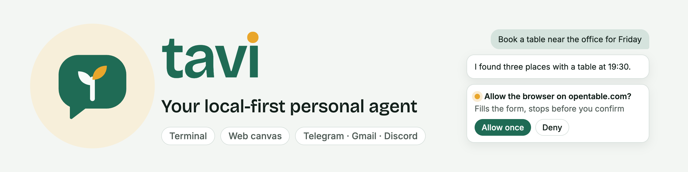
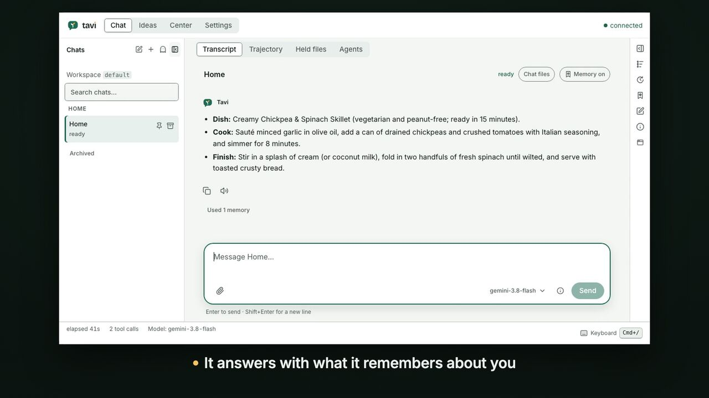
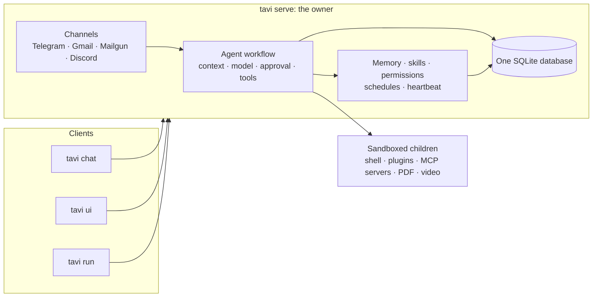
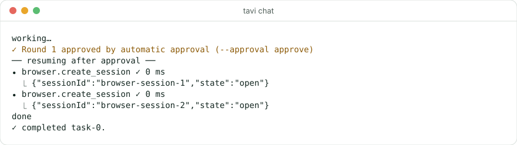

<p align="center">
  <picture>
    <source media="(prefers-color-scheme: dark)" srcset="docs/assets/brand/banner-dark.png">
    
  </picture>
</p>

<p align="center">
  
  <a href="LICENSE"></a>
  
  
  
</p>

# Tavi

Tavi is an open-source personal AI agent that runs on your own computer. You
talk to it in a terminal, in a browser, or from your phone over Telegram, email
and Discord, and it is the same agent everywhere: one memory, one set of
permissions, one list of things waiting on you.

It does the work as well as the talking. Tavi reads and edits files, runs
commands, browses the web, reads PDFs and videos, uses your calendar and task
apps, and keeps going on a schedule while you are away. Anything risky stops
and asks you first.

Everything it knows stays in one folder on your machine. There is no account
and no telemetry, and you choose the model: a cloud provider, or one running
locally.

<a href="https://youtu.be/-CyhAOg-zIA">
  
</a>

▶ **[Watch the 80-second demo](https://youtu.be/-CyhAOg-zIA)**: `tavi chat` in a terminal, the web canvas
asking before it opens a browser, and the same chat on a phone. A real run on a
fresh install, with the model's waits sped up.

## What Tavi does

- **Chat where you are.** A terminal UI (`tavi chat`), a web canvas
  (`tavi ui`), one-shot commands for scripts (`tavi run`), and Telegram, Gmail,
  Mailgun email and Discord for when you are away from your desk.
- **Work with your files and code.** Each chat has its own folder, or attaches
  one of yours. Tavi edits files with a diff you approve and runs builds and
  tests in a sandbox.
- **Use the web.** Search, fetch pages, or drive a real browser. When a site
  needs a sign-in or a CAPTCHA, you take over the page and hand it back.
- **Read documents, photos, video and voice.** PDFs, scanned pages and forms;
  video frames, transcripts and movement, and voice messages you send from a
  channel or attach in the web chat, all processed locally; and the photos you attach or send from a
  channel, which the chat's model looks at.
- **Connect your apps.** Google Calendar and Gmail, Todoist, Linear, Notion and
  any [MCP](docs/MCP.md) server, each with tools you review before a chat can
  use them.
- **Work without you.** Reminders, schedules, multi-agent research routines
  that publish cited reports, and a heartbeat that checks on things and tells
  you only what needs you.
- **Remember, with your say.** Tavi proposes memories and skills; nothing is
  kept until you approve it, and every answer can show what it drew on.
- **Start from an idea.** 65 ready-to-run everyday templates across 19 areas,
  from meal plans to job searches.

The [how-to guides](docs/use-cases/README.md) show each of these one task at a
time, with the real screens.

## Why Tavi

- **Local-first.** Chats, memory, credentials and settings live in one SQLite
  database in a data directory you own. Back it up, move it, delete it.
- **No telemetry, no account.** Tavi talks to the network only for what you
  configure ([PRIVACY](docs/PRIVACY.md)).
- **Any model.** OpenRouter, OpenAI, Anthropic, Gemini, a local Ollama, or any
  OpenAI-compatible endpoint, with separate roles for a main and a fast model.
  A local model needs a context of 32K tokens or more: Ollama's default is 4K
  ([CONFIGURATION](docs/CONFIGURATION.md#failover)).
- **Safe by default.** Risky tool calls wait for your approval. Content from
  the web or from other people marks a chat as untrusted, so its next outward
  action asks you first. Commands, plugins and file parsers run in an OS
  sandbox ([SECURITY-MODEL](docs/SECURITY-MODEL.md)).
- **Built to be extended.** Almost every part is a plugin, including the ones
  that ship with Tavi.

## Architecture



**One owner, thin clients.** A single background process, `tavi serve`, owns
the data directory. The terminal UI, the web canvas and every command are
clients that reach it over an authenticated local socket, so they always agree
on what is running and what is waiting on you.

**Pluggable throughout.** One manifest format covers every extension point:

| You can add | For example |
| :--- | :--- |
| Tools | A unit converter, a flight search, a company API |
| Channels | Another messaging service, with pairing and approvals built in |
| Model, search and fetch providers | A new model API or search engine |
| Memory, heartbeat, ideas and onboarding providers | Your own ranking, your own signals, your own first run |
| Mods | Hooks on prompts, tool calls and results; slash commands and status lines |
| Pages in the web canvas | A panel in a sandboxed frame |
| MCP servers | From npm, PyPI, a binary or a remote URL |

The built-in browser, sandbox, PDF, video, Telegram and Gmail features are
plugins on the same interface, and a provider plugin can replace how Tavi ranks
or decides without loosening who may read, approve or erase. See
[PLUGINS](docs/PLUGINS.md), [MODS](docs/MODS.md) and the
[examples](examples/README.md).

**Isolated by the operating system.** A plugin is installed as a pinned
snapshot you approve, and runs in a worker confined by macOS Seatbelt or Linux
bubblewrap. It sees its own folder, reaches only the hosts it declared, and
never holds your real keys: a proxy swaps them in on the way out
([SANDBOX](docs/SANDBOX.md)).

**Governed memory and tainted context.** The model can propose a memory but not
keep one, and recalled memories reach it as quoted data, never as instructions.
Every piece of context carries a trust label, which is how Tavi knows when to
ask ([MEMORY](docs/MEMORY.md)).

**Boundaries enforced by tests.** Package layering, licences, the CLI
reference and the how-to guides are all checked on every run. The full picture
is in [ARCHITECTURE](docs/ARCHITECTURE.md).

## Quick install

On macOS, Linux or WSL2 with Node.js `>= 22.22.2`, install the latest release:

```bash
curl -fsSL https://github.com/atanasster/tavi/releases/latest/download/install.sh | sh
```

The installer checks every package against the release's `SHA256SUMS`,
installs them into `~/.tavi/app` and links `tavi` into `~/.local/bin`, with
Playwright and Chromium for the browser tools. Run it again to update; your
data directory is not touched. `TAVI_VERSION=0.4.0` picks a release,
`TAVI_HOME` and `TAVI_BIN_DIR` move the install, and `TAVI_SKIP_CHROMIUM=1`
leaves the browser tools out.

To build from source instead:

```bash
git clone https://github.com/atanasster/tavi.git
cd tavi
pnpm install
pnpm run build
alias tavi="node $(pwd)/scripts/tavi.mjs"
```

Connect a model, then start the owner and open a chat:

```bash
tavi onboard     # pick a model; the other steps are optional
tavi serve       # the owner; leave it running
tavi chat        # in another terminal, or: tavi ui
```

`tavi onboard` finds a key in your environment or a local Ollama, and can sign
you in to OpenRouter. Its optional steps include voice messages: with
`tavi serve` running, it installs whisper.cpp and FFmpeg with Homebrew and
downloads a speech model, so a voice message is transcribed on this computer.
For servers and scripts, `tavi setup --non-interactive`
does the same from flags ([ONBOARDING](docs/ONBOARDING.md)). To start Tavi at
login, see [OPERATIONS](docs/OPERATIONS.md).

<picture>
  <source media="(prefers-color-scheme: dark)" srcset="docs/assets/terminal/chat-round-dark.svg">
  
</picture>

## Requirements

| Need | What | For |
| --- | --- | --- |
| Required | Node.js `>= 22.22.2` | everything |
| From source | pnpm `12.16.1` | building from a clone (`corepack enable`); the installer needs only npm |
| Linux | bubblewrap, socat and ripgrep | the sandbox (macOS has one built in); `tavi sandbox check` says what is missing |
| Optional | Chromium | the browser tools and PDF reports; the installer and `pnpm install` install it |
| Optional | FFmpeg, whisper.cpp | the video tools, and transcription of videos and voice messages (setup's Voice messages step installs both with Homebrew and downloads a speech model; or `brew install whisper-cpp ffmpeg` and a ggml model; see [VIDEO](docs/VIDEO.md#voice-messages-and-other-audio)) |
| Optional | uv | Python MCP servers |

[DEVELOPMENT](docs/DEVELOPMENT.md) has the install commands for each.

### Platforms

Tavi runs on **macOS**, **Linux** and **WSL2** on Windows.

**Native Windows is not supported yet.** Tavi's safety rests on three things
Windows does differently. The owner's endpoint is a named pipe with an access
list for your account, SYSTEM and Administrators only; private files are held
to the same rule by their access lists; and the credential key can be kept in
Windows Credential Manager. Until the pipe has been proven against a second
account in CI, `tavi serve` refuses to start there. The OS sandbox that confines
commands, plugins and file parsers is not used on Windows yet, so `tavi doctor`
reports it unavailable and names WSL2 as the fix. Children Tavi starts end with
it (Job Objects), and `tavi service unit --kind task` renders the logon task
for when `serve` runs there (do not install it yet). [WINDOWS](docs/WINDOWS.md)
has the details.

**WSL2** runs Tavi as Linux, sandbox included, with the Windows drives under
`/mnt` closed to sandboxed commands as other mounted drives are (attach a folder
there to work in it). A CI job covers it on demand ([SANDBOX](docs/SANDBOX.md#wsl2)).
WSL1 cannot run the sandbox. On WSL2 keep the data directory on the Linux filesystem (the default `~/.local/share/tavi`): every command that opens it refuses one on a Windows drive under `/mnt`. WSL stops a distribution soon after its last terminal closes, `tavi serve` with it; `tavi doctor`, `tavi service unit` and `tavi onboard` say which `.wslconfig` settings keep it running.

## Commands

| Command | What it does |
| :--- | :--- |
| `tavi onboard` / `setup` | Set up what is still open / go through every step again |
| `tavi serve` | Start the owner |
| `tavi chat` / `ui` / `run` | Terminal UI / web canvas / one task per command |
| `tavi remote connect` | Use the owner on another computer (a Mac mini, a server) from this one, over SSH |
| `tavi needs` / `approvals` / `answer` | What waits on you, and how to answer it |
| `tavi schedules` / `reminders` / `heartbeat` | Unattended work |
| `tavi channels` / `apps` / `mcp` / `plugins` | Channels, connected apps, MCP servers and plugins |
| `tavi memory` / `skills` | What Tavi remembers and the procedures it knows |
| `tavi models replace <connection>/<model> --with <model>` | Move every use of a model (defaults, roles, routines, heartbeats, chats) to another, after listing them and asking; Settings → Models has a Replace button for models that retire |
| `tavi models sync` | With a free [Rhumb](https://rhumbdata.com) key (`RHUMB_KEY`), say which models in use retire or change, and what could replace them; `serve` checks daily, and `tavi doctor`, Settings → Models, the chat's model picker and `/models` show it |
| `tavi doctor` / `logs` / `backup` | Health, logs and backups |

Every command has `--help` and takes `--format text|json`. The full reference
is [CLI](docs/CLI.md).

## Documentation

Every guide, grouped by what you came to do, is in
**[docs/README.md](docs/README.md)**. The ones most people start with:

| Guide | What it covers |
| :--- | :--- |
| [How-to guides](docs/use-cases/README.md) | Short, illustrated guides, one task each |
| [CONCEPTS](docs/CONCEPTS.md) | The owner, chats, workspaces, memory, tools and the glossary |
| [WEB-UI](docs/WEB-UI.md) / [TERMINAL-UI](docs/TERMINAL-UI.md) | The web canvas and the terminal chat |
| [CHANNELS](docs/CHANNELS.md) | Telegram, Gmail, Mailgun email and Discord |
| [AUTOMATION](docs/AUTOMATION.md) | Schedules, reminders, to-dos, routines and agents |
| [SECURITY-MODEL](docs/SECURITY-MODEL.md) / [PRIVACY](docs/PRIVACY.md) | How tool calls are decided, and what leaves your machine |
| [PLUGINS](docs/PLUGINS.md) | Extending Tavi with tools, channels, providers and pages |
| [ARCHITECTURE](docs/ARCHITECTURE.md) / [DEVELOPMENT](docs/DEVELOPMENT.md) | How Tavi is built, and how to work on it |

## Contributing

Issues and pull requests are welcome: see [CONTRIBUTING.md](CONTRIBUTING.md).
Report security problems privately as [SECURITY.md](SECURITY.md) describes.
Changes are listed in [CHANGELOG.md](CHANGELOG.md).

## License

MIT — see [LICENSE](LICENSE). Third-party components keep their own licences;
see [THIRD_PARTY_NOTICES.md](THIRD_PARTY_NOTICES.md).

<sub>Built by <a href="https://nannertech.com">Nanner Tech</a>.</sub>
