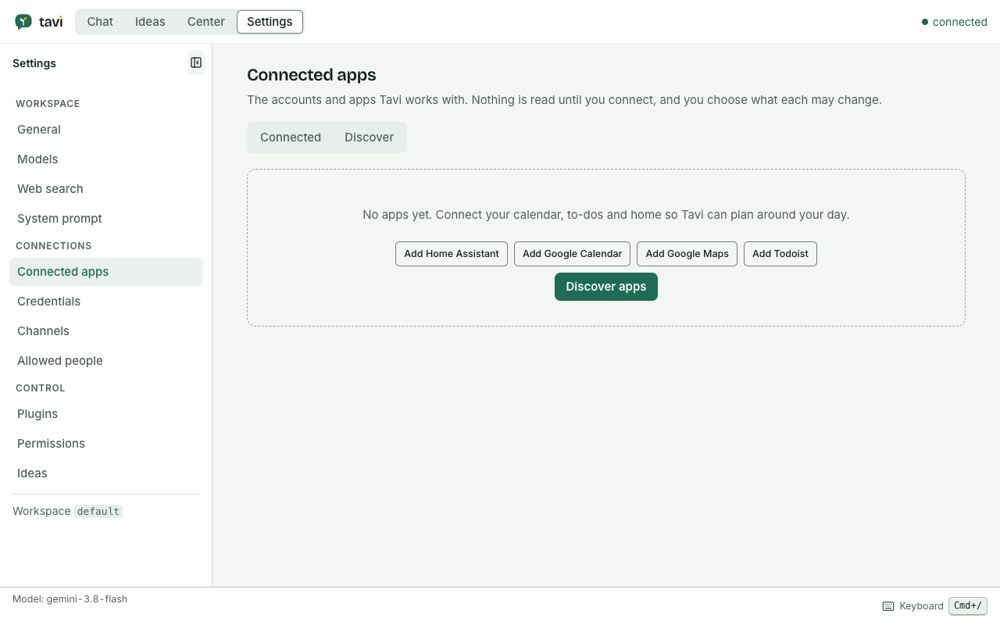
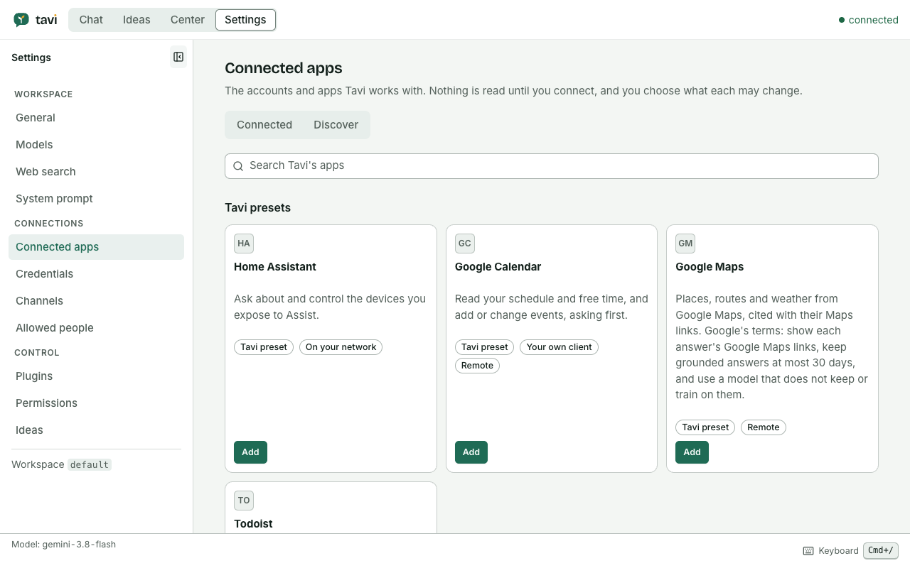

# Connected apps

Connected apps is one place for every account and app Tavi works with:
- MCP servers, such as Todoist or Home Assistant;
- channel connections, such as Gmail (with its account's calendar), Telegram or Discord;
- plugins.

Each app has the same page whatever kind it is. The canvas shows it under
**Settings → Connected apps** (`/settings/apps`), and the terminal under
`tavi apps` ([CLI.md](CLI.md#tavi-apps)). Both read one model the owner
answers, the `apps` command.

## The list and Discover



**Connected** lists your apps, grouped by health:
- needs you;
- connected;
- paused or off.

Each app shows its accounts and its one fix (*Sign in again*, *Review its
tools*, *Turn it on*…), with the same fix as a command. An app left before
its key or first sign-in offers *Finish setting up* or *Sign in*, which reopens
its sheet at that step; so does a key its server refused at its test, until a
test passes. A missing key is named by its label (*It needs your Maps API
key.*), and its command stores the key before naming it. *Needs you only* narrows the list, and so does
`tavi apps list --needs-you`. The search and filters show once there are six
apps or one needs you; a working app's row carries no badge, since it sits
under **Connected**.

An app whose key is not given yet, or was refused at its test, reads *Not set
up*; `tavi apps list` prints the commands that store the key and name it. A
key field says "Stored encrypted" only once `tavi credentials encrypt` has
run. Until then it says the key is not encrypted.



**Discover** lists, in this order:
- Tavi's presets (Home Assistant, Google Maps, Todoist, and Linear, Notion,
  Sentry, Stripe and Figma, each one sign-in);
- apps installed but not set up;
- the channels: one that signs in (**Google**) is added right here, and its
  connect sheet opens; one set up with keys alone (Telegram, Discord) is
  added in a sheet of its own: its setup help, a button for each page it starts at
  (*Open @BotFather*, *Open the Developer Portal*), its keys typed and
  tested, then, for a channel that pairs, a one-time code to pair yourself;
  one that needs settings too (Mailgun email) is added in Settings → Channels;
- for words you type, the MCP Registry.

A preset already added shows **Open**. Todoist's two presets are two ways into
one server, and Tavi keeps one: **Add** on the other asks to switch
`mcp.todoist` to it, removing its sign-in or token, and you review its tools
again ([MCP.md](MCP.md#todoist)).

A plain visit sends nothing out. Tavi does not review registry listings: you
review each tool when you add it. Adding a registry server reached over the
network, listed without headers, asks it once how it signs in, and one that signs in with OAuth is
connected from its page like any other app
([MCP.md](MCP.md#the-mcp-registry)).

## An app's page

- **Accounts.** Each account shows:
  - who it signed in as, when, and when its next sign-in is due;
  - where it is used;
  - whether it is **Personal** (only your own one-to-one chats) or
    **Shared** (people you allowed may use it, with your credentials).

  Mail and calendar accounts start Personal, every other account Shared.
  Shared only allows lending: an MCP server's account reaches other people
  once you also tick **People you allowed may use it**. Reconnecting keeps
  the choice.
  An app that signs in to nothing and asks for no keys (a local MCP server)
  offers no **Reconnect**.
- **Summary.** The line under the app's name is quoted as its author's only
  when its author wrote it; the line Tavi writes for a server that describes
  itself nowhere (`A local MCP server (notes)`) is shown plainly.
- **What it can do.** A tool Tavi has no words for is named from its own
  name (`find-completed-tasks` reads *Find completed tasks*), with the first
  sentence of what its server says; the review shows the whole description.
  Each tool is set to Allow, Ask or Block:
  - a page may tighten a tool, and may undo only its own tightening;
  - an MCP tool that changes or sends something is never allowed without
    asking (allow it one chat at a time from the approval card).
- **Recent activity.** Its read-only tools' calls (*Called*, whatever came
  of each), what its tools changed or sent, and what you were asked about
  them, newest first. Each row opens its chat. Calls are listed from when
  Tavi began recording their tool; older ones are not.
- **Data and privacy.** Covers:
  - the access it asks for;
  - where its calls go;
  - what runs;
  - the credentials it receives;
  - how what it returns is treated: always as untrusted, and mail and
    calendar as personal data.

  Disconnecting does not delete what Tavi already remembered, nor what the
  provider holds.
- **Settings** and **Advanced**: its review, its log, *Turn … off* (its
  tools are no longer offered, and it keeps everything: its fix then turns
  it on again), and the commands for each fix. Settings are drawn the same way for a plugin and a server,
  from its own fields, with the rarely needed ones under *More settings*; a
  channel's stay in Settings → Channels.

A channel that signs in, such as Gmail, is an app too. Its connections are
the page's accounts: they connect, reconnect and disconnect there, and each
row in Settings → Channels has *Open app*. Its settings stay in Channels.
*Add another account* adds a second connection and signs it in.

*Add another account* is offered for a channel that signs in and for a Tavi
preset that does (Todoist: a second instance of the preset). A server added from the MCP Registry or by its address
offers none: for a second account, add it again from Discover under another
name, and it is listed as an app of its own.

### A Google account

**Google** in Discover adds a Google account: one sign-in for what you turn on,
each in its own words on the connect sheet's first step, and changed later on
the account's row:
- **Let the agent use your calendar** (below);
- **Let the agent read and draft in your mailbox**, and **Send drafts I
  approve** (below);
- **Reach Tavi through this account**: Gmail as a channel, reading only mail
  with its label ([CHANNELS.md](CHANNELS.md)).

The sign-in asks Google only for what is on: who you are, then Gmail's access
while the mailbox or the channel is on, and the calendar's while the calendar
is. Google lists each access with its own box, none ticked: tick every one, or
the sign-in is refused, naming what was left out. Turning something on later
asks Google for its access at the account's next sign-in. From the terminal:
`tavi apps calendar gmail <account> on|off`, `tavi apps mailbox gmail <account>
off|read|send` and `tavi apps receive gmail <account> on|off`.

### A Gmail mailbox

A Gmail connection reaches the agent only through its label
([CHANNELS.md](CHANNELS.md)). Its account on the page can also open the
mailbox itself, one account at a time:
- **Let the agent read and draft in this mailbox** adds that account's own
  `gmail.<account>.search`, `.read` and `.draft` tools. Each is described by
  the account's address, and what they read is untrusted personal email.
  Each message listed or read says whether Google authenticated its sender
  (`fromVerified`). A search answers a page at a time: its `nextPageToken`
  asks for the next. `.thread` reads a thread by its `threadId`, within
  bounds: its latest 25 messages, each one's text and quotes cut to fit
  (`clipped`), and how many earlier ones were left out. `.label` triages:
  labels added or removed by name, archive (out of the inbox), read or
  unread, on up to 50 messages in one change. Every change asks, its card
  naming each message by the sender and subject a search or read showed; a
  change to more than one message, or one asked after mail was read, is
  approved once only. It answers with each message's labels read back, and
  never trashes, reports spam or makes a label. A channel's mailbox that
  cannot read threads or change labels has neither tool.
- **Send drafts I approve** adds `.send_draft`. Each send asks once and shows
  the draft whole, flags a recipient never written to before, and is refused
  if the draft changed since it was shown. A draft too long to show whole
  cannot be sent this way.

Both are off by default. From the terminal:
`tavi apps mailbox gmail <account> off|read|send`.

### A Google account's calendar

A Google account (a Gmail connection) also carries its calendar. **Let the
agent use this calendar** on the account's row adds its own tools, named by
the account (`gmail.<account>.list_calendars`, `.list_events`,
`.search_events`, `.get_event`, `.free_busy`, `.create_event`,
`.update_event`, `.respond_to_event` and `.delete_event`), over Google's
Calendar API, not its preview MCP server:
- reading the calendar and its free or busy times runs without asking, and
  what it returns is untrusted, personal data;
- adding, changing or answering an event asks first: its card shows the
  event and whether Google emails its attendees (it does only when the call
  says so; answering an invitation always tells its organizer);
- deleting an event asks every time, once only.

It is off by default. Turning it on asks Google for the calendar's access at
the account's next sign-in: until then its mail keeps working as before, and
a calendar tool's call asks you to sign in again (in a chat, its Connect
card). From the terminal:
`tavi apps calendar gmail <account> on|off`.

### A Discord bot

A Discord connection is an account of the Discord app, and the
`discord.channel` plugin it comes from is listed with the plugins
([CHANNELS.md](CHANNELS.md#discord)). Its account shows what setting it up
still asks, from the connection's latest check (taken when the page looks, at most a
minute old): the bot's name, a
warning if Public Bot or an unneeded privileged intent is on, whether the
Message Content intent a room's context needs is on, and the invite
link. Any channel can show such notes, but its link only to a host the channel
declares. Two of its failures name their fix:
- **A refused token** (revoked or reset in the Developer Portal) needs a
  sign-in: *Paste a new Discord token*, or
  `tavi channels secret <connection> token --file …`.
- **An intent turned off for the bot** (Gateway close 4014) needs more
  access: *Fix Discord's settings at its provider*. Turn the intent back on
  in the Developer Portal, then test the connection.

Neither reconnects until it is fixed. Any other failure is retried.

### Disconnecting a Google app

Google revokes a sign-in for every client of the same Cloud project, so
*Disconnect* signs out at Google only for the last connection signed in with
that project and account (another workspace's Gmail connection of the same
address, say). Before then the confirm, and `tavi apps disconnect`, names the
app that keeps it, and the sign-in is deleted only from this connection. A
Google account's calendar is part of its sign-in: disconnecting the account
ends both.

## Connecting

The connect sheet goes through four steps:
1. What the app can do, and whether the account is Personal or Shared.
2. The provider's client, when the app needs one. For Google, a *Desktop
   app* client you create once is reused by every Google app. **Set up
   Google** lists the console steps, each with a link to its page and the
   values to type (checked in the console on 2026-11-08):
   1. create a project;
   2. enable the Calendar and Gmail APIs (one link enables both);
   3. set up sign-in: app name, your email, External;
   4. on Branding, add a home page and a privacy policy (Tavi's repository
      pages, with copy buttons) and the authorized domain `github.com`, then
      **Publish app** on Audience;
   5. create a client of type **Desktop app**;
   6. in the dialog that shows it, **Download JSON** (Google shows its secret
      only there), and drop the file on the sheet. Its id and secret can
      also be pasted, under *More*.

   A Desktop client comes back to this computer on any port, so there is no
   redirect address to register and no port to keep. Google shows an
   "unverified app" screen on each sign-in to your own app (*Advanced → Go
   to …*). An app left in *Testing* signs you out every 7 days: Tavi learns
   this from a sign-in refused 7 days after it was made, and reminds you a
   day before the next one. Changing the Google client signs Gmail's older
   sign-ins out. From the terminal: `tavi apps client <app> --file <path>`.
3. The sign-in. A server that registers no clients itself asks here for a
   client of your own: create one in its developer settings with the
   redirect address the sheet shows (with a copy button), paste its id (and
   secret, if it has one), and sign in. An app reached with a key (Google
   Maps) has **Your key** in place of the sign-in: Tavi's steps for getting
   the key, each with a button for its page, the key pasted, then **Save and
   test** stores it in the credential store and asks the server for its tools
   with it.
4. Done.

**Signing in with a code.** A channel whose provider allows it (RFC 8628's
device flow) signs in with a code instead: the sheet shows the code, with a
copy button, and the address to enter it at on any phone or computer, and
waits until it is entered. Nothing opens here, and no address has to come
back. It is never offered for Google ([CHANNEL-PLUGINS.md](CHANNEL-PLUGINS.md)).

**Signing in from another computer** (the owner runs headless):
- **A tunnel.** Run `ssh -L <port>:127.0.0.1:<port> <server>`, open the
  address `tavi ui --print-url` prints there, and sign in from it.
- **The owner's https address**, for an app whose client takes an https
  redirect (never Google's: a Desktop client comes back to this computer
  only). It is set with
  `tavi channels ingress --public-url`, and only your browser must reach it.
  From the terminal: `tavi apps connect <app> --public`. A Tailscale Serve
  name will do: it stays inside your tailnet. On the server, with the ingress
  on port 8790:

  ```bash
  tailscale serve --bg 8790
  tavi channels ingress --port 8790 --public-url https://<machine>.<tailnet>.ts.net
  ```

  Then register `https://<machine>.<tailnet>.ts.net/oauth/callback` with the
  app's provider.
- **Paste the address you land on.** Finish the sign-in in any browser, then
  paste the address it lands on into the sheet, even if that page fails to
  load. From the terminal: `tavi apps connect <app> --paste`.

  Paste it only into Tavi: never into a chat, an email or another site.

## In a chat

A chat can need an app that is not connected, or whose sign-in lapsed. This
happens when a tool call meets it, or when the agent asks with
`apps.request_connect`. The chat then shows a **Connect** card:
- Connect opens the same sheet over the chat.
- Once connected, *Continue* sends "{App} is connected, please continue." as
  your message.
- An app not added yet offers *Add and connect*.

Where Tavi may ask you, a call that meets a lapsed sign-in, or the agent's
own `apps.request_connect` for an app that needs one, **waits** instead of
failing:
- The wait lasts half an hour, and the owner keeps it in its store, not in
  memory.
- The chat, the Center's *Waiting on you*, the Inbox's *Apps to connect* and
  `tavi needs` show the app to connect. It is not a question: no typed answer
  settles it.
- Signing the account in resumes every task waiting on it, and each runs its
  call again, once.
- *Not now* ends only that task's wait, and the agent is told you chose not
  to connect. When the half hour passes, it is told nobody connected in time.
  Neither marks the chat as having read anything: the call never reached the
  app.
- An account that was never signed in is asked for its first sign-in ("Google
  isn't signed in yet"), not to sign in again.
- A channel chat is told in words, never with a link.

Nothing is signed in without you. A run nobody attends, such as a schedule
or the heartbeat, does not wait: it only raises the repair.

## Repairs everywhere

An app's fix also appears in:
- the Center's *Waiting on you*, each opening the app's page;
- the heartbeat's *Apps that need signing in again*, when the heartbeat is
  on.

## Architecture

Connected apps unify MCP presets/servers, OAuth-backed channels, and plugins behind a single read/write model on the owner:

| Layer | Module / Path | Responsibility |
| :--- | :--- | :--- |
| **Contracts** | `packages/contracts/src/connected-apps.ts`, `app-basics.ts`, `app-connect.ts` | Schemas for app descriptors, health states (`needs_you`, `connected`, `paused`), account sharing (`personal` vs `shared`), per-tool permissions (`allow`, `ask`, `block`), and durable `apps.request_connect` waits. |
| **Owner App Registry & Sources** | `apps/cli/src/features/apps/registry.ts`, `owner.ts`, `health.ts`, `permissions.ts`, `sharing.ts`, `shared-grants.ts`, `mailbox-tools.ts`, `mailbox-catalog.ts`, `oauth-clients.ts`, `connect-waits.ts`, `activity.ts`, `tool.ts`, `sources/{channel,mcp,plugin}.ts` | Aggregates MCP servers (`sources/mcp.ts`), channels (`sources/channel.ts`), and plugins (`sources/plugin.ts`) into one catalog; manages shared Google OAuth clients (`oauth-clients.ts`), Gmail per-account `.search`/`.read`/`.draft`/`.send_draft` tools (`mailbox-tools.ts`), and 30-minute connect waits (`connect-waits.ts`). |
| **OAuth Flows** | `apps/cli/src/features/oauth/*` | Loopback callback listener, public ingress `/oauth/callback` routing, manual `--paste` URL completion, and RFC 8628 device-code flow. |
| **CLI & Web Canvas** | `apps/cli/src/features/apps/{client,parse,text}.ts`, `apps/ui/src/features/apps/*` | Implements `tavi apps` (`list`, `catalog`, `show`, `connect`, `disconnect`, `permission`, `mailbox`, `sites`, `client`) and **Settings → Connected apps** (`/settings/apps`). |

See [ARCHITECTURE.md](ARCHITECTURE.md) and [MCP.md](MCP.md) for how connected apps interact with the MCP host and channel host.
