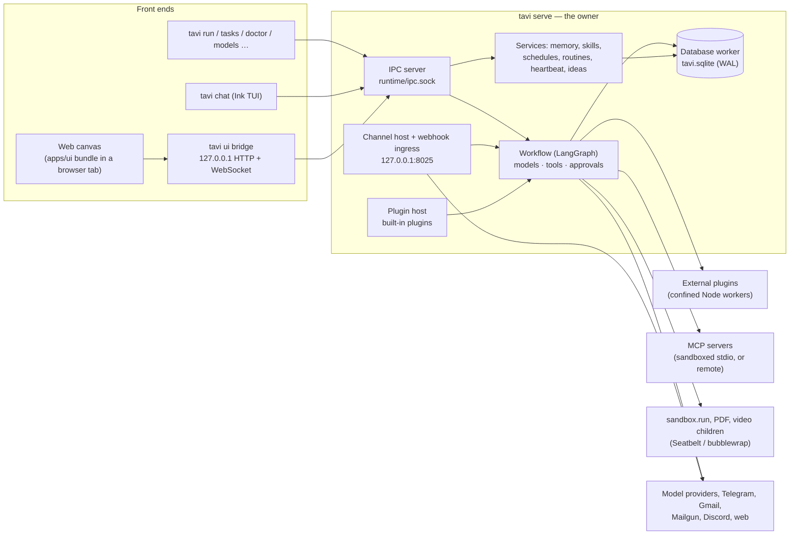
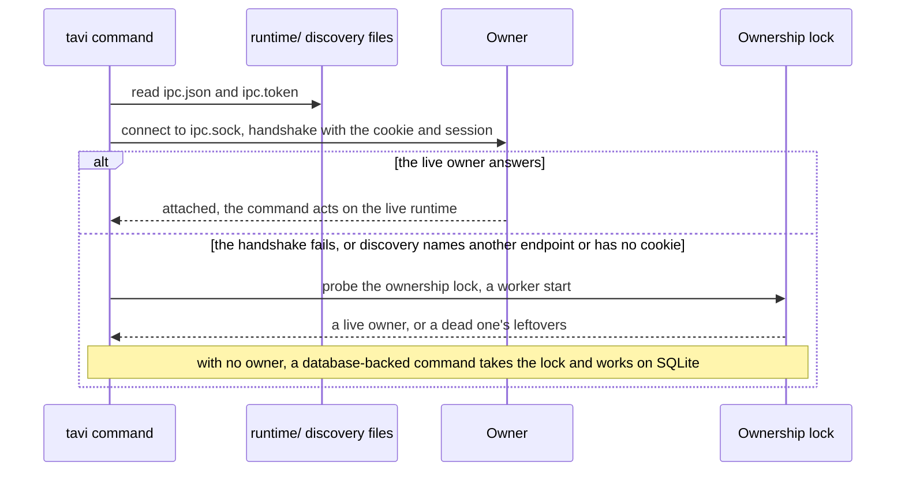
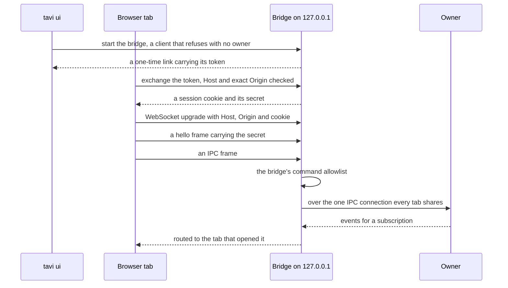
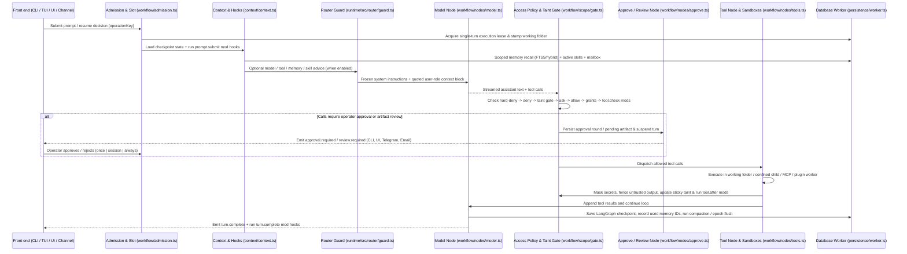

# Architecture

This page describes how Tavi is built, as the code stands: every package and app in the workspace, the owner process (`tavi serve`) and the front ends that connect to it, the end-to-end turn lifecycle, the 23-stage runtime composition pipeline, persistence, models, tools, plugins, MCP servers, memory, and the OS sandbox.

It is a map for reading the code and navigating directly to each module's architecture. For a quick-start overview, see [README.md](../README.md); for task-oriented walkthroughs and everyday use cases across the CLI, web canvas, and messaging channels, see [USECASES.md](USECASES.md); for core terms (*owner*, *Home*, *principal*, *taint*, *epoch*, *operator*), see [CONCEPTS.md](CONCEPTS.md); for building, testing, and running evaluations, see [DEVELOPMENT.md](DEVELOPMENT.md).

## Contents

- [The picture](#the-picture)
- [Workspace layout](#workspace-layout)
  - [Apps](#apps)
  - [Core packages](#core-packages)
  - [Kits](#kits)
  - [Built-in plugins and adapters](#built-in-plugins-and-adapters)
  - [External plugins built in this repository](#external-plugins-built-in-this-repository)
  - [Other top-level folders](#other-top-level-folders)
  - [Dependency rules](#dependency-rules)
- [The owner and its clients](#the-owner-and-its-clients)
- [Runtime](#runtime)
  - [End-to-end turn lifecycle](#end-to-end-turn-lifecycle)
- [Core package architecture deep-dives](#core-package-architecture-deep-dives)
  - [`@tavi/contracts` — schemas, protocol and ports](#tavicontracts--schemas-protocol-and-ports)
  - [`@tavi/runtime` — persistence, governance and hosts](#taviruntime--persistence-governance-and-hosts)
  - [`@tavi/agent-host` — LangGraph workflow, context, models and hosts](#taviagent-host--langgraph-workflow-context-models-and-hosts)
  - [`@tavi/client` — host-neutral, Node and browser transports](#taviclient--host-neutral-node-and-browser-transports)
  - [`@tavi/cli` — composition root, server, TUI and feature verticals](#tavicli--composition-root-server-tui-and-feature-verticals)
  - [`@tavi/ui` — web canvas views and state](#taviui--web-canvas-views-and-state)
- [Persistence](#persistence)
- [Models](#models)
  - [Token and prompt-cache behaviour](#token-and-prompt-cache-behaviour)
- [Tools, plugins, MCP and connected apps](#tools-plugins-mcp-and-connected-apps)
- [Memory](#memory)
- [Sandbox and confinement](#sandbox-and-confinement)
- [Architectural enforcement & test gates](#architectural-enforcement--test-gates)
- [Subsystem architecture & documentation directory](#subsystem-architecture--documentation-directory)

---

## The picture



The same, without a renderer:

```text
 tavi run / tasks / …   tavi chat (TUI)     browser tab ──HTTP/WS──> tavi ui (bridge, 127.0.0.1)
          │                   │                                         │
          └──────── authenticated Unix socket (runtime/ipc.sock) ───────┘
                                    │
                          tavi serve  (the owner)
         ┌──────────────┬───────────┴───────────┬────────────────────┐
     workflow        services              channel host          plugin host
   (LangGraph,     (memory, skills,      (Telegram, Gmail,     (built-in plugins;
   models, tools,   schedules, …)         Mailgun webhooks,     external ones in
   approvals)                             channel plugins)      confined workers)
         └──────────────┴──────── database worker ──────────────────────┘
                                  tavi.sqlite (WAL, ordered migrations)
```

---

## Workspace layout

Tavi is a pnpm workspace (`pnpm-workspace.yaml`: `apps/*`, `packages/*`,
`packages/builtin/*` and `packages/external/*`) built with turbo. Core packages,
kits and add-ons sit directly under `packages/`; the plugins the CLI composes
in are under `packages/builtin/`, and the plugins that ship as their own bundle
under `packages/external/`. Every package is private; nothing is published to
npm.

### Apps

| Path | Package | Role | Subsystem Architecture |
| --- | --- | --- | --- |
| `apps/cli` | `@tavi/cli` | The `tavi` binary (`src/bin/executable.ts` → `src/main.ts`, which hands each command to its handler): the command line itself (`src/cli/`: argv, exit codes, output, help, the parser), each command family's parser, client, owner-side handler, tools and slash commands (`src/features/<name>/`), `tavi serve` and its IPC routes (`src/server/`), `tavi chat` (Ink, `src/tui/`), `tavi ui`'s bridge (`src/server/ui-bridge.ts`), helpers several features share (`src/shared/`), and the one composition root (`src/runtime/composition.ts`, built part by part in `src/runtime/`) that puts the runtime, plugins, tools, channels and MCP together. Its tests mirror `src/` under `test/<feature>/`. | [CLI.md#architecture](CLI.md#architecture), [TERMINAL-UI.md#architecture](TERMINAL-UI.md#architecture), [OPERATIONS.md#architecture](OPERATIONS.md#architecture) |
| `apps/ui` | `@tavi/ui` | The web canvas: Vite and React (`src/main.tsx` → `src/App.tsx`, the shell that wires the routes, the chat, its panel and the overlays): shared primitives (`src/ui/`), hooks (`src/hooks/`) and helpers (`src/lib/`), each view with its data access (`src/features/<name>/`: the shell, the chat and its store, the transcript, the chat panel, the Command Center, Settings, apps, routines, ideas, Welcome, takeover and the plugin host), and the stylesheets (`src/styles/`). Its tests mirror `src/` under `test/`. Built into `apps/cli/ui-dist` and served by `tavi ui`; never installed as a package. | [WEB-UI.md#architecture](WEB-UI.md#architecture) |

### Core packages

| Path | Package | Role | Subsystem Architecture |
| --- | --- | --- | --- |
| `packages/contracts` | `@tavi/contracts` | Platform-neutral types and Zod schemas: ports, errors, the IPC frame codec and command protocol, events, settings. Depends on nothing of Tavi's. | [`@tavi/contracts` deep-dive](#tavicontracts--schemas-protocol-and-ports) |
| `packages/runtime` | `@tavi/runtime` | The application-owned core: the SQLite store and its worker, data-directory ownership, migrations, repositories, the IPC server, the plugin host, the tool registry, access policy, and services (memory, skills, messaging, routines, router guard). | [`@tavi/runtime` deep-dive](#taviruntime--persistence-governance-and-hosts), [ASYNC-PERSISTENCE.md#architecture](ASYNC-PERSISTENCE.md#architecture), [SECURITY-MODEL.md#architecture](SECURITY-MODEL.md#architecture) |
| `packages/agent-host` | `@tavi/agent-host` | The agent host, on top of the contracts: models (Vercel AI SDK, `src/models/`), the task workflow (LangGraph, `src/workflow/`: graph state, the scope its nodes share, the model, approve, tools and review nodes, admission, dispatch, folds and epochs), context assembly (`src/context/`), tool routing (`src/tools/`), the system prompt (`src/prompts/`), memory capture and review (`src/memory/`), the heartbeat, ideas and onboarding hosts (`src/hosts/`), agent communication (`src/agents/`) and the schedulers (`src/schedulers/`). | [`@tavi/agent-host` deep-dive](#taviagent-host--langgraph-workflow-context-models-and-hosts), [AUTOMATION.md#architecture](AUTOMATION.md#architecture) |
| `packages/client` | `@tavi/client` | The attached client of an owner: frames, connection, reconnect and the run reducer. Entries: `.` (host-neutral), `./node` (sockets, used by the CLI and the bridge) and `./browser` (used by the canvas). | [`@tavi/client` deep-dive](#taviclient--host-neutral-node-and-browser-transports), [TERMINAL-UI.md#architecture](TERMINAL-UI.md#architecture), [WEB-UI.md#architecture](WEB-UI.md#architecture) |

### Kits

Shared libraries and conformance suites that plugins of one kind build on. Each
depends on `@tavi/contracts` at most.

| Path | Package | Role | Subsystem Architecture |
| --- | --- | --- | --- |
| `packages/channel-kit` | `@tavi/channel-kit` | What every messaging channel connector shares, and the conformance suite each must pass. | [CHANNELS.md#architecture](CHANNELS.md#architecture), [CHANNEL-PLUGINS.md#architecture](CHANNEL-PLUGINS.md#architecture) |
| `packages/plugin-kit` | `@tavi/plugin-kit` | One subpath per provider kind, each with its test-only conformance suite (`./<kind>/conformance`): `./heartbeat`, shared pieces for heartbeat providers and signal sources; `./ideas`, the use-case catalogue; `./memory`, the suites every memory service port and memory provider must pass, and the capture and consolidation prompts; `./onboarding`, flow helpers, model role suggestions and verify advice. | [HEARTBEAT-PLUGINS.md#architecture](HEARTBEAT-PLUGINS.md#architecture), [IDEAS-PLUGINS.md#architecture](IDEAS-PLUGINS.md#architecture), [MEMORY-PLUGINS.md#architecture](MEMORY-PLUGINS.md#architecture), [ONBOARDING-PLUGINS.md#architecture](ONBOARDING-PLUGINS.md#architecture) |
| `packages/domain-kit` | `@tavi/domain-kit` | What every domain plugin's worker shares: its SQLite store's migrations, per-source budgets, the release check of its sources' terms, the bounded fetcher and retry rules, MinHash, its tools' input schemas and the script that assembles its bundle. | [JOBS.md#architecture](JOBS.md#architecture), [PLACES.md#architecture](PLACES.md#architecture), [TRENDS.md#architecture](TRENDS.md#architecture) |
| `packages/child-kit` | `@tavi/child-kit` | What the confined engines share: the RSS watchdog and kill ladder for their children, and a PNG encoder. | [SANDBOX.md#architecture](SANDBOX.md#architecture), [PDF.md#architecture](PDF.md#architecture), [VIDEO.md#architecture](VIDEO.md#architecture) |
| `packages/node-kit` | `@tavi/node-kit` | Node-only helpers on Node's built-ins alone: SHA-256, atomic file writes, reads that never follow a link, abortable sleeps, prefixed ids, opening a URL, bounded bodies and security headers. | [WORKING-FOLDERS.md#architecture](WORKING-FOLDERS.md#architecture) |
| `packages/jobs-kit` | `@tavi/jobs-kit` | The jobs domain's library: source adapters, normalisation, deduplication, matching and the store's schema. No network, no runtime imports. | [JOBS.md#architecture](JOBS.md#architecture) |
| `packages/places-kit` | `@tavi/places-kit` | The places domain's library: source adapters, entity resolution, opening hours and the store's schema. | [PLACES.md#architecture](PLACES.md#architecture) |
| `packages/trends-kit` | `@tavi/trends-kit` | The trends domain's library: source adapters, the velocity engine, clustering, the brief checker and the store's schema. | [TRENDS.md#architecture](TRENDS.md#architecture) |
| `packages/plugin-types` | `@tavi/plugin-types` | Types for writing a Tavi plugin: the context its module is handed, its hooks and their results. | [PLUGINS.md#architecture](PLUGINS.md#architecture), [MODS.md#architecture](MODS.md#architecture) |
| `packages/test-support` | `@tavi/test-support` | Private, tests only (a devDependency, never packed): temporary directories, polling waits, free ports, CLI output capture, an OpenAI-compatible stub, site fixture servers, a fake Discord, the fixture model, messaging and sandbox fixtures, and in-memory repositories. | [DEVELOPMENT.md](DEVELOPMENT.md) |

### Built-in plugins and adapters

Composed into the owner by `apps/cli`.

| Path | Package | Role | Subsystem Architecture |
| --- | --- | --- | --- |
| `packages/builtin/browser` | `@tavi/plugin-browser` | `BrowserPort` adapters: a Playwright adapter (Playwright an optional peer; Chromium installed separately); its tests' scripted fixture is in `test/support`. | [BROWSER.md#architecture](BROWSER.md#architecture) |
| `packages/builtin/browser-view` | `@tavi/plugin-browser-view` | The live browser view (`tavi.browserview`): a UI-only plugin the canvas frames in a sandboxed iframe. | [BROWSER.md#architecture](BROWSER.md#architecture), [WEB-UI.md#architecture](WEB-UI.md#architecture) |
| `packages/builtin/sandbox` | `@tavi/plugin-sandbox` | `SandboxPort` over `@anthropic-ai/sandbox-runtime`: Seatbelt on macOS, bubblewrap with seccomp on Linux. | [SANDBOX.md#architecture](SANDBOX.md#architecture) |
| `packages/builtin/limits` | `@tavi/plugin-limits` | `ResourceLimitPort`: a child placed in its own cgroup before it runs (Linux). | [SANDBOX.md#architecture](SANDBOX.md#architecture) |
| `packages/builtin/worker` | `@tavi/plugin-worker` | `PluginIsolationPort`: a third-party plugin's code in a confined Node worker, over length-prefixed JSON-RPC on stdio. | [PLUGINS.md#architecture](PLUGINS.md#architecture), [SANDBOX.md#architecture](SANDBOX.md#architecture) |
| `packages/builtin/local` | `@tavi/plugin-local` | The local messaging connection: the terminal UI's channel, one per workspace. | [CHANNELS.md#architecture](CHANNELS.md#architecture), [TERMINAL-UI.md#architecture](TERMINAL-UI.md#architecture) |
| `packages/builtin/telegram` | `@tavi/plugin-telegram` | Telegram channel connector (long polling). | [CHANNELS.md#architecture](CHANNELS.md#architecture) |
| `packages/builtin/mailgun` | `@tavi/plugin-mailgun` | Mailgun email channel connector: sending, inbound signature checks and parsing. | [CHANNELS.md#architecture](CHANNELS.md#architecture) |
| `packages/builtin/gmail` | `@tavi/plugin-gmail` | Gmail channel: OAuth sign-in through the host, inbound by a labelled query, replies in the thread. | [CHANNELS.md#architecture](CHANNELS.md#architecture), [APPS.md#architecture](APPS.md#architecture) |
| `packages/builtin/defaults` | `@tavi/plugin-defaults` | The built-in default providers, one subpath each: `./heartbeat` (the heartbeat provider), `./ideas` (the ideas provider), `./memory` (the memory provider, `tavi.memoryprovider`), `./onboarding` (the onboarding flow). | [HEARTBEAT.md#architecture](HEARTBEAT.md#architecture), [IDEAS.md#architecture](IDEAS.md#architecture), [MEMORY.md#architecture](MEMORY.md#architecture), [ONBOARDING.md#architecture](ONBOARDING.md#architecture) |
| `packages/builtin/router` | `@tavi/plugin-router` | The Jev routing provider (`tavi.router`); routing is off until configured. | [ROUTER.md#architecture](ROUTER.md#architecture) |
| `packages/builtin/flights` | `@tavi/plugin-flights` | The flight search tool (`tavi.flights`, `travel.flights_search`) over Kiwi.com's public MCP server, with Google Flights and Kayak links; its MCP client and fetch are handed in by `features/flights/host.ts`. | [PLUGINS.md](PLUGINS.md) |
| `packages/builtin/collectors` | `@tavi/plugin-collectors` | The daily brief's collectors and the `reports.*` tools (`tavi.collectors`), on ports the host hands in (`features/collectors/host.ts`). | [REPORTS.md#architecture](REPORTS.md#architecture) |
| `packages/builtin/site-skills` | `@tavi/plugin-site-skills` | What is known of sites the agent often browses (`tavi.siteskills`), carried on a session's first observation. | [BROWSER.md](BROWSER.md) |
| `packages/builtin/desktop` | `@tavi/plugin-desktop` | Experimental desktop control on macOS (`tavi.desktop`, off until enabled): the `desktop.*` tools over a native helper built on the Mac it runs on, acting only in apps the workspace grants. | [DESKTOP.md#architecture](DESKTOP.md#architecture) |
| `packages/builtin/guard` | `@tavi/plugin-guard` | The built-in guard mod (`tavi.guard`, off until enabled): asks before a risky command, on folder labels relative to the working folder. | [MODS.md](MODS.md) |
| `packages/builtin/pdf` | `@tavi/plugin-pdf` | Reading and filling PDFs in a single-use, confined parser child (PDFium WASM, patched `@cantoo/pdf-lib`). | [PDF.md#architecture](PDF.md#architecture) |
| `packages/pdf-ocr` | `@tavi/pdf-ocr` | The PDF tools' OCR add-on: Tesseract (WASM) with English data, run in the PDF child. | [PDF.md#architecture](PDF.md#architecture) |
| `packages/builtin/video` | `@tavi/plugin-video` | Video understanding's decoder over the person's own FFmpeg, one confined run per call, and its analysers. | [VIDEO.md#architecture](VIDEO.md#architecture) |
| `packages/video-transcribe` | `@tavi/video-transcribe` | Transcription add-on: the person's own whisper.cpp and ggml model in a confined child. Ships no binaries or models. | [VIDEO.md#architecture](VIDEO.md#architecture) |
| `packages/video-pose` | `@tavi/video-pose` | Pose add-on: RTMPose on `onnxruntime-node` in a confined child, on the person's own ONNX models. Ships no weights. | [VIDEO.md#architecture](VIDEO.md#architecture) |

### External plugins built in this repository

Each builds to `dist-plugin/` — one `index.mjs` bundle beside its
`tavi-plugin.json` manifest, the folder `tavi plugins install` takes — and runs
in a confined worker like any third-party plugin, except the Discord channel:
a channel plugin hands the owner a live connector, so it runs in the owner's
process and is approved with `--in-process` (see
[PLUGINS.md](PLUGINS.md#trust)).

| Path | Package | Role | Subsystem Architecture |
| --- | --- | --- | --- |
| `packages/external/discord` | `@tavi/plugin-discord` | `discord.channel`: Discord as a group channel. | [CHANNELS.md#architecture](CHANNELS.md#architecture), [CHANNEL-PLUGINS.md#architecture](CHANNEL-PLUGINS.md#architecture) |
| `packages/external/jobs` | `@tavi/plugin-jobs` | `jobs.finder`: searches job sources, matches postings, keeps the pipeline. See [JOBS.md](JOBS.md). | [JOBS.md#architecture](JOBS.md#architecture) |
| `packages/external/places-open` | `@tavi/plugin-places-open` | `places.open`: places from open data. See [PLACES.md](PLACES.md). | [PLACES.md#architecture](PLACES.md#architecture) |
| `packages/external/places-care` | `@tavi/plugin-places-care` | `places.care`: health providers from public registries. See [PLACES.md](PLACES.md). | [PLACES.md#architecture](PLACES.md#architecture) |
| `packages/external/trends` | `@tavi/plugin-trends` | `trends.radar`: topics across free trend sources, spikes raised on the heartbeat. See [TRENDS.md](TRENDS.md). | [TRENDS.md#architecture](TRENDS.md#architecture) |

### Other top-level folders

| Path | Holds |
| --- | --- |
| `docs/` | Reference documentation ([full directory below](#subsystem-architecture--documentation-directory)). |
| `evals/` | Model-in-the-loop evaluations and fixture suites ([DEVELOPMENT.md](DEVELOPMENT.md#evals)). |
| `examples/` | Example plugins (`plugins/`), mods (`mods/`) and a UI plugin (`ui-plugins/`). |
| `scripts/` | The `pnpm tavi` launcher, the sandbox matrices, the third-party notices generator, and `scripts/docs/`, which draws the docs' banner and retakes their screenshots ([DEVELOPMENT.md](DEVELOPMENT.md#documentation-images)). |
| `tests/` | Repository-wide tests: dependency and boundary gates, licences, the release gate, eval harness tests ([test gates below](#architectural-enforcement--test-gates)). |
| `patches/` | pnpm patches applied to dependencies (`@cantoo/pdf-lib`). |

### Dependency rules

Enforced by [`tests/boundaries.test.ts`](../tests/boundaries.test.ts) and [`tests/dependency-rules.test.ts`](../tests/dependency-rules.test.ts):

- `@tavi/contracts` depends on no workspace package, and on no Node, React or
  provider package.
- `@tavi/runtime` does not depend on `@tavi/agent-host` or `@tavi/cli`;
  `@tavi/agent-host` does not depend on `@tavi/runtime` or `@tavi/cli` (it uses
  `@tavi/contracts` and the kits).
- `@tavi/client` depends on `@tavi/contracts` alone; its root and browser
  entries import no Node module.
- Plugin packages depend on `@tavi/contracts` and, where they are one, their
  kind's kit; external plugins also on `@tavi/domain-kit` and their domain kit.
- React is allowed only in `apps/cli` (the TUI, through Ink) and `apps/ui`,
  the one package with `react-dom`, shipped as a static bundle.
- Playwright is an optional peer of `@tavi/plugin-browser` that no install
  resolves; `onnxruntime-node` only in `@tavi/video-pose`.
- `apps/cli` is the one composition root.

---

## The owner and its clients

**The data directory** holds everything Tavi keeps: `tavi.sqlite`,
`artifacts/`, `credentials/`, `chats/<workspace>/<task-id>/` working folders,
`plugins/<id>/<version>/` snapshots, logs, and — while an owner runs — its
discovery files under `runtime/`. It is resolved once at the CLI boundary:
`--data-dir`, else `$TAVI_DATA_DIR`, else the per-user data directory. See
[CLI.md](CLI.md#data-directory--ipc-architecture) and [OPERATIONS.md](OPERATIONS.md#the-data-directory).

**The owner.** `tavi serve` takes exclusive ownership of the data directory for
its lifetime. Ownership is held by a separate ownership worker and a database
lock (`owner.lock`), recorded in `owner.process.json`; a new owner takes over a crashed one
only once that process is gone. The owner publishes:

- `runtime/ipc.json` — protocol version, session, process id and socket
  endpoint (no credential);
- `runtime/ipc.token` — the authentication cookie, `0600`;
- `runtime/ipc.sock` — the Unix domain socket clients connect to.

The IPC protocol is versioned (`IPC_PROTOCOL_VERSION`, now 7, in
`packages/contracts/src/ipc.ts`); a client of another version is refused. An
owner serves at most 16 connections, at most 4 of them still authenticating (so
peers that never send the cookie cannot take an attached client's slot), each with at most 64 subscriptions, and
bounds every frame and backlog (`packages/contracts/src/ipc-limits.ts`). The
server side is `packages/runtime/src/ipc/`; the command handlers are in
`apps/cli/src/server/serve.ts`, `config-commands.ts`, `workspace-settings-commands.ts`, `center.ts`, and `reply.ts`.

**Clients.** While an owner runs, other `tavi` commands are its clients
through `@tavi/client/node`: `tavi run` dispatches a run and follows its event
stream, and most commands act on the live runtime. The commands that run on
the owner, those that run alongside it without its lock, and those refused
with exit `5` are listed in [CONCEPTS.md](CONCEPTS.md#the-owner). With no owner,
database-backed commands take the directory's lock, work on SQLite directly
and release it.

Every command's handler is loaded by `main.ts` when that command runs, not at
start-up, so `tavi --version`, `--help` and a command answered by the owner do
not load the owner runtime, the workflow or the plugins
(`tests/cli-startup-imports.test.ts`). Attaching reads discovery and opens the
IPC client through `@tavi/runtime/owner-attach`, never the runtime's root
(which loads the SQLite loader and every repository). It connects first: a
handshake on the directory's own socket with its current cookie and session
can only be answered by the live owner. Only when that fails, or discovery
names another endpoint or has no cookie, does it probe the ownership lock (a
worker start) to tell a live owner from a dead one's leftovers, and the
first-run check `tavi chat`, `run` and `serve` make at a terminal
(`features/onboard/first-run.ts`) loads the onboarding flow only when it offers
setup.



**`tavi chat`** is a terminal UI in Ink and React (`apps/cli/src/tui/`),
loaded only for that command. It needs a running owner. See
[TERMINAL-UI.md#architecture](TERMINAL-UI.md#architecture).

**`tavi ui`** starts a bridge in its own process (`apps/cli/src/server/ui-bridge.ts`):
a loopback HTTP and WebSocket server on `127.0.0.1` that serves the canvas
bundle from `apps/cli/ui-dist` and carries IPC frames between browser tabs and
the owner over **one** IPC connection. It is a client, not an owner: with no
owner it refuses. It checks `Host`, exact `Origin`, a session cookie and its
secret, exchanges a one-time token (printed or opened as a link) for a session,
and enforces its own command allowlist whatever the page sends. Tabs share the
connection; each subscription is routed to the tab that opened it. See
[WEB-UI.md#architecture](WEB-UI.md#architecture).



**Channels.** Messaging runs inside the owner. The channel host
(`packages/runtime/src/messaging/`) opens the connections saved in Settings →
Channels for every workspace it serves and applies changes live: Telegram by
long polling, Gmail by polling its label, the local connection for the TUI,
and channel plugins such as Discord in the owner's own process (approved
`--in-process`). Every channel that
receives webhooks (Mailgun) shares one ingress listener, `127.0.0.1:8025` by
default, which rate-limits, caps bodies and refuses replays before a
connector sees the request. An inbound message becomes a turn of that
conversation's task; replies, approvals and questions go back through the
channel. See [CHANNELS.md#architecture](CHANNELS.md#architecture) and
[CHANNEL-PLUGINS.md#architecture](CHANNEL-PLUGINS.md#architecture).

---

## Runtime

A **task** is the unit of work: a chat, a `tavi run`, a schedule's or
routine's fire, a reminder, a worker an agent delegated to. Each task holds
one execution slot, so one turn runs at a time per task; an admission for a
busy task waits. A slot held by an owner that died is freed with
`tavi recover`.

A turn runs through the **workflow** (`packages/agent-host/src/workflow/`), a
LangGraph graph: assemble the context (instructions, preferences, memory,
skills, mailbox), call the model, check each tool call against the access
policy, run allowed calls, raise an approval round for the rest, and loop
until the model answers. Graph state is checkpointed into the same database,
so a task survives a restart and can be resumed after an approval.

Every tool call is judged when the model makes it, not when it is decided: the
hard-deny list, the workspace's deny, ask and allow rules, and taint (whether
the turn has read untrusted content) produce a verdict recorded with the call.
An approval round is decided once, from any front end. See
[SECURITY-MODEL.md#architecture](SECURITY-MODEL.md#architecture).

Unattended work — schedules, routines, reminders, the heartbeat and ideas —
runs as built-in plugins inside the owner. See [AUTOMATION.md#architecture](AUTOMATION.md#architecture),
[HEARTBEAT.md#architecture](HEARTBEAT.md#architecture) and [IDEAS.md#architecture](IDEAS.md#architecture).

### End-to-end turn lifecycle



Step by step in the codebase:

1. **Admission and execution lease** (`packages/agent-host/src/workflow/admission.ts`, `admission-input.ts`, `packages/runtime/src/persistence/store/admissions.ts`, `store/executions.ts`): deduplicates the request by `operationKey`, acquires the task's single execution slot, stamps the calling chat's working folder (`apps/cli/src/runtime/folders.ts`) and `memoryReach` (`apps/cli/src/runtime/chat-scope.ts`), and binds the turn's model target (`packages/runtime/src/models/config.ts`).
2. **Context assembly and `prompt.submit` hooks** (`packages/agent-host/src/context/context.ts`, `retrieval-query.ts`, `packages/agent-host/src/workflow/retrieval.ts`, `context-block.ts`, `prompt.ts`, `tool-hooks.ts`): builds the system instructions (`packages/agent-host/src/prompts/system-prompt.ts` + agent persona + per-chat instructions), queries `MemoryServicePort` (`packages/runtime/src/memory/service.ts`) and `SkillServicePort` (`packages/runtime/src/skills/service.ts`), places memory, skills, notices, and epoch summaries into a user-role quoted-data context block (`[context-…]`), and runs any registered `prompt.submit` mod hooks (`packages/runtime/src/plugin-host/turn-hooks.ts`).
3. **Optional router advice** (`packages/runtime/src/router/guard.ts`, `apps/cli/src/features/router/task-routing.ts`): when routing is enabled for an eligible non-local chat, the host guard checks egress disclosures and budgets before asking the selected `RouterProvider` (`@tavi/plugin-router`).
4. **Model execution** (`packages/agent-host/src/workflow/nodes/model.ts`, `packages/agent-host/src/models/models.ts`, `openai-stream-compat.ts`, `prompt-cache.ts`): streams the model call over OpenAI Chat Completions, the Responses API or Anthropic's Messages API, applies Anthropic/OpenRouter prompt-cache breakpoints, enforces stream size/chunk limits (`packages/runtime/src/models/provider-stream.ts`), and records usage and cost (`packages/runtime/src/model-accounting.ts`).
5. **Access policy, taint gate, and `tool.check` hooks** (`packages/agent-host/src/workflow/scope/gate.ts`, `packages/agent-host/src/workflow/scope/labels.ts`, `packages/agent-host/src/workflow/scope/offer.ts`, `packages/runtime/src/access/policy.ts`, `packages/runtime/src/injection-detector.ts`): evaluates every emitted tool call against hard-deny paths/hosts, workspace `deny`/`ask`/`allow` rules, sticky conversation taint (`security.taint`), prompt-injection signals, session grants, and `tool.check` mod hooks (which can only tighten `allow` → `ask` → `deny`).
6. **Approval rounds and artifact reviews** (`packages/agent-host/src/workflow/approval.ts`, `interrupts.ts`, `nodes/approve.ts`, `nodes/review.ts`, `apps/cli/src/runtime/approvals.ts`): if any call requires approval or produces an artifact a person must review (a screenshot, a download, a file sent by path), the graph checkpoints and suspends, broadcasting the round to the terminal, web canvas, Telegram inline buttons, or Mailgun single-use links.
7. **Tool dispatch and output fencing** (`packages/agent-host/src/workflow/nodes/tools.ts`, `tool-output.ts`, `packages/runtime/src/tools/registry.ts`): executes approved calls inside the chat's working folder, OS sandbox (`@tavi/plugin-sandbox`), browser (`@tavi/plugin-browser`), confined parser child (`@tavi/plugin-pdf`, `@tavi/plugin-video`), MCP server, or external plugin worker (`@tavi/plugin-worker`). Tool outputs are scrubbed for secret shapes, wrapped in `[untrusted:<id>]` fences when untrusted, and passed through `tool.after` mod hooks.
8. **Checkpoint, compaction, and epoch rollover** (`packages/agent-host/src/workflow/checkpoint.ts`, `compaction.ts`, `epoch.ts`, `model-summary.ts`, `packages/agent-host/src/memory/epoch-flush.ts`, `apps/cli/src/features/run/turn-recorder.ts`): saves the LangGraph checkpoint (`packages/runtime/src/persistence/checkpoints.ts`), records which memory revisions the answer used, runs pre-rollover memory flush (`epoch-flush.ts`) and history compaction when the context window fills, and fires `turn.complete` hooks and optional task title/summary generation.

---

## Core package architecture deep-dives

### `@tavi/contracts` — schemas, protocol and ports

`packages/contracts/src/` is the zero-dependency foundation of the monorepo. It exports:

- **17 port contracts** (`packages/contracts/src/ports/`): `agent-delegation.ts`, `approvals.ts`, `artifacts.ts`, `checkpoint-query.ts`, `effects.ts`, `execution.ts`, `host.ts`, `invocation.ts`, `memory-repository.ts`, `memory-service.ts`, `model.ts`, `persistence.ts`, `skills.ts`, `tasks.ts`, `tools.ts`, `workflow-interrupts.ts`, and `workflow.ts`.
- **IPC & client event protocol**: `ipc.ts` (`IPC_PROTOCOL_VERSION = 7`), `ipc-limits.ts`, `events.ts`, `errors.ts`, `ids.ts`, and per-feature `*-ipc.ts` payload schemas (`browser-ipc.ts`, `channels-ipc.ts`, `folder-ipc.ts`, `heartbeat-ipc.ts`, `ideas-ipc.ts`, `mcp-ipc.ts`, `memory-ipc.ts`, `onboarding-ipc.ts`, `reminders-ipc.ts`), plus `connected-apps.ts`, `app-connect.ts`, and `app-basics.ts`.
- **Security & governance schemas**: `execution-policy.ts`, `tool-policy.ts`, `content-label.ts`, `untrusted-envelope.ts`, `argument-provenance.ts`, `provenance-display.ts`, `protected-fields.ts`, `commit-guard.ts`, `approval-card.ts`, `approval-rounds.ts`, `approval-inbox.ts`, `redaction.ts`, `known-url.ts`, and `sandbox.ts`.
- **Domain & plugin schemas**: `memory.ts`, `memory-settings.ts`, `memory-provider.ts`, `skills.ts`, `skill-rollout.ts`, `plugin.ts`, `plugin-sdk.ts`, `plugin-registry.ts`, `plugin-isolation.ts`, `plugin-ui.ts`, `mods.ts`, `mcp-manifest.ts`, `mcp-store.ts`, `channels.ts`, `messaging.ts`, `routines.ts`, `schedules.ts`, `reminders.ts`, `heartbeat.ts`, `ideas.ts`, `onboarding.ts`, `browser.ts`, `pdf.ts`, `video.ts`, `router.ts`, `models-config.ts`, `language-model.ts`, `web-search.ts`, `workspace-settings.ts`, and `system-prompts.ts`.

### `@tavi/runtime` — persistence, governance and hosts

`packages/runtime/src/` implements the host-owned state and enforcement layer:

| Subsystem | Directory / Files | Responsibility | Architecture Link |
| :--- | :--- | :--- | :--- |
| **Worker-Thread Persistence** | `packages/runtime/src/persistence/` (`client.ts`, `worker.ts`, `ownership.ts`, `checkpoints.ts`, 31 domain repositories, 29 `store/*` modules) | Asynchronous SQLite access over `better-sqlite3` in a dedicated worker thread, directory locking, migrations, backups, and LangGraph checkpoints. | [ASYNC-PERSISTENCE.md#architecture](ASYNC-PERSISTENCE.md#architecture) |
| **Access Policy & Secrets** | `packages/runtime/src/access/` (`policy.ts`, `secrets.ts`), `injection-detector.ts`, `address-guard.ts`, `host-policy.ts` | Deterministic permission evaluation, AES-256-GCM credential storage, prompt-injection detection, and SSRF / private-network address guards. | [SECURITY-MODEL.md#architecture](SECURITY-MODEL.md#architecture), [PRIVACY.md#architecture](PRIVACY.md#architecture) |
| **Memory Service** | `packages/runtime/src/memory/` (`service.ts`, `reads.ts`, `access.ts`, `rules.ts`, `limits.ts`, `vectors.ts`, `content-key.ts`) | Governed memory store (`MemoryServicePort`), scope isolation, immutable revisions, FTS5 + hybrid vector recall, and erasure journal. | [MEMORY.md#architecture](MEMORY.md#architecture) |
| **Skill Service** | `packages/runtime/src/skills/` (`service.ts`, `rollout.ts`) | Content-addressed skill lifecycle and task-scoped rollout allowlists. | [SKILLS.md#architecture](SKILLS.md#architecture) |
| **Plugin Host & Registry** | `packages/runtime/src/plugin-host/` (`host.ts`, `provider-factories.ts`, `provider-bindings.ts`, `turn-hooks.ts`, `resources.ts`), `packages/runtime/src/plugins/` | Dependency-ordered plugin startup, cryptographic provider bindings, `TurnHookRegistry`, and snapshot verification. | [PLUGINS.md#architecture](PLUGINS.md#architecture), [MODS.md#architecture](MODS.md#architecture) |
| **Messaging & Channel Host** | `packages/runtime/src/messaging/` (`channel-host.ts`, `service.ts`, `ingress.ts`, `pairing.ts`, `room-policy.ts`, `send-pacer.ts`, `split-text.ts`, `media-intake.ts`, `identity.ts`) | Multi-channel connection lifecycle, shared webhook ingress, one-time code pairing, group room gating, and outbound pacing. | [CHANNELS.md#architecture](CHANNELS.md#architecture) |
| **Models, Runtimes & Routines** | `packages/runtime/src/models/`, `packages/runtime/src/router/`, `packages/runtime/src/routines/`, `packages/runtime/src/tools/` | Model catalog/stream handling, router host guard, multi-agent routine orchestration, and `ToolRegistry`. | [CONFIGURATION.md#architecture](CONFIGURATION.md#architecture), [ROUTER.md#architecture](ROUTER.md#architecture), [AUTOMATION.md#architecture](AUTOMATION.md#architecture) |
| **Working Folders & IPC** | `packages/runtime/src/chat-folders.ts`, `folder-retention.ts`, `artifact-folders.ts`, `packages/runtime/src/ipc/` | Per-chat managed folders, host folder attachments, quota walks, and the Unix-socket IPC server (`runtime/ipc.sock`). | [WORKING-FOLDERS.md#architecture](WORKING-FOLDERS.md#architecture), [OPERATIONS.md#architecture](OPERATIONS.md#architecture) |

### `@tavi/agent-host` — LangGraph workflow, context, models and hosts

`packages/agent-host/src/` implements the agent execution engine on top of `@tavi/contracts`:

| Subsystem | Directory / Files | Responsibility | Architecture Link |
| :--- | :--- | :--- | :--- |
| **LangGraph Workflow** | `packages/agent-host/src/workflow/` (`graph.ts`, `state.ts`, `admission.ts`, `dispatch.ts`, `checkpoint.ts`, `compaction.ts`, `epoch.ts`, `approval.ts`, `interrupts.ts`, `tool-hooks.ts`, `tool-output.ts`, `nodes/`, `scope/`) | State machine (`model` → `approve` → `tools` → `review`), taint gate (`scope/gate.ts`), context folding, and epoch rollovers. | [SECURITY-MODEL.md#architecture](SECURITY-MODEL.md#architecture) |
| **Context & System Prompts** | `packages/agent-host/src/context/` (`context.ts`, `retrieval-query.ts`), `packages/agent-host/src/prompts/` (`system-prompt.ts`), `packages/agent-host/src/tools/` (`tool-routing.ts`) | Cache-stable system prompt composition, 8,000-token user-role context block assembly, keyword query extraction, and lexical tool shortlisting. | [CONFIGURATION.md#architecture](CONFIGURATION.md#architecture), [MEMORY.md#architecture](MEMORY.md#architecture) |
| **Model Transport** | `packages/agent-host/src/models/` (`models.ts`, `openai-stream-compat.ts`, `prompt-cache.ts`) | OpenAI Chat Completions and Responses API adapters, Anthropic's Messages API (`anthropic-messages`), Anthropic/OpenRouter prompt caching, and multimodal tool-result resolution. | [CONFIGURATION.md#architecture](CONFIGURATION.md#architecture) |
| **Memory Background Jobs** | `packages/agent-host/src/memory/` (`epoch-flush.ts`, `memory-capture.ts`, `memory-review.ts`, `memory-consolidation.ts`) | Pre-rollover memory flush, memory capture extraction, 10-minute idle conversation review, and weekly consolidation proposals. | [MEMORY.md#architecture](MEMORY.md#architecture) |
| **Proactive & Setup Hosts** | `packages/agent-host/src/hosts/` (`heartbeat-host.ts`, `heartbeat-tick.ts`, `heartbeat-signals.ts`, `heartbeat-delivery.ts`, `ideas-host.ts`, `onboarding-host.ts`) | Host registries and lifecycles for the heartbeat (`startHeartbeatHost`, `HeartbeatProviderRegistry`), daily personalised Ideas (`IdeasHost`), and setup readiness/flows (`OnboardingProviderRegistry`, `deriveStatus`). | [HEARTBEAT.md#architecture](HEARTBEAT.md#architecture), [IDEAS.md#architecture](IDEAS.md#architecture), [ONBOARDING.md#architecture](ONBOARDING.md#architecture) |
| **Delegation & Schedulers** | `packages/agent-host/src/agents/` (`agent-communication.ts`, `agent-wait-scheduler.ts`), `packages/agent-host/src/schedulers/` (`schedule-scheduler.ts`, `reminder-scheduler.ts`, `task-summarizer.ts`, `unattended-admission.ts`) | Child worker delegation and agent messaging (`agents.spawn`, `agents.status`, `agents.wait`, `agents.cancel`, `agents.send`, `agents.request`, `agents.reply`, `agents.read_payload`), task title/summary generation (`startTaskSummarizer`), and durable cron/interval/reminder/wait schedulers (`startScheduleScheduler`, `startReminderScheduler`, `startAgentWaitScheduler`). | [AUTOMATION.md#architecture](AUTOMATION.md#architecture) |

### `@tavi/client` — host-neutral, Node and browser transports

`packages/client/src/` provides the typed client library shared by the CLI, `tavi chat`, `tavi ui`'s bridge, and the browser canvas:

- **`.` (`packages/client/src/index.ts`, `client.ts`, `connection.ts`, `transport.ts`, `reduce-run.ts`, `records.ts`, `cursors.ts`, `scheduler.ts`)**: host-neutral frame multiplexer, reconnect state machine, cursor tracking, and deterministic run-event reducer.
- **`./node` (`packages/client/src/node.ts`, `packages/client/src/node/discovery.ts`, `packages/client/src/node/socket.ts`)**: discovers `runtime/ipc.json` + `runtime/ipc.token` and connects over the Unix domain socket `runtime/ipc.sock`.
- **`./browser` (`packages/client/src/browser.ts`, `packages/client/src/browser/websocket.ts`)**: connects from the web canvas tab to `tavi ui`'s loopback HTTP + WebSocket bridge using the tab's exchanged session secret.

### `@tavi/cli` — composition root, server, TUI and feature verticals

`apps/cli` is the single composition root of the application.

#### The 23-stage runtime composition pipeline (`apps/cli/src/runtime/composition.ts`)

When `tavi serve` or an offline command opens the runtime, `composeTaviRuntime` acquires data-directory ownership, opens `DatabaseClient`, and executes 23 ordered composition stages in `apps/cli/src/runtime/`:

| Stage | Module | What it composes |
| :--- | :--- | :--- |
| 1. `composeCore` | `apps/cli/src/runtime/core.ts` | Clock, structured logger, `webProviders` (`WebProviderConfiguration`), `RoutineService`, `RoutineExecutionService`, `ToolRegistry`, and `TurnHookRegistry`. |
| 2. `composeMemory` | `apps/cli/src/runtime/memory.ts` | `persistencePort` (`store.asPort()`), `readMemos` (workspace settings, delegation rows and task origins, each dropped by the write that changes it; `runtime/read-memo.ts`), `MemoryProviderRegistry`, `MemoryServicePort` (or admitted `memoryOverride`), `memoryProviderSync`, `chatNotices`, `memoryCards`, `memoryReads`, and `memory.*` tools (`registerMemoryTools`). |
| 3. `composeSandbox` | `apps/cli/src/runtime/sandbox.ts` | Host sandbox probe (`@tavi/plugin-sandbox`), Linux cgroup limits (`@tavi/plugin-limits`), `FolderSpace`, `ownerConfinement()` for child workers, and `sandbox.run` (`registerSandboxTools`). |
| 4. `composeBrowser` | `apps/cli/src/runtime/browser.ts` | `BrowserPort` and the live view's `BrowserLiveSource` (`@tavi/plugin-browser`, put together in `features/browser/host.ts`, the one owner module that names it), `sitePolicy`, `recipes`, `folderPromotion`, and core `browser.*` tools (`registerBrowserTools`). |
| 5. `composeAccess` | `apps/cli/src/runtime/access.ts` | `SkillService`, `AccessPolicy`, workspace allowed-people refresh (`refreshPeople`), and `AsyncCheckpointSaver`. |
| 6. `composePlugins` | `apps/cli/src/runtime/plugins.ts` | Content-addressed `PluginRegistry`, `McpHost` (`createMcpHost`), `--dev-plugin` snapshotter (`snapshotDevPlugin`), and enabled-plugin resolver. |
| 7. `composeModels` | `apps/cli/src/runtime/models.ts` | Chained secret store (`credentials/`), model/search/fetch `ProviderFactories`, connection catalog, role resolution (`main`, `fast`, `extraction`, `compaction`, `embedding`), `ModelAccounting`, router guard, and `web_fetch` (`registerFetchTool`). |
| 8. `composeOauth` | `apps/cli/src/runtime/oauth.ts` | `oauthFlows` (`OAuthFlows`), `oauthCallbacks` (`OAuthCallbackRouter`), `oauthBroker` (`OAuthBroker`), `onboardingSignIns` (`OpenRouterSignIns`), `chatGptSignIns` (`ChatGptSignIns`), `pairings` (`PairingRegistry`), and `roomInvitations`. |
| 9. `composeChannels` | `apps/cli/src/runtime/channels.ts` | `MessagingService`, `ChannelHost`, webhook ingress (`127.0.0.1:8025`), built-in connectors (Telegram, Mailgun, Gmail, local), pairing links, and `messaging.*` / group tools (`registerMessagingTools`, `registerGroupTools`). |
| 10. `composeTools` | `apps/cli/src/runtime/tools.ts` | Registers `browser.extract`, `browser.find`, `browser.vision`, `findings.*`, `heartbeat.*` report/fetch tools, flights tools, `fs.*` (`registerFsTools`), `pdf.*` (`registerPdfTools`), and `video.*` (`registerVideoTools`). |
| 11. `composeFolders` | `apps/cli/src/runtime/folders.ts` | `ChatFolders` (`chats/<workspace>/<task-id>/`), `--fs-root` validation, host folder attachments, and quota measurement. |
| 12. `composeHosts` | `apps/cli/src/runtime/hosts.ts` | `HeartbeatProviderRegistry`, `HeartbeatSignalRegistry`, `HeartbeatProviderStates`, `IdeasHost`, `OnboardingProviderRegistry`, and `heartbeat.*` note tools (`registerHeartbeatTools`). |
| 13. `composeResearchTools` | `apps/cli/src/runtime/research-tools.ts` | Registers the plugin authoring tools (`plugins.authoring_guide`, `plugins.validate`), assistant tools (`plan.update`, `sessions.search`, `artifacts.read`, `artifacts.view_image`), `http.request`, `web_search`, collector tools, and `reports.*` (`registerReportTools`). |
| 14. `composeRunEvents` | `apps/cli/src/runtime/run-events.ts` | Live run-event bus (`runEventBus`), live browser screencast hub (`liveHub`), `abortRegistry` (`RunAbortRegistry`), `admissions`, `scheduleFires`, and `messagingProfileFor`. |
| 15. `composeApprovals` | `apps/cli/src/runtime/approvals.ts` | `browserHandoffs`, `pendingBrowserActions`, `connectWaits`, `channelApprovals` (inline-button / email-link delivery), `reminderButtons`, `heartbeatButtons`, and `memoryChannelCards`. |
| 16. `composeAsking` | `apps/cli/src/runtime/asking.ts` | `routineCheckpoints`, `chatGrants`, `askUserDelivery` (`operator.ask_user`), `redactToolResults`, `taintMode`, `injectionDetector` (`injection-classifier.ts`), and `recordGateObservation`. |
| 17. `composeWorkflow` | `apps/cli/src/runtime/workflow.ts` | Compiles the LangGraph workflow adapter (`createWorkflowAdapter`), wraps it with run events, chat notices, and routine checkpoints, and wires `channelPurging`. |
| 18. `composeRoutines` | `apps/cli/src/runtime/routines.ts` | `routineWorkflow`, `RoutineNewsService`, `RoutinePublicationService`, `RoutineDeliveryService`, `RoutineEvaluationService`, `RoutineControlService`, `configureRoutineBindings`, and `routines.*` tools. |
| 19. `composeSchedules` | `apps/cli/src/runtime/schedules.ts` | Registers `reminders.*` tools (`registerReminderTools`) and builds `startReminderTask`, `reminderTargets`, and `scheduleDependencies`. |
| 20. `composeConversations` | `apps/cli/src/runtime/conversations.ts` | Inbound channel-message to task-turn router, `/new` epoch reset, slash-command dispatcher, `AgentCommunicationService`, and `agents.*` tools (`registerAgentTools`). |
| 21. `composeBuiltinPlugins` | `apps/cli/src/runtime/builtin-plugins.ts` | Registers the built-in plugins (`tavi.providers`, `tavi.router`, `tavi.retention`, `tavi.heartbeat`, `tavi.ideas`, `tavi.memory`, …), starts schedulers (`startScheduleScheduler`, `startReminderScheduler`, `startAgentWaitScheduler`, `startHeartbeatHost`), task summarizer (`startTaskSummarizer`), and vector backfill (`createMemoryVectorBackfill`). |
| 22. `composeExternalPlugins` | `apps/cli/src/runtime/external-plugins.ts` | Creates `PluginIsolationPort` (`@tavi/plugin-worker`), verifies hashes, starts enabled external plugins in confined workers (or `--in-process` for approved channel plugins), and wires `--dev-plugin` watcher (`watchDevPlugin`). |
| 23. `composeLifecycle` | `apps/cli/src/runtime/lifecycle.ts` | Reconciles checkpoint receipts (`reconcileCheckpointReceipts`), instantiates and starts `PluginHost`, runs startup recovery sweeps, and returns the `TaviRuntime` handle. |

#### The CLI feature verticals (`apps/cli/src/features/<name>/`)

Each feature directory co-locates its CLI flag parser (`parse.ts`), client command (`client.ts`), owner IPC handler (`owner.ts`), agent tools (`tools.ts`), and TUI/channel slash commands (`slash.ts`):

| Feature Verticals | Subsystem Guide |
| :--- | :--- |
| `onboard`, `config`, `credentials`, `models`, `search`, `system-prompt`, `http` | [ONBOARDING.md#architecture](ONBOARDING.md#architecture), [CONFIGURATION.md#architecture](CONFIGURATION.md#architecture) |
| `run`, `tasks`, `todos`, `ui` | [CLI.md#architecture](CLI.md#architecture), [TERMINAL-UI.md#architecture](TERMINAL-UI.md#architecture), [WEB-UI.md#architecture](WEB-UI.md#architecture) |
| `approvals`, `artifacts`, `permissions` | [SECURITY-MODEL.md#architecture](SECURITY-MODEL.md#architecture) |
| `sandbox`, `folders` | [SANDBOX.md#architecture](SANDBOX.md#architecture), [WORKING-FOLDERS.md#architecture](WORKING-FOLDERS.md#architecture) |
| `browser`, `flights`, `pdf`, `video` | [BROWSER.md#architecture](BROWSER.md#architecture), [PDF.md#architecture](PDF.md#architecture), [VIDEO.md#architecture](VIDEO.md#architecture) |
| `desktop`, `computer-use` | [DESKTOP.md#architecture](DESKTOP.md#architecture) |
| `channels`, `bindings`, `inbox`, `oauth`, `apps`, `mcp` | [CHANNELS.md#architecture](CHANNELS.md#architecture), [APPS.md#architecture](APPS.md#architecture), [MCP.md#architecture](MCP.md#architecture) |
| `schedules`, `reminders`, `routines`, `agents`, `projects`, `reports`, `collectors` | [AUTOMATION.md#architecture](AUTOMATION.md#architecture) |
| `heartbeat`, `ideas` | [HEARTBEAT.md#architecture](HEARTBEAT.md#architecture), [IDEAS.md#architecture](IDEAS.md#architecture) |
| `memory`, `skills` | [MEMORY.md#architecture](MEMORY.md#architecture), [SKILLS.md#architecture](SKILLS.md#architecture) |
| `plugins`, `tools`, `router` | [PLUGINS.md#architecture](PLUGINS.md#architecture), [MODS.md#architecture](MODS.md#architecture), [ROUTER.md#architecture](ROUTER.md#architecture) |
| `doctor`, `maintenance`, `service` | [OPERATIONS.md#architecture](OPERATIONS.md#architecture) |

#### The built-in plugins (`apps/cli/src/features/plugins/catalog.ts`)

`BUILTIN_PLUGINS` (pinned against composition by `apps/cli/test/plugins/plugins.test.ts`) comprises:

- **14 core plugins** (provide services other plugins require; cannot be disabled): `tavi.providerreadiness`, `tavi.providers`, `tavi.logger`, `tavi.persistence`, `tavi.tools`, `tavi.access`, `tavi.clock`, `tavi.models`, `tavi.workflow`, `tavi.channelhost`, `tavi.localmessaging` (the terminal's and canvas's chats reach a task only through it), and the confinement engines `tavi.sandbox`, `tavi.limits` and `tavi.worker` (which no plugin may replace: they confine every plugin).
- **24 optional host/provider plugins** (enabled by default; can be disabled with `tavi plugins disable <id>`): the engines `tavi.browser`, `tavi.pdf` and `tavi.video` (disable-only: disabled, their tools are not offered from the next start; a replacement engine is an embedder's `*Override` composition option, never a plugin), `tavi.memoryprovider` (the built-in memory provider; disabled, with no plugin provider chosen, recall is the host's own search and nothing drafts proposals), `tavi.router`, `tavi.retention`, `tavi.agentwaitscheduler`, `tavi.schedules`, `tavi.ideas`, `tavi.heartbeat`, `tavi.heartbeatagent`, `tavi.ideasagent`, `tavi.onboarding`, `tavi.heartbeatsignals`, `tavi.memory`, `tavi.reminderrule`, the built-in channels `tavi.telegram`, `tavi.mailgun` and `tavi.gmail` (each its own plugin; the core `tavi.channelhost` opens every installed channel's connections), the domain tools `tavi.flights`, `tavi.collectors` and `tavi.siteskills`, and `tavi.reminders` and `tavi.tasksummaries`.
- **1 experimental plugin** (off until enabled, macOS only): `tavi.desktop` (`@tavi/plugin-desktop`, `packages/builtin/desktop`), the `desktop.*` computer-use tools; see [DESKTOP.md](DESKTOP.md).
- **1 built-in guard mod** (off until enabled with `tavi plugins enable tavi.guard`): `tavi.guard` (`@tavi/plugin-guard`, `packages/builtin/guard`), registered as an ordinary built-in plugin whose hook leaves the turn at once when it is disabled.
- **1 built-in UI-only plugin** (framed by the web canvas): `tavi.browserview` (`@tavi/plugin-browser-view`).

### `@tavi/ui` — web canvas views and state

`apps/ui/src/` is organized into 16 feature modules under `apps/ui/src/features/`, shared UI components under `apps/ui/src/ui/` (including `QrCode.tsx` for Telegram pairing), hooks under `apps/ui/src/hooks/`, utilities under `apps/ui/src/lib/`, and design-token stylesheets under `apps/ui/src/styles/` (`tokens.css`, enforced by `pnpm run lint:css` and `apps/ui/test/styles/`):

| Feature Directory | Responsibility |
| :--- | :--- |
| `apps/ui/src/features/shell/` | Three-zone application frame (chats rail, center conversation/page, right-hand chat panel), header navigation, and keyboard shortcut sheet (`Cmd+/`). |
| `apps/ui/src/features/startup/` | Initial session handshake, fragment token exchange, and owner connection status. |
| `apps/ui/src/features/welcome/` | First-run `/welcome` wizard (`ConnectSteps.tsx`), Telegram QR-code / deep-link pairing, and Home setup checklist card. |
| `apps/ui/src/features/sessions/` | Left-hand chats list grouped by **Needs you**, **Working**, **Completed**, and **Activity**, plus pin/archive controls and `Cmd+K` search. |
| `apps/ui/src/features/chat/` | Main conversation view, prompt composer, model picker, file/PDF/video attachments, queued/steered messages, **Used N memories** chip (`MemoryUsed.tsx`), Trajectory view (`Trajectory.tsx`), and Changes (artifacts) view (`Changes.tsx`). |
| `apps/ui/src/features/transcript/` | Streamed Markdown + KaTeX renderer (`Transcript.tsx`), collapsible tool-call blocks (`ToolCards.tsx`), **Rewind to here**, receipt rows (`Receipts.tsx`), PDF form-fill review (`FillReview.tsx`), and video contact sheets (`VideoFrames.tsx`). |
| `apps/ui/src/features/workers/` | **Agents** delegation tree tab and read-only worker transcript side view. |
| `apps/ui/src/features/chat-panel/` | Resizable 5-tab right-hand panel (`Activity`, `Schedule`, `Memory`, `Instructions`, `Details` with `Folder.tsx`) and plugin strip/tab host. |
| `apps/ui/src/features/center/` | Command Center (`/center/<section>`): `activity`, `approvals` (unified keyboard-navigable `j`/`k`/`a`/`s`/`r`/`o` queue + decision history in `Inbox.tsx`), `schedule` (including reminder detail pages in `ReminderPage.tsx`), `heartbeat`, `identity` (Soul & memory), and `browser`. |
| `apps/ui/src/features/needs/` | Shared operator question card and receipt (`NeedCard.tsx`), background need toast, desktop notification offer, and favicon dot (`NeedNotify.tsx`). |
| `apps/ui/src/features/routines/` | Routine detail pages (`RoutineOverview.tsx` with its runs, checks and revisions in `RoutineSections.tsx`, `RoutineChecks.tsx` and `RoutineRevisions.tsx`; `RoutineForms.tsx`), pinned skill/model inspection (`RunInspector.tsx`), and run evidence/report viewer (`RunReport.tsx`, `RunRecords.tsx`, `RunDeliveries.tsx`). |
| `apps/ui/src/features/ideas/` | `/ideas` catalog and personalised suggestion cards with **Try it**, **Pin**, **Dismiss**, and **Schedule**. |
| `apps/ui/src/features/settings/` | Settings views (`General`, `Models`, `Web search`, `System prompt`, `Credentials`, `Channels` / `Allowed people` in `ChannelsSettings.tsx`, `Plugins`, `Permissions`, `Ideas`). |
| `apps/ui/src/features/apps/` | **Settings → Connected apps** (`/settings/apps`, `/settings/apps/discover`, `/settings/apps/<app>`) unified over MCP servers, channels, and plugins. |
| `apps/ui/src/features/takeover/` | Full-window interactive browser takeover modal (`You're in control`) over the live DevTools screencast. |
| `apps/ui/src/features/plugin-host/` | Sandboxed `<iframe sandbox="allow-scripts">` host speaking the `tavi.ui/1` `postMessage` protocol (`tavi.browserview` and third-party UI plugins). |

---

## Persistence

All application state is one SQLite database, `tavi.sqlite`, in WAL mode,
through `better-sqlite3`. The native handle lives only in a **database
worker** (a Node worker thread, `packages/runtime/src/persistence/worker.ts`);
application code holds a `DatabaseClient` and awaits named repository and
service operations, each of which is atomic where it must be. Ownership,
backup, restore and migrations also run in workers. See
[ASYNC-PERSISTENCE.md#architecture](ASYNC-PERSISTENCE.md#architecture).

- **Schema.** The first migration, `0001_baseline`
  (`packages/runtime/src/persistence/migrations.ts`), creates the schema from
  `baseline-schema.ts`; the migrations appended after it add columns, tables
  and indexes. Every application table is prefixed `tavi_`;
  migrations are forward-only, recorded in `tavi_schema_migrations`, and run
  in a transaction. A later change is a new migration appended to the list,
  never an edit of a shipped one; a schema snapshot test pins the result.
- **Profile format.** The baseline writes a profile format into `tavi_meta`
  with the first tables. A directory with another format is refused before
  migrating (`profile-validation.ts`).
- **Checkpoints.** LangGraph's `checkpoints` and `writes` tables belong to the
  pinned SQLite saver format and are never touched by an application
  migration; `packages/runtime/src/persistence/checkpoints.ts` is adapted from
  that saver.
- **Artifacts** (screenshots, downloads, reports, skill packages) are
  content-addressed files under `artifacts/`, with a row each.
- **Domain plugins** keep their own SQLite stores in their own folders
  (`@tavi/domain-kit`), not in `tavi.sqlite`.

---

## Models

A connection is one of two kinds
(`PROVIDER_KINDS = ["openai-compatible", "anthropic-messages"]`):
`openai-compatible` speaks Chat Completions or the Responses API
(`WIRE_APIS`), and `anthropic-messages` speaks Anthropic's own Messages API,
which takes prompt-cache breakpoints and returns thinking blocks its
compatibility layer does not; both go through the Vercel AI SDK
(`packages/agent-host/src/models/models.ts`). Presets cover OpenRouter, OpenAI,
Anthropic, Gemini, Ollama, LM Studio and a custom endpoint
(`packages/contracts/src/models-config.ts`). Credentials are stored in the
data directory's credential store, optionally encrypted at rest; a
connection's endpoint and credential are read at each call, so a change needs
no restart.

**Roles** (`main`, `fast`, `extraction`, `compaction`, `embedding`) bind a
connection and model to a purpose, with fallbacks; what each is used for is in
[CONFIGURATION.md](CONFIGURATION.md#roles).

The default model of a turn is resolved at its start: the owner's flags, else
role `main`, else the workspace default. A chat may pin a model of its own.
Optional routing (`tavi.router`) can advise on model, tools, memory and
skills; it is off by default. See [CONFIGURATION.md#architecture](CONFIGURATION.md#architecture) and
[ROUTER.md#architecture](ROUTER.md#architecture).

### Token and prompt-cache behaviour

A provider's prompt cache reuses a request's prefix — tools, then the system
text, then the messages — only while the next request starts with the same
bytes; a change anywhere re-sends everything after it. Anthropic models cache
only up to a marked breakpoint, which the transport adds for an Anthropic
model on OpenRouter and on an `anthropic-messages` connection
(`packages/agent-host/src/models/prompt-cache.ts`, `models.ts`); other
providers cache a matching prefix by themselves. A request is laid out
stable-first: the system text holds the instructions and the turn's runtime
facts (the same on every call of a turn), the call's own step facts go last,
and recalled memory travels in a user-role context block rather than the
system text.

Changes to that layout are gated on the workspace's `models.promptLayout`
([CONFIGURATION.md](CONFIGURATION.md#workspace-settings)): `v2`, the default,
is the cache-stable layout, and `v1` the layout earlier releases sent, so a
regression is rolled back by a setting. Under `v2` a turn's context block is written once, on
its first call, and kept on the person's message that opened the turn
(`WorkflowMessage.contextText`), carrying only what the conversation had not
shown yet ([MEMORY.md](MEMORY.md#a3-how-memory-is-read-one-turns-context)); the
step facts are a content part of their own after the person's words; and the
loop marks where the next call's copy of the request ends (`ModelMessage.cacheBreakpoint`,
sent as the AI SDK's part marker), which the transport turns into an Anthropic
`cache_control` or drops. Earlier turns are then sent byte for byte the same.
The system text then depends only on the instructions and the epoch's whole
tool catalog (deferred tools included), never on which tools a search found or
which channels are connected now: those reach the model in the context block
or the tools array. Each call's ledger record keeps what is needed to
check the cache: its `site` (which caller made it), `systemHash`, `toolsHash`,
and from the transport `wirePrefixHash` and `cacheUsageReported`; `tavi doctor`
reports token use per site and what re-sent a chat's prefix (model switches
and folds) ([CLI.md](CLI.md)). Offline, `@tavi/test-support/prefix` and
`packages/agent-host/test/prefix-continuity.test.ts` pin which consecutive
calls reuse the previous one's prefix ([DEVELOPMENT.md](DEVELOPMENT.md#prompt-cache-prefix-continuity)).

A task's base prompt is snapshotted when it starts. A chat on a shipped
template (`SYSTEM_PROMPT_TEMPLATES`) keeps it when a newer one ships, so its
system text stays byte for byte; only a workspace base, set or cleared, moves
an existing chat. `tavi-default-2` adds the rule that a tool step's text is at
most one short sentence, since every step's words are sent again on each later
call; `tavi-default-3` asks for independent read-only calls together in one
step; `tavi-default-4` says that a file the person mentions but never reached the
turn is said so, not searched for on the disk; `tavi-default-5`, the shipped
default, keeps LaTeX to real maths, since single dollars aren't drawn.

The tools node runs each run of independent read-only calls in a step at the
same time (at most `tools.parallelReads`, eight by default; `1` runs every call
in turn): tools whose gate-decided effect is read-only, that need no approval
and are not refused. A run that follows a write starts once the write has
settled, so it reads what the write left. Of two calls on one browser session
only the first goes early; the second waits its turn. Results, events and
records still come in call order. A call run early that asks the person is
stopped and run again in its turn, since questions are matched to interrupts by
position.

Older tool results are shrunk in the model's view only in strides: once the
conversation has grown by another 120,000 characters, the results in the
settled part are rewritten at once (`compactSupersededObservations`,
`packages/agent-host/src/workflow/compaction.ts`), so the cached prefix moves
once a stride rather than on every call. A browser observation a later one
replaced becomes its digest; an `fs.read` of a file the task read again (same
path and offset) or changed becomes a pointer to the newer one; a
`sandbox.run`, `fs.grep` or `web_fetch` result over 4,000 characters keeps its
head, tail and counts; an archived result keeps its note and artifact without
the preview. The checkpoint keeps every result whole, and a message keeps its
label and taint.

---

## Tools, plugins, MCP and connected apps

**Tools.** The runtime's `ToolRegistry` (`packages/runtime/src/tools/`) holds
every tool the workflow offers. Built-in tools are composed in `apps/cli`:
file tools in the chat's working folder, `sandbox.run`, the browser tools, web
search and fetch, PDF and video tools, messaging, memory, reminders, to-dos,
schedules, skills, agents and reports. External tools — from plugins and MCP
servers — register through the same registry and are subject to the same
policy. How a turn's list is built from it, how each call is decided and how
skills fit in is in [TOOLS-AND-SKILLS.md](TOOLS-AND-SKILLS.md).

**Plugins.** The plugin host (`packages/runtime/src/plugin-host/`) owns
composition, dependency order, cleanup and shutdown. Built-in plugins
(`apps/cli/src/features/plugins/catalog.ts`) run in-process; the *core* ones
(`tavi.persistence`, `tavi.tools`, `tavi.access`, `tavi.models`,
`tavi.workflow`, `tavi.channelhost`, …) provide services others need and
cannot be disabled. An external plugin is a folder with a `tavi-plugin.json`
manifest and an ES module, installed as an immutable, hash-pinned snapshot
under `plugins/<id>/<version>/` and approved before it runs. Its code runs in
a confined Node worker (`@tavi/plugin-worker`): it reads its own folder and
home, reaches only its manifest's network domains through a proxy, and gets
credentials as placeholders the proxy fills in. Plugins can add tools,
channels, model, search and fetch providers, routing, memory, heartbeat and
ideas providers, hooks into the turn (mods) and canvas views. See
[PLUGINS.md#architecture](PLUGINS.md#architecture) and [MODS.md#architecture](MODS.md#architecture).

**MCP servers** are plugins with an `mcp` block. `apps/cli/src/features/mcp/` adds,
probes, reviews and supervises them; a local stdio server runs under the
owner's confinement, a remote one is reached over HTTP with OAuth where it
needs it. Each server's tools are reviewed and approved before a chat sees
them. See [MCP.md#architecture](MCP.md#architecture).

**Connected apps** is one model over MCP servers, channel connections and
plugins, answered by the owner's `apps` command and shown in Settings →
Connected apps and `tavi apps`. See [APPS.md#architecture](APPS.md#architecture).

---

## Memory

Memory is one governed store, `MemoryService`
(`packages/runtime/src/memory/service.ts`), in `tavi.sqlite`. The agent only
proposes; the person approves. Each turn's context carries preferences and the
matching approved records as quoted data, never as instructions. Ranking and
the idle review's drafts come from the workspace's memory provider: the
built-in `tavi.memoryprovider` (`@tavi/plugin-defaults/memory`) or an installed
provider plugin, held to `@tavi/plugin-kit/memory`'s conformance suite. Hybrid recall
by meaning is opt-in through the `embedding` role. See [MEMORY.md#architecture](MEMORY.md#architecture)
and [MEMORY-PLUGINS.md#architecture](MEMORY-PLUGINS.md#architecture); skills are in
[SKILLS.md#architecture](SKILLS.md#architecture).

---

## Sandbox and confinement

`@tavi/plugin-sandbox` wraps `@anthropic-ai/sandbox-runtime`: Seatbelt on
macOS, bubblewrap with seccomp on Linux (`tavi sandbox check` and
`tavi sandbox setup` for the host). It confines:

- `sandbox.run`, the shell tool, to the chat's working folders, with network
  egress through a proxy;
- local MCP stdio servers and the PDF engine's children (`ownerConfinement()`
  in `apps/cli/src/features/sandbox/host.ts`);
- external plugins' workers, and the video decoder and its add-ons.

On Linux, `@tavi/plugin-limits` places children in their own cgroup, and
`@tavi/child-kit` bounds their memory with a watchdog and kill ladder. Without
a working sandbox on Linux, `sandbox.run` is off and the features that need it
say so. See [SANDBOX.md#architecture](SANDBOX.md#architecture) and
[WORKING-FOLDERS.md#architecture](WORKING-FOLDERS.md#architecture).

---

## Architectural enforcement & test gates

Repository-wide tests in `tests/` enforce the architectural boundaries on every
`pnpm test` run: the dependency direction between packages and where heavy
dependencies may appear, the persistence and memory ports, the confined
entries' imports, the CLI's lazy start-up, the web bundle's budget, licences,
the release artifacts, documentation links and the offline eval harnesses.
Each gate and what it checks is in
[DEVELOPMENT.md](DEVELOPMENT.md#repository-wide-gates).

---

## Subsystem architecture & documentation directory

Every document in `docs/` (also indexed by reader in [docs/README.md](README.md)), the examples (all of them in [examples/README.md](../examples/README.md)), and every evaluation suite in `evals/`:

### Core concepts, use cases & interfaces

| Document | Covers | Module Architecture Section |
| :--- | :--- | :--- |
| [USECASES.md](USECASES.md) | Running Tavi (`serve`, `chat`, `ui`, `run`, channels), 12 end-to-end capability walkthroughs, and all 65 everyday Ideas templates across 19 domains | — |
| [CONCEPTS.md](CONCEPTS.md) | The owner, Home and side chats, workspaces, principals, working folders, taint, approvals, memory, connected apps, and the glossary | — |
| [ONBOARDING.md](ONBOARDING.md) | Interactive `tavi onboard`, headless `tavi setup --non-interactive`, browser `/welcome` wizard, QR/deep-link Telegram pairing, and readiness checklist | [ONBOARDING.md#architecture](ONBOARDING.md#architecture) |
| [CLI.md](CLI.md) | Full command, subcommand, flag, exit-code, signal, and environment-variable manual for `tavi` | [CLI.md#architecture](CLI.md#architecture) |
| [TERMINAL-UI.md](TERMINAL-UI.md) | `tavi chat` Ink terminal interface, Home/side chats, notices, worker questions, and slash commands | [TERMINAL-UI.md#architecture](TERMINAL-UI.md#architecture) |
| [WEB-UI.md](WEB-UI.md) | `tavi ui` loopback bridge, 3-zone web canvas, Command Center, Settings, keyboard shortcuts, and accessibility | [WEB-UI.md#architecture](WEB-UI.md#architecture) |
| [CONFIGURATION.md](CONFIGURATION.md) | Credentials, model connections (OpenAI-compatible and Anthropic Messages), model roles, base system prompt, workspace settings (`tavi config`), and web search providers | [CONFIGURATION.md#architecture](CONFIGURATION.md#architecture) |
| [OPERATIONS.md](OPERATIONS.md) | Data directory layout, `tavi serve` lifecycle, `tavi service unit`, `tavi doctor`, logs, `tavi prune`, backups, NDJSON export, restore, and `tavi reset` | [OPERATIONS.md#architecture](OPERATIONS.md#architecture) |
| [DEVELOPMENT.md](DEVELOPMENT.md) | Checkout setup, `pnpm run build/typecheck/lint/knip/test`, `*.real.test.ts` / `*.live.test.ts` switches, sandbox matrix, and CI | — |

### Security, privacy, persistence & confinement

| Document | Covers | Module Architecture Section |
| :--- | :--- | :--- |
| [SECURITY-MODEL.md](SECURITY-MODEL.md) | Content-label lattice, `[untrusted:<id>]` fencing, `security.taint`, approval rounds, session grants, and prompt-injection detection | [SECURITY-MODEL.md#architecture](SECURITY-MODEL.md#architecture) |
| [PRIVACY.md](PRIVACY.md) | Local-only model connections, local-chat isolation across routing/embeddings/summaries/memory, and per-feature egress disclosures | [PRIVACY.md#architecture](PRIVACY.md#architecture) |
| [SANDBOX.md](SANDBOX.md) | `sandbox.run`, macOS Seatbelt, Linux bubblewrap + seccomp, cgroup v2 limits, egress proxy, and child-process confinement | [SANDBOX.md#architecture](SANDBOX.md#architecture) |
| [WORKING-FOLDERS.md](WORKING-FOLDERS.md) | Managed chat folders (`chats/<workspace>/<task-id>/`), `--fs-root` host folders, read-only/read-write attachments, and disk quotas | [WORKING-FOLDERS.md#architecture](WORKING-FOLDERS.md#architecture) |
| [ASYNC-PERSISTENCE.md](ASYNC-PERSISTENCE.md) | Worker-thread SQLite (`DatabaseClient`), bounded queues, spool files, ownership worker, and LangGraph checkpoint saver | [ASYNC-PERSISTENCE.md#architecture](ASYNC-PERSISTENCE.md#architecture) |

### Capabilities, channels, memory & automation

| Document | Covers | Module Architecture Section |
| :--- | :--- | :--- |
| [BROWSER.md](BROWSER.md) | Confined Chromium automation, 13 `browser.*` tools, site profiles, protected form fields, live DevTools view, and human takeover | [BROWSER.md#architecture](BROWSER.md#architecture) |
| [PDF.md](PDF.md) | Single-use confined PDFium + `@cantoo/pdf-lib` parser child, Tesseract WASM OCR, form staging, and filled-PDF review | [PDF.md#architecture](PDF.md#architecture) |
| [VIDEO.md](VIDEO.md) | Confined FFmpeg decoding, contact sheets, whisper.cpp transcription, RTMPose 3D pose estimation, and opt-in native video | [VIDEO.md#architecture](VIDEO.md#architecture) |
| [CHANNELS.md](CHANNELS.md) | Telegram, Gmail, Mailgun, and Discord connections, QR/deep-link/code pairing, group rooms, and channel approvals | [CHANNELS.md#architecture](CHANNELS.md#architecture) |
| [APPS.md](APPS.md) | Connected apps (`tavi apps`, Settings → Connected apps), Personal vs Shared household rules, OAuth sign-in, and site profiles | [APPS.md#architecture](APPS.md#architecture) |
| [MCP.md](MCP.md) | Local sandboxed stdio and remote HTTP/OAuth MCP servers, shipped presets, tool hash pinning, drift diffs and `list_changed` checks, overlap and shadowing warnings, and auto-search tool budgets | [MCP.md#architecture](MCP.md#architecture) |
| [AUTOMATION.md](AUTOMATION.md) | Reminders (`tavi reminders`, with monthly and yearly repeats), to-dos (`tavi todos`, `tasks.home`), cron/interval schedules (`tavi schedules`, and `schedules.*` from a chat), child agents, and multi-agent research/writer routines | [AUTOMATION.md#architecture](AUTOMATION.md#architecture) |
| [HEARTBEAT.md](HEARTBEAT.md) | Zero-token signal checks, fast-model triage, active hours, morning/evening summaries, and watched pages | [HEARTBEAT.md#architecture](HEARTBEAT.md#architecture) |
| [IDEAS.md](IDEAS.md) | The 65-item everyday use-case catalogue, daily personalised rewording, and empty-chat prompt suggestions | [IDEAS.md#architecture](IDEAS.md#architecture) |
| [MEMORY.md](MEMORY.md) | Scoped memory governance, proposals, FTS5 + hybrid vector recall, epoch flush, idle review, weekly consolidation, and 27 tested invariants | [MEMORY.md#architecture](MEMORY.md#architecture) |
| [SKILLS.md](SKILLS.md) | Versioned, content-addressed operator-approved skills, Agent Skills imports, agent proposals, `skills.read`/`skills.search`, the `allowed-tools` ceiling, use counts, routine pins, bounded task rollouts, and browser site notes | [SKILLS.md#architecture](SKILLS.md#architecture) |
| [TOOLS-AND-SKILLS.md](TOOLS-AND-SKILLS.md) | How a turn's tool list is built (layouts, deferred families, `tools.search`, the 128-tool limit), how a call is decided, parallel reads, loop detection, result shaping, the skill lifecycle end to end, and the evals that guard them | [TOOLS-AND-SKILLS.md#where-it-lives](TOOLS-AND-SKILLS.md#where-it-lives) |
| [IPC.md](IPC.md) | The owner's IPC protocol: every message an attached client sends and what it answers | [ARCHITECTURE.md](#the-owner-and-its-clients) |
| [REPORTS.md](REPORTS.md) | The daily brief: the project registry, the GA4, Search Console, Cloud Billing, Stripe and news collectors, and report history | [REPORTS.md#architecture](REPORTS.md#architecture) |
| [ROUTER.md](ROUTER.md) | Optional model/tool/memory/skill routing guard, Jev provider (`tavi.router`), price sheets, and offline paired evaluation | [ROUTER.md#architecture](ROUTER.md#architecture) |

### Plugins, mods, provider SDKs & domain plugins

| Document | Covers | Module Architecture Section |
| :--- | :--- | :--- |
| [PLUGINS.md](PLUGINS.md) | Plugin manifest (`tavi-plugin.json`), confined worker execution, provider factories (model, search, fetch, router), and backup/restore | [PLUGINS.md#architecture](PLUGINS.md#architecture) |
| [MODS.md](MODS.md) | Building tools, turn-hook mods (`tavi.mods/1`), and sandboxed UI plugins (`tavi.ui/1`), plus `tavi.guard` | [MODS.md#architecture](MODS.md#architecture) |
| [CHANNEL-PLUGINS.md](CHANNEL-PLUGINS.md) | Authoring webhook, OAuth/polling, and group-chat (`channelAbi: 2`) channel plugins with `@tavi/channel-kit` | [CHANNEL-PLUGINS.md#architecture](CHANNEL-PLUGINS.md#architecture) |
| [MEMORY-PLUGINS.md](MEMORY-PLUGINS.md) | Authoring memory providers (`tavi.memory/1`) and whole-service `memoryOverride` implementations with `@tavi/plugin-kit/memory` | [MEMORY-PLUGINS.md#architecture](MEMORY-PLUGINS.md#architecture) |
| [HEARTBEAT-PLUGINS.md](HEARTBEAT-PLUGINS.md) | Authoring heartbeat providers, signal sources (`tavi.heartbeat/1`), and `heartbeat.item`/`heartbeat.tick` mods | [HEARTBEAT-PLUGINS.md#architecture](HEARTBEAT-PLUGINS.md#architecture) |
| [IDEAS-PLUGINS.md](IDEAS-PLUGINS.md) | Authoring custom ideas providers (`tavi.ideas/1`) with `@tavi/plugin-kit/ideas` | [IDEAS-PLUGINS.md#architecture](IDEAS-PLUGINS.md#architecture) |
| [ONBOARDING-PLUGINS.md](ONBOARDING-PLUGINS.md) | Authoring custom onboarding flows (`tavi.onboarding/1`) with `@tavi/plugin-kit/onboarding` | [ONBOARDING-PLUGINS.md#architecture](ONBOARDING-PLUGINS.md#architecture) |
| [JOBS.md](JOBS.md) | `jobs.finder` (`@tavi/plugin-jobs` + `@tavi/jobs-kit`): job boards, ESCO/O\*NET matching, watches, and form staging | [JOBS.md#architecture](JOBS.md#architecture) |
| [PLACES.md](PLACES.md) | `places.open` & `places.care` (`@tavi/plugin-places-open`, `@tavi/plugin-places-care`, `@tavi/places-kit`): OpenStreetMap/Overture resolution, fuel/EV/311, licensing, and NPI healthcare directories | [PLACES.md#architecture](PLACES.md#architecture) |
| [TRENDS.md](TRENDS.md) | `trends.radar` (`@tavi/plugin-trends` + `@tavi/trends-kit`): multi-source velocity spike testing, theme clustering, and verbatim brief checking | [TRENDS.md#architecture](TRENDS.md#architecture) |

### Shipped examples (`examples/`) & evaluations (`evals/`)

| Path | Kind | Description |
| :--- | :--- | :--- |
| [`examples/plugins/acme-units`](../examples/plugins/acme-units/) | Tool plugin | Read-only unit converter (`acme.units.convert`). |
| [`examples/plugins/acme-fx`](../examples/plugins/acme-fx/) | Credentialed tool plugin | External currency-rate lookup (`acme.fx.rate`) using a stored `credential` setting. |
| [`examples/mods/acme-guard`](../examples/mods/acme-guard/) | Turn-hook mod (`tavi.mods/1`) | `tool.check` guard on `sandbox.run` that asks (or denies unattended) before destructive shell commands. |
| [`examples/mods/cache-meter`](../examples/mods/cache-meter/) | Turn-hook mod (`tavi.mods/1`) | `turn.complete` hook showing prompt-cache warmth in the TUI and canvas status line. |
| [`examples/ui-plugins/minimal-browser-view`](../examples/ui-plugins/minimal-browser-view/) | UI plugin (`tavi.ui/1`) | Minimal replacement for the `browser-view` UI role in a sandboxed iframe. |
| [`evals/template.ts`](../evals/template.ts) | Evaluation helper | Shared template data-directory validator and copier used across evaluation suites (`tests/eval-template.test.ts`). |
| [`evals/browser/README.md`](../evals/browser/README.md) | Evaluation suite | Live browsing task benchmark (flights, forms, prices) with item-by-item judging. |
| [`evals/fs/README.md`](../evals/fs/README.md) | Evaluation suite | Live file and sandbox action tasks: a multi-part `fs.edit`, `fs.grep` then a line-window `fs.read` over a large log, a `sandbox.run` script fed on `stdin` (`tests/fs-eval.test.ts`). |
| [`evals/skills/README.md`](../evals/skills/README.md) | Evaluation suite | Live skill eval pair: each task with and without a curated skill, judged by checks written with the skill, reporting lift and `skills.read` use (`tests/skill-eval.test.ts`). |
| [`evals/tool-choice/README.md`](../evals/tool-choice/README.md) | Evaluation suite | Live first-tool choice for about 40 everyday requests, as pass rate and pass^k (`tests/tool-choice-eval.test.ts`). |
| [`evals/tool-selection/README.md`](../evals/tool-selection/README.md) | Evaluation suite | Offline `tools.search` and router-shortlist recall against a committed baseline, and the schema token budget of a default turn (`apps/cli/test/tools/tool-selection-eval.test.ts`, `tool-schema-budget.test.ts`). |
| [`evals/compaction/README.md`](../evals/compaction/README.md) | Evaluation suite | Multi-rollover anchor survival regression gate (`packages/agent-host/test/compaction-quality.eval.test.ts`). |
| [`evals/heartbeat/README.md`](../evals/heartbeat/README.md) | Evaluation suite | Heartbeat notify precision/recall, urgency agreement, and prompt-injection resistance across fixture worlds. |
| [`evals/ideas/README.md`](../evals/ideas/README.md) | Evaluation suite | Built-in `tavi.ideasagent` rewording quality and groundedness across fixture worlds. |
| [`evals/injection/README.md`](../evals/injection/README.md) | Evaluation suite | Prompt-injection fixture corpus and taint-gate / detector evaluation (`--tier0` and live tiers). |
| [`evals/memory/README.md`](../evals/memory/README.md) | Evaluation suite | Memory recall, paraphrase, updates, expiry, preferences, capture, group isolation, and 200-turn prompt-cache gate. |
| [`evals/pdf/README.md`](../evals/pdf/README.md) | Evaluation suite | PDF reading, OCR, and form-filling evaluation over generated fixtures. |
| [`evals/router/README.md`](../evals/router/README.md) | Evaluation protocol | Paired-outcome statistical evaluation protocol for `tavi router evaluate --file`. |
| [`evals/video/README.md`](../evals/video/README.md), [`evals/video/RECORDING.md`](../evals/video/RECORDING.md) | Evaluation suite | Synthetic FFmpeg fixture builder, pose metrics, and video understanding evaluation. |
| [`evals/routines/score-live-eval.mjs`](../evals/routines/score-live-eval.mjs), [`evals/system-prompts/score-live-eval.mjs`](../evals/system-prompts/score-live-eval.mjs) | Live-eval scorers | Scorers for live routine traces (`packages/runtime/test/routine-live.eval.test.ts`) and system-prompt cases (`packages/agent-host/test/system-prompt-cases.test.ts`). |
