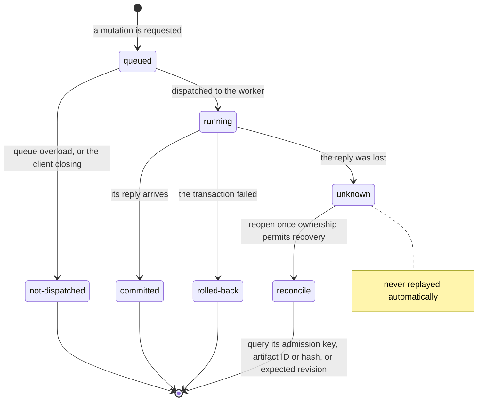

# Asynchronous persistence

Application code opens `DatabaseClient` and awaits repository or service calls. The client starts the packaged database worker and resolves only after migrations and checkpoint schema validation finish. Native SQLite handles, SQL repositories and callback transactions stay private to that worker. The built-import guard in `tests/persistence-boundary.test.ts` checks that the CLI and public runtime imports cannot reach the native driver.

Use an existing atomic operation for a read/check/write sequence. Adding several awaits does not make the sequence atomic. Add a named operation to the checked protocol, dispatcher and facade when a new invariant needs a transaction. Generate durable operation keys and artifact IDs before dispatch; preserve them during reconciliation.

## Queues and failure

The worker executes one database operation at a time. The ordinary queue accepts up to 128 requests and 32 MiB of serialized requests; completion/cancellation operations have 16 reserved slots and 4 MiB. Messages are at most 1 MiB. The ordinary response envelope is capped at 36 MiB. Queue overload returns `BUDGET_EXCEEDED` before dispatch.

Artifacts and checkpoints support larger values through an exclusive transfer with private spool files. Only one large upload and one large download may be active per client. Transfers use 512 KiB chunks, expire after 30 seconds without progress and are removed on clean shutdown. Checkpoint capture and serialization still require main-thread CPU and memory proportional to one large value; moving SQL does not remove that cost.

Errors include `details.mutationOutcome`:

- `not-dispatched`: the worker did not execute the operation.
- `rolled-back`: a transaction-backed operation failed and rolled back.
- `unknown`: a dispatched operation may have committed before its reply was lost.

Never automatically replay an unknown mutation. Reopen after ownership permits recovery and query its original admission key, artifact ID/hash or expected revision. `putArtifact` exposes its generated artifact ID in a `TaviError` so callers can reconcile it. Reusing an artifact ID for different bytes is a conflict.

The worker's connection opens with a 64 MB page cache, in-memory temporary storage, a 256 MB memory map and a write-ahead log trimmed to 64 MB after a checkpoint, then runs `PRAGMA optimize = 0x10002` so the planner has statistics, each `ANALYZE` sampling at most 1000 rows per index (`analysis_limit`); the six-hourly retention sweep runs `PRAGMA optimize` again (`store.optimize`). The worker builds its repositories once (`SqliteStore.asPort()`) and shares one set of service handlers across `service.*` requests that carry no options; a request with `now`, `ids`, `quotas` or `sharedRead` gets its own.

Each reply says whether the operation changed rows (SQLite's `total_changes()` moved, a trigger's rows included), so `DatabaseClient` has a write signal: `onWrite(listener)` is told of each request that changed something, by operation name, and `writeCount` counts them. A read never signals. The owner's background work waits on it instead of polling: the Command Center's watch reads again when something is written, the due-work planner reads `store.nextWakeups` (the earliest instant each reminder, schedule, agent-wait, approval-round and heartbeat sweep has work) after a write and sleeps until then, and the memory jobs, the memory provider upkeep and the heartbeat's need check skip a tick while `writeCount` has not moved. An idle owner with no tab open calls its worker about once a minute or less.

Subscribe to Node's `tavi.database.operation` diagnostics channel for operation name, queue depth, queue wait and execution duration. Events contain no query parameters or record bodies. Database-dependent requests can wait behind a lock even while agent timers and unrelated requests remain responsive.

## Checkpoints and ownership

`AsyncCheckpointSaver` keeps the pinned LangGraph serializer and SQLite saver format (1.0.4). It captures inputs before asynchronous serialization and orders deletion after earlier writes. Its async iterator opens a stable snapshot, including pending writes. There are at most four cursors; each expires after 30 seconds. Close/break an iterator promptly to release its read transaction and allow WAL truncation.

**Per-channel checkpoints (`TAVI_CHECKPOINT_BLOBS=1`, off by default).** Set in the environment of `tavi serve`, the saver stores a checkpoint per channel:

- Each put serializes and sends only the values of channels whose version changed since the parent, into `tavi_checkpoint_blobs` (one row per thread, namespace, channel and version).
- The `checkpoints` row keeps every version but no versioned values (its `type` is `json+blobs`). `checkpoints` and `writes` keep the pinned saver's shape.
- Every read through the worker (`get`, the list cursor, `tavi tasks`) rejoins the values by version, so turning the flag off again reads such rows as before; the pinned `@langchain/langgraph-checkpoint-sqlite` saver refuses them ("Unknown serialization type") rather than resuming with empty state.
- A thread written inline earlier continues per channel: the worker answers the channels it does not hold at their version and the saver sends them once.
- Values go with their thread (`deleteThread`, chat and plumbing purges) and with the last checkpoint that names them (`pruneThread`).
- While the flag is on, channel versions are the next integer plus a random fraction, so no two branches of a thread share a version minted then; a saver with the flag off bumps by one, keeping the fraction, so this assumes a thread is not forked from a checkpoint written with the flag off (tavi forks no thread).

In a 40-turn chat of the task graph (a tool call and an answer per turn) it halves the checkpoint bytes written (about 62 KB to 32 KB per checkpoint, 107 KB to 54 KB over the last ten turns): a step that changes the conversation still sends all of it, and the steps that do not, send only their versions.

Ownership uses a separate worker and database lock. A failed application worker closes admission and aborts active work; it does not release directory ownership. A new owner must verify that the predecessor process ended, even when the old ownership worker's native lock is gone. Shutdown stops producers, drains invocations and persistence, then releases ownership only after clean disposal. An unclean disposal retains ownership until the process exits or its controlling caller confirms all work stopped.

Doctor uses inspection mode to preserve evidence of an incompatible existing checkpoint schema. Inspection permits neither workflow execution nor checkpoint mutations. Backup, restore, migrations and ownership diagnostics also execute in workers.

## Architecture

All SQLite access in `@tavi/runtime` is isolated behind worker threads (`packages/runtime/src/persistence/`) so `better-sqlite3` never blocks the main event loop and cannot be imported outside the persistence worker ([`tests/persistence-boundary.test.ts`](../tests/persistence-boundary.test.ts)):

| Layer | Module / Path | Responsibility |
| :--- | :--- | :--- |
| **Ports & Contracts** | `packages/contracts/src/async-persistence.ts`, `persistence-types.ts`, `persistence-services.ts`, `checkpoint-storage.ts`, `packages/contracts/src/ports/{persistence,checkpoint-query}.ts` | Typed RPC envelopes, mutation outcome metadata (`not-dispatched`, `rolled-back`, `unknown`), cursor contracts, and repository/service port interfaces. |
| **Main-Thread Client & Facades** | `packages/runtime/src/persistence/client.ts` (`DatabaseClient`), `repositories.ts`, `services.ts`, `service-facades.ts`, `routine-facades.ts`, `administration-client.ts`, `ownership-client.ts` | Asynchronous client proxies, bounded request queues (128 ordinary / 16 priority slots), 512 KiB chunked spool transfers (`temporary-files.ts`, `snapshot-files.ts`), and `tavi.database.operation` diagnostics channel emission. |
| **Typed Worker Protocols** | `packages/runtime/src/persistence/protocol.ts`, `rpc.ts`, `store-protocol.ts`, `repository-protocol.ts`, `service-protocol.ts`, `routine-protocol.ts`, `plugin-registry-protocol.ts` | Checked request/response schemas and operation dispatchers between `DatabaseClient` and the worker thread. |
| **Database Worker & Schema** | `packages/runtime/src/persistence/worker.ts`, `worker-server.ts`, `sqlite-loader.ts`, `migrations.ts`, `baseline-schema.ts`, `profile-format.ts`, `profile-validation.ts`, `reset.ts`, `administration.ts` | Worker thread entry point, native `better-sqlite3` handle management, `0001_baseline` schema creation, WAL pragma configuration, backup/restore, and inspection mode. |
| **Ownership Worker** | `packages/runtime/src/persistence/ownership.ts`, `ownership-worker.ts`, `owner-process.ts`, `machine-identity.ts` | Dedicated lock worker holding exclusive directory ownership (`owner.lock`, `owner.process.json`) and verifying predecessor process liveness before recovery. |
| **LangGraph Checkpoints** | `packages/runtime/src/persistence/checkpoints.ts` (`AsyncCheckpointSaver`) | Pinned LangGraph checkpoint saver (format `1.0.4`), snapshot iterators with 30-second cursor leases, and receipt tracking (`store/checkpoint-receipts.ts`). |
| **Domain Repositories** | `packages/runtime/src/persistence/{approval-inbox,approval-round-repository,artifact-list,browser-history,center,channel-group-repositories,chat-instructions,chat-measurement,findings,heartbeat-repository,ideas-repository,mcp-repository,memory-use,messaging-connection-repository,model-accounting,need-delivery-repository,onboarding-repository,plugin-repository,prompt-selection,reminders-repository,routine-configuration,routine-evaluation-store,site-recipes,site-usage,task-folders,task-list,task-needs,task-summaries,tool-policy-repository,transcript-repository,workspace-settings-repository}.ts` | High-level transactional repositories exposed over the worker RPC boundary. |
| **Low-Level Store Tables** | `packages/runtime/src/persistence/store.ts`, `store-handlers.ts`, `packages/runtime/src/persistence/store/{admissions,agent-definitions,agent-delegations,agent-mailbox,agent-waits,approvals,artifacts,cancellations,checkpoint-receipts,context,effects,executions,maintenance,memory-rows,memory,messaging,model-config,projects,reports,schedules,search-providers,skills,stored-values,system-prompts,task-history,task-prompt-snapshots,task-repository,tasks,wakeups}.ts` | The 29 table-level SQLite modules executed inside the persistence worker. |

See [ARCHITECTURE.md](ARCHITECTURE.md) for how `DatabaseClient` is wired into the owner process.
