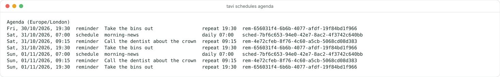
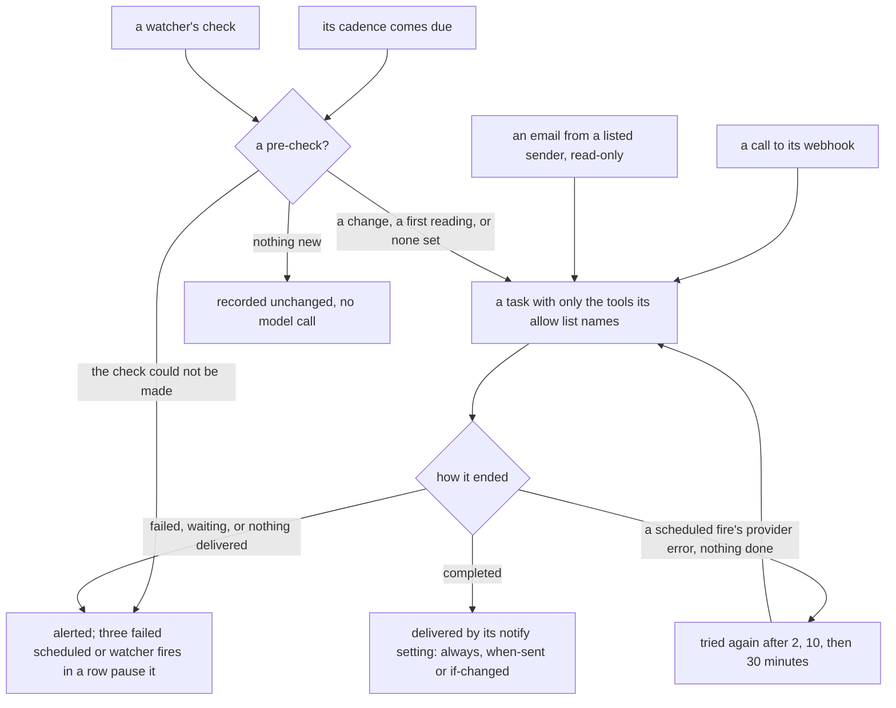
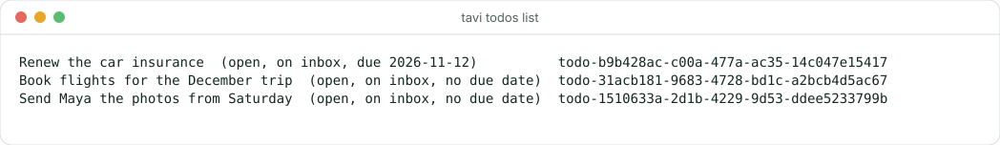
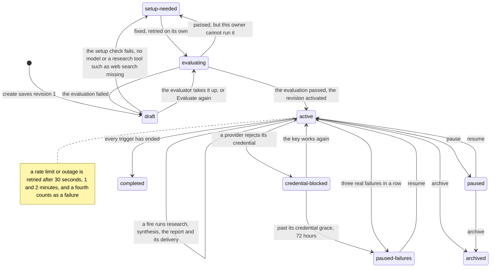
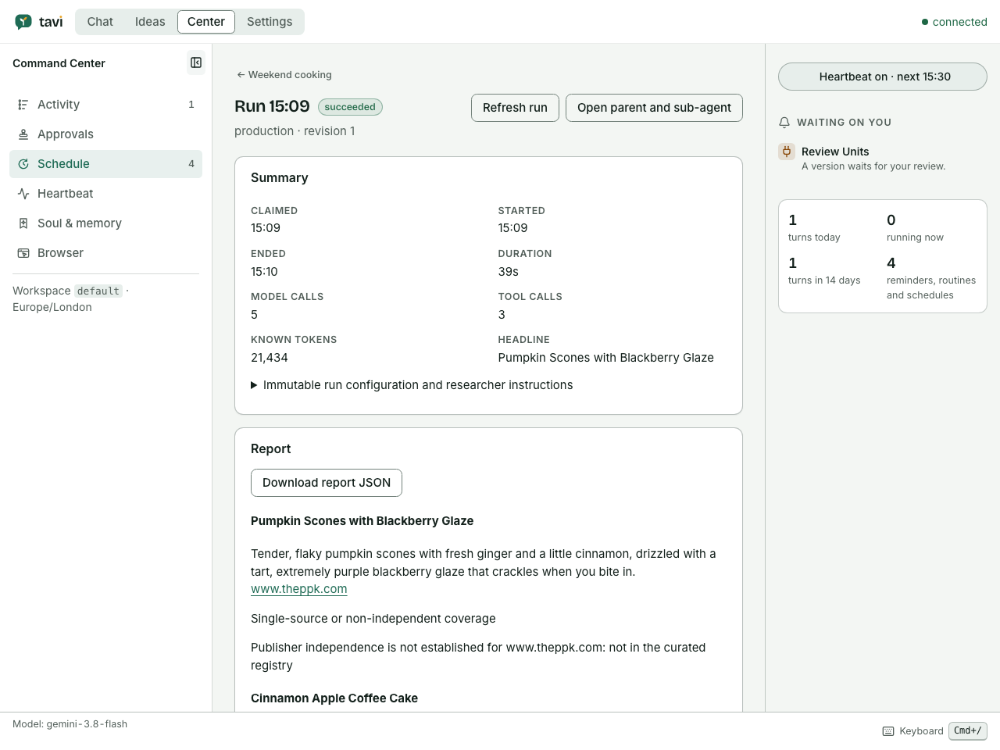

# Automation: runs, schedules, agents, reminders and routines

This covers the work Tavi does from one command or on its own: `tavi run` for a
single task, stopping and recovering work, the heartbeat, plain schedules,
named agents and the workers they spawn, the project registry and reports,
reminders, and agent routines. The heartbeat has its own guide,
[HEARTBEAT.md](HEARTBEAT.md), and so do ideas, [IDEAS.md](IDEAS.md). Every
flag is in [CLI.md](CLI.md).

Unattended work needs the owner running: `tavi serve` holds the scheduler. `tavi
service unit` renders a launchd (macOS) or systemd (Linux) unit that keeps it
running across reboots; pass the `serve` flags delivery needs with
`--serve-arg` (see [OPERATIONS.md](OPERATIONS.md)). This is not a hosted wake-up
service.

## `tavi run`: one task per command

```bash
tavi run [options] "<prompt>"
tavi run --attach <task-id>
```

- **With no owner**, the task runs in this process; Ctrl-C aborts it.
  `--connection`, `--model` and `--api-key-file` choose the model for this run.
  A task that waits on a worker it spawned is not left behind: the run stays
  until the worker ends and the task answers, up to the wait's deadline (exit
  `7` only past it, or for a wait on anything else).
- **Under a running owner**, the task is sent to the owner and its stream
  followed here; Ctrl-C only detaches (exit `130`), and `tavi run --attach
  <task-id>` follows it again. The owner's model and tool policy apply:
  `--connection` and `--model` together make that model the chat's own (one no
  connection offers is refused), and the tool-policy and credential flags are
  refused (exit `2`).
- **Where it goes.** A run is a chat of its own. `--home` posts the prompt into
  your Home chat instead, as its next turn. Under an owner the run's chat works
  in this terminal's directory when it lies under one of the owner's
  `--fs-root` folders (and is not your home folder itself), else in its own
  folder; `--folder <path>` names another folder, `--managed` keeps it in its
  own. With Home on, a run that settles posts a notice into Home.
- `--format json` streams the task's events as NDJSON (see
  [CLI.md](CLI.md#output-formats--event-streaming)); `tavi chat --replay` plays
  such a stream back.
- `--approval <ask|approve|deny>` decides gated calls: ask at the terminal (the
  default; exit `3` without one), or approve or deny every round, including the
  rounds of the workers the task spawns (marked "A worker:" at the terminal;
  without a terminal or a policy they are left for `tavi approvals approve
  <worker-task-id>`). `approve` still denies, with the reason, a call the taint
  step asked about (with `security.taint` at `enforce`), a call made after the
  task read untrusted content by a tool that asks a person then, and any call
  rated `critical`, as a schedule's fire does. See
  [SECURITY-MODEL.md](SECURITY-MODEL.md).
- `--operation-key <key>` makes a retry the same task instead of a new one
  (keys beginning `schedule:`, `reminder:` or `home:` are reserved).
- Tool reach, with no owner: `--http-allow-host`, `--http-request-header`,
  `--http-credential-host <ref>=<host>`, `--browser-allow-host` and
  `--messaging-allow-destination`.
- `--in-memory` uses a throwaway store.

## Stopping work: abort, cancel, recover

```bash
tavi abort <task-id>                                        # stop the running turn; the task can go on
tavi cancel <task-id> --reason "<text>"                     # stop the task for good
tavi recover <task-id> --generation <n> --reason "<text>"   # free a slot a dead process held
```

- **Abort** ends the turn a live owner is running (its outcome is failed with
  `ABORTED`) and records nothing durable, so the task can be continued or
  replied to later. A task with no running turn (finished, or suspended on an
  approval, a review or a wait) has nothing to abort (exit `8`): cancel it
  instead. Esc in `tavi chat` and **Stop** in the canvas abort.
- **Cancel** is a durable record: it survives a restart, a reply arriving
  afterwards cannot revive the work, and the task's pending approvals close
  with it.
- **Recover** clears an execution slot whose owner process is gone. An expired
  lease is evidence to investigate, not permission to overlap: confirm the
  previous process has ended, then name the generation to end.

`tavi tasks [<task-id>]` lists tasks or shows one's full timeline. `tavi tasks
instructions <task-id> [show|history|set "<text>"|reset]` reads and saves one
chat's own instructions (the same ones the canvas's chat panel edits); a save
applies from the chat's next turn. `tavi tasks history` exports, forgets and
rewinds a chat's saved history (see [WEB-UI.md](WEB-UI.md#saved-history-rewind-and-forget)).

`tavi doctor` reports composition, migrations, capabilities and stranded
admissions (with the `recover` command each needs). It also carries local
measurements, never uploaded: `chatMeasurement` (model calls, input tokens per
turn and summarizer calls by chat kind; side chats created, messages per side
chat and how often the person went back to the parent within a day),
`promptCacheByChatKind` (the cache-read share of input tokens on a turn's first
and later model calls, and how often a turn's first call kept the previous
turn's system text), and a `memory` section (settings, provider, digest, idle
review and hybrid recall's vectors). See [OPERATIONS.md](OPERATIONS.md).

## The heartbeat

The heartbeat is a periodic check-in that stays quiet until something needs you,
inside hours you choose. It watches what you list (including up to 20 `watch:
https://…` pages), failed runs, questions near their deadline, chat folders and
the disk, unanswered messages, bounced sends and failing routines, and tells you
only what matters, in Home, the Command Center and your channels. It is off
until you turn it on:

```bash
tavi heartbeat on
tavi heartbeat edit --file my-watchlist.md
tavi heartbeat status
```

It runs in `tavi serve` as the built-in `tavi.heartbeat` plugin; `tavi plugins
disable tavi.heartbeat` stops every heartbeat at once. Tune it under **Center →
Heartbeat**, with `/heartbeat` in a chat, or from the terminal.
[HEARTBEAT.md](HEARTBEAT.md) describes how it works and how to configure it;
[HEARTBEAT-PLUGINS.md](HEARTBEAT-PLUGINS.md) how to replace its decision with
your own provider or add signal sources; [CLI.md](CLI.md#tavi-heartbeat) lists
every action.

## Schedules

<picture>
  <source media="(prefers-color-scheme: dark)" srcset="assets/terminal/agenda-dark.svg">
  
</picture>

A schedule runs one prompt unattended on a cadence (times of day or every few
hours, on weekdays, monthly, yearly or once), or when a watched page, feed or
file, a webhook or an email starts it.

What happens when a schedule fires:



From a chat, ask for one in your own words ("every weekday at 8, summarise my
inbox"): the agent's `schedules.*` tools create, list, change, pause, resume,
run now and cancel the workspace's schedules, each saying back when it runs next in
the workspace's time zone. `schedules.list` also says each one's last run (when
it was due and why it ended so), its failures in a row and when it tells you
(`notify`). "Run my morning summary now" is `schedules.run_now`: it asks, as
any change does, then fires the schedule once on the owner's own scheduler
(its tools, delivery and disk check as at its time) without moving its next
run, and answers the run's task id; one already running, or a routine's, is
refused. Ask why one did not run ("why didn't my brief go
out on Tuesday?") and `schedules.history` reads its recent fires, each with
when it was due and why it ended so; a failed run is named by its task rather
than quoted. Creating or changing one goes through approval,
and the card says what will happen: when it runs ("every Mon–Fri at 07:00
(Europe/Sofia); next Wed 28 Oct 07:00", in the workspace's zone when none is
named), where each result goes, what it runs and the tools it uses without
asking. A change is read over the schedule it changes, so a card for a new time
still names its days. A schedule whose `allow` list reaches a tool that
writes, sends or runs something, or names no tool there is, asks on a high card
every time; so does a change to what or when such a schedule runs (its prompt,
cadence, zone or pre-check, not its delivery), whose card names the tools it
keeps (approved there, they need not be sent again). Resuming such a schedule
(`schedules.resume`) or running it now (`schedules.run_now`) asks the same way:
a high card that names the tools it re-arms, approved once, never for good,
and shown whatever a rule or an earlier approval allows; one whose tools only
read or search (`web_search` sends its query to your provider, and changes
nothing) asks as before. They
never touch a routine's schedule (change it with `routines.*`) or one whose
fire is running, and a repeated create with the same name and prompt makes
nothing new, unless that schedule is paused (resume it) or a routine's.

```bash
tavi schedules add --name brief --at 07:00 --timezone Europe/Sofia --prompt "..." --allow http.request
tavi schedules add --name checks --at 09:00,17:00 --days 1,2,3,4,5 --timezone Europe/Sofia --prompt "..."
tavi schedules add --name pulse --every-hours 2 --between 08:00-18:00 --timezone UTC --prompt "..."
tavi schedules add --name rent --at 09:00 --monthly last:fri --until 2027-06-30 --timezone UTC --prompt "..."
tavi schedules add --name launch --at 10:00 --once 2026-11-05 --timezone UTC --prompt "..."
tavi schedules list | show <name> | update <name> | enable <name> | disable <name> | remove <name> | run-now <name>
tavi schedules agenda [--days N] [--limit N] [--format text|json]
```

- A schedule runs as the operator who created it, with only the tools its
  `--allow` list names (exact ids or `prefix.*` families; none by default;
  `--allow '*'` is refused). `--agent <id>` runs it as a named agent.
- When it runs is one cadence, read by the same engine as reminders, routine
  triggers and the agenda: `--at` names one time or up to six a day
  (`--at 07:00,19:00`), or `--every-hours N` (1–12) runs every N hours by the
  wall clock from 00:00, or through `--between 08:00-18:00` (both ends
  included). On those times it runs every day, on `--days` (weekdays,
  0 = Sunday), `--monthly` (a day of the month, 31 being a shorter month's last
  day, or its nth weekday: `2:tue`, `last:fri`), `--yearly MM-DD` (02-29 is the
  28th in a year without one) or `--once YYYY-MM-DD`; `--until YYYY-MM-DD` is
  its last day. On `update`, the times given replace the stored ones together,
  and a day pattern replaces the others; `--days none` makes it daily again,
  `--until none` drops the end, `--no-agent` runs it on the base instructions,
  and `--no-alert` clears its alert target. A once or until date already past
  is refused when written. Raw cron is not accepted. In the web canvas, the
  schedule form, the routine forms (a routine's name, objective and triggers
  are edited in **Edit routine**), a repeating reminder and the heartbeat's
  days set the same cadence with one field, which shows the next three runs as
  the owner's scheduler computes them (`schedules preview`;
  [WEB-UI.md](WEB-UI.md#the-cadence-field)). A chat's **Repeat this…** opens
  that form filled with the chat's prompt and the read-only tools it used
  that `schedules tools` offers (its `readOnly` list; never scheduling
  writes, MCP writes or form fills), its other listable tools a click away,
  or a routine for a web research chat (reading memory does not stop a chat
  being one, though neither a routine nor a schedule has memory, as the form
  says); nothing is created until it is saved
  ([WEB-UI.md](WEB-UI.md)).
- A schedule that ends (`--once`, or `--until`) runs its last occurrence and
  then finishes: once its last fire has settled (a provider failure is
  retried first, as any fire's is) it is turned off with no next run, its
  ledger says `finished: … has no more runs` (reason `disabled`), and nothing
  is alerted. `list` says `finished` and `show` says it in its `state`;
  `enable` refuses it, and an `update` that moves its once or until date
  later, or drops the until, turns it on again. A routine's recurring trigger
  with an `until` is consumed the same way, and a routine whose triggers have
  all ended completes: one resumed or activated after they ran out (an until
  passed while it was paused, a one-off in the past) goes straight to
  `completed`, not `active`. `--missed` is `run-once-if-missed-within-6h`
  (the default) or `skip`. After the owner was stopped or asleep through
  several fires, only the latest one due is run or skipped: waking at 07:01
  runs that morning's 07:00 fire on time. Fires due together run up to three at
  a time, and one that waited for its turn is not counted late. A fire that
  runs late (more than two minutes), or after earlier fires were missed, is
  told so after its prompt, in the schedule's zone: "Scheduled for 07:00
  GMT+3, running at 11:40 GMT+3 (catch-up; the last run was 2026-10-24 07:00
  GMT+3)", or "(earlier runs were missed; …)" when its own fire is on time
  but the ones before it never ran. Without a previous run the note says only
  that the window since the last run may be longer than usual. So a prompt
  that asks for "news since yesterday" can widen. An on-time fire's prompt is
  exactly yours, and the note never touches the run's system prompt.
- Across a daylight-saving change, a time the clocks skip fires at the first
  minute that exists (New York's 02:30 on the spring change is 03:00 EDT;
  Sofia's 03:30 is 04:00), and a time the clocks repeat fires once, the first
  time the clock shows it (Sofia's 03:30 on the autumn change is 03:30 EEST).
  Reminders follow the same rule. Before this build a repeated time fired at
  its second reading in zones east of UTC, and a skipped one in the Americas
  fired as late as the gap was long (03:30 for 02:30); those fires, and a
  skipped midnight (Beirut, Cairo), now land as above.
- A schedule's last run is the last run that started, whatever started it: a
  scheduled fire, a file watcher's change, a webhook call, an email or a
  `run-now` (or **Run now**); a fire missed or skipped as an overlap leaves it. Its failure count is its fires' alone: a `run-now`
  neither resets it nor adds to it. The heartbeat's failed-schedule signal
  names plain schedules only (a routine's failed runs are its own signal), and
  a fire missed since the failure is said apart from it, never raised as a new
  failure.
- Every fire is kept in the schedule's fire history (its last 100, removed
  with it; refused webhook calls and emails are kept apart, their last 24, so
  they never push its fires out), with why it ended so: `ok`, `undelivered`, `quiet`, `unchanged`, `failed`, `timeout`,
  `waiting`, `asked`, `missed`, `overlap`, `disk`, `disabled`, `orphaned`,
  `manual`, `webhook` (a call to its webhook ran it), `webhook-refused` (calls
  to its webhook that started nothing, one row an hour counting them by
  cause), `watch` (a file watcher's check after its file changed; its outcome
  says whether it ran), `email` (an email from a listed sender ran it),
  `email-refused` (emails meant for its email trigger that started nothing,
  one row an hour counting them by cause), `retry` (failed on a provider error and tried again) or `paused`
  (paused after failing three times in a row); a retried try's row says which
  retry it was.
  `tavi schedules show` lists the ten most recent in the workspace's zone,
  and the web app's schedule page (Command Center → Schedule, a schedule's
  name) the last 30, each said as a sentence ("Missed: Tavi was not running
  at the time.") with a link to its task. `tavi schedules list` and `show`
  say when a schedule runs as its read-back does (`every Mon, Fri at 07:00
  (Europe/Sofia)`, next run in its zone), and `list` adds `failures=N`. A
  fire skipped while the run before it is still going is recorded there
  without touching that run's last outcome, and each fire slept through
  before the one that runs is recorded `missed`. The heartbeat's schedules
  signal also says when a schedule "missed 3 times in a row", counted from
  its latest fires that nothing ran at; a skip for overlap or a full disk, or
  any run, ends the count; a `run-now` or a refused webhook call or email
  neither adds to it nor ends it.
- A schedule cannot schedule more work: `--allow` refuses a tool that
  creates, changes or starts schedules or routines (`schedules.create`,
  `routines.run`, …) and a family that covers one (`schedules.*`,
  `routines.*`), on create and on update, and names the read-only ones it may
  list instead: `schedules.list` and `schedules.history`, and `routines.get`, `routines.list`,
  `routines.history`, `routines.inspect` and `routines.targets`. A schedule
  saved before this keeps its list as it is, but its fire denies those calls
  with the reason recorded, and you are told once per such entry (in its alert
  destination, or Home). An allow rule or grant for one of those tools does
  not let a fire, or a worker it spawns, make the call either.
- Whatever the list says, a fire denies a call made after the run read
  untrusted content (a page, a document, a search result) when that call would
  send data out, use a credential or change something lasting, and it denies
  any call rated `critical`; the denial and its reason are recorded with the
  run. A brief the run sends to its alert destination is not such a call: it is
  the fire's reply, and goes out with every address the run has not seen
  defanged, unless the run also read private data (mail, memory, a browser
  page), when a destination whose readers Tavi cannot know is refused like a
  group reply.
- `--alert-connection` and `--alert-destination` report a failed run; every
  address in the run's final words is disarmed in the alert (a webhook's caller
  or an email's sender may have steered them). A schedule with no alert
  destination (every schedule made in chat), or whose destination refused the
  alert or could not be reached, reports a failed, missed or refused fire as a
  notice in its person's Home instead, once per fire and cause: a fire refused
  every sweep on a full disk is told once.
  A round you decided yourself in another front end is not told there. With no
  Home, or Home off, it is only logged.
- A schedule never asks you anything unless `--checkpoints ask-with-default`
  (or the web form's **Questions while it runs**) says so: then a fire may stop
  to ask you in that alert destination, always with the option it takes if
  nobody answers before the next fire, and once it is answered the task carries
  on under the same `--allow` list.
- A fire may spawn workers (`agents.spawn`) that run side by side, and wait on
  them (`agents.wait`). A fire whose turn ends before a worker it spawned has
  answered is not over either: it is woken to read the worker's result. A
  worker's calls are decided by the schedule's `--allow` list, with every
  denial its fire's own calls get, rather than left for a person. A fire that
  waits on a worker, or on a question, reads "waiting on a worker" (or "asked
  a question") and is neither a success nor a failure: nothing is alerted
  (unless its run limit is spent) and its failure count is kept. The schedule counts as running until the task
  carries on and ends, when its real outcome is recorded (a manual run's still
  marked "manual run:"), delivered and, if it failed, alerted; meanwhile a
  fire due is skipped as an overlap (and told) and the schedule cannot be
  edited. A schedule whose last occurrence is such a run finishes only when
  that run ends.
  `tavi cancel` its task, or the workers it waits on, to free it at once.
- A fire's run may work `--max-run-minutes` (1–1440, default 30; a chat's
  `schedules.create`/`update` take `maxRunMinutes`). Past it, the turn in
  flight is aborted, the task and the workers it spawned are cancelled and the
  wait it is suspended on is settled, the fire is recorded failed as `timeout`
  and told once, and the schedule is free: the next fire runs. Only working
  time counts: the run's own turns and those of the workers it spawned. The
  time the run or a worker waits — on your answer to a question, on a worker
  or on a deadline — does not (each wait has its own deadline), nor does the
  time the fire spends recording how the run stands, nor the time the machine
  sleeps. A run carried on after an owner restart starts its limit afresh.
  `tavi schedules show` prints it as `run limit`. A routine's runs keep their own budget (`totalMinutes`).
- A schedule may also have a token ceiling, `--max-tokens` (1,000–100,000,000;
  none unless set; a chat's `schedules.create`/`update` take `maxTokens`, and
  `null` or `--max-tokens off` removes it). The tokens model accounting counts
  for the run's calls, and for those of the workers it spawned while their turns
  run, add up across the run and its continuations; once they pass the ceiling,
  the run is stopped as a timeout stops one — turn aborted, task and workers
  cancelled — recorded failed as `budget` and told once, and the next fire runs
  as usual. A run carried on after an owner restart counts from zero.
  Tokens are counted as each model call ends, so a run can go past the
  ceiling by one call; `add`/`update` warn about a ceiling below 30,000
  tokens, about one call (a run's first call alone takes about 25,000), and
  save it as asked.
  A run a webhook call or an email starts is never unbounded: with no ceiling
  of its own, it is stopped past 250,000 tokens, and setting `--max-tokens`
  replaces that.
  `tavi schedules show` prints it as `tokens`, the schedule page as *Token
  ceiling*, and the web form sets it.
- `--folder <path>` (off unless set; `update --folder off` removes it) pins the
  host folder each run works in, as a routine pins its own: the running owner
  checks it against its `--fs-root` folders when it is set, as a chat's primary
  folder, and stores its real path (an offline write refuses it), and each fire
  checks it again before its run starts and makes it the run's folder, so the
  run and its workers read and write there; a folder that no longer passes
  fails the fire, saying why. `tavi schedules show` prints it as `folder`. A
  chat's `schedules.create`/`update` never set it. See
  [WORKING-FOLDERS.md](WORKING-FOLDERS.md#schedules).
- What a workspace's scheduled work spends is summed per calendar month in the
  workspace's zone: the model calls of its schedules' runs and its routines'
  runs, with the workers either spawned — tokens, and an estimated cost when
  every call had a price sheet. `tavi doctor` shows it as `scheduledWork`, and
  Schedule's *Recurring* list says it in one line. With a monthly budget set
  (`tavi config set scheduled.monthlyTokenBudget <tokens>`, none by default),
  the line shows its share, and your Home is told once a month when it reaches
  80% (checked every 10 minutes). Nothing is stopped at the budget: a
  schedule's own `--max-tokens` (or, for a webhook's or an email's run, the
  default ceiling) is what stops a run.
- A fire skipped because the run before it is still going is told once per
  fire (in the alert destination, or Home): with the run limit that will end
  that run while it works, or that it is waiting on a worker or an answer.
- `--deliver-to home` posts each completed run's result into the schedule
  person's Home as a notice (`--deliver-to none` stops it): its status, then the
  run's final words (forged fences quoted, clipped to 1,600 characters; Home's
  next turn reads at most the first 400 of the status and words), linked to the
  run's task. A failed or waiting run is told there once, by its alert, which
  names its status and task but not its final words, not posted again as a
  result. Such a run needs no `messaging.send_to` of its
  own; a schedule that also allows `messaging.send_to` still owes its channel
  brief, and is alerted as undelivered when its run sent none, whether or not
  its result reached Home. With no Home yet, or Home off, nothing is posted,
  and the fire says so: its outcome reads "completed, but its result was not
  posted: …", and a `run-now` not followed from the terminal prints
  "Not posted to Home: …".
  When Home's next turn reads the result, it takes on the run's content label:
  a run that read a page or private data leaves Home tainted (and private) for
  good, as a worker's result does, so a later call that would send data out
  is asked about. The terminal and the web form deliver nowhere unless told
  (the web form's **Deliver result to** is **Home** or **Nowhere**), except
  the form **Repeat this…** opens from a chat, which starts at **Home** as a
  schedule made in a chat does;
  a schedule made in a chat (`schedules.create`) delivers to Home unless it
  names `deliverTo` or its `allow` list has `messaging.send_to`, and its card
  and answer (`delivery`) say where results go.
- `--notify` says when a run that went well tells you (failures are always
  told, once per cause, whatever it says). `always`, the default and what
  every schedule made before had, delivers every completed run and alerts a
  run that may send and sent nothing as undelivered. `when-sent` tells you
  only when there is something: a run that attempted no `messaging.send_to`
  (while its tool list allows one), or that ended with exactly
  `[nothing to report]`, is a quiet success — recorded `quiet`, nothing
  posted to Home, nobody alerted, no failure counted. A send that was
  attempted and refused by the connector, or failed, is still `undelivered`
  and alerted. A schedule that cannot send posts to Home as before unless its
  run ended with that marker. `if-changed` delivers as `always`, except that
  a result the same as the last one delivered (Tavi keeps the SHA-256 of its
  words, whitespace normalised) is not delivered again: Home gets no post,
  and a `messaging.send_to` text message to the schedule's own alert
  destination is not sent and answers the run `unchanged`; the fire is
  recorded `quiet`. A run of a schedule whose `notify` is not `always` is told
  in its runtime facts how to end with nothing to report; the marker is read
  by the scheduler and never posted, alerted or printed (`run-now` says
  "nothing to report"). A chat's `schedules.create`/`update` take `notify`,
  and set `when-sent` when you say "only if…"; `tavi schedules show` prints
  it as `notifies`, and the web form's **Tell me** and the schedule page's
  **Tells you** say it.
- `--precheck` (off unless set) gives a schedule one read-only look before
  each scheduled fire, so a fire with nothing new makes no model call:
  `page-changed:<https url>` (the page's readable text, whitespace normalised,
  hashes differently from the last reading), `feed-has-new:<https url>` (an
  RSS or Atom feed lists an item not seen at the last reading and not older
  than the newest seen) or `file-changed:<path>` (a file under one of the
  owner's `--fs-root` folders has different content; one over 16 MiB is
  compared by size and modification time). When it finds nothing new, the
  fire is recorded `unchanged` — no run, no model call, nobody told. When it
  finds something, or has no earlier reading (a new or changed pre-check), the
  fire runs as usual and its prompt ends with a short note saying what changed
  — the address or the path, never what was read there — and that the run
  reads it itself, with its own tools and tool list. The reading becomes the
  baseline once the run completes (or stops to wait on a worker or a
  question); a run that fails leaves the old one, so the next fire, or its
  retry, finds the same change again. A page or feed is fetched as a
  heartbeat's watched page is (the guarded public fetch below, from the
  address's own host only), and only where the site profiles allow an
  unattended read — an address they refuse is refused when the schedule is
  saved and fails the check; a file path is checked against the owner's
  `--fs-root` folders when the schedule is saved — so a `file-changed`
  pre-check needs a running owner — and again at each check. A check that
  cannot be made (the address refused by the guard or a site profile, an
  error answer, a file gone or no longer allowed) is recorded failed as
  `failed` (`pre-check
  failed: …`), counts toward the three-failures pause, and is told once until a
  check works again. `run-now` is not checked. A chat's
  `schedules.create`/`update` take `precheck` in the same words (`none`
  removes it) and the card says what it reads first; `tavi schedules show`
  prints it as `pre-check` with when it last read, the web form's **Only run
  when** sets it, and the schedule page's **Pre-check** says it. Changing the
  pre-check forgets the last reading.
- A **watcher** is a schedule whose trigger is a change rather than a time
  (off unless a person makes one): `tavi schedules watch <name> --page <https
  url> | --feed <https url> | --file <path> [--every <n>h] --prompt …` is an
  `add` of a schedule with the matching pre-check, checked every hour (or
  every `--every` hours, 1–12; `120m` works, anything under an hour is
  refused) through the day or `--between`, in `--timezone` (this machine's
  zone by default), and marked a watcher. Each check is the pre-check above:
  nothing new is `unchanged`, with no run and no model call, so polling costs
  a fetch or a read, never a model call. Cadences stay an hour or longer: a
  model never runs more often than once an hour on a schedule's cadence. A
  file watcher also reacts promptly while `tavi serve` runs: the file itself
  is watched (its folder only while nothing is at its path, as when an editor
  replaces it, and polled where neither can be), and about 30 seconds after
  the last change its pre-check-gated check is made, at most once a minute
  and 12 times an hour (a change past either waits until one is allowed; a
  check that met a run of the schedule still going is made again once it
  ends, and uses none of the hour's 12). It is a run-now of the schedule that
  runs only when the pre-check finds a change, recorded `watch` in its
  history and counted toward its failures like a scheduled fire, so a
  watcher that fails three times in a row pauses, which ends its watch; a
  failed run's change counts as seen, so the next change to the file, not
  the same one, runs it again. Six runs in a row within an hour, each on a
  change, stop the prompt checks for an hour, told once: until then only its
  cadence checks. It leaves its next scheduled fire as it was; its cadence's
  fires go on, catching a change made while the owner was down, and one due
  while a watch run is going is recorded `overlap` without an alert. The
  file is held to the `--fs-root` folders when it is watched, at each
  minute's sync (a symlink put at its path moves the watch to the file it
  points at) and again before each check, and
  the schedule is read again before each check, so one paused, edited or
  removed is never fired. A watched file that is deleted is checked at once
  and recorded `pre-check failed: … does not exist`. A file watcher's run is
  told which file changed and reads it with its own tools, so give it
  `--folder` naming the file's folder (or one above it); without one its run
  works in a folder of its own and cannot read the file. The watches follow every change made through the
  owner at once (and any other within a minute), and end when it stops.
  `update --watch off` keeps the pre-check at the schedule's own times, `on`
  makes one with a pre-check a watcher again, and removing the pre-check stops
  it being one. `show` prints `watcher` with what it watches ("watches the page
  https://… every hour; runs only when it changes"), and `list` and `add` say
  it in place of the cadence. A chat's `schedules.*` tools read a watcher back
  (`watches`) but cannot make one or change what one watches
  (`schedules.update` refuses a watcher's `precheck`): like a webhook, a
  watcher is started by something outside the schedule's times, so only a
  person turns it on or points it elsewhere. The
  web form's **Watch it** makes one, and Recurring badges and filters them.
- A schedule may have a webhook (off unless turned on): `tavi schedules
  webhook <id|name> on` (or **Turn on** under **Webhook** on its page) makes a
  secret and a signing key and prints them once — the secret is stored only as
  its SHA-256, the signing key only encrypted with the credential key, and is
  made only while the credential store is encrypted — with the
  address `POST <public address>/hooks/schedules/<schedule id>` on the
  channels' webhook listener — or, while no public address is set, the
  listener's own `http://127.0.0.1:<port>/hooks/schedules/<schedule id>`,
  which the command, `show` and the page then give (the `tavi channels ingress` port and public
  address; see [CHANNELS.md](CHANNELS.md) and, for exposing it,
  [OPERATIONS.md](OPERATIONS.md#a-schedules-webhook)). While any schedule has
  one, `tavi serve` keeps the listener open even with no channel. A call
  carries the secret as `Authorization: Bearer <secret>`, or is signed:
  `X-Tavi-Timestamp: <unix seconds>` (within five minutes of the owner's
  clock) and `X-Tavi-Signature: sha256=<hex HMAC-SHA256 of
  "<timestamp>.<body>">` keyed with the **signing key** printed beside the
  secret (each signature is taken once). A call that carries neither, or a
  wrong one, is answered `401` with no detail. Failed calls (a wrong secret, a
  bad signature, a body over the cap, a `503` to a call without the secret
  because the caller's address already has its share of the listener's bytes
  in flight, 16 MB, or all of them are, 64 MB) are counted per caller's address (behind
  a reverse proxy on the same machine, or one named with `tavi channels
  ingress --trusted-proxies`, the one it forwards in `X-Forwarded-For`; an
  IPv6 address by its /64): past
  ten in a burst, refilled at ten a minute, a call with no secret and no fresh
  signature headers is answered `429` before its body is read, while one with
  the secret or fresh signature headers is still checked, and charged only if
  it fails. A good one fires the schedule
  now, as `run-now` does — the same in-flight guard, tool list, budgets,
  delivery and notify, and not counted toward its failures — and is answered
  `202` once its run is admitted. Its body, if any (at most 8 KiB, UTF-8 text,
  valid JSON when sent as JSON; larger is `413`), follows the schedule's
  prompt as a quoted-data message of its own — untrusted data the run is told
  never to take as instructions, never part of the prompt, so its links are
  not known ones — and the run starts as one that read untrusted content
  (source `webhook`), so the taint rules hold from its first turn: no
  scheduling writes, unknown links defanged, writes outside the managed
  folder asked. Each schedule's webhook fires it at most once a minute and 12
  times an hour (`429` past either, with `Retry-After`); a paused schedule
  answers `409`, as does one whose run is still going. Each fire is in its
  history as `webhook`, its outcome naming the payload's size and a prefix of
  its SHA-256, never its words; refused calls are counted in one
  `webhook-refused` row an hour and logged at most once per schedule every 5
  seconds, with the count since. A good call whose fire started no run
  (`409`) is logged, not counted refused, and uses none of the hour's 12.
  `rotate` replaces the secret and signing key
  (calls with the old ones are refused from then), and `off` removes the route: a
  call to it, or to an id that has no webhook, is answered as a wrong secret is
  (`401`, `405` for a method other than POST, `413` over the cap), so the
  answers never tell which schedules have one. Such calls are not recorded and
  never reach the database (the owner keeps the ids of the schedules whose
  webhook is on in memory), and they share the caller's one burst with every
  other failed call; past it, a call with no secret and no fresh signature is
  answered `429`, and not recorded, before any schedule is looked up. A
  routine's schedule has no webhook.
  A chat cannot turn a webhook on or see its secret: there is no tool for it.
- A schedule may have an email trigger (off unless turned on): `tavi schedules
  email-trigger <id|name> on --connection <id> --from <addr|@domain>[,…]
  [--subject <text>]` (or **Set up** under **Email trigger** on its page)
  listens on one email connection of the schedule's workspace (Mailgun or
  Gmail: a channel that authenticates each sender; Telegram and the other
  channels are refused). An email fires the schedule now, as `run-now` does,
  only when its sender is listed — an exact address, or `@domain` for every
  address at that domain (not its subdomains) — **and** the channel verified
  it (the same verdict that admits a bound person's mail; a binding's "trust
  unverified mail" override does not count here), and, with `--subject`, its
  subject holds that text in any case. The verdict proves the sender's
  **domain**, not the person: Gmail passes only on a DKIM signature aligned
  with the From domain (neither SPF alone nor a DMARC pass resting on SPF
  alone counts, since anyone sending through that domain's SPF — a shared
  mail provider, a relay — would pass), Mailgun on SPF and DKIM for the envelope sender's
  domain, and a subdomain's mail aligns too. So an exact address trusts that
  domain's own mail servers to stop its other users sending as it, and an
  `@domain` entry for a public mailbox domain (`@gmail.com`, `@outlook.com`,
  `@yahoo.com`, `@icloud.com`, `@proton.me` and a few more) is refused, since
  anyone can get an address there; list exact addresses on those instead.
  **Email is where injected instructions come from most**, so the run is held
  tighter than any other: it starts tainted (source `email`), its subject and
  text (at most 8 KiB together, the rest cut) follow the prompt as a
  quoted-data message of their own, never part of it (so a link in the email
  is not a known one, and a string copied from it shows as the email's on an
  approval card), and it is a **reader session** — only tools that read and
  reach nothing outside are offered or run, whatever the schedule's `--allow`
  list or an allow rule says, besides `messaging.send_to` to the schedule's
  own alert destination (its delivery) and the Home post a schedule makes
  anyway; every worker it spawns inherits the same restriction. So an email
  can make the run read what Tavi already holds and summarise it, never
  write, send elsewhere, fetch a page, search the web or call a tool with an
  outside effect. At most one fire a minute and 12 an hour per schedule. An
  email the trigger takes — listed, authenticated, its subject matching — is
  the trigger's alone, whether it fired or was refused (rate limit, paused, a
  run in flight): it is marked handled before its run starts, so neither a
  redelivery nor a restart ever makes it a chat message. Any other email flows as before: a listed sender's
  mail the channel could not authenticate is refused by the trigger (counted)
  and then held as unverified mail always is; an unlisted sender's mail whose
  subject matches the trigger's `--subject` is counted refused too; other mail
  is not the trigger's business. Fires are recorded as `email`, naming the
  sender, the size and a hash prefix, never the subject or text; refusals in
  one `email-refused` row an hour by cause. The sender's address reaches the
  run only in the quoted email's heading, never in the run's own note (its
  local part can be any words). An email the trigger took whose fire started
  no run is logged, not counted refused, and uses none of the hour's 12. `off` stops it; a routine's
  schedule has none, and a chat cannot turn one on or change its senders:
  there is no tool for it. `show` prints `email` as what it listens for, or
  `off`.
- A fire whose run failed on provider weather — a rate limit, or a provider
  fault the transport calls retryable — is tried again 2, then 10, then 30
  minutes later: at most three retries, each under its own key so it never
  replays the failed one, and each told in its prompt that it is a retry of the
  fire due at its time. A retry is armed only when the failed try called no
  tool with an effect (nothing it did could be done twice: no send, no write,
  no worker), while the fire is still within its 6 hours, and before the
  schedule's next regular fire, so the two never both run; one the next fire
  overtook (the owner was down) is recorded `missed` and the regular fire runs.
  A rejected key, a billing limit, a model that answered badly, a timeout, a
  cancel and a `run-now` are never retried. A try that is retried is recorded
  `retry` and neither counts as a failure nor is told; only the last try's
  outcome is, once.
- A schedule whose fires fail three times in a row (failed, undelivered,
  stopped at its limit, never reported, or could not start; a retried try is
  not one) is paused: it stops firing, `tavi schedules show` says `paused after
  3 failed runs in a row; resume it to run again`, `list` says
  `paused:failures`, a chat's `schedules.list` answers `pausedReason:
  "failures"`, and the web app badges it **paused failures**. You are told once
  (in its alert destination, or Home), with how to resume it: `tavi schedules
  enable <name>`, **Resume** on its page, or `schedules.resume` from a chat.
  Resuming clears the reason and the failure count, so it gets three more
  tries; pausing it yourself has no reason and does not clear the count.
- Under a live owner every action runs on the owner; `run-now` fires on its
  scheduler without disturbing the next fire, and follows the run. A fire
  holds its schedule from the moment it is claimed, its pre-check included, so
  a `run-now` (or a webhook, email or watcher fire) and a scheduled fire never
  start together: the second is refused, or skipped as an overlap.

`tavi schedules agenda` lists every upcoming occurrence of routine triggers,
schedules and reminders in the next `--days` (default 7, at most 31), sorted by
time and shown in the workspace's timezone: a daily schedule appears once per
day (each of its times, or each step of its window), a one-off routine trigger
or a `--once` schedule until it fires, one with `--until` up to its last day, and a
monthly or yearly schedule, trigger or reminder in its own words ("Monthly on
the 1st, 09:00"; the workspace's zone is named once, in the heading, and only
another zone is said on a line). A missed fire the scheduler
will still catch up is listed first as overdue. Paused and disabled items are
left out, and a list cut at `--limit` (default 100) says so. The canvas shows the
same under **Center → Schedule** (see [WEB-UI.md](WEB-UI.md#schedule)).

## Agents and workers

`tavi agents add <id> --name <n> --prompt <text>` defines a named persona that a
task, a schedule (`--agent`) or a chat message (`@name`) can run as. `list`,
`show`, `update`, `remove`, `enable` and `disable` manage them. A definition
carries no permissions: what an unattended run may do is its schedule's tool
policy.

A spawn may name the tools its worker needs (`tools`, ids or patterns such as
`fs.*`, at most 32): the worker is offered only those, within what the spawning
chat may use, so it reads fewer tool schemas on every step. It can only narrow:
a tool the chat may not use is never added. Omitted, the worker has the chat's
tools.

A worker an agent spawns (`agents.spawn`) runs on its own from a chat you are
in: the spawn answers at once, and when the worker ends, its status and final
answer come back to the chat that spawned it by themselves, resuming it when it
waits on that worker, or giving it a turn to read the result. A schedule's
fire runs its workers the same way ([Schedules](#schedules)); a routine, a
heartbeat, a worker or any other unattended run still waits for its worker.

- The chat's turn reads a worker's answer once, as a quoted message, never as
  instructions. It counts as untrusted content for the chat only when the
  worker read some: a helper that fetched a page or searched the web marks the
  chat as having read what it read, while one that read nothing untrusted leaves
  the chat as it was. The same holds for another agent's message, by what its
  sender had read when it sent it, and for `agents.status`'s copy of a task's
  answer. A message or a task's answer from another person's chat always counts
  as untrusted.
- A worker starts as its chat stands when it is spawned: from a chat that read a
  page it starts as having read it, from a clean one clean. A routine's run
  counts as having read whatever its research worker read.
- A result that comes while the chat is mid-turn is read in a turn right after
  it, and one that comes while it waits on your approval or question waits until
  you have answered. A result the owner had not passed on when it stopped is
  passed on when it starts again.
- A chat's workers are at most three deep and at most five run at once (a worker
  waiting on an approval or a question counts until it ends); a spawn past
  either is refused until one ends, naming the workers in the way.
- `agents.send` and `agents.request` name the recipient by its task
  (`recipientTaskId`); the agent it runs as is taken from the task (a worker's
  delegation, else the task itself), and a request's peer grant
  (`agents:message:<agent>`) is checked against that agent. A
  `recipientAgentId` in the call is still accepted for one release and ignored.
  `agents.request` and `agents.reply` are offered only in a workspace whose grant
  holds a peer-messaging permission.
- `agents.wait` on a correlation id settles only on a message addressed to the
  waiting task, so a task can neither read nor consume another's answer. Only a
  reply (`agents.reply`) or a worker's own result to the chat that spawned it
  settles a wait; any other `kind: "result"` sent with `agents.send` arrives as a
  plain message. `agents.cancel` cancels the calling task itself and the workers
  it spawned (and theirs), never its parent or an unrelated task; a schedule's
  run past its limit still stops with all its workers.
- A worker inherits what you allowed the task that spawned it. "Approve for
  this chat" on a spawn covers more workers as that same agent, not any agent.
- A worker is never a chat: it has no row in the chats list and takes no
  messages. Its questions and browser handoffs appear in the chat that spawned
  it. Every workspace also has built-in agents: `worker`, which takes one
  self-contained task (a calculation, a summary of files) with the chat's tools
  and answers with the result, and `browser`, offered only while the browser can
  open, described in [BROWSER.md](BROWSER.md#the-browser-worker). A workspace's
  own agent of the same id replaces either.
- `tavi run` follows a task that waits on its worker to the answer: the owner
  resumes the task when the worker answers, and the run prints
  `[waiting] on worker task …` meanwhile (Ctrl-C detaches).

## Projects and reports

The daily brief, its sources and how to set it up are in
[REPORTS.md](REPORTS.md); in brief:

- `tavi projects add|list|show|enable|disable|remove|import` manages the project
  registry the report collectors read (GA4, Search Console, BigQuery billing,
  Stripe and news keywords per project). `news.search` answers only for a
  registered project's keywords (and needs the `news.searchCredentialRef` an
  `import` sets); news about anything else is a `web_search` question, and an
  unknown project id says so, naming the projects that are configured. With no
  project registered the per-project sources are not offered to the model at
  all; `projects.get` and `collect.daily` still are. `import` reads
  `<data-dir>/projects.json` and needs the owner stopped.
- `tavi reports show|open|list|trends` shows or writes out a rendered brief
  (`open <artifact-id> --out <path>`), lists the history, or charts a metric
  across periods.

## Reminders

A reminder says something to a person at a time: once, before an event (each
notice, such as the evening before at 20:00 and an hour before, not at the event
itself), or repeating at up to six times a day: every day, on chosen
weekdays, once a month (on a day of the month, the last day in a shorter
month, or on its nth or last weekday, such as the second Tuesday or the last
Friday), or once a year (29 February fires on the 28th in a year without one).
A date no month has is refused.

**Asking in chat.** Say "remind me to take my pills every evening at 9" or "I
have a dentist appointment next Monday at 10", and the agent creates it without
asking for approval, and repeats back when it will fire so a wrong reading is
caught at once. An event gets notices the evening before at 20:00 and an hour
before unless you say otherwise. Times you say are read in the workspace's zone
on that date, so "next month at 9" is 9 o'clock even across a daylight-saving
change. Those are the repeats there are: asked for every two weeks or every
three months, the agent says it can't repeat that and offers the nearest one.

**Where it is said.** A reminder is said where it was asked:

- in that Telegram chat, with ✅ Done, ⏰ Snooze 10 min and ⏰ Snooze 1 h
  buttons (only the person it is for can press them; they work even without a
  model connection, and the message then says "Done ✓" or "Snoozed until 15:10"
  in place of the buttons);
- by email, as plain text;
- as a notice in your Home, for a reminder asked in Home (a reminder in Home
  also posts its task's result there when the task settles);
- in the app, for a reminder asked elsewhere in the web canvas or the terminal.

If the chat cannot be reached, or the send fails or times out, it is retried for
15 minutes and then shown in the app.

**Starting a task.** A reminder can also start a task ("remind me to check the
train" checks it); that task asks for its tools like any other, and without a
model connection the reminder says "(task not started: no model is
configured)".

**Reliability.** Each fire happens once, even across a restart. One missed while
the owner was stopped is delivered late if less than six hours late and
otherwise recorded as missed, and a repeating reminder never sends a backlog.
The Command Center counts fired reminders nobody has acknowledged yet, and
`tavi schedules agenda` and the Center's **Coming up** list upcoming ones.

**Approval.** Reminders normally need no approval because every workspace gets an allow
rule for the reminder tools, shown in Settings → Permissions and `tavi
permissions list` as `seeded-reminders`; remove it to be asked each time, and it
stays removed. In a chat that read untrusted content, a reminder asks first, since it
outlasts the chat. A reminder that would start a task, or change or cancel one, is
still asked about when the conversation holds content from the web or a
document. Once approved, a reminder made (or changed) in such a chat remembers
it: the task it starts begins as if it had read that content too, so what that
task would send out or change is asked about again, and when it fires its words
are said with every web address disarmed (`hxxps[:]//example[.]com/…`), so no
channel fetches a link preview from them. Listing or changing such a reminder
later, even from a clean chat, reads its words as untrusted too. Routines, which
browse and deliver, keep asking; the agent can create one on weekdays or once at
a time directly, in the workspace's zone unless you name another.

**From the terminal** (through the owner when it runs, on the data directory
otherwise):

```bash
tavi reminders add "Take your pills" --repeat 21:00
tavi reminders add "Dentist appointment" --event "2026-10-05 10:00" --notify -1d@20:00,-1h
tavi reminders add "Stretch" --repeat 10:00,15:00 --days mon-fri --until 2026-12-31
tavi reminders add "Pay the rent" --repeat 09:00 --monthly 1
tavi reminders add "Book club" --repeat 19:00 --monthly last:fri
tavi reminders add "Mum's birthday" --repeat 08:00 --yearly 03-14
tavi reminders add "Call the bank" --at "2026-10-05 09:30" --prompt "Find the bank's opening hours"
tavi reminders list [--status active,paused,done,cancelled] | show <id>
tavi reminders snooze <id> --minutes <1-10080> | pause <id> | resume <id> | cancel <id>
```

Local times are read in the workspace's time zone (`--zone` for another), and
`add` prints when the reminder will fire. `--days`, `--monthly` and `--yearly`
each go with `--repeat`, one of them at a time. A snooze is any span from one
minute to a week (10,080 minutes), and the agent's `reminders.snooze` takes
the same. The agent's `reminders.list`
pages through a long list (`cursor`, `nextCursor`). What you add here, or with **New
reminder** in Schedule, is delivered in the app, or with `--deliver-to home` as
a notice in the person's Home (in the app when they have none or Home is off).
To be reminded in a chat, ask for it there.

### The agent's reminder tools

The agent creates reminders from ordinary chat with `reminders.create`, and has
`reminders.list`, `update`, `cancel` and `snooze`. A reminder tells a person
something at a time; a routine researches and produces a report — "remind me to check
the train" is a reminder with a `prompt`.

- **Where it is said** is never the model's choice: the conversation the task came from
  (or its delegation root's), else the app. A delegated worker's reminder is recorded as
  asked in the delegation root (`originTaskId`), so a group chat it was asked in still
  qualifies and "Added from" names the task the person talked to. See [Reminders from an attached client](IPC.md#reminders-from-an-attached-client) for
  delivery, buttons, retries and the task a `prompt` starts.
- **Whose**: `list`, `update`, `cancel` and `snooze` see only the asking person's
  reminders; another's is `NOT_FOUND`.
- **Idempotent**: `create` takes an `operationKey` (scoped to the task); a retried call
  answers the first, and an identical reminder already made is answered with
  `duplicate: true`. An `update` repeated with the same values changes nothing
  (`changed: false`). The timezone defaults to the workspace's.
- **Times**: `at` is written as a local time (`2026-10-05T10:00`); a time with an
  offset is taken as given.
- **Read-back**: every answer carries `readBack` ("Mon 5 Oct 10:00 Europe/Berlin; I'll
  remind you Sun 20:00 and Mon 09:00"), which the tool description tells the model to
  repeat, and `create` names any `skippedNotices` already past.
- **Approval**: a call asked about because the conversation holds untrusted content
  is offered only `once`: a chat grant would not lift the next such call.
- **Routing**: when tools are shortlisted, a prompt that asks to be reminded or names a
  time ("remind me", "tomorrow", "at 9", "at 21:00", "every evening", "don't let me forget";
  not "at 3 files") gets `reminders.create` and `reminders.list` ahead of the lexical
  ranking. When the router chose the tools, they are added after its picks while the
  shortlist has room, and never displace one.

## To-dos

<picture>
  <source media="(prefers-color-scheme: dark)" srcset="assets/terminal/todos-dark.svg">
  
</picture>

A to-do is something to do, kept until you tick it off: "add milk to my list",
"put 'call the plumber' on my work list", "what's on my to-do list?". It works
in every channel (Telegram, email, Home, the terminal) with no setup. To-dos
live in the reminders store, on named lists (`inbox` unless you name one; list
names are not case-sensitive), with optional notes and a due:

- a **due date** (`2026-10-30`) is shown, and never fires;
- a **due time** also reminds you then, said where a reminder asked in that chat
  would be, with the same buttons and the same missed-fire rule. Ticking the
  to-do off, or clearing its due, stops the reminder.

The agent's tools are `todos.add`, `todos.list` and `todos.complete` (always
listed) and `todos.update` and `todos.remove` (found through `tools.search` in
an attended chat). Each person sees only their own to-dos; a retried add, or an
open to-do with the same text on the same list, is the to-do already there.
Your own list never asks for approval: every workspace gets an allow rule for
`todos.*`, shown in Settings → Permissions and `tavi permissions list` as
`seeded-todos` (remove it to be asked each time, and it stays removed). While
the chat holds content from the web or a document, adding, ticking off,
changing or removing a to-do is still asked about, once, whatever the rule
says (the taint step comes before allow rules), and a to-do made in such a
chat keeps that chat's label, as a reminder does. Reminder lists never show to-dos; the Command Center's
**Schedule** ends with the open to-dos, by list, each ticked off with its box,
and a line to add one (a to-do with a due time also shows in **Coming up**,
where it opens the to-do list, not a reminder page). A to-do is never
cancelled, paused or resumed as a reminder (`tavi reminders cancel <todo id>`
is refused, `CONFLICT`): tick it off, re-time it or remove it as a to-do; its
delivered reminder can still be snoozed or marked done from the rail. A
ticked-off or removed to-do drops any delivery still waiting to be retried.

**Your own task app.** If you keep tasks elsewhere, set the task home:

```bash
tavi mcp add todoist --preset todoist   # Doist's hosted server: one OAuth sign-in
tavi config set tasks.home mcp:todoist
```

The system prompt then tells the agent your tasks live there: it adds, lists,
changes and ticks off your to-dos with that server's tools (asking as their
review decided), and `todos.*` keep only Tavi's own follow-ups. Set
`tasks.home tavi` (the default) to come back. There is **no two-way sync**:

- `tavi todos export` writes every to-do, open and done (every person's in
  the workspace; `--principal <id>` for one), as a Markdown checklist grouped by list (`--format json` for the records), to import or
  keep yourself;
- to move what is in Tavi, ask in a chat ("move my Tavi to-dos to Todoist"):
  the agent lists them, adds each through the app's server, and ticks each off
  in Tavi only once it was added. The move runs in a chat, not from the
  terminal, because adding to the app is a call to its MCP server, which only
  the owner's agent makes, with its approvals; offline there is no way to make
  it. Nothing comes back the other way: tasks added in the app stay there.

**From the terminal** (through the owner when it runs, on the data directory
otherwise):

```bash
tavi todos add "Buy milk" --list groceries
tavi todos add "Call the plumber" --due 2026-10-30T17:00+01:00 --notes "the leak under the sink"
tavi todos list [--list <name>] [--all] | done <id> | reopen <id> | remove <id>
tavi todos export [--list <name>] [--format json]
```

## Ideas

Ideas are things Tavi offers to do for you, grounded in what it knows about you
and checked against what it can do here, in the canvas's **Ideas** tab, `/ideas`
in a chat, and `tavi ideas`. `tavi serve` looks for new ideas once a day inside
each workspace's hours, and can send a weekly digest to your own chat on a
channel. See [IDEAS.md](IDEAS.md) and, to replace the built-in provider,
[IDEAS-PLUGINS.md](IDEAS-PLUGINS.md).

In the terminal:

```bash
tavi ideas list [--all]
tavi ideas try <id>          # prints the prompt to paste into a chat; nothing runs
tavi ideas refresh           # new ideas now, at most 3 an hour (refused while Ideas are off)
tavi ideas dismiss <id>      # not interested: never offered again (restore <id> undoes it)
tavi ideas brief "More about the garden, nothing about money."
tavi ideas provider [<id>]   # list the providers, or switch to another
tavi ideas digest tg-1 fri   # your best three each Friday in your own Telegram chat (off by default)
tavi ideas hours 07:00-21:00 # when the daily look and the digest run (08:00-22:00 by default)
tavi ideas budget 10000      # tokens a day for ideas' model turns (20000 by default; 0 turns them off)
tavi ideas reset             # forget every dismissal, snooze, exclusion and rewritten prompt kept as an example
tavi ideas off | on          # off: no ideas offered; an empty chat still suggests what Tavi can do
```

A page can't change the provider, digest, hours or budget: those are set in the
terminal.

## Agent routines

A routine is a persistent research specialist that runs on a schedule and
delivers a report. Open **Center → Schedule** in `tavi ui` and **New routine**,
or ask in chat: "Find the latest solid-state battery news every morning at 9am
in Europe/Sofia." The owner saves the specialist, its immutable instructions and
model pins, and its triggers. A bounded fixture evaluation of both research and
synthesis must pass before activation. Each fire runs its research worker
first, then hands the synthesis the worker's evidence as quoted, untrusted data
(labelled as the worker ended), so the synthesis spends no call starting its
worker. A fire cut short is resumed from where it stood: research its worker
already finished is found again by its operation key and reused, even once
research's time is up, and a synthesis already under way is resumed; a fire an
older build began resumes as it began. A routine that pins a folder still has
its synthesis start the worker, so the worker works in that folder too. A fire whose research does not complete
fails without starting its synthesis. A workspace runs two routine runs at
once, so two routines due at 09:00 both start then; a third waits for a slot,
and the wait never makes it stale: its catch-up window and deadline move on by
the time it waited, up to when a slot came free (an owner stopped meanwhile
does not stretch it). A run that fired more than two minutes past its
trigger time, or that goes on after an interruption more than two minutes after
it started, is told so beside its coverage window, in the routine's zone
("Scheduled for 07:00 GMT+3, started at 07:00 GMT+3, resumed at 11:40 GMT+3
after an interruption; the coverage window still ends when the run started");
an on-time run, or one you asked for, is told nothing. Every action that changes a routine or a run is
reachable from chat, Schedule in the Command Center and the owner's `routines`
IPC command: create, edit, undo, run, preview, pause, resume, archive, evaluate
again (`routines.reevaluate`), cancel a run (`routines.cancel_run`), retry a
delivery, resume a paused delivery target (`routines.resume_delivery`) and
revoke a run's grant. Reading a run's sources, ledger and PDF, and keeping or
dropping a standing answer, are in Schedule and over IPC. There is
deliberately no `tavi routines` subcommand.

A routine's status, from its creation:



A routine's triggers are listed by `tavi schedules list` and `show` as
schedule rows: a daily trigger at its own cadence, a one-off at its date and
minute in the routine's zone (`once on 2030-03-15 at 08:30 (Europe/Sofia)`).
Their missed policy reads `skip` for a routine that catches up on nothing
(`catchUpHours: 0`) and `run-once-if-missed-within-6h` otherwise; the
routine's own `catchUpHours` still decides how late a fire may run. A row
saved by an earlier build reads this way once the routine is next edited,
resumed or activated.

Each run keeps a copy of the revision it was admitted under. A settled run
that ended more than 30 days ago, is not among its routine's 50 newest and has
no delivery still open has that copy dropped when it is byte for byte its
revision's, and reads the revision's from then on: a revision is never changed
or removed, so the run, its history, its ledger's verification and its report
read exactly as before. A run whose copy differs (one asked for with a report
override) keeps it. The owner does this on the same ten-minute sweep that
prunes expired details and evidence, and `tavi prune` does it too, reporting
how many as `routine run snapshots`.

From chat, the common request is one call and one card: "make a routine on
solid-state battery news every morning and send it to my Telegram as a PDF" is
a single `routines.create` whose setup names the delivery target (from
`routines.targets`), `pdf: true` and, if asked, a `detailed` style; the card
says where the reports go. A later change sends only what changes:
`routines.update` with `{"report":{"formats":["in-app","pdf"]}}` keeps every
other report and delivery field as the revision has it (a delivery `window` of
`null` removes the window), and the merged report is still checked whole, so a
change that would leave the widened window narrower than the lookback is
refused. The model cannot set a report's plugin template; the owner pins it.
A new routine's report window follows its cadence: `lookbackHours` is the
longest gap between its runs (at least a day, at most 192 hours), and
`widenLookbackMaxHours` a day past it (at least 72), so a weekly routine reads
its whole week instead of reporting the days it missed as a gap. A run's
`routines.inspect` answer carries the report as text (`report`), and a
degraded run's publication names its gaps (`publication.gaps`).
An edit or undo is checked against the revision it was read from
(`expectedRevision`, the routine's `latestRevision`), not the routine's
`version`, which an evaluation finishing also bumps: "create, then make it a
PDF" no longer conflicts once the setup check has passed. Only a revision
saved since is a conflict. An edit or undo that names no `expectedRevision`
is checked against its `expectedVersion` instead, and one that names neither
is refused; pause, resume, archive and evaluate again check `expectedVersion`. `routines.run` and `routines.preview`
answer the queued run's `runId`, `status` and `revision`, and
`routines.inspect` reads it. `routines.get` reads the routine, and with
`view` a revision's provenance (`explain`, with `revision`), its run ledger's
integrity (`verify`) or whether it can run (`readiness`); these replace the
separate `routines.explain`, `routines.verify` and `routines.readiness` tools.
A schedule's stored `allow` list that still names them is not refused as a
write when it is saved again, but they name no tool, so a fire grants nothing
by them: list `routines.get` for those views.

### Skills a routine pins

A routine's revision can pin up to 20 approved skills, each by id, version
and content hash; `routines.create` and `routines.update` take a skill by id
alone and pin its active version. Every run reads exactly those bytes, not the workspace's
active versions, and adds each to the routine's instructions; a pin whose
version is no longer approved, or whose bytes changed, stops the run. A run
that pins a skill another author wrote (provenance `chat:<task>` or
`archive:…`) starts tainted, its research worker with it, as a webhook or
email run does: a call the taint step would ask about is refused, since nobody
is there to answer. The routine page names such pins and says so. Skills with
your own provenance leave the run as it was. See
[SKILLS.md](SKILLS.md#skills-pinned-by-a-routine).

### Setup and evaluation

A routine needs a default model (Settings → Models) and a web search provider
(Settings → Web search). Without them the routine's page says **Setup needed**
and names what is missing; once both are added to the running owner, with no
restart, the evaluation is retried on its own. A failed evaluation can be run
again with **Evaluate again**, and the page offers only the actions its status
allows. An evaluation makes about 36 model calls, four at a time, and may take
up to 15 minutes; it runs beside scheduled routines, never ahead of them. An
answer that is not the required JSON is asked again once before the evaluation
gives up on it. It measures the models on a frozen corpus of its own, whatever
the routine is about: a `news-v1` routine's evaluation is asked, in words about
no topic and with the default `news-v1` research instructions (none of its own,
and none of its skills), for what that corpus is labelled for, while an
`llm-releases-v1` routine is asked for model releases, as its earlier
evaluations were, so a pass it already earned still counts.

Because a `news-v1` evaluation measures only the models, a pass holds for the
whole workspace: any later routine, or edit, on the same research and synthesis
models activates at once, with no model calls, whoever made it and whatever it
is about. A model that fails is still refused, and lends no pass to the next
routine on it. An `llm-releases-v1` pass is still kept to its own objective and
instructions. A **Preview** never activates a revision: activation still waits
for its check. Until a run of a `news-v1` revision has published a report,
`routines.get` and `routines.create` carry a `topicNotice` saying the routine
has not been tried on its own topic yet and to preview it, and its page says
**Not yet tried on its topic** with **Preview**; a preview that publishes a
report clears it. An `llm-releases-v1` revision's check is asked its own
objective, so it carries no such notice.

### Failures, retries and credentials

Only real failures count toward a routine's automatic pause (three in a row by
default). A run cut short by stopping `tavi serve` is resumed when the owner
starts again, and one that hit a rate limit or a provider outage is retried
once its backoff ends (in the same sweep when it ends meanwhile), at most three
times per run, after 30 seconds, then 1 and 2 minutes; a fourth such failure
counts as a failure. A retry that waits for a free slot has its deadline
extended for the wait, as any run waiting for a slot does. The step the failure cut
short is excused: its model and tool calls and tokens no longer count against
the run's budget (its effort, under **Runs** and in `routines.history`, still
counts them), its time starts again, and the run's deadline moves on by the
attempt and its wait. A synthesis that failed this way reuses the research its
run already finished rather than researching again, and an attempt after an
excused one that runs out of budget is retried, not failed. A model or search provider that rejects its
credential marks the routine **Credential blocked**: it keeps running on
schedule and returns to active on its own once the key works, and is paused only
if the problem outlasts its credential grace (72 hours by default).

When a routine pauses on its own, you are told once: which routine, why
(failures in a row or the credential grace) and how to resume it. A production
run that expires before it could finish (the owner was asleep, stopped or busy
past its window) is told once too; a paused routine's expired runs are not. The
notice goes to the routine's delivery target, and into your Home when it has
none or that channel does not accept it. Resuming a routine also clears its
delivery targets' failures, so a paused target delivers again.

### Folders

Each run works in a folder of its own under the data directory, emptied of
scratch when it ends; `tavi tasks folders prune`, run by hand, reclaims it once
it has been unused for 30 days. A routine may instead pin a host folder, as it
pins its models: `folder: { path }` in the owner's `routines` IPC command
(`create`, or `update`'s snapshot), sent from a local client, never from the
canvas, and never chosen by the model. The folder must lie under one of the
owner's `--fs-root` folders, as `/folder set` requires; it is checked when the
routine is created or updated and again at every run, and a run whose folder is
gone or no longer allowed fails before it starts, saying why. See
[WORKING-FOLDERS.md](WORKING-FOLDERS.md).

### Reports and delivery

Follow up in the same task: "Make it a summary with links, generate a PDF and
deliver it to my configured Telegram destination." Report and delivery edits
preserve the researcher prompt. Telegram requires an explicitly configured and
authorized destination; sender identity is never inferred as a delivery chat.
Failed or uncertain delivery keeps the local report, and resending uses its
original bytes without repeating research. A target whose sends fail three
times in a row, or whose channel credentials stay missing past the credential
grace, pauses on its own while research carries on, and you are told once, on
another of the routine's delivery targets, else in your Home (the paused
channel is the one notice it cannot rely on). A target
held on missing credentials delivers again on its own within a few minutes of
them working; one paused on failures delivers again when you resume it on the
run's deliveries panel, resume the routine, or give the routine new delivery
targets. A held delivery waits quietly until then, or until it expires. When the PDF cannot be rendered, the
destination still gets the report, as a text message of its stories and their
sources.

A routine delivers within its delivery window (07:00–21:00 in its zone by
default). A report finished outside it stays in the app unless the revision's
`delivery.outsideWindow` is `next_window`, which sends it when the window next
opens. Creating or editing a routine whose trigger fires outside the window
while such reports stay in the app says so beside its delivery target
(`deliveryReadiness[].windowNotice`: "The trigger at 06:30 is outside the
delivery window …").

A revision's `report.templateVersion` names its template:

- `news-v1` (Tavi's own, and the default): news on the routine's objective,
  whatever it is about. The researcher is told to research the objective, the
  synthesis names each story's item (not who published it, so the same item
  from another outlet is still a duplicate), and a claim is any complete
  sentence quoted word for word from a fetched page; it need not repeat the
  story's name. Under strict corroboration a second source counts only when its
  page names a distinctive word of the story's title or item. The report is
  titled with the routine's name, each story with its own title, and it is
  delivered as a file named for the routine ("Battery Watch" becomes
  `battery-watch.pdf`), named as the report was titled even when the routine is
  renamed before it is delivered.
- `llm-releases-v1` (Tavi's own): model releases. A story is a release named by
  model and version, every claim must name it, a newly named LLM benchmark
  makes a release a new story, and the report is titled "LLM news" and
  delivered as `llm-news.pdf`. A routine saved before `news-v1` was about any
  topic, with the model-release instructions it was then set up with by
  default, keeps running exactly this way: its revision still says `news-v1`
  and is never rewritten. A `news-v1` routine saved earlier with instructions
  of its own (written in a chat, or edited) now runs as `news-v1` above: its
  report is titled and its file named after the routine, its claims need not
  name the release, its evaluation is measured again under the topic-neutral
  prompts, and its stories may get new dedup keys (one whose claims named an
  LLM benchmark always does), so a story may be reported once more within its
  dedup window.
- a template a plugin contributes, such as the trends plugin's `trends-v1`: a
  digest of the topics `trends.radar` tracks, titled "Trends digest" and
  delivered as `trends-digest.pdf` ([TRENDS.md](TRENDS.md)).

English summary and detailed reports are supported. A quoted sentence may
contain abbreviations and initials ("Acme Inc.", "the U.S.", "Dr. J. Lee",
"Jan. 5"): their periods do not end it. A preview run never changes the
routine's coverage, dedup or clustering record; only a production run's
publication does. One that finds the record changed while it ran (another
publication of the routine committed first) merges with it: both runs' dedup
entries are kept and the later coverage window wins.

Each dedup entry keeps the story's title and item (release identity) beside
its key, so a run knows what the routine already said: its research and
synthesis prompts list the 30 most recent stories still inside the dedup
window, as "already reported; skip unless there is a material update", so no
slot goes to a story the dedup would suppress and a new story takes its place.
The titles came from the web, so the list is quoted as untrusted data, never as
instructions. A routine that has reported nothing yet (or whose entries predate
titles, which still suppress repeats) is asked exactly as before. With
`onEmpty: "widen_lookback"`, research is told up front to gather back to
`widenLookbackMaxHours`, and research and synthesis are given that widened
window with the routine's own window named as the one preferred: the selection
still tries the own window first and uses older evidence only when nothing
there qualifies. A plugin template's `{from}` and `{hours}` name the widened
window for such a routine, and Tavi adds the preference after its words.

A plugin contributes a template in its manifest's `routineTemplates`, reviewed
with its version: an `id` (`<name>-v<n>`), the report's `title`, its file's
`filename`, whether a story is a topic (`storyIsTopic`), what a quiet report
says (`quiet.report`, `quiet.text`), what its coverage line counts
(`sourcesWord`), its research worker's policy (`research`) and synthesis prompt
(`synthesis`, with `{from}`, `{to}`, `{hours}`, `{maxItems}`, `{claims}`,
`{corroboration}` and, in `research`, `{synthesis}` filled by Tavi), the
`corroborationRule` sentence, and the `tools` (ids or `name.*` patterns) its
research uses. A routine saved with it (`routines create` or `update`, on a
running owner with the plugin enabled; otherwise `NOT_FOUND`) copies the
template into its revision as `report.template`, so a later version of the
plugin never changes a reviewed routine. Its research worker is narrowed to the
granted research tools the template's `tools` name, never widened past the
revision's grant, whether research runs first or the root spawns it (a pinned
folder).

### Research access

Simplified routine creation uses configured research hosts when present;
otherwise it uses guarded public-web research (`open_web`), where a page may be
fetched only if the run's own search returned it; a URL the model composes after
reading a page is refused. The approval card describes that access before
creation. Explicit revision policies also support `allowlist`, `custom_hosts`
and `primary_sources`.

A revision may also research with a plugin's reads: a read-only tool whose
manifest says it sends only a search query, or nothing (`jobs.finder.search`,
for instance). It names each one, and its runs' grants pin them; a plugin's
writes are never a routine's. A plugin read's result is evidence only by the
sources it names (`routineSources`: each a public HTTPS page within the
routine's network mode, with the excerpt it quotes); anything else in it passes
through unrecorded, and each plugin tool's sources count as one source toward
two independent ones.

### Questions while it runs

A routine never asks you anything unless its edit form's **Questions while it
runs** says **Ask the destination, with a default**: then a run may stop to ask
you in its delivery chat, always with the option it takes if you don't answer,
and waits inside its own time budget before going on with that default. Answer
it in that chat, in **Approvals**, or with `tavi answer`. A run's page lists its
**Questions** with how each was settled; **Always answer … for this routine**
keeps your answer, so later runs are answered at once. **Edit routine** lists
those answers, each with **Forget**. The run's timeline records each question
and how it was settled, so a routine's decisions can be audited.

### Changes made after reading untrusted content

A routine the agent created or changed after its chat read untrusted content (a
page, a search result, an email) keeps a note of it: the routine's page says
"Changed by Tavi after its chat read a web page (example.com)", and so do the
agent's own `routines.get` (its `explain` view too) and `inspect`, until you edit the
routine's objective or researcher instructions yourself. The agent's later
changes keep the note, and add to it when they too come from such a chat;
undoing to a revision brings back that revision's note, and changing only a
routine's schedule keeps it. A **Duplicate** of such a routine keeps the note
too, unless you change the objective or instructions it copies. What a run produced (`routines.run`, `preview`,
`inspect`, `reports.history`) is read by the agent as untrusted, as a web page
is, and so are a routine's own words in any answer while that note is on it, in
`routines.list` as soon as the change is saved, before it is activated. Each run
of a revision with that note starts as if it had read such content, so its
research cannot ask for anything new. A heartbeat change the agent proposed from
such a chat is remembered the same way, until you rewrite its instructions.

### What the canvas shows

The UI shows revisions, actual retained prompts, sources, attempts, report
downloads and provider receipts, plus each run's pinned research authority.
Schedule, in the Command Center, lists routines in **Recurring** with their
status, beside reminders, plain schedules and the heartbeat, one row each with
**Run now**, a **Pause** / **Resume** switch and **More** (**Edit**,
**Duplicate**, **Archive**); **Pause all** pauses what the list shows, and a
deleted schedule or reminder waits 8 seconds behind **Undo** before the owner
is asked (see [WEB-UI.md](WEB-UI.md#schedule)). Opening one gives it a page of its own (overview, runs, health checks,
researcher and settings, revisions), and a run opens as a page beneath that,
each with a way back and an address of its own
(`/center/schedule/routines/<routineId>[/runs/<runId>]`).



Each run row says how
long the run took, the tokens providers reported and its report's headline (the
first story's title, or the report's title on a quiet day); a run's page adds
its model and tool calls, a failed run says why (in the words of the error it ended on,
such as "Routine research workflow did not complete (failed): Required research did not
complete: Routine model budget exhausted"; a key or token the error quoted is masked),
and the routine's overview sums its last seven days
of runs. No cost is shown: tokens are not turned into money. `routines.history`
gives the agent each run's `durationMs`, `modelCalls`, `toolCalls` and
`tokensKnown` (not its headline, which is report text: `routines.inspect` reads
that as the run's output), and `routines.get` the seven-day total as
`lastSevenDays`. A source is linked only
when its address is a web URL. A ledger-integrity verdict states what a local
hash chain can and cannot establish.

### Routine tools and their IPC actions

Routines are available through chat tools (`routines.create`, `update`, `get` (with
`view`: `explain`, `verify` or `readiness`), `list`,
`pause`, `resume`, `archive`, `reevaluate`, `run`, `preview`, `history`, `inspect`,
`cancel_run`, `undo`, `targets`, `add_target`, `retry_delivery`,
`resume_delivery`, `revoke_grant`; over IPC, `cancel_run` is `cancel { runId }`, and
`explain`, `verify` and `readiness` stay actions of their own) and
the Command Center's **Schedule** section in `tavi ui`. The IPC `routines` family also takes these actions:
- `edit { routineId, operationKey, edit, expectedRevision? }` names only what changes: a `report` or `delivery` holds just the fields to change (a delivery `window: null` removes the window), merged onto the current revision and checked whole; its `expectedRevision` is checked as described above (a call naming neither it nor `expectedVersion` is `INVALID_INPUT`). `create`'s `setup` takes `style` and `delivery: { targetId, pdf? }`.
- `create { setup, operationKey, copyOf? }` with `copyOf` naming a routine (the canvas's **Duplicate**) makes the copy for that routine's owner, and the copy keeps its latest revision's provenance unless its objective or researcher instructions differ from the ones copied; a routine of another workspace or person, or none, is `NOT_FOUND`. With `fromTaskId` naming a chat (the canvas's **Repeat this…**), the owner reads that chat's context label itself and stamps an untrusted one as revision 1's provenance, as the model's `routines.create` from that chat would, even when the objective was edited before saving (a later edit of its objective or instructions clears it); any `modelLabel` sent with it is replaced. A chat of another workspace or person, or none, is `NOT_FOUND`; a label that cannot be read is `UNAVAILABLE`; `fromTaskId` with `copyOf` is `INVALID_INPUT`.
- `resume_delivery { routineId, targetId }` resumes a delivery target paused after repeated failures or missing credentials: its health is reset and its held deliveries are due at once. Answers `{ resumed: true }`.
- `checkpoints { routineId, runId }` lists a run's questions with how each was settled (`state`: `open`, `answered`, `defaulted`, `undelivered`, `withdrawn`; `answers`, `by`, `via`, `at`).
- `always_answer { routineId, waitId, answers }` keeps an answer to one of the routine's own questions, as one of its options, for a question under the same key (its folded text with its header). Only a person's answer can be kept: not a default, or another standing answer. A later run is answered at once, with nothing sent, settled `via: standing-answer`.
- `answers { routineId }` lists the kept answers.
- `forget_answer { routineId, questionKey }` drops one.

`list` rows are the routine
record plus `lastRun`, `nextRunAt` (the earliest `next_run_at` of an enabled, unconsumed
trigger schedule; `null` when nothing is armed) and `triggers` (the current revision's —
active, else latest — each with `consumed` once the trigger table records it; a fired
`once` trigger is `consumed: true`). SDK clients can use the
`routines` owner IPC command for the same operations plus paginated revisions, source
and ledger detail, and scoped artifact chunks.

A routine waits in `setup-needed` when its evaluation cannot start on this owner, and
the reason is recorded on the evaluation (`get` returns it as `evaluation.detail`): no
model configured, a pinned model connection this owner does not have, or a research
tool the routine names (`web_search`, `web_fetch`, `http.request`) not registered — most
often, no web search provider. Fix it — on the running owner, with no restart;
the pending evaluation is retried at once after a `models`, `credentials` or `search`
write, and on each sweep. Creating a routine is refused while `serve` runs on its
unconfigured `default` placeholder model, rather than pinning a model that does not exist;
once a default is set it pins that default.
Omitting principalId over local owner IPC resolves the configured workspace principal;
tool calls always use their invocation's workspace/principal and conversation.

A new routine's run may make 12 model calls (one held back for synthesis), 40 tool
calls and reserve 400,000 tokens, within 20 minutes; research is a loop of model turns
around its searches, so a model that searches one query a turn still finishes inside it:
research's last call within its share is its final step, where no tool runs (under
`models.promptLayout` `v2` the tools stay listed, and a call it makes is not run), so it
writes up what it found rather than the budget refusing its next search.
A routine made when the default was 5 is raised to 12 once, on the owner's first start
with this release: Tavi saves it a new revision saying so ("Model calls a run may make
raised from 5 to 12…"), which activates from its cached quality pass with no model call
— or, when it has none (its models' binding changed since it was checked), is checked
again as any new revision is. A run may then spend up to 12 model calls instead of 5,
within the same token ceiling. A routine set to 5 on purpose before this release looks
the same as one on the default, and is raised too. Left at 5: an archived routine, one
whose latest revision failed its quality check (save a revision to have it checked), and
one whose revision today's rules would refuse (a model binding or delivery target that
changed). The owner keeps what it raised and skipped in `tavi_meta`
(`routines.model_calls_raised`), and a routine set to 5 afterwards keeps it. A revision
saved through `routines.update` whose snapshot sets `execution.modelCalls` (1–100)
changes it at any time.

Creation defaults to daily 09:00 in the supplied IANA timezone; through `routines.create`
the timezone may be left out, and the routine takes the workspace's effective zone,
as does a daily trigger that names none. Model connections,
search configuration and exact HTTPS host allowlists must already be configured.
Activation evaluates a frozen, hashed, labelled corpus (34 items: releases, quiet days,
undated and snippet-only sources, version updates, restatements, injections,
syndications and irrelevant pages) against both pinned model roles. A run is scored
**per role** — precision ≥ 0.90 and recall ≥ 0.80 must hold for research *and* for
synthesis, so a strong role cannot carry a failing one — and a run that hit its budget,
its deadline, a provider failure, a malformed answer or an unsafe answer (an
instruction from a page surfaced as a claim) is recorded as incomplete and fails the
candidate rather than being reported as a smaller measurement. An answer is read with
or without one Markdown fence around all of it (```` ```json ````), as many models
write JSON; words around it still make it malformed. A malformed answer, and a
provider failure worth trying again (a dropped stream, an error the provider marks
retryable), each get one more attempt on the same model before the item counts
against it.

The evaluation budget is its own number, separate from a run's execution ceilings:
40 model calls / 400,000 reserved tokens (each call reserves its prompt at about four
bytes a token plus its 2,048-token answer cap) / 30 s per attempt / 15 minutes total, with
attempts held back for failover. The sample is derived from that budget: every
held-out acceptance item is always scored and tuning items fill the remainder. Spend
is reported as unknown when the provider does not say.

Report/delivery/presentation edits (style, language, PDF, targets) reuse a scoped
passing result; anything that can change what a correct selection cites —
instructions, models, skills, permissions, objective, lookback/limits, corroboration,
empty-day policy — requires a fresh evaluation. The cached pass is keyed to the corpus
hash, the scorer and prompt versions and those report settings, not to a version
literal.

A live measurement against a real provider is opt-in and never runs by default:
`TAVI_LIVE_EVAL=1` plus `TAVI_LIVE_EVAL_BASE_URL`, `TAVI_LIVE_EVAL_MODEL` and
`TAVI_LIVE_EVAL_API_KEY_FILE` (a file, never a key on the command line), bounded by
`TAVI_LIVE_EVAL_REPS` and `TAVI_LIVE_EVAL_CALL_CEILING`. It aborts on the first
provider failure, writes traces under `.evidence/routines/`, and
`node evals/routines/score-live-eval.mjs` prints the per-role spread and
exits non-zero if any repetition was incomplete or below threshold. The per-run cost
ceilings in `packages/contracts/src/routines.ts` are defaults, not measured figures.
The last active revision remains
active if its candidate fails. Preview has its own snapshot and never advances production
coverage, deduplication, streaks or delivery.

#### Research egress

A run's research authority is a **durable per-run grant**, pinned in the same transaction that
admits the run and re-resolved from storage immediately before every research or delivery
effect. It intersects the revision's declared tool list and host list with the current
workspace/tool authority, and it fails closed — never waiting for an approval — when the
grant is absent, its hash does not match, an effect carries a stale identity, the grant was
revoked, the authority was withdrawn, or the tool or host falls outside it. Every allow and
deny decision is recorded in the run ledger, and the run inspector shows the resolved
allowlist. Revoke a single run's grant from the run inspector or the `revoke_grant` action;
cancelling a run revokes its grant first, so a late worker cannot resolve an effect.
`revoke_grant` bounds the *next* effect: an effect already in flight is not aborted, and its
result is not captured as evidence.

Simplified creation (`setup`, including `routines.create`) uses configured HTTP
hosts when present, including wildcard entries. With no configured hosts, it pins
`open_web` with `web_search` and guarded `web_fetch`, so an approved creation does
not require a separate host configuration step. The approval card describes this
research access. External delivery still needs a configured destination. Omit
`setup.models` and `setup.agentId` to use configured models and a dedicated routine
specialist. `setup.triggers` takes daily triggers (`{ id, kind: "daily", at, timezone?,
daysOfWeek? }`, 0 = Sunday) and one-off ones (`{ id, kind: "once", runAt }`, `runAt` with
seconds and a UTC offset such as `2026-10-02T17:00:00+02:00`, stored in UTC), so
"every weekday at 7" and "once on Friday at 17:00" need no follow-up edit; `setup.at`
alone is a daily routine at that time (09:00 when neither is given), and beside
`triggers` it adds one more daily trigger with id `morning`. The approval card names
each trigger ("Mon, Fri at 07:00 (Europe/Berlin); once at …"; "(the workspace's zone)"
when none was named). A refused argument is answered with what is wrong
(`Invalid routine tool arguments: setup.triggers.0.runAt: …`). Routines still ask for
approval: they browse and can deliver.

`permissions.networkMode` chooses how an explicit revision may reach the network. Its schema default,
`allowlist`, widens nothing: only hosts the operator named (`permissions.allowedHosts`, with
`*.suffix` and `host:port` entries) are fetched, and no redirect is followed.
`custom_hosts` is the same list spelled deliberately. `primary_sources` adds the versioned,
hand-reviewed curated publisher list, and the version that produced a run's grant is recorded
in that grant, so a later edit to the list shows up as a difference rather than silently.
`open_web` allows any **public** HTTPS host. Every
wider mode is recorded by routine creation or an operator edit in the pinned revision and in the run's grant, and a
wider mode is what adds the guarded `web_fetch` tool to that run's research surface;
`web_fetch` is also registered on the generic tool registry against the operator's
`--http-allow-host` list (empty by default, which denies every host), so a non-routine caller
sees the same guarded tool with no widening at all. There is no deployment-level switch that
removes it: the host allowlist and the per-routine egress mode are its only boundaries, so an
operator who allows hosts for `http.request` also exposes this guarded path to model callers.
On the generic surface a long page comes back a page at a time, each at most 16,000 characters
(`maxChars`, up to 24,000) and 40,000 bytes of UTF-8: `page` gives its `offset`, `totalChars`
and, while there is more, `nextOffset`, which the next call passes as `offset`. An HTML
page comes back as its text with each link's address; `format: "raw"` returns the body as
fetched, markup included, for a caller that parses it — only for the text types the fetch
reads at all (HTML, XML, JSON, markdown, plain), paged, labelled and untrusted exactly as the
text is. A routine's fetch takes a URL alone and reads the page whole.

`web_fetch` is a guarded retrieval path rather than an unrestricted client: HTTPS only, no
userinfo, no IP-literal host, no credentials, cookies or caller headers; the host is resolved
once, every answer is classified, and a name that answers with *any* loopback, private,
link-local (including `169.254.169.254`), carrier-grade NAT, multicast, reserved or
IPv4-mapped form is refused outright; the socket is then pinned to the validated address while
TLS still verifies the hostname; every redirect hop is re-validated, at most five, with no
scheme downgrade; and the response is bounded (2 MiB encoded, 8 MiB decoded, a content-type
gate and a 10-second deadline covering DNS, connect and body — resolution is raced against
that deadline, so the fetch settles at it even though `dns.lookup` cannot itself be
cancelled). No ambient proxy is used. The
limit, stated plainly: **a fetch is retrieval, not verification** — page text is untrusted
data and a 200 says the bytes arrived, not that the claim in them is true. Widening a routine
is therefore a decision about what it may *read*, not about what it may believe.

`web_fetch` returns `{ provider, content, receipt }`. The plain content carries the
final URL, status code, body kind/text and truncation. The separate host receipt
records observed addresses, bytes and redirect hops. Routines require the receipt
for fetched evidence and pin provider selection independently of destination policy.

`http.request` is pinned too: its host is resolved once, an answer with any loopback,
private, link-local or metadata address is refused (`NOT_AUTHORIZED`), and the connection goes
to the validated address while TLS still verifies the hostname. Unlike `web_fetch` it follows
no redirect and takes the operator's headers and credential.

#### Overlap and deadlines

`execution.overlap` accepts only `skip`: a trigger that fires while the routine already has
a live run records a `skipped` occurrence with reason `overlap` rather than queueing it or
cancelling the running attempt. `queue` (with a bounded queue and an expiry) and
`cancel_previous` are **not available** — the contract refuses them by name rather than
silently downgrading to `skip`, so an attempt to set one fails visibly.

Two windows bound an occurrence, and they are different things. The **admission window**
comes from `execution.catchUpHours` (with a two-minute floor): an occurrence fired later
than that is recorded `missed`, and an occurrence that is admitted but cannot start yet is
`expired` once that window passes. That window is *not* reset by an owner restart and is
*not* extended by pausing: a queued intent left over a pause fires only if it is still
inside it. Once a run starts, its deadline becomes the run's execution budget,
`execution.totalMinutes`, and every step has its own share of it (`researchMinutes`,
`synthesisMinutes`, `renderMinutes`, `deliveryMinutes`).

A routine carries
**at most one delivery target** (the delivery loop and the health map are written for many,
but the schema and the editor offer one). And a routine reaches `completed` **only by
exhausting its triggers that end** (one-offs, and recurring triggers with an `until`,
each consumed when its last run is claimed); one resumed or activated after they all
ran out (an until passed while it was paused, a one-off in the past) goes straight to
`completed`, not `active`. A routine with an open-ended recurring
trigger never completes; it stays `active` until an operator pauses or archives it.

Routine-owned `schedules` rows route supported writes through revisioning. Use the
routine's page (Center → Schedule) for report/agent edits; the plain-schedule rows and
form there exclude owned rows. A routine-owned schedule can
be edited offline without Telegram or messaging configuration: a destination the revision
already names is *retained*, not re-authorized, so the edit lands and the response reports
whether that destination is currently authorized. Introducing, replacing or re-enabling a
destination still requires current authorization, and removing one is always available. Archive disables future
triggers. `schedules add` and agent mutations work while the owner is running.

`prune --dry-run` also counts expired routine prompt/evidence details according to each
run's saved retention policy. `prune` removes those payloads while keeping the ledger
hash envelopes. `--older-than` continues to govern ordinary transport/artifact rows;
it does not override a routine's saved detail retention. Routine artifact references,
including uncertain deliveries, protect bytes from generic artifact pruning. `prune` also
drops old settled routine runs' copies of their revision's snapshot (`routine run snapshots`,
not in the row total), as described above.

Back up with artifacts enabled to preserve reports; JSON export includes all routine,
quality, conversation and replay records but does not replace a blob-inclusive backup.
An older build refuses a data directory migrated by a newer one.

## Architecture

One-shot runs, plain schedules, reminders, multi-agent delegation, project collectors, and agent routines span `@tavi/contracts`, `@tavi/agent-host`, `@tavi/runtime`, `@tavi/cli`, and `@tavi/ui`:

| Layer | Module / Path | Responsibility |
| :--- | :--- | :--- |
| **Contracts & Ports** | `packages/contracts/src/schedules.ts`, `schedule-time.ts`, `schedule-precheck.ts`, `provider-failures.ts`, `reminders.ts`, `reminders-ipc.ts`, `routines.ts`, `routine-runs.ts`, `routine-grants.ts`, `routine-egress.ts`, `routine-news.ts`, `agents.ts`, `agent-communication.ts`, `agent-tree.ts`, `projects.ts`, `reports.ts`, `packages/contracts/src/ports/{agent-delegation,tasks,workflow-interrupts}.ts` | Schemas and port interfaces for schedules, timezone-aware reminders, versioned routines and hash-chained run ledgers, `@agent` definitions, worker delegation (`agents.spawn`), and project reports. |
| **Schedulers & Unattended Admission** | `packages/agent-host/src/schedulers/schedule-scheduler.ts`, `sweep-loop.ts`, `in-flight.ts`, `run-budget.ts`, `reminder-scheduler.ts`, `unattended-admission.ts`, `task-summarizer.ts`; `apps/cli/src/features/schedules/{precheck,webhook,email-trigger,watchers,trigger-limits,budget-notice}.ts` | Sweeps due schedules and reminders on the owner in single-flight sweeps (`sweep-loop.ts`), woken by its due-work planner (`createWakePlanner`) when a stored deadline comes (`store.nextWakeups`) or something is written, with a ten-minute timer only as a fallback; holds each schedule while a fire of it is in flight (`in-flight.ts`) and bounds its run's working time and tokens (`run-budget.ts`), enforces unattended tool policies and taint rules (`unattended-admission.ts`), runs pre-checks, watchers, webhook and email triggers with their rate limits, tells the monthly budget notice, and summarizes each task as it ends (`task-summarizer.ts`, with a five-minute timer behind it). |
| **Agents & Worker Delegation** | `packages/agent-host/src/agents/*`, `apps/cli/src/features/agents/*` | Implements `AgentCommunicationService`, `@name` persona routing, `agents.spawn` worker lifecycle, and parent-chat approval/question forwarding. |
| **Agent Routines Engine** | `packages/runtime/src/routines/*` (grants in `grants.ts`, the run ledger in `ledger.ts`), `packages/runtime/src/persistence/{routine-configuration,routine-evaluation-store,routine-facades,routine-handlers,routine-protocol}.ts`, `apps/cli/src/features/routines/*`, `apps/ui/src/features/routines/*` | Routine revisioning, 36-call fixture evaluation gate (cached per workspace and models), guarded research egress (`open_web`, `allowlist`, `custom_hosts`, `primary_sources`), PDF/text report synthesis (`news-v1`, `llm-releases-v1`, `trends-v1`), and **Command Center → Schedule** UI. |
| **Projects & Reports** | `packages/runtime/src/persistence/store/{projects,reports}.ts`, `apps/cli/src/features/{projects,reports}/*` | Project registry (`tavi projects`), daily metric/news collectors (`collect.daily`, `news.search`), and PDF/Markdown report rendering (`reports.generate`, `tavi reports`). |
| **CLI Entry Points** | `apps/cli/src/features/{run,tasks,schedules,reminders}/*` | Implements `tavi run`, `tavi tasks`, `tavi cancel|abort|recover`, `tavi schedules`, and `tavi reminders`. |

See [ARCHITECTURE.md](ARCHITECTURE.md) for how schedulers and routine services are wired in `apps/cli/src/runtime/composition.ts`.
