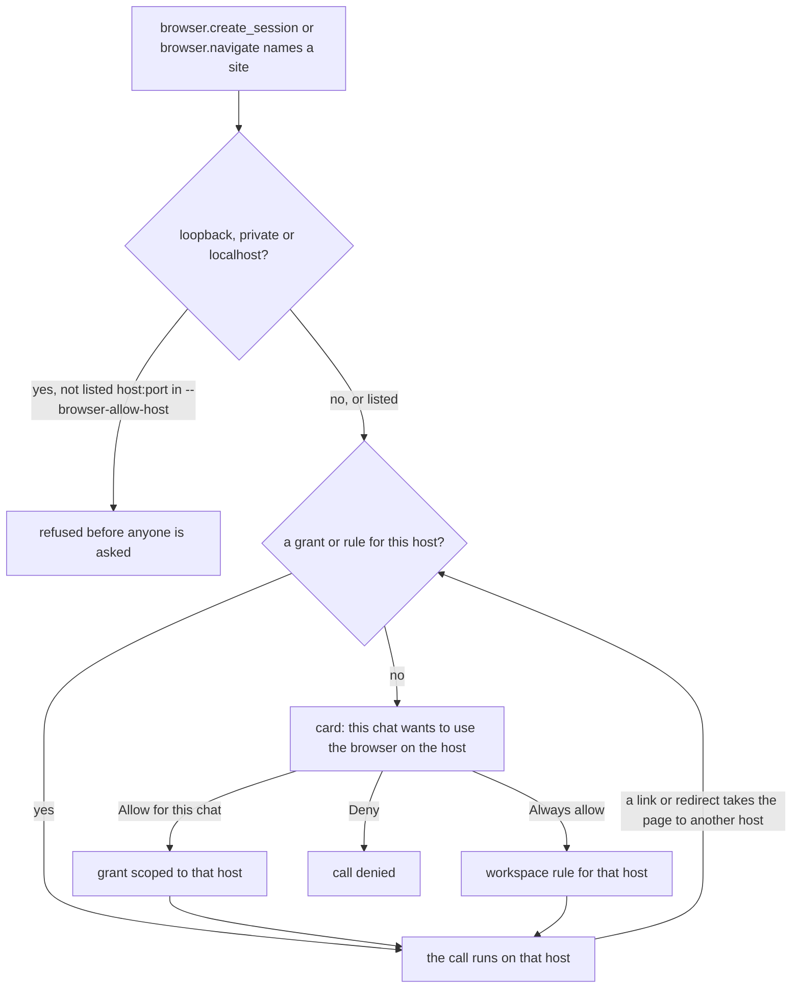

# The agent's browser

This covers the browser Tavi drives for a task: how it runs and what it keeps
between sessions (its profile), how it is allowed, the `browser.*` tools and the
rules they hold to, the models it uses, browser history, the live view in the
web canvas, handing the page to you and taking it over, and the `tavi browser`
commands. Browser permissions in the wider approval model are in
[SECURITY-MODEL.md](SECURITY-MODEL.md); every flag is in [CLI.md](CLI.md).

## Installing it

The browser tools (`browser.*`) and the PDF rendering behind `reports.generate`
drive headless Chromium through Playwright. It is an optional peer of
`@tavi/plugin-browser`, not a dependency, so an installed Tavi carries no
browser. Install it where Tavi is installed: beside a local install, or with
`-g` beside a global one.

```bash
npm install playwright
```

```bash
pnpm --filter @tavi/plugin-browser exec playwright install chromium
```

Without Playwright, or with Playwright but without its Chromium, Tavi runs as
usual and does not offer the agent the browser's tools, so a chat goes to web
search and `web_fetch` instead of asking you to approve a browser that cannot
open. Install Chromium while the owner runs and they are offered within half a
minute. A report render fails with `CAPABILITY_MISSING` naming these commands,
and the renderer reports itself unavailable. A checkout of this repository
already has Playwright, as a development dependency, and `pnpm install` there
installs its Chromium too (the root `postinstall`). Playwright skips a
Chromium it already has, so a later `pnpm install` costs a moment, and one
that brings a newer Playwright brings the Chromium it wants. It never fails
the install: offline, it says so and names the command above. It is skipped
in CI and when `TAVI_SKIP_CHROMIUM=1` or `PLAYWRIGHT_SKIP_BROWSER_DOWNLOAD=1`
is set. `tavi doctor` says whether there is one (`browser.chromium`).

A process launches Chromium on its first browser session and shares it across
the rest. Closing the runtime — the end of an in-process `tavi run`,
`tavi approvals approve|reject` or `tavi artifacts --resume`, or `tavi serve`
shutting down — closes any session still open (recorded in browser history as
"owner restarted") and then Chromium, before the database closes, so the
command exits and releases the data directory.

## How the browser runs

The agent's browser is Chromium in its headless mode (the full browser, not the
stripped headless shell), presenting itself as a desktop Chrome on the host's
platform with your locale, language and timezone. It runs without the
"controlled by automated software" switches. You see it only in the live view.

- **macOS:** the full Chromium, with Chromium's own sandbox turned on.
- **Windows** (once `tavi serve` runs there): as on macOS, Chromium's own
  sandbox is the boundary. Names are resolved only by Tavi's proxy, never by
  the network's resolver around it; a site is never offered your Windows
  sign-in (NTLM or Kerberos); and a `file://` URL naming a network share is
  refused, as it would reach that server around the proxy.
- **Linux:** confined, so a compromised page cannot read your files or Tavi's
  data. It is the full Chromium where that starts confined, else Playwright's
  headless shell (`TAVI_BROWSER_LINUX_CHROMIUM=auto`, the default;
  `headless-shell` always uses the shell, and any other value is ignored with a
  warning). Either runs inside the same sandbox as
  `sandbox.run` (see [SANDBOX.md](SANDBOX.md)), with Chromium's own sandbox
  nested in it, reading neither your home, Tavi's data directory nor any
  `--fs-root`, and writing only its profile and a scratch folder (its downloads
  land there). Its CPU and memory are capped, and it reaches the web through its
  own proxy, which never connects to this host (loopback, by number or as
  `localhost`) or a link-local address such as the cloud metadata service;
  other hosts on your network stay reachable, as from your own browser. On
  Linux the browser needs the sandbox to work (`tavi sandbox check`). `tavi
  serve --sandbox-tier unavailable` runs it unconfined, with only Chromium's own
  sandbox where the host allows it (a warning says when it does not).
- **Headed:** `TAVI_BROWSER_HEADED=1` (set for `tavi serve`) opens a real window
  instead, placed off-screen; on Linux that window runs unconfined.

`tavi doctor` shows how the browser is bounded (`browser`) and counts open
sessions (`browserSessions`). Its `browser.chromium` says whether Playwright's
Chromium is there to launch: `missing` (with the command that installs it in
`browser.install`) explains a chat that is never offered the browser's tools,
as after a Playwright update that wants a newer Chromium than the one installed.

### The profile

Each workspace keeps a browser **profile** under
`<data-dir>/browser-profiles/<workspace>-<hash>/`: cookies, the choices made on
consent banners and the sites you signed in to when the agent handed you the
browser carry over to later sessions. Because every session shares it, every
browser read counts as personal data. Settings → General → **Clear browser
profile…**, or `tavi browser clear-profile [--workspace <id>]`, forgets it and
closes the workspace's open browser sessions first.

A session opened with `profile: "ephemeral"` (`browser.create_session`) uses
none of it: a signed-out browser context with no stored cookies, which keeps
nothing when it closes. The model is told to prefer it for a task that needs
no sign-in. Once a chat has read content Tavi does not trust, opening a
session on the profile asks first, whatever the page ("this call opens the
browser with your profile"), unless you already approved one in that task;
a run nobody attends is refused and told to open a signed-out one ([SECURITY-MODEL.md](SECURITY-MODEL.md)).

### Signed agent identity

Off by default. With an operator key, the browser's page requests and
`web_fetch` carry an Ed25519 HTTP Message Signature (RFC 9421, the IETF
`webbotauth` profile), so a site that checks for it can tell Tavi from a bot
pretending to be a browser. Only a page's own document is signed; its images
and scripts are not.

```bash
openssl genpkey -algorithm ed25519 -out ~/.config/tavi/agent-signature.pem
export TAVI_AGENT_SIGNATURE_KEY_ID="my-agent-key"
export TAVI_AGENT_SIGNATURE_KEY_FILE="$HOME/.config/tavi/agent-signature.pem"
export TAVI_AGENT_SIGNATURE_AGENT="https://agent.example.com"   # optional: where the public key is published
```

`TAVI_AGENT_SIGNATURE_PRIVATE_KEY` takes the key itself (PEM, or a 32-byte seed
in hex or base64) when a file is not used. Neither variable reaches Chromium or
a sandboxed command.

### Sessions stay open

A session is kept open when its task ends (`ENDED` in the history), so the
chat's next turn finds its pages and sign-ins as they were. It holds a browser
context in memory until it is closed, or until its chat has left it idle for
`browser.sessionIdleMinutes` (30 by default, at most 1440; `0` keeps it until
it is closed), when it closes as `idle` and its profile keeps the sign-ins. A
person holding the page (a takeover, or a handoff still waiting) keeps it open:
it is checked again once it has been idle that long once more. A turn that uses
it again keeps it open, and the count starts again when that turn ends. While it
is kept, the live view says "Tavi has finished; the page is kept." over its last
picture, and **Take control** still takes it ([Taking control](#taking-control)):
a form the agent filled is there for you to check and submit yourself. Close it
with **Close
browser** in the canvas, `tavi browser close <session-id>`, or `tavi browser
close --inactive` for every session whose task has ended. A session belongs to
the chat that opened it, and to that chat's sub-tasks (the workers it
delegated to), whichever of them opened it: every `browser.*` call that names
a session from another chat or another workspace is refused, `close` included.

## Allowing the browser

How a browser call is decided, per host:



The first browser call of a chat asks one question, "This chat wants to use the
browser on example.com", naming the site it asked for. A decision allows the
browser **on that site only**:

- **Allow for this chat**: the browser on that site, for the rest of this chat
  (in Home or a messaging chat it says **Allow until tomorrow**: a day, or
  until the chat rolls over). Opening another site asks again, and so does the
  next click, typing or screenshot on a page a link or a redirect took the
  browser to on another site: a browser call is held to the host its page is
  on now, and a call whose page moved to another host after it was decided (a
  timed script, a late redirect) is refused: observe the page and act again.
  Once the chat has read web or document content, opening a page asks once
  each time, unless the chat has seen its exact address or the page is on
  that site with no query or fragment and a path your messages name
  (`/login`); typing asks once each time (see
  [SECURITY-MODEL.md](SECURITY-MODEL.md)).
- **Always allow**: a workspace rule per browser tool for that site; the
  browser never asks again there (remove them in Settings → Permissions). Not
  offered once the task has read web or document content; allowing it for the
  chat still is.
- **Deny**, with an optional reason.

"Use the browser" with no site allows only what reaches nothing (a screenshot,
closing a session): opening a page, a click, typing, a submit and acting by
sight are asked about on their own site. A browser grant or **Always allow**
rule that names no site never covers a call that names one; a rule you wrote with `tavi permissions add` or a
`serve --allow` flag still does.

**This machine and your private network are never opened by an approval.** A
host that is, or resolves to, a loopback, private (RFC 1918, ULA), link-local
(including the cloud metadata service at 169.254.169.254), carrier-grade NAT or
other non-public address, and every `localhost` name, is refused unless the
operator lists its `host:port` exactly with `--browser-allow-host`
(`127.0.0.1:5173`, `nas.lan:80`; a bare entry opens no port of it). The browser tools refuse such a
URL before anyone is asked, and the rule is enforced at the network layer: the
owner runs an egress proxy for the browser (on 127.0.0.1, one per browser,
answering only the browser's own per-launch credentials), and Chromium sends
every connection through it — loopback included, WebRTC only through it (no
direct UDP), and no QUIC. A launched browser runs only once a request of its
own is seen at the proxy, so a managed policy that sets another proxy stops it.
Every request passes through a route of the browser's own as it is (Playwright
otherwise never lets through a request Chromium sends again with the client
hints a site's `Critical-CH` header asks for, as every Google page does). The proxy checks each connection's host, resolves a
name once and connects to the address it checked, never resolving it again, and
refuses the rest with a 403 (the owner logs a warning naming the host; the full
URL is not logged). So every request is held to the rule wherever it comes
from: a page, each redirect hop, a script's fetch, an iframe, a dedicated,
shared or service worker, a WebSocket, a new tab, what Chromium prefetches or
prerenders for a page's speculation rules, and a WebRTC relay; and a name that
answers differently the next time (DNS rebinding) reaches only the address that
was checked. A name that resolves to a private address is refused like the
address itself; a name that does not exist is refused; a name that cannot be
checked (a resolver timeout or error, or too many names resolving at once) is
refused, and a domain whose name timed out is refused at once for a few
seconds. A person who takes the page over in the live view is held to the same
rule.

On Linux, where the browser runs confined, its only way out of the sandbox's
network namespace is the sandbox's own proxy, and that proxy holds it to the
same rule instead: it refuses a loopback, link-local, metadata, private or CGNAT
address by number, drops such an answer for a name and connects to the address
it checked — the same guarantees, for every request, worker, new tab, prefetch
and rebinding name. There an opened private host is listed by its address
with its port (`--browser-allow-host 192.168.1.20:80`), since the sandbox's
proxy, not the owner, resolves names; and this machine's own addresses
(loopback included) are never reached by the confined browser, listed or not.

Every surface asks it the same way: `y` in `tavi chat`, a bare `approve` in a
chat, **Allow for this chat** on a Telegram button, and `tavi approvals approve`
without `--scope` all allow the browser for the chat. An email *reply* approves
one call only (the next page asks again); the email's links allow it for the
chat. The web inbox's plain **Allow once** (and approving a round that mixes
browser and other calls on the chat's card) also allows that one call only.
Settings → Permissions shows a task's browser grant as one row per site, and
revoking it revokes the browser on that site. A worker inherits what you allowed the task that
spawned it, so the browser is not asked about again for each worker.

Still asked about on their own, even when the browser is allowed:

- a form submit, upload or download;
- a click (or Enter, or Space) on a control whose label pays, buys, books,
  orders, confirms, sends or submits ("Place order", "Pay now"); "Apply" counts
  only on a control that submits its form ("Apply filters" and "Check all that
  apply" never do);
- Enter in a field, except in a search box or a field that suggests as you
  type, where it searches or picks;
- acting by sight (`browser.vision_act`), at high risk.

An upload names an approved artifact or a file in the chat's folders by `path`;
the approval then shows that file's name, size and sha256, approving it approves
that file (stored as an artifact you are recorded as having reviewed), and a
file changed since is refused. When a saved rule or a grant allows the upload,
nobody saw the file: it is stored pending review, nothing is uploaded, and the
task waits for the review. A schedule's `--allow` never approves it for you;
`tavi run --approval approve` does, as it approved the upload call, and the
model then uploads it by its `artifactId`.

**When nobody is asked.** `tavi run --approval approve` and a schedule's tool
policy run browser calls but never open a site off `--browser-allow-host`
(repeatable; exact host or `*.suffix`). An unset list denies every absolute
destination; a relative navigation stays on an origin already vetted, and a
non-`http(s)` scheme (`file:`, `data:`) is refused without asking. A URL with
no scheme is a path on the session's page, resolved before anything is checked,
and that same address is what opens (`127.0.0.1.example.net/x` on
`https://example.com/` opens `https://example.com/127.0.0.1.example.net/x`,
never that host); with no page open, a bare host (no `https://`) is refused
before you are asked. `web_fetch` and
`http.request` reach only `--http-allow-host` hosts, where a call can still stop
on a card, depending on what the chat has read, and point the model at the
browser for any other, so a site you name is read with the
browser, after one question.

### The navigation allowlist and private addresses

The private-address and proxy rules above apply to every destination.
`browser.navigate`'s destination is model-authored, so it is operator policy
like every other model-chosen destination in this runtime. This is the control
that stops an approved artifact from being uploaded to a host the model picked
unasked; the workspace and review-state gates on
`browser.act {kind:"upload"}` are independent of it.

A browser session also belongs to the workspace and the chat that opened it: the
tool boundary records both and refuses every tool that names the session
(`navigate`, `observe`, `read`, `structured`, `act`, `batch`, `capture`,
`extract`, `find`, `vision_act`, `close`) from another workspace ("that browser
session belongs to another workspace") or another chat ("... another chat"),
so a task cannot drive, upload through or close a session it did not open. A
worker a chat delegated to counts as that chat, so it reaches the chat's
session, and the chat reaches one its worker opened; a side chat is a chat of
its own. A session the running process did not open is left to the browser,
which refuses an id it does not know.

## The tools

| Tool | What it does |
| :--- | :--- |
| `browser.create_session` | Open a session; with `url`, open and observe the first page in the same call (so the permission question names the site); `profile: "ephemeral"` for a signed-out one |
| `browser.navigate` | Go to a URL and observe it |
| `browser.observe` | Observe the current page again, or part of it (`scope`: main, dialog, form, or one element's part) and only what a person acts on (`filter: "interactive"`) |
| `browser.read` | The page's text, in pieces of up to 16,000 characters (`nextOffset` continues) |
| `browser.structured` | schema.org JSON-LD and microdata as records, without a model |
| `browser.extract` | Records of a shape the agent gives: from the page's published schema.org data when that answers every field, else read from the whole page by a separate model |
| `browser.find` | An element by what it is for ("the return date field"), among all the page's elements, by a separate model |
| `browser.act` | One action: click, type, submit, upload, download, select, hover, drag, press, scroll, back, tab, wait_for |
| `browser.batch` | Up to five `browser.act` steps in one call, or twelve that only fill a form |
| `browser.vision_act` | A sub-task done by sight, by a vision model, one action at a time |
| `browser.capture` | A screenshot: for the model (`forModel: true`) or kept as an artifact for you; with Set-of-Marks (`marks`), or cropped to a ref or region |
| `browser.request_handoff` | Ask you to act in the page yourself (under `tavi serve` with the live view) |
| `browser.close` | Close a session |

Every browser tool's output is untrusted web content: the page's words reach
the model as data, never as instructions (see
[SECURITY-MODEL.md](SECURITY-MODEL.md)).

### Observations

An observation lists what a model can use of the page, in page order: links,
buttons, form fields and actionable elements with their text (or label,
`aria-label`, placeholder or image `alt`), and non-actionable leaves such as a
`role="status"`. It leaves out what is not rendered, hidden inputs, elements
with nothing to say and container roles whose text is only their children's. A
native field carries its implicit role (`textbox`, `searchbox`, `combobox`,
`checkbox`, `radio`, `button`, `file`), what it holds (`value`, never a
secret's) and its state (`checked`, `expanded`, `selected`, `disabled`); an
element under a banner or modal is marked `covered`.

- At most 60 elements and 8,000 characters are listed, the page's content
  first, then the site chrome's fields and buttons, then its links;
  `elementsOmitted` counts the rest. Text is clipped to 120 characters.
- A link carries its absolute `href` (tracking parameters such as `utm_*` and
  ad click ids removed), so the agent can navigate to it directly; each `href`
  appears once.
- An element inside a list item, table row, article or card (a class named
  `card` or ending in `-card`) carries `context`: that container's heading and
  leading text, without the element's own label, up to 60 characters, so three
  "Book" buttons say which flight each one books. Same-named controls in
  different rows stay separate entries.
- Headings (`h1`–`h3`, `role="heading"`) are listed with the page's status
  text; `filter: "interactive"` leaves both out.
- A frame of the page (up to eight, each at least 40 pixels on a side) lists its
  elements with refs of its own (`f1:el-4`) and the frame's origin. A frame on
  another host is read only when the session may open that host: the page's own
  host, one a person allowed for this session, or one the browser opens unasked
  (`--browser-allow-host`, an enabled site profile). Any other shows as one
  entry, `f1:frame` with `frame: "<host> (not allowed)"`, and nothing inside it
  is listed, read or acted on.
- A ref (`el-<n>`) names the same element for the whole session, so a page
  observed again keeps the refs the agent knows. Observing the same document
  again (a scoped `observe`, a `find`) keeps the earlier epochs valid, up to
  the last 16; a new document, a navigation, `back` or a tab switch makes them
  stale. A stale ref the latest observation still lists says which epoch to
  act with. Acting by sight leaves the refs stale until the next observation.
- `browser.act` and `browser.batch` take a ref without its epoch: it is the
  latest observation's, acted on only where that observation saw it (one that
  moved is refused rather than found again by its label), and the outcome
  says `acted with epoch N`.
- An observation's elements reach the model as one line each, as
  `el-4 link "Next" ["Results"] → /p/2` (ref, role, text, context, value, state,
  link, flags such as `{submits, secret}`), a link on the page's own site made
  relative, with the format named once beside them. That is about a third of
  the words of the structured list, which everything else keeps: the stored
  result, the approval card's checks, site recipes and digests read the
  elements as they were.
- Once a session is observed again, older observations are sent to the model as
  digests (their links, no refs, and the epoch that replaced them), in strides
  so a provider's prompt cache is not invalidated on every call. The task's
  transcript keeps them whole. The details are in
  [What a session records](#what-a-session-records).

`browser.navigate` waits for the page's document, then briefly for it to load
and settle. A click that leaves the page waits up to 10 seconds for the
destination and says which page it now shows.

A click that opens a new tab moves the session to that tab and keeps the page
that opened it: with two or more pages open, an observation lists them in
`tabs` (index, URL, title, the active one marked), `browser.act` with
`kind: "tab", tab: <index>` switches to one, and `back` on a new tab with no
history of its own returns to its opener. A session keeps at most five pages,
closing the oldest one it is not using. When a popup closes by itself, the
session goes back to its opener and the next observation says so once
(`popupClosed: true`).

To read a list and then its entries without losing the list, `browser.act`
with `kind: "open_in_tab"` opens a link (its `ref`, which opens the link's
`href`) or a URL (`value`) in a new tab, and the list stays open in its own.
It is asked about and checked as a `browser.navigate` to that URL is — the
same card for its host, the same rules (a rule on `browser.navigate` holds it
too), the allowlist, the site profiles and the refusal of other schemes and
private addresses — so a new tab never opens what a navigation could not.
`kind: "close_tab"` closes a tab (`tab: <index>`, the active one by default)
and shows the page that opened it; the session's last tab is never closed this
way (the action is rejected and says to use `browser.close`). Refs
from another tab are stale after a switch, so act on the observation the
action returns.

### Reading a page

- `browser.read` returns the page's rendered text (its largest `main` or
  `article` when that holds most of it). It waits up to 5 seconds for a page to
  settle, and up to 10 more while it still looks to be loading (a progress bar,
  a "Loading…" line); if it still is, it says so in `stillLoading`, so the model
  reads again or reports that the results never came. A page that shows an
  error ("Oops, something went wrong") comes with `recovery`: the Reload or Try
  again control to use before looking elsewhere.
- `browser.structured` reads the data a page publishes for machines (job
  postings, businesses, opening hours, offers, reservations, lists, articles,
  posts, forum threads, videos) as records, its hidden text dropped. The agent
  tries it before `browser.extract`.
- `browser.extract` reads the page's text and links into records of the shape
  the agent asks for (each flight with its airlines, times and price; each
  product with its price), at most 100. It says when the page holds more than
  it showed (`complete: false`); a record that does not fit the shape gets one
  repair, and what still does not fit is counted (`invalid`) and left out.
  It reads the schema.org data the page publishes first: when that answers
  every field of every record, it returns those records (`source:
  "structured"`) with no model call; when it answers part, the model is shown
  it beside the page's text.
- `browser.find` observes the page afresh, all of it, and picks up to five
  elements that match a description, with the epoch to act on them. Its
  answer is capped at 1,000 tokens (an extraction's at 12,000), and both ask a
  reasoning model for low reasoning effort: its thinking counts against the cap.

A task keeps the records it gathers (what `browser.extract` reads, and what
`findings.add` saves), so a long search that shortens its conversation still
answers from everything it found (`findings.list`). `findings.check` holds them
to the request's constraints in code and names the best that pass.

### Acting

`browser.act` acts on an element from the latest observation (by ref and epoch)
or on the page:

- `click`, `type` (with `mode: "keys"` for a field that suggests as you type,
  and `clear: false` to append rather than replace), `submit`, `upload`,
  `download`, `select` (an option of a drop-down, native or the site's own),
  `hover`, `drag` (to another ref, `toRef`, or by `dx`/`dy` pixels);
- `press` (a key), `scroll` (`down`, `up`, `left`, `right`, `top`, `bottom`, or
  to a ref), `back`, `tab` (`tab: <index>` from `tabs`), and `wait_for` (text
  to appear, `url:<part>` for the address, a ref for its element, or nothing
  for the page to go quiet).

Each action says what it changed (`changes`: the URL, a field's value, a list or
dialog that opened), so the model checks rather than assumes. When the action
moved the page, opened or closed a list or dialog, or changed the elements
(typing that suggests, a submit, a select), the outcome carries the page
observed afresh as `page`, and the model acts on its refs without observing
again. After a submit or another call asked about as one, the outcome adds
`verify`: the changes and the page's status, alert and heading text, with a note
to confirm the commit worked before reporting success.

- **Timeouts.** An action gives up after 8 seconds and a navigation after 15
  (`timed out after 8 s`); `timeoutMs` sets an action's own limit, and how long
  a `wait_for` waits (5 seconds by default, at most 15). An observation whose
  page does not answer its scan within 10 seconds fails, saying so, rather than
  waiting out the tool's own timeout.
- **Stop.** Stopping the turn interrupts the action in flight. A step Chromium
  was already running may still land; the session's next action waits for it
  to finish first, so the two never act on the page at once.
- **Errors.** An action that failed or changed nothing comes with
  `networkErrors`: the HTTP errors (400 and up, for the page or its scripts'
  requests, addresses without query) and uncaught page errors since that action
  began, at most ten.
- **Refs are checked again.** Just before it acts, the browser finds the ref's
  element again in the page. When the page re-rendered and the element sits
  elsewhere, it acts on it there only if exactly one element still matches it
  (its tag, role, id, name, type, label and link), and says `<ref> moved; acted on it by its label`; when none or several
  match, it is refused (`changed or disappeared: observe again`). A ref whose
  element could not be checked (the read failed or timed out) is refused, not
  acted on blind.
- **No progress.** After four actions in a row that changed nothing, the
  outcome says so; after six, the next is refused before it runs, until the page changes.
- **Scrolling.** An outcome says how far it scrolled (`scrolled to 2400 of 9000
  px`), and `(end of page)` only when two scrolls at the very bottom found the
  page no longer growing.
- **Dense pages.** An observation that left out more than 40 elements, or a read
  with more to come, adds a hint to use `browser.find` for a control not listed
  and `browser.extract` for dense tables.

**Downloads.** A `download` stores the file as an artifact pending review, named
in the outcome's `artifactId`, and the turn waits on that review as it does on a
screenshot's: once you approve it (`tavi chat`'s review card, the canvas,
`tavi artifacts approve`, or `tavi run --approval approve`, which approves it
for you) the model reads it with `artifacts.read`, labelled as a download from
that page, and it is copied into `downloads/` in the chat's own folder. It may
take 60 seconds and be at most `browser.downloadMaxMiB`
(256 MiB by default, at most 4096); a larger one, by its declared length or as
it streams, is cancelled. A plain click that starts a download keeps nothing:
the download is cancelled, and the outcome says to fetch it with
`kind: "download"` on that element, which is asked about first. A PDF the
browser opens or downloads is read through Tavi's PDF engine, so `browser.read`
returns its text; a PDF the engine cannot read has none. A file a
`browser.navigate` downloads is held to the same 60 seconds and the same cap
(cancelled past either, or when the call is cancelled), and a PDF the browser
opens inline is read only up to 64 MiB: a larger one, by its declared length or
as it streams, is shown but has no text.

**Dialogs.** A JavaScript `alert` is accepted. A `confirm`, `prompt` or
`beforeunload` ("leave with unsaved changes?") is dismissed, on a background
tab too. Each one on the session's page is reported: the last as `dialog: { type, message,
handled }`, and all of them in order as `dialogs` when there was more than one
(a dialog raised after an action returned comes with the next). To accept one, the
agent arms the action that raises it with `dialog: { accept: true }`, which is
asked about first as a submit. When the session dismissed a dialog on that site
before, the card names its message and what it would commit (paying, sending,
account, legal, destructive, else a confirm), and the accept applies only to a
`confirm` or `beforeunload` asking exactly that, once; another dialog the page
raises instead is still dismissed. Answering a `prompt` with text is refused: the
person does it in the live view (`browser.request_handoff`).
`browser.navigate` never leaves a page that asks to keep its unsaved changes:
it says so, and the changes are saved first, the page is left through a link
with `browser.act` and `dialog: { accept: true }`, or the person takes the page.

**Batches.** `browser.batch` runs up to five steps in order — up to twelve when
every step only fills the form (a type with no Enter — no newline at all when
typed key by key, which presses Enter wherever it sits — a select, or a click on
an observed checkbox or radio that submits nothing; a longer batch with any
other step is refused before its card) — and stops at the
first that fails or is refused, moves the page (a new address, or a step that
answers a fresh `page`, except a `select` that leaves the page where it was),
or opens or closes a list or dialog. A step marked `optional: true` that fails,
or whose element is missing, is recorded as skipped and the batch goes on; a
refusal is never skipped. A submit, upload, download, dialog accept or Enter
outside a search box goes alone, through `browser.act`. A batch is asked about
for every host its steps act on: the page's, and that of each frame a step's
ref (or a drag's `toRef`) is in, so one that reaches into a frame on another
site asks about that site too, as the step sent alone would. Its card names
each step by the field it acts on and lists each value typed or picked under
that field (`“Full name” ← Jordan Ellis`; a secret field's value is left out),
and a `browser.navigate` card names the page's path, not only its site
(`Open 127.0.0.1:52003/record/1881 in the browser`).
A key sent with no ref (a `press` without one, or keys typed by sight) goes to
whatever has focus: when a Tab has moved focus into a frame on a site the call
was not decided on, it is refused, with a note to target that frame's element
by its ref so the call is asked about on that site.

`browser.vision_act` hands a step element actions cannot do (a canvas, a map, a
seat plan, a date picker drawn its own way) to a vision model that sees the
page and clicks, types, presses, scrolls, drags and waits on it one action at a
time (12 steps by default, at most 30), on the same page. It is asked about on
its own, at high risk, and is told never to sign in, pay or confirm a purchase.
Once the chat has read the page, a run nobody attends (`tavi run --approval
approve`, a schedule) never acts by sight: only a person can approve it.
A step the vision model calls done after acting is checked against the page:
when its address, title and controls (values included, compared and never
shown) are as they were before it acted, the result is `done: false`, its
summary beginning "not confirmed", and the agent looks at the page itself.
Each whole-page screenshot it sees carries Set-of-Marks: a box and ref label
drawn on every listed element, so it clicks or types into a marked control by its ref
(`click_ref`, `type_ref`, run as `browser.act` with the same checks) and uses
pixel coordinates only for what has no mark; it can zoom into a region of the
screenshot at full resolution, unmarked. The vision model sees only the newest
screenshot: each earlier one is described as earlier once a newer one comes,
and keeps that description, so every step's request matches the last one's up
to its newest result.

`browser.visionEngine` (experimental, `generic` by default) chooses what drives
it. `native` hands the step to the model's own computer-use tool where its
connection offers one: a native Anthropic connection (Claude's computer tool,
the version its model takes) or OpenAI's own API. Every action it asks for is
still run by the browser, with the same checks as acting by sight; an action
with keys held down is refused; a vendor's safety confirmation ends the step
and comes back to you, never acknowledged on your behalf; Stop cancels the
action in flight. Any other connection, and a local connection always, keeps
the generic loop, and so does a model whose vendor refuses its computer tool:
the first refusal moves that step to the generic loop, and the model stays on
it until `tavi serve` restarts.

A model that makes the same call twice in its last twelve since you last spoke
with the same answer — the same tool and arguments, idempotency keys, nonces,
request ids and timestamps aside — or two calls that keep taking turns (A, B,
A, B) with the same answers, is told it is looping; the same call a fourth
time is refused, not run, and a fifth asks you how to go on (an unattended run,
where nobody can be asked, keeps refusing). Polling whose answer changes, a
read made again after a change to check it, and several reads made together
in one step never count. When a turn's step budget runs out, its final answer
is given the task's findings.

### What the browser refuses

- **Commits not approved.** Commit controls are grouped into five categories —
  paying or buying, sending or posting, account or authorization, legal
  acceptance, and destructive actions (such as deleting or cancelling a
  booking, subscription or account) — across English, German, French, Spanish,
  Dutch, Swedish, Italian, Portuguese, Polish and Bulgarian, plus any form
  submit control outside a strict search form. Pressing Enter in a strict
  search form (`role="search"`, or a form whose visible text fields are all
  search-like and that contains no password, email, phone, file, textarea,
  secret or protected field) stays an ordinary browsing step. The browser reads
  the control again just before it presses, where the page's script cannot
  reach: one whose label became a commit since it was observed, or a press
  that sends its form (its submit control, even one outside the form that
  names it, or Enter in its field) when the call was not asked about as a
  submit, is refused — the agent is told to observe the page again and act on
  the element from it, so its card asks about the press — and acting by sight
  never commits or sends a form. A
  drop-down counts as search-like: a query with its filters is still a search.
  The check fails closed.
- **Protected form fields**, on any site: equal-opportunity and demographic
  questions, disability or veteran status, criminal history, attestations ("I
  certify", that you completed an application yourself, its use of AI, terms
  you accept), a signature, consent to a background check, and a clinic's
  medical intake (history, symptoms, conditions, health questionnaires, current
  medication, consent to treatment). They are recognised in English, German,
  French, Spanish, Dutch, Swedish, Italian and Portuguese, and medical intake in
  English, German, French, Spanish, Portuguese, Italian, Polish and Dutch. A protected field is refused when the call is assessed and again
  in the page, by the field's own name, id and labels, by reference or by sight;
  a field the page hides from a person (a honeypot) is never filled either. You
  fill those yourself in the live view.
- **Secrets.** A password field, and any field whose `autocomplete`, name, id,
  label or placeholder names a password, a one-time code, a PIN, a card's
  number, code or expiry, an IBAN or an SSN: an observation marks it `secret`
  and never lists its value, a change summary never says it, and a screenshot
  for the model never shows it. Typing or picking a value into one is refused,
  when the call is assessed and again in the page; the person fills it
  (`browser.request_handoff`).
- **Challenges.** A page that stands in the way (a captcha, a bot wall, a rate
  limit or virtual waiting room, a consent wall, a sign-in) is named in the
  observation (`blocked`), with what to do: hand it to you with `browser.request_handoff`, or get the
  information elsewhere. A click, key or text on a captcha or bot-wall page, by
  element or by sight, is refused, and so is a click on a captcha's widget
  embedded in an ordinary page (a Turnstile or reCAPTCHA box). A rate limit is read only on strong signs:
  HTTP 429, a short page that says this client was limited, or one that
  mentions a rate limit and came back with an error status.
- **Consent banners.** A cookie banner is answered by the browser itself, after
  every navigation and whenever the page reaches another host,
  declining what is not essential (`consentDeclined` says which button it
  pressed). A banner that offers only "accept" is never accepted for you: one
  that covers the page is a consent wall (`blocked`), one at its edge is left
  alone.

### Screenshots for the model

`browser.capture` with `forModel: true` takes a screenshot the model looks at,
and a blocked or near-empty page comes with one by itself, never of a page with
a password, payment or one-time-code field, nor a host on the no-thumbnail
list. Only the latest three images are sent to the model; a model that reads
text only gets the result's fields and a note that the image was not shown.
Under the cache-stable prompt layout (`models.promptLayout v2`) up to six are
sent, the oldest three dropped at once when a seventh arrives, and every image
result reads the same whether its image is still sent or not, so earlier
requests' cached prefix still matches.
Without `forModel`, a screenshot is kept as an artifact for you to review.

`marks: true` draws Set-of-Marks on the screenshot: a box and ref label on each
listed element (`marks` in the result gives each one's box), drawn where the
page's own scripts cannot reach and on the copy only, never the page. `ref`
(with its `epoch`) or `region` (`{x, y, width, height}` in CSS pixels) crops
the screenshot to that element or area at full resolution, to zoom in; a crop
carries no marks.

### How the model is told to browse

When browser tools are offered, the model is told how to browse: open a search
directly by the address a known site gives, else use the site's own search form;
type into suggesting fields key by key; check what each action changed; follow
`stillLoading` and `recovery`; hand a `blocked` page to you or look elsewhere;
check at least three date pairs of a date window (each in its own browser worker
when workers are offered); and answer with the figures it read rather than
ranges, with a link where each can be checked.

Flight questions go to `travel.flights_search` first; with flight search off
(`tavi config set travel.flightSearch off`) it answers with the address that
opens the same search in the browser. The tool (`tavi.flights`) asks two
sources at once, sending each the trip: origin, destination, dates, the number
of adults, the cabin, the currency, the sort and the limits asked for, nothing
about you.

- **Kiwi.com's public MCP server** (`https://mcp.kiwi.com`, free and keyless),
  through the owner's own MCP client. Kiwi is a reseller: on the big airlines
  its fares include its own fee and often run well above the airline's, so
  every answer with its fares says so (`note`).
- **Google Flights**, unless `travel.googleFlights` is off. With a SerpApi key
  stored as the credential `serpapi` (Settings → General → Flight search, or
  `tavi credentials set serpapi`), it asks Google Flights through SerpApi
  (`serpapi.com`, 250 free searches a month, one per flight search), round
  trips included: a round trip's fares are the whole trip's price for the
  outbound flights listed, and its return is chosen on Google Flights through
  the fare's link. Without a key it reads Google Flights' own search page
  (`www.google.com/travel/flights`), which lists fares for one-way trips only:
  a round trip's priced fares are then Kiwi's alone, and the page is asked
  each way, its cheapest three one-way fares each way coming back as
  `oneWayFares`, a reference never added up as a round-trip price. An answer
  none of whose fares is Google Flights' tells the model to give its link
  first. Either takes airport codes, and the first
  date of a range. Google Flights has no official interface, so this is best
  effort.

Every fare names its `source`, and `sources` says how each one went: `ok`,
`empty`, `skipped` (with why: a round trip on Google's page, a place name) or
`unavailable` — a source that could not be read, which says nothing of the
flights. The answer keeps each source's three cheapest before the rest compete
on price, so the two can be compared. The tool holds the maximum flight time per
direction in code, leaves self-transfer off unless asked, and keeps the
itineraries as the task's findings of kind `flight`, each from its source. Its
answer carries a Google Flights search for the same trip (unless Google Flights
is off) and a Kayak search (when both ends are airport codes), which the agent
gives you with the fares, and which the browser uses when no source answers.

### Site notes, site profiles and recipes

- **Site notes.** The first time a session reaches a site Tavi knows (Google
  Flights, Kayak, Skyscanner, Booking.com, Google Maps), its observation carries
  the site's notes (`site`): the URL that opens a search directly, what to wait
  for, a schema for `browser.extract`, and whether the site blocks automated
  browsers. The notes are the built-in `tavi.siteskills` plugin's: disabling it
  (`tavi plugins disable tavi.siteskills`) leaves them out from the next owner start.
- **Site notes as data.** A note is a `tavi.sitenotes/1` JSON file: `id`,
  `name`, `hosts` (plain domains, each covering its subdomains; never a public
  suffix or a shared host), optional `paths` (globs, never regular expressions:
  `*` within one segment, `**` across them, a trailing `/**` the path itself
  too, so `/maps/**` is `/maps` and `/maps/dir/…` but not `/mapsfoo`), `notes`,
  and optionally `handoffNote`, `searchUrl` (on one of its own hosts) and
  `resultSchema` (a `{placeholder}` never in its host). A glob is matched in
  one pass over the path, never by a backtracking expression, so no glob can
  stall a lookup. The built-in notes are written this way. A plugin ships its own
  as files its manifest's `siteNotes` names, checked at install and reviewed
  with the version, and a note is on while you have the plugin's site of the
  same id on (`tavi apps sites <app> <id> on`, which takes a note's id too, for
  a note no site profile shares). Your own notes are the data directory's
  `site-notes/*.json`, each off until `tavi browser site-notes --on <id>`, and
  off again once its file changes; `tavi browser site-notes` lists them and
  `--off <id>` turns one off. Listing, `--on` and `--off` read and change the
  data directory, so they need `tavi serve` stopped (exit 5 while it runs). A
  plugin's or your note reaches the agent as reference notes on the site, not
  instructions: the page and your request decide where they differ. A note you
  turned on is taken before a built-in one for the same host (a note for the
  page's path still comes before one for the whole host), so a note for
  booking.com replaces the built-in Booking.com notes while it is on.
  `tavi browser site-notes --propose <host>` writes a site's recipe as a
  proposed note (off) in `site-notes/`, for you to review, edit and turn on;
  **Save as a site note** beside a recipe in Settings → General does the same
  through the owner (the `browser` command's `propose-site-note`, the same
  code), and says the note is off and how to turn it on. Neither writes over a
  note already there.
- **Recipes.** When `browser.extract` finds results, the steps that led there on
  that site (at most 12, each named by its element's role and label, never what
  was typed and never a label with an email address, a phone number or a run of
  digits) become the workspace's recipe for the site, shown (`recipe`) the next
  time a session reaches it. Nothing is replayed by itself, unless you mark a
  site's recipe: `tavi browser recipes --replay <host>` has a session that
  opens the site by `browser.create_session` or `browser.navigate` (not by a
  click), in a run you attend whose chat read nothing
  untrusted, run its steps before the model sees the page, each held to every
  check `browser.act` makes, stopping at the first that does not match or would
  commit (`--stop-replay <host>` undoes it). A workspace keeps recipes for at
  most 500 sites, forgetting the one used longest ago. `tavi browser recipes
  [--forget <host> | --forget-all]` and Settings → General list and forget them.
- **Site profiles.** A plugin can ship site profiles for the sites it browses,
  each off until you turn it on (`tavi apps sites <app> <site> on|off`, or the
  app's page in Connected apps). A profile's hosts open without
  `--browser-allow-host`, and its rules hold in code: pages per task and per day
  at a courtesy interval; a site Tavi never browses itself (`navigate: false`)
  only reads a page you opened; a site read for the chat only (`assist-only`)
  takes only a typed search and keeps nothing as a finding; on a site whose
  profile lets Tavi fill forms (`stage`), the final step is refused, never
  asked, so you review and submit yourself, and staged forms are counted per day
  (`stage.perDay`); a schedule or heartbeat reads only a `watchable` site, on a
  path its robots.txt allows (read by the owner at a public address its name
  resolves to, pinned; a name that resolves to a loopback, private or metadata
  address reads as unreadable, which disallows); and a captcha, bot wall or
  rate limit ends the site for the task. See [APPS.md](APPS.md) and [PLUGINS.md](PLUGINS.md).

### The browser worker

Every workspace has a built-in `browser` agent: `agents.spawn` with it hands one
browsing task (a site, a set of dates) to a worker that answers with records, so
a wide search runs as several workers whose results are compared. The worker is
offered only the browser, findings, flight search, `web_fetch`, its plan and the
plugin tools that ask for it (`browserWorker`), and has up to 40 steps a turn. A
workspace's own `browser` agent replaces it, without those limits. While
Chromium is not installed the built-in is not there (`agents.spawn` names the
agents that are), so a task for a worker goes to the general `worker` instead.

## Models

| Use | Model |
| :--- | :--- |
| The browser worker itself | The run's own model (role `main`) |
| Reading a page (`browser.extract`, `browser.find`) | The workspace's `extraction` role, else `fast`, else `main`, else the workspace default |
| Acting by sight (`browser.vision_act`) | The first that reads images of: `main`, its fallbacks, the workspace default, the other bound roles |

A workspace that configures neither roles nor a default inherits the default
workspace's. Set roles with `tavi models set-role` or Settings → Models.

## Browser history

Each browser session a task opens is recorded: the task, when it opened and
closed (and why), how many pages it saw, and each page's address and title.
Only the scheme, host, port and path of an address are stored: the query
string, the `#fragment` and any `user:password@` are dropped first, so login
tokens, one-time links and search terms stay only in the task's own transcript.
A click or form submit that leads to another page is recorded at once.

After a page is opened, observed or reached that way, a small thumbnail (320
pixels wide, at most one every 10 seconds per session) is kept for the Command
Center. It is never shown to the model or sent anywhere. No thumbnail is taken
of a page with a password, card-payment or one-time-code field, or with any
frame on a host in `browser.noThumbnailHosts`. The default list is common
webmail and payment hosts (`mail.google.com`, Outlook, Yahoo and Proton mail,
`*.paypal.com`) and `*.bank`; set your own:

```bash
tavi config set browser.noThumbnailHosts "mail.example.com,*.bank"   # none: no host; unset: the default
```

History is kept 30 days: the owner deletes older sessions, with their visits
and thumbnails, on its retention sweep whatever `--retention-sweep-artifacts`
says. A session left open when the owner stopped is closed as "owner
restarted" at the next start. Deleting a task deletes its sessions.

### What a session records

A session's close reason is `closed` or `owner restarted`. Besides its page
count it keeps the last page's URL and title, and one visit row per page;
observing the same page again adds none. A non-web URL keeps only its scheme (`data:`). Titles are clipped to 300 characters with
control characters removed; `browser.navigate` and `browser.observe` return the
page's `title` when it loads within a second. A `browser.act` click or submit
that takes the page elsewhere is recorded with its title, as a navigate is.

An observation is sent whole only until the session is observed again. After
that each later model call gets a digest in its place, with no refs:
`{sessionId, epoch, url, title?, superseded, links}`. `links` holds the
observation's `{text?, href}` pairs, so a task that read a results list and
opened one article can still open the next one. `superseded` names the epoch
that replaced it and says the refs are stale.
When the session later observes the same URL again, the older observation
becomes that one-line stub without `links`, since the newer one lists them. The
session's latest observation is always sent whole, and so is any observation
whose digest would be no smaller. A `browser.create_session` result's `page` is
shrunk the same way. This happens only in what the model is sent. The task's
checkpoint, its transcript and the archive of a compaction fold keep every
observation whole. The digest depends only on the observation and the one that
superseded it, so the same history is sent as the same bytes on every call, and
an observation changes form at most twice. Links are most of a digest.

A rewrite of an older observation changes the request's prefix, so a
provider's prompt cache has to take every message after it again, at a cache
write's price. The digests are therefore applied in strides: an observation
is shrunk only once the conversation has grown about 120,000 characters
(≈35,000 tokens) past a whole-stride mark beyond it and the observation that
replaced it, and all such observations switch together. The model's view of a
growing conversation changes once per stride rather than on every navigate. A
short task (a news-research run's 8 observations and 7 reads come to about
75,000 characters) sends every observation whole. Shrinking each one as soon
as it was superseded saved some 12–14% of each call's conversation, but on an
Anthropic model it left every other call reading back only the system prompt
and tools: cache writes were 169,000 of 747,000 input tokens, against 35,000
of 507,000 with the stride.

A thumbnail is taken once the call has answered, as a JPEG stored as an
internal artifact (`purpose: "thumbnail"`, approved, recorded against the
task). `artifacts.view_image`, a chat attachment, a `browser.act` upload and
the `artifacts` listing all treat it as absent. The sensitive fields are a
password, a payment field (`autocomplete` of `cc-number`, `cc-csc` or
`cc-exp*`) and a one-time-code field (`one-time-code`); such a page, or one
with a frame on a host in `browser.noThumbnailHosts`
([`tavi config`](CLI.md#tavi-config)), also clears the session's earlier
thumbnail. The page is checked again once the image is taken, and the image is
dropped if the page changed or became sensitive meanwhile. A new thumbnail
replaces (and deletes) the previous one. `browser.capture` screenshots and
`browser.act` downloads carry their task as the artifact's run.

The Command Center's Browser section reads this history through `browser` and
`artifacts read` ([Browser history from an attached client](IPC.md#browser-history-from-an-attached-client)).

### The Command Center's Browser section

**Center → Browser** shows the sites the agent is on or was on in the last 30
days, one card per session: **Open now** for sessions still open (each with a
pulsing **Live** pill and a duration that moves every minute), then **Earlier**,
newest first, with **Load older**. A card shows the last page's thumbnail (or
the host's first letter where none was kept), the task's title, the host and
page title, and "12 pages · 18 min" (a closed one also says the day), with the
person when more than one uses the workspace. **Show visits** lists each page
with its time as host and path. Clicking the card opens the task in the chat at
the call that opened that browser session. The list follows the owner's change
feed, read again at most every five seconds while the agent browses.

The two newest live cards show the page live, in the browser view (its
`center.browser` placement; `tavi plugins ui place` moves or hides it), with
**Take control**; the others keep their thumbnail. A session whose task has
ended stays under **Open now** with an **Ended** pill, its duration stopped at
the task's end, and **Take control** for the page it kept, until **Close
browser** on its card closes it. With nothing
browsed it says "Nothing browsed in the last 30 days."

## The live view

The built-in UI plugin `tavi.browserview` shows the agent's browser in the
canvas while it browses for a chat: in a strip at the top of the chat panel and
in the panel's **Browser** tab. It shows the page as it changes: its address and
title, a status (**Live**, **Loading**, **Paused**, **Hidden — sensitive
page**, **Ended**, **Needs you**, **You're in control**), and a box over the
element a click or typing is on, which follows the page if the action scrolls
it, with **Open in transcript** (the call that did it) and **Expand**. With
several sessions (a sub-agent's too, labelled with that agent's name) a switcher
picks one. While a submit, upload or download waits for your approval, the view
outlines its target on the page (dashed), until it runs or you deny it. Once
the chat's turn has finished, the session it kept shows its last picture, marked
**Ended**, with "Tavi has finished; the page is kept."; a closed one says "This
browser session has ended."

The **Browser** tab's **Expand** (top right) shows the live view large, over the
page, without reloading it; **Shrink**, Escape, a click outside it, or switching
chat or tab puts it back. Expanding never stops a running turn.

How it works:

- Frames are JPEGs from the DevTools screencast, produced only while someone
  watches, at the widest width any watcher asked for (at most 960 pixels; four
  screencasts at once). A view drawn wider — **Expand** — asks for wider frames
  at once, so it is never a stretched strip. Nothing is stored or sent to the
  model. Where you go yourself while you hold the page is shown too: the bar
  names the page you are on.
- A page with a password, card-payment or one-time-code field, or on a
  no-thumbnail host, is never shown: the check runs on every navigation and
  every 750 ms while frames flow, a frame is sent only when it was taken after
  the page was last found clear, and a failing check hides the page. The one
  exception is the person in control (below): someone signing in must see the
  sign-in page.
- A view that is hidden, collapsed or scrolled away is told so and stops
  receiving frames.

`tavi plugins disable tavi.browserview` turns it off at once; `tavi plugins ui
set-role browser-view <plugin>` fills the role with another plugin. `tavi
browser live` (below) writes the same frames to files for debugging.

## Handing the browser to you

Under `tavi serve`, a task can ask you to act in its browser yourself (sign in,
enter a one-time code, solve a human check, give consent) with
`browser.request_handoff`. It names the session, the reason (`sign-in`, `mfa`,
`captcha`, `payment`, `consent`, `other`) and what you should do (at most 500
characters, never asking you to tell it a password or code). The task waits,
durably, by default up to 15 minutes (at most 60), until you hand the page back
from the live view with how it went and an optional note; then it looks at the
page again. A task started in a chat is told to send you there (the takeover is
only in `tavi ui`, on this computer); an unattended one cannot ask, and the tool
is not offered where nobody could take the page over. A new message in that chat
while it waits moves on: the handoff is cancelled, the page goes back to the
agent, and the new message is answered (the same holds for a message sent while
a call waits for your approval: that call is not run).

In the canvas, a card in the chat says so, with the time left, **Take control**
and **I can't do this** (with an optional note); above phone width the chat
panel opens, its live view expanded (on a phone it stays as you left it, so its
sheet never covers the card), and a desktop notification fires if you turned
them on (for a task in another chat too). The Command Center's rail counts it as a browser handoff.
The page is pictures, so a screen reader cannot read it; the card offers to say
you cannot do it instead.

### Taking control

**Take control** is also on the live view's header and on a live session's
Command Center card, whenever you want the page, asked for or not. Taking
control waits for the agent's current step to finish, and never acts alongside
it; while you hold the page, the agent's browser calls wait for you.

It stays after the chat's turn has finished, on the session the turn kept (and
on its **Ended** card in the Command Center): only your own click takes it, the
page streams only while you hold it, and the rules below are the same. With no
turn running there is no stop button; handing back records how long you had it
in the chat, and the agent sees the page as you left it on the chat's next turn.

While you hold it, the page fills the window under a bar Tavi draws itself,
never a plugin: "You're in control — Tavi is paused · Tavi doesn't see what you
type", the address, the time left, **Done — hand back** (with an optional note,
never a password or code), **Couldn't do it**, and a stop button named for what
it ends.

- Click, scroll and type into the page (Escape goes to the page; paste works; on
  a phone a tap clicks, a one-finger drag scrolls and the keyboard comes up).
- On a phone (a window up to 720 px wide) the page is laid out at your screen's
  size while you hold it, so it shows at its real size rather than a desktop page
  shrunk to fit; it goes back to its own size when you hand back, or when a wider
  screen takes it.
- Lists and dialogs the page opens are drawn by Tavi. A page asking for a file
  gets Tavi's own file picker (at most 10 files, 20 MiB, handed to the page from
  memory; Tavi keeps no copy). Shortcuts that would open or switch tabs are
  dropped.
- What you type is applied and dropped: never logged, reported, kept or shown
  to the model. Once you hand back, observations and action summaries show no
  field's value on that page until it goes elsewhere.
- The frame turns from the agent's colour to yours, and every other view of the
  page says you are in control.
- The stop button first stops the running turn; when no turn runs (the agent
  only waits on you), what happens depends on the chat. An ordinary chat or
  side chat is cancelled for good and not continued (**Stop the chat**; a
  schedule's or reminder's run, **Stop the run**). Home is never cancelled: the
  handoff it waits on is withdrawn and it goes on (**Stop the agent**). A worker
  is cancelled while its chat goes on (**Stop the agent**).

Closing the view, or the tab, keeps you in control until you come back ("You
still have control" · **Resume control**; a connection back within 10 seconds
simply carries on) or another tab takes it. Ten idle minutes ask "Still
working?", and two more hand the page back; a page you took yourself and left
with no tab open goes back to the agent after 12 minutes. A timed-out hand-back
lets a waiting task go on at once.

The chat then shows "You controlled the browser for 1 m 12 s — done · your
note", also for a page you took while the agent was not waiting for you, and
the agent looks at the page again. A handoff a restart left open is settled as
cancelled when the owner starts: its browser closed with the process.

## `tavi browser`

```bash
tavi browser history [--live] [--limit N] [--format text|json] [--workspace <id>]
tavi browser close <session-id> | --inactive [--workspace <id>]
tavi browser clear-profile [--workspace <id>]
tavi browser recipes [--forget <host> | --forget-all] [--replay <host> | --stop-replay <host>] [--format text|json] [--workspace <id>]
tavi browser live <task-id> --out <dir> [--session <id>] [--width <px>] [--frames <n>] [--workspace <id>]
```

| Command | What it does |
| :--- | :--- |
| `history` | The sessions tasks opened in the last 30 days, newest first (`--live`: only open ones; `--limit` default 20). Through a running owner, or from the data directory |
| `close` | Close one session, or every session whose task has ended (`--inactive`); recorded as closed by the operator |
| `clear-profile` | Forget the workspace's browser profile (cookies, consent choices, sign-ins); on a live owner it closes the workspace's open sessions first |
| `recipes` | The steps that last led to results on each site; `--forget <host>` or `--forget-all` first; `--replay <host>` marks a site's recipe to replay, `--stop-replay <host>` unmarks it |
| `live` | A debug aid: on a running owner, watch a task's sessions (and its sub-agents') and write each frame to `<dir>` as a JPEG (`<session>-<n>.jpg`, width 160–960, default 640), printing pages, hidden pages and ends. Tavi keeps no frame; the files are yours |

All take `--data-dir <path>`. Full options are in
[CLI.md](CLI.md#tavi-browser-history).

## Settings at a glance

| Setting | Where | Effect |
| :--- | :--- | :--- |
| `--browser-allow-host <host>` | `tavi serve`, `tavi run` | Hosts the browser may open when nobody was asked |
| `browser.noThumbnailHosts` | `tavi config set`, Settings → General | Hosts whose pages get no thumbnail and no live frame |
| `browser.sessionIdleMinutes` | `tavi config set` | Minutes a session its chat left idle stays open (default 30, at most 1440; `0`: until closed) |
| `browser.downloadMaxMiB` | `tavi config set` | The largest download kept, in MiB (default 256, 1–4096) |
| `browser.visionEngine` | `tavi config set` | `generic` (default) or `native` (experimental): what drives acting by sight; a local connection always uses `generic` |
| `tavi browser recipes --replay <host>` / `--stop-replay <host>` | CLI | Replay a site's recipe when `browser.create_session` or `browser.navigate` opens the site, in attended runs with nothing untrusted in the chat |
| `TAVI_AGENT_SIGNATURE_KEY_ID`, `TAVI_AGENT_SIGNATURE_KEY_FILE` (or `TAVI_AGENT_SIGNATURE_PRIVATE_KEY`), `TAVI_AGENT_SIGNATURE_AGENT` | Environment of `tavi serve` | Sign the browser's page requests and `web_fetch` with an operator key |
| `TAVI_BROWSER_HEADED=1` | Environment of `tavi serve` | A real, off-screen window instead of headless |
| `TAVI_BROWSER_LINUX_CHROMIUM` | Environment of `tavi serve` | On Linux, `auto` (default): the full Chromium where it starts confined, else the headless shell; `headless-shell`: the shell only |
| `--sandbox-tier unavailable` | `tavi serve` | Run the browser unconfined on Linux |
| `travel.flightSearch`, `travel.googleFlights` | `tavi config set`, Settings → General | Flight search tool, and its Google Flights links |
| `extraction`, `fast`, `main` roles | `tavi models set-role`, Settings → Models | The models that read pages and act by sight |
| `tavi.browserview` | `tavi plugins enable/disable` | The live view |

## Architecture

Browser automation, confinement, live DevTools screencasting, and human takeover span `@tavi/contracts`, `@tavi/plugin-browser`, `@tavi/plugin-browser-view`, `@tavi/cli`, and `@tavi/ui`:

| Layer | Module / Path | Responsibility |
| :--- | :--- | :--- |
| **Contracts & Ports** | `packages/contracts/src/browser.ts`, `browser-live.ts`, `browser-handoff.ts`, `browser-history.ts`, `browser-ipc.ts`, `render.ts`, `site-profiles.ts`, `site-recipes.ts`, `protected-fields.ts` | `BrowserPort`, `BrowserLivePort`, `BrowserHandoffPort`, `RenderPort`, observation/action schemas, protected form-field classifiers, site profile rules, and recipe schemas. |
| **Playwright Engine (`@tavi/plugin-browser`)** | `packages/builtin/browser/src/playwright.ts`, `control.ts`, `live.ts`, `render.ts`, `confined.ts`, `chromium.ts`, `egress-proxy.ts`, `guard.ts`, `protected.ts`, `secrets.ts`, `sensitivity.ts`, `blocked.ts`, `changes.ts`, `identity.ts`, `page-globals.ts`, `thumbnail.ts` | Headless/headed Chromium session lifecycle, Linux `bwrap` confinement (`confined.ts`), DNS-pinned egress proxy (`egress-proxy.ts`), DOM observation & action execution, sensitive-page frame suppression (`sensitivity.ts`), and commit/protected-field guards. |
| **Live View UI Plugin (`@tavi/plugin-browser-view`)** | `packages/builtin/browser-view/src/manifest.ts`, `live.ts` | Built-in UI plugin (`tavi.browserview`) declaring placements (`chat.panel`, `center.browser`) for the live browser strip and Command Center cards. |
| **CLI & Owner Orchestration** | `apps/cli/src/features/browser/{owner,client,parse,extract,find,vision,handoff,live-owner,live-client,pending-actions,profile,site-policy,site-recipes,site-notes,site-skills-host,address-guard,models}.ts`, `apps/cli/src/features/sandbox/tools.ts` (`registerBrowserTools`), `apps/cli/src/runtime/{browser,tools}.ts` | Registers the 13 `browser.*` tools, orchestrates extraction (`browser.extract`), element finding (`browser.find`), vision actions (`browser.vision_act`), durable human handoffs (`handoff.ts`), site recipes, and `tavi browser` CLI commands. `features/browser/host.ts` alone names `@tavi/plugin-browser` (the engine, the live view's producer and the renderer); the rest of the owner sees `BrowserPort`, `BrowserLiveSource` and `RenderPort` in contracts. |
| **Web Canvas Takeover** | `apps/ui/src/features/takeover/*`, `apps/ui/src/features/center/*` | Full-window interactive takeover bar and input relay (`You're in control`), plus **Command Center → Browser** history and live cards. |

See [ARCHITECTURE.md](ARCHITECTURE.md) for how `BrowserPort` is wired in the owner and [evals/browser/README.md](../evals/browser/README.md) for browser benchmark evaluations.
