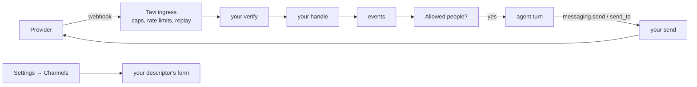

# Building a channel plugin

A channel plugin adds a way to talk to the agent: a chat app, a mailbox, SMS. Once it is installed, it works like the built-in Telegram and email channels:
- You add its connections in Settings → Channels, from a form drawn from the plugin's own description.
- You allow people on it in Allowed people.
- The agent is told about it each turn, replies on it, and sends to it with `messaging.send_to`.
- Approvals and questions reach people through it.

What a built-in channel does beyond that is a reviewed grant for a plugin: mailbox tools, the OAuth client a provider's apps share, and a pairing deep link come from its descriptor and the operator's choices (see `app` below), and its accounts never start *Public*. A built-in channel's plugin (`tavi.telegram`, `tavi.mailgun`, `tavi.gmail`) can be disabled so yours takes its provider id.

This guide builds one step by step. The main example is a **WhatsApp Cloud API** plugin, which receives webhooks and authenticates with secret fields. [Part 2](#part-2-a-gmail-style-channel-oauth-and-polling) then shows what changes for a **Gmail-style** channel, which signs in with OAuth and polls for new mail.

Both examples are real code you can read alongside this guide:
- [`tests/fixtures/channel-whatsapp-like/`](../tests/fixtures/channel-whatsapp-like/) is a complete WhatsApp-Cloud-shaped plugin. Tavi's own tests install it, configure it and drive it end to end ([`apps/cli/test/channels/whatsapp-like.test.ts`](../apps/cli/test/channels/whatsapp-like.test.ts)).
- [`packages/builtin/gmail/src/connector.ts`](../packages/builtin/gmail/src/connector.ts) is the built-in Gmail channel. It's a TypeScript package, but it uses the same connector contract a plugin does.

The reference for every field is [PLUGINS.md → Channel plugins](PLUGINS.md#channel-plugins). The operator's side is [CHANNELS.md](CHANNELS.md) (see [CHANNELS.md#architecture](CHANNELS.md#architecture) for the host and connector module layout).

> **Use the provider's official API.** The WhatsApp example uses Meta's WhatsApp Business **Cloud API**. Do not build a channel on WhatsApp Web automation, a personal account or a reverse-engineered client. It breaks WhatsApp's terms, the number gets banned, and it breaks without warning. The same goes for any provider: if it has an official bot, business or mail API, use that.

<a id="architecture"></a>

## How a channel plugin fits together



**What you write:**
- The **manifest** (`tavi-plugin.json`). It declares the channel: its settings, secrets, who its senders are, its webhook routes and its limits. It is reviewed before any of your code runs.
- The **connector** (`index.mjs`). It opens a connection, sends messages, and turns what the provider delivers into events.

**What Tavi does:**
- Draws the settings form and keeps secrets in the credential store.
- Runs any OAuth sign-in and refreshes tokens.
- Mounts and protects webhook routes: body caps, rate limits, replay refusal.
- Decides who is allowed.
- Downloads attachments and checks their type and size.
- Splits long messages and paces sends.
- Retries when told to, records every send, and tells the agent what it can reach.

Your code never sees a refresh token, an OAuth client secret or another channel's secrets.

## Part 1: a WhatsApp Cloud plugin, step by step

### Step 0: know your provider

Before writing anything, answer these about the provider:

| Question | WhatsApp Cloud API |
|---|---|
| How do messages arrive? | Webhooks, **one address per Meta app** for every phone number, plus a GET verification handshake |
| How is a delivery authenticated? | `X-Hub-Signature-256`: an HMAC-SHA256 of the raw body, keyed by the app secret |
| How do you authenticate sends? | A long-lived system-user access token |
| What identifies a person? | Their phone number (E.164) |
| What can a message carry? | Text, up to 3 reply buttons, media by id |
| Limits | Messaging tiers (rate); a **24-hour service window** for free-form messages |

### Step 1: create the plugin directory

```text
acme-whatsapp/
  tavi-plugin.json
  index.mjs
```

The entry must be plain ES-module JavaScript. Bare package imports (`import x from "some-package"`), CommonJS and computed imports are refused. Use Node builtins and relative imports only, and bundle anything else into `.mjs` files inside the directory.

### Step 2: describe the channel in the manifest

```json
{
  "schemaVersion": 2,
  "abi": "tavi.providers/1",
  "provenance": { "format": "bundled-esm", "packages": [] },
  "id": "acme.whatsapp",
  "version": "1.0.0",
  "name": "WhatsApp (Cloud API)",
  "description": "Chat with the agent on WhatsApp through Meta's Cloud API.",
  "entry": "index.mjs",
  "provides": ["channel"],
  "channelAbi": 1,
  "channels": [
    {
      "providerId": "whatsapp",
      "label": "WhatsApp",
      "kind": "chat",
      "description": "A WhatsApp Business number, through Meta's Cloud API.",
      "settings": [
        { "key": "phoneNumberId", "label": "Phone number ID", "type": "string", "required": true, "pattern": "\\d{1,32}" },
        { "key": "apiBaseUrl", "label": "API address", "type": "string", "default": "https://graph.facebook.com/v20.0" }
      ],
      "auth": {
        "kind": "secrets",
        "fields": [
          { "key": "accessToken", "label": "Access token" },
          { "key": "appSecret", "label": "App secret" },
          { "key": "verifyToken", "label": "Webhook verify token" }
        ]
      },
      "sender": { "label": "Phone number", "placeholder": "+15551234567", "pattern": "\\+[1-9]\\d{6,14}", "normalize": "e164", "authentication": "provider" },
      "target": { "label": "Phone number", "placeholder": "+15551234567", "pattern": "\\+[1-9]\\d{6,14}", "normalize": "e164" },
      "ingress": [{ "name": "webhook", "methods": ["GET", "POST"], "scope": "provider", "maxBodyBytes": 1048576 }],
      "media": { "inboundMaxBytes": 16777216, "mimeTypes": ["image/*", "audio/*", "application/pdf"] },
      "sendRate": { "perMinute": 600, "perTargetPerMinute": 60 },
      "account": { "setting": "phoneNumberId" },
      "setupHelp": "In Meta's developer console, add WhatsApp to an app, create a system user with a permanent token, and point the app's webhook at the address shown under Webhooks."
    }
  ],
  "tools": [],
  "config": {}
}
```

What each choice does:

- **`id` and `version`.** `id` is dotted and lower-case (the `tavi.` namespace is reserved). An installed version is immutable: any change to the files needs a new `version`.
- **`provides` and `channelAbi`.** These say the plugin adds a channel built for channel contract 1. This build speaks contracts 1 and 2: 2 adds [group chats](#part-3-group-chats-channel-abi-2) and the host's services (`ctx.channelHost`), and a channel without groups may say either. A plugin built for another contract is refused at startup, before any of its code runs.
- **`kind: "chat"`.** This tells the agent what a conversation on the channel is. The other values are `email` and `sms`.
- **`settings`.** Non-secret fields: the operator's form shows them, and your code receives them as `config`. `pattern` is matched against the whole value.
- **`auth.kind: "secrets"`.** These become masked fields kept in the credential store. Your code reads them with `credentials.get(key)`.
- **`sender` and `target`.** These say what a person's id and a send target look like.
  - `normalize: "e164"` turns `+1 (555) 123-4567` into `+15551234567` everywhere: in Allowed people, in `send_to` and in the allowlist.
  - `authentication: "provider"` means Meta vouches for each sender. Email uses `per-message`; see Part 2.
- **`ingress`.**
  - Meta sends every number's events to one address per app, so the route is **provider-scoped**: `/hooks/p/whatsapp/webhook`.
  - A provider that gives each account its own webhook uses `"scope": "connection"`, which mounts `/hooks/<connection id>/<name>`.
  - Tavi enforces the methods and the body cap before your code runs.
- **`media`, `sendRate`.** `media` sets the most an inbound attachment may weigh and the types accepted. `sendRate` is the provider's pace; Tavi queues sends to stay inside it.
- **`account`.** This names the setting that identifies the connection's account. The webhook below uses it to route an event to the right connection.
- **`setupHelp` and `setupLinks`** (optional). What setting the channel up takes, in your words, and up to three pages it starts at (`{ label, url }`, https). Discover's sheet for the channel shows each as a button, but only on a host the descriptor declares in `hosts` or its `pairing` link, so a descriptor sends nobody elsewhere.
- **`app`** (optional). How the channel presents in Connected apps ([APPS.md](APPS.md)), in your words. Without it, the channel's app is named from `label` and `description`. Core names no channel: the built-in Gmail, Telegram and Mailgun present through this same field.
  - `name`, `summary`, `category` (`chat`, `email`, …) and `publisher`.
  - `scopes`: the access it asks for, each `{ scope, says, access }`.
  - `dataClass: "personal"` for mail, whose accounts then start *Personal*. Its `dataClass` is never `public`: a plugin's accounts start *Personal* at most.
  - `proves` (for example `["messaging"]`) tells Ideas what a connection of the channel lets it offer.
  - `provider` and `mailbox` are reviewed grants, named on the plugin's approval screen.
  - `mailbox: true` gives its accounts mailbox tools (search, read, send, each account off until the operator turns it on) only when the code registers the kit with it: `registerChannel(definition, { mailbox })`. A mailbox that also implements `ChannelMailbox`'s optional `searchPage`, `thread` and `modifyLabels` adds a page token to its search and the `thread` and `label` tools, and one that does not has none of them. A kit for a descriptor that does not declare `mailbox` fails the plugin's load.
  - Mailbox tools are registered as `tavi serve` starts: a channel plugin first started later has them from the next start, while one that restarts or is updated keeps them, using the mailbox it registers now.
  - `provider` (a client shared with that provider's other apps, such as Google's) holds only once the operator binds it to the plugin's approved version with `tavi channels share-client <provider> <plugin>`, and only for a channel whose OAuth addresses are the provider's own (those this build's channel of it signs in at), since the client's secret goes to its token address; until then the channel signs in with its own client.
  - Two more fields come from the descriptor too:
    - `pairing` (`{ deepLinkTemplate, openLabel }`): a deep link such as `https://t.me/{account}?start={code}` shown as a QR code when pairing, the account read from the connection test's setup link.
    - In an OAuth spec, `disallowsDeviceFlow` (no channel sharing its provider's client is offered a sign-in by code) and `clientProjectPattern` (a regular expression whose first group is the project a client id belongs to, which coordinated revocation weighs; honoured only for this build's channels).

### Step 3: register the connector

`index.mjs` exports `register`. It receives the plugin context and calls `registerChannel` once for each channel the manifest declares.

```js
import { createHash, createHmac, timingSafeEqual } from "node:crypto";

export function register({ registerChannel, z, TaviError }) {
  registerChannel(whatsappChannel({ z, TaviError, fetch: globalThis.fetch }));
}

export function whatsappChannel({ z, TaviError, fetch }) {
  return {
    providerId: "whatsapp",                 // must match the manifest
    version: "1.0.0",
    configSchema: z.object({ phoneNumberId: z.string().regex(/^\d{1,32}$/), apiBaseUrl: z.string().url().optional() }).passthrough(),
    capabilities: {
      receiveMode: "webhook", send: true, editOrProgress: false, formats: ["plain"],
      attachments: false, maxAttachmentBytes: 0, maxPartsPerMessage: 1, threads: false,
      interactions: true,            // reply-button presses come back as events
      deliveryReceipts: true,        // delivered/read statuses come back as events
      maxTextLength: 4096,           // Tavi splits longer text before it reaches send()
      approvals: "buttons",          // approval rounds are shown as buttons
    },
    createConnection: ({ connection, config, credentials }) => connectionFor({ connection, config, credentials, TaviError, fetch }),
    destinationFor: (target) => ({ to: target.to }),
    destinationFromInbound: (replyTo) => ({ to: replyTo.externalSenderId }),
    paceTargetOf: (destination) => destination?.to,
    ingress: webhook({ TaviError }),
  };
}
```

- `z` is Tavi's own Zod, so you don't need a copy of it. `configSchema` validates the settings again when a connection opens.
- `TaviError` is Tavi's error type. The host acts on two of its codes (Step 4).
- The **descriptor always comes from the manifest**, never from code. Registering a `providerId` the manifest doesn't declare fails the plugin.
- `destinationFor` turns what the agent names in `send_to` (`{ to, threadId?, subject?, replyToId? }`) into your channel's own destination. `destinationFromInbound` builds the destination for replying to a message that came in.

### Step 4: open a connection and send

`@tavi/channel-kit` also holds the helpers the built-in channels share:
`fetchWithTimeout` and `readCapped` (a request with a deadline, a body with a
cap), `readJson`, `redactSecrets` and `redactedError` (an error with every
secret and its HTTP Basic form taken out), `parseDestination` and
`checkPartCount` (an outbound message checked against your channel's shape),
the receipt helpers `uncertainReceipt`, `httpFailureReceipt` and
`aggregateStatus`, `notRunning`, and the email helpers (`replySubject`,
`referencesHeader`, `domainOf`, `domainsAligned`, `HEADER_LINE_MAX`,
`splitEmailText`), `inboundParts` and `disarmUrls`. The kit is part of
this repository, not published: bundle what you use into your plugin, since a
bare import is refused ([PLUGINS.md](PLUGINS.md)).

`createConnection` returns the live connection: `start`, `stop`, `status`, `probe` and `send`.

```js
const WINDOW_CLOSED = 131047; // Meta: outside the 24-hour customer-service window

function connectionFor({ connection, config, credentials, TaviError, fetch }) {
  const base = config.apiBaseUrl ?? "https://graph.facebook.com/v20.0";
  let state = "stopped";
  let since = new Date().toISOString();
  return {
    async start() {
      if ((await credentials.get("accessToken")) === null) throw new Error("no access token");
      state = "running"; since = new Date().toISOString();
    },
    async stop() { state = "stopped"; },
    status: () => ({ state, since }),
    probe: async () => ({ ok: state === "running" }),

    async send(message) {
      // Refused before anything went out: the host records it as not sent and may send it again.
      if (state !== "running") throw new TaviError("UNAVAILABLE", `WhatsApp connection ${connection.connectionId} is not running`);
      const part = message.parts[0];
      if ("artifactId" in part) return { status: "rejected", retryable: false, parts: [{ index: 0, status: "rejected", error: "this channel does not send files" }] };
      const to = String(message.destination.to).replace(/^\+/, "");
      const buttons = (message.buttons ?? []).flat().slice(0, 3);
      const body = buttons.length === 0
        ? { messaging_product: "whatsapp", to, type: "text", text: { body: part.content } }
        : { messaging_product: "whatsapp", to, type: "interactive", interactive: { type: "button", body: { text: part.content },
            action: { buttons: buttons.map((b) => ({ type: "reply", reply: { id: b.data, title: b.label.slice(0, 20) } })) } } };
      const token = await credentials.get("accessToken");
      let response, answer;
      try {
        response = await fetch(`${base}/${connection.accountIdentity}/messages`, {
          method: "POST", headers: { "content-type": "application/json", authorization: `Bearer ${token}` },
          body: JSON.stringify(body), signal: AbortSignal.timeout(config.requestTimeoutMs ?? 30_000),
        });
        answer = await response.json().catch(() => undefined);
      } catch (error) {
        // In flight: it may have gone out. Never retried. Keep the token out of the error.
        return { status: "uncertain", retryable: false, parts: [{ index: 0, status: "uncertain", error: String(error?.message ?? error).split(token).join("[redacted]") }] };
      }
      const id = answer?.messages?.[0]?.id;
      if (response.ok && typeof id === "string") return { status: "accepted", retryable: false, parts: [{ index: 0, status: "accepted", providerMessageId: id }] };
      if (answer?.error?.code === WINDOW_CLOSED) return { status: "rejected", retryable: false, parts: [{ index: 0, status: "rejected", error: "outside the 24-hour customer-service window: the person must write first" }] };
      if (response.status === 429) {
        // Throttled: nothing went out. The host waits this long and sends it again.
        const seconds = Number(response.headers.get("retry-after") ?? "1");
        return { status: "rejected", retryable: true, retryAfterMs: Math.round(seconds * 1000), parts: [{ index: 0, status: "rejected", error: "HTTP 429" }] };
      }
      // Refused (4xx): nothing went out. Anything else — a 5xx, or a 2xx with no message id — may have.
      const status = response.status >= 400 && response.status < 500 ? "rejected" : "uncertain";
      return { status, retryable: false, parts: [{ index: 0, status, error: `HTTP ${response.status}` }] };
    },
  };
}
```

Every outbound call needs a timeout. Reading it from `config.requestTimeoutMs` lets a test shorten it (Step 7); `configSchema`'s `passthrough()` keeps the key.

`send` returns a `SendOutcome` instead of throwing. These are the rules the host relies on:

| Outcome | Means | Host does |
|---|---|---|
| `accepted` + `providerMessageId` | The provider took it | Records it; a later delivery status names that id |
| `rejected` | Nothing went out | Records it as not sent and tells the agent why; with `retryAfterMs`, waits and sends again |
| `uncertain` | It may have gone out (timeout, connection reset, 5xx) | Never sends it again |
| throw `TaviError("UNAVAILABLE")` | Refused before calling out (not running) | Not sent; may be sent again |
| throw `TaviError("INVALID_INPUT")` | A malformed destination | Not sent; not retried |

Any other throw is treated as a send that may have happened part way. Never put a secret in an outcome or an error: the conformance suite (Step 7) checks this.

**The service window.** Meta takes a free-form message only within 24 hours of the person's last message. Report its refusal as `rejected` with an error that says so, and the agent hears exactly that. Opening a closed window takes an approved template, a further feature this example leaves out.

### Step 5: receive webhooks

`ingress` has up to three functions. Tavi calls them for each request to one of your routes, after it has checked the address's recent failures and capped the body. A request your `verify` rejects counts against its address; only one it accepts counts toward the connection's rate limit.

```js
function changesOf(body) {
  return (body?.entry ?? []).flatMap((entry) => entry?.changes ?? []).map((change) => change?.value ?? {});
}
function parse(request) {
  try { return JSON.parse(Buffer.from(request.rawBody).toString("utf8")); } catch { return undefined; }
}
const e164 = (number) => (number.startsWith("+") ? number : `+${number}`);

function webhook({ TaviError }) {
  return {
    // A provider-scoped route: which connection is this for? Meta names the number in the body.
    connectionFor(request, connections) {
      if (request.method === "GET") return undefined;   // the handshake names no number: Tavi asks each connection's verify
      const number = changesOf(parse(request))[0]?.metadata?.phone_number_id;
      return connections.find((c) => c.accountIdentity === number)?.connectionId;
    },

    // Is this really Meta? Anything that fails never reaches handle().
    async verify(request, context) {
      if (request.method === "GET") {
        const expected = await context.credentials.get("verifyToken");
        return { ok: expected !== null && request.query["hub.mode"] === "subscribe" && request.query["hub.verify_token"] === expected };
      }
      const secret = await context.credentials.get("appSecret");
      const given = String(request.headers["x-hub-signature-256"] ?? "");
      if (secret === null || !given.startsWith("sha256=")) return { ok: false };
      const expected = Buffer.from(`sha256=${createHmac("sha256", secret).update(request.rawBody).digest("hex")}`);
      const actual = Buffer.from(given);
      if (expected.length !== actual.length || !timingSafeEqual(expected, actual)) return { ok: false };
      // The host refuses a second delivery with the same key, for replayTtlMs.
      return { ok: true, replayKey: createHash("sha256").update(request.rawBody).digest("hex"), replayTtlMs: 10 * 60 * 1000 };
    },

    // Turn the delivery into events, and answer the provider.
    async handle(request, context) {
      if (request.method === "GET") return { events: [], response: { status: 200, body: String(request.query["hub.challenge"] ?? ""), contentType: "text/plain" } };
      const body = parse(request);
      if (body?.object !== "whatsapp_business_account") throw new TaviError("INVALID_INPUT", "not a WhatsApp webhook");   // answered 400
      const at = context.now();
      const events = [];
      // Only this connection's number: one delivery may batch several numbers' changes.
      for (const value of changesOf(body).filter((change) => change.metadata?.phone_number_id === context.connection.accountIdentity)) {
        for (const message of value.messages ?? []) {
          const sender = e164(String(message.from));
          const base = { connectionId: context.connection.connectionId, providerEventId: message.id, externalSenderId: sender,
            externalConversationId: sender, conversationKind: "direct", externalMessageId: message.id,
            occurredAt: new Date(Number(message.timestamp) * 1000).toISOString(), receivedAt: at };
          if (message.type === "interactive" && message.interactive?.button_reply) {
            events.push({ ...base, kind: "interaction", interaction: { data: message.interactive.button_reply.id, callbackId: message.id, messageId: message.context?.id ?? message.id } });
          } else if (["image", "audio", "document"].includes(message.type)) {
            const media = message[message.type];
            events.push({ ...base, kind: "message", ...(media.caption ? { content: media.caption } : {}), media: [{ ref: media.id, mimeType: media.mime_type }] });
          } else {
            events.push({ ...base, kind: "message", content: message.text?.body ?? "" });
          }
        }
        for (const status of value.statuses ?? []) {
          if (!["delivered", "read", "failed"].includes(status.status)) continue;
          const to = e164(String(status.recipient_id));
          events.push({ connectionId: context.connection.connectionId, providerEventId: `status:${status.id}:${status.status}`, kind: "delivery",
            externalSenderId: to, externalConversationId: to, occurredAt: at, receivedAt: at,
            delivery: { providerMessageId: status.id, status: status.status } });
        }
      }
      return { events };
    },
  };
}
```

What Tavi does with the events:

- **`connectionId`** must be `context.connection.connectionId`. Tavi drops any event a connector names for another connection, and on a provider-scoped route it uses `connectionFor`'s answer only if it is one of that provider's connections.
- **`providerEventId`** must be the provider's own stable id. A redelivered event is recorded once.
- **A `message`** from a sender nobody allowed is held and starts nothing. One from an allowed person starts or continues that person's conversation.
- **An `interaction`** (a button press) decides an approval or answers a question, but only for the person allowed to decide it. The same holds for the other buttons Tavi sends: a reminder's *Done* / *Snooze*, a heartbeat item's *Open* / *Snooze* / *Don't tell me*, and a memory card's *Keep* / *Discard* / *Undo* / *Open*. A memory card never carries more than 3 buttons, and its callback data (`y:<token>:<op>`) is at most 36 bytes. With `editOrProgress`, Tavi edits a memory card's message after a press, and when the memory it shows is forgotten.
- **A `delivery`** status is recorded on the send whose `providerMessageId` it names.
- **A request that is not the provider's shape:** throw `INVALID_INPUT` from `handle` and it is answered with 400.

### Step 6: let Tavi download media

An event names attachments as `media: [{ ref, mimeType? }]`. Tavi asks your connection to download one only for an allowed sender. It then checks the size against `media.inboundMaxBytes` and the type against the file's own bytes, and keeps what passes as an untrusted artifact. Add `fetchMedia` to the connection. Return the download's `Response` and Tavi reads it, stopping at the cap as the bytes arrive, so a huge file is never held in memory:

```js
    async fetchMedia(handle, { signal }) {
      const token = await credentials.get("accessToken");
      const located = await fetch(`${base}/${handle.ref}`, { headers: { authorization: `Bearer ${token}` }, signal });
      if (!located.ok) throw new Error(`media lookup answered HTTP ${located.status}`);
      const { url } = await located.json();
      return fetch(url, { headers: { authorization: `Bearer ${token}` }, signal });   // Tavi reads it, within the cap
    },
```

### Step 7: test it before you install it

Use the **conformance suite**, `describeChannelConformance` from `@tavi/channel-kit/conformance`. It drives your connector against a fake provider in four moods: `ok`, `hang`, `echo` (a fetch error that repeats the request headers) and `garbled`. It checks that:
- the descriptor is valid and matches the connector;
- a destination is built and sent to;
- a send before `start` or after `stop` is refused without calling out;
- a hanging or garbled send is reported as `uncertain`, not thrown;
- the secret appears in no outcome or error;
- a file part the channel cannot carry is rejected, not dropped.

The suite isn't published as a package. Run it from a checkout of the Tavi repository, the way the fixture's test does:

```ts
import { describeChannelConformance } from "@tavi/channel-kit/conformance";
import { TaviError, type ChannelDescriptor } from "@tavi/contracts";
import { z } from "zod";
import manifest from "../acme-whatsapp/tavi-plugin.json" with { type: "json" };
import { whatsappChannel } from "../acme-whatsapp/index.mjs";

const fakeGraph = (mood) => async (_url, init) => {
  if (mood === "hang") return new Promise((_, reject) => init?.signal?.addEventListener("abort", () => reject(new DOMException("aborted", "AbortError"))));
  if (mood === "echo") throw new TypeError(`fetch failed with ${JSON.stringify(init?.headers)}`);
  if (mood === "garbled") return new Response("<html>proxy page</html>");
  return new Response(JSON.stringify({ messages: [{ id: "wamid.1" }] }));
};

describeChannelConformance("WhatsApp (Cloud API)", {
  descriptor: manifest.channels[0] as ChannelDescriptor,
  provider: fakeGraph,
  create: (fetch) => whatsappChannel({ z, TaviError, fetch }),
  connection: { connectionId: "wa-test", providerId: "whatsapp", accountIdentity: "1029384756", workspaceId: "w", configRevision: 1, enabled: true },
  config: { phoneNumberId: "1029384756", apiBaseUrl: "https://graph.test/v20.0", requestTimeoutMs: 30 },
  secret: "EAAG-s3cret-token",
  target: "+15551234567",
});
```

Importing `index.mjs` from a TypeScript test needs a small `index.d.mts` beside it that declares the exports, as the fixture has.

For a test against the whole owner (install, configure, a signed webhook, an allowed sender, a reply), copy [`apps/cli/test/channels/whatsapp-like.test.ts`](../apps/cli/test/channels/whatsapp-like.test.ts). It captures the ingress listener and stubs `fetch`, so it needs no network.

### Step 8: install, review and enable

```bash
tavi plugins install ./acme-whatsapp
```

```bash
tavi plugins show acme.whatsapp
```

`show` (and Settings → Plugins) presents the channel for review before any of its code runs. It says *"Receives messages from outside and can send as you on WhatsApp"* and lists every address it reaches: its webhook routes with their body caps, and for an OAuth channel its sign-in, token and account addresses and scopes. Read the files, then:

```bash
tavi plugins approve acme.whatsapp 1.0.0
```

```bash
tavi plugins enable acme.whatsapp
```

Restart `tavi serve`: enabling takes effect on the owner's next start. The plugin runs in the owner's process, with the same trust and limits as any external plugin ([PLUGINS.md → Trust](PLUGINS.md#trust)).

### Step 9: add a connection and point the provider at it

In **Settings → Channels**, choose **WhatsApp**, then **Add connection**. Fill in the phone number ID and the three secrets, then save; the connection opens at once. Or from a terminal, with each secret read from a file:

```bash
tavi channels add whatsapp --phoneNumberId 1029384756 --secret-file accessToken=./token --secret-file appSecret=./app-secret --secret-file verifyToken=./verify-token
```

Webhooks need a public HTTPS address in front of Tavi's listener, which binds to `127.0.0.1`. Set it under **Webhooks** on the same page, or:

```bash
tavi channels ingress --port 8025 --public-url https://hooks.example.com/tavi
```

Then, in Meta's app settings, set the webhook callback URL to `https://hooks.example.com/tavi/hooks/p/whatsapp/webhook` with the same verify token, and subscribe to `messages`. Meta's verification GET should succeed at once. **Test** on the connection's row sends a short message to a number you give.

### Step 10: allow people and talk to it

Nobody can reach the agent until you allow them. In **Settings → Allowed people**:
1. Choose the WhatsApp connection.
2. Enter the person's number, which is normalized to E.164.
3. Enter a person ID: `operator` for yourself, or an ID of their own for anyone else. Someone with their own ID keeps their own memory, and you decide their approvals.

**Pair with a code** lets the person prove the number is theirs by sending a one-time code.

Now send a WhatsApp message to the business number: it starts a turn, and the agent replies in the same chat. For the agent to message someone first with `messaging.send_to`, allowlist the target:

```bash
tavi serve --messaging-allow-destination '*:+15551234567'
```

### Step 11: ship updates

An installed version never changes. Bump `version`, then install, approve and enable the new version (`enable acme.whatsapp --version 1.1.0`), and restart. Disabling the plugin withdraws the channel: its connections close and show *provider missing* until it's back. Their settings, secrets and allowed people are kept.

## Part 2: a Gmail-style channel (OAuth and polling)

Gmail is built in, but nothing in it is special: a plugin can do everything it does. Here is what changes from Part 1.

### OAuth instead of secret fields

```json
"auth": {
  "kind": "oauth2",
  "oauth": {
    "authorizeUrl": "https://accounts.google.com/o/oauth2/v2/auth",
    "tokenUrl": "https://oauth2.googleapis.com/token",
    "revokeUrl": "https://oauth2.googleapis.com/revoke",
    "scopes": ["https://www.googleapis.com/auth/gmail.modify"],
    "pkce": true,
    "extraAuthorizeParams": { "access_type": "offline", "prompt": "consent" },
    "client": { "source": "operator" },
    "redirect": "loopback-any-port",
    "tokenAuthMethod": "client_secret_post",
    "accountIdentity": { "userinfoUrl": "https://gmail.googleapis.com/gmail/v1/users/me/profile", "field": "emailAddress" }
  }
}
```

Tavi runs the whole sign-in:
1. **Connect with Gmail** opens the provider's page in a window of its own.
2. Tavi exchanges the code itself, with PKCE.
3. It names the account from `accountIdentity` and keeps the tokens in the encrypted credential store. OAuth requires credential encryption, and the page offers to turn it on.
4. It refreshes tokens before they expire.

Your connector only ever asks for a current access token:

```js
const token = await credentials.accessToken();   // refreshed by the host; throws if the sign-in is gone
```

The OAuth settings that need a choice:
- **`client`.**
  - `{ "source": "operator" }` makes each operator enter their own OAuth app. Settings → Channels shows an **OAuth app** form, and `setupHelp` should tell them how to create one.
  - `{ "source": "plugin", "clientId": … }` ships your own app.
  - Tavi registers no app with any provider. Getting yours reviewed by Google is between you and Google.
- **`redirect`.**
  - `loopback-any-port` comes back to `tavi ui`'s own address, on whatever port it listens (RFC 8252 §7.3: the provider must accept any loopback port).
  - `public` goes through the operator's public address, for providers that require HTTPS.
- **`extraAuthorizeParams`** may add parameters such as `prompt`, but never the flow's own (`state`, `code_challenge`, …).
- **`issuer`** (optional), the provider's issuer identifier, for a provider that names itself in its redirect (RFC 9207's `iss`). Every channel shares the owner's one `/oauth/callback`, so with it declared a redirect, or a pasted-back address, that names another issuer or none is refused before its code is exchanged. Leave it out for a provider that does not send `iss`.
- **`deviceAuthorizationUrl`** (optional), for a provider that allows the device flow (RFC 8628). The channel then signs in with a code instead:
  - its app's page in Connected apps shows the code, with a copy button, and the address to enter it at, on any phone or computer;
  - the owner asks the provider for the token at the interval it gives (at least five seconds), five seconds longer after each `slow_down`, server error or unanswered request, until the code is entered, refused or lapses (ten minutes at most);
  - the address must be https, and an address with the code already in it is used only on that same site;
  - nothing comes back to a redirect, so `redirect` is not used for it;
  - the sign-in is then kept as a browser one is: every scope, its account named, the same account as before.

  It is refused for Google's addresses, whose device flow does not allow the scopes its mail and calendar need. A code sign-in is started from the page; `tavi channels connect` still signs in through the browser.

A failed token refresh is a send refused before it went out, so throw `UNAVAILABLE`:

```js
let token;
try { token = await credentials.accessToken(); }
catch (error) { throw new TaviError("UNAVAILABLE", error.message); }
```

### Polling instead of webhooks

With no webhook there is no `ingress`. Set `receiveMode: "poll"`. The connection registers the host's handler through `onInboundEvent`, and calls it for each new message:

```js
let handler, timer, abort;
return {
  onInboundEvent(next) { handler = next; },
  async start() {
    abort = new AbortController();
    // Check the sign-in works here, so a failed start says why. Don't read mail yet:
    // a message taken in now would start a turn before the host has marked this connection open.
    const profile = await call("/profile", abort.signal);
    if (!profile.ok) throw new TaviError("UNAVAILABLE", `Gmail did not answer (HTTP ${profile.status})`);
    schedule(0);               // the first check runs once start() has returned
  },
  async stop() { abort?.abort(); clearTimeout(timer); },
  // ...status, probe, send, as in Part 1
};

function schedule(delayMs = 30_000) {
  timer = setTimeout(async () => {
    try { await poll(abort.signal); } catch { /* shown on status; try again next time */ }
    if (!abort.signal.aborted) schedule();
  }, delayMs);
  timer.unref?.();
}

async function poll(signal) {
  for (const message of await listUnprocessed(signal)) {
    const event = toInboundEvent(message);
    try {
      await handler?.(event);       // resolves once the host has recorded it
    } catch {
      continue;                     // not recorded: leave it for the next poll
    }
    await markProcessed(message.id, signal);   // only after the host has it
  }
}
```

Two rules make polling safe:
- **Mark a message processed only after `handler` resolves.** The host has then recorded it, and a redelivery with the same `providerEventId` is recorded once.
- **Never start a turn from inside `start()`.** The connection isn't open until `start` returns, so the agent's reply would be refused.

### Email senders: authentication per message

Anyone can put any address in an email's `From:` header, so an email channel declares `"sender": { …, "normalize": "lowercase", "authentication": "per-message" }`. Each event then carries the provider's verdict:

```js
{ ..., externalSenderId: "ana@example.com", senderAuthentication: "pass" }   // or "fail"
```

Gmail sets `pass` only when **Google's own** `Authentication-Results` header shows a DKIM signature passing **for the From address's domain** (or one aligned with it); SPF alone, or a `dmarc=pass` resting on SPF alone, is not a pass. An unverified message is held, and the person is told at most once a day. It's admitted only if the operator ticks *Trust this person's unverified messages* for them, and it never decides an approval.

Parse the address with care: a display name such as `"boss@example.com" <attacker@evil.test>` must yield `attacker@evil.test`. See `addressOf` and `senderAuthenticationOf` in [`connector.ts`](../packages/builtin/gmail/src/connector.ts).

### Threads and subjects

An email reply belongs in its thread. Give the conversation the provider's thread id (`externalConversationId: "gmail-thread:<id>"`, `conversationKind: "thread"`), and carry `externalMessageId`, `externalReferences` and `subject` on the event. `destinationFromInbound` then builds a reply with `Re: <subject>`, `In-Reply-To`, `References` and the thread id. `destinationFor` gives a fresh `send_to` its own subject. Strip CR/LF from anything that goes into a header, so a value can never add a header such as `Bcc:`.

## Part 3: group chats (channel ABI 2)

A channel whose platform has rooms — servers' channels, group chats — is built for **channel ABI 2** (`"channelAbi": 2`) and declares `groups` in its descriptor. The worked example is [`tests/fixtures/channel-group-like/`](../tests/fixtures/channel-group-like/): a fake group platform and its connector, which Tavi's group scenario suite ([`apps/cli/test/channels/group-seam.test.ts`](../apps/cli/test/channels/group-seam.test.ts)) installs and drives through a real owner. The built-in Telegram channel speaks the same seam.

**The rule: your connector reports, the host decides.** It never decides anything that depends on who a sender is to Tavi; it cannot see bindings. It says how a message addressed the agent, who wrote it and what it quotes. The host decides which rooms are listened to, which messages are taken in, who may speak, where an approval goes and what is stored.

**The descriptor** gains:
- `groups: { unboundSenders, unlistedRooms, defaultTrigger }`. `unboundSenders: "drop"` drops a room message from someone nobody allowed before anything of it is stored (`"hold"` keeps it for the operator, as Telegram does). `unlistedRooms: "drop"` drops a room nobody listed and tells the operator (`"admit"` takes it in). `defaultTrigger` is what addresses the agent in a new room: a subset of what you report.
- `hosts`: the hosts the channel reaches (`"api.example"`, `"*.example"`, at most 16). They are its Connected apps egress and its review's address list.
- `retention`: `"purge-on-remove"` when the platform's terms say an app's data goes when it stops; removing a connection then erases what it brought in 24 hours later ([CHANNELS.md](CHANNELS.md#removal-and-purge)). Absent means `"keep"`. The review shows the choice.

**The capabilities** gain `groups`: `addressing` (the address kinds you report: `mention`, `reply`, `thread`, `command`, `picked`), `directToSender`, `listRooms`, `membershipEvents`, `leaveRoom`, and optionally `recentHistory`, `polls` and `events`. Each method below exists exactly when its capability says so; the conformance suite checks it.

**Inbound events** may carry:
- `addressed`: how the message addressed the agent — a mention of it, a reply to one of its messages, a message in a thread it started, one of its commands, or a message the person picked for it (a context menu's "Ask about this"). Take a leading mention off the text yourself: the host never parses platform markup. A message with no `addressed` is not addressed.
- `authorKind`: `person`, `bot` or `system`. The host drops bots' and the platform's messages before recording them.
- `referenced`: a message this one quotes or points at — its author's id, its message id, its text when the platform gives it, and `via: "reply" | "picked"`. It is always that author's labelled data, never the sender's prompt.
- `kind: "membership"` with `membership: { change: "added" | "removed", roomName? }` when the agent is added to or removed from a room: the operator is asked to add the room or leave it.

**Definition and instance methods:**
- `directDestinationOf(externalSenderId, connection)`: the destination of a one-to-one chat with a sender. A room's approval card goes there, and the room sees only a notice that it waits. A `direct` event's `externalConversationId` must be the conversation this reaches: the host takes it as proof that the chat is the sender's own.
- A send that the platform refuses because the recipient cannot be reached one-to-one (DMs closed, never started the bot) answers its part receipt with `unreachable: true`; the host then tells the room to approve in Tavi, and never shows the card in the room.
- `answerInteraction(callbackId, text)`: **the text must be visible to the presser only** (an ephemeral reply, a toast). A platform that cannot show a private notice drops the text; it never posts it where others see it.
- `listRooms()`, `leaveRoom(destination)`, `fetchRecent(destination, { limit, before, signal })` (newest last, at most `limit`, each with its `authorKind`), `createPoll`, `readPoll` (voters as sender ids), `endPoll`, `createEvent`. A poll's or event's `effectId` is your idempotency key: the same id twice creates one.
- `status()` may carry `repair: "credentials" | "provider-settings"` for a failed connection whose fix you know (a revoked token, a setting at the provider), and `accountRef`, the platform's own id for the account once started (a bot's id): adding the same account back within a removal's grace cancels its purge. A `start()` that fails for one of those says so as the thrown `TaviError`'s `details.repair`.
- Never send a link preview or a mass mention (`@everyone`): suppress both on every send.

**`ctx.channelHost`.** An ABI 2 plugin's `register(ctx)` is handed `ctx.channelHost = { now, fetch, readArtifact }`, the same services a builtin channel gets. `readArtifact(artifactId, workspaceId, maxBytes)` returns only an approved artifact of the sending workspace, capped at what your channels may send.

**Test it** with `describeGroupChannelConformance` from `@tavi/channel-kit/conformance`, over a fake of your platform that can emit each scripted event and records what the connector sent (see [`apps/cli/test/channels/group-like.test.ts`](../apps/cli/test/channels/group-like.test.ts) and Telegram's [`group-conformance.test.ts`](../packages/builtin/telegram/test/group-conformance.test.ts)).

## Checklist

- [ ] The manifest declares `provides: ["channel"]`, `channelAbi: 1` and one descriptor per channel. Code registers exactly those `providerId`s.
- [ ] Every secret is a `secrets` field or comes from OAuth. None is a setting, and none ever appears in an outcome, an error or a log.
- [ ] `send` returns `accepted`, `rejected` or `uncertain`. It throws only `UNAVAILABLE` (not running, or no token) or `INVALID_INPUT`. A 429 is `rejected` with `retryAfterMs`.
- [ ] Every outbound call has a timeout.
- [ ] Webhooks: `verify` checks the provider's signature in constant time and returns a `replayKey`. `handle` throws `INVALID_INPUT` for a request that isn't the provider's shape.
- [ ] Polling: nothing is taken in during `start()`, and a message is marked processed only after the host has it.
- [ ] `providerEventId` is the provider's stable id.
- [ ] `sender.authentication` is `per-message` wherever a sender can be forged, with `senderAuthentication` set from evidence the provider added.
- [ ] `describeChannelConformance` passes against a fake provider.
- [ ] It uses the provider's **official** API.
- [ ] A group channel: `channelAbi: 2`, `groups` in its descriptor and capabilities, `addressed` and `authorKind` on every room message, `answerInteraction` private to the presser, no link preview or mass mention on any send, `hosts` and `retention` declared, and `describeGroupChannelConformance` passing.
