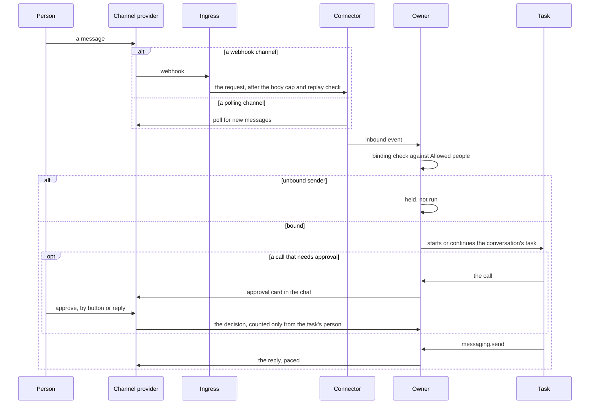
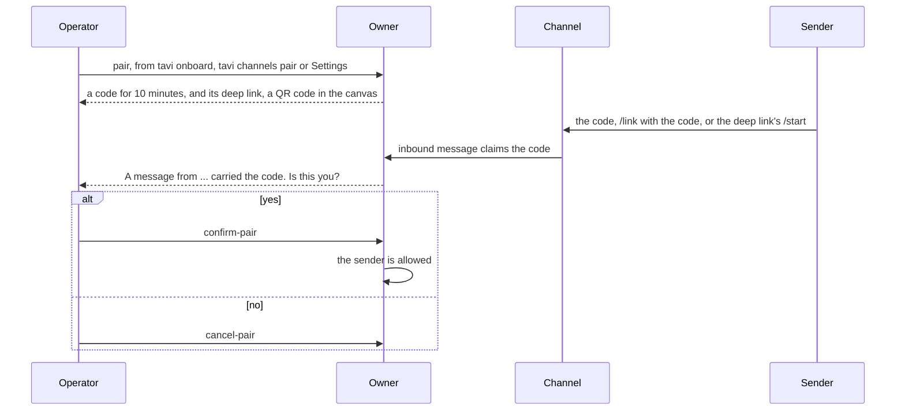

# Channels

A channel is a messaging service the agent is reached on and sends through: Telegram, Gmail, email through Mailgun, Discord (a plugin built in this repository) and any channel a plugin adds. Channels are configured in Settings → Channels, or with `tavi channels` from a terminal (see [CLI.md](CLI.md#tavi-channels)). The people who may chat through them are set in Settings → Allowed people, or with `tavi bindings`.

This page is for anyone who sets up or runs a channel. It starts with a [quick start](#quick-start), then covers how a message becomes a task, approvals, pairing, group rooms, each channel's setup, and what removing a connection deletes. To add a channel of your own, see [CHANNEL-PLUGINS.md](CHANNEL-PLUGINS.md).

## Quick start

Channels are configured with `tavi channels` (or Settings → Channels) and opened by `tavi serve`. Each built-in channel is its own plugin (`tavi.telegram`, `tavi.mailgun`, `tavi.gmail`): `tavi plugins disable tavi.telegram` leaves Telegram out from the next start, and a channel plugin may then take its place; nothing stops every channel at once. Its saved connections stay, credentials and paired people included, and a channel plugin approved for the same provider id opens them: `tavi plugins disable` says so, so remove them first (`tavi channels remove`) when no other plugin should.

Telegram needs a bot token from BotFather. What email needs is in [Email through Mailgun](#email-through-mailgun) and [Gmail](#gmail).

```bash
tavi channels add telegram --secret-file token=<file>
tavi serve --messaging-allow-destination <chat-id>
```

```bash
tavi channels add mailgun --domain mail.example.com [--from ana@mail.example.com] [--set region=eu] \
  --secret-file apiKey=<file> --secret-file webhookSigningKey=<file>
tavi channels ingress --port 8025 [--public-url https://mail.example.com/tavi] [--trusted-proxies 10.0.0.0/8]
```

Then allow the people who may write to the agent: `tavi channels link [connection] [--principal <id>] [--name "Ana"]` (or `tavi channels pair`), `tavi bindings bind --connection telegram-<id> --sender <id> --principal operator [--name "Ana"]`, or Settings → Allowed people (`tavi channels people` lists who is allowed, and `tavi channels unlink <connection> <sender>` or `revoke` removes one). A message from an unbound sender is held, not run (the newest 20 per sender and 5,000 in all, for at most 30 days). `tavi inbox list` shows held messages; once the sender is bound, `tavi inbox replay <provider-event-id>` admits one (with the owner stopped). Bindings made with `tavi bindings` need the owner stopped; `tavi channels link` / `unlink` and Settings → Allowed people apply them at once.

## Conversations and tasks

One message's way through, from the person to the reply:



- **Who a sender is.** Your own senders take the workspace's principal (`operator`); anyone else gets one of their own (`--principal ana`), acts with the workspace's permissions, and waits for you to decide their approvals. They can own routines too, made from their chat: each runs as theirs, stops once they are revoked, and is listed with yours in the app's Schedule, named as theirs. Once they are revoked their routines stay listed, marked *no longer allowed*: you can look at one and archive it, nothing more; their schedules can be shown, paused or removed, and their reminders are shown in the app only, starting no task.
- **A message starts a task.** An inbound message starts a task, and replies in the same conversation continue it. Each email thread is a conversation of its own: a new email starts a task, and replies in its thread continue it. Starting a message with `@name` runs it under a named agent persona.
- **Where a task may send.** A task can reply (`messaging.send`), or send to a destination you allowlisted with `tavi serve --messaging-allow-destination` (`<target>`, or `<connection-id>:<target>` when several connections are open; `*:<target>` for every connection, `<channel>:*` such as `telegram:*` for anyone on that channel).
  - A target is what the channel sends to — a Telegram chat id, an email address (lower-case) — and works the same for every channel: a task's `messaging.send_to`, a question it asks with `ask_user`, and a routine's delivery all go through it, and an email reply keeps the thread's subject.
  - Each turn the agent is told the channels it can reach — connection id, channel, what a message there carries, and the targets you allowed — and `messaging.channels` lists them mid-task; it never sees a setting or a secret.
  - `messaging.channels` also lists the people you bound (`channels allow`, a pairing) that the allowlist already reaches — a person whose own chat or address is an allowed target on their connection — by the name you gave them.
  - `messaging.send_to` takes `person: "Ana"` in place of `to`: matched exactly (case aside) by that name or principal, on `connectionId` when given, refused with the candidates when it names more than one destination and with the people it can name when none.
  - The card shows the destination the person resolved to (`Ana (telegram-<id>:12345)`), and a send whose person resolves elsewhere by the time it runs is refused (`CONFLICT`), even after a restart.
  - A binding never widens the allowlist. A destination the allowlist refuses is answered with the targets allowed on that connection, each known person's name beside theirs.
  - They are part of its runtime facts; under the v2 prompt layout (`models.promptLayout`) they are in the turn's context block instead, said again only when the set changes, so a connection that reconnects mid-chat does not change the instructions a provider caches ([ARCHITECTURE.md](ARCHITECTURE.md#token-and-prompt-cache-behaviour)).
- **An answer is always sent.** A turn started by a message is told to answer with `messaging.send` (in a group or thread, when an answer is called for). In a one-to-one chat, a turn that ends without having tried a send of its own has its answer sent for it, once, as a reply to that turn's message (an email keeps its subject and thread) — only where a `messaging.send` would go without asking, and with unknown links defanged when the turn read untrusted content. A send the turn tried and was refused or denied leaves nothing to relay. A group or thread is left to the agent, which may rightly stay quiet there.
- **`/new` starts over.** `/new` (or `/reset`) in a chat, from the person its task runs for, ends its current task: what the task was still waiting on — a question, an approval round, its workers — is withdrawn and the task cancelled if it was still going, it stays readable under its id (the chat says which), and your next message starts a fresh task in the same chat. An approval round the task was still waiting on loses its buttons, and a later press says the conversation was reset. If the owner stops partway through, its next start finishes the withdrawal. `/new` typed in the canvas is ordinary text: start over there with **New side chat**.
- **Conversation Homes.** Each DM or group's current task is that conversation's Home: with `chat.home` on, the canvas lists them under **Conversations** (marked `DM` or `group`), and `tavi chat`'s `/chats` says `dm` or `group`. In a Telegram group with forum topics, while `chat.home` is on, a topic is a side chat of the group's Home, one per topic — started by the person the Home runs for (anyone else's message in a new topic is a turn of the Home) — and its replies stay in that topic; a reply thread is not a topic. `/new` in a topic with a side chat ends that side chat; anywhere else it ends the Home, and a topic's side chat of an ended Home ends at its next message, which opens one under the new Home. A question asked in a topic is answered by typing in that topic, never another; with `chat.home` off the whole group, topics included, is one task. A side chat cannot be opened from a messaging chat in the canvas. While `chat.home` is on and you have a Home, each conversation posts one notice into it, updated as it goes — its channel and kind (a group by its id), how many messages came since you last wrote in Home and when the last came, never a word of the chat.
- **Your DM as your Home (opt-in).** `tavi config set chat.home-dm telegram-<id>:<your user id>[,…]` (needs `chat.home` on; off by default; `off` clears it) makes the listed Telegram identities' private chats with the bot turns of your Home — each identity must still be bound to you, the workspace's operator, when a message arrives. Each is answered back in the DM (and its questions and approvals asked there), while your next turn in the canvas answers in the canvas; a turn from the DM is held to the messaging profile. **Privacy:** Home's whole context — everything you said in the canvas or `tavi chat`, its notes and notices — can shape what is sent to the DM, and the DM's messages and replies show in Home; the note printed when the link takes effect names the identities. Groups, forum topics, email and unlisted identities are never linked. In a linked DM, a bare `approve` decides only a round asked there (a canvas round needs its token), a message while Home waits on a round is refused until it is decided, and `/new` ends nothing. With no Home yet, the DM keeps its own conversation. Turning it off returns the DM to its own conversation from its next message.
- **Approvals go to the chat a task came from.** Approvals raised by a task started in a chat are sent to that chat (see [Approvals in the chat a task came from](SECURITY-MODEL.md#approvals-in-the-chat-a-task-came-from)). In Telegram they carry buttons; a press counts only from the bound person the task belongs to, the same check a typed `approve` gets. A round nobody decides is rejected after 24 hours; change that with `tavi serve --approval-expiry <hours>` (0.25 to 720).
- **The messaging profile.** A task started from a chat — including one a reminder starts when the reminder is delivered to a chat — runs under the messaging profile: it cannot use `sandbox.run`, `fs.write`, `fs.edit`, `http.request` with a credential, or `plugins.validate`. To let one of those five through in your own one-to-one chats, start `tavi serve` with `--messaging-allow-tool <tool-id>` (repeatable); any other tool id is refused. It lifts the tool only where the turn's chat is one-to-one and its sender is bound to the workspace's operator: never in a group, a thread, an email thread or another person's chat. Before group chats it lifted the tool in every chat; `tavi serve` now says once at start which chats it applies to.

## Questions and approvals by email

- **Questions.** A question's email is titled `[tavi <token>] Question: <its header or first words>`; reply with the option's number, its label or your own words on the first line. A reply that keeps the subject answers that question even when your mail client drops the thread, and a word like `approve` there is an answer, not an approval. A question a schedule's run asks opens with `⏸ <schedule> asks:`. A question with options lists them numbered, with a link each when a public address is set; in a reply, a first line that picks one is the answer, and the signature and quote below it are ignored.
- **Approvals.** Every approval email names its round in the subject, `[tavi <token>]`. Reply `approve` or `reject <reason>` on the first line to decide it: the reply counts only when Mailgun verified your address (SPF and DKIM both pass, in the verdict headers Mailgun adds above the message's first `Received` line), keeps that subject, and the round is low or medium risk — and it approves once only. A high or critical round says to decide it with `tavi approvals approve <task-id>`, in the web app, or with a link. With a public address set, the email carries a single-use link per choice: a link opens a page that shows exactly what it would do and decides nothing until you press its button, and using one link spends the others. Links go only to the address bound to whoever decides the round (the operator, or the task's own person when no operator is named): when an allowed person writes into the operator's thread, their copy of the card has no links or token and says the operator decides.
- **Approval links.** For approval links in emails, set **Public address** to the https address your reverse proxy exposes the listener at, and forward `/i/*` there as well as `/hooks/*`.
  - The address may carry a path, such as `https://mail.example.com/tavi`: forward `<prefix>/i/*` (here `/tavi/i/*`); the listener answers at both `/tavi/i/<token>` and `/i/<token>`, so the proxy may keep or strip the prefix.
  - A critical round's link page asks for a PIN: store one with `tavi credentials set approvals.pin --file <path>`; after three wrong PINs the email's links stop working, and with no PIN set a critical round is decided with `tavi approvals`.
  - Without the public URL, emailed approvals are decided by reply (verified senders, low- and medium-risk rounds, once only) or from `tavi approvals`.

## Pairing from onboarding

`tavi onboard` (and `tavi setup channels`) adds the featured channel (Telegram by default, else the first installed channel set up with secrets alone) with a running owner, in that channel's own words: its `setupHelp`, each of its `auth.fields` asked hidden, the connection saved and checked (no message is sent), then a pairing code for the workspace operator. It prints *Send `XXXX-XXXX` to @name within 10 minutes (or `/link XXXX-XXXX`; Open in Telegram: https://t.me/name?start=XXXX-XXXX)*, the link from the channel's `pairing` template, waits, and when a message claims the code asks *A message from … carried the code. Is this you?*; only a yes allows the sender (`confirm-pair`), a no cancels the code. Codes live in the owner's memory: one it forgot after a restart, or one that expired, is replaced by a new one. Offline it says pairing needs `tavi serve`; headless, `--channel-secret <channel>:<field>=<file>` (for example `--channel-secret telegram:token=bot.token`) adds and tests the channel and leaves pairing to `tavi channels link <connection>` (or `tavi channels pair <connection>`).



## Rooms

A channel that declares group chats listens only in the **rooms** you list for it on each connection, from `tavi channels rooms <connection>` (see [CLI.md](CLI.md#tavi-channels)). Each room has your name for it, a **trigger** — what addresses the agent there: a mention, a reply to one of its messages, a thread it started, one of its commands, or a message someone picked for it — and who it hears: anyone you allowed (`bound`, the default) or you alone (`operator-only`). Two connections cannot share a room.

What a room drops or slows down:

- A message that does not match the trigger, or comes from a bot or the platform, is dropped before anything of it is stored or its attachments fetched, and only counted, by reason, in `tavi channels rooms <connection>` (and the connection's status line).
- A message from someone Tavi does not know is dropped the same way on a channel that drops them (Discord); on Telegram it is held for you to pair, as a one-to-one message from them is, its attachments not fetched.
- A room or a sender flooding the agent is slowed down (per room 6 messages a minute and 20 an hour, per sender 3 a minute), and the room is told once an hour.

When you add a room, it gets one short introduction (if it could not be sent, Tavi tries again the next time the rooms are listed with the connection open, and never resends one that may have gone out): whose agent this is, what addresses it there, that it never learns from the room for your private use, that it never reads people Tavi does not know, and to ask you to be left out.

On Telegram, a room is a group or supergroup by its chat id (negative). The bot reports a mention of its username (or of the bot by name, a `text_mention`), a reply to one of its messages, and a leading command for it (`/ask@yourbot`, or a `/command` naming no bot), and takes a leading `@bot` (or a command's `@yourbot`) off the text. A new Telegram room's trigger is all three.

An approval a room's task asks for is sent to the decider's private chat with the bot, with buttons, and the room gets only a notice that it waits. A decider who never started the bot is asked in the room to open a chat with it or approve in Tavi, and the card never falls back to the room.

When the agent is added to a room nobody listed, or such a room speaks, the heartbeat tells you (once a day per room) so you can add it or, where the channel can, leave it (`rooms <connection> leave <id>`); its messages are dropped meanwhile.

**Room context**. A room reads only the message that addresses the agent, unless you turn on its context: `tavi channels rooms <connection> set <id> --context recent`, on a channel that can read a room's recent messages.
- Then a message that addresses the agent there is read with up to 20 of the room's messages before it, as one block of quoted data beside it.
- In that block, each message from someone you allowed is labelled as theirs, and anyone else's is replaced with "[message from someone not known to Tavi]". A bot's and the platform's messages are left out.
- The person's own words stay the turn's prompt. The room's words make the chat untrusted, so its sends ask.
- Nothing is read without a message that addresses the agent, and nothing read is kept beyond the turn.
- The room is told when its context is turned on. `--context off` turns it off again.
- In such a room, a task can also read the room's latest messages mid-task with `messaging.recent` (up to 20, paging back with `before`), labelled the same way and untrusted. It reads only the task's own room, and is offered only on a connection that has a room set to `recent`.

**Grants**. The operator can grant or deny one tool per room or per person, on a connection: `tavi channels grant <connection> room|contact <id> <tool> allow|deny`, or *Rooms* on the connection in Settings → Channels.
- A `deny` holds whatever else would allow the tool: in a room and its threads, or in one person's one-to-one chat. It holds even where `serve --messaging-allow-tool` lifts the tool.
- An `allow` is only for one person in their one-to-one chat, on a chat channel (Telegram, Discord). It lifts a tool the messaging profile holds back there, and the tool is still asked about as anywhere else. On an email channel a contact grant can only deny: a sender's address can be forged, and an email thread is not a one-to-one chat.
- A room is never allowed a tool: it can never be granted `sandbox.run`, `fs.write` or `fs.edit`, or anything else.
- No grant brings a Personal account's tools into a room: a mailbox's, an MCP server's or a plugin's account marked Personal in Connected apps is never offered or callable in a room's turn, the operator's own included. A room's group tools (polls, events) stay offered.
- The group tools — `messaging.create_poll`, `messaging.poll_results`, `messaging.end_poll`, `messaging.create_event` and `messaging.recent` — are not offered in a one-to-one DM, which has no members to poll, invite or read back; `messaging.send` and the group tools are not offered in a turn that answers no channel conversation either (Home, the terminal, the canvas).
- `tavi channels grants <connection>` lists the grants, and `grants <connection> revoke <id>` revokes one from its chat's next turn. Removing a connection erases its grants.
- *Rooms* in Settings → Channels also turns each room's context on and off.

## Discord

Discord is a channel plugin, `discord.channel`, built in this repository and installed like any external plugin. It runs in the owner's process, since a channel cannot be a worker, so its approval must say `--in-process`. Without that flag the approval is refused, and the refusal names the flag.

```bash
pnpm --filter @tavi/plugin-discord build
tavi plugins install packages/external/discord/dist-plugin
tavi plugins approve discord.channel 0.1.1 --in-process
tavi plugins enable discord.channel
```

The review lists the hosts the plugin reaches (`discord.com`, `gateway.discord.gg`, `*.discord.gg`, and Discord's CDN for files), and says that a connection's data is purged when you remove it.

**Setting it up.**
1. You bring your own bot. Create an application at discord.com/developers, add a bot, and turn **Public Bot** off.
2. Paste the bot's token into Settings → Channels → Add connection → Discord, or `tavi channels add discord --secret-file token=<path>`.
3. The invite link to use is under the connection's account in Connected apps, and **Test** (`tavi channels test`) prints it too. It asks for View Channel, Send Messages, Send Messages in Threads, Embed Links, Attach Files, Read Message History, Send Polls and Create Events (permissions 580817017490432). Both also warn if Public Bot is still on, if a privileged intent Tavi does not use is turned on, or if the bot's role in a server lacks Send Polls or Create Events (invite the bot again with the current link).
4. The bot connects with the Guilds, Guild Messages and Direct Messages intents (4609), none of them privileged. A room set to read its recent messages ([Room context](#rooms)) also needs the application's **Message Content** intent, which you turn on in the Developer Portal; without it, that room reads only the message that addresses the bot. Connected apps and `tavi channels test` say whether it is on.
5. DM the bot, and allow your Discord user ID in Allowed people, or pair with a code.

**What it does.**
- **DMs** with the people you allowed.
- **Rooms** in servers the bot was invited to: each is a text channel you add with `tavi channels rooms` (see [Rooms](#rooms)).
  - A room hears a mention of the bot, or of its role, and a reply to one of its messages. The leading mention is taken off the text.
  - A message from someone you have not allowed is dropped before anything is stored.
  - Without Message Content, Discord withholds the text of a message someone replies to, so that message is named but never quoted.
- **Threads** of a room are the room's.
  - A thread is heard under its room's rules and trigger. A thread of a room you have not added is dropped.
  - Once the room has a chat, a thread is a side chat of it. Before that, the thread's first message starts the room's chat, and the agent answers in the thread.
  - Any message in a thread the bot opened addresses it, so `thread` is in Discord's default trigger.
  - `tavi channels rooms <connection> set <room> --auto-thread on` makes the agent answer each message that addresses it in a thread opened from that message, named after the first line of its answer. Each such thread is a conversation of its own, and `/new` in it ends only that one. The room then hears `thread` as well. The setting is off by default.
- **Files people send** are taken in only from people you allowed.
  - Each is kept as untrusted content, at most 25 MiB, of the types Discord's channel takes: images, PDFs, plain text, audio and video (MP4, MOV, WebM, 3GP, Matroska).
  - Its name is quoted as the file's, never as the person's words.
  - Files are downloaded only from Discord's CDN (`cdn.discordapp.com`, `media.discordapp.net`), without the bot's token. A link Discord let expire is read again from its message once.
- **Commands**, registered when the bot starts, wherever it is and in its DMs:
  - `/tavi ask <question>` asks the agent, and `/tavi new` starts a new chat, as typing `/new` does.
  - **Ask Tavi about this**, on a message's menu, asks about that message. Its words are its author's, quoted as data, never the asker's instructions.
  - A room hears them if its trigger has `command` and `picked`, as Discord's default trigger does. Their user goes through the same check as anyone's message: someone you have not allowed starts nothing.
  - Each is acknowledged at once with a note only its user sees, saying it was taken or why not. The agent's answer goes to the chat.
- **Polls and events**, through the agent's group tools in a room.
  - `create_poll` posts a Discord poll: a question of up to 300 characters, at most 10 answers of 55, open for up to 32 days. It always asks the task's person first, with every answer on the card. The same effect never posts twice.
  - `poll_results` names the voters Tavi knows as people and only counts the others. With `wait`, it holds until the poll is finalized or `timeoutMinutes` pass (10 by default, at most 30), reading it every 30 seconds, and stops with the run.
  - `create_event` makes an external event in the room's server, with its place and times, and gives its link. It always asks first. Discord has no idempotency key for events, so the server's events are checked for one of the same name and start before one is made, and again when Discord's answer was lost: it is never made twice.
  - Without Send Polls or Create Events in a server, the bot's poll or event there is refused, and the refusal says which.
- **Inviting the bot to a server** that has no room on the connection tells you privately, in a pairing item. *Add as room* lists the server's system channel, or its first text channel. *Leave* leaves the whole server, since Discord has no way to leave one channel.
- **Approvals.**
  - A room task's approval card goes to the decider's DM, and the room is told only that a round waits. Both messages are edited once the round is decided.
  - A press by anyone else is answered privately, in a reply only the presser sees, and decides nothing.
  - If Discord will not open a DM with the decider (their DMs are closed: code 50007), the room is told to approve the round in Tavi.
  - Every press is acknowledged at once, before the host runs.
- **Sending.**
  - Every message and edit goes out with link previews off (SUPPRESS_EMBEDS) and pings no one.
  - Each send is sent at most once, by a nonce from its effect id.
  - Long text is split at 2,000 characters.
  - Files of up to 20 MiB are sent with their caption, such as a report a routine delivers to a DM. A larger one is refused before anything is uploaded.
  - While a message's turn runs, the bot shows as typing where its reply will go.
  - Buttons go in rows of five, and a refusal button is red.
  - In a room where the bot lacks a permission, the send fails and its error names the permissions it needs.
- **Health.**
  - A revoked token (a 401, or Gateway close 4004) is a sign-in to repair in Connected apps.
  - An intent the application has not turned on (close 4014) is a provider setting to repair. Neither reconnects until it is fixed.
  - Otherwise the Gateway resumes after a drop and reconnects with backoff, and REST requests follow Discord's rate-limit buckets.
- **One receiver per bot.** A second connection with the same application is refused while the first runs.

Removing a Discord connection purges its data after 24 hours, as Discord's Developer Terms require ([Removal and purge](#removal-and-purge)).

## The weekly ideas digest

Off by default. `tavi ideas digest <connection> <day>` sends your best three ideas, once a week on that day inside your ideas hours, to your own chat on that connection. Once a week holds whatever is set since: a day moved, or a digest turned off and on, waits until a week has passed since the last send. Only one of your authorized delivery targets is used, the same ones reminders use; with none on the connection, nothing is sent and the owner logs why.

Reply `try 2` in that chat within a week, or just `2` within a day, to start the idea you picked. It goes with your message as context, and the chat continues as any message there does. One reply picks per digest, and only in the chat it went to, while Ideas is on and the digest still goes to that connection. A number for an idea no longer offered (dismissed, snoozed, muted, set aside, or past what Tavi can do now), a later number, or one in a group on the same connection, is just a message. `/ideas` on a channel answers only in your own direct chat.

`tavi ideas digest off` turns it off; the last send stays recorded, so turning it back on waits out that week. A web page can't turn it on. See [IDEAS.md](IDEAS.md).

## Removal and purge

**Disable** a connection to pause it: everything it brought in stays. **Remove** keeps a connection's history too ("delete keeps history"), except on a channel whose descriptor says `retention: "purge-on-remove"` — Telegram, and the group channels whose platform terms require that an app's data goes when it stops (Telegram's Bot terms s.4.2(c), Discord's Developer Terms s.5(b)).

There, `tavi channels remove` (and *Remove* in Settings → Channels) first says what will go — conversations, messages, files, chat notes and the routine and heartbeat targets on it — and offers an export of each conversation, and goes on only with `--yes` (or the dialog's confirmation).

24 hours after the removal, at the owner's next retention sweep, every conversation the connection held, in every epoch, is forgotten as `tavi tasks history <task> forget --with-memory` forgets one — its turns, the words of its messages, its fold archives and the memory its chats taught — with every checkpoint of its thread. Then go its inbox and outbox rows, deliveries, inbound notes, the people allowed on it, its rooms, where its approval rounds were delivered, and the media its senders brought in.

A routine or heartbeat delivery target on it goes too, since it holds the platform's user and chat ids, and the owner's log names each routine and heartbeat that lost one. What stays is a counts-only record of the purge.

Adding the same platform account back (the same bot) within the 24 hours cancels it, as soon as its connection opens: at the save, or at the owner's next start or reload when it could not open then. A purge stopped midway resumes at the next sweep.

Removing a channel plugin's last version (`tavi plugins remove`) schedules the same purge for each of its connections: it is refused first with what they would erase, and goes on with `--yes` (Settings → Plugins warns in its confirmation). Installing it again within the grace cancels it.

**Forgetting one person, at their request.** `tavi channels forget-sender <connection> <sender> --yes` erases what that person sent on the connection: their messages (admitted and held), the files those carried, their binding, and the notes and memory their own chats taught. It needs a running owner. Other people's messages stay, but their quotes of that person's words (a reply's parent, a message picked with *Ask Tavi about this*) are taken out of them. Saved turns are not split by speaker, so it names each conversation they spoke or were quoted in, with a `tavi tasks history <task> forget` line to erase their words there too. Chat notes are matched by the chats they were written in, not by who said what: a note a room's chat took from them stays with the room's chat until it is forgotten.

**A privacy notice.** [templates/CHANNEL-PRIVACY-NOTICE.md](templates/CHANNEL-PRIVACY-NOTICE.md) is a short notice to fill in and link from a bot's profile (on Discord, also from the Developer Portal's privacy-policy field): what the bot reads and keeps, that it never reads people you have not allowed, how to ask for deletion (`forget-sender`), and that nothing is used for training. Telegram's standard bot privacy policy covers Telegram.

**Memory in group chats**. A group's words are its members', and they all read its answers, so a group conversation, its forum topics and the workers they start read none of the bound person's own memory or preferences: only the chat's own notes (a topic also its group's). The model can propose only notes for that chat, never memory for everywhere, and past-chat search from a group finds only that group's own earlier chats (its earlier epochs and its topics), never the person's Home or other chats. This holds from a group's first message. A DM, a DM linked to Home and an email thread keep the person's memory. If you relied on your preferences in a group, keep them as that group's chat notes. See [MEMORY.md A.6](MEMORY.md#a6-who-sees-what).

**Memory commands on channels**. In a direct chat, the bound person can type `/remember <text>`, `/forget <words>` then `/forget <n>`, `/memory` (status), `/memory review`, `/memory keep <n…>`, `/memory discard <n…>`, `/memory keep all`, `/memory off` | `on` (this conversation's memory: off, nothing is recalled or remembered from it until `/memory on`, and only those and `/memory` are taken meanwhile) and `/why`, answered at once without a turn. Each acts on that person's own memory only, with their own authority: a person who is not the workspace operator decides their own proposals here, and the operator never decides theirs. `/memory pause` and `resume` are the workspace operator's alone. Numbers belong to the chat: they are the newest memory card or listing in it, so a listing in the terminal never renumbers what the channel showed. A group chat answers every memory command with "Memory isn't used in group chats.", and email takes none (its From address can be spoofed).

**Memory cards on channels**. A turn in a direct chat that proposed memory, and a rollover's flush, send the chat's memory card after the reply, as its own message — only in a direct chat whose sender is bound to the card's person, never in a group, a topic or a chat channel's thread.

On a channel with buttons the card carries at most three:

- *Keep* / *Discard* / *Open* for one proposal;
- *Keep all* / *Discard all* / *Open* with the items numbered for several (so `/memory keep 2` decides one);
- *Undo* / *Open* once saved.

Their callback data is `y:<token>:<k|d|u|o|K|D|U>`, at most 36 bytes; lower case acts on that item, upper case on the whole card.

A press is handled beside the reminders' and the heartbeat's, without a model: only the person the card is for can use it, on their own memory (another's is "not found"), and not on a card more than 7 days old. What a press says of a record already decided — here, in the app or on another channel — is read from the record ("Already kept"), and two presses race through the record's compare-and-set, so exactly one wins. After a press the message is edited to what the card says now.

*Keep all* keeps only plain proposals — a sensitive one, an update or a tidy-up waits ("Kept 1 · 1 needs a look"), and with nothing plain waiting the card offers no *Keep all* — and sends a *Saved* card whose *Undo* forgets exactly those; *Discard all* has no exclusions. A tidy-up is marked "tidy-up, open Tavi to compare" with only *Discard* / *Open*, and a *Keep* pressed on it answers that it needs a look in the app.

A forget anywhere edits every message a card holding that memory was sent as — or holding a waiting tidy-up the forget erases with it — where the channel can edit; where it cannot, the forget's answer names the channel ("Earlier messages in … may still show it").

A channel without buttons gets the card as text with `/memory keep 1 · /memory discard 1`; email gets the text and "Open Tavi to review.", never an action. A sensitive proposal is never written into a channel message: "1 sensitive item waiting — open Tavi to review", with only *Open*. The card's words are rendered from the memory each time and dropped from the send's outbox record once the send is over, whether it went out or failed.

**The memory digest on channels**. Once a week while proposals wait, and sooner when one is within 7 days of expiring that no digest has shown yet, each person's waiting proposals are gathered into a digest card at the first check after 09:00 in the workspace's time zone ([MEMORY.md B.1](MEMORY.md#b1-reviewing-proposals)). A person other than the operator gets it in their own direct chat — the newest one if they have several, never a group — and the operator gets it in Home and on each of their delivery targets that is a direct chat whose sender is bound to them (one send per target, `memory-card:<card>:<connection>:<chat>`). It is the same kind of card with the same press handler: at most 10 titles, numbered, a sensitive one never named, "and N more — Review" past them, and *Keep all* / *Discard all* / *Review* where the channel has buttons (*Keep all* keeps only the plain proposals it lists — a sensitive one, an update or a tidy-up waits — and sends a *Saved* card whose *Undo* forgets exactly those); the `/memory` commands as text where it has none; the text and "Open Tavi to review." by email. A forget edits every message the digest was sent as, as it does a card's. A chat whose memory is off or private gets none, and `tavi memory config digest off` stops it everywhere.

Settings → Allowed people explicitly binds a sender on one of the workspace's connections to a person ID; the sender field is labelled as that connection's channel says — a numeric Telegram **user** ID (not a username or group chat ID), or an exact email sender address. Use the same person ID across channels only for the same person; it controls access to their private memory. Use `operator` only when deliberately granting the local operator's identity.

An optional display name is the name the Command Center shows for that person (the person ID otherwise); allowing the same person again with another name renames them on every binding in the workspace, and `tavi bindings bind --name` does the same.

Bindings apply to new inbound processing immediately. Revoking access does not cancel already-running tasks or erase history. Unknown senders remain unbound and cannot start agent conversations.

A bound email sender's message starts a conversation only when Mailgun verified it (SPF and DKIM pass, with the From header's domain matching the sending address's, and every DKIM signature the message carries made for that domain — so a pass is the From domain's own, not some other domain's signature); otherwise it is held and the sender is told, at most once a day, that it could not be verified.

*Trust this person's unverified messages* (only on a channel that checks each message's sender itself, such as email; or `tavi bindings bind --trust-unverified yes`) admits that person's unverified mail for someone whose own mail setup is broken; anyone can then write as them, and unverified mail still never decides an approval. This page does not grant access to local settings or configure outbound destination permissions.

**Pair with a code** (`tavi channels link` / `tavi channels pair` from the CLI, or **Pair with a code** in Settings → Allowed people and the onboarding connect wizard) spares finding a sender's id: fill in the connection, person ID and display name, and the page (or terminal) shows a one-time 8-character code (`XXXX-XXXX`), valid for 10 minutes (the terminal prints its local expiry time), along with `/link XXXX-XXXX` and — on a channel whose descriptor declares a `pairing` deep link, once the connection's test names its account — a QR code and that link (Telegram's is `https://t.me/<bot>?start=XXXX-XXXX`). A connection that failed to open or is turned off gets no code, since no message could reach it: the CLI says why it isn't running and names Settings → Channels and `tavi channels list`; Allowed people and Welcome say it isn't running and link to Settings → Channels, which shows why. Allowed people's panel speaks to you when **This is me** is ticked (*Pair yourself (Sam)*, *Send this code to the agent on Telegram from your own account*) and names anyone else by their display name; it says an already-allowed account's messages are not read as a code only when someone on that connection is allowed, and its live status changes only when the pairing does (the last check's time sits beside it).

The person scans the QR code (which makes Telegram send `/start XXXX-XXXX`), sends `/link XXXX-XXXX`, or sends the bare code to the agent on that channel. The first message carrying it (its first line, case and dashes aside) from a sender nobody has allowed yet claims it, and the page or terminal shows who sent it (display name and sender ID).

Nothing is allowed until you confirm with **Allow them** (or `y` / `--yes` in the CLI); **Not them** (or `n`) discards it. When **This is me** is ticked, Allowed people asks *Is this you?* as Welcome does, with **Yes, it's me** and **Not me**, and says *You're allowed* once you confirm. If no display name was entered up front, the sender's platform display name is saved automatically on confirmation.

The code's message is held like any unknown sender's, never started as a conversation, and an email that fails its sender checks claims nothing. Codes live in the running owner: one not used before a restart is gone. To revoke an allowed person later, use **Revoke access** in Settings → Allowed people or `tavi channels unlink <connection> <sender>` (`tavi channels revoke <connection> <sender>`).

Secrets use the existing private credential store (encrypted when credential encryption is enabled); API responses expose only whether keys are present. Blank fields retain saved keys. Nonsecret settings are stored as connection rows in the database, so the database snapshot includes them; secrets stay in the credential store. Allowed people use the existing database identity-binding repository.

## Managing connections

Settings → Channels lists the current workspace's connections, each with its status, and adds, edits, tests and removes them.

**The form and its buttons**

- Every channel's form is drawn from its descriptor — its settings, its secrets and its setup help — so a channel a plugin adds is configured here the same way as Telegram and Mailgun email.
- **Add connection** picks an installed channel. Settings → Connected apps → Discover adds a channel set up with keys alone in one sheet too: its setup help and pages, its keys tested, then pairing yourself with a code. One that needs settings, such as Mailgun email, is added here.
- **Test** sends a short message to a target you enter.
- **Remove** closes the connection and deletes its stored secrets, keeping its conversations in history.
- The page speaks IPC `channels` (`catalog`, `list`, `save`, `delete`, `test`, `probe` (the account's check and setup notes, no message sent), `ingress`, `people`, `allow`, `revoke`; pairing with `pair`, `pairing`, `confirm-pair`, `cancel-pair`; signing in with `oauth-client`, `oauth-client-clear`, `oauth-start`, `oauth-status`, `oauth-disconnect`, `oauth-callback` and `ui-port`).

**Saving, enabling and disabling**

- Enable a connection, enter its credentials, and save: the change applies at once, without a restart. A new channel opens, a changed one reopens, a disabled one closes.
- `tavi serve` opens the saved channels of every workspace it serves.
- A saved channel that cannot open (a wrong key) is logged and the others still open.
- Disabling a saved channel does not delete its stored keys.
- Saving a connection reopens it without dropping what is in flight: the close waits up to 30 seconds for sends already going out, and sends that arrive meanwhile wait for the reopened connection instead of failing.

**A removed connection**

- Removing a connection keeps it as a record, so its conversations and history still name their channel (on a channel that purges on removal, only until its purge, see [Removal and purge](#removal-and-purge)).
- Nobody can reach the agent through it any more: the people allowed on it are revoked and its stored secrets are deleted.
- A send left pending on it (one a crash may have interrupted after it went out) is settled as uncertain, never tried again.

**A channel that is no longer installed**

- A connection whose channel is not installed (a channel plugin disabled or removed) is shown as *provider missing* and kept closed. It can still be removed.
- Nothing about it is deleted, and it opens again once the channel is back.

**Pacing and delivery status**

- Sends through a connection are paced by its channel (Telegram: about 30 a second overall and one a second to a chat, after a short burst).
- When the provider still says to slow down (a 429 with a wait of a minute or less), the send is held for that long and tried again, up to three times, instead of failing.
- A channel that reports what became of a message — delivered, read, bounced, failed — has that recorded on the send, never undone by a status that arrives late.
- Each connection's row in Settings → Channels says when it last took a message in or sent one in this run of the owner, and why its last send failed.

## Email through Mailgun

- Email uses the existing Mailgun integration: an API key, independent webhook signing key, sending domain, its region (`us`, the default, reached at `api.mailgun.net`, or `eu` at `api.eu.mailgun.net`, for a domain created in Mailgun's EU region; no other address can be set), and an optional sender address on that domain (default `tavi@<domain>`).
- Email refuses to open with a sender address on another domain or without a signing key.
- This is not an SMTP/IMAP mailbox connection.
- Inbound mail arrives through [the webhook listener](#the-webhook-listener): configure an HTTPS reverse proxy and Mailgun inbound route separately.

## The webhook listener

Every channel that receives webhooks shares one listener, the ingress. The **Webhooks** section of Settings → Channels sets the local webhook port and public address, shared by every channel. The saved listener binds to `127.0.0.1` (`127.0.0.1` by default).

**Routes**

- Point Mailgun's inbound route at `<public address>/hooks/<connection id>/inbound` (the id is shown in its row) — `/hooks/<connection id>/<route>` in general.
- The listener caps each route's body and refuses a replayed signature before a channel's own code sees the request.

**Replayed and failed requests**

- The listener accepts each Mailgun signature once: a captured request cannot be resent with another body, and a reuse is refused with 403.
- It answers 429 before reading a request from an address whose recent requests failed (over twenty in a burst, refilled at twenty a minute; each request counts until its signature checks out, so no more than twenty from one address are read at once), so forged posts never use up the rate limit real deliveries need.
- Mailgun retries a 429 and a 503, and a delivery that failed downstream is accepted again on retry.
- Requests that fail (a body over the cap, a bad signature, a 503 for bytes in flight) are counted per caller's address (an IPv6 address by its /64).
- Each request is counted as it arrives and let off only once its channel's check passes, so an address never has more unchecked requests being read than its burst; once it has spent its burst, its requests are answered 429 before their body is read.
- Only a request that passed its channel's check counts toward the connection's rate limit.

**Behind a reverse proxy**

- Behind a reverse proxy on the same machine, or one you trust with `tavi channels ingress --port <port> --trusted-proxies <ips or CIDR ranges>` (comma-separated; empty clears them), the address is the last `X-Forwarded-For` entry the proxy adds.
- The header is ignored from any other sender, so behind a proxy elsewhere that you have not listed, every caller shares its address.

**Limits**

The listener's limits keep one address from taking every slot or byte from real deliveries:

- Bodies being read together are capped at 64 MB, and one address's at 16 MB (503 past either, which providers retry).
- A client gets 15 seconds to send its headers and 60 for the whole request.
- At most 128 connections are open at once, 16 of them from one address (an IPv6 address by its /64; a proxy on the same machine or one you trust is held only to the 128).

## Gmail

**Gmail** connects your own Gmail account: a Google account, added from Connected apps → Discover → **Google** or in Settings → Channels.

**What it reads**

- While **Reach Tavi by email** (its `receive` setting, on by default) is off, it takes nothing in, and asks Google for none of Gmail's access unless the mailbox's tools are on.
- While it is on, it is a way to reach the agent, not access to your mailbox: it reads only mail carrying its label (`tavi` by default — give it with a Gmail filter, for example for mail to `you+tavi@gmail.com`), checks for it every 30 seconds, and labels each message it took in `<label>-processed`, so as a channel the agent never sees the rest of your inbox.
- Reading, drafting and sending in the mailbox itself is a separate opt-in per account, off by default, on the account's app page (*Let the agent read and draft in this mailbox*; see [APPS.md](APPS.md#a-gmail-mailbox)).
- Attachments are not sent or taken in yet.

**What it sends**

- A reply goes into the same thread, `Re:` its subject.
- Anything the agent sends through Gmail goes out **as you**, from your address, and appears in your Sent folder — so a `send_to` through it needs an explicit destination, like any channel's, and none is allowed by default.

**How senders are verified**

- Its senders are checked per message, from Google's own `Authentication-Results`, as email through Mailgun is: a message is verified only when it carries a passing DKIM signature by the From domain (or a domain aligned with it).
- SPF alone is not enough, nor is a `dmarc=pass` that rests on SPF alone, since anyone sending through that domain's SPF (a shared mail provider, a relay) would pass; mainstream senders sign with DKIM.

**Signing in**

- It signs in with the one Google client every Google app shares: a *Desktop app* client of your own, made once from a Google app's connect sheet in Connected apps (**Set up Google**, [APPS.md](APPS.md#connecting)) or entered under **OAuth app** in Settings → Channels.
- A Desktop client comes back to `tavi ui` on any port, so there is no redirect address to register and no port to keep; it comes back to this computer only, never through the public address.
- An app left in *Testing* signs in for 7 days at a time; publishing it may need Google's review of the `gmail.modify` scope.

**The same account in Connected apps**

- A Gmail connection is also an account on Gmail's page in Connected apps, which connects, disconnects and adds another account; there its account can also let the agent use its calendar ([APPS.md](APPS.md#a-google-accounts-calendar)).
- Because Google revokes a sign-in for every client of the same Cloud project, disconnecting Gmail while another connection of the same Google account (in another workspace, say) still uses that account's sign-in deletes it here only, and says which app keeps it — from Connected apps or `tavi apps disconnect`, and equally from *Disconnect* in Settings → Channels (its confirm names the app) or `tavi channels disconnect` (its output does).
- Only the last app signed in with that project and account revokes it at Google.

## Signing in with OAuth

A channel that signs in with OAuth (a mailbox, a workspace chat) connects through an OAuth app, and Tavi registers none of its own.

**The OAuth app**

- A channel plugin may ship its author's app, used as it is; otherwise — or to use your own anyway, through **Use a different OAuth app** — the connection dialog asks for your app's client id and, where the provider gave one, its secret, with the channel's own instructions for creating it.
- It is stored in the credential store once per channel and used by every connection of it; **Forget my OAuth app** removes it.
- Whether the provider must first review the app (or, for an app still in testing, how long its sign-ins last) is between you, the provider and the plugin's author.
- Changing or forgetting a channel's OAuth app signs its connections out at the provider and marks them to be connected again, since a sign-in is the app's it was made with.

**Encrypted credentials**

- A sign-in keeps a refresh token, so it needs the credential store encrypted at rest (`tavi credentials encrypt`): until it is, the connection dialog offers **Encrypt credentials** in place of Connect, which rewrites every saved credential encrypted, with its key kept in the data directory, and a sign-in started any other way is refused.
- An OAuth app's client secret, like a sign-in's token, is kept only once credentials are encrypted.

**Connecting**

- Once saved, an OAuth connection is signed in with **Connect with …** (the channel's name): the provider's page opens in a window of its own, you sign in and allow the access the channel asks for, and the provider sends the browser back to Tavi, which exchanges the code itself (with PKCE), names the account from the provider (`Connected as …`), keeps the tokens in the credential store and opens the connection.
- The page that started it asks the owner how it went; nothing comes back to it from the provider directly, and no token or code is ever shown.
- From a terminal, `tavi channels connect <connection>` does the same: it prints the provider's address to open in any browser, and takes the redirect on a listener of its own on `127.0.0.1` (`tavi channels disconnect` signs out).
- A sign-in left unfinished expires after 10 minutes, and its link works once; **Cancel sign-in** gives up on one at once (a window the browser blocked, say).
- A sign-in is kept only when it allowed every access the channel asks for and the provider named the account.
- Signing a connection in again must be the same account — to use another, **Disconnect** it first or add a connection.
- **Disconnect** is offered whenever a sign-in is kept, connected or not.

**Where the provider sends the browser back**

Where the provider sends the browser back depends on the channel:

- to `tavi ui`'s own loopback address (any port, as RFC 8252 §7.3 has a provider accept);
- or to your public address (`<public address>/oauth/callback`, forwarded by your proxy like `/hooks/*`), for providers that require https.

**Tokens and refresh**

- A signed-in connection's channel asks the owner for an access token, never for the sign-in itself: the owner refreshes the token a minute before it expires (once at a time, keeping the new refresh token a provider rotates in), and no channel can read the refresh token or the OAuth app.
- When the provider refuses a refresh for good — the access was revoked, or a test app's sign-in lapsed — the connection is closed and shown as *reconnect needed*, and the Command Center lists **Reconnect …** under Waiting on you until it is connected again; it is never retried in a loop.
- A channel updated to ask for more access than was granted keeps working with what it has and is listed the same way, to be allowed with a new sign-in.

**Disconnecting**

- **Disconnect** asks first, then signs out: the provider is told to revoke the token where the channel names how — unless another app is signed in with the same grant, which keeps it (see [Gmail](#gmail)) — the token is deleted, and the connection closes until it is connected again.
- Removing a signed-in connection signs it out the same way.

## Details and edge cases

**Schedules fired by email**

- A schedule can also be fired by email (`tavi schedules email-trigger`, off by default; see [AUTOMATION.md](AUTOMATION.md)): only on a channel that authenticates each sender (Mailgun, Gmail), only from senders it lists, and only when the channel's verdict passed — which proves the sender's domain, not the person.
- Such an email is the trigger's alone — marked handled and never admitted as a conversation's message — and its run may only read.
- Email the trigger does not take is handled as any other email, unchanged.

**Attachments**

- A message's attachments are taken in by the owner, not by the channel: a channel names what it received, and only for a sender allowed in Allowed people (on email, a verified one) does the owner download it, check its size against the channel's cap and its type — from the file's leading bytes — against the types the channel takes, and keep it as an artifact marked untrusted.
- The types are images, PDF, plain text and audio; on Telegram and Discord also video — MP4, MOV, WebM, 3GP and Matroska, Telegram's round video messages and animations included, each taken once — and on email video within the message's 10 MiB.
- Anything else is not stored, and the message carries a note saying how many attachments were skipped and why.
- A redelivered message's attachment is the same artifact, not a second copy.
- The lines naming the kept attachments — their file names are whoever made the files' to choose — reach the agent as quoted data, labelled `attachment`, never as the sender's own words: a caption stays the person's message, and a message of attachments alone has no prompt of its own.

**Form fills on channels**

- A `pdf.fill` round lists every value it would write, by page, with its source and whether the gate found the value there.
- In the owner's own one-to-one chat (a Telegram DM) a sensitive value is masked — an ID, card, insurance or phone number to its last four, a date of birth to its year, an email address to its first letter and domain, health details as `[health-verified]` — and its quoted source is dropped; a long table takes up to three messages, the buttons under the last.
- That chat may approve only when every row was shown and every masked value was verified against its source; otherwise it offers ❌ alone, and the fill is approved in the canvas or with `tavi approvals approve`.
- A group, a topic and an email show the field names only, and so does a person's own DM (their rounds are the operator's).
- An email's link page shows the masked table, and only its link can approve, never a reply; an email without links, or with a masked value not found in its source, can only reject.
- A fill started from a chat writes only to that chat's `forms/` (see [WORKING-FOLDERS.md](WORKING-FOLDERS.md)), and sending the copy anywhere is a separate approval.

**MCP servers on channels**

- An MCP server's tools ([MCP.md](MCP.md)) are offered in the operator's own chats on a channel as in the app, in a workspace whose `mcp.servers` lists the server.
- A chat of anyone else bound on a channel is offered none until the operator runs `tavi mcp people mcp.<name> on`; their calls then run with the operator's credentials for that server.
- Their approvals reach the chat the task came from like any other, with the server's name on the card: a bare `approve` or a button press is once, a session approval covers that one tool, and `always` is never offered.

**Heartbeat delivery**

- A heartbeat (see [HEARTBEAT.md](HEARTBEAT.md)) sends its urgent items, its morning digest and its pause alerts to the targets you chose for it, through the same outbox, pacing and grants as any send.
- Each target gets each telling once: the target, the item and its version are part of the send's identity, so a replay sends nothing again, and a refused or uncertain send is recorded and never retried — the item stays in the app.
- A target whose connection was removed, is not open or needs signing in again is skipped and logged.
- When the thing an item was about clears up, the message is edited to say "Resolved" only on a channel that can edit messages; elsewhere nothing more is sent.
- On a channel with buttons an item carries three — *Open*, *Snooze 1 h* and *Don't tell me* (callback data `h:<token>:<o|s|m>`, 20 bytes) — handled beside the reminders' presses: only the person it is for can use them, a press older than ten minutes is not acted on, a press on an item already resolved, snoozed or muted gets a receipt, and a press that acts replaces the buttons with what it did.
- Without buttons (email, the local channel), the message ends with where to open it in Tavi.

**No link previews; links disarmed after untrusted content**

- Telegram fetches a preview of a link server-side the moment a message shows it, so a URL with data in its query string would leave before anyone tapped it.
- Every Telegram message and edit therefore goes out with link previews off, whatever it is: a reply, an approval round (which may show the very URL the gate stopped), a question, a memory card, a heartbeat item, a reminder or a routine's delivery.
- Once a conversation has read untrusted content (a web page, an email, a downloaded file), a reply it sends through `messaging.send`, and a question or option it asks with `operator.ask_user` (or an MCP server's question, asked the same way), has every web address the conversation did not already hold defanged — `https://evil.example/?q=…` becomes `hxxps[:]//evil[.]example/?q=…`.
- A URL the person wrote, or one a page or result listed, stays a link; one the model composed does not.
- The heartbeat's items are disarmed the same way (one helper, `disarmUrls` in `@tavi/contracts`, which the channel kit re-exports).
- Email has no link previews to turn off; a tainted turn's email reply is defanged the same way.
- The report renderer aborts every request but `data:` and `about:` URLs, runs no script, blocks service workers and resolves no host name.

**Inbound labelling: only the person's own words are the prompt**

A conversation's task runs for one person, and only that person's own words become the turn's prompt. Everything else a channel brings in is admitted beside it as an `inbound-` block — quoted data with a label saying whose words they are — which the model reads but never takes as a request, and which marks the chat as having read untrusted content for the rest of its life, so its sends, changes and novel links ask once:

- **Another member of a group, topic or email thread** (bound in the same workspace): their message is a turn of the person's task, under the person, admitted as `chat-other` data from `member:<connection>:<sender>`, with no prompt of the person's, and that turn reads only the chat's own notes, never the person's memory, whatever the channel. Only the task's person answers its questions and decides its approvals ("Approvals raised by a task started in a chat" above). A sender bound in another workspace is refused before anything they wrote is read.
- **A Telegram forward** (`forward_origin`): the forward is `chat-forward` data; what the person writes about it arrives as a message of its own and stays theirs. A forwarded `/new` or `approve` is no command.
- **Email**: the person's new text is the prompt.
  - The quoted reply is `email` data from `host:<sender domain>`: `>` lines and the attribution before them (`On … wrote:`, `Am … schrieb …:`, `Le … a écrit :`, `…写道：`, or any line ending in a colon that names an address or a date), and a reply header such as `From:`/`Sent:`/`Subject:`, `Von:`/`Gesendet:`/`Betreff:` or `De :`/`Envoyé :`/`Objet :`.
  - A forwarded message (`Forwarded message`, `Original Message`, `Weitergeleitete Nachricht`, `Message transféré`, `转发的邮件`, `Begin forwarded message:`) is `email` data from `host:<sender domain>` too.
  - Lines are read after NFKC with invisible characters removed, so a fullwidth colon or a zero-width space changes nothing.
  - The split is channel-kit's `splitEmailText`, which each email connector reports as `quotedRanges`: Mailgun on `stripped-text`, or `body-plain` when that is absent; Gmail on the first `text/plain` part, and a Gmail message with none, read from its one-line snippet, is wholly quoted.
  - It is a heuristic and fails safe, whatever the language: mail whose own text still looks like a reply or a forward — `wrote:`, a colon-ended line with an address or a date, two `Word: value` lines in a row in any script, a line of dashes around words, an address in angle brackets with a line after it, HTML — is wholly quoted data, so the turn has no prompt. The cost is that some plain mail is read that way too (a `Name: …` / `Phone: …` pair, say), which makes that chat's sends ask once.
  - An email admitted under *Trust this person's unverified messages* is wholly `email` data too.
  - A question is answered, and a command read, only from the person's own words.
- The block reaches the model framed as `[inbound] …` `[/inbound]` after the person's message, never merged with the memory context block. The admission's stored intent keeps only the person's prompt and a digest of the blocks, so the chat's history and task title show the person's words, not a member's or a quote.

## Architecture

Messaging channels, webhook ingress, one-time pairing codes, room governance, and outbound pacing are split across `@tavi/contracts`, `@tavi/channel-kit`, `@tavi/runtime`, five channel packages, and CLI/UI surfaces:

| Layer | Module / Path | Responsibility |
| :--- | :--- | :--- |
| **Contracts & SDK** | `packages/contracts/src/channels.ts`, `channels-ipc.ts`, `channel-groups.ts`, `channel-rooms.ts`, `channel-settings.ts`, `channel-mailbox.ts`, `messaging.ts`, `messaging-grants.ts`, `inbound-parts.ts`, `url-text.ts`, `packages/channel-kit/src/{email,conformance}.ts` | `MessagingConnectorDefinition`, `MessagingConnectorInstance`, `MessagingServicePort`, inbound message normalization (`inbound-parts.ts`) and link disarming (`url-text.ts`), which the host and every channel share, email authentication/quoting (`email.ts`), and the channel plugin conformance suite. See [CHANNEL-PLUGINS.md](CHANNEL-PLUGINS.md). |
| **Runtime Messaging Host** | `packages/runtime/src/messaging/service.ts`, `channel-host.ts`, `ingress.ts`, `pairing.ts`, `room-policy.ts`, `media-intake.ts`, `send-pacer.ts`, `identity.ts`, `split-text.ts` | Manages connector lifecycles (`channel-host.ts`), HTTP webhook ingress (`ingress.ts`), 10-minute one-time pairing codes and `/start` or `/link` deep-link matching (`pairing.ts`), room admission and mention policies (`room-policy.ts`), attachment intake (`media-intake.ts`), and rate-limited outbound delivery (`send-pacer.ts`). |
| **Built-in & External Connectors** | `packages/builtin/telegram/src/*` (`@tavi/plugin-telegram`), `packages/builtin/mailgun/src/*` (`@tavi/plugin-mailgun`), `packages/builtin/gmail/src/*` (`@tavi/plugin-gmail`), `packages/builtin/local/src/*` (`@tavi/plugin-local`), `packages/external/discord/src/*` (`@tavi/plugin-discord`) | Long-polling and Bot API delivery with link previews disabled (`telegram`), signed webhook & MIME parsing (`mailgun`), OAuth label polling and mailbox tools (`gmail`), local testing loopback (`local`), and Discord Gateway bot (`discord.channel`). |
| **Persistence** | `packages/runtime/src/persistence/messaging-connection-repository.ts`, `channel-group-repositories.ts`, `store/messaging.ts` | Stores channel connections, identity bindings, paired sender display names, room allowlists, held inbox items, and contact tool grants. |
| **CLI & Web Canvas** | `apps/cli/src/features/{channels,bindings,inbox}/*`, `apps/ui/src/features/settings/ChannelPeople.tsx`, `apps/ui/src/features/welcome/ConnectSteps.tsx`, `apps/ui/src/ui/QrCode.tsx` | Implements `tavi channels` (`add`, `link`, `pair`, `people`, `unlink`, `revoke`, `rooms`, `grant`, `ingress`), `tavi bindings`, `tavi inbox`, and browser QR-code / deep-link pairing in **Settings → Channels** and **Welcome**. |

See [ARCHITECTURE.md](ARCHITECTURE.md) for how `ChannelHost` and `MessagingService` are wired in the owner.
