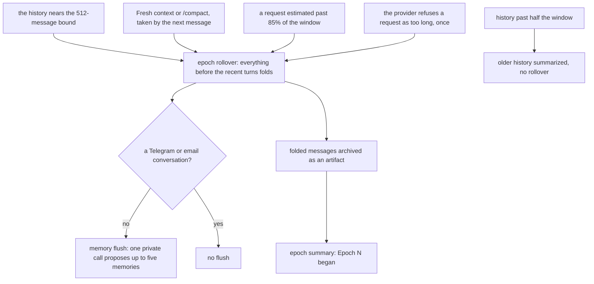

# Concepts

This page describes Tavi's core model as it is built: the data directory, the
owner process and its clients, workspaces and principals, chats, turns and
epochs, agents and workers, projects, the tools a chat can call and how they
are governed, working folders, the browser and the shell sandbox, PDFs and
videos, and how secrets and credentials are kept out of the model's reach.
Commands and flags are named where they matter; [CLI.md](CLI.md) has every
flag. Settings are in [CONFIGURATION.md](CONFIGURATION.md), day-to-day
running (backup, reset, logs, upgrades) is in [OPERATIONS.md](OPERATIONS.md),
everyday workflows across surfaces are in [USECASES.md](USECASES.md), and the
codebase's package and runtime design is in [ARCHITECTURE.md](ARCHITECTURE.md).

## Contents

- [Glossary](#glossary)
- [The data directory](#the-data-directory)
- [The owner](#the-owner)
- [Workspaces and principals](#workspaces-and-principals)
- [Chats and turns](#chats-and-turns)
- [Agents and workers](#agents-and-workers)
- [Projects](#projects)
- [Models](#models)
- [Governed tools](#governed-tools)
- [Working tools](#working-tools)
- [Working folders and the file tools](#working-folders-and-the-file-tools)
- [The browser](#the-browser)
- [The shell sandbox](#the-shell-sandbox)
- [PDFs](#pdfs)
- [Videos](#videos)
- [Secrets in tool results](#secrets-in-tool-results)
- [Credentials](#credentials)

## Glossary

The terms `tavi --help` and these docs use.

| Word | Meaning |
| :--- | :--- |
| **chat** | What you talk to. A prompt starts one. |
| **turn** | One prompt and its answer. |
| **Home** | One persistent chat that goes on; `tavi chat` and the web canvas open on it when Home is on. |
| **side chat** | A new chat started next to Home (`/side` in `tavi chat`, **New side chat** in the canvas). |
| **epoch** | The span of a chat's history between two rollovers; older epochs are folded into a summary. |
| **worker** | An agent a chat delegated to. Never a chat of its own: what it asks you is asked in the chat that delegated to it. |
| **run** | One fire of a schedule, routine or reminder. |
| **task** | The runtime's and the operator's word for any of the above (`tavi tasks`, task ids). |
| **session** | Only a browser session. |
| **sign-in** | The credential a `tavi ui` link gives a browser tab. |
| **owner** | The `tavi serve` process that owns a data directory. While it runs, other `tavi` commands are its clients and run on it ([The owner](#the-owner)). |
| **workspace** | A separate set of settings, rules, agents and chats; the one you get is `default` (`--workspace`). |
| **principal** | The user an action runs as, in a workspace: you are `operator` (`--principal`). A bound channel sender acts as the principal they are bound to. |
| **operator** | You: the person who runs Tavi and the default principal. Configuring Tavi and writing credentials are the operator's alone. |
| **binding** | A link from a sender on a channel (a chat user id, an email address) to a principal (`tavi bindings`). Messages from an unbound sender are held in `tavi inbox`. |
| **artifact** | A file Tavi stores for a task: a tool's large output, a screenshot or download, a report. |
| **grant** | What an approval with scope `session` allows for the rest of a chat (`tavi permissions grants`). |
| **taint** | A chat that has read untrusted content (a web page, an email) is tainted. With `security.taint` at `enforce` (the default), the taint check then asks before a call that could send data out, use a credential or save something; at `observe`, an opt-out that `tavi serve` and `tavi doctor` warn about, it only records what it would have asked (`tavi permissions taint`, [SECURITY-MODEL.md](SECURITY-MODEL.md#untrusted-content-and-the-taint-gate)). |
| **round** | A batch of gated tool calls that waits for your approval. |
| **review** | A wait on an output (a sandbox or browser artifact) before the model sees it. |
| **memory** | What Tavi keeps about you across chats, each record proposed, reviewed and citable ([MEMORY.md](MEMORY.md)). |
| **skill** | An approved, versioned procedure the agent loads when it applies ([SKILLS.md](SKILLS.md)). |
| **plugin** | A package that adds tools, a channel, a provider or a page, reviewed and approved before it runs ([PLUGINS.md](PLUGINS.md)). |
| **mod** | A plugin's hooks into the turn itself: what the model is told, a check before a call, a note after it ([MODS.md](MODS.md)). |
| **schedule** | A prompt run unattended on a cadence or a trigger, with the tools it lists ([AUTOMATION.md](AUTOMATION.md)). |
| **routine** | A multi-agent piece of recurring work with an objective, research and a report ([AUTOMATION.md](AUTOMATION.md)). |
| **reminder** | Something said to a person at a time, which can also start a task ([AUTOMATION.md](AUTOMATION.md#reminders)). |
| **heartbeat** | A short periodic check that tells you only what needs you ([HEARTBEAT.md](HEARTBEAT.md)). |
| **desktop control** | The experimental `desktop.*` tools that act in the macOS apps a workspace grants ([DESKTOP.md](DESKTOP.md)). |

## The data directory

The data directory holds everything: `tavi.sqlite`, artifacts, the credential
store (`credentials/`), logs, and, while an owner runs, its discovery files
under `runtime/`. The owner and every client use the same one. Where it is
and every entry in it are in
[OPERATIONS.md](OPERATIONS.md#the-data-directory).

**Each chat gets its own folder** under `chats/<workspace>/<task-id>/`, which
Tavi creates when the chat runs. The file tools and the shell work in it, or in
a host folder the chat was given (see
[Working folders and the file tools](#working-folders-and-the-file-tools)).
`chats/` is Tavi's to manage: `tavi backup` copies it (without each folder's
`.tmp/` and `.home/`) and `tavi reset` erases it, so keep files a chat must not
lose in a host folder it attaches; reset never touches those.

- Forgetting a chat's history (`tavi tasks history … forget`) and rewinding it
  never touch its folder. Forget names the folder, its size, and
  `tavi tasks folders prune --chat <task-id>` to clear it.
- Each schedule, routine or reminder fire is a run with a folder of its own (a
  routine may pin a host folder instead; see [AUTOMATION.md](AUTOMATION.md)).
- A chat's scratch, `.tmp/` in its folder, is emptied when its turn ends and
  when its conversation rolls over to a new epoch, never while a worker of the
  chat still runs in it. `.home/`, the shell's home with its build caches, is
  kept.

### Folder budget

A chat's own folder may hold 2 GB, and every chat's folder together 20 GB
(`tavi serve --folder-cap`, `--chats-cap`). Past 80% the chat is told once and
`/folder` shows the size. At the budget Tavi empties the folder's `.tmp/`
first, then refuses file writes into it, copies of approved downloads and new
`sandbox.run` calls, naming the size and the prune command. It is a budget, not
a ceiling: a command already running, or several at once, may go past it.

Below 1 GB free on the data directory's disk (`--free-space-floor`; `0` turns
it off), file writes on that disk, files stored for you or the model
(downloads, screenshots, `reports.generate` PDFs, channel media) and new
`sandbox.run` calls are refused. Tavi's own small archives (a folded
conversation's) and a routine's published report are not. `tavi artifacts
approve` with no owner running keeps to the default budget and floor. Host
folders have no budget. Clearing old run folders is in
[OPERATIONS.md](OPERATIONS.md#keeping-storage-small).

## The owner

`tavi serve` takes exclusive ownership of the data directory. While it runs,
other `tavi` commands become its clients over an authenticated local socket,
in one of three ways:

| While an owner runs | Commands |
| :--- | :--- |
| **Run on the owner** | `run`, `chat` and `ui` (their runs); `tasks` (except `tasks folders prune`), `doctor`, `cancel`, `recover`, `abort`, `approvals`, `needs`, `answer`, `artifacts`, `permissions`, `onboard`, `setup`, `config`, `system-prompt`, `models`, `credentials`, `search`, `projects` (all but `import`), `schedules`, `reminders`, `todos`, `agents list\|show\|add\|update\|remove`, `channels` (including `link`, `pair`, `unlink`, `revoke`, `people`), `plugins`, `mcp`, `apps`, `router`, `heartbeat`, `ideas`, `browser`, `memory` (all but `export`) and `reset` |
| **Run alongside it**, without its lock | the read-only and host commands `backup`, `export`, `logs`, `service`, `sandbox` and `router evaluate` |
| **Refused with exit `5`** (stop the owner to use them) | the commands that read or change the store directly and have no remote form: `memory export`, `skills`, `bindings`, `inbox`, `reports show` and `open`, `projects import`, `tasks folders prune`, `prune` and `restore` |

Without an owner, database-backed commands take the directory's lock, work on
the data directory directly, and release it.

A client and an owner must speak the same IPC protocol (currently 7). Running
it as a service, shutdown, recovery after a crash and upgrading are in
[OPERATIONS.md](OPERATIONS.md#running-the-owner).

## Workspaces and principals

Everything happens in a workspace (`default`) as a principal (`operator`).
Commands take `--workspace` and `--principal`. Settings (`tavi config`), the
browser profile, saved permission rules, agents and recipes are per workspace.

## Chats and turns

A prompt starts a **chat** (the runtime, and operator commands such as
`tavi tasks`, call it a task and name it by its task id). A prompt and its
answer are a **turn**. In `tavi chat` and the web canvas, the next prompt after
a turn finishes **continues** the chat: a new turn of the same chat, whose
model sees the earlier prompts and answers.

**Home.** With Home on (the default; `tavi config set chat.home off` turns it
off), both open on your **Home**, one chat that goes on, and a new chat is a
**side chat** (`/side` in `tavi chat`, **New side chat** or **+** in the
canvas). With Home off, `/new` (or **New chat** in the canvas) starts a new
one.

**Turn budget.** Each turn is bounded on its own: 24 model steps and 64 tool
calls by default. When a turn's budget is spent, its last step is offered no
tools, so the model answers from what it gathered and says what it did not get
to. Continue the chat to go on.

### Epochs and compaction

A chat never ends for being long. Once its history nears the conversation's
bound (512 messages), everything before the recent turns is folded into an
**epoch** summary: the earlier summaries, your requests quoted as you wrote
them, and the ids, paths, hashes and links they named. The folded messages are
archived as an artifact the summary names. The transcript shows
`[compaction:epoch] epoch N`; without an artifact store (`--in-memory`) the
summary says it is lossy.

What starts a fold, and what a rollover does:

In the web canvas each rollover is a divider between the turns, **Epoch N
began**, with **Open archive** (the folded turns' artifact, in the chat panel's
Details) and **Fresh context**, which makes your next message start a new epoch
now, whatever the chat's length. Fresh context is also in the chat panel's
Memory tab, and is `/compact` in `tavi chat`. The request is saved with the
chat, so it survives an owner restart and is taken once, by your next message.

When the model catalog knows the model's context window, compaction follows
it:

- Older history is summarized once the conversation passes half the window (at
  most about 64,000 tokens, or 128,000 while the model serves the chat from its
  prompt cache), down to half that again, so the next summary waits for real
  growth. None is made when it could free less.
- A request estimated past 85% of the window is folded before it is sent.
- A provider that refuses a request as too long gets it again, folded, once.

Such a summary can paraphrase a tool's output, so it is sent as quoted data in
the conversation, never as instructions, and an epoch summary names it rather
than carrying its words.

### The memory flush before a rollover

Just before a rollover folds a span, one short private model call reads what
you and the assistant said in it (never a tool's output) and proposes up to
five things worth remembering, facts for every chat and notes for this one, as
**proposals** in the Command Center's memory queue. Nothing is remembered until
you approve it; the chat shows them as one memory card for that rollover, and a
failed call never holds the rollover up. A Telegram or email conversation is
never flushed, since its words may be someone else's; nor are the turns Home
got from your linked Telegram DM when a later rollover folds them. See
[MEMORY.md](MEMORY.md).

## Agents and workers

An **agent** is a named persona (`tavi agents add`) that a task, a schedule or
a chat message (`@name`) can run as; every workspace also has built-in ones,
such as `browser`. A chat delegates to a **worker** with `agents.spawn`, which
names the agent by its id or, in any case, its name ("Researcher" is
`researcher`), may name the tools the worker needs (it can only narrow what the chat may use),
and the worker's answer comes back to the chat as a quoted message. A routine's
research worker runs before its synthesis, which reads the evidence as quoted
data. Limits, taint and
approvals are in [AUTOMATION.md](AUTOMATION.md#agents-and-workers); schedules,
routines, reminders and the heartbeat are in [AUTOMATION.md](AUTOMATION.md)
and [HEARTBEAT.md](HEARTBEAT.md).

## Projects

The **project registry** (`tavi projects`) is what the report collectors and
`news.search` read, per project. See
[AUTOMATION.md](AUTOMATION.md#projects-and-reports).

## Models

A model connection is one of two kinds: `openai-compatible` (Chat
Completions, or the Responses API for a Sign in with ChatGPT connection),
which most cloud APIs and local servers speak, and `anthropic-messages`,
Anthropic's own Messages API, which a new connection to Anthropic's endpoint
gets from its preset (one added before keeps the compatibility layer until it
is removed and added again). A workspace has
a default model and role bindings (`main`, `fast`, `extraction`, `compaction`,
`embedding`, and others); a chat may pick its own model. A running owner reads
the model configuration at each turn, so changes take effect on the next turn
without a restart. See
[CONFIGURATION.md](CONFIGURATION.md#configuring-models-and-credentials).

## Governed tools

Tools with effects outside the model (writing files, sending messages, web
requests, the browser, the sandbox) are gated. A **round** of such calls waits
for your approval, and some outputs (sandbox and browser artifacts) wait for
your **review** before the model sees them.

**Allowlists.** Hosts a tool may reach are allowlisted on the command line
(`--http-allow-host`, `--browser-allow-host`, `--messaging-allow-destination`);
nothing is allowed by default.

**Always-run tools.** `web_search` runs unasked already, by the seeded
`seeded-web-search` rule. Another gated tool you always want to run unasked,
such as `http.request`, is named with `tavi serve --allow http.request` (repeatable, no
`*`; dotted forms such as `web.search` are refused in `--allow` and
`permissions add`). It lifts the round for that tool under that owner; its own
allowlists still apply. The approval card's **Always allow** saves a workspace
allow rule for `web_search` (Settings → Permissions). It works like `--allow`
but is bound to the current search provider, so changing provider asks again.
It is offered even after the chat read web content, since no query shapes what
the rule allows.

**The approval card.** In the canvas one click decides a call; only a
critical-risk call asks for a second confirmation, and a reason is asked for
only when you deny. The card says what the call does in plain words, with its
tool, its risk and one **Flagged:** line saying why it asks (made after the
chat read web content, runs inline code, and so on); the exact command and full
input sit behind **Details**. Its buttons are **Allow once**, **Allow for this
chat** (in Home, **Allow until tomorrow**), **Always allow** where offered, and
**Deny**. While it waits, the prompt box says a message sent now is queued
until you decide.

**The decision record.** Each decision is a line in the chat panel's Activity
tab ("Approved: web_search …", who decided it, and when), read from the owner's
approvals history (`approvals history` with a `taskId`), so it survives a
reload. Consecutive decisions on one tool with the same outcome fold into one
row (**Approved: web_search ×11**) that opens to each decision. The newest 100
show first; **Load older decisions** reads the next 100.

**The Worked block.** The calls between two pieces of the answer fold into one
block, **Worked · 14 steps**, naming the tools used (`web_search ×11,
sandbox.run`). Keeping the plan is not counted; a block of only plan updates
reads **Updated the plan**. It stays one block however many approvals the turn
stopped for. While a call runs the block reads **Working** and names the call;
a model failover shows as **retried**, with its reason inside. Three bouncing
dots under the latest output say the turn is still working.

The full permission model (rules, scopes, the taint gate, untrusted-content
fencing) is in [SECURITY-MODEL.md](SECURITY-MODEL.md).

## Working tools

Every task can:

- **Keep a plan** (`plan.update`, at most 12 steps of 100 characters). It shows
  as a checklist in `tavi chat` and at the top of the canvas chat panel's
  Activity tab, while the chat's working line names the step under way ("step 3
  of 4: Verify return options"). A worker's view shows a running worker's plan
  at its top.
- **Search earlier conversations** (`sessions.search`). It matches any of the
  query's keywords anywhere in a chat (a chat holding more of them first, then
  the newest) and finds a Chinese or Japanese word inside an unspaced sentence.
  Each hit cites its chat by title; the canvas shows the call as "Searched
  earlier chats · 3 found" with a link to each, and `tavi chat` prints their
  titles. Its excerpts are quoted data that taint the chat like a web page. It
  leaves out heartbeat checks, `run` tasks, private chats, chats with memory off
  (and their side chats), chats from other messaging conversations and their
  workers' tasks, so a group's words never turn up in Home, and from a group it
  finds only that group's own earlier chats. It is not offered while memory is
  paused, and a delegated worker never gets it.
- **Look at an approved image** (`artifacts.view_image`): a vision-capable
  model sees the image; any other reads only its text fields.
- **Read and write files** in its chat's folders (next section).

## Working folders and the file tools

A chat has a **working folder**: its own folder by default, or a host folder
under an `--fs-root`, with other host folders attached read-only or read-write.
The file tools and the shell reach those folders and nothing else on the
computer. [WORKING-FOLDERS.md](WORKING-FOLDERS.md) has the architecture, a
guide and worked examples.

The file tools read, list, glob and grep (`fs.read`, `fs.list`, `fs.glob`,
`fs.grep`) and write or edit (`fs.write`, `fs.edit`; the approval shows the
diff). Reads reach every attached folder; writes reach only the chat's own
folder, a host folder it works in, and folders attached read-write. A worker
uses its chat's folders.

`tavi serve --fs-root /path/to/project` (repeatable) names the folders a chat
may use or attach, not folders every chat reads and writes. A new chat started
from the terminal or the canvas gets the first root attached read-only; a chat
from a messaging conversation, a schedule or a reminder gets none. Choose or
attach folders with `/folder` in `tavi chat`, `tavi tasks folder <task-id>`,
`tavi run --folder`, or the canvas's folder chip.

- The model is told its working folder, each attached folder's path and mode,
  and to use `$TMPDIR` for scratch.
- A relative path is in the chat's working folder. A file in an attached
  folder is reached by its absolute path and shown as `<folder name>/<path>`.
- Paths are resolved through symlinks and must stay in the chat's folders.
  Another chat's folder, `~/.ssh`, `~/.aws` and the like, your shell profiles
  and histories, `~/.git-credentials`, `~/.gitconfig`, `~/.config/gh`, and the
  rest of the data directory are never read or written.
- A write whose file was swapped for a link after it was approved is refused.
  A file with more than one hard link is neither read nor written in a chat's
  own folder.
- A saved approval rule names the file it was saved for
  (`chat:<task-id>/<path>` in a chat's own folder, the full path in a host
  folder), so allowing `notes.md` in one chat never allows another chat's. On
  macOS a deny or ask rule also holds a file name spelled in another case
  (`.ENV` for `.env`).
- In a side chat, a write into a host folder and any `sandbox.run` are not
  offered as a standing rule, since the rule would also allow the parent
  chat's.
- After a chat has read untrusted content, a write outside its own folder is
  asked about every time, whatever a rule allows.
- A grep pattern with nested quantifiers (`(a+)+`) or a backreference is
  refused, and a search stops after five seconds, saying it was cut short.
- A folder `tavi serve --dev-plugin` runs is read-only to these tools wherever
  it appears.
- A folder whose path holds `*`, `?`, `[` or `]` cannot be attached or used as
  a chat's folder.

**Chats from messaging.** A task started from a messaging chat is held back from
`sandbox.run`, file writes, `plugins.validate` and `http.request` with a
credential, unless you allow a tool with
`tavi serve --messaging-allow-tool <tool-id>` (then only in your own one-to-one
chats), or allow one for one person in their own one-to-one chat with a contact
grant (`tavi channels grant`), still asked each time. See
[CHANNELS.md](CHANNELS.md).

## The browser

The agent's browser is Chromium, headless, presenting itself as desktop Chrome
with your locale, language and timezone; you see it in the web canvas's live
view. [BROWSER.md](BROWSER.md) covers the browser tools, site profiles,
recipes, protected form fields, the live view and handoff in full. The core
model:

**The browser is one permission.** The first browser call of a chat asks one
question, "This chat wants to use the browser", naming the site it asked for:

- **Allow for this chat**: the browser may open any http(s) site for the rest
  of this chat. In Home or a messaging chat this is **Allow until tomorrow**: a
  day, or until the chat rolls over.
- **Always allow**: a workspace rule for `browser.*`; the browser never asks
  again (remove it in Settings → Permissions). Not offered once the task has
  read web or document content.
- **Deny**, with an optional reason.

Every surface asks it the same way: `y` in `tavi chat`, a bare `approve` in a
chat, **Allow for this chat** on a Telegram button, and
`tavi approvals approve` without `--scope` all allow the browser for the chat.
An email reply approves one call only; the email's links allow it for the chat.
The web inbox's plain **Allow once**, and approving a round that mixes browser
and other calls, allow that one call only.

**Always asked on its own**, even when the browser is allowed: a form submit,
an upload, a download, and a click (or Enter, or Space) on a control whose
label pays, buys, books, orders, confirms, sends or submits. An upload names an
approved artifact or a file in the chat's folders by `path`; the approval shows
the file's name, size and sha256, and a file changed since is refused. When a
saved rule or a grant allows an upload, nobody saw the file, so it is stored
pending review and the task waits for it. `messaging.send_to` sends a file by
`path` the same way.

**Unattended browsing.** `--browser-allow-host` is what the browser may open
when nobody was asked. `tavi run --approval approve` and a schedule's tool
policy run browser calls but never open a site off that list. `web_fetch` and
`http.request` reach only `--http-allow-host` hosts, where a call can still stop
on a card, depending on what the chat has read, are not offered when that list
is empty, and point the model at the browser for any
other host. A `file:` or other non-web URL is refused without asking.

**Sessions and profiles.** A browser session is kept open when its task ends,
so the chat's next turn finds its pages and sign-ins as they were; it is closed
by `tavi browser close <session-id>` or `tavi browser close --inactive`. Each
workspace keeps a browser profile under `<data-dir>/browser-profiles/`
(cookies, consent choices, sign-ins); Settings → General → **Clear browser
profile…** or `tavi browser clear-profile [--workspace <id>]` forgets it.

**History is kept 30 days.** Each session's pages are recorded by scheme, host,
port and path only (no query string, fragment or user info), with a small
thumbnail for the Command Center that is never shown to the model. No
thumbnail is taken of a page with a password, card-payment or one-time-code
field, or on hosts in `browser.noThumbnailHosts`. `tavi browser history` lists
the sessions.

**Confinement.** On Linux the browser runs inside the same sandbox as
`sandbox.run`, reading neither your home, the data directory nor any
`--fs-root`, with its own proxy that never connects to this host or a
link-local address. On macOS it is the full Chromium with Chromium's own
sandbox. `TAVI_BROWSER_HEADED=1` opens a real, off-screen window instead.

**Handoff.** Under `tavi serve`, a task can ask you to act in its browser
yourself (sign in, enter a one-time code, solve a human check) with
`browser.request_handoff`. It waits, by default up to 15 minutes, until you
hand the page back from the live view. The agent never tries to solve a
captcha, and never fills a protected form field (demographic questions,
attestations, signatures, medical intake).

## The shell sandbox

`sandbox.run` runs a command in the chat's working folder, confined by
Seatbelt on macOS and bubblewrap with seccomp on Linux. It writes only the
chat's folders (only its own once the chat has read untrusted content), never
reads another chat's folder, credential homes or the data directory, has no
network unless you grant domains, uses credentials only as placeholders its
proxy fills in toward bound hosts, and never sees your environment.
[SANDBOX.md](SANDBOX.md) covers what it reads and writes, network, limits and
the off switch.

## PDFs

A chat reads a PDF in its folders or an approved attachment (`pdf.read`),
lists a form's fields (`pdf.fields`), looks at up to three pages as images
(`pdf.render`), hands a model a short PDF whole where its connection takes
PDFs (`pdf.view`), fills a form into a new copy (`pdf.fill`), and writes on a
printed form with no fields (`pdf.overlay`). Every filled value names its
source and is approved once, in a table; a fill is never run by a schedule or a
routine. Signature, initials and "I certify" fields stay blank for you.

A PDF that needs a password opens with one you set on the host as a
credential, `tavi credentials set pdf.<its sha256>` (the name the refusal
gives). It never reaches the model. Each PDF is parsed by a single-use child
process with capped memory and time. The optional OCR add-on (`@tavi/pdf-ocr`)
reads scanned pages.

The six tools are on by default; `tavi config set pdf.enabled off` turns them
off per workspace. `tavi doctor`'s `pdf` section reports their state.
[PDF.md](PDF.md) has the details.

## Videos

A chat reads a video in its folders or an approved attachment with the FFmpeg
installed on this machine (Tavi ships none: `brew install ffmpeg` or
`apt install ffmpeg`). Without it the video tools are not offered.

- `video.info` gives a video's facts (container, duration, codec, size, frame
  rate, rotation, sound, subtitles, and whether it records a location, never
  where).
- `video.frames` looks at it through its frames (evenly spaced, at scene cuts,
  where it moves most, or at named times), as a contact sheet or stills;
  `ocr: true` reads on-screen text.
- `video.view` watches a video: a contact sheet and two stills for any model,
  or the whole clip for a model that takes video (see
  [CONFIGURATION.md](CONFIGURATION.md#native-video)).
- `video.transcribe` gives what is said, with its times.
- `video.pose` measures a person's movement, once a pose analyser is set up.

Each video is read in a run of its own, sandboxed with no network where the
host allows it; on a Linux host whose sandbox is unavailable, video calls are
refused unless you start `tavi serve --video-allow-unconfined`. Videos from a
channel, mail or the web are kept 30 days (`video.keepDays`); videos in your
folder are never pruned. `tavi config set video.enabled off` turns the tools
off per workspace.

**Video analysers** (pose, transcription, on-screen text) are chosen by the
owner in `<data-dir>/video/analyzers.json`, read when `serve` starts: per
capability, an ordered list of built-ins, your own commands, or an MCP
server's tool. The pose add-on (`@tavi/video-pose`) and transcription add-on
(`@tavi/video-transcribe`) need models you supply in `<data-dir>/video/models`.
[VIDEO.md](VIDEO.md) has the formats, analyser manifests and setup steps.

## Secrets in tool results

Secrets (API keys, tokens, private keys) in what a tool returns are masked as
`[redacted:<kind>]` before the model sees them. See
[SECURITY-MODEL.md](SECURITY-MODEL.md#output-trust).

## Credentials

Credentials are referenced, never passed around: a connection names a
reference and the value is read from the credential store when it is used. The
commands are in [CONFIGURATION.md](CONFIGURATION.md#credentials), the
guarantees in [SECURITY-MODEL.md](SECURITY-MODEL.md#credentials).
