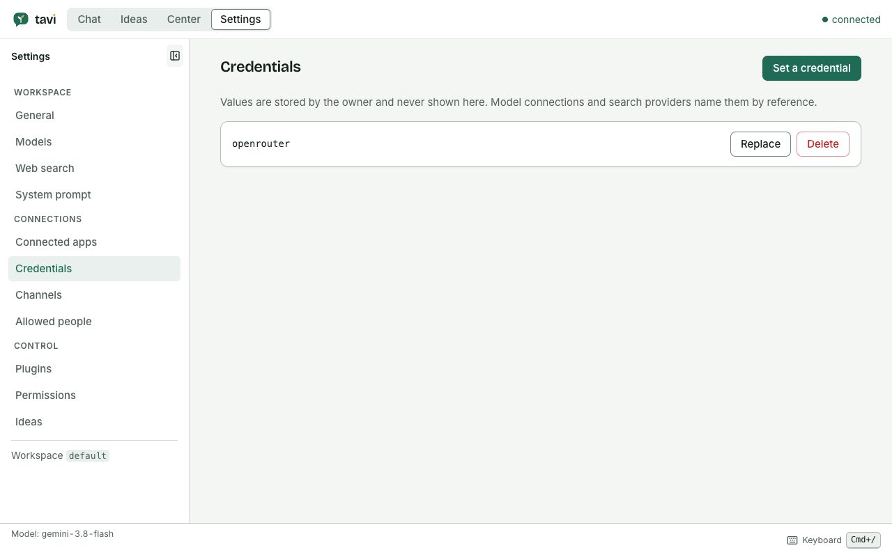
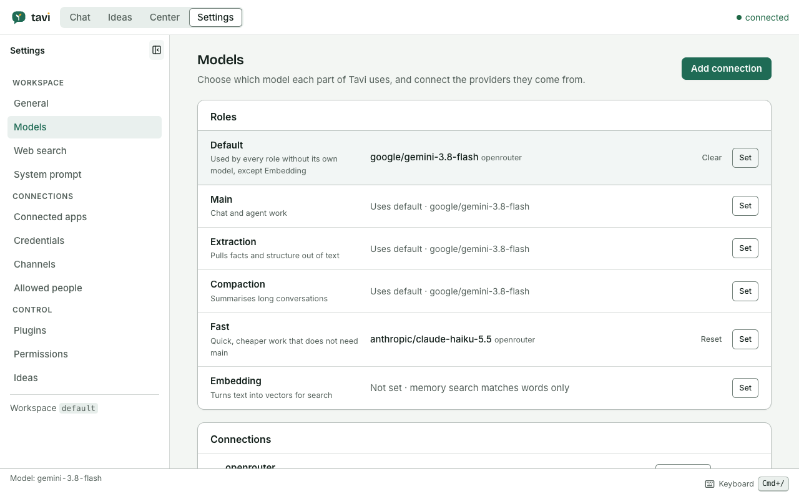
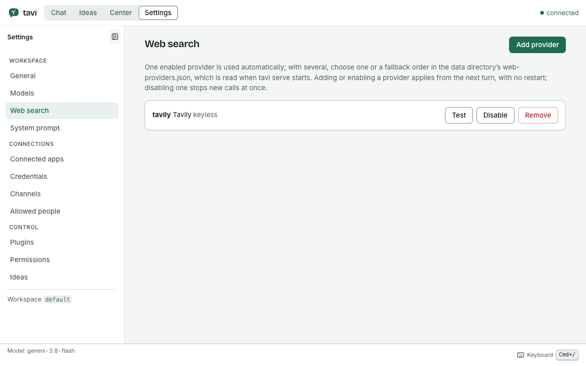

# Configuration

This page covers what you set to make Tavi work your way: credentials, model
connections and roles, the base system prompt, per-workspace settings
(`tavi config`), web search providers, the `tavi serve` flags that open what
tools may reach, the files in the data directory you may edit, and environment
variables. Most of it can also be done in the web canvas's Settings views and
from `tavi chat`. [CLI.md](CLI.md) lists every flag; `tavi onboard` sets up the
basics for you ([ONBOARDING.md](ONBOARDING.md)).

## Contents

- [Where configuration lives](#where-configuration-lives)
- [Credentials](#credentials)
- [Configuring models and credentials](#configuring-models-and-credentials)
- [System prompt](#system-prompt)
- [Workspace settings](#workspace-settings)
- [Workspace settings: timezone and task summaries](#workspace-settings-timezone-and-task-summaries)
- [Web search](#web-search)
- [Owner flags](#owner-flags)
- [Environment variables](#environment-variables)
- [Architecture](#architecture)

## Where configuration lives

| What | Where | Changed with |
| :--- | :--- | :--- |
| Credentials | `<data-dir>/credentials/`, one 0600 file per reference; `credentials.key` when encrypted (the key itself, or a reference to it in the OS keychain) | `tavi credentials` |
| Model connections, default model, roles | the database | `tavi models`, Settings → Models |
| Base system prompt | the database, per workspace | `tavi system-prompt`, Settings → System prompt |
| Workspace settings | the database, per workspace | `tavi config`, Settings → General |
| Web search providers | the database; provider selection in `<data-dir>/web-providers.json` | `tavi search`, the **Web search** view |
| Video analysers | `<data-dir>/video/analyzers.json` (read when `serve` starts) | edit the file; see [VIDEO.md](VIDEO.md) |
| What tools may reach | `tavi serve` flags | restart the owner with new flags |
| Permission rules | the database, per workspace | Settings → Permissions; see [SECURITY-MODEL.md](SECURITY-MODEL.md) |
| Memory settings | the workspace's `memory` setting | `tavi memory config`; see [MEMORY.md](MEMORY.md) |

Configuration commands run on a live owner over its socket when `tavi serve`
is running, and on the data directory directly otherwise. On a live owner a
change applies from the next turn or model call, without a restart, unless
noted below.

## Credentials



```bash
tavi credentials set <ref> --file <path>      # store a value (from a 0600 file, not a symlink)
tavi credentials list                         # names only, never values
tavi credentials delete <ref>
tavi credentials encrypt                      # encrypt the store at rest
```

Credentials are referenced, never passed around: a connection or provider
names a reference (`openai.apiKey`), and the value is read from the store (or a
file bound with `--api-key-file`) when it is used. No command prints one, and
none is reachable from the agent. `tavi credentials delete` names the model
connections that still name the reference it removed; a call on one of them
then fails, naming `tavi credentials set <ref>` to store it again.

`tavi credentials encrypt` encrypts every value at rest (AES-256-GCM), creating
the key if there is none. It is idempotent. Keep the key: without it the values
cannot be read, and it is never regenerated. Under a live owner, `set` reads
the file locally and sends the value once over the local socket.

Where the OS keychain is available, the key lives there and
`<data-dir>/credentials.key` (0600) holds only a reference to it: the macOS
Keychain (through `/usr/bin/security`), or on Linux a Secret Service keyring
such as GNOME Keyring or KWallet (through libsecret's `secret-tool`, with a
session bus), or on Windows Credential Manager (called in process, so no tool
runs). The item is under the service `tavi-credential-key`. The key is
passed to the tool on its standard input, never on a command line. Elsewhere,
or when the keychain refuses or does not answer within a few seconds,
`credentials.key` holds the key itself, as before.

A **new data directory** is encrypted from its first open, with no step of its
own: so a sign-in's token or an OAuth client secret can be kept from the
start. The key goes to the keychain when it takes it; without one (or with
`TAVI_CREDENTIAL_KEYCHAIN=off`) `credentials.key` is the key itself (0600), as
`tavi credentials encrypt` makes it. While a plain store holds values — a
directory from before, or one whose key file could not be written — `tavi
serve` warns at start and `tavi doctor` says so under `credentialStore`. A directory that existed
before, whether plain or encrypted with a key file, is left as it is: nothing
is migrated. A value `tavi credentials set` stored before the first open is
encrypted when the key is created. Each key has a keychain account of its own,
named in `credentials.key`, so no two data directories share one, and a moved
directory still finds its key; `tavi reset` deletes the item. Set
`TAVI_CREDENTIAL_KEYCHAIN=off` to keep new keys out of the keychain; a key
already there is still read. A data directory copied to another machine needs
its keychain item too: without it, its encrypted values cannot be read.

A data directory deleted by hand, rather than with `tavi reset`, leaves its
item behind. On macOS, `security find-generic-password -s tavi-credential-key`
shows one item (its `acct` is the account), and
`security delete-generic-password -s tavi-credential-key -a <account>` removes
it. On Linux, `secret-tool clear service tavi-credential-key account <account>`
does the same. Keep the items whose accounts are named in the `credentials.key`
files of the data directories you still use.

On a **headless Linux server** run as a system unit there is no keychain, and
`credentials.key` would hold the key in the clear beside the data. A systemd
credential can hold it instead, encrypted with the host key (and the TPM, where
there is one) by `systemd-creds`, and handed decrypted only to the service:

```bash
tavi credentials key --export | sudo systemd-creds encrypt --name=tavi-credential-key - /etc/tavi/credential-key.cred
tavi service unit --credential-encrypted tavi-credential-key=/etc/tavi/credential-key.cred --out tavi.service
# install and start the unit as its header says, then, with it running:
tavi credentials key --to-systemd
```

`--export` refuses to write to a terminal. `--to-systemd` runs on the service,
the one process that reads the credential (under `$CREDENTIALS_DIRECTORY`,
which every confined child is denied): it checks the credential holds the very
key `credentials.key` holds, and only then replaces the file with a reference
(`tavi-keychain:v1:systemd:tavi-credential-key`), reads the key back through
it, and deletes the file's copy. Nothing is re-encrypted. From then on only the
service reads the credentials: a command run without it (`tavi credentials
set` with the service stopped) fails `UNAVAILABLE`, naming the line it needs.
`tavi credentials key --to-file`, with the service running, moves the key back
into the file. The encrypted file is bound to that machine: keep a copy of the
key elsewhere (`--export`, before the move) for a restore anywhere else.

Naming conventions:

| Reference | Used for |
| :--- | :--- |
| `<provider>.apiKey`, or any name you choose | a model connection (`--credential`) |
| `search.<name>`, or the kind's own prefix (`brave.<name>`) | a web search provider; a model connection can never use such a key |
| `pdf.<sha256>` | the password of a PDF, by its full sha256 (the name a refusal gives) |

## Configuring models and credentials



```bash
tavi models add <id> --base-url <url> [--credential <ref>] [--model <id>] [--local-only] [--header k=v] [--pdf-input none|openai-file] [--pdf-engine pdf-text|mistral-ocr|native|default] [--first-byte-timeout <s>|default] [--idle-timeout <s>|default]
tavi models list | show <id> | remove <id>
tavi models rebind <id> [--credential <ref>]  # point a connection at another key
tavi models discover <id>                     # ask the provider which models it offers
tavi models test <id> [--model <id>]          # one small, bounded generation
tavi models probe <id> --pdf [--model <id>]   # does the model read a PDF sent as a file?
tavi models probe <id> --video [--model <id>] # does the model watch a video sent whole?
tavi models video <id> --enable <model> --yes # send that model whole videos (after its disclosure)
tavi models video <id> --disable <model>      # back to frames
tavi models set-default --connection <id> [--model <id>]
tavi models clear-default
tavi models set-role <role> --connection <id> [--model <id>] [--fallback <conn>/<model> ...]
tavi models clear-role <role>
tavi models roles                             # what each role resolves to
```

`--credential` is required unless the connection is local (a loopback or
unix-socket base URL, or `--local-only`): a local server that takes no key gets
a placeholder of its own, stored under the connection's id (or `<id>-2`, … when
another connection or key has that name), as `tavi setup model` connects Ollama
and LM Studio. One key per connection keeps two local servers from sharing a key
across addresses.

Offline (no owner running), `discover` and `test` need `--credential-file
<path>`; on a running owner they use the stored credential and
`--credential-file` is refused.

A key named by connections at two addresses still serves chats on both, but
while an owner runs `models test`, `discover` and `probe` refuse to send it
(an attached client must not move a key to another origin): `models add` warns
when it makes such a pair, so give each connection a credential of its own.

`set-default` and `set-role` save a model the connection's catalog (from
`discover`) does not list — a model can be typed by hand — but warn on stderr,
naming the nearest listed id and `tavi models test <id> --model <model>`.

You can do the same from `tavi chat` (`/credentials set`, `/models add`,
`/models set-default`, `/models set-role`, `/models test`) and, except adding
a connection, from the web canvas's **Models** and **Credentials** views.

### Connection kinds

Connections speak Chat Completions; a Sign in with ChatGPT connection speaks
OpenAI's Responses API instead. A connection to Anthropic's endpoint speaks
Anthropic's own Messages API (`anthropic-messages`), which caches the prompt
and, when the model thinks (Claude 5 models do by default), keeps its thinking
across a step's tool calls; Google is reached
through its own OpenAI-compatible endpoint, where vendor extensions (thinking
settings) are not sent. `--local-only` declares a connection as operator-controlled local
infrastructure; a `localhost`/loopback or unix-socket endpoint counts as local
too. `models add`, `list` and `show` print both: `localOnly`, as declared, and
`local`, what Tavi treats the connection as.

How each provider is told what to cache, at a glance (the details follow):

| Provider | What Tavi sends for its prompt cache |
| :--- | :--- |
| Anthropic's own endpoint (`anthropic-messages`) | `cache_control` breakpoints, natively |
| OpenRouter, an `anthropic/…` model | `cache_control` breakpoints on the last tool schema, the system message, the end of the earlier conversation and the newest message still carried; a `session_id` digest of the chat |
| OpenRouter, a `google/…` model | the last breakpoint alone; a `session_id` |
| OpenRouter, any other model | a `session_id` |
| OpenAI's own endpoint | a `prompt_cache_key` digest of the chat; GPT-5.6 and later also take the loop's breakpoints under the v2 layout (`prompt_cache_breakpoint`) |
| Any other endpoint, a local server | nothing: its automatic prefix cache applies |

A provider's automatic prefix cache (OpenAI and compatible gateways, a local
server's KV reuse) still applies. Within a turn, a model call starts with the
previous call's instructions and history unchanged (unless the offered tools or
the retrieved context changed) and adds only what is new. Memory, skills and an
ordinary chat's epoch summaries travel in a block of quoted data at the front
of the person's newest message, never in the instructions, so the tool schemas
and instructions stay the same from one message of a chat to the next. An
`anthropic/…` model on OpenRouter caches nothing by itself, so its requests
carry `cache_control` breakpoints on the last tool schema, the system message,
the end of the earlier conversation and the newest message the next call still
carries. Any other provider is sent the request unchanged. Under the v2 prompt
layout (`models.promptLayout`) the agent loop itself marks where the cacheable
prefix ends — the turn's opening message, and on a later call the newest message
before the step note — and the transport turns those marks into `cache_control`
for such a model and drops them for every other provider. A `google/…` model
on OpenRouter reads only the last breakpoint, so it is sent that one alone. A
call whose prompt no later call reads (a compaction summary, an activity
summary, the injection check) is sent no breakpoint, since writing a cache entry
costs more than sending the prompt plainly; a routine evaluation's calls, which
send each role's system prompt up to 40 times, mark it (a prompt below the
provider's cache minimum is simply not cached); a heartbeat
turn whose next check comes between 5 and 55 minutes later marks its tools and
system text to be kept for an hour (`ttl: "1h"`) rather than five minutes.
Besides breakpoints, OpenRouter is sent a digest of the chat's task id as
`session_id` (of the heartbeat provider's id for a heartbeat check, whose ticks
share their prompt), which keeps a chat's calls on the provider whose cache holds
its prefix, and OpenAI the same digest as `prompt_cache_key` (a new shard of the
key past 15 calls a minute); which preset takes which is its `promptCache` entry in
`packages/contracts/src/models-config.ts`. Any other endpoint is sent neither.
On OpenAI's own endpoint, GPT-5.6 and later also take the loop's breakpoints
under the v2 layout as `prompt_cache_breakpoint` (an older model is sent none),
and a heartbeat that keeps its prefix an hour asks them for a 30-minute cache
(`prompt_cache_options.ttl`), the longest OpenAI offers.

### Discovery

`tavi models discover` reads `GET /models` as the standard `data` array or the
`models` map some gateways answer with. Each entry's name
(`name`/`display_name`), context window (`context_length`, `limit.context`, …)
and output cap (`max_tokens`, `top_provider.max_completion_tokens`, …) are kept
in the catalog and shown on the Models cards and in the composer's picker.
Replies up to 4 MB and 500 models are read; a bigger listing is truncated. A
gateway's batch-only variants (OpenRouter's `<model>:batch`) are left out.

### Testing

`tavi models test` records the result in the model catalog. A model refused for
good (bad key, unknown model, no quota) is marked unavailable and skipped by
runs; a rate limit or a timeout is not recorded.

### Which model a run uses

1. A chat's own model, when one was chosen for it.
2. Else `--connection/--model`, if given.
3. Else role `main`'s binding (`set-role main`), then its fallbacks.
4. Else the workspace default.

A running `tavi serve` reads this at each turn, so a changed default, role or
connection (one added after it started included) takes effect on the next
turn, without a restart. An owner started with no model at all composes no
stand-in provider, refuses runs until a default resolves, and serves the first
model added from the next turn. A turn keeps the model it began with, and a
call goes to the endpoint its binding was resolved for.

`tavi serve --connection <id> --model <id>` pins the default instead.

### Each chat its own model

Pick one in the web composer, or send `/model <connection> <model>` in
`tavi chat`. The chat runs it from its next turn (a turn already running
finishes on its model), whatever the default does later, and it also becomes
the default for new chats (when role `main` or the owner's flags outrank it,
you are told so). Workers the chat delegates to run its model too.

Under an owner, `tavi run --connection <id> --model <id>` makes them that run's
own model without touching the default (with `--home` they only assert the
owner's default: Home's model is picked with `/model`). A model its
connection's catalog does not list is refused when picked, and a chat whose
model no connection offers any more is refused until another is picked.

### Failover

Role `main`'s fallback (up to three targets) takes over a call answered with a
rate limit or a provider fault. The failed call's partial text is discarded,
and the stream says so. A billing failure (out of credit, or a key's spending
cap such as OpenRouter's "Key limit exceeded") does not fail over; the run
fails with a note to raise the limit or pick another model.

A provider that stalls counts as a provider fault: a call that has had no
output for 60 seconds (180 for a call that reasons first: a reasoning effort
asked for, an OpenAI reasoning model, or a Claude model that takes an effort;
600 for a server on this computer, which reads the whole prompt before it
answers), or that goes quiet for 90 seconds mid-reply, is given up and fails
over. A model's thinking counts as output even where the stream carries it in a
field of its own, as Ollama's does. A slow endpoint can be given longer with
`tavi models add <id> ... --first-byte-timeout <seconds>` and
`--idle-timeout <seconds>` (1 to 3600; `default` puts one back); the setting
is kept across edits while the endpoint stays the same.

A local server's context length is its own setting, not the model's: Ollama
runs every model at 4,096 tokens unless told otherwise, and Tavi's prompt with
its tools runs to about 22K. Such a server silently cuts what does not fit, and
answers whatever end of the prompt it kept, so a call whose server reports
reading far less than was sent (under one token per eight characters) fails
with a note saying so and naming the setting to raise. On Ollama, set the
context length in its Settings or with `OLLAMA_CONTEXT_LENGTH` (32K or more),
or make a model of your own with `PARAMETER num_ctx 32768` in a Modelfile.

### Roles

| Role | Used for |
| :--- | :--- |
| `main` | Runs chats; its fallback takes over on failure. |
| `fast` | The cheaper model routing and heartbeat checks use. |
| `extraction` | Reads pages for the browser tools (`browser.extract`, `browser.find`), and runs memory's background calls: the flush before a rollover, the idle review, the weekly tidy-up. Falls back to `fast`, then `main`. |
| `compaction` | Writes the summary that folds older history once a chat's context fills. Falls back to `fast`, then the chat's own model. |
| `embedding` | A text-embedding model, called through the connection's `/embeddings` endpoint. Only an explicit binding is used, never the workspace default. Memory uses it for hybrid recall (`tavi memory config retrieval hybrid`). |

The summary, the flush and the idle review use their role when you bound it,
else `fast` when that is bound, else the chat's own model. None of them uses a remote role for a chat that used
or runs on a local model. A finished task's activity title and summary are
written by the workspace's `activitySummaryModel` when set, else by `fast`
when bound, else by the task's own model, under the same local rule; a chat
keeps the first title written for it as it goes on (only its summary
follows, and a later pass asks the model for the summary alone), and a task whose words have not changed since its summary was
written is not summarized again. The summary also stays on the chat's own model when the
role's known context window is too small for the span. The summary folds older
history once the conversation passes half the model's window (the catalog's,
from `tavi models discover`), capped at 64,000 tokens, or at 128,000 once the
chat's current model reports prompt-cache reads; with no known window, at
32,000 tokens, or 6,000 for a model on a local connection. A request past 85% of
a known window is folded before it is sent. Embedding calls are
metered like any other (purpose `embedding`, usage only, never the texts), and
a chat on a local connection never has its texts sent to a remote embedding
connection.

### PDF input

`--pdf-input` says whether a PDF a tool hands the model is sent to it as a
file. It is on by default for the OpenAI and OpenRouter endpoints, off
everywhere else, and never for Anthropic's compatibility endpoint, which drops
files; `--pdf-input none` turns it off. On another endpoint it cannot be set by
hand: `tavi models probe <id> --pdf` sends the model a one-page PDF holding a
random code, and PDF input goes on only when the model quotes the code back.
`--pdf-engine` picks OpenRouter's file parser.

### Native video

Native video is per model, and off until you turn it on. Without it, a chat
sees a video through at most three still images.

- **Which models.** One qualifies when the provider's catalog says it takes
  video (`tavi models discover` records it), or when
  `tavi models probe <id> --video` passes. The probe sends a 4-second clip of
  four random digits, encoded by your FFmpeg, and the model must read them back
  in order. Never on OpenAI's or Anthropic's endpoints.
- **Turning it on.** `tavi models video <id> --enable <model>` prints what it
  means (the whole clip, every frame and its sound, goes to the provider each
  time it is viewed) and turns it on only with `--yes`. In the canvas,
  Settings → Models lists each connection's models under **Native video**: a
  switch for each model that reads video, which shows the same words and asks
  before it turns on, and **Probe** for any other. The picker badges a model
  that reads video, and **Video analysers**' **Check** shows what `doctor` says
  of FFmpeg and the analyser chains.
- **What it keeps.** The setting stays across edits of the connection, and goes
  when its endpoint changes.

A clip is sent whole only when it is MP4, MOV or WebM, up to 2 minutes and 20
MiB, the whole clip is asked for, and a person is in the chat. See
[VIDEO.md](VIDEO.md).

## System prompt

The base instructions every chat runs under, from its next message. Settings →
System prompt edits them in the canvas; the CLI does the same over the owner.
The shipped default (`tavi-default-5`) treats search results as leads: for
exact current figures (prices, schedules, availability) the model opens a site
that has them, with the browser when it is offered, or says the figures are
unverified. It also tells the model that untrusted content arrives fenced as
data (see [SECURITY-MODEL.md](SECURITY-MODEL.md)), and to write at most one short
sentence before a tool call, never repeating what it just wrote or read: each
step's words are sent again on every later call of the turn. It asks for
independent read-only calls (reads, searches, lookups) to be sent together in
one step, since they run at the same time. If you say you attached a file and
none reached the turn, it says so rather than searching the disk: task folders
are not where your files are. A chat that started on an earlier version keeps
it; a new chat starts on `tavi-default-5`.

```bash
tavi system-prompt show
tavi system-prompt set --file ./my-prompt.txt
tavi system-prompt reset
tavi system-prompt preview --agent <agent-id>
```

`preview` lists what a new task's model request is built from, in order and
with lengths: the shipped default (or your prompt, with the default it replaces
struck out), the agent's persona, then the runtime facts and the memory and
skills context generated for each call (the facts shown as a sample, the
context with how many skills are active). It uses the same composition the
runtime does, so it cannot drift from what the model receives.

How the request is composed:

- The memory and skills context is not part of the instructions: it is sent as
  a block of quoted data just before the person's newest message.
- The facts that hold for the whole turn are part of the instructions. The
  call's own step and tool-call budget and the local time are sent as a short
  note at the end of the request, after the conversation, so the instructions
  stay cacheable from call to call.
- A persona is appended after the base rather than replacing it (an edited
  persona is read again at each model call). A chat's own instructions
  (`tavi tasks instructions`) are the top layer, after the base and any
  persona.
- A routine keeps its own pinned instructions, and the compaction summary call
  keeps its own prompt.

The file is read exactly as written (multiline and surrounding whitespace
kept), up to 20,000 JavaScript string code units, which is what the DOM counts,
so an astral character counts as two. Changes apply from the next message: a
new chat, and each existing chat's next message (Home included), run under the
saved base, while a turn already running keeps the base it was admitted under.
An approval or an answer resumes it under that base, so a turn never switches
prompts halfway. A chat whose base was an explicit one keeps it. A message
whose base did not change is sent the same instructions, byte for byte, so a
provider's prompt cache of them still holds.

Writes are a compare-and-set (`--expected-revision <n>` asserts the revision),
so two editors cannot silently overwrite each other: a stale write is refused,
and a timed-out write is an unknown outcome to check rather than a rollback.
The text is stored locally and sent to the model you run; do not put
credentials in it. Resetting it does not erase the per-task copies.

## Workspace settings

`tavi config` reads and changes one workspace's settings (`--workspace <id>`,
default `default`). On a live owner the change applies to the next model call;
without one the data directory is changed directly. Settings → General in the
canvas changes most of the same keys, `skills.suggestions` (**Skill
suggestions**), `models.toolDeferral` (**Rarely used tools**) and `tasks.home`
(**Your to-do list**, listing Tavi and the MCP servers this workspace allows
and has enabled) among them.

```bash
tavi config get [key]           # one setting, or every setting
tavi config set <key> <value>
tavi config unset <key>         # back to the default
```

`--expected-revision <n>` makes a write a compare-and-set.

| Key | Values | Default | Meaning |
| :--- | :--- | :--- | :--- |
| `workspace.timezone` | IANA zone, e.g. `Europe/Berlin` | the owner host's zone | The zone the agent states the local time in, and that "today" and relative times resolve in. |
| `operator.name` | one line, up to 80 characters | unset | What you are called; onboarding's about step sets it. |
| `activity.summaries` | `on`, `off` | `on` | Whether a finished task gets a generated title and one-line summary. |
| `activity.summaryModel` | `<connection>/<model>` | the workspace's `fast` role when bound, else the task's own model | The model that writes summaries; never used for a task on a local connection when it is remote. |
| `chat.home` | `on`, `off` | `on` | Whether the workspace has a Home chat that `tavi chat` and the canvas open on. Off, `/new` starts separate chats. |
| `chat.home-dm` | `<connection>:<sender id>[,...]`, or `off` | `off` | Your own chat-channel DM identities whose private chats with the bot are turns of your Home. Needs `chat.home` on. See [CHANNELS.md](CHANNELS.md). |
| `models.keptRequests` | `0`–`1000` | `10` | How many of a task's newest model calls keep their whole request; older calls keep usage, cost and a hash. |
| `models.maxOutputTokens` | `256`–`1000000` | `16384` | The most one model call may write (its `max_tokens`); a heartbeat's or an idea's own cap is used instead. A provider that refuses a call because the key can pay for fewer tokens (OpenRouter's "can only afford N") gets the same call once more, asking for that many. |
| `scheduled.monthlyTokenBudget` | tokens, 1,000 or more | none | What the workspace's schedules and routines, with their workers, are meant to use in a calendar month in its zone. Your Home is told once a month at 80%; nothing is stopped. `tavi doctor` and the Schedule page show the month's total either way ([AUTOMATION.md](AUTOMATION.md#schedules)). |
| `models.promptLayout` | `v1`, `v2` | `v2` | How a model call's prompt is laid out for prompt caching. `v2` is the cache-stable layout (see [ARCHITECTURE.md](ARCHITECTURE.md#token-and-prompt-cache-behaviour)), the default; `v1` is the layout earlier releases sent, and setting it is the rollback. Read on every model call, so a change reaches a running task's next call. |
| `tasks.home` | `tavi`, `mcp:<server>` | `tavi` | Where you keep your tasks. `tavi`: Tavi's own to-do list (`todos.*`). `mcp:<server>`: a task app connected as an MCP server (such as `tavi mcp add todoist --preset todoist`); the system prompt then sends your to-dos there and `todos.*` keep only Tavi's own follow-ups. No sync: `tavi todos export`, or ask in a chat to move them ([AUTOMATION.md](AUTOMATION.md#to-dos)). |
| `models.toolDeferral` | `auto`, `on`, `off` | `auto` | Whether an attended chat's rarely used built-in tools wait behind `tools.search` under `v2`. `auto` defers them unless the chat runs on a local model, which keeps the whole list; `on` always; `off` never. Whatever it says, a list past the 128 tools one request may carry defers the families. See [TOOLS-AND-SKILLS.md](TOOLS-AND-SKILLS.md#how-a-turns-tool-list-is-built). |
| `browser.noThumbnailHosts` | comma-separated hosts (`*.domain` matches subdomains), `none` | common webmail and payment hosts, and `*.bank` | Hosts whose pages never get a Command Center thumbnail. Replaces the default list. |
| `browser.sessionIdleMinutes` | whole minutes, `0`–`1440` | `30` | How long a browser session nobody is using stays open before it closes; its sign-ins stay in the profile. `0` keeps it until it is closed. |
| `browser.downloadMaxMiB` | whole MiB, `1`–`4096` | `256` | The largest file a browser download keeps; a larger one is cancelled and refused. |
| `browser.visionEngine` | `generic`, `native` | `generic` | What drives `browser.vision_act`: Tavi's own loop, or (experimental) the model's native computer-use tool on a native Anthropic connection or OpenAI's API, each action still run and checked by the browser. |
| `desktop.grantedApps` | comma-separated bundle ids or app names, `none` | none | The apps experimental desktop control (`tavi.desktop`) may see and act in, each at its built-in tier. See [DESKTOP.md](DESKTOP.md). |
| `travel.flightSearch` | `on`, `off` | `on` | `travel.flights_search` asks Kiwi.com's public flight search. Off, it refuses and the agent browses flight sites. |
| `skills.suggestions` | `on`, `off` | `on` | Whether the agent may offer, unasked, a procedure that worked as a skill for you to review (`skills.propose`). Off, it offers one only when asked. |
| `travel.googleFlights` | `on`, `off` | `on` | Flight answers link Google Flights (unofficial, best effort) to confirm a fare or when the search fails. |
| `pdf.enabled` | `on`, `off` | `on` | The PDF tools. Off, they refuse every call and the canvas takes no PDF upload. |
| `video.enabled` | `on`, `off` | `on` | The video tools. Off, they refuse. |
| `video.keepDays` | `1`–`3650` | `30` | How long a video from a channel, mail or the web is kept; its frames stay with its chat. |
| `tools.redactResults` | `on`, `off` | `on` | Mask credential shapes in tool results as `[redacted:<kind>]`. |
| `tools.parallelReads` | `1`–`32` | `8` | How many independent read-only calls of one model step run at the same time. `1` runs every call in turn. Results, cards and approvals keep call order whatever it says. See [TOOLS-AND-SKILLS.md](TOOLS-AND-SKILLS.md#parallel-read-only-calls). |
| `sandbox.domains` | comma-separated hosts or `*.domain`, optionally with `:port`, or `@registries` | none | Domains this workspace's `sandbox.run` may reach, beside `serve --sandbox-domain`. See [SANDBOX.md](SANDBOX.md). |
| `sandbox.network` | `granted`, `ask` | `granted` | `ask` lets a `sandbox.run` name hosts nobody granted in `requestDomains`, which a person approves on its card for that call alone (no rule or unattended run does). See [SANDBOX.md](SANDBOX.md#network). |
| `security.taint` | `off`, `observe`, `enforce` | `enforce` | How the approval gate treats calls after untrusted content entered the chat. `observe` and `off` are opt-outs that `tavi serve` (at start) and `tavi doctor` warn about. `serve --taint-policy` overrides it. See [SECURITY-MODEL.md](SECURITY-MODEL.md). |
| `security.injectionDetector` | `off`, `patterns`, `model` | `patterns` | The detector that flags calls made after a likely prompt injection. See [SECURITY-MODEL.md](SECURITY-MODEL.md). |
| `mcp.servers` | comma-separated server ids | none | The MCP servers whose tools this workspace is offered. See [MCP.md](MCP.md). |
| `mcp.people` | comma-separated server ids (each also in `mcp.servers`) | none | The MCP servers other people bound on a channel are offered (`tavi mcp people`). See [MCP.md](MCP.md). |
| `memory` | JSON | memory on, suggestions on | The whole memory section; `tavi memory config` changes one key at a time. See [MEMORY.md](MEMORY.md). |
| `ui.roles` | JSON, e.g. `{"browser-view":"acme.browserview"}`; `"off"` per role | the built-in (`tavi.browserview`) | Which plugin fills each UI role. See [MODS.md](MODS.md). |
| `ui.placements` | JSON per `<plugin-id>/<contribution-id>`: slots, or `"hidden"` | each manifest's own | Where plugin UI contributions are shown. See [MODS.md](MODS.md). |

## Workspace settings: timezone and task summaries

### Timezone

Each workspace has a timezone. The agent is told the current local time in it
on every model call, so "tomorrow" or "next Monday at 10" resolves in your zone
rather than the server's. Until you choose one, the owner host's zone applies.
Settings → General picks it from a searchable list, with **Use host zone** to
go back to the default; the CLI does the same:

```bash
tavi config get workspace.timezone              # workspace.timezone = Europe/London (default: host zone)
tavi config set workspace.timezone Europe/Berlin
tavi config unset workspace.timezone
```

A name the platform does not know is refused. The change applies to the next
model call, including in a task that is already running.

The web canvas says times in this zone too, not the browser's: a question's
deadline and answer receipt, when a memory record was last used, routine runs
and deliveries, instruction revisions and follow-ups. A time today shows alone
("14:30"); any other day adds it ("Tue 29 Sep 14:30").

### Your name

Your own name is a workspace setting too, which onboarding's about step sets:
`tavi config set operator.name "Robin"` (one line, up to 80 characters;
`tavi config unset operator.name` clears it).

### Task summaries

Task summaries are on by default. When a task finishes, the owner makes one
small model call (at most 60 output tokens, no tools) that gives it a short
title and a one-line summary, such as "Finish the SEO action plan / Delivered
the 90-day roadmap PDF", rather than the raw first line of the prompt. A failed
or cancelled task's summary says why. A task continued with a follow-up is
summarized again when it finishes again. The call is recorded against the task
like any other, so it shows in its cost.

The summary is written by the workspace's `fast` role when one is bound, else
by the same connection and model the task used. You can name another model with
`activity.summaryModel`; neither is ever used for a task that ran on a
local connection (a `localhost`/loopback or unix-socket endpoint, or one added
as local-only, such as Ollama or LM Studio) when the chosen model is remote:
that task's own model writes its summary. The same holds for a task that used
several connections: if any of them was local, no remote model summarizes it
(the task is then left with its prompt's title).

To turn summaries off (no call is made; tasks that finish from then on keep the
first line of their prompt as the title, while a task summarized earlier keeps
its generated title and summary), use Settings → General or:

```bash
tavi config set activity.summaries off
tavi config set activity.summaryModel ollama/llama3.1   # optional: <connection>/<model>
tavi config unset activity.summaryModel                  # back to fast, else each task's own model
```

## Web search



`web_search` uses a single available provider automatically. With several,
select a provider or fallback chain in `web-providers.json` (see
[PLUGINS.md](PLUGINS.md#web-provider-selection-and-receipts)). It is a gated
tool, and every workspace is seeded once with the `seeded-web-search` allow
rule, so chats and schedules run it without a round (existing workspaces get
the rule at their next start; remove it, or add an `ask` rule, to be asked
again). Under taint a search still asks when the chat holds private data, or
when the query is shaped like data leaving; in any chat, a query that looks
like a key or token asks once before it goes, and a run nobody attends is
refused it ([SECURITY-MODEL.md](SECURITY-MODEL.md#a-web-searchs-query)).
`tavi onboard`'s search step says so once a provider is added, and `tavi
doctor`'s `webSearch` section says whether the rule is still there. When no
provider answers, the error carries each provider's own reason (a refused
query's explanation included, such as Tavily's refusal of a bare `site:` query)
so the model can reword it.

```bash
tavi credentials set search.brave --file ~/.config/tavi/brave.key
tavi search add brave --kind brave --credential search.brave
tavi search add home --kind searxng --base-url http://127.0.0.1:8888
tavi search list | test <id> [--query <text>] | enable <id> | disable <id> | remove <id>
```

| Kind | Key | Notes |
| :--- | :--- | :--- |
| `tavily` | optional | Runs keyless without `--credential`. |
| `brave` | required | |
| `serper` | required | |
| `searxng` | none | Your own instance (`--base-url`), with `json` in its `search.formats`. |

A search key must be stored under `search.<name>` or the kind's own prefix
(`brave.<name>`), and a model connection can never use such a key. A running
owner offers `web_search` once an enabled provider exists: adding or enabling
one (the first included) takes effect from the next turn, with no restart;
disabling or removing one excludes it from new calls immediately. The canvas's
**Web search** view adds, tests, enables and removes providers too.

## Owner flags

What tools may reach, and how the owner runs, is set by `tavi serve` flags.
Nothing is reachable by default. The most used:

| Flag | Meaning | Default |
| :--- | :--- | :--- |
| `--connection`, `--model`, `--api-key-file` | Pin the model instead of the configured default | the configured default |
| `--allow <tool>` | Let every task call this gated tool without an approval round (repeatable; `*` refused) | none |
| `--http-allow-host <host>` | Hosts `http.request` and `web_fetch` may reach (exact or `*.suffix`); with none they are not offered | none |
| `--http-credential-host <ref>=<host>` | Bind a credential reference to a host it may be sent to | none |
| `--browser-allow-host <host>` | Hosts the browser may open when nobody was asked; the only way to let it open this machine or a private network address, listed as `host:port` | none |
| `--messaging-allow-destination <dest>` | Destinations `messaging.send_to` may address | none |
| `--messaging-allow-tool <tool-id>` | A held-back tool a chat-started task may use, in your own one-to-one chats | none |
| `--fs-root <path>` | A folder a chat may use as its working folder or attach (repeatable) | none |
| `--folder-cap`, `--chats-cap`, `--free-space-floor` | Working-folder budgets (K, M, G, T are powers of 1024) | 2GB, 20GB, 1GB |
| `--sandbox-domain`, `--sandbox-read`, `--sandbox-credential`, `--sandbox-memory`, `--sandbox-pids`, `--sandbox-cpu`, `--sandbox-tier`, `--sandbox-nested` | The shell sandbox; see [SANDBOX.md](SANDBOX.md) | |
| `--video-ffmpeg`, `--video-ffprobe`, `--video-allow-unconfined` | The video tools' FFmpeg | first on `PATH` |
| `--pdf-allow-unconfined` | Run the PDF parser child unconfined where the sandbox is unavailable, rather than refuse PDF calls | off |
| `--taint-policy <mode>` | Override every workspace's `security.taint` | unset |
| `--approval-expiry <hours>` | How long an approval sent to a chat or email waits (0.25–720) | 24 |
| `--log-file`, `--log-rotate-bytes`, `--log-keep` | The owner's log; see [OPERATIONS.md](OPERATIONS.md#logs) | `<data-dir>/logs/tavi.log`, 5242880, 3 |
| `--drain-deadline <ms>` | Shutdown deadline | 10000 |
| `--retention-sweep-artifacts` | Let the six-hourly sweep delete non-report artifacts | off |
| `--dev-plugin <path>` | Load a plugin folder without installing it; refused under a service | none |

`tavi serve --help` and [CLI.md](CLI.md#tavi-serve) list them all.

## Environment variables

| Variable | Meaning | Default |
| :--- | :--- | :--- |
| `TAVI_DATA_DIR` | Data directory (after `--data-dir`) | `$XDG_DATA_HOME/tavi` when that is set, else `~/Library/Application Support/tavi` on macOS, `~/.local/share/tavi` on Linux and `%LOCALAPPDATA%\tavi` on Windows |
| `TAVI_API_KEY_FILE` | Model key file for a run (after `--api-key-file`) | unset |
| `TAVI_BASE_URL` | Base URL of the default OpenAI-compatible endpoint when no connection is configured | `https://api.openai.com/v1` |
| `TAVI_ORGANIZATION` | `OpenAI-Organization` header | unset |
| `RESOLVER_KEY` | Model resolver key for `tavi models suggest`: a local model that fits the machine and price sheets for the cloud connections, printed and never applied ([CLI.md](CLI.md#tavi-models)) | unset: off, nothing is sent |
| `RESOLVER_URL` | Model resolver base URL | `https://rhumbdata.com` |
| `TAVI_CREDENTIAL_KEYCHAIN` | `off` keeps a new credential key out of the OS keychain: a new data directory then starts unencrypted, and `tavi credentials encrypt` writes a key file | the OS keychain where available |
| `TAVI_SANDBOX` | `off` turns `sandbox.run` off, as `serve --sandbox-tier unavailable` does | on where the host supports it |
| `TAVI_BROWSER_HEADED` | `1` opens the agent's browser in an off-screen window instead of headless; on Linux it then runs outside the sandbox | headless |
| `TAVI_BROWSER_LINUX_CHROMIUM` | `headless-shell` runs Playwright's headless shell only in a confined Linux launch; `auto` prefers the full Chromium where it starts confined | `auto` |
| `TAVI_SCREEN_READER` | `1` asks setup's prompts as plain numbered lines, as `--plain` does | Ink prompts at a terminal |
| `TAVI_SERVICE` | `1` marks an owner as a service (`tavi service unit` sets it): no setup offer, no `--dev-plugin` | unset |
| `TAVI_CHECKPOINT_BLOBS` | `1` in `tavi serve`'s environment stores checkpoints per channel (experimental; see [ASYNC-PERSISTENCE](ASYNC-PERSISTENCE.md)) | unset: inline checkpoints |
| `TAVI_PREVIEW_CHATGPT` | `1` offers Sign in with ChatGPT in setup (a preview) | unset |
| `TAVI_NO_REBUILD` | `1` makes `pnpm tavi` skip its rebuild check | unset |
| `TAVI_AGENT_SIGNATURE_KEY_ID`, `TAVI_AGENT_SIGNATURE_KEY_FILE` (or `TAVI_AGENT_SIGNATURE_PRIVATE_KEY`), `TAVI_AGENT_SIGNATURE_AGENT` | Sign the browser's and `web_fetch`'s requests as your agent with an Ed25519 key (opt-in; [BROWSER.md](BROWSER.md)) | unset: requests are not signed |
| `USER` | Acting principal fallback | `operator` |

See also [CLI.md](CLI.md#environment-variables).

## Architecture

Configuration, credentials, model connections, system prompts, and web search providers span `@tavi/contracts`, `@tavi/runtime`, `@tavi/agent-host`, and `@tavi/cli`:

| Layer | Module / Path | Responsibility |
| :--- | :--- | :--- |
| **Contracts** | `packages/contracts/src/models-config.ts`, `language-model.ts`, `workspace-settings.ts`, `system-prompts.ts`, `web-search.ts` | Schemas and bounds for model connections, role bindings (`main`, `fast`, `extraction`, `compaction`, `embedding`), workspace settings (`tavi config`), compare-and-set system prompt revisions, and web search providers. |
| **Runtime Config & Secrets** | `packages/runtime/src/models/{config,discovery,provider,provider-stream}.ts`, `packages/runtime/src/access/secrets.ts` | `0600` file-backed and AES-256-GCM encrypted credential store (`credentials.key`), `/models` catalog discovery, portable `LanguageModelProvider` streaming adapter, and per-call connection resolution. |
| **Agent-Host Model Execution** | `packages/agent-host/src/models/{models,openai-stream-compat,prompt-cache}.ts` | OpenAI Chat Completions and Responses API transport, Anthropic's Messages API (`anthropic-messages`), prompt-cache breakpoint placement, PDF/video capability probes, and role failover. |
| **CLI & Owner Handlers** | `apps/cli/src/features/{models,credentials,config,search,system-prompt,http}/*` | CLI parsers, live-IPC and offline handlers for `tavi models`, `tavi credentials`, `tavi config`, `tavi search`, and `tavi system-prompt`, plus shared `web_search` / `web_fetch` provider dispatch. |

See [ARCHITECTURE.md](ARCHITECTURE.md) for how configuration changes take effect on the next model call without restarting `tavi serve`.
