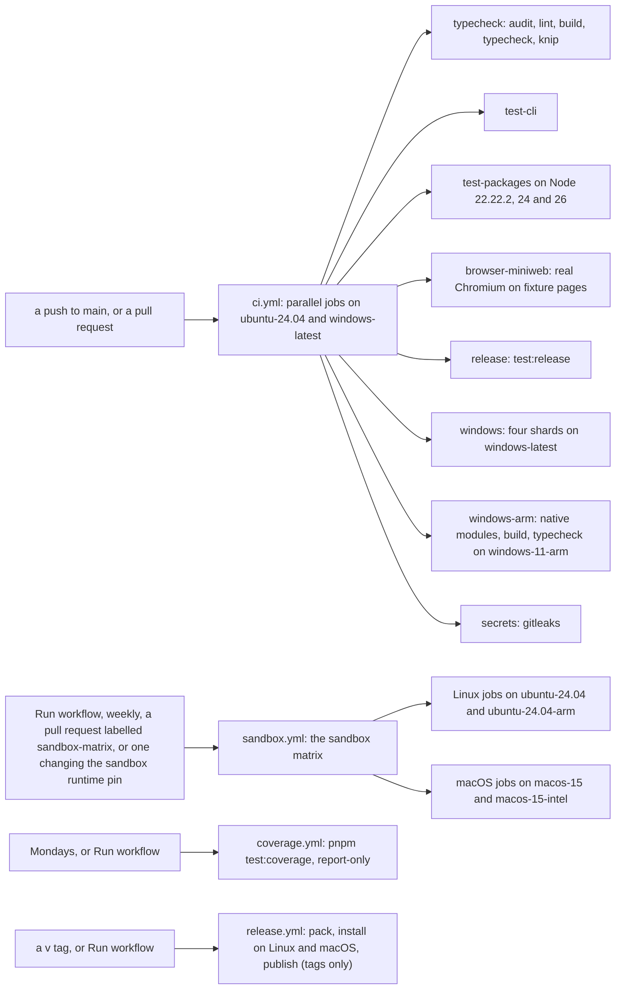

# Development

This page is for working on Tavi itself: setting up a checkout, building,
typechecking and testing, where shared code lives, the suites that need real
hosts, the evals, the sandbox matrix, CI, and the release gate. How the code
is organised is in [ARCHITECTURE.md](ARCHITECTURE.md); the pull-request rules
are in [CONTRIBUTING.md](../CONTRIBUTING.md).

## Set up

You need Node.js `>= 22.22.2`, pnpm `12.16.1` (`corepack enable`; the
repository pins it in `packageManager`), and macOS, Linux or WSL2. Native
Windows is not supported for running Tavi yet; to build and test there, see
[WINDOWS](WINDOWS.md#install), which also needs the Microsoft Visual C++
runtime. This page builds Tavi from a clone; to install a prebuilt release
instead, see the [README](../README.md#quick-install) and [Releases](#releases).

- `pnpm install` refuses a Node.js older than the floor.
- On Node 25 and later, run `npm install -g corepack` before `corepack enable`.
- The SQLite driver ships prebuilt for macOS, Linux (glibc and musl) and
  Windows, x64 and arm64: no compiler or Python is needed.
- On WSL2, clone into the Linux filesystem (`~/`), not under `/mnt`.

```bash
git clone https://github.com/atanasster/tavi.git
cd tavi
pnpm install
pnpm run build
```

The optional system tools, each needed only for the feature it serves:

| Tool | For | Get it |
| --- | --- | --- |
| Chromium | the browser tools and PDF reports | installed by `pnpm install`, and again for each new Playwright; by hand, `pnpm --filter @tavi/plugin-browser exec playwright install chromium` ([BROWSER.md](BROWSER.md)) |
| bubblewrap, socat and ripgrep (Linux) | the sandbox; macOS has one built in | your package manager; `tavi sandbox check` says what is missing ([SANDBOX.md](SANDBOX.md)) |
| FFmpeg | the video tools | `brew install ffmpeg`, `apt install ffmpeg` ([VIDEO.md](VIDEO.md)) |
| whisper.cpp and a ggml model | video transcription | `brew install whisper-cpp`, or a build of your own on `PATH` |
| `onnxruntime-node` and an RTMPose ONNX model | pose measurement in video | see [VIDEO.md](VIDEO.md) |
| uv | Python MCP servers | [docs.astral.sh/uv](https://docs.astral.sh/uv/) ([MCP.md](MCP.md)) |

`node scripts/pnpmw.mjs` is a pnpm wrapper that keeps corepack's and pnpm's caches
inside the workspace, for environments where `$HOME` is not writable. The
package store stays at pnpm's default location (`pnpm store path`).

## Running the CLI from a checkout

```bash
pnpm tavi <command>                     # from the repository root
alias tavi="node $(pwd)/scripts/tavi.mjs"
```

`scripts/tavi.mjs` (what `pnpm tavi` and the alias run) rebuilds before
`tavi serve`, `tavi ui`, `tavi chat`, `tavi onboard` and `tavi setup` when any package's sources, configs or manifest
changed since its last build — through turbo, so only what changed is built
again — and starts nothing if the build fails. Other commands run the last
build as is. `TAVI_NO_REBUILD=1` skips the check. `node_modules/.bin/tavi`
(the root `bin`, `apps/cli/dist/executable.mjs`) never checks.

While writing a plugin, `tavi serve --dev-plugin <folder>` loads it without
installing or approving it and reloads it on save; see
[PLUGINS.md](PLUGINS.md) and [MODS.md](MODS.md).

## Build, typecheck, test

The root `package.json` scripts, run through turbo (`turbo.json`):

```bash
pnpm run build          # every package, and the canvas into apps/cli/ui-dist
pnpm run typecheck      # every package, then the tests' own types (tsconfig.tests.json, tsconfig.guides.json)
pnpm run lint           # Biome: formatting and lint rules over the whole repository (biome.jsonc)
pnpm run format         # Biome: rewrite every file into the repository's format
pnpm run knip           # unused files, exports and dependencies (knip.jsonc)
pnpm run lint:css       # literal colours, spacing and token fallbacks in the canvas CSS (apps/ui/.stylelintrc.yaml)
pnpm test               # every package's tests, then the repository-wide tests in tests/
pnpm run check          # lint, typecheck, then test
pnpm run test:real      # also the *.real, *.live and *.soak suites (TAVI_REAL_TESTS=1)
pnpm run test:release   # the packed, installed CLI (TAVI_RELEASE_INSTALL=1)
pnpm run test:coverage  # every package's tests with coverage, summed per package (report-only)
```

- `build` builds each package's dependencies first (`^build`). `@tavi/cli`'s
  build also waits for `@tavi/ui`, then copies the canvas into
  `apps/cli/ui-dist` (`apps/cli/scripts/copy-canvas.mjs`). Outputs are
  `dist/`, `dist-plugin/` (external plugins) and `ui-dist/`.
- `typecheck` needs the dependencies built. `test` builds the package itself
  first, and so its dependencies: several packages' tests run their own built
  workers and children (`@tavi/runtime`, `@tavi/plugin-worker`,
  `@tavi/plugin-pdf`, `@tavi/pdf-ocr`, the video packages). `@tavi/cli`'s
  tests also need `@tavi/plugin-discord` built. Tests are never cached.
- `knip` reads each package's entry points from its `package.json` and its
  tsdown, Vite and Vitest configs; `knip.jsonc` adds what they cannot see
  (files started by path, dependencies used from CSS or by resolved path),
  each with its reason. A package entry point's exports are its API and are
  not reported.
- `lint` and `format` run Biome once from the root, not per package (it
  checks the whole repository in about a second). It formats TypeScript and
  JavaScript at a 140-column width with double quotes, semicolons and trailing
  commas, and the configuration JSON (`package.json`, `tsconfig*.json`,
  `tavi-plugin.json`, `turbo.json`, `knip.jsonc`); data JSON, recorded test
  fixtures and golden files stay as written, and CSS is stylelint's. `lint`
  fails on an unformatted file or any finding, warnings included;
  `pnpm exec biome check --write .` formats and applies the safe fixes. Each
  rule turned off in `biome.jsonc` says why, and a per-line exception is a
  `biome-ignore` comment that says why.
- `lint:css` (stylelint) holds `apps/ui/src/styles` to the tokens in
  `tokens.css`: no hex, `rgb()` or literal `hsl()` colour, no rem or
  on-scale px in margin, padding or gap, and no `var(--x, fallback)` but the
  three component properties the config names. A sanctioned exception is a
  `stylelint-disable-next-line` comment that says why.
- `tests/no-planning-citations.test.ts` keeps planning-record citations
  (decision ids, plan files and sections, step ids) out of tracked files; its
  allowlist names standards and terms-of-service sections.
- `test:coverage` (`scripts/coverage.mjs`) runs every package's tests with
  `--coverage` (V8; `src/` only, as `vitest.config.ts` sets it), then sums
  each package's `coverage/coverage-summary.json` into a table of lines,
  statements, branches and functions: printed, written to
  `coverage/summary.md`, and added to the GitHub job summary in CI. Each
  package's HTML report is its own `coverage/index.html`. Turbo's filters
  pass through (`pnpm test:coverage --filter=@tavi/contracts`). It is
  report-only: no floor fails a run, and the exit status is the tests'. A
  child process a test starts (plugin workers, confined helpers, the PDF and
  video children) is not measured, so those packages read low.
- One package: `pnpm --filter @tavi/runtime test`, or `npx vitest run` in its
  folder; one file: `npx vitest run test/<file>.test.ts`.

The shared Vitest config (`vitest.config.ts`) runs tests in forked workers,
one file at a time, resolves workspace packages to their sources (the
`development` condition), and points `XDG_DATA_HOME` at a scratch directory
and blanks `TAVI_DATA_DIR`, so no test touches your real data directory.

The jobs, places and trends domains' recorded source answers and labelled
sets live once, in `packages/test-support/fixtures/{jobs,places,trends}/`
(`domainFixtures(domain)` from `@tavi/test-support/fixtures`): the kits'
tests and the external plugins built on them read the same copy, and no
package's tests reach into another package.

### Prompt-cache prefix continuity

A provider's prompt cache reuses a request's prefix only when the next request starts with the same bytes, tools first. `@tavi/test-support/prefix` checks that offline: `recordingFetch` keeps every request body a test's model adapter sends, and `prefixContinuity(previous, next)` flattens two bodies into items (a role per message, each content part's text, tool calls and tool-call ids; a string and a one-part array alike, cache breakpoints left out) and reports `hit`, `toolsMatch`, `cacheableThrough` (the last message the previous request's cacheable prefix reaches: through its last breakpoint, or every message but the newest when none is marked) and `divergesAt` (its first message the next request changed).

`packages/agent-host/test/prefix-continuity.test.ts` drives real turns through the workflow and the AI SDK adapter for an Anthropic model on OpenRouter (which caches only what a breakpoint marks) and pins, per scenario, whether the next call reuses the previous one's prefix. Where today's layout misses, the test asserts the miss and says why; the change that fixes it flips the expectation. To add a scenario, build the adapter with `harness(...)`, run the turns, and assert `prefixContinuity(bodies[i], bodies[i + 1])`. The scenarios not driven yet are listed at the top of that file with the reason each misses today.

For a live check over many turns, `evals/memory/cache-gate.ts` reads `tavi doctor`'s measurement instead (see [CLI.md](CLI.md)): Home's cache-read share, its chat-turn sites' cache reads and writes (`usageBySite`), and `prefixChurn`.

### Repository-wide gates

`tests/` holds the checks no package can make on its own; a new
`tests/*.test.ts` gets a row here.

| Test | Checks |
| --- | --- |
| `lockfile.test.ts` | No resolved package is deprecated by its maintainers. |
| `duplication.test.ts` | jscpd (`.jscpd.json`) over `apps`, `packages`, `examples`, `evals`, `scripts` and `tests` finds no more clones than the committed ceilings: one for clones with both sides in tests, one for every other clone (a test copying source logic included); lower a ceiling when you remove clones. |
| `boundaries.test.ts`, `dependency-rules.test.ts` | The dependency direction between packages and where React, Playwright, `onnxruntime-node` and other heavy dependencies may appear ([ARCHITECTURE.md](ARCHITECTURE.md#dependency-rules)). |
| `plugin-boundaries.test.ts` | Each plugin package, kit and add-on (`packages/builtin/*`, `packages/external/*`, the engines' add-ons, the kits) stays replaceable, by the rules listed under this table. Each gate is also run against a planted violation it must catch. |
| `persistence-boundary.test.ts` | The CLI and the runtime's public imports cannot reach the native SQLite driver. |
| `memory-port-boundary.test.ts`, `memory-invariants.test.ts` | Every memory read and write goes through `MemoryServicePort`, and every numbered invariant in [MEMORY.md](MEMORY.md#invariants) maps to a test that runs and passes. |
| `async-database-baseline.test.ts`, `async-checkpoint.test.ts`, `database-contention.test.ts`, `artifacts.test.ts` | The worker-thread SQLite baseline, the LangGraph checkpoint saver, concurrent reads and writes, and that the built entry points resolve from `dist` with migrations, the shared handle, WAL and an offline snapshot/restore ([ASYNC-PERSISTENCE.md](ASYNC-PERSISTENCE.md)). |
| `confined-entries.test.ts` | The built entries that run confined (the plugin worker, the PDF and video children) import Node built-ins, their own chunks and their own package's dependencies, never a `@tavi/` package they could not read at load. |
| `channel-names.test.ts` | Core never names a channel provider: outside the channel packages, a shrinking allowlist holds each file to the names it has today. |
| `tool-references.test.ts` | Every tool the system prompt and tool descriptions name is a registered tool. |
| `shared-helpers.test.ts` | Code uses the shared helper (`errorMessage`, `definedOnly`, `integerFlag`, `sleep`/`delay`, `temporaryDirectories`, the canvas mount) instead of writing it out; see [Shared code](#shared-code). |
| `cli-startup-imports.test.ts` | The built CLI loads no owner runtime, workflow, browser, PDF, video or sandbox plugin, or bundler up front: not for `--version` or `--help`, and not in the chunks `tavi tasks`, `tavi run` and `tavi chat` load their handlers from. Each command's handler is loaded when it runs, and attaching to a live owner loads `@tavi/runtime/owner-attach`, never the runtime's root. Reads the build, so run `pnpm build` first. |
| `ui-bundle.test.ts` | The web canvas's first load (the entry chunk, the chunks `index.html` modulepreloads and the stylesheets it links) and all of its JavaScript stay within their gzipped budgets ([below](#web-bundle-budget)). Reads `apps/ui/dist`: locally it is skipped, saying so, when there is no build; in CI a missing build fails it. |
| `licences.test.ts` | Every installed and bundled dependency has a permissive licence. |
| `release.test.ts` | The packed artifacts are the release (always), and a clean install runs (opt-in, below). |
| `doc-links.test.ts` | Every relative link in tracked Markdown resolves, and each `#fragment` names a heading in its target. |
| `doc-images.test.ts` | Every image under `docs/assets` is shown by a tracked page, has alt text, and is at most 250 KiB. |
| `no-planning-citations.test.ts` | No tracked file cites a planning document, phase or decision id. |
| `*-eval.test.ts`, `eval-template.test.ts`, `memory-cache-gate.test.ts` | The eval harnesses, offline ([Evals](#evals)). |
| `terminal.test.ts` | The pseudo-terminal the release gate runs `tavi chat` under, in each platform's `script(1)` form. |
| `video-analyzer-conformance.test.ts`, `routine-templates.test.ts` | The analyser conformance suite against its fixtures, and the test support's copy of the trends plugin's routine template staying the plugin's own. |
| `integration/*.test.ts` | Packages meeting where the owner composes them, so no plugin package depends on another: the PDF, video and browser children under the sandbox, the external plugins' bundles and the worker package in a confined worker, PDF OCR with its add-on, the PDF engine on the eval's signed form, and the agent host's memory review with the built-in provider. |
| `ui-plugin-base.test.ts`, `pdf-lib-patch.test.ts` | The browser view's theme tokens against the canvas's, and the workspace's pinned `@cantoo/pdf-lib` patch. |

`plugin-boundaries.test.ts` holds each plugin package, kit and add-on to these
rules:

- Its manifest names no plugin package in any dependency field (the plugin kit
  and plugin types aside).
- Its `src/`, `test/` and `scripts/`, recursively, import no other plugin
  package, nor `@tavi/cli`, `@tavi/ui`, `@tavi/agent-host` or `@tavi/runtime`,
  and `@tavi/test-support` only from `test/`; each kind of the plugin kit,
  however deep its files nest, imports contracts and its own files alone.
- Nothing in those directories climbs out of the package by a relative import or
  a path built from its own directory, nor does a `package.json` script; the
  root configs (`vitest.config.ts`, `tsconfig*.json`, `tsdown.config.ts`) are
  outside the scan.
- In `apps/cli/src` each plugin package is imported by its one owner module only
  (its `features/*/host.ts`, the catalog for the channels and the browser view,
  `runtime/builtin-plugins.ts` for the default providers, the router and the
  guard, with the catalog also taking the router's own entry, the guard's
  `./manifest` and the default onboarding flow it hands the offline setup), and
  none in the runtime, the agent host, contracts, the client or the canvas.
- The CLI's and the agent host's sources import neither the plugin kit nor the
  channel kit, which they may name as dev dependencies only (for their tests),
  and the plugin types are taken as types alone.
- Each package's `tsdown` entries are exactly what its `exports` build, plus the
  files it spawns, loads or serves by path (the sandbox's host process and
  policy compiler, the PDF and add-on children, the plugin worker, the browser
  view's script).

## Shared code

Before writing a helper, a component or a style value, look for it in the home
below that fits where your code runs; when it is not there and a second caller
needs it, add it to that home rather than copying it. A home's boundary (the
last column of the first table) decides what may move into it: a helper that
needs more than its home allows belongs one layer up.

### Packages

| Home | Main exports | Use it for | Boundary |
| --- | --- | --- | --- |
| `@tavi/contracts/i18n` | `createTranslator`, `Locale` (`SUPPORTED_LOCALES`, `DEFAULT_LOCALE`, `LOCALE_NAMES`, `isLocale`), `Catalog` (`Catalogs`, `CatalogFor`, `PluralMessage`), `Translate`, `formatMessage`, `formatNumber`, `pluralCategory`, `pseudoLocalize` | The words a person reads, in the workspace's language: a catalogue per language and namespace, English as the fallback, plural forms by the language's rules, `{name}` parameters. | No Node or DOM APIs and no zod, like `./util`. A label function takes a `Translate` from its caller rather than importing a language's catalogue, so a page loads only the language it shows. |
| `@tavi/contracts/util` | `errorMessage`, `isRecord`, `definedOnly` (`DefinedOnly`), `clip`, `plural`, `csvList`, `jsonObjectIn`, `nowTimestamp`, `defineProviderError` (`ProviderError`), `retryAfterMs` (`RETRY_AFTER_MAX_MS`), `textPageEnd` | The small helpers every package writes the same way: an error's message, a record check, an object without its `undefined` fields, a clipped string, a counted noun, a provider's typed failure, a `Retry-After` header as a wait. | No Node or DOM APIs and no zod: a browser bundle or a plugin imports it without the contracts barrel. |
| `@tavi/contracts/zod-util` | `parseOrThrow` (`ParseOrThrowOptions`), `zodIssues` | A schema parse that throws `INVALID_INPUT` naming its issues, or the issues as `path: message` lines. | As `./util`, plus zod. |
| `@tavi/contracts/print-theme` | `PRINT_PALETTE`, `PRINT_FONT`, `PRINT_TYPE_SCALE`, `printThemeCss` | Any document rendered to print or PDF (the daily brief, a routine's report). | As `./util`. |
| `@tavi/node-kit` | `writeFileAtomic`, `writeFileAtomicAsync`, `writeJsonAtomic`, `flushFile`, `flushDirectory`; `readBoundedBody` (`BodyTooLargeError`); `readNoFollow`, `readNoFollowSync`; `sha256Hex`; `prefixedId`; `securityHeaders`; `isLoopbackHostname`; `openUrl`, `openerFor`; `serialLock`; `sleep` | Node-side code in any package: an atomic file write, a response body read under a size cap, a read that refuses a symlink, an abortable wait, one-at-a-time work. | Node's built-ins only, and no dependencies (`tests/boundaries.test.ts`). |
| `@tavi/child-kit` | `watchRss`, `killLadder`, `signalGroup`, `treeRss`, `residentKb`, `RSS_POLL_MS`, `KILL_GRACE_MS`; `encodePng` | An engine that confines a child (the PDF and video engines): the RSS watchdog and the `SIGTERM`-grace-`SIGKILL` ladder. | No workspace package at all. |
| `@tavi/channel-kit` | `redactSecrets`, `redactedError`, `fetchWithTimeout`, `readCapped`, `readJson`, `parseDestination`, `checkPartCount`, `uncertainReceipt`, `httpFailureReceipt`, `aggregateStatus`, `notRunning`; the email helpers `replySubject`, `referencesHeader`, `domainOf`, `domainsAligned`; `./conformance`'s `describeChannelConformance`, `describeGroupChannelConformance` | A messaging channel connector, built in or a plugin's: secrets kept out of what it reports, a bounded provider request, per-part receipts, and the shared conformance suite for its tests. | Depends on `@tavi/contracts` and zod alone (`tests/boundaries.test.ts`). |
| `@tavi/domain-kit` | `openDomainStore`, `migrate`; `createBudgetLedger`, `takeBudget`; `createSourceHealth`; `createWorkerFetcher`, `boundedText`, `boundedBytes`, `workerHome`; `parseXml`, `childOf`, `childrenOf`, `textOf`; `minhashSignature`, `minhashSimilarity`, `minhashBands`; `KIT_ZOD`, `objectsOf`; `domainCovers`, `domainSourceProblems` | A domain plugin's worker (jobs, places, trends): its SQLite store, per-source budgets and health, bounded requests, XML, near-duplicate detection, and the release check of its sources' terms. | Depends on `@tavi/contracts` and zod alone; a domain plugin bundles it into its one module. |
| `@tavi/test-support` | `temporaryDirectories`, `temporaryDirectory`; `waitFor`, `waitForValue`, `until`, `delay`; `capture`, `quietIo`; `fakeFetch`; `partialFake`; `freePort`, `listenLocally`, `closeServer`; `needsPosix`, `POSIX_ONLY`; and the entries `./fakes`, `./fixtures` (`domainFixtures`), `./openai-stub`, `./site`, `./discord`, `./messaging`, `./sandbox`, `./prefix`, `./plugin-worker`, `./routine-templates` | Tests only: a temporary folder, a wait for a condition, captured output, a fake fetch or model, a local port, recorded fixtures. | Tests only: a dev dependency, never a dependency (`tests/dependency-rules.test.ts`); a plugin package imports it from `test/` alone (`tests/plugin-boundaries.test.ts`). |

A confined child (the plugin worker, the PDF and video children) loads no
workspace package at run time, not even `@tavi/contracts/util`
(`tests/confined-entries.test.ts`): what it needs is bundled into it or
written in it.

### The CLI (`apps/cli/src`)

| Home | Main exports | Use it for |
| --- | --- | --- |
| `cli/argv.ts` | `parseFlags` (`FlagRules`, `ParsedFlags`), `integerFlag`, `dataDirectoryFlag`, `UsageError` | A command's flags: the shared flag loop, a whole-number flag within bounds, `--data-dir`. |
| `cli/exit.ts` | `EXIT`, `refusalExit`, `reportRefusal`, `reportFailure`, `reportCommandFailure`, `configRefusalExit`, `ownerRefusalExit`, `isOwnershipContention` | A command's exit code, and printing a failure or an owner's refusal the same way attached and offline. |
| `cli/output.ts` | `emit`, `emitJson`, `emitError`, `jsonText` (`OutputFormat`, `OutputSink`, `ErrorSink`) | A command's answer as text or JSON, and a line on standard error. |
| `shared/json-body.ts` | `readJsonBody` | A response read as JSON under a size cap, instead of `Response.json()`. |
| `shared/served-page-css.ts` | `SERVED_PAGE_CSS`, `SERVED_PAGE_STYLE`, `SERVED_PAGE_STYLE_SRC`, `SERVED_PAGE_LIGHT_TOKENS`, `SERVED_PAGE_DARK_TOKENS` | A page the CLI serves outside the canvas (the approval page, an OAuth landing page) and its CSP hash. |
| `shared/terminal-text.ts` | `terminalText` | Provider text shown in a terminal, its control characters removed. |
| `tui/theme.ts` | `TONES`, `UI_TONES`, `GLYPHS`, `BLINK_CURSOR`, `RULES`, `divider` | Every colour, glyph and rule `tavi chat` draws. |

### The canvas (`apps/ui/src`)

| Home | Main exports | Use it for |
| --- | --- | --- |
| `ui/` | `Button`, `IconButton`, `Field`, `Select`, `Popover`, `Modal`, `Confirm`, `Tabs`, `TabList`, `Tooltip`, `Card`, `Empty`, `Icon`; `Parts.tsx`'s `Pending`, `LoadState`, `LoadError`, `Failure`, `Notice`, `StatusBadge`, `Section`, `Summary`, `PageHead`, `DetailHead`, `InlineConfirm`, `SearchField`, `FilterChip`, `BusyFieldset`, `Disclosure`, `LoadMore` | Every control and repeated piece of a view: a button, a labelled field, a list to choose from, an overlay, a load's states. |
| `hooks/` | `useLoaded`, `useLazyLoad`, `useSerialRead`; `usePoll`, `useNow`; `useDismiss`; `useAnchoredPosition`; `useRowKeys`; `useResetOnChange`; `useAction`, `useFormSubmit`; `useAnnounce` | A view's read and reload, a repeated read, a popover's ways out and its place by its anchor, stable row keys, state reset when an input changes, an action's busy and failure state. |
| `lib/delay.ts` | `delay` | An abortable wait in the browser (`@tavi/node-kit`'s `sleep` is Node's). |
| `lib/layout.ts` | `DEFAULT_SIDEBAR_WIDTH`, `MIN_CHAT_PANEL_WIDTH`, `POPOVER_GAP_PX`, `POPOVER_EDGE_PX`, `TOUCH_SLOP_PX`, … | Every number the script lays out with: panel widths, popover spacing, gesture thresholds. |
| `lib/breakpoints.ts` | `PHONE_MAX_WIDTH`, `WIDE_MIN_WIDTH`, `DOCKED_MIN_WIDTH`, `PHONE_QUERY` | A breakpoint the script reads, the same steps as `styles/breakpoints.css`. |
| `styles/tokens.css`, `styles/breakpoints.css` | The colour, spacing, size, radius, type, layer, motion tokens; the `@custom-media` breakpoints (`--phone`, `--overlay`, `--undocked`, `--wide`) | Tokens only, enforced by stylelint: every other stylesheet names a token or a breakpoint, never a literal. |

### The guards

These fail a change that writes out a shared helper again or skips a shared
component, each naming the files allowed to keep the long form and why:

- `tests/shared-helpers.test.ts`: an error's message, optional fields spread
  one by one, an integer flag parsed by hand, a timer-promise wait, a test's
  own temporary folder or canvas mount.
- `apps/ui/test/ui/shared-components.test.ts`: a raw `<button>`, `<select>`,
  overlay or labelled control instead of `Button`, `Select`, `Modal` or
  `Popover`, and `Field`.
- `apps/ui/test/ui/inline-style.test.ts`: an inline `style` with a literal
  size or colour.
- `tests/confined-entries.test.ts`: a confined child that imports a
  workspace package.
- `tests/duplication.test.ts`: any new copy-pasted block of 8+ lines and
  70+ tokens, against the source and test ceilings.
- stylelint (`pnpm run lint:css`, `apps/ui/.stylelintrc.yaml`): a literal
  colour, spacing step, size or breakpoint outside the token files.

## Real, live and soak suites

Suites that drive a real browser, sandbox, worker process or remote site are
named `*.real.test.ts`, `*.live.test.ts` and `*.soak.test.ts`. The shared
Vitest config excludes them unless `TAVI_REAL_TESTS=1`, which
`pnpm run test:real` sets (turbo passes the variable through):

```bash
pnpm run test:real
```

They cover the confined PDF, video and browser children, Playwright, the
sandbox runtime, host and egress proxy, cgroup limits, plugin workers, the
domain plugins' workers and sites, the browser handoff, the live view and
epoch rollover under load. A suite that needs credentials, a service or the
public internet still skips without its own switch. Every switch starts with
`TAVI_LIVE` or is listed below, and turbo passes them all through to the test
tasks (`turbo.json` `globalPassThroughEnv`):

| Switch | Turns on |
| --- | --- |
| `TAVI_LIVE_NETWORK=1` | The network proofs in the MCP and flights tests. |
| `TAVI_LIVE_EVAL=1`, `TAVI_LIVE_EVAL_*` | The live system-prompt cases (`packages/agent-host/test/system-prompt-cases.test.ts`) and the routine eval (`packages/runtime/test/routine-live.eval.test.ts`), against the connection the `TAVI_LIVE_EVAL_*` variables name. |
| `TAVI_INJECTION_LIVE=1`, `TAVI_INJECTION_*` | The injection suite's live tier (`apps/cli/test/injection/tier1.live.test.ts`); `TAVI_INJECTION_TAINT` runs it under another `security.taint` mode, and the rest (connection, model, key file, seeds, fixtures, results) are what `evals/injection/eval.ts` passes ([evals/injection](../evals/injection/README.md)). |
| `TAVI_LIVE_HA`, `TAVI_LIVE_HA_URL` | The Home Assistant MCP test, which `scripts/mcp-homeassistant-live.sh` sets up in Docker (`TAVI_HA_URL` points its setup script at the instance). |
| `TAVI_LIVE_JOBS=1` | The jobs plugin's searches against live boards and its drift canaries (`packages/external/jobs/test/*.live.test.ts`, [JOBS.md](JOBS.md)). |
| `TAVI_LIVE_PLACES=1` | The places plugin's searches against OpenStreetMap's live services (`packages/external/places-open/test/*.live.test.ts`). |
| `TAVI_LIVE_TRENDS=1` | The trends plugin's live sweep and open-page lists (`packages/external/trends/test/*.live.test.ts`). |
| `TAVI_LIVE=1` | The Overture pack read live from S3 (`packages/places-kit/test/overture.test.ts`). |
| `TAVI_RELEASE_INSTALL=1` | The release gate's clean install (`pnpm run test:release`). |
| `TAVI_SOAK=1`, `TAVI_SOAK_*`, `TAVI_TAKEOVER_MINUTES` | The longer soak runs of the live view and epoch rollover (`apps/cli/test/**/*.soak.test.ts`); the takeover minutes are how long the live-view soak holds a takeover (default 15). |
| `TAVI_MCP_LOAD=1` | The MCP load test (`apps/cli/test/mcp/mcp-load.test.ts`). |
| `TAVI_LIMITS_REAL=1` | The real resource-limit test (`packages/builtin/limits/test/limits.real.test.ts`). |
| `TAVI_INJECTION_DETECTOR_EVAL=1`, `TAVI_INJECTION_DETECTOR_REPORT` | The injection detector eval ([evals/injection](../evals/injection/README.md)). |
| `TAVI_SANDBOX_MATRIX=1` | The confinement proofs the sandbox matrix runs (`scripts/sandbox-matrix/`). |
| `TAVI_UPDATE_GOLDEN=1` | Rewrites the golden files a test compares against instead of failing: the sandbox policies, the tool catalogue in [TOOLS-AND-SKILLS.md](TOOLS-AND-SKILLS.md#the-tool-catalogue). |
| `TAVI_RECORD_FIXTURES=1` | Re-records the client's IPC fixtures (`apps/cli/test/cli/client-fixtures.test.ts`). |
| `JOBS_KEY_<SOURCE>` | A job board's API key, for its drift canary (`packages/external/jobs/test/drift.live.test.ts`). |

The domain plugins' live suites print what they found, for a person to read;
they write no files.

```bash
scripts/mcp-homeassistant-live.sh            # a disposable Home Assistant, then its live test
```

## Evals

`evals/` holds the evaluations that put a model in the loop, plus fixture
suites. Each has a README with its fixtures, scoring and options. The scripts
are erasable TypeScript, so `node` runs them without a build.

A live eval never writes into the data directory you use. Each run copies a
dedicated **template data directory** (`evals/template.ts`), which may hold
only model connections and their credentials, the model catalog, role
bindings and workspace defaults; any other is refused. With neither
`--template` nor `--data-dir <dir>` an eval refuses to run.

```bash
EVAL_TEMPLATE=/tmp/tavi-eval-template
tavi models add … --data-dir "$EVAL_TEMPLATE"   # a connection and its credential
```

| Eval | What it measures | Run |
| --- | --- | --- |
| [browser](../evals/browser/README.md) | Real `tavi run`s of browsing tasks (flights, forms, prices), each answer judged item by item, with tokens, blocked pages and repeat runs counted. | `node evals/browser/eval.ts --template "$EVAL_TEMPLATE" --label baseline` |
| [fs](../evals/fs/README.md) | Real `tavi run`s of small file and shell tasks on one `tavi serve --eval` owner: a three-part `fs.edit`, an `fs.grep` then a line-window `fs.read` over a generated 1 MiB log, and a `sandbox.run` script fed on `stdin`, each checked from the folder, the stream and the answer, with no judge. The browser action tasks (upload, download, tabs, frames, stale refs) are the browser eval's `actions` category. | `node evals/fs/eval.ts --template "$EVAL_TEMPLATE" --label baseline` |
| [heartbeat](../evals/heartbeat/README.md) | Fixture worlds put to the model as the built-in provider's prompt: notify precision and recall, now/later agreement, staying quiet, resisting planted instructions, tokens a check. | `node evals/heartbeat/eval.ts --template "$EVAL_TEMPLATE" --label baseline` |
| [memory](../evals/memory/README.md) | Recall, paraphrase, updates, expiry, preferences, abstention, capture, injection and group isolation under four conditions, plus proposal precision and recall, wrong-memory rate, tokens and cache reads. | `node evals/memory/eval.ts --offline`, or `--template … --connection <id> --model <id> --label baseline` |
| [ideas](../evals/ideas/README.md) | The built-in ideas provider's rewording, against fixture worlds. | `node evals/ideas/eval.ts --offline`, or `--template "$EVAL_TEMPLATE" --label baseline` |
| [injection](../evals/injection/README.md) | Fixture attacks where untrusted text reaches the model, and the gate that must meet each. | `node evals/injection/eval.ts --tier0` |
| [pdf](../evals/pdf/README.md) | Reading PDFs and filling forms over fixtures built from code. Build `@tavi/plugin-pdf` first. | `node evals/pdf/eval.ts --label <label>` |
| [video](../evals/video/README.md) | Video understanding over synthetic fixtures built with your own FFmpeg. | `node evals/video/build-fixtures.ts`, then `node evals/video/trial.ts --label <label>` |
| [compaction](../evals/compaction/README.md) | Whether anchors planted early in a chat survive three rollovers' summaries. A regression gate in the ordinary test suite (`packages/agent-host/test/compaction-quality.eval.test.ts`). | `pnpm test` |
| [skills](../evals/skills/README.md) | Real `tavi run`s of tasks once without and once with a curated skill approved and active, judged by checks written with the skill, as each arm's pass rate, the lift and the cases the skill made worse. | `node evals/skills/eval.ts --template "$EVAL_TEMPLATE" --label baseline` |
| [tool-choice](../evals/tool-choice/README.md) | Real `tavi run`s of about 40 everyday requests, scored on the first tool the model calls and its key arguments, as a pass rate and pass^k over repeated runs. | `node evals/tool-choice/eval.ts --template "$EVAL_TEMPLATE" --label baseline` |
| [tool-selection](../evals/tool-selection/README.md) | Offline recall@1/@5 of `tools.search`'s ranking and the router's lexical shortlist over the real tool registry, for 30 everyday requests, held to a committed baseline. In the ordinary test suite (`apps/cli/test/tools/tool-selection-eval.test.ts`); `TAVI_UPDATE_TOOL_SELECTION_BASELINE=1` rewrites the baseline. Beside it, `tool-schema-budget.test.ts` holds the tool schemas a default turn sends (with every family, and with the attended families deferred) to the token ceilings in `schema-budget.json`; `TAVI_UPDATE_TOOL_SCHEMA_BUDGET=1` rewrites them. | `pnpm test` |
| [router](../evals/router/README.md) | The protocol `tavi router evaluate --file` reads recorded routing evidence under; not a measured benchmark. | `tavi router evaluate --file observations.json` |
| routines | Per-role precision and recall, as a spread across repetitions, from the traces `packages/runtime/test/routine-live.eval.test.ts` writes (`TAVI_LIVE_EVAL=1`) to `.evidence/routines/`. | `node evals/routines/score-live-eval.mjs` |
| system-prompts | Countable facts (task success, model calls, unneeded questions, unsupported claims) from the live system-prompt cases (`packages/agent-host/test/system-prompt-cases.test.ts`, `TAVI_LIVE_EVAL=1`), per template. | `node evals/system-prompts/score-live-eval.mjs` |

More, from the eval READMEs:

```bash
node evals/browser/eval.ts --compare results/a.json --compare results/b.json
node evals/memory/eval.ts --template "$EVAL_TEMPLATE" \
  --connection openrouter --model <model> \
  --judge-connection anthropic --judge-model <model> --label baseline
node evals/memory/cache-gate.ts --template "$EVAL_TEMPLATE" --connection openrouter --model <model> --turns 200 --label gate
```

The memory eval also runs offline in the test suite with a scripted reader;
live, it starts its owners as `tavi serve --eval`. A run's `task.completed`
metrics in `--format json` carry `cacheReadTokens` when a provider reports
cache reads.

## Startup benchmark

```bash
node scripts/bench-startup.mjs [--runs <n>] [--build]
```

Times the built CLI from spawn: `tavi --version` and `tavi tasks` to exit
(with no owner, and with an owner attached), and `tavi serve` to its
`"serving": true` line. Each runs once to warm up, then five times (`--runs`),
and the median, minimum and maximum print as a Markdown table. It works in a
fresh data directory under the system temp directory (every `TAVI_*`
variable from your shell is dropped), stops the owner and deletes the
directory when it ends, so your own data is never opened. It builds
`@tavi/cli` when `apps/cli/dist` is missing, or always with `--build`. Run it
before and after a change to startup and compare medians from back-to-back
runs: a busy machine moves them by hundreds of milliseconds.

## Web bundle budget

```bash
pnpm --filter @tavi/ui analyze
```

Builds the canvas into `apps/ui/dist/` and prints every chunk in
`apps/ui/dist/assets/` with its raw and gzipped size, the entry chunk (the one
`index.html` loads) marked, then the gzipped totals of the entry, the first
load (the entry plus the chunks `index.html` modulepreloads and the
stylesheets it links) and all JavaScript. The measurement itself writes
nothing into `dist/`, which ships inside `@tavi/cli`.
`node apps/ui/scripts/analyze.mjs` measures an existing build without
rebuilding (`--json` for the measurement as JSON).

`tests/ui-bundle.test.ts` holds the first load and all JavaScript to budgets
about 15% above the sizes measured when they were set (the numbers are in its
header). In CI (`CI` set) a missing build fails the suite; locally it skips
with a warning. A
change that trips one either finds what grew (a static import pulling a lazy
page into the entry, a new dependency) or, for growth that is meant, raises
the budget from a fresh `analyze` and says what it bought.

## Sandbox matrix

The sandbox and the confined children behave differently on each host shape,
so they have their own matrix. `scripts/sandbox-matrix.sh` runs each job and
keeps what it found (kernel facts, log and result) under
`reports/sandbox-matrix/<job>/`:

```bash
scripts/sandbox-matrix.sh list
scripts/sandbox-matrix.sh run macos-arm64 docker-default
scripts/sandbox-matrix.sh run all
```

| Job | What it proves |
| --- | --- |
| `typecheck` | The workspace's typecheck and tests. |
| `macos-arm64`, `macos-x64` | Seatbelt: the sandbox suite on a Mac. |
| `docker-default` | Docker's default seccomp profile: the refused tier. |
| `docker-nested` | User namespaces allowed, `/proc` masked: `nested` only with the flag. |
| `docker-unconfined` | Every namespace bubblewrap needs: `full` in a container. |
| `docker-cgroup` | Resource limits on a real cgroup v2, privileged, as root. |
| `arm64` | `docker-unconfined` on linux/arm64. |
| `ubuntu-24.04-restricted` | `apparmor_restrict_unprivileged_userns=1`: refused, with the AppArmor cause. |
| `ubuntu-24.04-setup` | The same after `tavi sandbox setup --apply`: full. |
| `ubuntu-26.04` | Stock (refused), then after setup (full). |
| `debian-12` | Debian's bwrap on 6.1: full. |
| `fedora-latest` | SELinux enforcing; recorded, not gating. |
| `unit` | `tavi serve` under the generated service unit (`scripts/sandbox-matrix/unit.sh`). |
| `wsl2` | Ubuntu 24.04 in WSL2 on a Windows runner: the build, the unit tests and `tavi sandbox check`, whose probe must find the Windows drives under `/mnt` unreadable. CI only (`.github/workflows/sandbox.yml`), on demand. |

The VM jobs run in Lima (`brew install lima`) from the cloud images in
`scripts/sandbox-matrix/images.conf`: one line per image and architecture with
its sha256. A `-` digest is not yet pinned, and a VM job on it refuses to start
until `scripts/sandbox-matrix.sh pin <image> <arch> [url]` records one.

The scripts:

| Script | What it does |
|---|---|
| `scripts/sandbox-matrix.sh list` \| `run <job>... \| all` | Runs the matrix jobs on this machine and keeps what each found (`facts.txt`: kernel, sysctls, bubblewrap; `log.txt`; the result) under `reports/sandbox-matrix/<job>/`. `pin <image> <arch> [url]` records a VM image's digest. |
| `scripts/sandbox-matrix/suite.sh <mcp\|sandbox\|limits>` | One suite inside a Linux container or VM, with `TAVI_SANDBOX_MATRIX` naming the expected case (`srt`, `refused` or `nested`): `sandbox` runs the sandbox package's suites (the policy compiler, host detection, egress and the escape cases), the PDF children, plugin workers and the confined browser under the real srt, and the owner's sandbox tests; `limits` runs resource limits on a real cgroup v2 |
| `scripts/sandbox-matrix/unit.sh <user> <work tree>` | The sandbox under the generated systemd unit, in a VM as root: the suite under the unit's directives, then each directive the unit leaves out, one at a time |
| `scripts/sandbox-matrix/facts.sh` | What a job ran on: kernel, user-namespace sysctls, LSMs, cgroup, seccomp, which bubblewrap, socat and ripgrep |
| `scripts/sandbox-matrix/images.conf` | The VM jobs' cloud images, one line per image and architecture with its sha256 |

Two related scripts:

```bash
scripts/mcp-sandbox-matrix.sh [mac|linux|linux-bwrap|linux-refused|linux-nested|linux-cgroup|all] [mcp|sandbox|limits]
scripts/sandbox-footprint.sh     # wrap time, spawn-to-exit and owner RSS; RUNS=50 by default
```

`mcp-sandbox-matrix.sh` runs the MCP sandbox suite on the Mac, then on Linux
in Docker (bubblewrap, refused, nested); `DOCKER_PLATFORM` picks the
architecture and `TAVI_LIVE_NETWORK=1` adds the per-server network proof.

### Sandbox usability benchmark

How often `sandbox.run` asks, and how often an ordinary command fails in the
sandbox, is measured by [`evals/sandbox-usability`](../evals/sandbox-usability/README.md).
Its prompt count is pinned in `baseline.json` and checked by the default test
run, so a change that adds or removes a prompt shows up as a failing test until
the baseline is rewritten on purpose:

```bash
TAVI_UPDATE_SANDBOX_BASELINE=1 pnpm vitest run tests/sandbox-usability-eval.test.ts
TAVI_REAL_TESTS=1 pnpm vitest run tests/integration/sandbox-usability.real.test.ts   # failures in the real sandbox
```

`.github/workflows/sandbox.yml` runs the same jobs, unchanged, on GitHub
runners: the Linux jobs on `ubuntu-24.04` (and `ubuntu-24.04-arm`), the macOS
ones on `macos-15` and `macos-15-intel`, each uploading its report as an
artifact. It is heavy, so it runs on demand (Actions → sandbox → Run workflow),
weekly (Tuesdays, for drift in the runners' images), on a pull request
labelled `sandbox-matrix`, and on any pull request that changes the
`@anthropic-ai/sandbox-runtime` pin: its `pin` job diffs the catalog and the
lockfile, so a Dependabot bump runs the whole matrix unlabelled. Not on every
push.

## CI

`.github/workflows/ci.yml` runs on every push to `main` and every pull
request (a newer push to a pull request cancels its older run), on
`ubuntu-24.04` (and, for the `windows` and `windows-arm` jobs, `windows-latest` and `windows-11-arm`) with Node 22.22.2
(the `engines` minimum) and pnpm 12.16.1, in parallel jobs, each with a time limit:



| Job | Runs |
| --- | --- |
| `typecheck` | `pnpm audit --prod --audit-level high` (accepted advisories are listed, each with its reason, under `auditConfig` in `pnpm-workspace.yaml`), `pnpm run lint`, `pnpm run build`, then `pnpm run typecheck`, `pnpm run knip`, `knip --production --include dependencies` (a runtime dependency only tests import) and `pnpm run lint:css`. |
| `test-cli` | Installs the Linux sandbox (bubblewrap, socat, ripgrep, and lifts Ubuntu 24.04's user-namespace restriction), since PDF processing and plugin workers run only confined, then `pnpm exec turbo run test --filter=@tavi/cli`, which builds the CLI (its `ui-dist` too) first. |
| `test-packages` | Every other package's tests, a build of the canvas (for its bundle budget), then the repository-wide tests (`pnpm exec vitest run`), on Node 22.22.2, Node 24 and Node 26. |
| `browser-miniweb` | Installs Chromium, then runs the browser's guards against real Chromium on local fixture pages (`tests/integration/browser-miniweb.real.test.ts` with `TAVI_REAL_TESTS=1`; zero cases run is a failure), then records the per-action timing bench (`evals/browser/timing.ts`), which never fails the run. |
| `release` | `pnpm run test:release`. |
| `windows` | Native Windows, in four shards: `pnpm run build`, then on the first shard `pnpm run lint`, `pnpm run typecheck` and `pnpm run knip`, then a quarter of the repository-wide tests (`vitest run --project tavi-monorepo --shard=N/4`) and of every workspace's (`--project "@tavi/*"`, which does not fail the job until its first run has named every test file that needs POSIX). A test that needs POSIX skips there only through `needsPosix(import.meta.url)`, its file named with the reason in `POSIX_ONLY` (`@tavi/test-support`); `tests/posix-only.test.ts` holds the list's length, so after that first run it only shrinks. |
| `windows-arm` | Windows 11 on Arm: `pnpm run build`, then loads the native modules (koffi, better-sqlite3, the keyring) from their arm64 builds, `pnpm run typecheck`, and the repository-wide tests (`vitest run --project tavi-monorepo`). |
| `secrets` | gitleaks over the full history. |

`.github/workflows/coverage.yml` runs `pnpm test:coverage` on Mondays and on
demand (Run workflow), never on a pull request: the suites run one file at a
time, and coverage slows them further. It installs the Linux sandbox as
`test-cli` does, puts the per-package table in the job summary, and uploads
each package's HTML report as the `coverage` artifact. It reports only; no
floor is enforced yet.

The real suites and browser tests without Chromium skip in CI, except
`browser-miniweb`'s suite. Checkouts do not keep the job's token
(`persist-credentials: false`).

Every action in `.github/workflows/` is pinned to a commit SHA, its version in
a trailing comment (`actions/checkout@<sha> # v4.4.0`); a tag can be moved, a
commit cannot. To change one, resolve the tag's commit
(`gh api repos/<owner>/<repo>/git/ref/tags/<tag>`, and for an annotated tag
`gh api repos/<owner>/<repo>/git/tags/<sha>`) and update the SHA and the
comment together. Dependabot (`.github/dependabot.yml`) opens, each week, one pull request
for the actions' and one for npm's minor and patch updates, and a pull request
of its own for each major update (not for `@types/node`, which follows the
oldest supported Node.js, nor Ink's next major, nor undici, which `overrides` in `pnpm-workspace.yaml` hold and which is bumped by hand with them); security updates come as they
are published, grouped into one pull request. Each
runs CI like any change, and a bump of an exactly pinned package (the sandbox
runtime, a patched one) gets the review that pin asks for.

### Updating dependencies by hand

Without Dependabot (a fork, a local checkout), or when it does not touch a
`catalog:` pin in `pnpm-workspace.yaml`:

1. `pnpm outdated -r` lists what is behind; `pnpm audit` what is vulnerable.
2. Pick versions at least a week old, so a withdrawn release is caught before
   it lands. pnpm's own `minimumReleaseAge` gate refuses a version newer than
   its default unless `minimumReleaseAgeExclude` names it (kept for a security fix).
   Shared dependencies change in `catalog`, the rest in their manifest;
   transitive security floors go under `overrides`, each with its reason.
3. `pnpm install`, then `pnpm run check`, `pnpm run knip` and `pnpm run lint:css`.
   `tests/lockfile.test.ts` refuses a deprecated package, and
   `tests/licences.test.ts` a licence outside the allowed list.
4. Third-party notices are generated at build (below); update the Node.js,
   pnpm and Playwright versions quoted in README, CONTRIBUTING and this file
   when they change.

## Release gate

`tests/release.test.ts` has two halves. The first always runs: only built
output ships, the published `exports` have no source condition, workspace
ranges are concrete, every export target exists, and the dependency closure a
consumer resolves has no desktop or browser package. The second packs the
tarballs, installs them outside the repository with the ordinary installer,
and runs the installed CLI — the shipped entry points, the migrations and the
native SQLite binding in a tree that never saw the monorepo:

```bash
pnpm run test:release
```

It needs the public registry, `npm` on `PATH` and POSIX `tar`, so it is not
part of the default suite; when skipped it says so. With it, the same file
installs the packed tarballs through `scripts/install.sh`, as a person
installing a release does; without it, it still checks that the installer
refuses a package that does not match `SHA256SUMS` and asks for the
`engines` Node.

## Releases

A release is the packed tarballs of every package a `tavi` install needs (the
set the release gate installs), `install.sh` and `SHA256SUMS`, attached to a
GitHub Release. `.github/workflows/release.yml` makes one from a tag:

1. Set `version` in `apps/cli/package.json` (and the packages beside it), and
   move `## Unreleased` in `CHANGELOG.md` under `## <version>`: the release's
   notes are that section.
2. Tag the commit `v<version>` and push the tag. The `pack` job refuses a tag
   that does not match the CLI's version, runs the release gate and
   `node scripts/pack-release.mjs`; the `install` job installs that release
   with `install.sh` on fresh Linux and macOS runners and runs the installed
   `tavi`; only then does `publish` create the GitHub Release.

Run the workflow by hand (**Run workflow**) to pack and test-install without
publishing. Locally, `node scripts/pack-release.mjs` writes
`release/<version>/` (git-ignored), and
`TAVI_RELEASE_BASE=$PWD/release/<version> sh scripts/install.sh` installs from
it (`TAVI_HOME` and `TAVI_BIN_DIR` keep it apart from your own install).

## Third-party notices

What a build bundles is not installed, so its licences ship beside the
bundle. `scripts/third-party-notices.mjs` reads a package's `taviBundled`
list, walks everything those reach, and writes one notices file:

```bash
node scripts/third-party-notices.mjs <package-dir> <output-file> <title>
```

`apps/ui` and `@tavi/plugin-pdf` run it in their builds, writing
`dist/THIRD-PARTY-NOTICES.txt`, through the root's `notices` script
(`pnpm --workspace-root run notices . …`, the package's folder resolved from where pnpm was started), so no package names a path
outside itself. The script is a turbo global dependency, so a change to it
rebuilds everything. `THIRD_PARTY_NOTICES.md` at the repository
root covers code adapted into Tavi and what it ships; `tests/licences.test.ts`
holds every dependency to a permissive licence.

## Keeping docs in step

When you change a user-facing behaviour — a command, a flag, `tavi chat` or
the canvas — update [README.md](../README.md), [CLI.md](CLI.md),
[USECASES.md](USECASES.md), [ARCHITECTURE.md](ARCHITECTURE.md) (when package or
module boundaries change) and the reference page it belongs to in the same
change, and retake the screenshots it changes (below). Two tests hold the
reference to the code: `apps/cli/test/cli/cli-docs.test.ts` fails when a flag
or action in a command's `--help` is missing from CLI.md, and
`apps/cli/test/tools/tool-catalogue.test.ts` when TOOLS-AND-SKILLS.md's tool
catalogue falls behind the registry (`TAVI_UPDATE_GOLDEN=1` rewrites it).

### Documentation images

The README's banner and the docs' screenshots are drawn by scripts in
`scripts/docs/`, with the browser plugin's Playwright (its Chromium, or Google
Chrome where that is not installed); they add no dependency. The banner needs
only `pnpm install`; build before the screenshots (`pnpm run build`), which
drive `apps/cli/dist` and the canvas it bundles.

```bash
node scripts/docs/render-assets.mjs                      # docs/assets/brand/banner-{light,dark}.png
node scripts/docs/capture-ui.mjs                         # every shot that needs no model
node scripts/docs/capture-ui.mjs --only ideas,chat-answer --model
```

- `capture-ui.mjs` starts from a new data directory in the system's temporary
  folder, seeds it through the CLI (reminders, a schedule, to-dos, memory, web
  search, an example plugin awaiting review), runs its own `tavi serve` and `tavi ui` on free ports, and writes
  `docs/assets/screens/<name>.png` (and `-dark.png`) and, for a terminal shot,
  `docs/assets/terminal/<name>.svg`. The directory is deleted at the end, and
  on Ctrl-C. The shots, their routes and the steps before each picture are in
  `scripts/docs/shots.mjs`.
- `--model` also takes the shots that need a real model, on OpenRouter. The key
  is read from `--api-key-file`, by default the `openrouter` credential of your
  own data directory, and stored in the throwaway directory's credential store
  (never the OS keychain) until it is deleted; it is never printed or written
  into the repository. A data directory that encrypts its credentials at rest
  holds them as ciphertext: pass a plain key in a `0600` file instead.
- `welcome-refused` reaches openrouter.ai too, with a made-up key it expects
  refused, so it needs the network even without `--model`.
- A wait that does not see what it waits for is reported (`missed: …`) and the
  run exits 1; check that picture before you commit it. `TAVI_DOCS_DEBUG=1`
  prints each tavi command it runs.
- `tests/doc-images.test.ts` keeps every file under `docs/assets` shown by a
  page, described by alt text, and under 250 KiB.

The demo video (about a minute and a half: `tavi chat`, the web canvas, the
same Home at phone size) is recorded and cut by two more scripts:

```bash
node scripts/docs/demo-record.mjs   # raw scenes into .demo-recording/ (needs a model, like --model)
node scripts/docs/demo-edit.mjs     # .demo-video/tavi-demo.mp4, poster.png, thumbnail.png, youtube.md
```

- `demo-record.mjs` uses the same throwaway, seeded session and OpenRouter key
  as `capture-ui.mjs --model`, and records each scene as the browser's
  screencast: a JPEG per frame the page drew, with its time and the captions.
  The terminal is a real `tavi chat` on a pseudo-terminal, drawn live by
  xterm.js (loaded from jsdelivr). `--only terminal,canvas,phone` re-records
  some scenes; `--out` moves the recording.
- `demo-edit.mjs` needs `ffmpeg` with libx264. It keeps every frame the pages
  drew and shortens only still stretches no caption asked to hold, so the
  model's waits are cut while its answers stay on screen. It can run on
  another machine than the recording: copy the recording folder across and
  pass `--in`.
- Neither folder is committed. The video goes on YouTube and into a GitHub
  release or README as an upload; only the poster lives in `docs/assets`.

### How-to guides

The task-shaped guides under [docs/use-cases/](use-cases/README.md) are
executable: each page has a walk, `tests/guides/<folder>/<slug>.guide.test.ts`,
that does its steps in the page's order on a throwaway owner and canvas
(`scripts/docs/session.mjs`, shared with `capture-ui.mjs`), checks what each
step says you will see, and takes the step's picture: a WebP of the canvas, or
an SVG of what a terminal command printed, light and dark. Walks are left out
of `pnpm test` and run on purpose, after `pnpm run build`:

```bash
pnpm test:guides                                    # every guide
pnpm test:guides get-started/first-chat             # one guide
pnpm test:guides get-started --update-shots         # a folder, retaking its pictures
pnpm docs:indexes                                   # rewrite docs/use-cases' indexes
```

- A new guide starts from `docs/use-cases/_template.md` (an everyday recipe from
  `_template-recipe.md`); its walk is `walkGuide(path, { configured, model,
  steps })` from `tests/guides/support/walk.ts`, one function per step keyed by
  the step's title, each ending in `walk.shot()` or `walk.terminal()`, or
  `walk.unwalked(reason)` for what a walk cannot do (a real key is never typed
  into a page).
- Most walks talk to the real model on OpenRouter with the key of
  `--key-file`, by default the `openrouter` credential of your data directory,
  as `capture-ui.mjs --model` does. A walk that needs something only you have
  (a bot token, a Google sign-in) is skipped unless `--provided` names it.
- Web search keys come from `.env.tutorials` at the repository root
  (gitignored): `TAVILY_API_KEY`, `BRAVE_API_KEY`, `SERPER_API_KEY`, any of
  them. Each walk stores them in its throwaway directory's credentials as
  `search.<kind>` and adds Tavily with its key; without the file, Tavily runs
  keyless (rate-limited).
- `--update-shots` retakes a guide's pictures once its walk passes. They are
  kept unless one of them changed — a canvas picture that moved outside the
  boxes its step masks (`walk.shot(target, { mask })`, for the model's own
  words), or a terminal picture whose text differs — and then all of them are
  written, so every step shows the same run.
  Look at every picture before you commit it.
- Every screen a walk photographs is also checked: console errors, failed
  requests, an axe-core scan, clipped text and sideways scrolling, the same
  screen in the dark theme, at 390 px and with reduced motion, and leftovers on
  a terminal screen. The findings go to `plans/qa/guide-walk-*.json` for the QA
  report; `--strict` fails a walk on any.
- `tests/use-case-guides.test.ts` (in `pnpm test`) keeps each page's shape, its
  pictures at the paths the walk writes (and small), a walk for every page,
  the indexes in step with the pages, every everyday recipe in step with its
  Ideas template, and every `tavi …` command a page shows one the CLI parses.
