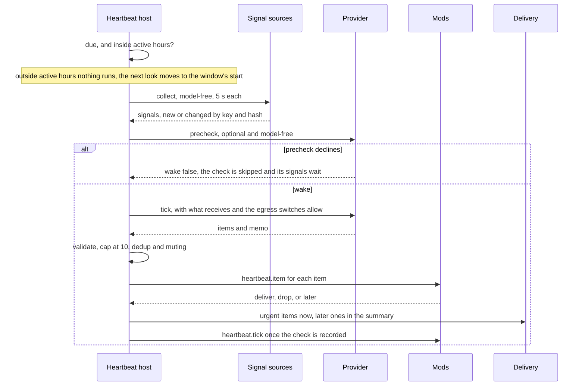

# Heartbeat plugins

How to replace the heartbeat's decision with your own provider, or add things for it to watch. [HEARTBEAT.md](HEARTBEAT.md) covers how the heartbeat works and how to configure it. Plugin basics are in [PLUGINS.md](PLUGINS.md).


There are three ways to extend the heartbeat, from lightest to heaviest:
- **A mod with heartbeat hooks** adjusts what the built-in heartbeat says without replacing it: drop items or make them wait for the summary (`heartbeat.item`), or watch every check (`heartbeat.tick`). See [Lighter option](#lighter-option-a-mod-with-heartbeat-hooks).
- **A signal source** adds *things to watch*: a calendar, a mailbox, a metrics API. Many can be active at once, and they feed whichever provider is selected.
- **A provider** replaces *the decision*: given signals, instructions, memory and history, what is worth telling the person? One provider is active per workspace.

Tavi's authoring skill can scaffold any of them. Ask Tavi to "write a heartbeat provider plugin", and it reads its plugin-authoring guide (`plugins.authoring_guide`).

Tavi keeps everything else: when checks run, the limits, delivery, dedup, muting, the log and the safety rules. Your plugin can't message anyone directly, choose where messages go, act on the person's behalf, or exceed the budget. Those parts aren't yours to replace, and that is what makes a provider safe to install.

One check, between Tavi's heartbeat host and the selected provider:



**Step 1: the manifest.**

```json
{
  "schemaVersion": 2,
  "abi": "tavi.providers/1",
  "provenance": { "format": "bundled-esm", "packages": [] },
  "id": "acme.heartbeat",
  "version": "1.0.0",
  "name": "ACME heartbeat",
  "description": "Rule-based heartbeat: no model, reports anything waiting over an hour.",
  "entry": "index.mjs",
  "provides": ["heartbeat"],
  "heartbeat": { "abi": "tavi.heartbeat/1", "receives": ["signals", "ledger"], "usesTurns": false, "maxTickSeconds": 30 },
  "config": { "waitMinutes": { "type": "number", "description": "Report signals older than this" } }
}
```

- `provides` and `heartbeat.abi` say the plugin supplies a heartbeat provider built for contract `tavi.heartbeat/1`. A plugin built for another contract is refused before any of its code runs.
- `receives` lists what your provider asks to be given: `instructions`, `signals`, `ledger`, `memory`. Tavi derives the disclosure the person confirms from it. Each item also has a per-workspace switch that is **off** until the person turns it on, so code for the case where a field is missing.
- `usesTurns: true` lets you call `host.runTurn`, a metered AI turn limited to the heartbeat's read-only tools.
- `maxTickSeconds` (1–600) is your check's deadline. Past it, the check's `signal` aborts and the check is recorded as failed.

**Step 2: register the provider.** Call `provideHeartbeat` once, in `register`. Tavi takes your `tick`, `precheck` and `status` functions when you call it, so changing the object later changes nothing, and they answer only while the plugin runs. `status()`, if you give one, returns `{ ready, detail? }`: `tavi doctor` shows it (the detail masked and cut to 200 characters) and warns when you say you're not ready. Your plugin's details and its review in `tavi plugins show` and *Settings → Plugins* show what your provider asks to receive and which signal sources it adds. If your plugin declares a `/heartbeat` command, it is listed as `/<your plugin>:heartbeat`: the bare name stays the built-in's.

```js
export default {
  register({ config, provideHeartbeat, HeartbeatProviderError }) {
    const waitMs = (config.waitMinutes ?? 60) * 60_000;
    provideHeartbeat({
      // Optional and model-free: say no early and the check costs nothing. It gets the new signals' keys
      // (only with `signals` egress) and 5 s; a throw or a slow answer lets the check run. Check now never asks it.
      async precheck({ signals }) {
        return signals.length === 0 ? { wake: false, reason: "no signals" } : { wake: true };
      },
      async tick({ wake, signals, recent, signal }) {
        if (signal.aborted) throw new HeartbeatProviderError("transport");
        const muted = new Set(recent.filter((e) => e.state === "muted").map((e) => e.key));
        const now = Date.parse(wake.now);
        const items = signals
          .filter((s) => now - Date.parse(s.at) > waitMs && !muted.has(s.key))
          .map((s) => ({
            key: `acme:${s.key}`,
            signalKeys: [s.key],                    // resolves itself when the signal goes away
            urgency: "later",
            title: s.title.slice(0, 120),
            sources: [{ label: s.source, ref: s.key }],
          }));
        return { items, memo: `checked ${signals.length}` };
      },
    });
  },
};
```

**What Tavi does with your answer:**
- It validates every item against its own schema. An item with a field the contract doesn't have is dropped whole.
- It caps the answer at 10 items. An item with a title over 120 characters or a body over 1,000 is dropped.
- It renders only links that point at sources Tavi itself produced.
- It delivers by the person's settings, not yours.

If you **throw**, the check is recorded as failed and nothing is sent; your error text is kept masked, and a pause alert names only the kind of failure, never your words. Your memo is masked too. Five failures in a row pause the heartbeat. Your `memo` (at most 4 KiB) comes back on the next check; it is cleared if the person switches provider.

**Using AI inside a provider** (with `usesTurns: true`):

```js
const { reported } = await host.runTurn({
  prompt: `Signals:\n${JSON.stringify(signals)}\nReport only what needs the person today.`,
  model: "fast",
});
return { items: [], memo: `turn reported ${reported.length}` };
```

The items the turn reports through `heartbeat.report` are checked and delivered by Tavi as part of this check; you don't return them again. If you also return an item with the same key, yours replaces the turn's. `runTurn` gives you back only their keys and urgencies, never their text, the transcript, tool output or memory the turn read. (A key is the model's own string, and with `ledger` on the next check's `recent` shows the titles your turns reported: treat both as what your turns saw.) A turn's tool results are always masked, whatever the workspace's redaction switch. If your plugin hasn't been allowed `memory`, the turn gets no memory and none of the tools that read the person: memory, past chats, reminders, projects, reports, or the person's extra tools; nor the persona the person chose for checks. (No heartbeat turn's system prompt carries memory of its own: a turn allowed memory gets the host's bounded, masked records in its prompt and the memory tools. Past-chat search never returns heartbeat checks.) Its `heartbeat.fetch`, which reads a watched page or a link found on one on a site the person allowed (at most 5 a check across all its turns, never a URL the model composed), is offered only when your plugin has `signals`. The turn is reserved against the person's daily budget before it runs. A check runs at most 3 turns, each of at most 8 steps. A turn that ends without calling `heartbeat.report` reported nothing, whatever it wrote.

`@tavi/plugin-kit/heartbeat` exports the prompt the built-in provider sends (`buildHeartbeatPrompt`, with the stable parts first so a provider's cache can reuse them, and outside text fenced by `fenceUntrusted`). Keep that order if you build your own: the guidance, the watch list and your notes, then `HEARTBEAT_PROMPT_SEPARATOR`, then what changes every check (the time, the signals, what was told lately, memory). Tavi's own turns do not yet cache the stable part between checks (the message is one block that changes every check), so the order is for a provider that caches a prompt prefix of its own. A turn you run with `runTurn` gets the host's compact heartbeat base prompt under `models.promptLayout v2`. Use it as it is or build on it.

**A panel of its own (optional).** A provider can show a small panel under *More* in Center → Heartbeat with the plugin `ui` block (see [PLUGINS.md](PLUGINS.md#ui-plugins)): a contribution placed in `center.heartbeat` that receives `mod.state`. Its ticks send it values with `host.publish(key, value)`: JSON of at most 16 KiB under a key of 1–64 letters, digits, dots, dashes or underscores, masked like a tool's output, the newest per key, at most 16 keys a person. The panel shows only while your plugin is the selected provider, and Forget heartbeat history clears what it published. Values are kept in memory, so after a restart the panel is empty until the next check publishes. The header, rail and notices stay Tavi's own.

```js
async tick({ signals, host }) {
  host.publish("watching", { signals: signals.length, at: new Date().toISOString() });
  return { items: [] };
}
```

**Step 3 (optional): a signal source.**

```json
{
  "provides": ["heartbeat-signals"],
  "heartbeatSignals": { "abi": "tavi.heartbeat/1", "sources": ["queue"], "offers": { "queue": "Jobs stuck in the queue" } }
}
```

`offers` is optional: a line per source, in the person's words, that the heartbeat's first-run offer suggests beside the
built-in sources' lines. It is one line of plain text, at most 120 characters, and shown at approval; the offer never
runs your source's code, and a line your code supplies is ignored.

```js
register({ provideSignals, config }) {
  provideSignals({
    id: "queue",
    async collect({ signal }) {
      const res = await fetch(config.feedUrl, { signal });
      const jobs = await res.json();
      return jobs.filter((j) => j.status === "stuck").map((j) => ({
        key: `queue:${j.id}`, hash: j.updatedAt, title: `Job ${j.name} is stuck`,
        at: j.updatedAt, source: "Job queue", data: { id: j.id },
      }));
    },
  });
}
```

**A signal source's contract:**
- Call `provideSignals` once for each id your manifest's `sources` lists, in `register`.
- A plugin that only provides signal sources runs as a confined worker, like a plugin with tools: `collect` runs in the worker, and what it returns crosses as data. That worker is never stopped for idleness, so a check never waits for it to start. A heartbeat provider still runs in the owner's process. A version approved in-process before this keeps running there until you approve it again (`tavi plugins approve <id> <version>`).
- `collect` must be fast and model-free: 5 s, 50 signals, 32 KiB.
- If your signals leave by age rather than by being fixed (failures in the last day), give the source `retracts: false`: a key that leaves is forgotten without marking its items resolved.
- If you saw only part of what you watch (a list cut at its page size), return `{ signals, incomplete: true }` instead of the list: Tavi uses what you found and doesn't take the rest for gone.
- `key` is the identity (stable across checks), and `hash` changes when the thing changes. Tavi prefixes each key with your plugin and source id (`acme.queue.queue:queue:42`), so no source can stand in for another's signal.
- The first collection only records what is already there, so nothing old is told as new.
- A signal Tavi has already seen with the same hash doesn't wake anyone.
- When a key disappears, items that rested on it resolve themselves. While your plugin isn't running (a restart, an upgrade), what it reported stays seen; the first collection after install only records what is there.
- Your output is treated as untrusted text everywhere.

**Step 4: develop and test before installing.**

Check the manifest and registration without starting Tavi:

```bash
tavi plugins validate ./acme-heartbeat
```

Then iterate against a running owner, which reloads the plugin on every save. The log marks a dev provider's checks `provider_dev`. While it reloads, a check that comes due is skipped (logged as `provider-reloading`) and nothing pauses unless it stays gone for more than 30 s; a check it was answering when you saved is recorded as skipped, never as a failure:

```bash
tavi serve --dev-plugin ./acme-heartbeat
```

For editor types, use `import type { ExternalPluginContext } from "@tavi/plugin-types"`. It includes `provideHeartbeat` and `provideSignals`.

Then use the conformance suite, `describeHeartbeatConformance` and `describeSignalSourceConformance` from `@tavi/plugin-kit/heartbeat/conformance`, the same checks Tavi's own built-ins pass. It checks:
- the answer shape and bounds;
- that you never name a destination;
- abort handling;
- deterministic keys;
- that none of the secrets you name appears in your errors or memo;
- that your provider still answers when every egress switch is off.

Each suite takes a function that builds a fresh provider or source for every check:

```js
import { describeHeartbeatConformance, describeSignalSourceConformance } from "@tavi/plugin-kit/heartbeat/conformance";
import { createProvider, createQueueSource } from "../index.mjs";

describeHeartbeatConformance("acme.heartbeat", () => createProvider({ waitMinutes: 60 }), { secrets: ["test-token-123"] });
describeSignalSourceConformance("acme.queue", () => createQueueSource({ url: "http://127.0.0.1:9/feed.json" }));
```

The complete example is [`tests/fixtures/heartbeat-rule-provider/`](../tests/fixtures/heartbeat-rule-provider/). Tavi's tests install, approve, enable and select it, then drive it end to end ([`apps/cli/test/heartbeat/heartbeat-plugins.test.ts`](../apps/cli/test/heartbeat/heartbeat-plugins.test.ts)).

**Step 5: install, select, confirm.**

```bash
tavi plugins install ./acme-heartbeat
```

```bash
tavi plugins approve acme.heartbeat 1.0.0
```

```bash
tavi plugins enable acme.heartbeat
```

```bash
tavi heartbeat set-provider acme.heartbeat
```

Selecting a provider shows what it receives, in the words its approval used, and Center → Heartbeat shows a switch only for what its manifest asks for. The egress switches (`tavi heartbeat egress signals on`, or *More → Provider*) start off, turn off again whenever the person switches to a different provider, and can be turned on only for what your manifest declares. Going back is `tavi heartbeat set-provider builtin`. The switches govern a plugin's provider only: the built-in one (`tavi.heartbeatagent`) runs inside Tavi and is given what a check needs without them, as Tavi's own policy. A check still running when the person switches keeps neither its items nor its memo, so the next provider never inherits them. If your plugin is disabled or fails to start, the heartbeat pauses and says so; the person picks the built-in provider (or another) to go on. Disabled in the middle of a check, the check stops at once and is recorded as failed. It never switches silently.

**A provider doesn't hook its own checks.** A plugin that provides a heartbeat may still declare mods hooks, but none may match `heartbeat` turns: Tavi refuses that manifest at install. A check's turns also name their provider on every hook's envelope (`heartbeatProvider`), and Tavi passes over that plugin's hooks in them. Otherwise its hooks could read what its egress switches withhold.

### Lighter option: a mod with heartbeat hooks

To adjust the built-in heartbeat rather than replace it, write a mod (see [MODS.md](MODS.md)) that hooks the two heartbeat events:
- **`heartbeat.item`** runs for each item after dedup and muting, before delivery. It sees the item's key, urgency, title and sources, and the check's time and the person's timezone (`now`, `timezone`). It may return:
  - `{}` (deliver);
  - `{ drop: "reason" }`;
  - `{ urgency: "later" }` (make it wait for the summary).

  It can never make an item urgent, rewrite it or choose where it goes. If your hook throws, the item is delivered as Tavi decided.
- **`heartbeat.tick`** observes every check: why it ran, what kind it was, how it ended, how many items and what it cost. It never sees signals, instructions or memory.

```json
{ "mods": { "abi": "tavi.mods/1", "hooks": [
  { "event": "heartbeat.item", "disclosure": "Holds urgent heartbeat items for the morning summary at weekends." }
] } }
```

```js
hooks.on("heartbeat.item", async (e, next) => {
  const decided = await next(e);            // another mod may already have dropped it
  const day = new Intl.DateTimeFormat("en-US", { weekday: "short", timeZone: e.timezone }).format(new Date(e.now));
  return !decided.drop && e.urgency === "now" && (day === "Sat" || day === "Sun") ? { urgency: "later" } : decided;
});
```

A dropped item shows as *filtered* in the log, with your plugin's name, and is recorded with the check (`hookDecisions`). A drop stands: the heartbeat doesn't ask about that item again until what it says changes, or it resolves and comes back. To delay an item rather than suppress it, answer `{ urgency: "later" }`. Its reason is masked like any plugin text. Every hook gets a read-only copy of the item, and `next(e)` always passes the original on, so one mod can't alter what the next one sees. The full example is [`tests/fixtures/heartbeat-quiet-weekends-mod/`](../tests/fixtures/heartbeat-quiet-weekends-mod/).

**Checklist.**
- [ ] `provides` and the matching `heartbeat` / `heartbeatSignals` block with `abi: "tavi.heartbeat/1"` are present.
- [ ] A provider declares no mods hook that could match `heartbeat` turns.
- [ ] `tavi plugins validate` passes.
- [ ] `receives` names only what you use, and the code works when any of it is missing.
- [ ] `tick` honours `signal`, and reports failures with `HeartbeatProviderError`.
- [ ] Item keys are stable, and `signalKeys` are set so items resolve themselves.
- [ ] No secrets in `memo`: the person can read it (`tavi heartbeat status --format json`), and Tavi masks anything secret-shaped in it anyway.
- [ ] Conformance passes; the end-to-end fixture test passes.

## Architecture

Heartbeat providers and signal sources share contracts and conformance tooling across `@tavi/plugin-kit/heartbeat`, `@tavi/agent-host`, and `@tavi/plugin-defaults`:

| Layer | Module / Path | Responsibility |
| :--- | :--- | :--- |
| **SDK & Conformance** | `packages/plugin-kit/src/heartbeat/*` (`@tavi/plugin-kit/heartbeat`, `@tavi/plugin-kit/heartbeat/conformance`) | Provider and signal-source helpers, `HeartbeatProviderError`, and `describeHeartbeatConformance` / `describeSignalSourceConformance`. |
| **Host & Built-in Provider** | `packages/agent-host/src/hosts/heartbeat-host.ts`, `packages/builtin/defaults/src/heartbeat.ts` (`@tavi/plugin-defaults`) | Enforces egress switches (`signals`, `instructions`, `memory`, `tools`), bounds check outputs, masks secrets in `memo`, and runs the default `tavi.heartbeatagent` provider (`BUILTIN_HEARTBEAT_PROVIDER_ID`). |

See [HEARTBEAT.md#architecture](HEARTBEAT.md#architecture) and [ARCHITECTURE.md](ARCHITECTURE.md) for the complete heartbeat subsystem layout.
