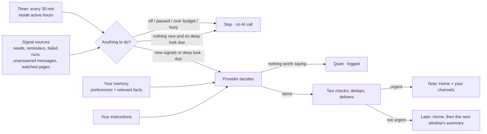
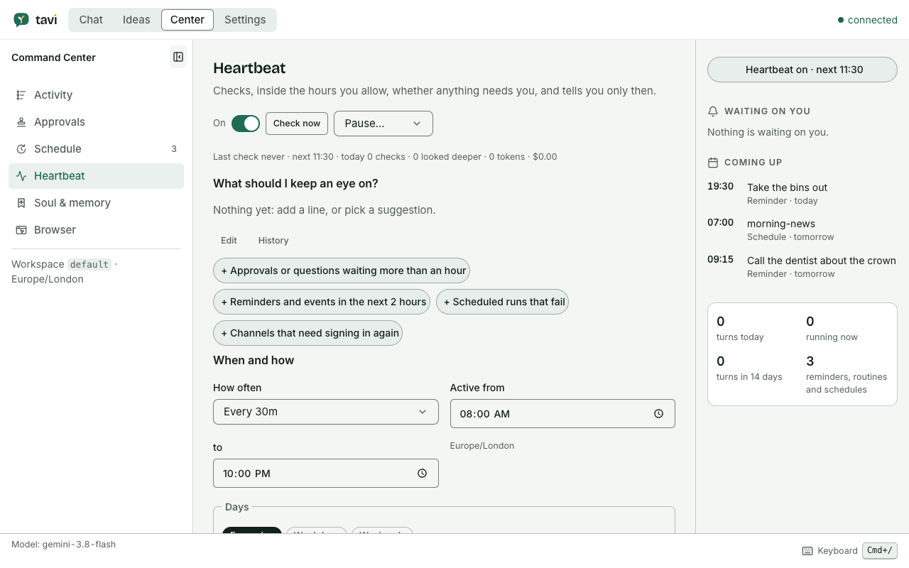

# The heartbeat

The heartbeat lets Tavi check in on its own. Inside the hours you allow, it looks at what you asked it to keep an eye on. It stays quiet unless something needs you, then tells you right away if it's urgent, or in a summary when your next window opens (each morning, by default) if it isn't.

This guide has four parts:
- [How it works](#part-a--how-the-heartbeat-works).
- [Configuring it](#part-b--configuring-it): in the app, by chat or from the terminal.
- [Replacing it with your own plugin](#part-c--replacing-it-with-your-own-plugin): a different decision-maker, or new things to watch, detailed in [HEARTBEAT-PLUGINS.md](HEARTBEAT-PLUGINS.md).
- [Architecture](#architecture): how the host, signals, delivery, and built-in provider are built.

Plugin basics are in [PLUGINS.md](PLUGINS.md), and channels in [CHANNELS.md](CHANNELS.md).

## Part A — How the heartbeat works

**In one sentence.** Inside the hours you allow, Tavi wakes up on a schedule, checks the things you asked it to keep an eye on, and either stays quiet or tells you: right away if it is urgent, otherwise in the summary when your next window opens.

**One check, step by step.**



1. **The timer** fires every *How often* (default 30 min), but only inside *Active hours* (default 08:00–22:00, your timezone). Outside them nothing runs on its own, nothing is sent, and the log shows one "Closed hours" line. *Check now* is you asking, so it runs outside your hours too.
2. **Cheap checks come first.** Tavi skips the check without calling any AI model when:
   - the heartbeat is off or paused;
   - today's limit is reached;
   - you are chatting with Tavi in Home right now (it waits for the next sweep once; if you are still busy, it skips that check);
   - nothing changed since the last check.
3. **Signals** are what makes a check worth doing. They are small facts Tavi gathers itself, without AI:
   - a question, approval or review that has waited half an hour, or whose deadline is within the hour;
   - a reminder or schedule of yours due in the next two hours (routines are not listed: their agenda entries don't say whose they are);
   - a schedule that failed, or that missed its latest runs ("missed 3 times in a row": nothing ran at those times; a skip because the previous run was still going is not a miss);
   - a channel that needs signing in again;
   - a message someone sent you on a channel that has waited over an hour with no answer (a newer message in the same conversation takes its place; one a mod deliberately dropped counts as answered);
   - a message the channel reported bounced or failed, in the last day;
   - a routine run of yours that failed, in the last day;
   - a message held for your review, or a file a chat made waiting for your review;
   - a chat's folder past 80% of its space budget, all chats' folders together past 80% of theirs, or the disk Tavi keeps its data on nearly full (sizes only: no file is opened);
   - a page you asked it to watch that changed: Tavi reads each watched page at most once an hour, only from a site you allowed, and notices when what it says changes (the page's words are treated as untrusted text).

   A check sees only signals it hasn't seen before; the very first check only notes what is already there, so a backlog never floods you — and so does the first check of a source added later, or one back after a month unread. A check that fails, runs out of budget or loses its provider hands its new signals to the next check rather than dropping them, and a failed deep look stays due. A source that is missing for a moment (a plugin restarting, a watched page not read yet) keeps what it saw. A failed send or routine run leaves the list after a day, and something coming up leaves it when its time passes, without its message being marked "Resolved". Anything that reads like a password or key is masked before the provider sees it.
4. **Events between checks.** Some things don't wait for the timer: a run that failed, or a question or approval with 80% of its time to the deadline gone. Each asks for a look soon, after a minute's pause so a burst counts once, and at most one such look every 10 minutes (a look that could not start, say with no model or a full disk, does not count, and its event waits for the next check); a later event makes the next scheduled check look even if nothing else changed. A message someone else sent you makes the next scheduled check look rather than one now: it only becomes a signal once it has waited an hour, so a look now would find nothing and still spend a check. Outside your active hours an event waits, and the window's first check is that look. A paused or off heartbeat ignores events. The log marks these checks as woken by an event. (The heartbeat keeps waiting events in memory, so a restart forgets them; the next scheduled check still runs.)
5. **Deep looks.** Every few hours (*Look deeper*, default 4 h), even with no new signals, Tavi reads your whole instruction list once. That covers the things signals can't see.
6. **The provider decides.** It gets the new signals, your instructions, what it told you recently (and your 👍/👎), and what Tavi remembers that matters: your preferences, plus facts related to what it's looking at.

   That memory is one bounded block (at most 10 records and 4 KiB, secrets masked, and each record logged with the check), each record shown as a chat's answer sees it: its title, then its whole text up to 300 characters, or the part around the matching words of a longer one (`[fact] Home city — Alice moved to Lisbon in March`).
   - It is the only memory a check is handed: unlike a chat, a check's turn never gets an ordinary memory section of its own, whose search would be steered by other people's words in its signals.
   - Related facts are found by the words of the instructions or the signals' titles, never by meaning: with hybrid recall on (`tavi memory config retrieval hybrid`), a check's words are still never sent to an embedding model.
   - It can still look something up with memory search.

   It returns either nothing or a few *items*. The built-in provider is one short AI turn on your *Fast* model. It can read, but it can't send, buy, write or change anything.

   Under the cache-stable prompt layout (`models.promptLayout v2`):
   - that turn runs under a compact base prompt of its own (`tavi-default-2-heartbeat`, under half a chat's: untrusted content is data, approvals and limits hold, no credentials, report only what was seen) instead of a chat's, unless the workspace set a base prompt of its own, which still wins;
   - a check every 5 to 55 minutes keeps its tools and base prompt cached for an hour (its first message is not cached between checks: it holds what changed, Anthropic takes at most four cache marks and a turn already uses them, and the notes in its stable start change whenever a check rewrites them; a provider that caches prefixes by itself, such as OpenAI, still reuses that stable start);
   - its answer is capped at 2,048 tokens, every call of the turn asking a reasoning model for low reasoning effort (CLI.md *Reasoning effort*).

   That first message puts what never changes between checks (the check's guidance, your instructions, its notes) before `--- This check ---` and what changed after it.
7. **Tavi delivers, not the provider.** Tavi checks each item and drops anything it already told you, that you muted or snoozed, or that changed but was told less than 6 hours ago. Web addresses in an item's words are disarmed (`hxxps[:]//example[.]com/…`) unless they are a page you watch, so no channel fetches a link preview the check composed. Then:
   - **urgent items** go to Home and your chosen channels, at most 3 an hour unless you change it under *More*; one past the limit waits as a non-urgent item, marked "held back";
   - **the rest** sit quietly in Home and go into the summary when your next window opens — whatever opens it first: a scheduled check, an event or *Check now*. A summary lists what was told since the window before opened (at least the last 24 hours), so Friday's items still reach Monday's summary when the weekend has no window; anything older drops out of it but stays in the log.

   **Why an item names a memory.** An item's card in Home names up to two memories the check that told it was given, as "Because you said: “Travelling to Lisbon until Friday”". They come from that check's logged memory (step 8, below), read again each time the card is shown, so a memory you forget is no longer named, and a sensitive one never is. Channel messages and the Center's list don't name them.

   A channel gets each item once; a send the channel refused is never repeated, and the item stays in the app. With Home turned off, items show in Center → Heartbeat instead, and channels still get them. If the cause goes away (you answered the approval), the card in the app shows "Resolved · 14:20". So does the channel message, on channels that can edit messages; elsewhere nothing more is sent. When the heartbeat pauses itself (its daily limit, repeated failures, its provider missing), it tells you the same way.
8. **Everything is logged.** Each check shows:
   - why it ran;
   - what it looked at, including which memories it used;
   - whether it stayed quiet or told you something;
   - what it cost.

   A skipped check (a full disk, no model, nothing new, the provider declining or missing) is logged too, and is never counted as a failure. While it is off or paused nothing is logged: the pause is shown as its status. The closed hours since your last check show as one line when your next window opens.
9. **Where it runs.** The heartbeat runs in the Tavi owner (`tavi serve`) only, as the built-in `tavi.heartbeat` plugin. Disabling that plugin (`tavi plugins disable tavi.heartbeat`) stops every heartbeat at once; `tavi doctor` says whether it is running and how your heartbeat is doing. If the owner was off at a check's time, one catch-up check runs when it comes back; missed checks are never replayed.

**What it can and can't do.**

| It can | It can't |
|---|---|
| Read your memory, reminders, past chats and reports, and pages you asked it to watch on sites you allowed (in a check it may read up to 5: a watched page, or a link found on one, on those sites only) | Send messages by itself, change settings, create schedules or reminders, or edit its own instructions |
| Suggest an action ("Pay the ACME invoice?") | Run that action. *Do it* opens a normal chat turn, and Tavi asks your approval as usual |
| Run without a working folder. It never reads or writes your chats' folders or your `--fs-root` folders, and leaves nothing under `chats/` | Open files. A suggested action never names a file path; files are passed as artifacts |
| Message you at most 3 times an hour, inside your hours | Wake you at night (not in this version) |
| Run alongside the plugins with hooks (mods) you approved. They see a check as `source: heartbeat`, `attended: false`, and can only make it stricter or quieter | Let a mod add tools, rewrite its prompt, or send for it. A plugin that is your heartbeat provider never hooks its own checks |

## Part B — Configuring it



**The first-run offer.** Before you have saved anything for the heartbeat, while one of its built-in sources has something to watch for you (an approval waiting, a failed schedule, a held message…), one card asks once — at the top of Home, or in the Center's rail when Home is off — whether to check on things every 30 minutes between 08:00 and 22:00, with how many checks a day that is. It prefills a line per thing it can watch, which you can edit first. *Turn on* switches it on with them; *Not now* is for good, and so is any other first save — turning it on and off again does not bring the card back (turn it on later in Center → Heartbeat or with `tavi heartbeat on`).

**In the app: Center → Heartbeat.**

| Setting | What it does | Default |
|---|---|---|
| **On / Pause** | Off stops it; *Pause* stops it until you resume or for a set time. Every pause stops every kind of check. | Off (Tavi offers to turn it on once) |
| **What should I keep an eye on?** | Your instructions, one per line. Suggestions appear as one-tap chips. A line starting `watch:` with a URL watches that page. | Prefilled from what's connected |
| **How often** | 15 min · 30 min · 1 h · 2 h · 4 h | 30 min |
| **Active hours / Days** | When it may check and message you; may cross midnight | 08:00–22:00, every day |
| **Tell me** | *Urgent things right away; the rest quietly here and in a summary when your next window opens* · *Everything as it happens* (still at most the hourly limit, 3 unless you change it) · *Only the summary when your next window opens* | The first |
| **Where** | Home, plus channel targets: choose one of your enabled channels and who on it, then confirm that the heartbeat may message them; each can be removed | Home |
| **More** | Look-deeper interval; the model its checks run on in place of the workspace's *Fast* model (a provider that asks for the main model still gets that) and the persona they run as (none unless you choose one); limits (checks, tokens — at least 80,000, since each check reserves its worst case — and, optionally, dollars a day; urgent messages an hour); what you told it not to mention, each with *Unmute*; extra read-only tools your plugins and MCP servers add, for its checks to use (only a plugin's or an approved, enabled MCP server's: built-in tools, and an MCP server's writes, are not offered here; a chosen MCP tool behind search is offered directly). A check that has read untrusted content — the heartbeat's own signals included — is denied, never asked, a call that a person would have been asked about then: an egress-capable MCP read, and every tool's critical or taint-asked call, whatever `security.taint` says; the signal sources it gathers from, each named by what it watches (a plugin's by its offer line, else its source in words, and the plugin: *Watches from Jobs*), each of which you can turn off (one turned off is not read, and what it found before is kept, not taken for resolved); provider and what it receives, with a plugin provider's own panel when it has one; the sites it may read, each removable; *Forget heartbeat history* (asks you to confirm) | — |

The header has *On/Off* and, while it is on, *Check now* (when the heartbeat runs in this owner) and *Pause* (for an hour, 4 hours, a day, or until you resume), then the last check, the next one, and — once it has checked today — today's checks, deeper looks, tokens and cost ("cost unknown" while the model is unpriced). Off and never run, it shows no figures.

- *Edit* changes the instructions in place (if they were changed elsewhere while you edited, Save is refused once with why and the page reads them again; Save again to keep yours) and *History* lists earlier versions.
- The log lists every check — why it ran when not on schedule, how many memories it used, and what a mod held back — filtered to what told you something, what was skipped or what failed.
- The page reads the heartbeat again every couple of seconds while it is open, so a new check shows up without a reload; if a read fails, it says so above the last good figures.
- The rail beside every Center section shows a pill: on and the next check, off, or paused, read again every 30 seconds.
- *Forget heartbeat history* deletes the log, what it has told you (except what you said not to tell you about, which stays muted), what it had seen, its notes, its provider's panel and its plugins' hook records; today's checks and spending still count toward the daily limits, so forgetting never resets the budget.
- The history kept is 30 days; older log rows, items (except what you muted), hook records and the notes it keeps of who messaged when are removed on their own.
- Backups and `tavi reset` cover heartbeat history along with the database; the heartbeat keeps no files of its own.
- The estimate under the settings says how many checks a day the hours allow (within the daily limit) and, once it has run, the tokens they would spend at its own average per check.

**By chat.** Say "keep an eye on failed payments" or "check every hour instead". Tavi reads the heartbeat (`heartbeat.status`), then proposes the change (`heartbeat.propose`): the approval card shows it as a diff — "How often: 30m → 1h", "+ Watch the Globex renewal" — and it is applied only when you approve, only if Tavi read the heartbeat at that revision (so the diff was shown), and only if nothing changed the heartbeat meanwhile. Each change is approved on its own. A change proposed after the chat read a web page or other untrusted content is remembered as such: asking for the status later reads the instructions as that content, and each check starts as if it had read it, until you rewrite the instructions yourself (*Edit*, or `tavi heartbeat`). "How's the heartbeat doing?" shows the status. Only the workspace operator can read or change it, and the heartbeat's own checks are offered neither tool.

*Do it* runs in Home's working folder, or in a new chat's own folder when Home is off. Because the suggestion came from outside data, any write into your own folders asks every time.

**With a slash command.** `/heartbeat` works in `tavi chat`, the canvas and your channels:
- `/heartbeat` shows the status;
- `/heartbeat pause 2h` (or `30m`, `1d`, at most `7d`; none pauses until you resume), `/heartbeat resume` and `/heartbeat now` control it.

It is yours alone: anyone else gets "/heartbeat is the workspace operator's", in a shared channel chat too. It runs where the heartbeat runs, in `tavi serve`.

`/heartbeat` answers at once (`now` queues a check), and is limited to a few uses a second. If it keeps failing, only the command is switched off until the next restart; the heartbeat itself keeps running.

Changing settings still goes through the app, chat approval or the terminal.

**From the terminal:**

```bash
tavi heartbeat on
```

```bash
tavi heartbeat every 1h
```

```bash
tavi heartbeat hours 08:30-19:00 --days mon-fri
```

```bash
tavi heartbeat edit --file my-watchlist.md
```

```bash
tavi heartbeat log --since 1d
```

The full list is in [CLI.md](CLI.md#tavi-heartbeat).

**On each message.** Every item shows where it came from and which of your lines it answers. In the app — its card in Home, and under *What it told you* in Center → Heartbeat — its buttons are:
- **Do it** (only when it proposed something): starts a turn in Home (or a new chat when Home is off) seeded with the proposal. Tavi treats it as coming from outside, so it asks your approval before anything runs. Your message in that turn is a fixed request; the item — its title, suggestion and proposed call — is quoted data beside it, never your words.
- **Chat about this:** asks Tavi about the item in Home (or a new chat), quoting it; like *Do it*, Tavi treats the item as coming from outside.

Both turns start labelled `heartbeat` ([SECURITY-MODEL.md](SECURITY-MODEL.md#untrusted-content-and-the-taint-gate)): untrusted, with the item as the label's reference and the sites of the pages it cites (the hosts of its sources' links) named, so an approval card can say where the suggestion came from. A page a check reads with `heartbeat.fetch` is labelled `heartbeat` too, with its host.
- **Snooze for a day.**
- **Don't tell me about this:** mutes this item; *Undo* on its receipt tells about it again (to mute all like it, `tavi heartbeat mute '<prefix>*'`). An item a mod held back is not listed among what it told you; the log shows the mod's decision and reason.
- **Useful / Not useful:** teaches the next checks what you care about; both, and mutes, are shown to the next checks.

A resolved, snoozed or muted item collapses to one line ("Resolved · 14:20").

On a channel, a message carries what the channel supports:
- where it has buttons, up to three: *Open*, *Snooze 1 h* and *Don't tell me*. Only you can use them, and a press on an item already settled gets a short receipt instead;
- on email and channels without buttons, the text and a line saying where to open it in Tavi (Center → Heartbeat).

A message sent to an email channel goes out from your own address. If a channel refuses or fails a message, the log says so and the item stays in the app. Tavi never re-sends it.

**Writing good instructions.**
- Write one concern per line, phrased as what would make it worth telling you: "Tell me if a payment fails", not "Check Stripe".
- Say what counts as urgent: "…urgent if it's over €500".
- Put preferences that apply everywhere into memory (Soul & memory), not into the instructions. "I'm travelling until Friday" is a good example: the heartbeat reads memory every time.
- Empty instructions are fine. The heartbeat then reacts only to signals and never takes a deep look.
- To watch a page, write `watch:` and its https address, then what matters: `watch: https://example.com/pricing — tell me if the Pro price changes`. Saving a line that watches a new site also allows the heartbeat to read that site (it can't ask you while it runs on its own); the approval card for a chat change lists it as "Sites it may read". It reads the page at most once an hour and tells you only when what the page says changes and your line says it matters. A site you take out of *Sites it may read* is never read again, even if a line still names it. It watches at most 20 pages; `#section` at the end of an address is ignored, since it is the same page.

**Troubleshooting.**

| You see | Why | What to do |
|---|---|---|
| "Paused (today's limit was reached)" | Today's checks, tokens or dollars were used up, or what was left could not fit one more AI call (the dollar limit counts the calls that have a price; one with none still counts toward tokens and checks) | It resumes at the next window; raise the limits under *More* |
| "Paused (it failed repeatedly)" | Five checks in a row failed: the model or provider kept failing | Open the log row for the error; *Resume* |
| "Paused (its provider is unavailable)" | The plugin you chose was disabled or removed | Choose the built-in provider under *More* (or `tavi heartbeat set-provider builtin`), or another; that ends the pause |
| "Skipped — disk full" | The data directory's disk is almost full, so checks pause rather than risk a half-written state | Free some space; checks resume at the next sweep |
| "Skipped — no model" | No *Fast* model is set and none chosen under *More* | Settings → Models → Fast |
| Never hear from it | Quiet is the normal outcome | Check the log; try *Check now*; make urgent things explicit in your instructions |
| "quiet (a result was withheld)" in the log | A plugin's hook refused or withheld what the check read | `tavi plugins show <id>` shows its hook activity; fix or disable the plugin |
| A mod shows *degraded* | Its hooks failed repeatedly, and its checks fail closed | `tavi plugins show <id>`; restart after fixing |
| A channel target gets nothing | The channel connection was removed, needs reconnecting, or its plugin is missing; the item stays in the app, and the owner's log says why | Settings → Channels; then pick the target again under *Where* |

`tavi doctor` reports the same state: whether it's running, the provider (and, for a plugin provider that says, whether it is ready), the next check, today's usage and any pause reason.

## Part C — Replacing it with your own plugin

A plugin can replace the heartbeat's decision (a *provider*), add things for it to watch (a *signal source*), or adjust what the built-in one says (a mod with heartbeat hooks). Tavi keeps when checks run, the limits, delivery and the safety rules; a plugin receives only what its manifest asks for and the person switches on.

[HEARTBEAT-PLUGINS.md](HEARTBEAT-PLUGINS.md) is the guide: the manifest, the provider and source contracts, AI turns inside a provider, the developer loop, conformance, installing and a checklist.

Two plugins this repository ships add a signal source. **Jobs** (`jobs.finder`, [JOBS.md](JOBS.md)): its `watches` source sweeps your approved job watches in its worker, without a model, and tells the heartbeat each new match (`New match: <title> at <company> (0.86)`) and any job source it has paused. **Trends** (`trends.radar`, [TRENDS.md](TRENDS.md#the-heartbeat)): its `spikes` source sweeps your tracked topics and tells the heartbeat when one takes off. Both carry text from third-party pages, so the heartbeat treats it as untrusted.

## Architecture

The heartbeat is split across a host engine in `@tavi/agent-host`, a provider/signal-source SDK in `@tavi/plugin-kit/heartbeat`, the default provider in `@tavi/plugin-defaults`, and worker-backed SQLite persistence in `@tavi/runtime`:

| Layer | Module / Path | Responsibility |
| :--- | :--- | :--- |
| **Contracts & SDK** | `packages/contracts/src/heartbeat.ts`, `heartbeat-ipc.ts`, `heartbeat-time.ts`, `packages/plugin-kit/src/heartbeat/*` (`@tavi/plugin-kit/heartbeat`) | Schemas for `HeartbeatConfig`, `HeartbeatSignal`, `HeartbeatItem`, active-hour windows, and the `HeartbeatProvider` / `HeartbeatSignalSource` contracts and conformance suite. See [HEARTBEAT-PLUGINS.md](HEARTBEAT-PLUGINS.md). |
| **Host, Signals & Delivery** | `packages/agent-host/src/hosts/heartbeat-host.ts`, `heartbeat-tick.ts`, `heartbeat-signals.ts`, `heartbeat-delivery.ts` | Timer and event-woken scheduling (`heartbeat-host.ts`), cheap pre-checks and budget reservation (`heartbeat-tick.ts`), built-in signal gathering and watched-page diffing (`heartbeat-signals.ts`), and deduplicated urgent vs. window-summary delivery (`heartbeat-delivery.ts`). |
| **Built-in Provider** | `packages/builtin/defaults/src/heartbeat.ts` (`@tavi/plugin-defaults`) | Default `tavi.heartbeatagent` provider (`BUILTIN_HEARTBEAT_PROVIDER_ID`, hosted by `tavi.heartbeat`) running a single bounded turn on the workspace's `Fast` model with lexical memory recall. |
| **Persistence** | `packages/runtime/src/persistence/heartbeat-repository.ts` | Worker-backed SQLite persistence for instructions, revision history, seen signal cursors, delivered items, mutes/snoozes, and 30-day check logs. |
| **CLI & Web Canvas** | `apps/cli/src/features/heartbeat/*`, `apps/ui/src/features/center/*` | Implements `tavi heartbeat`, `/heartbeat`, `heartbeat.status` / `heartbeat.propose` chat tools, and **Command Center → Heartbeat**. |

See [ARCHITECTURE.md](ARCHITECTURE.md) and [evals/heartbeat/README.md](../evals/heartbeat/README.md) for heartbeat evaluation benchmarks.
