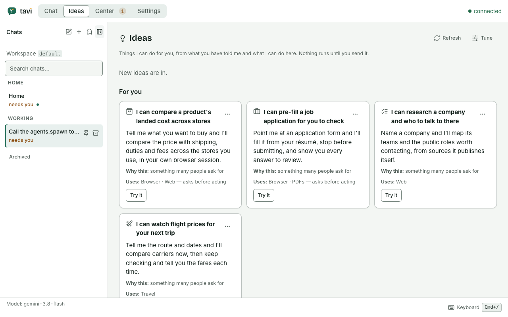
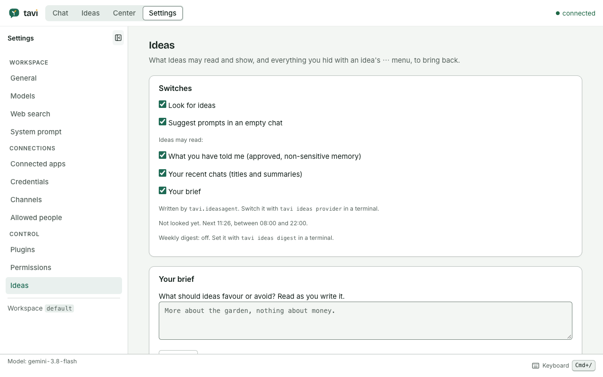
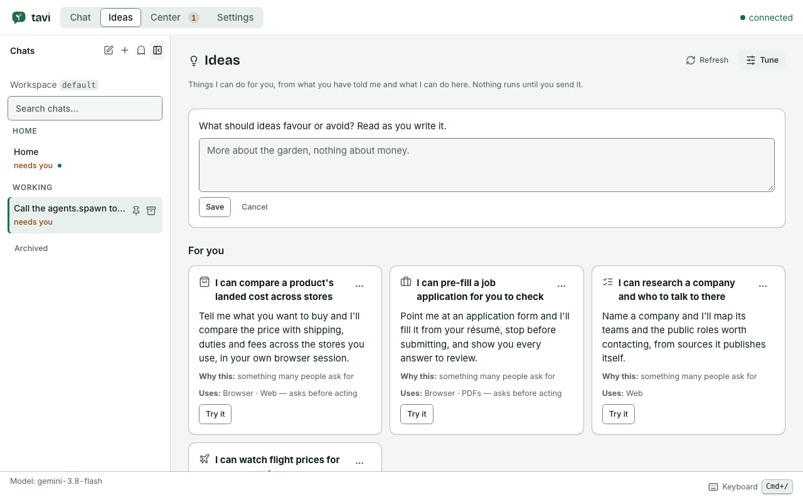

# Ideas

Ideas are things Tavi offers to do for you. Each one rests on something you told it and is limited to what it can actually do here. Each says why it was offered and what it would use. Nothing runs until you send it.

This page is for anyone who uses Ideas and wants to know where they come from and what they read. It covers [where ideas come from](#where-ideas-come-from), [the built-in catalogue](#the-built-in-catalogue), [the Ideas tab](#the-ideas-tab), [chat and the terminal](#in-chat-and-in-the-terminal), [what Tavi reads and keeps](#what-ideas-read-and-keep), and [architecture](#architecture). To replace the built-in writer with your own plugin, see [IDEAS-PLUGINS.md](IDEAS-PLUGINS.md).

## Where ideas come from

1. **What Tavi can do here.** Tavi takes a census of the tools, connected apps (a mailbox such as Gmail, Google Calendar, Home Assistant) and channels (Telegram, Discord) enabled in this workspace, by the categories they prove (`mailbox`, `calendar`, `home`, `messaging`, and a plugin's `places`, `jobs`, `trends`, `travel`, …). It never offers an idea that would need something missing.
2. **What you told it.** A provider reads your approved, non-sensitive preferences, facts and lessons (your profile first: core facts about you, then preferences and lessons, then other facts), your own recent chats (titles, and the summaries of chats known to have read nothing untrusted), and your *brief*. It never reads private or memory-off chats, chats with other people on a channel, or sensitive memory. While your memory is paused, it reads only your brief: no memory, no chats, no prompts you rewrote, and no idea is offered on memory.
3. **The built-in provider** picks from a catalogue of everyday use cases (travel, work, learning, home, shopping, people, productivity). If you have set a *Fast* model, it first asks that model which of them fit what it knows of you, each resting on one thing you said: those come first, in the model's order, whatever words you used. Then come the ones that only share a word with something you said. It cites where you said it. It then asks the *Fast* model once more to reword the ideas that cite something of yours; the others keep the catalogue's words. Ideas never use your main chat model: with no *Fast* model set, they are ranked by those shared words alone and keep the catalogue's words. A rewording that turns an idea into one you tried, dismissed or snoozed keeps the catalogue's words, so that idea does not come back under another name.
4. **A check on every idea.** Tavi checks each idea before showing it: its source must be real, its tools present, and its section one you have not muted.

**During setup**, the first-ideas step shows the top three chips at once and asks for a refresh in the background, replacing them in place once new ones arrive (it looks for up to two minutes) (see [ONBOARDING.md](ONBOARDING.md)).

`tavi serve` looks for new ideas once a day, inside your hours (08:00–22:00 by default, in your workspace's timezone; `tavi ideas hours` changes them). You can also ask with *Refresh*, at most three times an hour. The *Next* time the tab and `tavi ideas list` give is when that daily run starts: `tavi serve` looks every 15 minutes, so a run due now starts at the next look, and a refresh does not take the place of the day's run. A daily run whose inputs have not changed asks the provider nothing and keeps the ideas already offered; it asks again only if none is left. Model use has a daily budget of 20,000 tokens (`tavi ideas budget` changes it; 0 turns model use off), shared with the prepared steps below. Past it, ideas keep their plain catalogue wording until midnight. While Ideas are off, a refresh is refused and not counted.

## The built-in catalogue

The built-in provider (`tavi.ideasagent`, shipped in `@tavi/plugin-defaults`) draws from **65 everyday use-case templates across 19 domains** defined in `packages/plugin-kit/src/ideas/catalogue.ts`:

- **Shopping & Deals** (`shopping.landed-cost`, `shopping.review-check`)
- **Local Vetting & Care** (`travel.specialist`, `health-home.in-network`)
- **Jobs & Career** (`work.job-watch`, `work.application-prefill`)
- **Trends & Monitoring** (`work.trend-radar`, `work.comment-clusters`)
- **B2B Leads** (`productivity.prospects`)
- **Travel & Commute** (`travel.fare-watch`, `travel.hotels`, `travel.car-or-rail`, `travel.fuel-route`, `travel.itinerary`, `travel.visa-packing`)
- **Hobbies & Craft** (`learning.sketch-critique`, `learning.garden-plan`, `health-home.fridge-recipes`, `learning.mix-practice`, `productivity.photo-organise`, `learning.cut-list`, `learning.canon-audit`)
- **Life Ops & Admin** (`productivity.morning-brief`, `productivity.meeting-slots`, `productivity.inbox-triage`, `productivity.downloads-cleanup`, `productivity.subscriptions`, `health-home.appliance-records`)
- **Learning & Study** (`learning.tutor`, `learning.language`, `learning.flashcards`, `learning.tech-roadmap`, `learning.exam-prep`)
- **Health & Fitness** (`health-home.form-check`, `health-home.meal-plan`, `health-home.sleep`, `health-home.thought-record`, `health-home.supplements`)
- **Home & Smart Home** (`health-home.rental-watch`, `health-home.load-shift`, `health-home.recycling`, `health-home.neighbourhood`)
- **Family & Household** (`health-home.school-forms`, `people.carpool`)
- **Pets** (`health-home.pet-vaccines`, `health-home.pet-diet`, `health-home.lost-pet`)
- **Auto & Bikes** (`travel.car-code`, `travel.bike-wear`, `travel.recalls`)
- **Wardrobe & Style** (`shopping.capsule`, `shopping.outfit`, `shopping.mending`)
- **Gaming** (`learning.dnd-lore`, `learning.rules`, `people.game-night`)
- **Genealogy & Archives** (`learning.cursive`, `learning.census`, `learning.gedcom`)
- **Personal Knowledge** (`productivity.note-links`, `productivity.distil`, `productivity.bookmarks`)
- **Culture & Social** (`people.recommendations`, `people.tour-radar`, `people.keep-in-touch`)

Each template declares its required workspace capabilities (`requires`), which capabilities always ask before acting (`asks`), whole-word lexical triggers (`triggers`), and an optional recurring `cadence` (`daily` or `weekly`). For the complete 65-item reference table and step-by-step capability walkthroughs, see [USECASES.md — Built-in everyday use-case catalogue](USECASES.md#built-in-everyday-use-case-catalogue).

## The Ideas tab

The **Ideas** tab sits beside Chat when the owner offers it (`tavi serve` with this build).

- **For you**: the four best ideas, two by two (stacked on a phone).
- **The sections**: the rest, three per section, two a row as in For you, with *More* to see all of them.
- **The footer**: "That's all for now", when Tavi last looked (and why that look came to nothing, when it was skipped or failed), and when it will look next.

Each card shows:
- **Why this:** what it rests on. *you said "…"* opens Soul & memory, *chat "…"* opens that chat, *your brief* is your own words, and *something many people ask for* means nothing personal was used (a plugin provider's such idea says *suggested by* and the provider's id).
- **Uses:** what it would use, plus *asks before acting* when one of them always asks you first.
- **Try it:** opens a new chat of its own (never a side chat of a draft, or a reply to a notice) with the idea's prompt in the box; on a phone it closes the chat's sheet so the box is in view. Its first `[part]` is selected to type over, and Tab goes to the next one; with none ahead, Tab leaves the box. Edit it, then send it yourself, or don't. One *Try it* at a time.

Each card's **⋯** menu steers what comes next:
- **Pin** keeps it until you unpin it, try it, or make it recurring: trying an idea or making it a routine retires it, pin and all, and frees its place among the 12.
- **More like this** favours ideas like it, and its section.
- **Not now** hides it for a week.
- **Not interested** hides it for good.
- **Not interested in <section>** mutes the whole section.
- **Make it recurring…** (on an idea that repeats) opens a routine you can edit: what to do, the day for a weekly one, and the time. A `[part]` left unfilled stops the first **Create routine** with the part selected in the box and a warning under it, since nobody is there to ask when it runs; created again with the same words, it stays as it is. Only template blanks count, here and for Tab: Markdown links, addresses (`[example.com]`, `[fe80::1]`), task boxes, bare numbers, `[[wiki]]` links, brackets joined to a word (`foo[bar]`) and anything in code are not parts. Nothing is created until you save it, and Tavi checks a new routine before it starts.
- **Remind me…** sets a reminder that says the idea at the time you pick, read on your workspace's clock. It doesn't run anything.
- **Don't use "…"** stops Tavi using that memory, chat or your brief for ideas, and ends the ideas that quoted it.

**Settings → Ideas** undoes every one of these: *Bring back* a hidden idea (refused while all 12 places are pinned), *Unmute* a section, *Use again* a source (a chat is named by its title). It also holds:
- the switches: ideas on or off, suggestions in an empty chat, and which sources ideas may read;
- your brief;
- when Tavi last looked and looks next;
- the weekly digest's setting, shown read-only;
- *Start over*, which forgets everything you hid (and the prompts you rewrote, kept as examples) or unmutes every section, after asking you to confirm.

**Ready.** Once a day Tavi may run the first step of up to two ideas ahead of time, using read-only tools: a search, places, trends, jobs or flights. It only does this for ideas that rest on nothing of yours (*something many people ask for*) and have nothing left for you to fill in, and only from the built-in provider or one that reads nothing of yours (or any provider once you allow it with `tavi ideas prepare on`; switching providers turns that off again), within at most 40,000 tokens of your ideas budget. A card that says *Ready* opens its chat, and what Tavi found goes with your first message as data the reply reads, never as instructions. The answer is dropped after a day, or as soon as the idea's words or tools change, even while its step is running. Every built-in idea that could qualify has a part for you to fill, so today only the ideas of a plugin provider that reads nothing of yours are ever prepared.

**Refresh** asks for new ideas now; the tab checks back every few seconds and says what the look found, or, after two minutes, that it is still looking. A refresh asked while a look is under way waits for its own run. **Tune** edits your *brief*, the topics ideas should favour or avoid ("More about the garden, nothing about money."); saved, it says whether a look will read it (not while Ideas, or the brief's switch, are off). When no *Fast* model is set, the tab says so and links to Settings → Models. Ideas still come; they are matched by the words you used alone and keep their plain wording. When Ideas are off, the tab says so, shows no cards, and links to Settings → Ideas.

A page can read and steer ideas, but it cannot switch the provider or the digest, or change the hours or the budget. Those send your words somewhere new or decide what runs unattended, so they stay in the terminal (`tavi ideas provider`, `digest`, `hours`, `budget`).

## Suggestions in an empty chat

A new chat shows up to three suggestions:
- **Continue: <title>** for your newest own chat that has a summary and was active in the last three days (it counts toward the three, and opens that chat);
- your best ideas;
- when there are no ideas, things Tavi can do here, such as *Search the web* or *Set a reminder*.

A suggestion fills the box and selects the part for you to type over, like `[topic]`. It never sends. The suggestions step aside once you type, and come back if you clear the box. If you clear an idea's words, or leave the chat, the message you send next is no longer linked to that idea; nor is it when the owner refused to mark the idea tried. Home shows no idea suggestions, only *Continue* and what Tavi can do, since an idea is tried in a new chat. **More ideas →** opens the tab. Turn them off in Settings → Ideas.

## In chat and in the terminal

- **In chat:** `/ideas` lists your top four with what to send (or says Ideas are off), and `/ideas refresh` looks again. On a channel it answers only in your own direct chat with Tavi, never in a group or an email thread.
- **Weekly on a channel (off by default):** `tavi ideas digest <connection> <day>` sends your best three ideas to your own chat on that connection each week. It goes at most once a week: moving the day, or turning it off and on, waits out the week. Reply `try 2` within a week (or `2` within a day) to start one; one digest gives one pick, and only an idea still offered can be picked. See [CHANNELS.md](CHANNELS.md#the-weekly-ideas-digest).
- **In the terminal:** `tavi ideas list | try | dismiss | restore | refresh | brief | provider | digest | hours | budget | prepare | reset | on | off`. `list` marks a prepared idea *ready*, and says first when Ideas are off. `tavi doctor` reports ideas' volume, budget, hours, *Fast* model, digest and the last day's prepared steps. See [CLI.md](CLI.md#tavi-ideas).

## What ideas read and keep

- **Read:** only what is listed above, narrowed by the switches for memory, chats and the brief, and by memory being paused. A source you mark *Don't use this* is never given to a provider again, nor are the prompts you rewrote in a chat you set aside.
- **Kept:** an idea not acted on expires after a week. Feedback that ranks them (tried, ignored, *more like this*) is kept for 90 days. Dismissals, muted sections and excluded sources are kept until you reset them.
- **Forgotten:** forgetting a memory or a chat, rewinding a chat, or turning a chat's memory off, also deletes the ideas that quoted it (and, for a chat, the prompts you rewrote in it). A memory that is revised, or no longer approved, stops being quoted: ideas keep the citation but not its words, and unpinned ones end.
- **Model calls:** a model turn's request is not kept; only its usage is recorded.
- **What you do with ideas:** when you send an idea's prompt, the chat it starts is linked to the idea. If you edited the prompt first, your words are kept as an example of how you like to ask. Private and memory-off chats are never linked. When a turn of that chat finishes without failure, the idea counts as done. Ideas you try lead to more from that section. If you take up few of the ideas shown over a week (trying one, or making it a routine), Tavi offers fewer of them, down to four; if you try many, it offers more, up to twelve.

## Architecture

Ideas are split across a host boundary (`@tavi/agent-host`), a provider contract (`@tavi/plugin-kit/ideas`), a worker-backed SQLite store (`@tavi/runtime`), and CLI/UI adapters:

| Layer | Module / Path | Responsibility |
| :--- | :--- | :--- |
| **Contracts & Ports** | `packages/contracts/src/ideas.ts`, `packages/contracts/src/ideas-ipc.ts` | Zod schemas and ports for `Idea`, `IdeaDraft`, `IdeaCapability`, `IdeaCategory`, `IdeaBasis`, `IdeasProvider`, `IdeaRepositoryPort`, `BUILTIN_IDEAS_PROVIDER_ID`, and Ideas IPC frames. |
| **Provider SDK & Catalogue** | `packages/plugin-kit/src/ideas/catalogue.ts`, `conformance.ts` (`@tavi/plugin-kit/ideas`) | The 65-template `IDEA_CATALOGUE`, capability filtering (`availableTemplates`), lexical trigger scoring (`triggerScore`), and provider conformance suite. See [IDEAS-PLUGINS.md](IDEAS-PLUGINS.md). |
| **Built-in Provider** | `packages/builtin/defaults/src/ideas.ts` (`@tavi/plugin-defaults`) | Default `tavi.ideasagent` (`BUILTIN_IDEAS_PROVIDER_ID`) Ideas provider: matches approved memories, untainted chat summaries, and the user brief against `IDEA_CATALOGUE`; with the `Fast` model slot, one turn picks the templates that fit the person (`TRIAGE_SYSTEM`) and another rewords those that cite something of theirs. |
| **Host & Owner IPC** | `packages/agent-host/src/hosts/ideas-host.ts`, `apps/cli/src/features/ideas/owner.ts` | `IdeasHost` (daily timer and suggestion lifecycle) and owner IPC handlers (`ideasProviderViews`): census calculation, basis/capability verification, daily token budget enforcement, rate-limited refresh, weekly channel digest dispatch, and read-only *Ready* step pre-execution. |
| **Persistence** | `packages/runtime/src/persistence/ideas-repository.ts`, `packages/runtime/src/persistence/store-handlers.ts` | Worker-thread SQLite persistence (`SqliteIdeaRepository`) for offered ideas, pins, dismissals, muted sections, excluded sources, rewritten prompt examples, and cascade deletion when a cited memory or chat is forgotten. |
| **CLI & Web Canvas** | `apps/cli/src/features/ideas/*`, `apps/ui/src/features/ideas/*` | `tavi ideas` CLI commands, `/ideas` slash command, empty-chat suggestion chips, the **Ideas** tab (`IdeaCard.tsx`), and **Settings → Ideas**. |

See [ARCHITECTURE.md](ARCHITECTURE.md) for how `IdeasHost` is wired in the runtime composition pipeline. How the built-in provider's wording is measured is in [evals/ideas](../evals/ideas/README.md).
