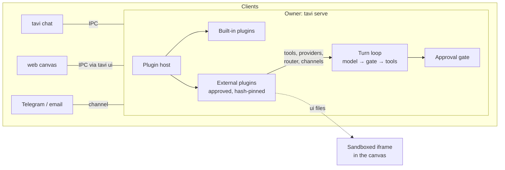
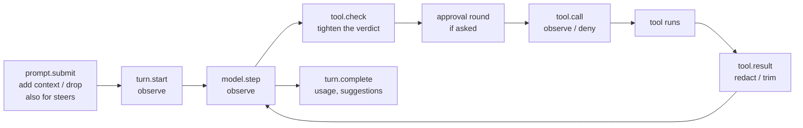

# Plugins and mods — how they work, making one from a chat, installing and removing

Mods are plugins that hook into a turn ([A.4](#a4-how-mods-fit), Examples 3 and 4): every hook event, status lines and notices, suggested next prompts, slash commands and panes, with a developer loop (`tavi plugins validate`, `tavi serve --dev-plugin`).

This guide has five parts:
- [Part A — How plugins work](#part-a--how-plugins-work): where a plugin runs, what it can add, how it is trusted, and how mods fit in a turn.
- [Part B — Making a plugin from a chat](#part-b--making-a-plugin-from-a-chat): asking Tavi to write one, with four worked examples.
- [Part C — Installing, updating and uninstalling](#part-c--installing-updating-and-uninstalling): the terminal and the canvas.
- [Part D — When something goes wrong](#part-d--when-something-goes-wrong).
- [Architecture](#architecture): how mods, turn hooks, and UI plugins are wired in the runtime.

The full manifest and module reference is [PLUGINS.md](PLUGINS.md). Channel plugins have their own walkthrough in [CHANNEL-PLUGINS.md](CHANNEL-PLUGINS.md).

---

## Part A — How plugins work

### A.1 Where a plugin runs

Every turn runs in one process, the **owner** (`tavi serve`). `tavi chat`, the web canvas (`tavi ui`) and channels such as Telegram are clients of it. Built-in plugins run inside the owner; an approved external plugin runs in its own confined Node worker (`@tavi/plugin-worker`) by default, reaching only its own folder and its manifest's network domains through the owner's proxy (only a plugin explicitly approved with `--in-process`, such as a channel plugin, runs in the owner's process; see [PLUGINS.md#trust](PLUGINS.md#trust)).



### A.2 What a plugin can add

| Contribution | Manifest | Module call | Example |
|---|---|---|---|
| Tools the model can call | `tools` | `registerTool` | `acme.units.convert` |
| Search, fetch or model providers | `capabilities` | `registerSearch` / `registerFetch` / `registerModel` | a self-hosted search engine |
| A routing provider | `provides: ["router"]`, `router` | `provideRouter` | a different model router |
| A messaging channel | `provides: ["channel"]`, `channels` | `registerChannel` | WhatsApp ([CHANNEL-PLUGINS.md](CHANNEL-PLUGINS.md)) |
| Canvas UI | `ui` | none (no owner code) | a replacement browser view |
| Turn hooks | `mods` | `hooks.on` | a destructive-command guard |

A plugin also gets settings (`config`, typed), credentials by reference (`secret(key)`), a small durable store (`state`, 16 namespaces, 256 KiB), a log, and a scope whose disposers run when it stops.

### A.3 How a plugin is trusted

1. **Install** copies the directory, hashes every byte and records the version as *proposed*. No code runs.
2. **Approve** is the trust decision, made by the operator after reading the files (`tavi plugins show` lists what the version declares and where its files are).
3. **Enable** takes effect at the next owner start. The owner re-hashes the snapshot and refuses one that changed.
4. Every tool keeps the approval policy of the `effect` its manifest declares: `read-only` runs unasked; `mutating` and `external` ask first.

A chat, a tool or an agent can **never** install, approve or enable a plugin — only the operator can, from the terminal or the canvas. Tavi can *write* a plugin for you (Part B); you decide whether it runs.

### A.4 How mods fit

A mod is an ordinary plugin with a `mods` block: it declares the turn events it hooks, each with a sentence you read at approval. Its module registers each declared hook in `register` with `hooks.on(event, [match,] hook)`; a hook it did not declare, or one wider than declared, fails the plugin's load, and `tavi plugins show` says why. Hooks run at fixed points in the turn:

A **turn** is one message being handled: a new prompt, a reply, or an approval resuming it. Inside a turn the model may take several steps.



What a mod can and cannot do:
- **Can** make a call stricter (allow → ask → deny) and explain why on the approval card; deny a call; mask or trim a tool's output; add context to a prompt; show a status line in the CLI and web.
- **Cannot** approve a call the rules would ask about, change a call's input, touch the system prompt, pop up a dialog mid-turn, or message a channel.
- A mod that fails on a guarding hook fails **closed**: the call is asked about, or its result withheld.
- Secrets in tool results are masked by Tavi itself, before any mod runs (`tools.redactResults`, on by default).
- Masked secrets cannot be written back: a file write or shell command containing `[redacted:…]` is refused, so a secret is never silently erased from a file.
- A mod never sees the input or output of a sensitive call (a sensitive web page, a request carrying a credential).
- At approval you see what each hook does, in the author's words, and what it can read, in Tavi's: "Sees the input of every tool, and can refuse the call. It sees this in every workspace." for a `tool.check` hook, "Sees and can change the output of …" for a `tool.result` one, naming the tools it matches.
- When a mod asks about a call, you can approve it once, not for the session.
- Where nobody can answer (a schedule or a routine), a mod sees `attended: false` and can deny instead of asking.

**Heartbeat events.** Two more events concern the [heartbeat](HEARTBEAT.md), outside any turn:

| Event | Kind | When | It sees | It may answer | If it fails |
|---|---|---|---|---|---|
| `heartbeat.item` | Tightening | For each item the heartbeat would tell you, after it drops repeats and muted items, before anything is sent | The item's key, urgency, title, sources and signal keys, and the check's time and your timezone | `{}` (tell it), `{ drop: "why" }` (hold it back for good: it is not offered again until it changes), or `{ urgency: "later" }` (make it wait for the summary, the way to delay one); never more urgent, never reworded | Skipped: the item is told as the heartbeat decided |
| `heartbeat.tick` | Observer | After each check is recorded | Why it ran, its kind, how it ended, its item counts and cost | Nothing | Skipped |

A held-back item shows in the heartbeat's log as "<mod> held back (<reason>)", the reason masked, and is not listed among what the heartbeat told. `heartbeat.tick` never sees signals, instructions or memory. A heartbeat provider's own hooks never run for its own checks. [HEARTBEAT-PLUGINS.md](HEARTBEAT-PLUGINS.md#lighter-option-a-mod-with-heartbeat-hooks) has a worked example.

---

## Part B — Making a plugin from a chat

Tavi writes the files with its file tools; you approve each file as a diff, then install it yourself (Part C).

### B.1 Set up once

Give the owner a folder it may write in, and restart it:

```bash
mkdir -p ~/tavi-plugins
tavi serve --fs-root ~/tavi-plugins
```

Then open a chat that works in it: `cd ~/tavi-plugins && tavi chat`, or on the canvas pick the folder with the chat's folder chip and "Work in this folder". A chat started elsewhere works in its own folder and can only read `~/tavi-plugins`. Each file Tavi writes is an `fs.write` approval that shows the whole file: read it before you approve, because once approved and enabled its code runs, as a confined worker with what its manifest asks for.

Chats from Telegram, Discord or email cannot write files unless you allowed it: `tavi serve --messaging-allow-tool fs.write` for your own one-to-one chat, or a contact grant (`tavi channels grant <connection> contact <sender> fs.write allow`) for one person's one-to-one chat on a chat channel, still asked each time ([CHANNELS.md](CHANNELS.md#rooms)). Keep it that way: write plugins from the terminal or the canvas.

**Tavi knows the rules.** Its built-in authoring skill is a tool, `plugins.authoring_guide`, that it reads before writing a plugin: the manifest and module format, the hook events and their answers, a `node --test` file against a recording context, and the install commands it hands back. It also checks the plugin's folder in the chat's working folder (or an attached folder) with `plugins.validate`, which needs no `--fs-root`, and fixes what that reports. It never installs, approves or enables anything. The prompts below still spell the rules out, so they work on an older owner too. The rules that matter: a `tavi-plugin.json` with `schemaVersion: 2`, `abi: "tavi.providers/1"` and `provenance`; an `.mjs` entry; no `import` of packages (use the `z` the context passes in); every tool declared in the manifest.

**Check it before you install it.** `tavi plugins validate ~/tavi-plugins/<name>` reports what install would refuse, and on macOS what `register` adds that the manifest does not declare. While you change it, `tavi serve --fs-root ~/tavi-plugins --dev-plugin ~/tavi-plugins/<name>` runs it straight from the folder, unapproved, reloading after each save; install it (Part C) once it works.

### B.2 Example 1 — a read-only tool

The finished plugin is [`examples/plugins/acme-units`](../examples/plugins/acme-units/).

**Ask:**

> Create a Tavi plugin in `~/tavi-plugins/acme-units`, id `acme.units`, version `0.1.0`. It adds one read-only tool, `convert`, that converts between km and miles, kg and pounds, and °C and °F. Write `tavi-plugin.json` with `schemaVersion: 2`, `abi: "tavi.providers/1"`, `provenance: { "format": "bundled-esm", "packages": [] }`, `entry: "index.mjs"`, and the tool with `effect: "read-only"`. Write `index.mjs` exporting a default object with `register({ z, registerTool })`; use that `z` for the input schema, and import nothing.

**What Tavi writes** (two approvals):

```json
{
  "schemaVersion": 2,
  "abi": "tavi.providers/1",
  "provenance": { "format": "bundled-esm", "packages": [] },
  "id": "acme.units",
  "version": "0.1.0",
  "name": "Units",
  "description": "Converts distances, weights and temperatures.",
  "entry": "index.mjs",
  "tools": [
    { "name": "convert", "effect": "read-only", "description": "Convert a value between km/mi, kg/lb or C/F" }
  ]
}
```

```js
// index.mjs
const RATES = { "km>mi": 0.621371, "mi>km": 1.609344, "kg>lb": 2.204623, "lb>kg": 0.453592 };

export default {
  register({ z, registerTool }) {
    registerTool({
      name: "convert",
      inputSchema: z.object({ value: z.number(), from: z.enum(["km", "mi", "kg", "lb", "C", "F"]), to: z.enum(["km", "mi", "kg", "lb", "C", "F"]) }),
      handler: async ({ value, from, to }) => {
        if (from === to) return { value };
        if (from === "C" && to === "F") return { value: value * 9 / 5 + 32 };
        if (from === "F" && to === "C") return { value: (value - 32) * 5 / 9 };
        const rate = RATES[`${from}>${to}`];
        if (rate === undefined) throw new Error(`cannot convert ${from} to ${to}`);
        return { value: value * rate };
      },
    });
  },
};
```

Then install it ([C.1](#c1-install-and-enable)): `tavi plugins install ~/tavi-plugins/acme-units`, `approve acme.units 0.1.0`, `enable acme.units`, and restart the owner. Ask "how many miles is 42 km?" and Tavi calls `acme.units.convert` without asking, because it is read-only.

### B.3 Example 2 — a tool that calls an API with a key

The finished plugin is [`examples/plugins/acme-fx`](../examples/plugins/acme-fx/).

**Ask:**

> Create a Tavi plugin in `~/tavi-plugins/acme-fx`, id `acme.fx`, version `0.1.0`, same format as acme.units. One tool, `rate`, with `effect: "external"` and `untrustedOutput: true`, that fetches the exchange rate between two currency codes from `https://api.example-fx.com/latest?base=…&symbols=…`. The API key is a `credential` setting named `apiKey`; read it with `secret("apiKey")` and send it as the `Authorization: Bearer` header. Pass the handler's `signal` to `fetch`. Never put the key in the result or the log.

The manifest gains a setting, and the tool an outward effect:

```json
  "tools": [
    { "name": "rate", "effect": "external", "untrustedOutput": true, "description": "Exchange rate between two ISO currency codes" }
  ],
  "config": {
    "apiKey": { "type": "credential", "required": true, "description": "API key for example-fx" }
  }
```

```js
export default {
  register({ z, secret, registerTool }) {
    registerTool({
      name: "rate",
      inputSchema: z.object({ base: z.string().regex(/^[A-Z]{3}$/), quote: z.string().regex(/^[A-Z]{3}$/) }),
      handler: async ({ base, quote }, { signal }) => {
        const key = await secret("apiKey");
        if (key === null) throw new Error("set the acme.fx apiKey credential first");
        const url = `https://api.example-fx.com/latest?base=${base}&symbols=${quote}`;
        const response = await fetch(url, { headers: { Authorization: `Bearer ${key}` }, signal });
        if (!response.ok) throw new Error(`example-fx answered ${response.status}`);
        const body = await response.json();
        return { base, quote, rate: body.rates?.[quote] ?? null };
      },
    });
  },
};
```

Store the key and point the setting at it before enabling:

```bash
tavi credentials set plugins.acme.fx.apiKey --file ~/.config/tavi/fx.key
tavi plugins config acme.fx --set apiKey=plugins.acme.fx.apiKey
```

Each call is an approval round (it is `external`), and because its output is untrusted, later calls in that turn are rated higher risk.

### B.4 Example 3 — a guard that asks before destructive shell commands

**Ask:**

> Create a Tavi mod in `~/tavi-plugins/acme-guard`, id `acme.guard`. Add a `mods` block with `abi: "tavi.mods/1"` and one hook: event `tool.check`, matching tool `sandbox.run`, `onFailure: "ask"`, with the disclosure "Asks before shell commands that delete or overwrite files." In `register`, call `hooks.on` for that event: await `next(e)`, join `e.input.command` and `e.input.args` into one line, and if it matches `rm -rf`, `git reset --hard`, `git clean -fdx`, `DROP TABLE` or `mkfs`, return `{ decision: "ask", reason }` naming what it does — or `{ decision: "deny", reason }` when `e.envelope.attended` is false, since nobody can approve it then; otherwise return what `next` gave.

```json
  "mods": {
    "abi": "tavi.mods/1",
    "hooks": [
      { "event": "tool.check", "match": { "tools": ["sandbox.run"] }, "onFailure": "ask",
        "disclosure": "Asks before shell commands that delete or overwrite files." }
    ]
  }
```

```js
const DANGEROUS = [
  [/\brm\s+-[a-z]*r[a-z]*f|\brm\s+-[a-z]*f[a-z]*r/i, "deletes files recursively"],
  [/\bgit\s+reset\s+--hard\b/i, "discards uncommitted work"],
  [/\bgit\s+clean\s+-[a-z]*f/i, "deletes untracked files"],
  [/\bdrop\s+(table|database)\b/i, "drops database objects"],
  [/\bmkfs\b/i, "formats a disk"],
];

export default {
  register({ hooks }) {
    hooks.on("tool.check", { tools: ["sandbox.run"] }, async (e, next) => {
      const verdict = await next(e);
      const command = [e.input?.command, ...(e.input?.args ?? [])].join(" ");
      const hit = DANGEROUS.find(([pattern]) => pattern.test(command));
      if (hit === undefined) return verdict;
      // A schedule approves asks for the tools it allows: where nobody can answer, refuse.
      if (!e.envelope.attended) return { decision: "deny", reason: `This command ${hit[1]}, and nobody can approve it in this run.` };
      return { decision: "ask", reason: `This command ${hit[1]}.` };
    });
  },
};
```

The approval card then reads "acme.guard: This command discards uncommitted work." in the CLI and the canvas, after Tavi's own reasons: a hook's reason is named for its plugin. A chat-started task never gets that far: the messaging profile denies it `sandbox.run` outright, unless you allowed it with `tavi serve --messaging-allow-tool sandbox.run` — then the card shows in Telegram too. The guard can only make a call stricter. If it throws, the call is asked about anyway. This is [`examples/mods/acme-guard`](../examples/mods/acme-guard/), which a test installs and drives.

Tavi also ships a fuller one, **`tavi.guard`**: it says what a command would touch (the paths it names, relative to the chat's working folder, and an absolute one resolved through links), lets echoed or printed text, a heredoc only `cat`-like readers read, and `git clean --dry-run` pass but reads quoted text and substituted commands (`$(…)`) as what they run, also catches `find -delete`, `truncate` and `>` onto a file, and is off until you turn it on with `tavi plugins enable tavi.guard` and restart `tavi serve`.

### B.5 Example 4 — a prompt-cache timer in the status line

**Ask:**

> Create a Tavi mod `acme.cachetimer` with one hook, `turn.complete`, disclosure "Reads token usage to show how long the prompt cache stays warm." When a turn ends with `usage.inputCacheReadTokens` or `usage.inputCacheWriteTokens` above zero, show `ui.status(e.envelope, "cache warm until HH:MM")`, five minutes from now; otherwise clear it with `ui.status(e.envelope)`.

```js
export default {
  register({ hooks, ui }) {
    hooks.on("turn.complete", async (e, next) => {
      const cached = (e.usage?.inputCacheReadTokens ?? 0) + (e.usage?.inputCacheWriteTokens ?? 0);
      // The envelope says which task's status row this is: only one the hook was handed.
      if (cached === 0) ui.status(e.envelope);
      else {
        const until = new Date(Date.now() + 5 * 60_000).toTimeString().slice(0, 5);
        ui.status(e.envelope, `cache warm until ${until}`);
      }
      return next(e);
    });
  },
};
```

The status shows in `tavi chat`'s status row and the canvas header, never on a channel; `ui.notice(e.envelope, text)` adds a one-off line instead. Together they are limited to 4 a second. This is [`examples/mods/cache-meter`](../examples/mods/cache-meter/), which a test installs and drives. A turn waits up to 2 seconds for its `turn.complete` hooks, so their lines arrive with the turn; a chat stops listening once its turn ends, so a line a timer updates later is not seen until the chat's next turn, and not then if the chat was reopened or reconnected meanwhile — show the time it runs out instead. It shows only for a model whose provider reports cache reads or writes (Anthropic's prompt cache, OpenAI's automatic caching); with others it stays blank.

### B.6 Updating a plugin from a chat

An installed version is immutable. Ask Tavi to change the files **and bump `version`** (for example to `0.1.1`), then install and approve the new version and `enable acme.units --version 0.1.1`. The old version stays installed until you remove it.

---

## Part C — Installing, updating and uninstalling

### C.1 Install and enable

```bash
tavi plugins install ~/tavi-plugins/acme-units   # copied, hashed, proposed (runs no code)
tavi plugins show acme.units                     # what it declares and where its files are
tavi plugins approve acme.units 0.1.0            # the trust decision
tavi plugins config acme.units --set key=value   # only if it has settings
tavi plugins enable acme.units                   # runs from the next owner start
```

Restart `tavi serve`. `tavi plugins list` should show the plugin as `ready`. If it shows `failed`, the error says why ([Part D](#part-d--when-something-goes-wrong)).

**In the canvas:** Settings → Plugins → **Install** takes a folder path on the owner's machine. The review shows the same declarations as `show`, then **Approve** and **Enable**. The page says when a restart is needed.

**UI-only plugins** (only a `ui` block) run no owner code, so they enable and disable without a restart.

**Before installing:** `tavi plugins validate <dir>` checks the folder without installing it, and `tavi serve --dev-plugin <dir>` runs it from the folder for one owner run, reloading on save and listed as `dev` — never under `tavi service`.

### C.2 Update

```bash
tavi plugins install ~/tavi-plugins/acme-units   # the folder now says 0.1.1
tavi plugins approve acme.units 0.1.1
tavi plugins enable acme.units --version 0.1.1   # from the next start
```

If the new version has different settings, set them first: `tavi plugins config acme.units --version 0.1.1 --set …`.

### C.3 Turn off and uninstall

```bash
tavi plugins disable acme.units                  # its tools are withdrawn immediately
tavi plugins remove acme.units                   # every version, its settings and its state
tavi plugins remove acme.units --version 0.1.0   # or just one old version
tavi credentials delete plugins.acme.fx.apiKey   # credentials are yours; remove them yourself
```

- `remove` refuses an enabled plugin: disable it first.
- Removing every version deletes its files from the data directory, its settings and its `state` store. Your source folder (`~/tavi-plugins/…`) is untouched.
- `reject acme.units 0.1.0` revokes trust in a version without removing it; a rejected version can never be approved again.
- Built-in plugins cannot be removed, only disabled (`tavi plugins disable tavi.<id>`), and *core* built-ins not even that.

In the canvas: Settings → Plugins → the plugin → **Disable**, then **Remove**.

---

## Part D — When something goes wrong

| You see | What it means | What to do |
|---|---|---|
| `install` refuses the folder | A symlink, a special file, or over 500 files / 20 MB | Remove the extra files; bundle dependencies into `.mjs` files |
| `failed` with "bare import" or "CommonJS" | The entry imports a package | Inline or bundle it; use the `z` the context gives |
| `failed` with a tool-name clash | Another tool already has that id or model-facing name | Rename the tool |
| `failed` after a timeout | `register` or `start` took over 10 s | Do slow work lazily in the handler |
| The owner will not start | A plugin blocks it (a synchronous loop, `process.exit`) | Stop the service, run `tavi plugins disable <id>` (works offline), start again |
| "snapshot changed" | Files under the data directory were edited after approval | Install a new version instead |
| The model never calls the tool | The plugin is not `ready`, or the description is vague | Check `tavi plugins list`; write a description that says when to use it |
| A mod shows `degraded` | Its hooks failed 5 times in 10 minutes and are suspended until the owner restarts; its guards still ask or withhold | Read its failures under *hook activity* in `tavi plugins show` and the owner's log (`plugin <id>: its <event> hook failed`), install a fixed version, restart `tavi serve` |

`tavi doctor` checks each enabled plugin's approval, hash and settings without importing it, and warns when a canvas role fell back to the built-in.

## Architecture

Mods (`tavi.mods/1`) hook into turn and heartbeat events through a bounded, fail-safe pipeline across `@tavi/contracts`, `@tavi/runtime`, `@tavi/agent-host`, and `@tavi/cli`:

| Layer | Module / Path | Responsibility |
| :--- | :--- | :--- |
| **Contracts** | `packages/contracts/src/mods.ts` | Schemas, bounds (`MAX_HOOK_CONTEXT_BLOCKS`, `MAX_HOOK_CONTEXT_CHARS`), and event payloads for `prompt.submit`, `tool.check`, `tool.after`, `turn.complete`, `heartbeat.item`, and `heartbeat.tick`. |
| **Turn Hook Registry** | `packages/runtime/src/plugin-host/turn-hooks.ts` (`TurnHookRegistry`) | Orders registered hooks, enforces per-hook timeouts and circuit-breaker suspension (5 failures in 10 minutes → `degraded`), and guarantees monotonic tightening on `tool.check` (`allow` → `ask` → `deny`). |
| **Workflow & Scope Execution** | `packages/agent-host/src/workflow/tool-hooks.ts`, `packages/agent-host/src/workflow/scope/hooks.ts` | Invokes `prompt.submit`, `tool.check`, `tool.after`, and `turn.complete` hooks inside the turn loop, fences added context as quoted untrusted data, and enforces secret masking on `redact` rules. |
| **Built-in Guard & Authoring Tools** | `packages/builtin/guard` (`@tavi/plugin-guard`, `tavi.guard`), `apps/cli/src/features/plugins/authoring-guide.ts`, `authoring-tools.ts`, `validate.ts`, `dev.ts` | Built-in `tavi.guard` destructive-shell guard mod, `plugins.authoring_guide` / `plugins.validate` agent tools, and `--dev-plugin` hot reload. |

See [PLUGINS.md#architecture](PLUGINS.md#architecture) and [ARCHITECTURE.md](ARCHITECTURE.md) for how mods integrate with the plugin host.
