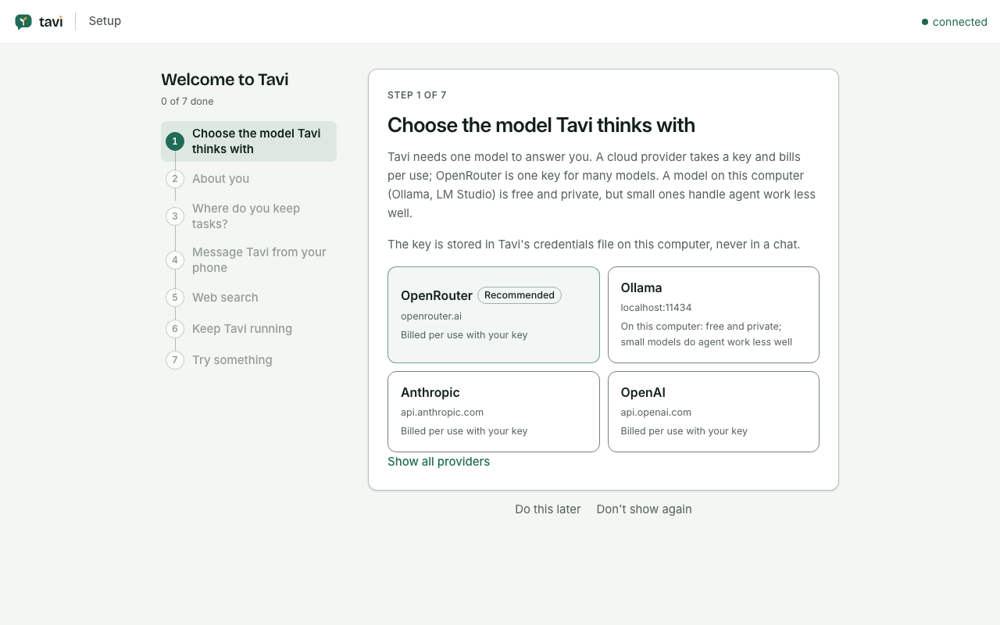
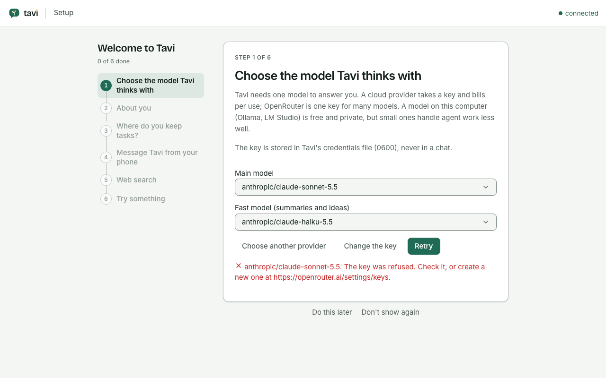

# Setting up Tavi

Tavi needs one thing to answer: a model. Everything else is offered once, can be skipped, and is asked for again only when you need it. This guide is for anyone installing Tavi for the first time, or returning to a step they skipped. It covers setup in [the terminal](#in-the-terminal) and in [the browser](#in-the-browser), [the checklist](#the-checklist), [what setup writes](#what-setup-writes), [replacing the flow](#replacing-the-flow), and the [architecture](#architecture) behind it.

## In the terminal

```bash
tavi onboard
```

`tavi onboard` walks only what is still open, the model first. A first run asks one thing before it: the language Tavi speaks to you in, English on Enter ([LANGUAGES.md](LANGUAGES.md)). It offers a key it finds in your environment or an Ollama already running; for OpenRouter, **Sign in with OpenRouter** opens your browser and OpenRouter makes a key for Tavi (`--paste` over SSH). With a ChatGPT plan and `TAVI_PREVIEW_CHATGPT=1` set (the sign-in is a preview), **ChatGPT (preview)** signs you in with it instead, and answers use the plan's allowance; the sign-in is kept only in an encrypted credential store (`tavi credentials encrypt`). Otherwise it asks for a key, hidden. With a key it lists the provider's models. It proposes a main and a fast model and checks each with one short request that must call a tool; when a lifecycle sync has already stored what Rhumb says of the connection's models (a connection set up again), it leaves out those retired, deprecated, closed to new users, or retiring or redirected within 30 days, unless that would leave a role with nothing. Each one becomes a role only once it passes. With a provider Rhumb lists (OpenRouter, OpenAI, Anthropic, Gemini) it then offers a free Rhumb key (https://rhumbdata.com/sign-up; Enter skips it), stored as the credential `rhumb`, so Tavi can say before a model you use retires (`tavi models sync`); it is not asked with `RHUMB_KEY` set or a key already stored. Then come the optional steps: your name and time zone, where you keep tasks, a channel (Telegram by default, or the one a plugin offers in its place; paired to you with a one-time code), voice messages (the owner installs whisper.cpp and FFmpeg with Homebrew and downloads a speech model, on your yes; it needs `tavi serve` running), starting Tavi with your computer (a user-scope service, never `sudo`), and three first prompts.

Coming from OpenClaw or Hermes, `tavi onboard import` brings over their model connections and Telegram bot. `--dry-run` shows what it would copy, naming where each key is but never the key itself, and it asks before copying any key.

Ctrl-C keeps what was set up. `tavi onboard status` prints the checklist and exits `0` when the model is set up, `3` when not. An install that had a model before setup existed is checked once from the answers it already gave, so it reads as set up straight away, whether or not `tavi serve` has run since. `tavi setup` goes through every step again, keeping each on Enter.

### Where do you keep tasks?

One question, skippable like the rest: **Tavi's own list** (the default: nothing is saved, the step is just marked done, and a task app saved before is cleared), a task app already connected here (saved as `tasks.home: mcp:<server>`, so to-dos go there and Tavi's own list keeps only its follow-ups), or **Todoist**. Todoist signs in through your browser, which the terminal step cannot open, so it prints the commands that connect it and leaves the step open:

```bash
tavi mcp add todoist --preset todoist
tavi mcp probe mcp.todoist          # signs in through the browser
tavi mcp approve mcp.todoist <version>
tavi plugins enable mcp.todoist
tavi config set tasks.home mcp:todoist
```

Nothing is copied between the two lists ([AUTOMATION.md](AUTOMATION.md#to-dos)). `tavi setup tasks` asks again; **Settings → General → Your to-do list** and `tavi config set tasks.home` change it any time.

### Headless setup

`tavi setup --non-interactive` asks nothing: each flag sets its step, and a step without its flags is left as it is. The key comes only from a file (`--key-file`) or standard input (`--key-stdin`), never from an argument.

```bash
tavi setup --non-interactive --preset openrouter --key-file ~/.config/tavi/openrouter.key
tavi setup --non-interactive --preset custom --base-url http://10.0.0.5:8000/v1 --key-file ./server.key --model qwen3-32b
tavi setup --non-interactive --preset ollama --model qwen2.5-coder:32b
```

- `--preset ollama` needs no key, and its connection is marked local-only.
- `--preset custom --base-url <url>` takes any OpenAI-compatible endpoint. A local one (a loopback address, or `--local-only`) needs no key.
- `--preset anthropic` speaks Anthropic's own Messages API, with prompt caching ([CONFIGURATION.md](CONFIGURATION.md)).

A required step left open exits `3` and names the flag it needs; `--json` answers with the exit, the missing flag, what comes next and the checklist. `--channel-secret <channel>:<field>=<path>` (repeatable: `--channel-secret telegram:token=bot.token`) adds that channel on a running owner, with each field read from its file, and leaves pairing to `tavi channels link <channel>` (or `tavi channels pair <channel>`). With no owner running, a channel step exits `4`: a channel lives in the owner.

### Skipping and coming back

Every step but the model can be skipped. A skipped step stays on the checklist and in `tavi onboard`, which asks about it next time; `tavi setup <step>` goes to it straight away. Offline, the steps the browser does (apps, web search) print the command that does each, and the first idea says personal ideas start once `tavi serve` runs. When the fast model failed its check, the end of `tavi onboard` and the checklist both say **Fix the fast model**, with the advice: the main model works, but ideas and summaries run on the fast one. With no setup flow installed, `tavi onboard` prints what is open with the command for each, and asks nothing.

## In the browser

<picture>
  <source media="(prefers-color-scheme: dark)" srcset="assets/screens/welcome-dark.png">
  
</picture>

`tavi ui` opens **Welcome** (`/welcome`) on a first run, once a browser session, and only from the empty chat. An install that already had a model is never redirected. Welcome is a page of its own: no chat list, page tabs or model strip around it, just the steps in a rail (a row on a phone) beside a card for the one shown, with **Back**, **Skip** and **Continue** at its foot. The rail keeps a finished step, checked, and counts the whole flow ("2 of 6 done", "Step 3 of 6"); you can go back to one, but Welcome opens on the first step still to do and moves on to the next one. An optional step offers **Skip** until its own action is done, and **Continue** only once it is. Welcome's steps:

- **The model**, as in the terminal. A key is sent once and never shown again.
- **About you**: your name and time zone, saved in this workspace's settings and, while memory is on, as two preferences you can see and forget. You can untick that.
- **Apps**: Gmail or Google Calendar, each card saying what it may read and that anything that changes or sends something asks first.
- **Where do you keep tasks?**: **Use Tavi's list** (nothing to set up), **Use** a task app already connected, or **Connect** Todoist, which adds its preset when it is not added yet and opens the same connect sheet the Apps page does; once you have signed in, Todoist becomes `tasks.home` (review its tools when the sheet asks). As in the terminal, choosing Tavi's own list clears a task app saved before.
- **Channels**: Telegram, tested with your bot token, then paired to you with a one-time code (`ABCD-2345`): scan the QR code with your phone's camera, tap **Open in Telegram** (`https://t.me/<bot>?start=ABCD-2345`), or send `/link ABCD-2345` to the bot. Once your message arrives, Tavi links your Telegram account to `operator`. Until you link, nobody's messages are answered.
- **Voice messages**: which of FFmpeg, whisper.cpp and Whisper's base speech model are here, each ticked, and **Set up voice messages**, which has the owner install the tools with Homebrew as your user (never `sudo`), download the model (about 148 MB, MIT, from Hugging Face, kept only when its checksum matches) and name it in `analyzers.json`, with its progress shown until it is done. Without Homebrew, the commands to run instead and **Check again**. Voice messages are then transcribed on this computer ([Video](VIDEO.md#voice-messages-and-other-audio)). The step is done only once a voice message can be transcribed, and unavailable with the video plugin turned off.
- **Web search**: a provider and its key (optional for Tavily, which also runs keyless; SearXNG takes its instance's address instead), tested with one search. Once it is added, `tavi onboard` says that searches go to it without asking (the seeded `seeded-web-search` rule), that a query that looks like a key or token still asks, and so does a chat that read a page or an email before a search that could carry private data out, and how to be asked every time (`tavi permissions rm seeded-web-search`) or stop searching (`tavi search disable <kind>`).
- **First ideas**: three things Tavi can do now, drawn from [Ideas](IDEAS.md), marked "New with Gmail" when an app connected in this workspace makes them possible. Better ones replace them in place when Tavi's background look finds some. *Try it* opens a new chat with the prompt in the box. Nothing is sent until you send it.

**Do this later** goes to Home; **Don't show again** stops the redirect and dismisses the Home checklist too. `/welcome/<step>` opens one step. A key the provider refuses offers **Change the key**:



If the chosen flow plugin's steps can't be used, Welcome says why and shows Tavi's own.

## The checklist

Every surface reads the same checklist: Welcome, the card on Home and `tavi onboard status` name the same steps in the same order and count "N of M done" over the same steps. A step one surface cannot do is still listed there, with where it is done: the canvas lists **Keep Tavi running** with `tavi setup service`, and the terminal lists **Connect an app** and **Web search** with `tavi ui` or the command that does each now, on an indented line under the step so the row fits a narrow terminal. A model you connected with `tavi models add` and `set-default` counts as set up, with **Verify** offered for the one check not made yet.

After Welcome, a **Setup checklist** card on Home lists what is still open, one link each, with **Continue setup** and **Dismiss**. It goes when nothing is open. Dismissed, it stays gone. A later release that adds a step brings it back once, showing only the new step (the built-in flow's version 2 added **Where do you keep tasks?**, version 3 **Voice messages**). It shares its place with the heartbeat's offer: the checklist comes first while the model is not set up, and the offer comes first once only optional steps remain. While Tavi runs in a terminal rather than as a service, the card's **Keep Tavi running** row says that channels and schedules stop with `tavi serve`, and that `tavi setup service` in a terminal does it.

Once you finish setup (its last screen's **Go to Home**), Home says when your first ideas will be ready, usually "Tomorrow morning I'll have ideas for you", until Tavi's next look has run. That look always asks for new ideas, even if nothing else changed. Nothing is pushed to you.

An app connected anywhere counts: a chat's *Connect* card says when connecting also finishes a setup step, with a link to it, and the checklist updates once the sheet closes.

**Settings → General → Run setup again** goes through every step, done ones included (`/welcome?all=1`).

## What setup writes

Every change goes through the same commands the Settings pages use (`models`, `credentials`, `channels`, `search`, `workspace-settings`, `memory`), so nothing setup does is hidden. Keys go to Tavi's credentials file (`0600`), never into a command line, a log or an answer. Setup rebinds or overwrites only what it created itself, and a channel whose token fails its test is removed again. `tavi onboard reset` forgets skips and the dismissal; it keeps what is set up.

## Replacing the flow

A plugin can replace which steps setup walks and their words, for example a company putting its own Slack first (`tavi onboard provider <id>` selects it). Readiness and every change stay Tavi's own. See [ONBOARDING-PLUGINS.md](ONBOARDING-PLUGINS.md).

## Architecture

Onboarding and setup share a single readiness and checklist model across `@tavi/contracts`, `@tavi/plugin-kit/onboarding`, `@tavi/agent-host`, `@tavi/runtime`, `@tavi/cli`, and `@tavi/ui`:

| Layer | Module / Path | Responsibility |
| :--- | :--- | :--- |
| **Contracts & SDK** | `packages/contracts/src/onboarding.ts`, `onboarding-ipc.ts`, `onboarding-plugin.ts`, `packages/plugin-kit/src/onboarding/*` (`@tavi/plugin-kit/onboarding`) | Schemas for readiness steps, checklist state, custom flow descriptors, and the onboarding provider conformance suite. See [ONBOARDING-PLUGINS.md](ONBOARDING-PLUGINS.md). |
| **Host & Default Flow** | `packages/agent-host/src/hosts/onboarding-host.ts`, `packages/builtin/defaults/src/onboarding.ts` (`@tavi/plugin-defaults`) | Computes workspace readiness from live model/channel/search/app state, validates custom onboarding flow plugins, and provides the default step order (`tavi.onboarding`). |
| **Persistence** | `packages/runtime/src/persistence/onboarding-repository.ts` | Worker-backed SQLite persistence for step marks (`skipped`, `seen`, `created_ref`), checklist dismissal, selected onboarding provider, step verifications, and funnel events. |
| **CLI Setup (`tavi onboard` / `tavi setup`)** | `apps/cli/src/features/onboard/*` | Interactive terminal wizard (`tavi onboard`), OpenClaw/Hermes importer (`tavi onboard import`), and repeatable/headless step runner (`tavi setup --non-interactive`). |
| **Web Canvas (`Welcome`)** | `apps/ui/src/features/welcome/*` (`ConnectSteps.tsx`, `WelcomeTasksStep.tsx`), `apps/ui/src/ui/QrCode.tsx` | First-run `/welcome` wizard, Telegram QR-code and `https://t.me/<bot>?start=XXXX-XXXX` deep-link pairing (`ConnectSteps.tsx`, `QrCode.tsx`), starter Ideas chips, and the Home **Setup checklist** card. |

See [ARCHITECTURE.md](ARCHITECTURE.md) for how `OnboardingProviderRegistry`, `deriveStatus`, `validateFlow`, and `hostFallbackFlow` are wired into the owner.
