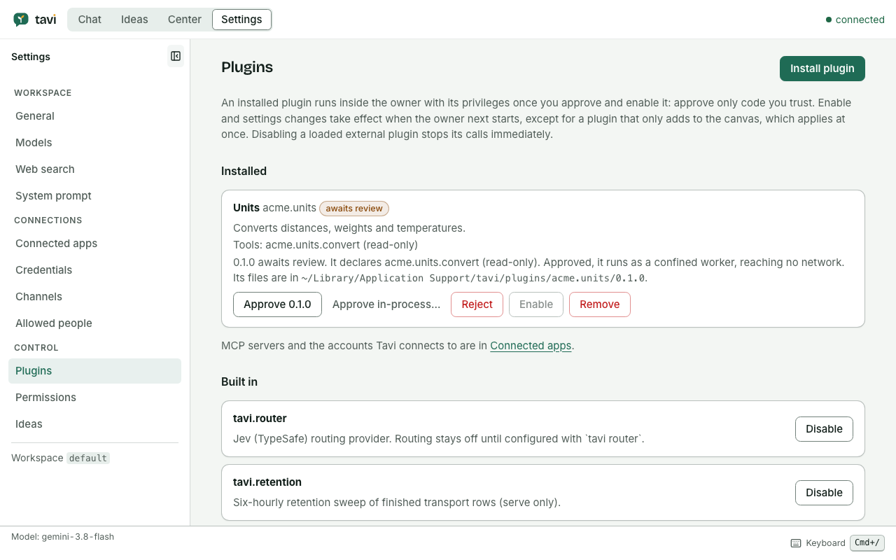
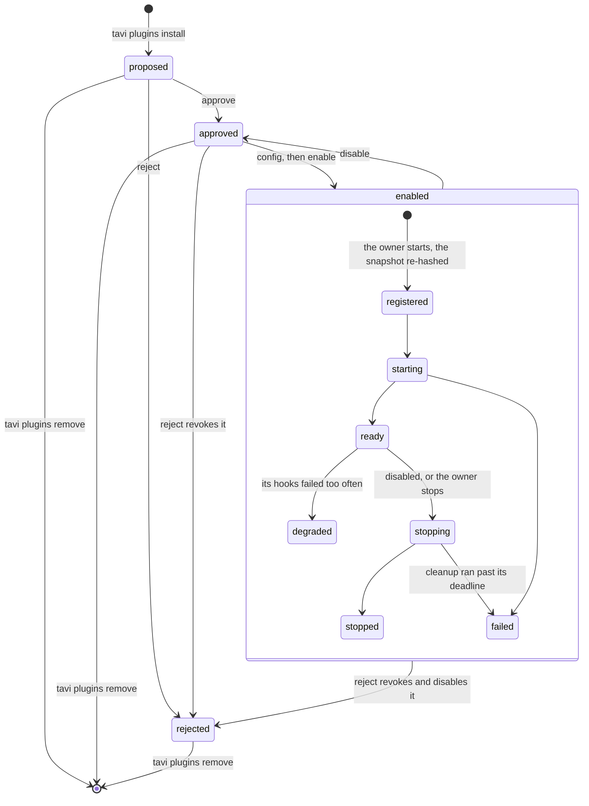

# Plugins

A plugin adds something to Tavi: tools, a messaging channel, a routing, model,
search or fetch provider, hooks into the turn, or additions to the web canvas.
Built-in plugins ship with Tavi. An external plugin is a directory with a
manifest and a module, which the operator installs, reviews and enables.

This page is for operators who manage plugins and for authors who write them.
It covers managing plugins, the built-in ones, the external plugin format, each
kind of thing a plugin can supply, and what running one means. The command
reference is in [CLI.md](CLI.md#tavi-plugins).

## Managing plugins



Tavi's plugin registry lets the operator list, install, review, enable
and configure plugins from `tavi plugins` or the **Plugins** view of `tavi ui`.
[Built-in plugins](#built-in-plugins) lists what ships with Tavi and which of
those can be disabled; [External plugins](#external-plugins) describes the
format of one you install. [MODS.md](MODS.md) is the guide: how plugins
work, asking Tavi to write one in a chat (with worked examples), installing,
updating and uninstalling.

```bash
tavi plugins list                                  # built-in and installed, with state
tavi plugins validate ./weather-plugin            # what install would refuse; register run in the sandbox (macOS, Linux)
tavi serve --dev-plugin ./weather-plugin          # while writing one: runs unapproved, reloads on save (read-only to Tavi's file tools)
tavi plugins install ./weather-plugin             # copied and hash-pinned, proposed
tavi plugins approve acme.weather 1.0.0           # the trust decision: it runs as a confined worker
tavi plugins approve acme.chat 1.0.0 --in-process # a channel plugin: in the owner's process, UNSANDBOXED
tavi plugins audit                                # what in-process plugins would lose as workers
tavi plugins config acme.weather --set city=Sofia --set days=3
tavi plugins config acme.providers --instances '[...]'  # provider accounts (JSON)
tavi plugins enable acme.weather                  # runs from the next owner start
tavi plugins show acme.weather | disable <id> | remove <id>
tavi plugins ui list                              # canvas roles and where contributions show
tavi plugins ui set-role browser-view acme.view --yes   # another live browser view (after its disclosure)
tavi plugins ui place acme.view/live chat.panel.tab     # or hidden, or default
```

`tavi plugins show` lists, for each version, its tools and settings, what
each hook can read and what it has decided, where each tool's input goes (its
sink), whether a person decides every call of it, and which of its input
values its approval card shows. A plugin's settings show in Connected apps
under the labels its manifest gives them, its optional ones folded under *More
settings*.

## Built-in plugins

Built-in plugins are composed from this build's own packages each time the
owner starts. `tavi plugins list` shows them with their phase in the running
owner:

| Plugin | Core | What it does |
| :--- | :--- | :--- |
| `tavi.providerreadiness`, `tavi.providers` | yes | Provider activation before admissions open, account-scoped search/fetch/model provider factories |
| `tavi.logger`, `tavi.persistence`, `tavi.tools`, `tavi.access`, `tavi.clock` | yes | Logging, the store, the tool registry, access policy, the clock |
| `tavi.models`, `tavi.workflow` | yes | Model connections and the task workflow (when a model is configured) |
| `tavi.router` | no | The Jev (TypeSafe) routing provider; see [ROUTER.md](ROUTER.md) |
| `tavi.retention` | no | The six-hourly retention sweep (`serve` only) |
| `tavi.agentwaitscheduler` | no | Wakes tasks waiting on agent replies |
| `tavi.schedules` | no | Fires recurring schedules |
| `tavi.heartbeatagent` | no | The built-in heartbeat provider: one short, metered, read-only model turn on the fast model each check, telling you only what it reports (`serve` only). Disabling it pauses heartbeats that use it |
| `tavi.heartbeatsignals` | no | The heartbeat's built-in signal sources: what waits on you, what is coming up, failed schedules and routine runs, channels needing attention, held messages, messages left unanswered, sends that failed, watched pages, and chat folders or the disk filling up (`serve` only) |
| `tavi.heartbeat` | no | The heartbeat host: wakes each heartbeat inside its active hours, runs its cheap checks before any model call, and keeps its log (`serve` only; see [HEARTBEAT.md](HEARTBEAT.md)). Disabling it stops every heartbeat |
| `tavi.ideas` | no | The ideas host: looks for new ideas once a day inside each workspace's active hours and answers `/ideas` (`serve` only; see [IDEAS.md](IDEAS.md)). Disabling it stops the daily run; a refresh still works |
| `tavi.ideasagent` | no | The built-in ideas provider (`@tavi/plugin-defaults/ideas`): ranks the use-case catalogue by what Tavi can do here and what you mentioned. Any approved plugin with `provides: ["ideas"]` can replace it per workspace (`tavi ideas provider <id>`); see [IDEAS-PLUGINS.md](IDEAS-PLUGINS.md) |
| `tavi.onboarding` | no | The built-in onboarding flow (`@tavi/plugin-defaults/onboarding`): the steps `tavi onboard`, `tavi setup` and the canvas's Welcome walk. The onboarding host checks every flow and keeps the model step first while it is open. An approved plugin with `provides: ["onboarding"]` can replace it per install (`tavi onboard provider <id>`). Disabling it leaves the setup checklist, with the command for each open step |
| `tavi.memoryprovider` | no | The built-in memory provider (`@tavi/plugin-defaults/memory`): ranks what memory recalls for a turn, the `memory.search` tool and a heartbeat check with Tavi's own index, drafts the idle review's and the epoch flush's proposals, and drafts weekly tidy-up suggestions when a workspace turns consolidation on, through the host's provider registry (so disabling `tavi.memory` never stops recall). It is what any other memory provider falls back to; disabled, with no plugin provider chosen, recall is the host's own search and no proposal is drafted; see [MEMORY-PLUGINS.md](MEMORY-PLUGINS.md) |
| `tavi.memory` | no | The memory host: the chat commands `/remember`, `/forget`, `/memory` and `/why` in the canvas, the terminal and direct chats, and, on its one 60 s tick (skipped while nothing was written, for up to five minutes), the review digest, the idle review, consolidation and hybrid recall's vector backfill (the tick is `serve` only; see [MEMORY.md B.1](MEMORY.md#b1-reviewing-proposals)). Its jobs also run on demand, offline or through a running owner: `tavi memory reindex`, `review-now` and `consolidate-now` ([CLI.md](CLI.md)). Disabling it withdraws the commands and stops those jobs; recall, proposals and provider removals keep working |
| `tavi.collectors` | no | The daily brief's tools (`@tavi/plugin-collectors`): the collectors `projects.get`, `ga4.report`, `gsc.query`, `gcp.billing`, `stripe.subscriptions`, `news.search` and `collect.daily`, and `reports.generate` / `reports.history` ([REPORTS.md](REPORTS.md)); disabled, none is composed |
| `tavi.siteskills` | no | Site skills (`@tavi/plugin-site-skills`): what is known of Google Flights, Kayak, Skyscanner, Booking.com and Google Maps, which the browser tools carry on a session's first observation of each; disabled, none is shown |
| `tavi.browser`, `tavi.pdf`, `tavi.video` | no | The browser, PDF and video engines: disabled, their `browser.*`, `pdf.*` and `video.*` tools are not offered from the next start. Disable-only: a replacement engine is an embedder's composition option (`browserOverride`, `pdfOverride`, `videoDecoderOverride`), never a plugin |
| `tavi.sandbox`, `tavi.limits`, `tavi.worker` | yes | The confinement every plugin worker, `sandbox.run`, the PDF parser and video reads run under, with its limits: listed so it is seen, and never disabled or replaced by a plugin, since it confines every plugin |
| `tavi.flights` | no | `travel.flights_search` (`@tavi/plugin-flights`): flight search over Kiwi.com's public MCP server, through the owner's own MCP client, and Google Flights beside it (SerpApi with a stored key, else Google's own page), before browsing; disabled, the tool is not composed |
| `tavi.desktop` | no | Experimental, macOS only, off until `tavi plugins enable tavi.desktop`: the `desktop.*` tools that see and act in the apps a workspace grants, each action asked about in an attended run; its helper is built once on the Mac it runs on (see [DESKTOP.md](DESKTOP.md)) |
| `tavi.guard` | no | A first-party mod, off until `tavi plugins enable tavi.guard`: asks before a shell command that deletes or overwrites files, says what it would touch, and refuses it in a run nobody can approve (see [Mods](#mods-hooks-into-the-turn)) |
| `tavi.reminders` | no | Fires reminders when they are due, with their buttons; a text-only reminder needs no model connection |
| `tavi.tasksummaries` | no | Writes each task's title and summary in its own loop, never on the path that finishes a task |
| `tavi.reminderrule` | no | Seeds each workspace once with the `seeded-reminders`, `seeded-todos`, `seeded-web-search`, `seeded-memory-propose` and `seeded-skills-propose` allow rules |
| `tavi.localmessaging` | yes | The local connection each workspace's terminal and canvas chats go through: without it no message typed there reaches a task |
| `tavi.channelhost` | yes | Opens the saved connections of every installed channel, built-in or a plugin's, saved in Settings → Channels, and applies Settings changes live |
| `tavi.telegram`, `tavi.mailgun`, `tavi.gmail` | no | One built-in channel each (Telegram, email through Mailgun, Gmail): disabled, its channel is not installed from the next start, and a channel plugin may take its provider id, with the saved connections under it (disable warns) |
| `tavi.browserview` | no | The live view of the agent's browser in the web canvas (UI only; see below) |

A **core** plugin provides a service other plugins need and cannot be disabled.
A disabled non-core plugin is left out when the owner next starts; its own
settings stay with its command (`tavi schedules`, `tavi channels`).
Disabling `tavi.router` in a running owner also stops its routing at once, so
no further task data is sent; the restart only unloads its code.

### Reference replacements

A replacement reaches parity with a built-in once it is granted the same reviewed permissions, with one exception: a plugin's tool never adds a line to the system prompt (`promptGuidance` is a built-in tool's alone), so a replacement for a built-in tool says how it should be used in its `description`.

Each of these examples stands in for a built-in once that built-in is
disabled, through the same path it used. Install, approve with
`--in-process`, enable, then select it as the last column says.
`apps/cli/test/plugins/replacements.test.ts` runs each one through the host (the memory example's capture is asked of the provider the host resolves, not through a timed idle review). Tools take no selecting: once the built-in is disabled, the example's tool is the one registered. The browser view's stand-in is a UI plugin, [`minimal-browser-view`](../examples/ui-plugins/minimal-browser-view/) (below).

| Example | Replaces | Select it with |
| :--- | :--- | :--- |
| [`acme-telegram-webhook`](../examples/plugins/acme-telegram-webhook/) | `tavi.telegram`: takes the `telegram` provider id, with Bot API webhooks in place of polling | `tavi channels add telegram --botUsername <bot> --secret-file token=<file> --secret-file webhookSecret=<file>`, then point the bot's `setWebhook` at the connection's webhook address with that secret |
| [`acme-memory-keywords`](../examples/plugins/acme-memory-keywords/) | `tavi.memoryprovider`: keyword recall and "remember that" capture, with no model | `tavi memory set-provider acme.memorykeywords`, then `tavi memory egress records on` and `tavi memory egress conversation on` (without them the built-in's recall serves) |
| [`acme-ideas`](../examples/plugins/acme-ideas/) | `tavi.ideasagent`: a fixed catalogue, checked against the census | `tavi ideas provider acme.ideas` |
| [`acme-onboarding`](../examples/plugins/acme-onboarding/) | `tavi.onboarding`: ACME's flow, Slack first and no Telegram | `tavi onboard provider acme.onboarding` |
| [`acme-heartbeat-rules`](../examples/plugins/acme-heartbeat-rules/) | `tavi.heartbeatagent`: tells a new signal matching an instruction line, with no model | `tavi heartbeat set-provider acme.heartbeatrules`, then `tavi heartbeat egress instructions on` and `tavi heartbeat egress signals on` |
| [`acme-router`](../examples/plugins/acme-router/) | `tavi.router`: keyword routing with no model or network | `tavi router set-provider acme.router --revision N` |
| [`acme-mailgun-lite`](../examples/plugins/acme-mailgun-lite/) | `tavi.mailgun`: takes the `mailgun` provider id; a signed inbound route in (HMAC checked in constant time, its token the replay key), the Messages API out, text only | `tavi channels add mailgun --domain <domain> --secret-file apiKey=<file> --secret-file webhookSigningKey=<file>`, then point a Mailgun inbound route at the connection's `inbound` webhook address |
| [`acme-gmail-lite`](../examples/plugins/acme-gmail-lite/) | `tavi.gmail`: takes the `gmail` provider id; polls unread mail with one label and replies in its thread, signing in at Google's own OAuth addresses | `tavi channels share-client google acme.gmaillite` (or its own OAuth app), then `tavi channels add gmail` and `tavi channels connect <connection>` |
| [`acme-flights`](../examples/plugins/acme-flights/) | `tavi.flights`: `acme.flights.search` over a fixed fare sheet, no network, declaring `proves: ["travel"]` for Ideas | nothing: `travel.flights_search` is gone and `acme.flights.search` is registered |
| [`acme-daily-brief`](../examples/plugins/acme-daily-brief/) | `tavi.collectors`: `acme.dailybrief.brief` writes the day's brief, text and HTML, from the figures it is given | nothing: the built-in's `collect.daily`, `reports.*` and `projects.get` are gone |
| [`acme-flight-sites`](../examples/plugins/acme-flight-sites/) | `tavi.siteskills`: a reviewed site profile (manifest `sites`) for one fare site, which the browser tools enforce once on | `tavi apps sites acme-fare-sites acme-fares on` |
| [`acme-guard`](../examples/mods/acme-guard/) | `tavi.guard`: a `tool.check` hook on `sandbox.run` that asks before a destructive command and refuses it unattended | nothing: its hook decides the check the built-in decided |

`tavi.browserview` composes nothing: it is a UI-only plugin, the
default for the `browser-view` role, shipped in the canvas build under
`plugins/tavi.browserview/` and served like any UI plugin, under the hash the
owner reads from those files as it starts. It shows the chat's browser
sessions live — each frame, the address and title, a status chip, the box of
the element an action is on, a switcher between sessions — in the chat panel's
top strip while the chat is active, and as a **Browser** tab. Disabling it
(`tavi plugins disable tavi.browserview`, or Settings → Plugins) removes the
view at once, with no restart, and nothing streams.

## External plugins

An external plugin is a directory:

```text
weather-plugin/
  tavi-plugin.json
  index.mjs
  lib/…            (any other files the entry imports)
```

### Manifest: `tavi-plugin.json`

```json
{
  "schemaVersion": 2,
  "abi": "tavi.providers/1",
  "provenance": { "format": "bundled-esm", "packages": [] },
  "id": "acme.weather",
  "version": "1.0.0",
  "name": "Weather",
  "description": "Daily forecasts for a configured city.",
  "entry": "index.mjs",
  "tools": [
    { "name": "forecast", "effect": "external", "description": "Get the forecast for a day", "untrustedOutput": true }
  ],
  "config": {
    "city": { "type": "string", "required": true, "description": "City to forecast" },
    "days": { "type": "number", "description": "How many days ahead" },
    "metric": { "type": "boolean" }
  }
}
```

Every field, at a glance; the larger blocks are described after the table.

| Field | Type | Required | Meaning |
| --- | --- | --- | --- |
| `schemaVersion` | number, `2` or `3` | yes | The manifest format: `3` for a manifest with `locales`, `2` otherwise. |
| `abi` | string, `"tavi.providers/1"` | yes | The plugin contract it is built for. |
| `provenance` | object: `format`, `packages` | yes | How its files are packaged: `bundled-esm`, or an MCP server's `mcp-*` format ([MCP servers](#mcp-servers)). |
| `id` | string | yes | Dotted lower-case segments, such as `acme.weather`. The `tavi.` namespace is reserved. |
| `version` | string | yes | Semantic versioning, at most 32 characters, with a lower-case prerelease (`1.2.0-rc.1`). An installed version is immutable, so changed files need a new version. |
| `name` | string, at most 80 characters | yes | The plugin's name. |
| `description` | string, at most 500 characters | no | What it does; empty when left out. |
| `entry` | string | with code | A relative `.mjs` path inside the directory. Optional for a plugin that only adds to the web canvas (`ui`); one with `tools`, provider factories or a service needs it. |
| `ui` | object | no | What it adds to the web canvas (below, and [UI plugins](#ui-plugins)). |
| `mods` | object | no | Its hooks into the turn and its slash commands (below). |
| `apps` | object | no | How its apps present in Connected apps ([Apps](#apps)). |
| `capabilities` | array, at most 32 | no | The `search`, `fetch` or `model` providers it declares ([Provider descriptor v2 and local data](#provider-descriptor-v2-and-local-data)). |
| `tools` | array, at most 32 | no | The tools it registers (below). |
| `sites` | array of `.json` paths, at most 32 | no | Its site profiles (below). |
| `siteNotes` | array of `.json` paths, at most 32 | no | Its site notes (below). |
| `routineTemplates` | array, at most 4 | no | Its routine report templates (below). |
| `provides` | array | no | The services it provides the host: `router`, `channel`, `heartbeat`, `heartbeat-signals`, `memory`, `ideas`, `onboarding`. |
| `channels`, `channelAbi` | array (at most 4), number | no | A messaging channel the plugin adds — see [Channel plugins](#channel-plugins). |
| `router` | object | no | A routing provider's declaration ([Routing providers](#routing-providers)). |
| `heartbeat`, `heartbeatSignals` | object | no | A heartbeat provider, or the signal sources it adds ([Heartbeat providers](#heartbeat-providers)). |
| `memory` | object | with `provides: ["memory"]` | A memory provider (below). |
| `ideas` | object | no | An ideas provider ([Ideas providers](#ideas-providers)). |
| `onboarding` | object | no | An onboarding flow ([Onboarding flows](#onboarding-flows)). |
| `mcp` | object | no | An MCP server's launch spec ([MCP servers](#mcp-servers)). |
| `isolation` | `process` or `in-process` | no | `process` (a confined worker) or `in-process`, which only an approval with `--in-process` grants; absent, a worker when it can be one. See [Trust](#trust). |
| `network` | object: `domains` | no | `{ domains: [...] }`, the hosts a worker may reach (`host` or `*.domain`, either with `:port`; at most 64). The exact ones (no pattern, no port) are where its credentials are put in. |
| `rawSecrets` | array of setting keys, at most 16 | no | Credential settings whose real value a worker's `secret(key)` returns, rather than a placeholder its proxy replaces; shown at approval. |
| `devices` | `["screen"]` | no | `["screen"]` is accepted, for desktop computer use, but grants nothing in this build; desktop control is the built-in `tavi.desktop` ([DESKTOP.md](DESKTOP.md)). |
| `config` | object, at most 32 settings | no | Its settings (below). |
| `locales` | object: language → `.json` path | with `schemaVersion: 3` | Its language packs ([Translating your plugin](#translating-your-plugin)). |

- `ui` (optional): what the plugin adds to the web canvas, under the `tavi.ui/1` ABI — at most 8 `contributions`, each with:
  - an `id`, a `title`, an HTML `document` (and optionally an `.svg`/`.png` `icon`) inside the directory;
  - the host `placements` it goes in (`chat.panel.top`, `chat.panel.tab`, `overlay.takeover`, `center.browser`, `center.heartbeat`, `onboarding.step`);
  - an optional `role` (`browser-view`);
  - the data `channels` it receives (`browser.live`, `browser.control`, `mod.state`);
  - a `disclosure` of what it receives, required with any channel.

  `browser.live` delivers the agent's pages as frames and addresses, never a sensitive page. `browser.control` asks to drive a page the operator took over; it needs `browser.live`, is shown in the disclosure the operator confirms, and is not delivered in this version — taking the browser over always uses Tavi's own takeover surface, drawn by the canvas, so what a person types there passes through no plugin, and the host's control bar is never a plugin's.

  Its scripts are `.js` files the owner never imports, so they are not held to the module rules below, but they count toward the hash like every file. A plugin with only `ui` runs no owner code: enabling or disabling it needs no restart. `tavi plugins show`, the canvas's review and `tavi doctor` list each contribution's slots, channels and disclosure.

  The document runs in a sandboxed iframe with an opaque origin. `tavi ui` serves an enabled plugin's approved files at `/plugin-ui/<id>/<content-hash>/<path>` — only `.html .js .css .svg .png .webp .woff2 .json`, re-hashed against the approved hash before first use, and with the owner asked again before each document, so a disabled or rejected plugin is refused from its next load. A document's CSP names only its own path as a source and allows no network (`connect-src 'none'`); its data reaches it only from the canvas.

  A role (`browser-view`) is filled per workspace by one plugin — the built-in `tavi.browserview` unless `tavi plugins ui set-role` (or Settings → Plugins → **Canvas**) chooses another enabled, approved plugin that declares it, after its disclosure is confirmed; one that can no longer fill it falls back to the built-in. `tavi plugins ui place` moves a contribution to other slots or hides it. The live browser view is the built-in `tavi.browserview`; replacing it is a plugin that declares the `browser-view` role. [`examples/ui-plugins/minimal-browser-view`](../examples/ui-plugins/minimal-browser-view/) is the smallest one: a manifest, a document and one script that asks for `browser.live`, shows each frame and acknowledges it.
- `mods` (optional): its hooks into the turn and its slash commands, under the `tavi.mods/1` ABI (see [Mods](#mods-hooks-into-the-turn)). A `mods` block declares at least one hook or command.
  - `hooks` (up to 16) are each `{ event, match?, onFailure?, disclosure }`:
    - `event` one of `turn.start`, `prompt.submit`, `model.step`, `tool.check`, `tool.call`, `tool.result`, `turn.complete`, `heartbeat.tick`, `heartbeat.item` (the heartbeat's own events: an observer of each check, and each item before it is told, which a hook may hold back or make wait for the summary — see [MODS.md](MODS.md));
    - `match` narrows it by `tools` (1–32 tool patterns, only on the three tool events), `sources` (task origins) and `channels` (1–16 messaging connection ids), and a `hooks.on` that names no match gets the declared one;
    - `onFailure` is what a hook that fails stands for — `tool.check` `ask` (the default) or `deny`, `tool.call` `skip` or `deny`, `prompt.submit` `skip` or `drop`, `tool.result` `withhold`, the observers `skip`;
    - `disclosure` (1–300 characters) says what it does, shown at approval beside Tavi's own line of what it can read;
    - `contextTrusted: true` (only on a `prompt.submit` hook) declares that the context blocks it adds are the plugin's own trusted data, so they do not taint the turn — approval shows the hook as *trusted context*.
  - `commands` (up to 8) are each `{ name, description }`: a name of lower-case letters, digits and dashes starting with a letter (up to 32), a description up to 200 characters.
- `provides: ["memory"]` with `memory` (`{ abi: "tavi.memory/1", capabilities, index, receives }`): a memory provider. The manifest is checked today, and the disclosure derived from its block (what it does and asks to receive) is shown by `tavi plugins show`, the chat's plugins pane and the canvas's Plugins view: one that names `memory` without the block, the block without `provides`, another `abi`, or `capabilities` without `recall` is refused at install. The plugin registers it with `context.provideMemory`; see [Memory providers](#memory-providers).
- `tools`: at most 32, each id (`<id>.<name>`) at most 64 characters. Each becomes the tool `<id>.<name>`, with the manifest's `description` and `effect`:
  - `read-only`: no approval round.
  - `mutating` or `external`: an approval round, unless `serve --allow <tool>` exempts it.
  - `proves` (optional): up to four Ideas categories (`places`, `care`, `jobs`, `trends`, `travel`, …) the tool lets Tavi offer ideas for while it is registered ([IDEAS.md](IDEAS.md)); a read-only tool that proves one may be offered to an idea's prepared first step.
  - `minRisk` (optional: `low`, `medium`, `high` or `critical`): the least risk the approval gate gives any call of the tool, which the card's **Flagged** line names ("rates this tool at least medium risk"). It only raises the risk the effect implies, never lowers it, and the gate may raise it further (a chat that read untrusted content makes the call high risk, and the card's **Why am I asked?** says why); `critical` means every call is asked, whatever a rule says, and approved once only.
  - `untrustedOutput` (optional, default `true`): the tool returns third-party content (pages, messages, files). Once its output is in the conversation, the chat is tainted: later calls that send data out or keep it ask once, are rated at least high risk and are never approvable `always`. A tool that returns only the plugin's own data declares `"untrustedOutput": false`; approval shows that tool as *trusted output* (`tavi plugins show`, Settings → Plugins), so declare it only when it is true. Leaving the field out is untrusted.
  - `sink` (optional: `network`, `search`, `persist` or `none`; default `network`): where the tool's input goes, as the approval gate reads it once a chat is tainted. `network` is a request carrying what the model chose; `search` is a query to a third party, which asks once only when the chat also holds personal or secret data; `persist` writes something that outlives the chat, which always asks under taint, and only a `mutating` tool may declare it; `none` sends nothing anywhere and never asks under taint. Only a `read-only` tool may declare `none`, and in a confined worker a `none` tool's request is refused: `fetch`, `node:http(s)` and new sockets fail, and the call fails with `NOT_AUTHORIZED`. That guard catches a mistake, not a hostile plugin, whose own work queued outside the call is outside it.
  - A `read-only` tool whose `sink` is `search` or `none` may be named in a routine's research tools, and then runs in that routine's unattended research step, within its run's grant. Declare those sinks only when they are true: the routine's research step trusts them.
  - `attendedOnly` (optional, only `true`): a person decides every call of the tool. The approval gate asks each call once, whatever an allow rule, a session grant or `--allow` says, and a run nobody attends (a schedule, a heartbeat) refuses it. Use it for a tool whose call starts something that runs later without the person, such as a background watch.
  - `card` (optional): `{ "fields": ["/query", "/cadence"] }`, up to 8 JSON pointers into the call's input whose values the approval card shows, one row each, as given (a value or key with a line break or another control character is shown JSON-quoted, so it is always one row) and each cut to an equal share of the card, so every row shows. A field the call does not give has no row (a pause by `watchId` shows just the action and the id), and an object value with up to 16 fields shows one `name/key: value` row per top-level field (`criteria/salaryFloor`, `criteria/seniority`), so a long field never hides another; a larger object is one JSON row. Rows only add to the card: they never change its risk, its title or what an approval covers.
  - `browserWorker` (optional, only `true`): the built-in browser worker is offered the tool too, beside its browser tools. Only a `read-only` tool, or one with `attendedOnly`, may declare it.
  - `requiresTools` (optional): up to eight full tool ids of another plugin's tools this one is of no use without (`["browser.observe", "browser.act"]`). The tool is offered only while every one of them is registered, and a call made while one is missing fails with `UNAVAILABLE`. Declare it for a tool whose input only another plugin's tools can produce, so that turning that plugin off never leaves the model holding a tool it cannot feed. A plugin must not assume any other plugin is installed: a description that mentions another plugin's tool says "where it is offered".
  - A plugin tool's call has nothing narrower than the tool's name for a rule to match: an approval can cover the rest of the task (`session`, any call of the tool) but is never offered as `always`.
- `sites` (optional): up to 32 `.json` files in the plugin, each a site profile (`abi: "tavi.sites/1"`, `SiteProfileSchema` in `packages/contracts/src/site-profiles.ts`): the hosts it names, what Tavi may do there (`access.mode`: `read`, `assist-only`, `stage` or `none`; `navigate: false` for a site Tavi never browses itself, only reading a page the person opened; `watchable` for unattended reads), its page budgets, and its terms. Install checks each one; they are hash-pinned with the version, and each is off until the operator turns it on (Connected apps, *Sites this app may browse*, or `tavi apps sites <app> <site> on`).
- `siteNotes` (optional): up to 32 `.json` files in the plugin, each a site note (`abi: "tavi.sitenotes/1"`, `SiteNoteSchema` in `packages/contracts/src/site-notes.ts`): what is known of a site, its hosts and path globs, an optional search URL on its own hosts and a result schema, with no code and no regular expression. Install checks each one (it is there, parses, and its id is the only one); they are hash-pinned with the version, and a note is off until the operator turns on the plugin's site of the same id (`tavi apps sites <app> <id> on`, which takes a note's id where no site profile shares it). The agent reads an enabled note as reference notes on the site, never as instructions. See [BROWSER.md](BROWSER.md).
- `routineTemplates` (optional): up to four routine report templates, each its `id` (`<name>-v<n>`, never `news-v1`), report words, research and synthesis prompts and the `tools` its research uses ([AUTOMATION.md](AUTOMATION.md#agent-routines)). They are reviewed with the version, offered while the plugin runs, and copied into each routine revision saved with one; an id another plugin already provides fails the load.
- `config`: at most 32 settings, typed `string`, `number`, `boolean` or `credential`. A `required` one must be set before the plugin can be enabled. A setting's optional `label` (up to 60 characters) is what its app's Settings form in Connected apps calls it, its key otherwise; `advanced: true` folds it under that form's *More settings*. A `credential` setting holds a *reference* under `plugins.<id>.`, never a secret: store the value with `tavi credentials set plugins.acme.weather.apiKey --file …` (or the canvas's Credentials view), set the setting to that reference, and read it in the plugin with `context.secret(key)`. A reference outside the namespace is refused, and model connections cannot name a plugin's key. Put API keys here, not in a `string` setting: settings are stored unencrypted and shown by `show` and the canvas.

### Module API

The entry is an ES module. It exports, as a default object or as named exports:

```js
export default {
  // Called once inside owned plugin startup. Register only tools the manifest declares.
  register({ pluginId, version, config, z, log, secret, registerTool }) {
    registerTool({
      name: "forecast",
      inputSchema: z.object({ day: z.number().int().min(0).max(7) }),
      handler: async ({ day }, { signal }) => ({ city: config.city, day, summary: "sunny" }),
    });
  },
  // Optional lifecycle inside the plugin host.
  async start({ config, log, signal }) { log.info("weather plugin started"); },
  async stop() {},
};
```

- `z` is tavi's own Zod, so a plugin needs no copy of its own to describe tool input.
- The model reads a tool's input schema, so Tavi cleans it as it cleans an MCP server's: the model is shown the schema converted to JSON Schema, with control, zero-width and bidirectional characters removed, forged envelope fences and chat-template tokens quoted, and each `description`, `title`, example and string under a keyword outside the JSON Schema vocabulary cut at 300 characters. Calls are still validated by the Zod schema the plugin gave. A confined worker's reported JSON Schema is cleaned the same way. Prose in a schema that reads like instructions to the model (`always call`, `before any other tool`, a forged fence, `<IMPORTANT>`, "before using this tool, read …", a secret path such as `~/.ssh`), the same poisoning shapes in a property name, an `enum` or `const` value or a structured default, and a property name or `enum` value that cleaning changes (checked on the schema before cleaning), is named, by its JSON pointer, in the owner's log when the plugin loads and as a warning from `tavi plugins validate`.
- `config` is the operator's settings, already typed by the manifest.
- `log` writes to the owner's log, tagged with the plugin ID.
- `scope` is a resource scope the plugin owns from registration on, even when registration or start fails: what it registers there (a timer, a socket) is released when the plugin stops. `signal` is aborted when the plugin is stopped or disabled.
- `secret(key)` returns the secret behind one of this plugin's `credential` settings, or `null` when none is stored, and refuses any other key. In the owner's process it returns the real value and resolves when called, so a rotated value applies without a restart. In a confined worker it returns a placeholder (`fake_value_…`) that the worker's proxy replaces with the real value toward the declared hosts (a `rawSecrets` key returns its real value, read when called); those placeholders' real values are read once, when the owner starts the plugin, and kept across the worker's idle restarts, so a rotated credential reaches a worker only after `tavi serve` restarts (or the plugin is disabled and enabled again with a restart). In a worker the placeholder is also in the environment variable `TAVI_SECRET_<KEY>` (the setting's key in upper case).
- A handler's third argument says who the call is for and whether anyone attends it: `{ principalId, workspaceId, unattended }`. `unattended` is `true` in a run nobody attends, such as a schedule's, so a source whose terms allow only calls a person makes can refuse there in code.
- A handler's result is bounded to 64 KiB before it reaches a model, like any tool's.
- A handler's result may keep records with the task: an object's `taviFindings`, up to 8 entries of `{ kind, records, sourceUrl? }` as `findings.add` takes them (each record at most 8,000 characters), is added to the calling task's findings, where they survive the conversation being shortened, and is left out of what the model reads. An entry that is not one fails the call. Findings are what the plugin found: the agent reads them as untrusted data.
- `register`, `start` and `stop` each have 10 seconds. A plugin whose import or `register` throws or times out is reported as `failed` with the error, and none of its tools are registered. Every tool is checked before any is registered: an id or model-facing name (dots become underscores) that another tool already has fails the whole plugin. A plugin whose `start` fails is `failed` too: its tool registrations are withdrawn. In each case the owner and every other plugin start regardless.
- **Prepare the dependency closure.** Bare package imports, CommonJS and computed imports are refused. Bundle dependencies into `.mjs` files inside the approved directory; only relative imports within it and Node builtins are permitted.
- **A call's deadline.** Every tool call, a plugin's included, is answered `TIMEOUT` (retryable for a read; for a change, whose outcome is then uncertain, a hint to check first) when it runs past two minutes: its handler's `signal` aborts then, and a handler that does not stop for it is answered all the same. A built-in tool that holds its own deadlines (an MCP server's call, a browser vision loop, a long video or PDF job) sets `timeoutMs: 0`.
- **Limits of isolation.** The deadlines catch asynchronous hangs. For a plugin in the owner's process (`UNSANDBOXED`), a synchronous infinite loop at import or in `register` blocks the owner's start, and an uncaught exception from a background timer, an unhandled rejection, or `process.exit` takes the owner down. A confined worker's do not: they end its own process, whose tools answer `UNAVAILABLE` until it is started again with backoff (see [Trust](#trust)); a `register` that never returns fails its start at the deadline. If a plugin keeps an owner from starting, stop the service and run `tavi plugins disable <id>` offline; it needs no running owner.

### Lifecycle

1. `tavi plugins install <dir>`:
   - Refuses symbolic links, special files and anything over 500 files, 20 MB, 500 directories or a depth of 32.
   - Reads every file once, hashes those bytes and writes the same bytes to `<data-dir>/plugins/<id>/<version>/`, through a private staging directory.
   - Records the version as **proposed**.
   - Runs no code.
   - At most 50 versions per plugin and 100 plugins can be installed.
2. `tavi plugins approve <id> <version>` is the trust decision. `show` and the canvas list what that version itself declares (its tools and settings) and where its files are, so you can read them first. `reject` refuses a proposed version, or revokes an approved one. A rejection is final: to trust the code again, install a new version.
3. `tavi plugins config <id> --set key=value …`, then `tavi plugins enable <id>`. By default, `enable` picks the newest approved version. To upgrade to a version with different settings, prepare them first with `config <id> --version <v> --set …`, then run `enable <id> --version <v>`. Settings the new version does not declare are dropped.
4. When the owner starts, it re-hashes the enabled version's snapshot. It refuses a snapshot that changed after approval, then imports the entry.

Enabling, reconfiguring and selecting another version activate on owner restart.

A version's review state and, once enabled, the phase the owner's plugin host records for it:



**While you write one**:
- `tavi plugins validate <dir>` checks the folder as `install` would, without installing it. On macOS, and on Linux where the sandbox works (`tavi sandbox check`), it also runs `register` in a sandbox, against a context that only records. It compares what that adds with the manifest and refuses what the owner would refuse to load: more than 16 hooks, a hook or a command with no function, or a command registered twice. It warns about a tool whose schema's prose reads like instructions to the model, naming where. Elsewhere, or where the sandbox does not work, only the manifest and files are checked. For a plugin with language packs it reports every pack's problems and what each pack translates ([Translating your plugin](#translating-your-plugin)).
- `tavi serve --dev-plugin <dir>` loads the folder for that owner run without installing or approving it, and reloads it after each save, so a change is tried without a version bump or a restart. `tavi plugins list` marks it `dev`, and its decisions are its own: a verdict it changes names the rule `mod:dev:<id>`, and its hook activity is kept apart from an installed plugin's of its id. It is refused under a service (`TAVI_SERVICE=1`). The folder is read-only to Tavi's file tools while it runs: edit it yourself, or let Tavi write the plugin before you start the owner with it.
- Asked in a chat, Tavi writes one itself: the tool `plugins.authoring_guide` gives its agent the format, the hooks, a test to write and the install commands to hand back, and `plugins.validate` runs the same check as `tavi plugins validate` on a folder in the chat's working folder or an attached folder, one at a time, never from a chat-started task (the messaging profile holds it back, as it does the shell), and only after asking (once) in a turn that holds untrusted content, since it runs the folder's code. Both are read-only; neither installs anything.
- `@tavi/plugin-types` (`packages/plugin-types`) has the module's types — `ExternalPluginContext`, `ExternalPluginModule`, the hook events and their results — as one `.d.ts` that needs only `zod`, so a plugin type-checks outside this repository (`import type { ExternalPluginContext } from "@tavi/plugin-types"`, in a `// @ts-check` `.mjs` through JSDoc, or a `.ts` you build to `.mjs`). It is private to this repository, not published to npm: build it (`pnpm --filter @tavi/plugin-types build`) and depend on the folder, or copy its `dist/index.d.mts` beside the plugin.

Disabling or rejecting the loaded version withdraws its tools/providers and aborts
affected calls immediately. A cleanup failure during withdrawal does not undo the
committed change: it is reported once as a warning and as the plugin's `failed`
status. The CLI and canvas report the restart requirement.

### Translating your plugin

A plugin speaks the workspace's language (`workspace.locale`, [LANGUAGES.md](LANGUAGES.md)) through language packs: one JSON file per language, shipped in the plugin's folder. English is the manifest itself; a pack adds another language's words for what a person reads. Tavi speaks `en` and `bg`, so those are the languages a pack can be for.

**Declare the packs.** List them under `locales` and set `schemaVersion` to `3`, as [`acme-onboarding`](../examples/plugins/acme-onboarding/) does:

```json
{
  "schemaVersion": 3,
  "abi": "tavi.providers/1",
  "provenance": { "format": "bundled-esm", "packages": [] },
  "id": "acme.onboarding",
  "version": "0.1.0",
  "name": "ACME setup",
  "description": "Slack first, the company key, no Telegram.",
  "entry": "index.mjs",
  "locales": { "en": "locales/en.json", "bg": "locales/bg.json" },
  "isolation": "in-process",
  "provides": ["onboarding"],
  "onboarding": { "abi": "tavi.onboarding/1", "disclosure": "Puts ACME's Slack first and leaves Telegram out." }
}
```

`locales` needs `schemaVersion: 3`, and `3` needs `locales`: a manifest without packs stays `2`, so a Tavi from before packs still installs it (one from before packs refuses a `3` manifest). Each path is a relative `.json` path inside the plugin.

**A pack** has two parts, both optional. Its `locales/bg.json`, shortened:

```json
{
  "manifest": {
    "name": "Първи стъпки в ACME",
    "description": "Първо Slack, после ключът на фирмата, без Telegram."
  },
  "messages": {
    "flow.title": "Здравей! Това е Tavi в ACME",
    "step.about.title": "За теб"
  }
}
```

- `manifest` translates the manifest's words a person reads, each named by its path, in which a setting, channel, app, tool, contribution, template or command is named by its id or key:

  | Path | Longest text |
  | :--- | ---: |
  | `name` | 80 |
  | `description` | 500 |
  | `config.<key>.label` | 60 |
  | `config.<key>.description` | 500 |
  | `apps.apps.<appId>.name` | 60 |
  | `apps.apps.<appId>.summary` | 200 |
  | `apps.apps.<appId>.scopes.<scope>.says` | 160 |
  | `apps.apps.<appId>.tools.<tool>.title` | 60 |
  | `apps.apps.<appId>.tools.<tool>.says` | 160 |
  | `channels.<providerId>.label` | 60 |
  | `channels.<providerId>.description` | 500 |
  | `channels.<providerId>.setupHelp` | 4000 |
  | `channels.<providerId>.settings.<key>.label` | 80 |
  | `channels.<providerId>.settings.<key>.help` | 500 |
  | `channels.<providerId>.auth.fields.<key>.label` | 80 |
  | `channels.<providerId>.auth.fields.<key>.help` | 500 |
  | `channels.<providerId>.sender.label`, `.target.label` | 80 |
  | `channels.<providerId>.sender.placeholder`, `.target.placeholder` | 120 |
  | `channels.<providerId>.sender.help`, `.target.help` | 200 |
  | `channels.<providerId>.pairing.openLabel` | 60 |
  | `ui.contributions.<id>.title` | 40 |
  | `ui.contributions.<id>.disclosure` | 500 |
  | `routineTemplates.<id>.title` | 60 |
  | `mods.commands.<name>.description` | 200 |

  Nothing the model reads can be translated: a tool's declaration (`tools.…`), an MCP server's (`mcp.…`), or a routine template's research, synthesis, corroboration rule or tools. The model always reads the English the version was reviewed with. A path the manifest has no field at, a model-facing path, or a text longer than its field takes is refused at install. The English pack (`en`) carries `messages` only: its manifest words are the manifest's.
- `messages` are the code's own words, read with `ctx.t`. A key is letters, digits, dots, dashes and underscores, starting with a letter or digit, at most 128 characters. A message is a string, with `{name}` where a parameter goes, or a plural object with an `other` form and any of `zero`, `one`, `two`, `few` and `many`, such as `{ "one": "{count} нещо", "other": "{count} неща" }`. Bulgarian, like English, uses `one` and `other`.

A pack is at most 64 KiB, with at most 500 `manifest` entries and 1000 messages; each message, or each plural form, is at most 2000 characters, and no text may be empty.

**Use the messages in code.** `ctx.locale` is the language of the owner's default workspace (`"en"` or `"bg"`), and `ctx.t(key, params)` says a message in it. A plugin runs once for the whole owner, so where it serves another workspace too (a channel bound to it, say), it still speaks the default workspace's language there. The words Tavi shows for your manifest are different: the canvas picks the pack of the workspace it shows.

```js
export function register({ provideOnboarding, t }) {
  provideOnboarding({
    async flow(request) {
      // Read when the flow is asked for, so a language changed in Settings is followed.
      return { abi: "tavi.onboarding/1", version: 1, title: t("flow.title"), steps: [/* … */] };
    },
  });
}
```

- `ctx.t` looks the key up in the language's messages, then in English (`locales/en.json`), then answers the key itself. It fills each `{name}` from `params` (a number is written the reader's way: "20 000" in Bulgarian), and a name with no parameter is left as written. A plural object's form is chosen by `params.count`; with no count it is `other`.
- Both are live: call `ctx.t` and read `ctx.locale` each time something is said, not once in `register`, and a language changed while the plugin runs (in the default workspace) is followed with no restart. A confined worker hears each change too, one made while it starts included.
- Translate only what a person reads. What a tool returns is read by the model and stays as it is.
- A mod's hooks and commands are told the language in the envelope (`envelope.locale`, absent for English), and a command's input carries `locale`, `en` when the envelope has none ([MODS.md](MODS.md)).

**Where the words show.** The canvas shows a plugin's manifest words in the workspace's language: its name and description, its settings in Connected apps, its apps' entries, a channel's setup, and its canvas contributions' titles. The terminal's plugin listings, `--format json` and what runs stay English. A field a pack leaves out shows in English.

**Review and changes.** Packs are among the version's files: they count toward its content hash, and are reviewed and approved with it, so changing a pack is a new version. Tavi reads a pack only from the approved snapshot while it still has its approved hash: a pack changed on disk after approval, or a snapshot that no longer matches, is never shown: its manifest words show in English, with no error (and the owner refuses to start a version whose snapshot changed).

**Canvas panels (`tavi.ui/1`).** A UI contribution's frame is told the language too. `init` carries `locale`, the canvas's language (`"en"` or `"bg"`; an older host sends none, which means English), and `messages`, your pack's messages in that language with each key it lacks filled from `locales/en.json`, at most 1000 keys, the language's own first. `messages` is absent when you ship no messages for it. When the person changes language the host sends `{abi: "tavi.ui/1", type: "locale", locale, messages?}`: redraw your words when it arrives. There is no `t()` inside the frame, so fill each `{param}` yourself and pick a plural form with `new Intl.PluralRules(locale)`. Your document cannot fetch its own `locales/*.json` (`connect-src 'none'` stays): the host reads and verifies the packs and hands you the words. A pack's `ui.contributions.<id>.title` and `.disclosure` translate the panel's title and what it says it receives. Keep state you read back (a `data-state`) as stable ids, never display text. [`minimal-browser-view`](../examples/ui-plugins/minimal-browser-view/) is the smallest panel that does all of this.

**Check them.** `tavi plugins validate <dir>` runs install's checks on every pack and lists each pack's problems, not only the first. For each pack that checks out it counts the manifest fields with English text that the pack translates, and the message keys it has out of every key in the packs that check out, and names those it leaves to English:

```text
language pack bg (locales/bg.json): 14 of 16 manifest fields
  fields left in English: channels.telegram.sender.placeholder, channels.telegram.target.placeholder
```

It warns about a message that has no English (`ctx.t` would answer its key in English) and about a pack that translates a field the manifest leaves empty. `--format json` gives the same as `locales`: each pack's `locale`, `path`, `problems`, and `manifest` and `messages` counts (`translated`, `total`, `missing`); an English pack has no `manifest` count. In the sandbox run, `register` is handed `ctx.locale` `"en"` and a `ctx.t` that reads the English pack.

[`examples/plugins/acme-telegram-webhook`](../examples/plugins/acme-telegram-webhook/) translates a channel's setup words, and [`examples/plugins/acme-onboarding`](../examples/plugins/acme-onboarding/) says its whole flow with `ctx.t`, from an English and a Bulgarian pack.

## Plugins this repository ships

Five external plugins have their source in this repository. Each is built
with `pnpm --filter <package> build` and installed from its `dist-plugin`
folder like any other plugin, then approved and enabled. The four below run
as confined workers and show in Connected apps; the fifth, the Discord channel
(`discord.channel`, `@tavi/plugin-discord`), hands the owner a live connector,
so it runs in the owner's process and is approved with `--in-process` (see
[CHANNELS.md](CHANNELS.md) and [Channel plugins](#channel-plugins)).

| Plugin | Package | App | What it does | Guide |
| :--- | :--- | :--- | :--- | :--- |
| `jobs.finder` | `@tavi/plugin-jobs` | **Jobs**, Personal | Searches the job boards of employers you name (Greenhouse, Lever, Ashby, SmartRecruiters, Recruitee, Personio, Breezy, Workable, Workday), job APIs and the MCP servers of Dice and Snagajob; matches postings against the profile in your reviewed memory in code; keeps your application pipeline; stages applications on the ATS profiles you turn on and stops before the last step for you to submit. It never applies or sends anything | [JOBS.md](JOBS.md) |
| `places.open` | `@tavi/plugin-places-open` | **Places**, Shared | Finds shops, services, restaurants and clinics near an area from OpenStreetMap and an Overture Maps area pack, resolved into one place with each fact's sources, age and confidence; official fuel prices, EV chargers, stops along a route, open-data area reports and trade licence checks; booking-site profiles, each off until you turn it on. It never books | [PLACES.md](PLACES.md) |
| `places.care` | `@tavi/plugin-places-care` | **Places: health**, Personal | Finds US providers in the NPI Registry, checks one provider's record, and asks a payer's public Plan-Net directory whether providers are in a plan's network (`in_network`, asked every call; the plan's name never leaves Tavi). Offered only in its operator's own chats | [PLACES.md](PLACES.md) |
| `trends.radar` | `@tavi/plugin-trends` | **Trends**, Shared | Tracks the topics you name across free public sources, tests each topic's last 24 hours against a seasonal baseline, and raises a *signal* (one family of sources spikes) or *confirmed* (two do); adds the heartbeat signal source **spikes**; checks a brief's citations and figures before it is sent. It never posts | [TRENDS.md](TRENDS.md) |

## Channel plugins

A plugin can add a messaging channel — a chat app, a mailbox, SMS — that the agent is reached on and sends through exactly as it is through the built-in Telegram and Mailgun email channels: its connections are configured in Settings → Channels (or `tavi channels`) from the channel's own description, people are allowed on it in Allowed people, the agent is told of it each turn and sends to it with `messaging.send_to`, and approvals and questions reach it. [CHANNELS.md](CHANNELS.md) is the operator's side. **[CHANNEL-PLUGINS.md](CHANNEL-PLUGINS.md) builds one step by step**; this section is the reference.

### Writing a channel plugin

**The manifest declares the channel.** `provides: ["channel"]`, the channel's descriptor in `channels` (at most 4), and `channelAbi`, the version of the channel contract it is built for (`CHANNEL_ABI`, 2 in this build, which still loads 1; a channel declaring `groups` needs 2, [CHANNEL-PLUGINS.md](CHANNEL-PLUGINS.md#part-3-group-chats-channel-abi-2)). A plugin built for another contract is refused when the owner starts, reported as needing an update, and none of its code runs. The descriptor is reviewed with the plugin, before any of its code runs: `tavi plugins show` and Settings → Plugins say **"Receives messages from outside and can send as you on <label>"** and list every address the channel reaches — its OAuth authorize, token, revoke and account addresses and scopes, its webhook routes with their body caps, and the hosts its descriptor declares — and whether removing one of its connections erases what it brought in after 24 hours (`retention: "purge-on-remove"`). Removing such a plugin's last version schedules that purge for each of its connections.

```json
{
  "schemaVersion": 2, "abi": "tavi.providers/1", "provenance": { "format": "bundled-esm", "packages": [] },
  "id": "acme.pigeon", "version": "1.0.0", "name": "Pigeon", "entry": "index.mjs",
  "provides": ["channel"], "channelAbi": 1,
  "channels": [{
    "providerId": "pigeon", "label": "Pigeon", "kind": "chat", "description": "Messages by carrier pigeon.",
    "settings": [{ "key": "loft", "label": "Loft", "type": "string", "required": true }],
    "auth": { "kind": "secrets", "fields": [{ "key": "token", "label": "Token" }] },
    "sender": { "label": "Pigeon ID", "placeholder": "p-1", "pattern": "p-\\d+", "normalize": "none", "authentication": "provider" },
    "target": { "label": "Pigeon ID", "placeholder": "p-1", "pattern": "p-\\d+", "normalize": "none" },
    "ingress": [{ "name": "events", "methods": ["POST"], "scope": "connection", "maxBodyBytes": 65536 }]
  }]
}
```

The descriptor (`ChannelDescriptorSchema`, `@tavi/contracts`) is everything core knows of the channel:

- `kind` — `chat`, `email` or `sms`: what the conversation is, never sniffed from an id.
- `settings` — the non-secret fields a connection takes (`string`, `number`, `boolean`, `choice`; `required`, `default`, `pattern`, `help`). Settings → Channels draws its form from them.
- `auth` — `secrets` (masked fields kept in the credential store), `oauth2` (the host runs the whole sign-in; see below) or `none`.
- `sender` / `target` — how a person's id and a send target look: a label, a placeholder, a `pattern` matched whole, and a normalization (`none`, `lowercase` for addresses, `e164` for phone numbers). `sender.authentication` is `provider` when the provider vouches for every sender, or `per-message` when each message carries its own evidence (email), in which case unverified messages are held unless the operator trusts that person's.
- `ingress` — webhook routes the host mounts: `/hooks/<connection>/<name>`, or once per provider at `/hooks/p/<providerId>/<name>` for a provider that sends every account's events to one address (the connector's `ingress.connectionFor` names the connection from the request; one that names none is matched by each connection's `verify`, and a provider-scoped route's rate limit is the provider's). Each has its methods and a body cap the host enforces before any plugin code runs.
- `media` — the most bytes and the MIME types an inbound attachment may have; `sendRate` — the provider's pace, overall and to one target; `icon` — a builtin glyph name or a PNG data URI of at most 16 KB (never SVG); `setupHelp`; `account` — which setting names the account.

**The code supplies the connector.** In `register`, call `registerChannel(definition)` once for each declared channel, with a `MessagingConnectorDefinition` whose `providerId` is the declared one; a channel the manifest does not declare fails the plugin. Its descriptor always comes from the manifest, never from the code. When the plugin stops, its channel is withdrawn: its connections close and show *provider missing*, and open again when it is back.

```js
export function register({ registerChannel, z }) {
  registerChannel({
    providerId: "pigeon",
    version: "1.0.0",
    configSchema: z.object({ loft: z.string() }).passthrough(),
    capabilities: { receiveMode: "webhook", send: true, editOrProgress: false, formats: ["plain"], attachments: false,
      maxAttachmentBytes: 0, maxPartsPerMessage: 1, threads: false, interactions: false, deliveryReceipts: true,
      maxTextLength: 280, approvals: "none" },
    createConnection: ({ connection, config, credentials }) => ({
      async start() { /* check the token works: await credentials.get("token") */ },
      async stop() {},
      status: () => ({ state: "running", since: new Date().toISOString() }),
      probe: async () => ({ ok: true }),
      async send(message) { /* one provider call per part; never throw for a provider refusal */ },
    }),
    // A send target as the agent names it (`to`, `threadId`, `subject`, `replyToId`) → this channel's destination.
    destinationFor: (target) => ({ to: target.to }),
    // A reply to an inbound message → this channel's destination.
    destinationFromInbound: (replyTo) => ({ to: replyTo.externalSenderId }),
    // Webhooks: check the request is the provider's, then turn it into events. The host records them.
    ingress: {
      verify: async (request, context) => ({ ok: true, replayKey: request.headers["x-pigeon-id"] }),
      handle: async (request, context) => ({ events: [] }),
    },
  });
}
```

- **Sending.** `send` answers a `SendOutcome` per part: `accepted` with the provider's message id, `rejected` (a provider refusal, with `retryAfterMs` when it said to slow down — the host waits and tries again), or `uncertain` (it may have gone out: never retried). Throw only `INVALID_INPUT` (a malformed destination) or `UNAVAILABLE` (not running). Text over `maxTextLength` is split by the host before it reaches `send`, and sends are paced by `sendRate`; `paceTargetOf(destination)` names who a destination reaches, when the destination carries more (a thread, a reply).
- **Receiving.** Polling connectors call the handler `onInboundEvent` registers; webhook ones answer through `ingress`. An event's `providerEventId` is the provider's own, stable id: a redelivery is recorded once. Name attachments as `media` handles — a provider file id, or the bytes the request carried — and implement `fetchMedia` to download one within `maxBytes`; the host downloads only an allowed sender's, checks the size and the type from the content, and stores what passes as untrusted. A provider's delivery or read status arrives as a `kind: "delivery"` event.
- **Credentials.** `credentials.get(key)` reads one of the connection's secret fields; `credentials.accessToken()` an OAuth access token, refreshed by the host. A channel never reads a refresh token or an OAuth app's client: both are refused.
- **OAuth.** Declare `auth.kind: "oauth2"` with the authorize and token addresses, scopes, the redirect mode (`loopback-any-port`, `public`), the token-endpoint client authentication, and `client`: `{ "source": "plugin", "clientId": … }` to ship your app (a secret, if any, as a credential reference), or `{ "source": "operator" }` for the operator to enter their own. Tavi registers no OAuth app with any provider; whether the provider must review yours is between you and it. `extraAuthorizeParams` may add parameters such as `prompt`, never the flow's own.
- **Conformance.** `@tavi/channel-kit/conformance` is a test suite every connector should pass: a valid descriptor that matches its connector, a destination built and sent to, sends refused before start and after stop with no call made, an unanswered or garbled send reported as uncertain rather than thrown, secrets kept out of every outcome and error, and a file part it cannot carry rejected rather than dropped. The builtin connectors run it; run it in your own tests against a fake provider. `@tavi/channel-kit` also has the helpers they share (`fetchWithTimeout`, `readCapped`, `redactSecrets`, `parseDestination`, …); bundle what you use into your `.mjs`.
- **Running.** A channel plugin hands the owner its connector, a live object a worker cannot pass, so it runs in the owner's process: its approval needs `--in-process` (see [Trust](#trust)).
- **Errors the host acts on.** `context.TaviError` is Tavi's own error: throw `new TaviError("UNAVAILABLE", …)` or `("INVALID_INPUT", …)` from `send` for a message refused before it went out (the host records it as not sent; after `UNAVAILABLE` it may be sent again, after `INVALID_INPUT` it is not), and `("INVALID_INPUT", …)` from `ingress.handle` for a delivery that is not the provider's shape (answered 400). Any other throw is taken as one that may have happened part way.
- **The builtin channels are installed the same way.** Telegram, Mailgun email and Gmail are a table in the owner's plugin catalog — each a descriptor and a connector made from the services the owner gives every channel (the time, its provider's `fetch`, an approved artifact of the sending workspace) — and go through the same installation as a plugin's, with builtin trust; nothing else in the owner names them.

### Worked example: a WhatsApp Cloud plugin

Tavi does not ship WhatsApp; this is how you would add it. [`tests/fixtures/channel-whatsapp-like`](../tests/fixtures/channel-whatsapp-like/) is a test-only plugin shaped exactly like it, which Tavi's own tests install, configure and drive end to end — read it beside this. **Use Meta's official WhatsApp Business Cloud API only.** Automating WhatsApp Web or a personal account breaks WhatsApp's terms and gets the number banned.

- **Descriptor.** `kind: "chat"`. Settings: the business **phone number ID** (`"account": { "setting": "phoneNumberId" }` makes it the connection's account, which the webhook below routes by). Secrets: the system-user **access token**, the app's **app secret** (signs webhooks) and a **verify token** you choose. Senders and targets are phone numbers: `"normalize": "e164"`, `"pattern": "\\+[1-9]\\d{6,14}"`, `"authentication": "provider"` (Meta vouches for the sender). `media` names the types it takes in (images, audio, PDF) and their cap.
- **Routes.** Meta sends every number's events to one address per app, so the route is provider-scoped — `"ingress": [{ "name": "webhook", "methods": ["GET", "POST"], "scope": "provider", "maxBodyBytes": 1048576 }]` — served at `<public address>/hooks/p/<providerId>/webhook`, which is what you give Meta. `ingress.connectionFor(request, connections)` picks the connection: for a POST, the one whose account is the body's `metadata.phone_number_id`; for Meta's GET verification, which names no number, none — answer `undefined`, and the host asks each of the provider's connections' `verify` and takes the first that accepts, so each number keeps its own verify token. Whatever it answers must be one of `connections`; any other is no connection, and events a connector names for another connection than the verified one are dropped.
- **Verify.** A GET is Meta's subscription check: answer `ok` when `hub.mode` is `subscribe` and `hub.verify_token` is the connection's verify token, and `handle` answers it with `hub.challenge`. A POST carries `X-Hub-Signature-256: sha256=<HMAC of the raw body with the app secret>`: compare it in constant time, and return a `replayKey` (a digest of the body) so the host refuses the same delivery twice. The host has already capped the body and rate-limited the address; anything that fails `verify` never reaches `handle`.
- **To events.** `handle` turns each change into events: a text message into `kind: "message"` with its `content`; an image, voice note or document into one with `media: [{ ref: <media id>, mimeType }]` (the host downloads it with your `fetchMedia` — `GET /<media id>` for its address, then the address, with the access token — only for an allowed sender, and keeps it as an untrusted artifact); a reply-button press into `kind: "interaction"` with its `data`; a `statuses` entry into `kind: "delivery"` with `delivery: { providerMessageId, status }`. The sender is the `from` number with a `+`; the conversation is the sender's number (`conversationKind: "direct"`).
- **`destinationFor`.** A target is a phone number: `({ to })`, and `destinationFromInbound` replies `to` the sender. `send` posts `/<phone number ID>/messages` — a `text` message, or an `interactive` one with up to three reply buttons when the message carries `buttons` (declare `"interactions": true` and `"approvals": "buttons"`, and an approval round reaches the person as buttons) — and answers the message id Meta returns as `providerMessageId`, which a later delivery status names.
- **The service window.** Meta takes a free-form message only within 24 hours of the person's last one; outside it, it refuses the send (error `131047`) and only an approved template may open the conversation again. Answer that refusal as `rejected` with an error that says so: the host records it as not sent, and the agent is told why. (Sending a template is a further step this example leaves out.)
- **Pace.** Declare Meta's messaging tier as `sendRate`; when Meta answers 429, nothing went out: return `status: "rejected"` with `retryAfterMs` (from `Retry-After`), and the host waits and sends it again.

## Apps

A plugin with tools is an app in Settings → Connected apps
([APPS.md](APPS.md)) whether it says so or not: it is named from its
manifest, and its tool names are the titles. Its manifest's optional `apps`
block, under the `tavi.apps/1` ABI, says how it presents instead:

```json
"apps": {
  "abi": "tavi.apps/1",
  "apps": [{
    "id": "acme-weather",
    "name": "Weather",
    "summary": "Daily forecasts for your city.",
    "icon": "assets/weather.svg",
    "category": "other",
    "publisher": "Acme",
    "tools": { "forecast": { "title": "Get the forecast", "says": "Reads the forecast for one day." } }
  }]
}
```

- `id`: lowercase letters, digits, dots and dashes, starting with a letter;
  keep it the same across versions. An id Tavi uses for its own
  apps (`gmail`, `todoist`, …) is replaced by the plugin's id.
- `name` (at most 60 characters) and `summary` (at most 200).
- `icon` (optional): an `.svg` or `.png` inside the plugin's directory. The
  install refuses one that is missing. The canvas loads it from the
  approved snapshot, through the same `/plugin-ui/<id>/<hash>/` route as a
  UI plugin's files, and only while that version is enabled and approved; a
  path outside the directory is refused. For a plugin with no `ui` block,
  only the icons the block names are served, only as images, and the owner
  is asked on every load. A UI plugin's icon is served as its other files
  are (see [UI plugins](#ui-plugins)). Without an icon, or before approval, the app shows
  two letters. No icon is ever fetched from anywhere else.
- `category`: `calendar`, `email`, `chat`, `notes`, `tasks`, `files`,
  `home`, `dev`, `business`, `search` or `other` (the default).
- `publisher` (optional).
- `scopes` (optional): the access it asks for, each `{ scope, says, access }`
  with `access` one of `read`, `change` or `send`, and `optional` for one the
  app works without.
- `tools` (optional): a `title` (at most 60 characters) and a sentence
  (`says`, at most 160) for each tool, by its name.
- `dataClass` (optional): `personal` for mail and calendar. The tools'
  results are then labelled personal, and its account starts *Personal*:
  only the operator's own one-to-one chats may use it.

The block needs a Tavi with Connected apps (built on or after 2026-10-15). An
older Tavi refuses the whole manifest, as it does any block it does not know,
because manifests are strict; leave the block out for one.

The block is part of the version: it is reviewed and hash-pinned with it.
Its text is the author's. A version's review, in Settings → Plugins and in
`tavi plugins show`, quotes it as the author's words, and an app's page
marks its tool sentences the same way. Only the first app of a block is shown today; a block may
name up to 4.

## UI plugins

A plugin can add to the web canvas (`tavi ui`) through its manifest's `ui`
block, under the `tavi.ui/1` ABI. The built-in browser view,
`tavi.browserview`, is one; [`examples/ui-plugins/minimal-browser-view`](../examples/ui-plugins/minimal-browser-view/)
is the smallest replacement for it.

**Manifest.** `ui: { abi: "tavi.ui/1", contributions: [...] }`, at most 8
contributions, each with:

- `id` and `title`;
- `document`, an HTML file in the plugin's directory, and an optional `icon`;
- `placements`, the slots it goes in, each optionally with `show` and `height`;
- an optional `role`;
- the `channels` it receives, with a required `disclosure` of what they carry.

A plugin with only `ui` runs no owner code: it needs no `entry`, and
enabling, disabling or choosing it takes effect at once, without a restart.

**Slots** (where a contribution is shown):

- `chat.panel.top`: between the chat panel's header and its tabs.
  - `show: "while-active"` means only while one of the chat's browser
    sessions is open and the chat runs, then 30 s more. `always` means at
    any time.
  - `height: { min, default, max }` bounds what the reader can drag it to.
- `chat.panel.tab`: a tab after the panel's built-in five, at
  `/tasks/<task>/plugin:<plugin>/<contribution>`.
- `center.browser`: the Command Center's two newest live browser cards, in
  place of their thumbnails.
- `center.heartbeat`: a heartbeat provider's own panel under *More* in Center →
  Heartbeat, shown only while that plugin is the selected provider. Its
  `mod.state` channel carries what the provider's ticks `publish` for the
  person; see [HEARTBEAT-PLUGINS.md](HEARTBEAT-PLUGINS.md).
- `onboarding.step`: an onboarding flow plugin's own page under an `info`
  step's words on the canvas's Welcome, shown only while that plugin's flow
  runs and the step names it (`frame`). It may declare no channel; see
  [ONBOARDING-PLUGINS.md](ONBOARDING-PLUGINS.md).
- `overlay.takeover`: reserved. Taking the browser over always uses Tavi's own
  surface.

`tavi plugins ui place` or Settings → Plugins → **Canvas** moves a
contribution to other slots, or hides it.

**Roles.** `browser-view` is filled per workspace by one plugin, the built-in
unless `tavi plugins ui set-role` (or Settings → Plugins → **Canvas**) chooses
another enabled, approved plugin that declares it. Only the chosen plugin's
`browser-view` contribution is shown. One that can no longer fill the role
falls back to the built-in.

**Channels.** A channel is delivered only to a contribution that declared it.
Its disclosure is shown when the plugin is approved (`tavi plugins show`, the
canvas's review), and confirmed again when a plugin is chosen for a role.

- `browser.live` carries a chat's browser sessions as `tavi.ui/1` `channel`
  messages: `session`, `navigated`, `action` (`pending` while it waits for
  approval, `started`, `ended`; with the element's box in the page's
  document CSS pixels: subtract a frame's `metadata.scrollOffsetX/Y`, then
  scale by `pageScaleFactor` and add `offsetTop`, to place it on that
  frame), `frame` (a JPEG),
  `hidden`, `control` (who acts in the page) and `ended`. The full message shapes are
  `BrowserLiveMessage` in `@tavi/contracts`.
  - A `session` opened by a sub-agent's task carries `agent`, that agent's
    name, for telling the chat's sessions apart.
  - After an owner restart, each session the view knew gets `ended` with the
    reason `owner restarted`.
  - A sensitive page is never sent, only `hidden`.
  - At most 2 frames are unacknowledged: a plugin acknowledges each one with
    `ack` once shown, or the stream stops.
- `browser.control` asks to drive a page the operator took over. It needs
  `browser.live`, and the operator's confirmation says what it asks for. It is
  not delivered: the takeover surface is Tavi's own.
- `mod.state` delivers what the plugin's own owner code published with
  `ui.publish` for the chat in view: on `watch`, one message
  `{ key, value }` per key published so far, then one for each change; a
  change of chat sends `{ key, value: null }` for each key the new chat has
  no value for, then the new chat's values. It is for a plugin with a
  `mods` block, so a pane can draw a plan's progress without rendering
  anything in the owner. A `center.browser` card gets its own task's values,
  not the chat in view.

**The ABI.** Every message is `{ abi: "tavi.ui/1", type, ... }`. Anything
malformed or unknown is dropped, as is a message over 64 KiB. A plugin that
sends more than 200 messages in a second is paused for good: its watch ends.

- **From the host:**
  - `init`: the plugin and contribution, slot, context, granted channels,
    theme, size, `reducedMotion` and `visible`;
  - `theme`, `size`, `visibility` and `context` updates;
  - `channel` messages, each with a `seq`.
- **From the plugin:**
  - `ready`;
  - `watch { channel, sessionId?, maxWidth? }` and `unwatch { channel }`;
  - `ack { seq }`;
  - `requestHeight { px }` and `badge { count?, dot? }`;
  - `navigate { target }` (a tool call in the transcript, the Command
    Center's Browser, or another slot);
  - `shortcut { key }` (`Escape`, `toggle-panel`).

A hidden contribution's watch ends after 2 s.

**Theme.** A frame cannot read the page around it, so `init` and every
`theme` message carry the canvas's tokens as CSS variable values
(`theme.tokens`, with `colorScheme` `light` or `dark`); a page sets them on
its root element. They are `PLUGIN_UI_THEME_TOKENS` in `@tavi/contracts`:

- colours, as HSL components for `hsl(var(--primary))` or
  `hsl(var(--border) / 50%)`: `--background`, `--foreground`, `--card`,
  `--card-foreground`, `--primary`, `--primary-foreground`, `--secondary`,
  `--muted`, `--muted-foreground`, `--accent`, `--destructive`, `--positive`,
  `--warning`, `--info`, `--border`, `--ring`;
- type sizes: `--text-2xs` (11px), `--text-xs` (12px), `--text-sm` (12.5px),
  `--text-meta` (13px, the canvas's control and form text), `--text-base`
  (14px), `--text-md` (15px), `--text-lg` (16px), `--text-xl` (17px),
  `--text-2xl` (18px), `--text-3xl` (22px), `--text-4xl` (26px), `--text-5xl`
  (40px);
- line heights: `--leading-none` (1), `--leading-tight` (1.3),
  `--leading-snug` (1.4), `--leading-normal` (1.5), `--leading-relaxed` (1.6),
  and fixed `--leading-4` (16px), `--leading-4-5` (18px), `--leading-5` (20px);
- weights: `--weight-regular` (400), `--weight-medium` (500),
  `--weight-strong` (550), `--weight-semibold` (600), `--weight-bold` (700);
- spacing, `--space-N` = N × 4px: `--space-0-5`, `--space-1`, `--space-1-5`,
  `--space-2`, `--space-2-5`, `--space-3`, `--space-3-5`, `--space-4`,
  `--space-4-5`, `--space-5`, `--space-6`, `--space-7`, `--space-8`,
  `--space-10`, `--space-12`, and `--space-px` (1px), a one-pixel nudge;
- radii: `--radius` (0.5rem), `--radius-sm` (2px less), `--radius-lg`
  (0.75rem), `--radius-xs` (4px), `--radius-2xs` (3px), `--radius-xl` (12px),
  `--radius-full`, `--radius-round` (50%);
- hairlines, whole colours over `--border` from strongest to faintest:
  `--line-strong` (70%), `--line-firm` (60%), `--line` (50%), `--line-soft`
  (40%), `--line-faint` (30%), `--line-fainter` (25%), `--line-faintest`
  (15%);
- tints, percentages for a colour's alpha (`hsl(var(--primary) /
  var(--tint-medium))`): `--tint-subtle` (6%), `--tint-soft` (8%),
  `--tint-medium` (10%), `--tint-strong` (14%), `--tint-heavy` (22%); and
  alphas for text and fills: `--alpha-faint` (40%), `--alpha-half` (50%),
  `--alpha-muted` (60%), `--alpha-strong` (70%), `--alpha-firm` (80%),
  `--alpha-hover` (90%);
- opacities: `--opacity-faint` (0.4), `--opacity-disabled` (0.5),
  `--opacity-soft` (0.6), `--opacity-muted` (0.7);
- motion: `--duration-fast` (100ms), `--duration-base` (120ms),
  `--duration-slow` (160ms), `--duration-pulse` (1.6s), `--duration-bounce`
  (1.4s), `--duration-ping` (600ms), and `--ease-standard`, `--ease-out`,
  `--ease-in-out`;
- sizes: `--icon-size` (18px), `--icon-size-sm` (16px), `--icon-size-xs`
  (13px), `--icon-size-2xs` (10px), `--stripe-width` (3px) and
  `--stripe-width-lg` (4px), an accent stripe's width;
- strokes: `--border-width` (1px), a hairline border, `--border-width-thick`
  (2px), and `--outline-width` (2px), a focus or state outline;
- fonts: `--font-mono` and `--font-system`, stacks of system faces. No other
  font is passed: a page uses them or ships its own `.woff2`.

**`plugin-base.css`** defines every token with the canvas's light and dark
values (by `prefers-color-scheme`), so a page looks right before `init`
arrives and when opened outside Tavi. It is generated from the canvas's
`apps/ui/src/styles/tokens.css`, filtered to `PLUGIN_UI_THEME_TOKENS`, by
`scripts/plugin-base.mjs`, which writes the built-in view's copy and the
example's (`node scripts/plugin-base.mjs --check` and
`tests/ui-plugin-base.test.ts` regenerate and compare both, so edit tokens.css
and rerun the script rather than either copy). A page can load files from its own
plugin only, so copy it into the plugin — from
[`examples/ui-plugins/minimal-browser-view/plugin-base.css`](../examples/ui-plugins/minimal-browser-view/plugin-base.css)
— and link it before the page's own stylesheet:

```html
<link rel="stylesheet" href="plugin-base.css">
<link rel="stylesheet" href="live.css">
```

```js
// On `init` and `theme` from the host: its values win over plugin-base.css's.
if (event.source !== parent) return;
for (const [name, value] of Object.entries(message.theme?.tokens ?? {})) {
  if (/^--[a-z0-9-]+$/.test(name) && typeof value === "string") document.documentElement.style.setProperty(name, value);
}
if (message.theme?.colorScheme === "light" || message.theme?.colorScheme === "dark") document.documentElement.style.colorScheme = message.theme.colorScheme;
```

The radius tokens given in `rem` (`--radius`, `--radius-lg`, and `--radius-sm`
built on `--radius`) resolve against the plugin page's own root font size,
which is the browser's 16px unless the plugin sets it; the canvas root is 15px.

The example's `live.js` and the built-in view (`packages/builtin/browser-view`)
do exactly this.

**The sandbox.**

- **Its own frame.** A contribution's document runs in a
  `sandbox="allow-scripts"` iframe with an opaque origin. It cannot read the
  canvas's DOM, cookies or session, open windows, or navigate the page.
- **Served by the bridge.** `tavi ui` serves an enabled plugin's approved
  files at `/plugin-ui/<id>/<content-hash>/<path>`:
  - only `.html .js .css .svg .png .webp .woff2 .json` files;
  - re-hashed against the approved hash before first use;
  - each document only to the canvas's own iframe request (`Sec-Fetch-*`).
- **CSP.** Each document's CSP allows scripts, styles, fonts and images from
  its own path only (images also as `data:` URLs, which is how frames are
  shown), with no inline scripts or styles, no forms and no network
  (`connect-src 'none'`). It may be framed only by the canvas. Its data
  reaches it only from the canvas.
- **Revocation.** A disabled, rejected or removed plugin's documents are
  refused from the next request, and every open page tears its frames down at
  once.

**What a UI plugin cannot do.** It cannot:

- reach the network, the owner or the canvas;
- see a sensitive page;
- take the browser over, send it input, or stand in for the host's controls
  (the take-control buttons and the takeover bar are always the canvas's own);
- receive a channel it did not declare.

## Routing providers

A plugin can supply a [routing provider](ROUTER.md) in place of the built-in
Jev one. Declare it in the manifest:

```json
{
  "provides": ["router"],
  "router": {
    "features": ["tools", "memory", "skills"],
    "batch": true,
    "pricing": { "connectionId": "plugin:acme.router", "model": "acme-1" }
  }
}
```

- `features`: what it may be asked about (`model`, `tools`, `memory`, `skills`).
  It is never asked about another feature, and while it is selected, an
  undeclared feature runs unrouted, as if its mode were `off`.
- `batch`: whether one call may carry 2–3 of the tools, memory and skills
  surfaces. Without batching it gets one call per surface; those calls count
  once against the turn's call limit and each against the task's.
- `pricing`: the price sheet it is charged under. The id must start with
  `plugin:`, so it cannot stand in for Jev's or a model connection's sheet.
  Install the sheet with `tavi router configure` (its `priceSheets`) and pin it
  with `priceRevision`. Without a matching sheet, routing abstains.

In `register`, call `context.provideRouter({ classify, measure?, unavailable?, status? })`
once. A manifest without `router` makes `provideRouter` throw, and the plugin
does not load, even if it catches the error. `classify(request)` gets:

- `features`, the per-feature `prompts` (already scrubbed of credentials);
- the shortlisted `candidates` (`id`, `revision`, `description`, `feature`); in
  a batch the ids are opaque and the host maps them back;
- `settings` (always `{}`; use the plugin's own `config`), `limits` and an
  abort `signal` that fires at the deadline, on disable or when the plugin stops.

The request is a frozen copy: the host validates the answer against its own
shortlist. It reads the answer once, as plain JSON; a getter, proxy or throw
cannot reach past that.

It returns `{ probabilities, choice?, confidence?, usage? }`. For `model`,
`choice` names one of `main`/`fast` and the probabilities sum to 1. For the
other features, it returns a probability per candidate. The host rejects
unknown ids, values outside [0, 1] and answers over `maxResponseBytes` as
`invalid`, and applies the thresholds itself. To report a failure, throw
`new context.RouterProviderError("transport" | "invalid" | "credentials")`, or
any object with that `reason`. Any other throw counts as `transport`, and a
failure never fails the task: routing falls back to its baseline.

The host, not the plugin, owns everything else:

- modes, and consent to send task text, tool descriptions, memory excerpts and
  skill metadata (`egress`);
- deadlines, concurrency, the circuit breaker, replay and receipts.

The budget is reserved from the manifest's price sheet: a full request at the
dearest input rate plus a full response at the dearest output rate. A
`maxCostUsd` in plugin code is ignored. The reported `usage` is advisory. When
it is missing, malformed or priced above the reservation, the reservation is
charged.

Select the provider with `tavi router set-provider acme.router --revision N`;
no restart is needed. Only an installed plugin with an approved version that
declares a router can be selected. `plugins show` and the canvas say what
approving it means, including that its settings and credentials are shared
across every workspace that selects it. Disabling, rejecting or removing it in
a running owner stops its routing at once. Removing or rejecting a version
other than the loaded one leaves it running.

## Heartbeat providers

A plugin can supply the [heartbeat](HEARTBEAT.md)'s decision in place of the
built-in one, or add things for it to watch. Declare them in the manifest:

```json
{
  "provides": ["heartbeat", "heartbeat-signals"],
  "heartbeat": { "abi": "tavi.heartbeat/1", "receives": ["instructions", "signals"], "usesTurns": false, "maxTickSeconds": 30 },
  "heartbeatSignals": { "abi": "tavi.heartbeat/1", "sources": ["queue"] }
}
```

In `register`, call `context.provideHeartbeat({ tick, precheck?, status? })`
once, and `context.provideSignals({ id, collect })` once for each declared
source. Either call without its declaration, or a source id the manifest
doesn't list, makes the call throw, and the plugin doesn't load, even if it
catches the error. Both answer only while the plugin runs; disabling it in the
middle of a check stops the check and pauses the heartbeat until the person
picks another provider. A plugin with signal sources and no heartbeat provider
runs as a confined worker: each collection is a call into the worker, and its
answer comes back as data.

A provider receives only what `receives` lists and the person switches on
(`tavi heartbeat egress <field> on`, all off by default). It never sends
anything: Tavi validates its items and delivers them. Approving it shows what it
may receive; `tavi plugins validate` reports the provider and each source it
registers. Select it with `tavi heartbeat set-provider <id>`. The whole contract,
with a worked example, conformance and the developer loop, is in
[HEARTBEAT-PLUGINS.md](HEARTBEAT-PLUGINS.md).

## Memory providers

A plugin can rank what memory recalls, and draft proposals from chats, in
place of the built-in `tavi.memoryprovider`. Declare it in the manifest:

```json
{
  "provides": ["memory"],
  "memory": { "abi": "tavi.memory/1", "capabilities": ["recall", "capture"], "index": "host", "receives": ["records", "conversation"] }
}
```

In `register`, call `context.provideMemory({ recall, capture?, consolidate?,
sync?, status? })` once. Calling it without the declaration, supplying
`capture` or `consolidate` the manifest's `capabilities` doesn't list, or
`sync` with `index: "host"`, makes the call throw, and the plugin doesn't load,
even if it catches the error. Throw `context.MemoryProviderError("transport" |
"invalid" | "budget")` for a typed failure. The provider answers only while the
plugin runs; it joins the owner's provider registry under the plugin's id when
it starts and leaves it when it stops.

A workspace selects it with `tavi memory set-provider <id> --yes` (or the
Center's *Soul & memory → Settings → More → Provider*); one that stops running
falls back to the built-in, said once in the owner's log, on doctor's
`memory.provider` line and in the Center. It receives only what `receives`
lists and the workspace switches on, each after a disclosure:
`tavi memory egress records|conversation|personal on --yes`, all off by
default and again after every `set-provider`. Without `conversation` it is
never asked to recall or capture, and the heartbeat never asks it; without
`records` it is given no memory text; `personal` (the person's own memory,
shared by all their workspaces) needs `records` too; sensitive memory never
reaches it. It answers ids, never text: Tavi re-checks each against what the
person may read and renders from its own rows. With `index: "own"` it keeps an
index through `sync`, and every forget reaches it before the call returns, or
waits, said on the receipt, until it runs again. `tavi plugins validate`
reports the provider and which methods it supplied. The whole contract, egress,
worked examples, the sample fixtures, conformance and the developer loop are in
[MEMORY-PLUGINS.md](MEMORY-PLUGINS.md).

### Ideas providers

A plugin can write a workspace's Ideas in place of the built-in provider:
`provides: ["ideas"]`, an `ideas` declaration (`abi: "tavi.ideas/1"`,
`receives`, `maxRunSeconds`, `disclosure`), `provideIdeas({ generate, status })`
in `register`, approved `--in-process`. It receives only what its `receives`
lists and the workspace's switches allow, and only proposes: Tavi validates
each idea against the census, the sources it was given and the ledger before
storing it. The whole contract and the conformance suite are in
[IDEAS-PLUGINS.md](IDEAS-PLUGINS.md).

### Onboarding flows

A plugin can replace setup's flow, the steps `tavi onboard`, `tavi setup` and
the canvas's Welcome walk and their words: `provides: ["onboarding"]`, an
`onboarding` declaration (`abi: "tavi.onboarding/1"`, `disclosure`),
`provideOnboarding({ flow })` in `register`, approved `--in-process`. It
receives the status, the census and the ids of what is available, nothing of
the person's, and only chooses steps: Tavi keeps the model step first while
the model is not set up, drops
what is unavailable, falls back to the built-in flow when it fails or its
plugin stops, and makes every change itself. The person selects it with
`tavi onboard provider <id>`. The whole contract, a worked example and the
conformance suite are in [ONBOARDING-PLUGINS.md](ONBOARDING-PLUGINS.md).

## Diagnostics

`tavi doctor` reports each plugin under `pluginRegistry`. With no owner running, it
runs no plugin code: an enabled plugin is `verified` (approved, snapshot hash
matching, settings complete) or `failed` with the reason. Against a live owner it
shows `ready` or `failed` as that owner loaded it. The terminal UI's `/plugins`
lists the same state. Under `routerProviders`, it warns for each scope whose
routing is on but whose selected provider cannot run.

## Trust

Approval decides where a plugin's code runs:

- **As a confined worker** (the default, `worker` in `tavi plugins list`): its
  own Node process under the same sandbox as `sandbox.run` (Seatbelt on macOS,
  bubblewrap on Linux), in the owner's resource limits. It reads its approved
  version folder and its home (`<data-dir>/plugins/<id>/home`, also its `cwd`
  and the only place it writes), and nothing else of `$HOME` or the data
  directory. A backup (`tavi backup`) copies the home, except `home/cache/`:
  keep there what the plugin can fetch again. It reaches only the hosts its
  manifest's `network.domains` declares, through a proxy of its own (Node
  needs 22.21+ to use it). Its
  environment is its own, never the owner's: reading a credential-like variable
  it does not hold (`process.env.GITHUB_TOKEN`) throws, naming `secret(key)`,
  while any other absent variable is `undefined`. A `credential` setting reaches it
  as a placeholder (`fake_value_…`) that its proxy replaces with the real value
  only on HTTPS requests to the exact hosts (no pattern, no port) among
  `network.domains`, decrypting their TLS alone with a CA of the owner's
  (valid 30 days; a worker holding credentials is started again a day before
  the CA it loaded runs out); a setting named in `rawSecrets` returns its real value instead, and
  the approval shows it. It talks to the owner over JSON frames on stdio: its
  tools, hooks and commands are registered in the owner through the same checks
  as an in-process plugin's, their inputs and answers cross as data (a hook gets a copy of its
  event), state values are at most 256 KiB, and a message at most 4 MiB. It is
  stopped after 10 minutes without a call and started again on the next one; a
  crash makes its tools `UNAVAILABLE` for a backoff (1 s doubling to a minute),
  a read call in flight is tried again once, and any other is reported with
  whether it took effect unknown. On Linux it runs in a cgroup of its own; a
  worker its memory cap ended is reported as that (`QUOTA_EXCEEDED`), not
  retried.
- **In the owner's process** (`UNSANDBOXED` in `tavi plugins list` and `doctor`),
  with its privileges: it can read the data directory, the network and anything
  else the owner can. Only an approval that says so runs a plugin here: `tavi
  plugins approve <id> <ver> --in-process`, asked again for every version.
  A plugin whose manifest asks for it (`isolation: "in-process"`), or that hands
  the owner live objects a worker cannot (messaging channels, search, fetch or
  model providers, a routing, heartbeat or memory provider), needs it. Heartbeat
  signal sources do not: a worker's `collect` answers the owner's call as data. A version
  approved before workers keeps running in-process until it, or a newer one, is
  approved again: `tavi plugins approve <id> <ver>` on an approved version
  records the new choice (who decided it; when its bytes were reviewed is kept)
  and, for the running version, takes effect at the next owner start.

Settings → Plugins on the canvas shows the same choice: each version under
review says whether it would run as a worker (with its network domains and raw
secrets) or why it cannot, a running plugin is tagged `worker` or
`UNSANDBOXED`, and **Approve** approves a version as a worker. An in-process
approval is the terminal's alone, as an MCP server's weaker sandbox is: the
owner refuses one from a page, and a version that cannot be a worker names the
`tavi plugins approve … --in-process` command instead. The owner logs a warning each time it
loads a plugin in its own process.

`tavi plugins audit` (and `doctor`, under each such plugin's entry as `audit`)
reads each enabled in-process plugin's approved files and lists what it would
lose as a worker: the files it opens, hosts it names that
`network.domains` does not declare, the environment, child processes and native
addons. It is a static reading: it can miss what code builds at run time.

Either way, a chat's working folder does not confine a plugin: the
folder limits tavi's own file tools and `sandbox.run`, not a plugin's code or
the tools it registers, and a hook sees a chat's folders only as labels. A
routing provider gets its task data only through the host guard, but its code
can still send that data anywhere once it has it. Approval remains the trust
decision: read the code before you approve it. The registry guarantees that
exactly the approved bytes in the plugin directory are what runs, and that the
plugin's tools are governed by the effect its manifest declares. The canvas may
install and approve plugins because it is operator-only. A tool or an agent
never can: the `plugins` command is not a tool.

## MCP servers

An MCP server is a plugin whose manifest has an `mcp` block (ABI
`tavi.mcp/1`) and no `entry`: it runs no code in the owner, and the owner never
imports anything from it. Its id is `mcp.<name>` (lowercase letters and
digits, at most 19 characters); the `mcp.` namespace is reserved for these. Its
`provenance.format` is one of `mcp-remote`, `mcp-npm`, `mcp-pypi`, `mcp-dir`,
`mcp-command` or `mcp-mcpb`. It declares no `tools`, `capabilities`,
`provides`, `mods` or `ui`: its tools come from the server and are reviewed
when it is approved. `tavi plugins list` and `show` call it kind `mcp`, and
say outright that it runs no owner code (`runsOwnerCode: false`).

```json
"mcp": {
  "abi": "tavi.mcp/1",
  "transport": "stdio",
  "package": { "registry": "npm", "name": "@acme/notes-mcp", "version": "2.4.1", "integrity": "sha512-…" },
  "command": ["node", "${package}/dist/index.js", "--stdio"],
  "env": { "NOTES_TOKEN": { "setting": "token" }, "NOTES_MODE": { "value": "local" } },
  "network": { "domains": ["api.acme.example"] },
  "filesystem": { "read": [], "write": [] }
}
```

- `transport` is `stdio` or `http`. An http server has a `url` and `headers`;
  `network.lan` lets it use a private address, and plain `http` only there. A
  stdio server has a `command`, `env`, `network.domains` and `filesystem`.
- `command` is an argv array, never a shell string. Its first element is
  `node` (Tavi's own), `python` (the uv-managed interpreter the block's
  `interpreter` pins by `path`, `sha256` and `version`, checked before every
  start), a path inside the plugin directory, or an absolute path with
  `"external": true`. `${package}` is the fetched package's
  directory, or the copied server's (`mcp-dir`). `npx`, `uvx`, `bunx`,
  `pnpm dlx`, `yarn dlx`, `npm exec` and `docker`/`podman` are refused, with
  the reason.
- Each `env` and header value is a literal or a setting. A header fed by a
  setting, and a variable whose name looks secret, takes a credential setting;
  a literal never feeds either. `NODE_OPTIONS`, `LD_*`, `DYLD_*`,
  `PYTHONPATH`, `PYTHONSTARTUP`, `PYTHONHOME`, `PATH`, `HTTP_PROXY`,
  `HTTPS_PROXY`, `ALL_PROXY`, `NO_PROXY`, `SystemRoot`, `WINDIR`, `ComSpec`
  and `PATHEXT` are refused, in any case.
- `filesystem` paths are absolute. `$HOME` itself, Tavi's data directory and
  another tool's credential folders (`~/.ssh`, `~/.aws`, …) are refused.
- `auth` (`none`, `headers`, `oauth`), `exposure` (`auto`, which lists a
  server of at most eight tools and keeps a larger one behind `tools.search`;
  `always`; `search`; a plugin's own `registerTool` tools are always listed —
  none can declare itself deferred), `maxMessageBytes` (64 KiB to 4 MiB, default 1 MiB) and
  `concurrency` (1 to 16, default 4) have defaults.
- There is no sandbox field: the operator chooses the sandbox state, so a
  manifest cannot ask to run unsandboxed.

The content hash covers the manifest, so a changed launch spec is a new
version and a new review. `tavi mcp add` writes these manifests for you;
`tavi mcp off` is the kill switch for every server, and `tavi mcp on` turns
them back on. [MCP.md](MCP.md) covers adding, reviewing, approving, signing in
to and running servers, and the presets (Home Assistant, Google Calendar,
Google Maps). In the canvas, MCP servers, channel connections and plugins are
all apps in Settings → **Connected apps**; [APPS.md](APPS.md) is its guide.

## Plugin state store

Every external plugin gets `context.state`:

- `load(): Promise<Record<namespace, value>>` returns every stored namespace;
- `put(namespace, value): Promise<void>` stores a JSON value; writes of one plugin are serialized.

A plugin has at most 16 namespaces and 256 KiB in total. The rows live in the database, so backup and restore carry them; removing a plugin's last version deletes them. A state change does not count as a registry change.

## Own-tool pre-call hook

`context.registerTool` accepts an optional `beforeCall(input, {signal})` that runs after the approval gate and before the handler. Returning `{deny: true, reason}` refuses the call with that reason. It never changes a tool's risk, which comes only from the manifest.

## Mods: hooks into the turn

A plugin can hook into the turn — every tool's calls, not only its own (the guide is [MODS.md](MODS.md)). It declares each hook in a `mods` block of its manifest, and registers it in `register` with `hooks.on`:

```json
"mods": {
  "abi": "tavi.mods/1",
  "hooks": [
    { "event": "tool.check", "match": { "tools": ["sandbox.run"] }, "disclosure": "Asks before shell commands that delete files." }
  ]
}
```

```js
export function register({ hooks }) {
  hooks.on("tool.check", async (e, next) => {
    const verdict = await next(e);
    const line = [e.input?.command, ...(e.input?.args ?? [])].join(" ");
    return /rm\s+-rf/.test(line) ? { decision: "ask", reason: "Deletes files." } : verdict;
  });
}
```

- **Events.**
  - `prompt.submit` (a new prompt or reply, and a steer folded into a running turn):
    - answer `{ context: [...] }` to add up to 4 blocks — quoted after the prompt as data, labelled with the plugin, and untrusted from every front end (source `plugin`, principal `tool:<plugin id>`), so they taint the turn, unless the approved manifest declares that hook `contextTrusted: true` (a plugin approved before the field existed is untrusted until a new version declares it and is approved);
    - or `{ drop: reason }` to run no turn and say why — as the turn's answer in `tavi chat` and the canvas, and as one message in a channel chat, where only the model replies otherwise;
    - a steer can gain context but is never dropped; the prompt's text and the system prompt are never a hook's to change.
  - `tool.check` (when the model emits a call, before its verdict is checkpointed: answer `allow`, `ask` or `deny` with a `reason`).
  - `tool.call` (before a gated-in call runs: `{ deny }`).
  - `tool.result` (after core redaction, before the archive: `{ withhold }`, or `{ output }` with only string values changed).
  - The observers `turn.start`, `model.step` and `turn.complete` (usage, outcome, tool calls; it may answer `{ suggestions: [...] }`, up to 3 next prompts of 120 characters, shown under the turn as buttons in the canvas and a hint line in `tavi chat` — a turn waits up to 2 s for these hooks).

  A hook is `(e, next)`: `await next(e)` is what the hooks beneath and core answer. `e` is a frozen copy (writing to it fails the hook), and `next` always passes the hooks beneath the original event, whatever it is given: a hook changes things only in its answer, so it can never make a guard beneath judge a different call. Passing a changed `tool.result` or `prompt.submit` event to `next` fails the hook (the result is withheld), since the change would be lost.

  Answers compose: an outer hook's `next` returns what the hooks beneath answered; a string an outer `tool.result` rewrite leaves as the original keeps the inner hook's rewrite — and so does one both rewrote, unless the outer hook called `next` and so built on it — `prompt.submit` blocks add up (within 4), and every `turn.complete` hook runs whether or not the one above calls `next`. Each answer is checked against the original's shape, copied (the plugin keeps no reference to it) and masked again.
- **Only stricter.** A hook can turn allow into ask into deny, never back; a core deny is never asked about. A hook's ask (with or without a reason, and over core's own ask) offers `once` only and shows its reason on the approval card, named for the plugin (`acme.guard: …`); its deny is what the model reads, with `ruleId: mod:<plugin id>`.
- **Lengths.** An `allow` or `ask` reason is up to 300 characters; a `deny`, `withhold` or `drop` reason up to 500; `context` up to 4 blocks of 4,000; `suggestions` up to 3 of 120. Longer is a wrong shape.
- **Declared and approved.** `hooks.on` is refused — and the load fails, with the reason in `tavi plugins show` — for an event the manifest does not declare, a match wider than declared or that is no match, or a seventeenth hook. The match registered is a copy, checked once, so changing the object afterwards changes nothing. A match narrows by `tools` (tool patterns as rules write them; a call's rule aliases count, so `browser.act` covers `browser.batch`), `sources` (`cli`, `ipc`, `messaging`, `schedule`, `agent`, `reminder`, `web`, `routine`) and `channels` (messaging connection ids). Beside each hook's `disclosure`, Tavi shows its own line of what the hook can read. A match has no workspace field: a hook sees the turns it covers in every workspace, and that line says so. A list the registered match leaves out (or no match at all) is the declared one.
- **Fails closed.** A `tool.call`, `prompt.submit` or `turn.complete` hook may answer nothing (no change); a `tool.check` or `tool.result` hook must answer. A hook that throws, takes more than 5 s of its own time (time inside `next` is not counted) or answers a wrong shape stands for its failure rule: a `tool.check` asks (or `onFailure: "deny"`), a `tool.result` withholds the result, a `tool.call` is skipped and the call runs (or `onFailure: "deny"`), a `prompt.submit` is skipped (or `onFailure: "drop"`), an observer is skipped. After 5 failures in 10 minutes the plugin shows `degraded` and its hooks are suspended until the owner restarts — its gating ones still asking or withholding.
- **Cancel and disable.** A cancelled turn aborts its hooks' `next.signal` and ends their dispatch at once; that is never counted as a failure. A plugin disabled, rejected or reloaded while a dispatch runs is skipped from then on, and its status lines are cleared. A `turn.complete` hook still running when the turn's 2 s wait ends is stopped too. `next` may be called more than once; time inside it is never charged.
- **Where hooks run.** Every turn the owner runs: chats, replies and steers, schedule fires, workers, routine runs (their research and synthesis turns, `source: "routine"`, masked as `tools.redactResults` says), and an in-process `tavi run`.
- **What hooks see.** Every event carries `envelope`: workspace, principal, task, `source`, front end, channel, chat kind, and `attended` — false for a schedule's or an unattended run, where an `ask` would be auto-decided; a guard that must hold there denies instead.
  - `source` is where the turn came from: a message from Telegram into a Home begun in the CLI is `messaging`, with its `channel`, as the gate holds it; a worker that turn spawned is `messaging` too, with that turn's `channel` on every turn of its own (kept on its delegation row), so a `channels` match reaches it; a side chat held to a channel because its parent chat is names no `channel`; a canvas or `tavi chat` turn names no channel, and a command typed in `tavi chat` is `ipc`.
  - `chatKind` is `home`, `side`, `worker` or `run`; a plain chat has none.
  - A call whose tool is sensitive, or that carries a credential, shows hooks neither input nor output; a browser tool's output from a sensitive page (a password, payment or one-time-code field, or a no-thumbnail host — the output says so in `sensitive`) is not shown to `tool.result` hooks either.
  - Tool output is masked (`tools.redactResults`) before any hook sees it, and so is the input shown to `tool.check` and `tool.call` hooks and the input of a call on an approval card sent to clients; the call itself runs with the real one.
  - An output over 1 MiB is handed over cut, `truncated: true` — then only a withhold counts.
  - Whatever a plugin writes is masked too: its ask and deny reasons, withhold and drop reasons, and the context it adds.
- **Slash commands.** A `mods` block may declare up to 8 `commands` (`{ "name": "tally", "description": "…" }`, the name lower-case letters, digits and dashes); the module registers each in `register` with `commands.register({ name, run })`, where `run({ envelope, args, signal })` answers `{ text }` (up to 4,000 characters, masked). `signal` fires at the command's 5 s deadline or when the plugin stops; a stopped plugin's late answer is dropped and the person is told it is no longer running. Failing commands count toward a breaker of their own: five in ten minutes turn off the plugin's commands until the owner restarts, never its hooks. One person may run 4 a second on a front end or channel. In a channel chat a command runs against the chat's task only for the person whose chat it is; another member's runs with no task of theirs. Typed as `/tally args` in `tavi chat`, the canvas's composer or a channel chat, it is answered by the plugin and shown to the person — nothing reaches the model, and no turn starts. A name `tavi chat` or a channel keeps (`/help`, `/new`, `/start`, …), or one two plugins declare, is listed as `<plugin>:<name>`. `/help` in `tavi chat` lists them; `tavi plugins show` shows each version's. Over IPC: `plugin-commands` (`list`, `run`).
- **Status and notices.** `ui.status(e.envelope, text)` puts a line on the task's status row in `tavi chat` and the canvas header (`ui.status(e.envelope)` clears it); `ui.notice(e.envelope, text)` adds a one-off notice. Only an envelope the plugin's hooks were handed is accepted — a command's `run` is not handed one, so `ui.*` from a command throws — at most 4 a second (clearing a line it shows is never held to that); text is clipped (200 and 2,000 characters) and masked. Never sent to a channel. These are client event protocol 7.
- **Panes.** `ui.publish(e.envelope, key, value)` hands a JSON value (up to 16,384 characters, masked) to the plugin's canvas contributions that declare the `mod.state` channel, which get it for the chat in view; a key is up to 64 letters, digits, `_`, `.` and `-`, and the newest value per key is kept. The same envelope rule applies; values have their own limit of 4 a second, and one over it is sent when the limit allows (only the newest per key). A value too large throws; one held for the limit that turns out too large once masked is logged and not sent. At most 64 values wait per plugin, the oldest dropped beyond that (logged once). A value is never sent to a channel or `tavi chat`. On the task stream it is a `plugin.state` event, so `tavi run --format json` shows it.
- **Replay.** A non-read-only call's deny or result is recorded in the effect ledger, so a replay does not ask the hooks again; `tool.call` hooks run before the ledger records the call as begun, so a crash or cancel inside one leaves no effect that looks attempted, and two admissions racing the same call ask them once; a read has no ledger entry, so a `tool.result` hook must answer the same input the same way.
- **Audit.** Every verdict a hook changed, call it denied, result it withheld or rewrote, and every failure, is kept (the newest 10,000 decisions and, apart from them, 500 failures per plugin) and shown by `tavi plugins show` as hook activity, which says when older rows were pruned — a built-in's (`tavi.guard`) as an external plugin's — with each event's hook time in the running owner (median and worst over its last 100 dispatches, `next` not counted). `tavi doctor` lists each plugin's hooks and commands; `tavi run` prints a plugin's notices (`[plugin] …`) and the suggested next prompts (`[suggested] …`).
- **Tutorial: a cache timer.** [`examples/mods/cache-meter`](../examples/mods/cache-meter/) is a whole mod in two files: a manifest declaring one `turn.complete` hook, and a module that reads the turn's `usage` and, when the prompt cache was read or written, calls `ui.status(e.envelope, "cache warm until 14:05")` — five minutes on — or clears the line. Install it like any plugin (`tavi plugins install examples/mods/cache-meter`, `approve acme.cachetimer 0.1.0`, `enable acme.cachetimer`, restart `tavi serve`) and the line appears on `tavi chat`'s status row after a turn on an `anthropic/*` model. [MODS.md](MODS.md#b5-example-4--a-prompt-cache-timer-in-the-status-line) walks through asking Tavi to write it.
- **Built in: `tavi.guard`.** A first-party mod, off until `tavi plugins enable tavi.guard` (from the next owner start; `disable` withdraws it at once): a `tool.check` hook on `sandbox.run` that asks before a command that deletes or overwrites — `rm -rf`, `git reset --hard`, `git clean -f…`, `DROP TABLE`, `mkfs`, `chmod -R 777`, `dd of=`, `find … -delete`, `truncate`, a `>` redirect onto a file — naming the paths it would touch (relative to the chat's working folder, as its hook sees the folder by label like any plugin's; an absolute path resolved through links), and refuses it where nobody can approve.
  - Echoed or printed text, a heredoc's body when only text readers such as `cat` read it (a body `psql`, `python3` or a shell reads is judged) and `git clean --dry-run` pass — `--dry-run` elsewhere does not, since `rm` reads it as a file name.
  - Quoted text is read as what it would run, backslashes and empty quotes are taken off (`\rm`, `r''m`).
  - A line is judged command by command, cut at `;`, `&&`, `||`, `|`, `&`, newlines, backticks and `$(…)`, a subshell's, a process substitution's and a wrapper's commands too (`sudo rm`, `sudo -u root find … -delete`, `timeout 5 truncate`, `xargs rm`, `find -exec rm`), after shell keywords and assignments (`then find … -delete`, `FOO=1 find …`), and git's global options (`git -C dir reset --hard`).
  - Redirects (`>`, `>|`, `N>`, `&>`, not `>>` or `/dev/null`) are read outside quotes and heredoc bodies, onto a quoted path too (`> "notes.md"`); a `<<` in a comment or after an escape opens no heredoc.
  - It is a guard against mistakes, not a sandbox: a shell has more ways to delete a file than any list. [`examples/mods/acme-guard`](../examples/mods/acme-guard/) is the smaller one the guide builds.
- **Limits of isolation.** As for any plugin. In the owner's process (`UNSANDBOXED`), hooks run in the owner with its privileges, and a budget catches an asynchronous stall, never a synchronous loop. In a confined worker, a hook runs in the worker's process with the worker's confinement: it gets a JSON copy of its event, its `next` is a call back into the owner, and a stalled or looping hook is cut off at its budget like any other failure.

## Provider factory SDK

`@tavi/contracts/plugin-sdk` exports typed search, fetch and model factories.
Factories receive validated settings, an instance ID, an abort signal, an owned
resource scope and a resolver limited to that instance's configured credential
names. Register cleanup as each resource is acquired. The runtime's
`ProviderFactoryRegistry` owns construction failure cleanup and refuses retained
handles after the factory or account scope is withdrawn. Builtin and approved
external contributions use the same factory registration interface and the
`SearchFactoriesService`, `FetchFactoriesService` and `ModelFactoriesService`
tokens. The owner composes those services as `tavi.providers`.

External tool plugins also receive `scope` and `signal` during `register`.
Registration runs inside host startup. Tool batches are validated in full
before publication, and failed registration or startup unwinds owned resources
and invokes `stop` once. Cleanup failures remain visible in shutdown reports.
Provider declarations, instance configuration and selection are described below.

## Provider descriptor v2 and local data

An existing database must carry `profile.format = tavi-1`; the owner checks that value
read-only before running migrations. Old data directories are refused. Keep the
original directory; there is no automatic import or approval transfer.

A descriptor uses `schemaVersion: 2`, `abi: "tavi.providers/1"` and
`provenance: { "format": "bundled-esm", "packages": [...] }`. Each packaged
dependency records its exact npm name/version, SHA-512 tarball integrity and
license. Locally authored plugins without dependencies use an empty list.
Prepare dependencies into the artifact before installation; installation never
runs package managers or plugin configuration code. The existing limits remain
20 MiB and 500 files. Every snapshot file contributes to its approval hash.

Executable entries and relative module dependencies must be prepared `.mjs` files.
Module inspection refuses CommonJS module formats, unbundled package imports, computed imports and
relative imports outside the snapshot. Node builtins remain available to trusted
in-process code. This checks ordinary ESM dependency closure, not arbitrary
runtime filesystem access or a security sandbox. Host contracts are provided
through context and type-only SDK imports, avoiding a second host module copy.

Declare providers in `capabilities`, for example:

```json
{
  "id": "lookup",
  "kind": "search",
  "settings": { "endpoint": { "type": "string", "required": true, "description": "API endpoint" } },
  "credentials": ["apiKey"],
  "disclosure": "Receives search terms"
}
```

Inside `register`, use `registerSearch`, `registerFetch` or `registerModel`
with that factory name and its typed factory. Only declared factories can
register, during the registration hook; their contributions belong to the
plugin's scope. Settings support strings, numbers, booleans and string arrays,
with required fields and optional enumerated choices. Each instance names its
workspace and account explicitly. Store secrets separately; credential
references must be under `plugins.<plugin-id>.<instance-id>.<name>`.

```sh
tavi plugins config acme.search --instances '[{"id":"work","factory":"lookup","workspaceId":"default","accountId":"work","settings":{"endpoint":"https://api.example"},"credentials":{"apiKey":"plugins.acme.search.work.key"}}]'
```

`--instances` replaces the complete list; `[]` clears it. Configuration changes
activate on restart. `plugins show --format json` includes the instances and
reviewed capability declarations; the review display includes data disclosures
and dependency licenses. The Plugins Settings form edits the same structured
instance list and accepts credential references only.

### Provider execution identity

The host resolves a provider for the authenticated workspace and principal before
checking a grant or dispatching a call. Its binding covers the account, endpoint,
implementation digest and configuration revision. Tool approvals and saved grants
carry that digest; changing any of these facts requires a new authorization.
Routine revisions pin model bindings and web provider identity. An unavailable
fallback target may remain in a revision, but cannot acquire authority merely by
becoming available later.

Model and mediated web calls record a version 1 operation envelope in the database
worker, separately from provider payloads. Each observable attempt has one record;
a repeated model attempt ID is refused. Routine budgets reserve each search
provider attempt, including a failed fallback. Interrupted calls retain uncertain
billing or outcome. Operation metadata contains credential references, never the
credential values or search query. Fetch metadata records the initial origin;
transport evidence remains the fetch transport's responsibility.

Builtin code digests include the loaded package's local module files and chunks.
Approved external providers use their approved artifact digest. In-process test
model overrides have an explicit `in-process` endpoint; network adapters require
configured connection metadata or an approved provider factory. Configuration
changes to an active builtin model require restart, and invalidate its old grants.
The shared web dispatcher uses these bindings.

### Provider activation and withdrawal

Configured factories create one owned provider object per instance during host
startup. Instance connection IDs are `<pluginId>.<instanceId>`. Network model/search instances declare an `endpoint` or `baseUrl` transport URL.
A fetch instance uses the per-call URL and host policy; its factory binding is
`in-process`, and the operation records its destination. Local model fixtures
can also use the explicit `in-process` endpoint. Workspace ownership is
resolved by the host, and diagnostics show account and credential references.
Missing factories, unknown workspaces, invalid endpoints, or construction
failures withdraw the module's entire contribution set.

External-only model startup waits for successful factory construction. Routine
bindings and recovery run afterward, before schedulers or messaging start.
Search resolution includes only instances owned by the authenticated workspace.
Fetch factories activate with the supported transport observation integration.

Disable or rejection of the loaded version aborts its in-flight operations and
withdraws retained handles immediately. A selected newer version does not hide
the version actually running. Configuration edits, enable, and code changes
activate on restart. Disposal runs once under a deadline, and failures remain
visible in plugin status and shutdown diagnostics. Router revocation still runs
through the existing guard, with consent, cost reservations and receipts intact.

The service owners listed in the spike remain in place: database worker and
ownership protocol; workflow, tools and access; memory and skills; routines and
durable schedulers; local messaging, Telegram and Mailgun; browser and sandbox;
retention; logging and clock; and Jev and external routing providers.

### Shared web contracts

Search factories return the plain `WebSearchProvider` interface:
`id`, a local `available()` check, and `search(request, signal)`. Results contain
`sources`, optional `content`, and `truncated`; source titles and snippets are
optional. Fetch factories return `WebFetchProvider`, whose result contains the
final `url`, `statusCode`, a `body` with `kind` (`html` or `text`) and `content`,
and `truncated`. These contracts are plain data, so a provider imports nothing
from Tavi's runtime. Tavi validates search results and applies its output limits.

The canonical tools are `web_search` and `web_fetch`. Exact permission rules
use those IDs; `web_*` grants the two web tools as a group. Old dotted names
have no runtime aliases. Prompts, routine snapshots and operator rules in the
new development profile must use the canonical names.

Builtin search and HTTP retrieval register factories in the same host registry
as external providers. Search activation freezes one instance per workspace and
provider. Adding or enabling an instance requires restart; disabling or removing
one excludes it from new calls immediately. HTTP instances are created for the
workspace's requested network policy, with a maximum of 128 policy instances per
owner lifetime. Restart releases inactive policies. The builtin HTTP adapter
retains its actual transport observation separately from the portable payload;
the common dispatcher admits only providers with supported observed transports.

### Web provider selection and receipts

The owner reads `web-providers.json` from its data directory at startup. With
one available search provider, selection is automatic. With several providers,
name the selected provider or an ordered fallback chain explicitly:

```json
{
  "schemaVersion": 1,
  "workspaces": {
    "default": {
      "search": { "providers": ["home", "acme.search.account"], "timeoutMs": 10000 },
      "fetch": { "providers": ["builtin:public-fetch"], "timeoutMs": 10000 }
    }
  }
}
```

Search IDs are the configured builtin IDs or external instance IDs. Fetch IDs
are `builtin:public-fetch` and configured external instance IDs. A chain has
at most four distinct entries and one deadline of at most 30 seconds. Every
fallback consumes its own reservation and retains its account binding. A missing
selected provider fails closed. Cancellation, withdrawal and authorization
failures stop the chain. Editing selection requires restarting the owner and
reapproving any routine whose pinned search binding changed.

Interactive and routine web calls use the same dispatcher. Routine host policy,
grants and fencing remain additional requirements. Fetch returns
`{ provider, content, receipt }`: `content` is the provider's fetch result;
`receipt` contains observations from the host's actual guarded transport,
including the original/final URLs, status, bytes, address and redirect hops.
An arbitrary provider result cannot manufacture a host receipt. A fetch provider
without a supported observed transport is refused before its fetch method runs.


### Model provider boundary

A model factory returns the plain `LanguageModelProvider` interface: configured
`listModels`, exact-route `resolveModel`, and `prepareCall` with a frozen model
and plain-data streaming chunks. Tavi converts workflow requests at one boundary;
interactive tasks, compaction, routines and evaluations retain the same
host authorization, attempt ledger and retry owners.

Model instance IDs, including the plugin prefix, must be lowercase connection
slugs of at most 64 characters; invalid IDs are refused during offline configuration.
Provider instances project read-only connections and configured catalogs into
model settings. Edit their endpoint and credential references through plugin
configuration, then restart. `models discover` returns that configured catalog;
it performs no remote discovery. Listings remain `available`, without claiming
that a live capability probe passed. `models test` currently refuses these
connections; qualify them with an approved task.
Role bindings are restricted to the instance workspace. Withdrawal prevents use
of the provider; a saved provider connection can never fall through to Vercel.

The initial portable profile supports text and tools. Image tool results are
rejected before provider preparation. Vercel remains the builtin transport for
image-capable workflows. Automatic router selection of a cheaper model currently
requires a builtin connection with live capability evidence; explicit external
model selection remains supported. Price sheets use the external instance ID as
the connection ID and retain the normal effective revision and explicit rates.
A provider's uncached input, cache-read and cache-write counts become aggregate input
once at the boundary. Missing rates or usage remain unknown, never zero-cost.


Model attempts persist a validated plain JSON request beside the operation and
binding in the attempt ledger. History is capped at 2 MiB and frozen before any
authorization await. Task deletion removes these attempt records with the task.
Portable streams are limited to 128 blocks, 64 calls, 128 KiB of text, 64 KiB per
tool argument payload, 65,536 chunks and 2 MiB of accepted stream data. A five-minute
host deadline and the caller/instance signals end noncooperative preparation or
iteration; late results cannot emit events. The host makes no internal retry.
Identical usage reports count once; conflicting reports fail with unknown usage.
Failed, interrupted and recovered pending attempts retain unknown billing even
when an adapter reports zero counters on its error event.


### Backup and restore

Use this build only with a data directory carrying this format. No original-profile import is provided. Both backup sources and
existing restore destinations must carry the supported format; refusal happens
before snapshot output or destination files are replaced.

A normal `tavi backup --out /path/to/snapshot` carries the database, approved
plugin artifacts and `web-providers.json`. Instances, configured catalogs,
credential references, binding history and saved tasks remain in the database.
It excludes `credentials/`, `credentials.key` and `provider-bindings.key`.
After restoring into a separate directory, re-enter credentials, restart and
approve calls/routine revisions for the new bindings. Restored provider code
retains its artifact approval, but the regenerated private binding key changes
credential-backed execution identities. Old destination selection/key files are
kept beside the previous database with `.pre-restore-…` suffixes.

The existing explicit `--include-credentials` option copies credential files;
legacy plaintext stores remain plaintext in that opt-in backup. For provider
reference-only backups, leave it off. The encryption key is always excluded.
Backup does not copy logs, owner locks or process records. Stop the owner before
restore; use the same new-format directory for CLI, server and UI commands.

## Architecture

The plugin system spans manifest validation, content-addressed registry persistence, confined worker isolation, provider factories, turn hooks, and sandboxed UI iframes:

| Layer | Module / Path | Responsibility |
| :--- | :--- | :--- |
| **Contracts & Author Types** | `packages/contracts/src/plugin.ts`, `plugin-sdk.ts`, `plugin-registry.ts`, `plugin-isolation.ts`, `plugin-ui.ts`, `plugin-ids.ts`, `provider-config.ts`, `provider-operation.ts`, `packages/plugin-types/*` (`@tavi/plugin-types`) | Manifest schemas (`tavi-plugin.json`), capability declarations (`tools`, `mods`, `ui`, `channel`, `memory`, `heartbeat`, `heartbeatSignals`, `ideas`, `onboarding`, `router`, `model`, `search`, `fetch`), `PluginIsolationPort`, and TypeScript declarations for plugin authors. |
| **Plugin Host & Provider Factories** | `packages/runtime/src/plugin-host/host.ts`, `provider-factories.ts`, `provider-bindings.ts`, `turn-hooks.ts`, `resources.ts`, `errors.ts` | Lifecycle orchestration (`register`, `start`, `stop`), tool/provider registration, cryptographic provider bindings, resource/timer accounting, and `TurnHookRegistry`. |
| **Registry & Persistence** | `packages/runtime/src/plugins/registry.ts`, `async-registry.ts`, `mcp-tree.ts`, `packages/runtime/src/persistence/plugin-repository.ts`, `plugin-registry-protocol.ts`, `plugin-registry-handlers.ts` | Content-addressed snapshot verification, approval/enablement state, plugin key-value `state` store, and worker-thread SQLite persistence. |
| **Confined Worker (`@tavi/plugin-worker`)** | `packages/builtin/worker/*` | `PluginIsolationPort` implementation running third-party plugin code in a confined Node child process over length-prefixed JSON-RPC on stdio. |
| **CLI, UI Route & Canvas Host** | `apps/cli/src/features/plugins/*`, `apps/cli/src/server/plugin-ui-route.ts`, `apps/ui/src/features/plugin-host/*` | `tavi plugins` CLI (`install`, `approve`, `enable`, `disable`, `config`, `validate`, `show`, `remove`), `--dev-plugin` live reload, CSP-locked `/plugin-ui/<id>/<content-hash>/<path>` asset serving, and sandboxed iframe `postMessage` bridge (`tavi.ui/1`). |

See [ARCHITECTURE.md](ARCHITECTURE.md) for the complete inventory of built-in and external workspace plugin packages.
