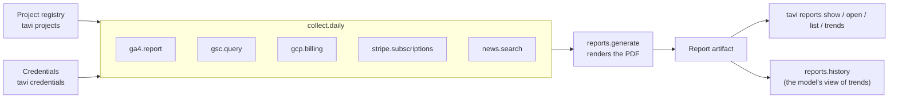

# The daily brief

The daily brief is a short PDF about the projects you run — a website, an app, a
product — built from their own numbers: Google Analytics traffic, Search
Console clicks, the month's cloud bill, Stripe revenue and churn, and news that
mentions them. You register each project once; a schedule, or you in a chat,
asks for the brief, and the agent collects every configured source, writes the
brief and stores it as a report you can open, list and chart over time.

It is the built-in plugin `tavi.collectors` (`@tavi/plugin-collectors`,
`packages/builtin/collectors`). Disable it with `tavi plugins disable
tavi.collectors` and none of its tools is offered.

- [How it works](#how-it-works)
- [Set it up](#set-it-up)
- [The sources](#the-sources)
- [Run it every morning](#run-it-every-morning)
- [Read past briefs](#read-past-briefs)
- [What leaves the machine](#what-leaves-the-machine)
- [Architecture](#architecture)

## How it works



- **Each source is isolated.** A source that is not configured for a project
  says so and is never called; a source that fails (a rotated key, a quota)
  becomes a note on that project, and the rest of the brief is still written.
- **The collectors are reads.** `projects.get`, `ga4.report`, `gsc.query`,
  `gcp.billing`, `stripe.subscriptions`, `news.search` and `collect.daily` are
  read-only and call fixed provider endpoints or the feeds you configured,
  never a URL the model chose, so
  an unattended run never waits on an approval for them. `reports.generate`
  writes the report, so it is a mutating tool.
- **The brief never comes back to the model.** Even a short PDF is past the
  64 KiB a tool result may carry; `reports.generate` returns the artifact's
  reference and size, and you read the brief with `tavi reports`.
- **News is untrusted.** Feed and search text was written by someone else, so a
  turn that reads `news.search`, `collect.daily` or `reports.history` is
  tainted ([SECURITY-MODEL.md](SECURITY-MODEL.md#untrusted-content-and-the-taint-gate)):
  its next outward action asks first in a chat, and is refused in a scheduled
  run.

## Set it up

1. **Store the credentials** each source needs, from files with mode `0600`
   (a value is never an argument):

   ```bash
   tavi credentials set google.reports --file ~/keys/reports-service-account.json
   tavi credentials set stripe.acme --file ~/keys/stripe-restricted-key
   tavi credentials set search.tavily --file ~/keys/tavily-key
   ```

2. **Register each project** and the sources it has. Every source is optional:
   a project with no Stripe account still gets traffic and search numbers.

   ```bash
   tavi projects add acme --name "Acme" \
     --ga4 properties/513076108 \
     --gsc sc-domain:acme.example \
     --gcp-project acme-billing --gcp-table billing.gcp_billing_export_v1 \
     --stripe-ref stripe.acme \
     --keyword "Acme,acme.example" --language en --region US
   tavi projects list
   ```

   `tavi projects disable <id>` parks a project: it keeps its ids, and every
   collector skips it.

3. **Set the deployment-wide settings** — the Google service account, the
   lookback window and the news feeds are shared by every project, not set per
   project. They are read from `<data-dir>/projects.json` by
   `tavi projects import`, which needs the owner stopped:

   ```json
   {
     "googleServiceAccountRef": "google.reports",
     "lookbackDays": 7,
     "news": {
       "feedUrls": ["https://acme.example/blog/feed.xml"],
       "maxItemsPerProject": 5,
       "searchCredentialRef": "search.tavily"
     },
     "projects": [
       { "id": "acme", "name": "Acme", "ga4PropertyId": "properties/513076108", "keywords": ["Acme"] }
     ]
   }
   ```

   The file lists 1 to 50 projects. It is checked whole before anything is
   written, and saved in one transaction, so a mistake leaves nothing
   half-applied. A project already registered is left as it is (remove it and
   add it again to change it); a setting the file leaves out keeps its stored
   value, and `news` is replaced as a whole. An unknown key is an error, not
   ignored: a mistyped `gscSiteUrl` would otherwise look exactly like a site
   with no traffic.

4. **Ask for it.** In a chat: *"Generate today's brief."* The agent calls
   `reports.generate` and tells you the report's id.

### The project fields

| Field (`projects.json`) | `tavi projects add` flag | Source it turns on |
| :--- | :--- | :--- |
| `id` | the positional id | — (1–64 characters, stable) |
| `name` | `--name` | — (shown in the brief) |
| `ga4PropertyId` | `--ga4` | Google Analytics 4: sessions, users, conversions |
| `gscSiteUrl` | `--gsc` | Search Console: clicks, impressions, average position |
| `gcp.billingProjectId` + `gcp.billingTable` | `--gcp-project` + `--gcp-table` | Cloud Billing month-to-date cost, from the BigQuery export |
| `stripeCredentialRef` | `--stripe-ref` | Stripe: MRR, paid revenue, churn |
| `keywords`, `language`, `region` | `--keyword`, `--language`, `--region` | News about the project |

| Setting (`projects.json` only) | What it does |
| :--- | :--- |
| `googleServiceAccountRef` | The credential holding a Google service-account key (its JSON), used for GA4, Search Console and BigQuery. |
| `lookbackDays` | The window GA4, Search Console and Stripe report on, ending yesterday (1–90 days, default 7); Cloud Billing is always month to date. |
| `news.feedUrls` | Up to 20 RSS or Atom feeds read for every project's keywords. |
| `news.maxItemsPerProject` | The most news items a project gets (1–20). |
| `news.searchCredentialRef` | The credential a web-search provider (Tavily) is called with, using each project's keywords as the query. |

## The sources

| Tool | Reads | Needs |
| :--- | :--- | :--- |
| `projects.get` | The registry: each project and which sources it has (never a credential or its name). | nothing |
| `ga4.report` | `analyticsdata.googleapis.com` | `ga4PropertyId`, the service account with read access to the property |
| `gsc.query` | `searchconsole.googleapis.com` | `gscSiteUrl`, the service account added as a user of the property |
| `gcp.billing` | `bigquery.googleapis.com` | `gcp`, the service account able to query the billing export table |
| `stripe.subscriptions` | `api.stripe.com` | `stripeCredentialRef`, a key that can read subscriptions and charges |
| `news.search` | the configured feeds and search provider | `keywords`, and `feedUrls` or `searchCredentialRef` |
| `collect.daily` | all of the above, for every project, as one bounded summary | — |
| `reports.generate` | `collect.daily`, then renders and stores the PDF | — |
| `reports.history` | the recorded briefs' periods and per-project figures | — |

The Google sources share one service account with the read-only scopes
`analytics.readonly`, `webmasters.readonly` and `bigquery.readonly`. With no
project registered, the per-project tools are not offered at all;
`projects.get` and `collect.daily` still are, so the agent can tell you what is
missing. `news.search` answers only for a registered project: news about
anything else is a `web_search` question.

## Run it every morning

A schedule runs the brief unattended. A schedule may call only the tools it
lists, so name the report tools, and post each run's result into your Home:

```bash
tavi schedules add --name morning-brief --at 07:00 --timezone Europe/London \
  --prompt "Generate today's brief." \
  --allow 'reports.*' --deliver-to home
```

`reports.generate` hands back the report's id, not its text; open it with
`tavi reports open`. A run that reads the history or the news is tainted, so
it cannot send anything elsewhere on its own.

See [AUTOMATION.md](AUTOMATION.md) for cadences, delivery and budgets.

## Read past briefs

```bash
tavi reports list                         # one line per brief, newest first
tavi reports open <artifact-id> --out brief.pdf
tavi reports trends --project acme --metric sessions
```

`list` and `trends` work while `tavi serve` runs; `show` and `open` read the
data directory themselves, so stop `tavi serve` first (they say so).

`trends` gives one series per project and metric, in period order, with the
change from the previous period; a re-run for the same period replaces the
earlier point. The model sees the same numbers through `reports.history`. Every
action and flag is in [CLI.md](CLI.md#tavi-reports).

## What leaves the machine

Only what you configure: each collector calls its provider with that
project's ids and your credential, and nothing else is sent. The figures come
back to this machine, go into the brief and the report history, and reach the
model of the chat that asked. Credentials are resolved inside each tool and are
never shown to the model, in a note or in the PDF. See
[PRIVACY.md](PRIVACY.md).

## Architecture

| Part | Where | Responsibility |
| :--- | :--- | :--- |
| Collectors | `packages/builtin/collectors/src/collectors.ts` | `projects.get`, the per-source tools and `collect.daily`; Google service-account sign-in; per-source isolation and the tool-result bound. |
| Reports | `packages/builtin/collectors/src/reports.ts` | `reports.generate` (render and store the PDF) and `reports.history`. |
| Host wiring | `apps/cli/src/features/collectors/host.ts` | Hands the plugin its ports: the project registry, secrets, fetch and the report store. |
| Project registry | `packages/contracts/src/projects.ts`, `packages/runtime/src/persistence/store/projects.ts`, `apps/cli/src/features/projects/` | The project and settings schemas, their storage, and `tavi projects`. |
| Report store | `packages/runtime/src/persistence/store/reports.ts`, `apps/cli/src/features/reports/` | The report history and `tavi reports`. |
