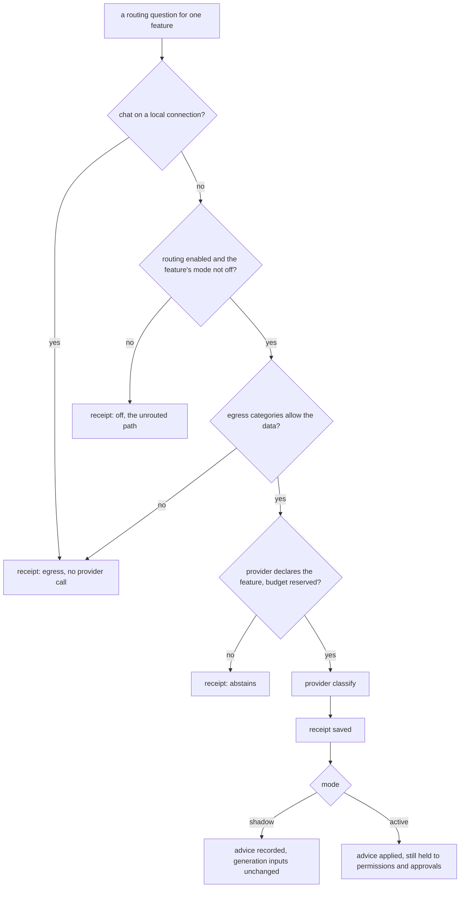

# Optional routing (Jev and other providers)

Tavi includes the native `@tavi/plugin-router` package as the built-in `tavi.router` plugin: the Jev provider. Routing itself is a host guard that applies the settings below, and the provider only answers the questions the guard lets through. Fresh installations have routing disabled, every feature off and every router cloud disclosure category denied.

One routing decision, for one feature (model, memory, skills or tools):



## Status

Use `tavi router status --data-dir <directory>` to inspect the current revision, configured and effective modes, the selected provider, its readiness and reserved/spent router budget. It performs no provider requests. Commands attach through authenticated IPC when an owner is running; otherwise they acquire directory ownership. The browser bridge does not expose router administration.

| Field | What it reports |
| --- | --- |
| `configuration` | The current `revision` and the configured `settings` (including feature `modes`). |
| `provider` | The selected provider's `id` and its `state`: `running` when an owner has it loaded; otherwise `enabled` or `disabled` as the plugin registry records it (offline always, and in an owner after a runtime disable, or an enable that waits for a restart), `failed` with the owner's `error`, or `not-installed`. |
| `credentialPresence` | Jev provider only, known offline too: `present` means the local credential resolved (otherwise `missing`, `not-configured` or `unavailable`). |
| `liveCredentialValidity` | Jev provider only: live validity remains `not-tested`. |
| `priceReady` | For the Jev provider, price readiness, known offline too. For another provider, whether the pinned `priceRevision` prices its sheet (from its manifest, so also offline). |
| `readiness` | Another provider only: its own report, given only while it runs in an owner (`unknown` otherwise). |
| `workspaceReservedOrSpentUsd` | The router budget reserved or spent. |
| `effectiveModes` | All `off` unless the provider is running. It also turns off any feature the running provider does not declare: that feature takes its unrouted path. |
| `activation` | Always operator-controlled; evaluation is required before rollout. |

## Configuring it

Store a key through `tavi credentials` using its existing file/secret flow. Never put the key itself in router JSON.

A configuration file has `settings` and an optional `priceSheets` array. Settings accept the `provider` (the plugin id of the routing provider: `tavi.router` on a fresh installation, and otherwise kept when a configuration omits it), `priceRevision`, feature `modes`, explicit `egress` category booleans, and bounded task/workspace budgets. The Jev provider's own settings go under `providerSettings["tavi.router"]`: a `credentialRef` and the pinned `https://api.typesafe.ai/v1/systemone` / `jev-1.13.0`, checked by the provider's own schema (`@tavi/plugin-router`) when the configuration is written and again at each call.

Configure echoes the normalized document; a built-in provider with no entry keeps none, and runs with its defaults. An external provider's `providerSettings` entry must be empty, because it takes its settings from its plugin config. Omitted settings other than `provider` take schema defaults: configure replaces the complete settings, rather than patching it.

```json
{ "settings": { "enabled": true, "modes": { "tools": "shadow" }, "egress": { "taskText": true, "toolDescriptions": true, "skillMetadata": false, "memoryExcerpts": false },
  "priceRevision": "jev-2026-09", "providerSettings": { "tavi.router": { "credentialRef": "jev.key" } } } }
```

```sh
tavi router configure --file router.json --revision 0
tavi router set-mode tools shadow --revision 1
tavi router set-provider tavi.router --revision 2
tavi router explain task-id
```

Get the current revision from status before each write. A stale revision fails without changing settings or installing prices, naming the current revision (`REVISION_CONFLICT`, exit `2`, as an invalid file is, with or without a running owner). Set-mode changes one feature; it does not enable the global switch.

Set-provider selects the routing provider: the built-in `tavi.router`, or an installed external plugin with an approved version that declares one (see [routing providers](PLUGINS.md#routing-providers)). A whole `configure` that changes `provider` is checked the same way; one that names no `provider` keeps the current one, so reapplying a partial file never moves routing back to Jev.

- Selecting a provider whose price sheet the pinned `priceRevision` does not match succeeds with a warning: its decisions abstain until the sheet is installed.
- Selecting a provider that is not enabled succeeds with a warning, and routing stays off until it runs.
- Switching needs no restart: the next decision uses the new provider, and receipts from the old one are never replayed.
- Every configuration write cancels pending router work.

Each dated price sheet supplies immutable `revision`, `connectionId`, `model`, `effectiveAt`, `currency: "USD"` and per-million-token `input`, `cacheRead`, `cacheWrite`, `output` rates; optional `reasoning` describes a separately priced output subset. Use verified rates for your provider agreement. Jev sheets use connectionId `jev`. The current Jev protocol requires free output for its conservative reservation; unknown or mismatched pricing abstains. The command installs no assumed vendor price.

## Shadow and active

Shadow mode sends eligible data and costs money if egress, credentials, prices and budgets permit. It leaves generation inputs unchanged. Active mode can change task admission, context or tools. Ordinary attended CLI/IPC tasks are eligible; routines, schedules, messaging and child workers remain excluded. Explicit connection/model intent wins. Automatic fast routing also needs a distinct explicit workspace fast binding, compatible catalog facts, credentials and a known cheaper price sheet. Classification never changes a saved task route. A chat on a local connection (one that used or runs on Ollama, LM Studio or another endpoint on this machine, its default included) is never routed: no provider is asked about its model, memory, skills or tools, each such decision answers `egress` at once with no provider call, and it is never moved to a remote `fast` model. A chat that starts on a local default saves its local chain as its route at its first turn, whether routing is on or off, so a default changed to a remote model later never moves it; a chat that ran locally with no saved route and whose default is now remote is refused. Its chain keeps only its local fallbacks: when none is left the turn fails with `NOT_CONFIGURED`, saying a local chat never falls back to a remote model ([PRIVACY.md](PRIVACY.md)).

## Batching and receipts

Tools, memory and skill relevance share one bounded request when multiple surfaces have eligible, disclosure-approved candidates and the provider batches (Jev does). A provider without batching is asked once per surface; those calls count once against the turn's admission limit and each against the task's. The model admission decision remains separate, so all four surfaces can receive advice under the default two-call admission limit. Question slots are allocated across surfaces before extra candidates; per-feature modes and thresholds still apply. Later model steps share the remaining admission budget and fall back to authorized baseline behavior when it is exhausted.

A shared request has one accounting receipt (`batchedFeatures`) and per-feature receipts linked through `batchDecisionId`. Only the shared receipt owns a provider call, cost reservation and elapsed time. The per-surface calls of a provider without batching share a `batchDecisionId` that names no transport of its own; each owns its call. Every receipt names its `providerId`. Replays reuse saved decisions; an interrupted, unfinished projection abstains. Revocation, cancellation, configuration changes and disable invalidate pending advice. Generation, fallback and compaction calls each recheck model authority immediately before provider dispatch.

## Explaining a route

`explain` reports the saved route, up to 20 latest receipts and provider attempts, five latest context projections (up to 32 references per category, with original totals), truncation flags and complete cost totals across all attempts. Unknown estimates remain unknown; the known subtotal is not a savings claim. Router reservation totals include uncertain charges. No receipt can mean an off/excluded/pre-dispatch refusal. Projections record IDs and versions, not memory text. A skill recommendation or exposure does not prove it was applied.

## What advice can change

Tools selected by advice still pass current permissions, disclosure membership, argument checks and approvals.

Under the v2 prompt layout (`models.promptLayout`, [ARCHITECTURE.md](ARCHITECTURE.md#token-and-prompt-cache-behaviour)):

- the tool question is asked once per turn rather than once per model step;
- the shortlist is ranked from the person's words alone (a tool result that names a PDF no longer moves it mid-turn);
- an active shortlist only adds to the tools the epoch's earlier turns were offered (`routedToolIds`, oldest giving way past 128): routing never takes a tool back out of the array that leads every request's cached prefix.

A turn's final step keeps its tools listed and says in its step note that a call is not run, instead of sending no tools. The model route is chosen on a task's first turn and replayed on every later one, so routing never moves a chat whose prompt is cached on one model to another between turns; a model changes mid-chat only by failover or a person's choice, and `tavi doctor` counts those (`prefixChurn.modelSwitches`).

`tools.search` exposes up to eight authorized matches for the next generation without executing them:

- It reads a query's words split on spaces, dots, underscores and hyphens (so `reminders.create` is two words), leaves stop words out and reads a plural as its singular.
- It ranks each tool by the query words it holds, rarer words counting more and a word in the tool's id three times one in its description.
- A tool already offered to this turn is left out: a routed turn's routed tools under v2, or an unrouted turn's tools found before and, under v2, the tools it lists up front (a server's excepted, since one may have been dropped to fit the list).
- A hit carries no version.

The router-off shortlist ranks the same way. Memory advice cannot repair evidence absent from retrieval, and protected preferences/conflicts retain deterministic precedence.

A routing decision is the provider's own call (`classify`), not a model request Tavi sends, so it carries no reasoning effort or output cap of Tavi's. Tavi's own short background calls — a find, an extraction, a summary, the injection classifier, a heartbeat check — ask a reasoning model for low effort, and no cap applies on the Responses wire (Sign in with ChatGPT); see [CLI.md](CLI.md) *Reasoning effort*.

## Rolling back

To roll back operationally, either disable the provider with `tavi plugins disable tavi.router`, or configure a complete settings document with `enabled: false` using the current revision. Disabling the plugin stops routing immediately in a running owner: in-flight decisions are aborted and settled, and tasks take exactly their unrouted behavior (no tool shortlist, `tools.search` or disclosures). The configuration is kept for when it is enabled again. Pending requests are canceled, new decisions stop and context/tools return to the baseline. Existing tasks preserve their selected model and saved fallback chain. Disabling does not down-migrate the database. Keep backups and check binary/schema compatibility separately before reverting an installed release.

Activation remains an operator decision after held-out quality, total cost per successful task and latency evaluation. There is no automatic activation or demonstrated savings from the offline fixtures.

## Packaging and deployment

Build with `pnpm run build`, verify types with `pnpm run typecheck`, and run `pnpm run test:release` for an installed-tarball check outside the repository. The release closure includes `@tavi/plugin-router`; it has no runtime workspace dependency beyond contracts.

The release test runs installed `router status` and verifies all modes and egress categories are off on a new directory. Routine parent/worker fixtures pass routing hooks that throw if reached, covering excluded adapters through success, failure and recovery. A task with no saved route runs unrouted. Back up the data directory before upgrading: migrations add accounting, router and projection tables to the existing backup/export set.

## Evaluation reports

`tavi router evaluate` with no file reports that no evidence was supplied, without provider calls: the verdict (`activation: inconclusive`) and its reasons, with no per-arm tables. Supply `--file observations.json` to analyze paired outcomes using the [versioned evaluation protocol](../evals/router/README.md). This command runs locally on supplied files and does not require an owner, mutate modes, or launch paid tasks. It reports known/unknown costs and task-clustered intervals, and produces a reproducible arm-order plan. No activation decision has been made: no independently judged live pilot or experiment budget has been supplied.

## Architecture

Optional routing separates the host governance guard from the replaceable routing provider across `@tavi/contracts`, `@tavi/runtime`, `@tavi/plugin-router`, and `@tavi/cli`:

| Layer | Module / Path | Responsibility |
| :--- | :--- | :--- |
| **Contracts** | `packages/contracts/src/router.ts` (`RouterPort`, `RouterProvider`) | Schemas for router settings, feature modes (`off`, `shadow`, `active`), egress disclosures, price sheets, batched decisions, and accounting receipts. |
| **Host Guard & Persistence** | `packages/runtime/src/router/{guard,slot,repository,async-repository}.ts` | Enforces local-connection exclusions, egress category disclosures, cost reservations, admission limits, and SQLite persistence for router settings, price sheets, receipts, and context projections. |
| **Built-in Jev Provider (`@tavi/plugin-router`)** | `packages/builtin/router/src/{index,typesafe}.ts` | Built-in `tavi.router` plugin implementing the batched Jev protocol (`jev-1.13.0`). |
| **CLI & Offline Evaluator** | `apps/cli/src/features/router/{evaluation,owner,task-routing,client,parse}.ts`, [evals/router/README.md](../evals/router/README.md) | `tavi router` CLI (`status`, `configure`, `set-mode`, `set-provider`, `explain`, `evaluate`) and paired-outcome statistical evaluation. |

See [ARCHITECTURE.md](ARCHITECTURE.md) for how the router guard sits in the turn lifecycle.
