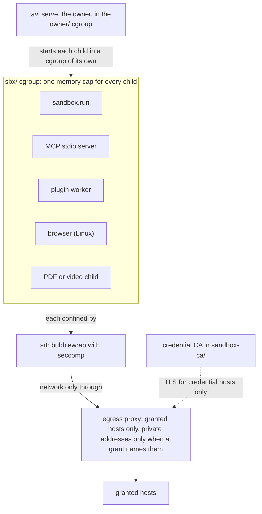

# Sandbox

This document describes the sandbox Tavi runs untrusted code in: the
`sandbox.run` tool a chat uses for shell commands, and the other children
confined the same way (MCP stdio servers, plugin workers, `plugins.validate`,
the PDF parser, the video tools, and the browser on Linux). It covers the
platforms and mechanisms, what a command can read, write and reach, how it
uses a credential without holding it, resource limits, every setting, how to
check and set up a host, the test matrix, and what the sandbox does not cover.
Approvals, permission rules and the taint gate that decide *whether* a call
runs are in [SECURITY-MODEL.md](SECURITY-MODEL.md).

## Contents

- [Threat model](#threat-model)
- [Platforms and tiers](#platforms-and-tiers)
  - [WSL2](#wsl2)
- [What runs in the sandbox](#what-runs-in-the-sandbox)
- [`sandbox.run`](#sandboxrun)
- [Filesystem](#filesystem)
- [Local capabilities](#local-capabilities)
- [Environment](#environment)
- [Network](#network)
- [Credentials without holding them](#credentials-without-holding-them)
- [Resource limits](#resource-limits)
- [Configuration](#configuration)
- [Checking and setting up a host](#checking-and-setting-up-a-host)
- [Running as a service](#running-as-a-service)
- [Troubleshooting](#troubleshooting)
- [Recipes](#recipes)
- [Limits of the sandbox](#limits-of-the-sandbox)
- [The sandbox matrix](#the-sandbox-matrix)
- [How this compares](#how-this-compares)
- [Architecture](#architecture)

---

## Threat model

**The attacker** is the model acting on instructions it should not follow:
words injected into a web page, an email, a file or a tool's output, or a
package whose install script an approved command runs. Tavi assumes any
command `sandbox.run` runs may be hostile.

**The boundary is the OS sandbox**, not the approval card. Seatbelt on macOS
and bubblewrap with seccomp on Linux decide what a command can read, write
and reach. Approvals and permission rules
([SECURITY-MODEL.md](SECURITY-MODEL.md)) decide only *whether* a command runs
and what a person is asked: a command a rule allows, or one the read-only rule
runs without asking, gets the same policy as one a person approved.

| Class | Control | Limit |
| :--- | :--- | :--- |
| Reading your secrets | Reads are denied for `$HOME`, the data directory, every `--fs-root`, the credential homes and key files by name, mounted drives, `/Users/Shared`, `$XDG_RUNTIME_DIR` and, on macOS, other users' `/tmp` entries; only the chat's folders, the toolchains on `PATH`, `--sandbox-read` folders and the shared package cache are re-opened ([Filesystem](#filesystem)) | System folders (`/etc`, `/usr`) stay readable |
| Sending data out | No network unless a domain is granted; each run has its own proxy, which refuses paste sites and private addresses; a run that reached a host taints the chat ([Network](#network)) | A granted host receives whatever the command sends it; HTTPS to a grant (but a credential's host) is a tunnel the proxy does not read unless `--sandbox-inspect-tls` |
| Leaving something the host runs later | Protected names (git hooks and config, shell profiles, editor and agent settings, package managers' config), the user persistence locations, and `hostRunsChanged` for project files the host runs on purpose ([Protected names](#filesystem)) | `package.json` scripts and a `Makefile` in a writable host folder stay writable: reported, not blocked |
| Stealing a credential | Injected by the proxy toward its hosts only; the command holds a placeholder ([Credentials](#credentials-without-holding-them)) | A host that echoes the header back hands it to the command |
| Outliving the run | A cgroup and PID namespace on Linux; on macOS a run tag and an inherited marker, swept when the run ends ([Limits](#limits-of-the-sandbox)) | On macOS, a process that clears its environment *and* closes every inherited descriptor; Linux's nested tier has no PID namespace, only the cgroup |
| Exhausting the host | Memory, process and CPU caps (a delegated cgroup on Linux), a timeout on every run ([Resource limits](#resource-limits)) | Advisory on macOS |
| Feeding the model a page's words | A run's output is untrusted once it reached the network or the chat's `downloads/` holds a file: the chat is tainted ([SECURITY-MODEL.md](SECURITY-MODEL.md#what-makes-a-chat-tainted)) | — |

## Platforms and tiers

The sandbox is `@anthropic-ai/sandbox-runtime` 0.0.83 (srt), which this page describes, pinned exactly, wrapped
by the `@tavi/plugin-sandbox` package:

| Platform | Mechanism | Needs |
|---|---|---|
| macOS | Seatbelt (built in) | nothing |
| Linux | bubblewrap with seccomp | `bubblewrap`, `socat` and `ripgrep` from your package manager; on some distributions a one-time root step (`tavi sandbox setup`) |
| WSL2 | bubblewrap with seccomp, as Linux | as Linux; see [WSL2](#wsl2) |
| Windows | — | not supported: srt's Windows backend is alpha and Tavi does not use it yet, so sandboxed tools are refused; separately, `tavi serve` refuses to start until its named pipe is proven. WSL1 has no namespaces |

On Linux one host check — the host's facts plus a live probe of the compiled
`sandbox.run` policy — settles a **tier** that `sandbox.run`, MCP stdio
servers, the PDF children and `tavi doctor` all read:

- **`full`** — every isolation the sandbox offers.
- **`nested`** — srt's weaker nested mode, for a container that masks
  `/proc`: PID and `/proc` isolation are given up. Used only when you start
  `tavi serve --sandbox-nested`, and every `sandbox.run` result says so.
- **`unavailable`** — with its cause and the fix to run. `sandbox.run` is
  refused (never run unconfined), an MCP server granted a network does not
  start, the video tools are refused (unless `serve --video-allow-unconfined`),
  and so are the PDF tools (unless `serve --pdf-allow-unconfined`).

`tavi serve` waits up to 20 seconds at start for the first probe, then starts
anyway. A `sandbox.run` refused on a failed answer more than 30 seconds old
first has the host checked again, waiting up to 5 seconds for it, so a host
fixed while the owner runs (`tavi sandbox setup --apply`) runs the next call
with no restart; a check still running after that wait refuses the call on the
old answer and goes on for the next one. A failed answer more than 10 minutes
old is also checked again the next time anything asks for it (an MCP server
starting, a PDF or video call), and `tavi doctor` on the running owner checks
at once. srt installed under an `--fs-root` (where a sandboxed command could
rewrite it) makes the tier `unavailable`.

There is no unsandboxed fallback: a tool that declares it requires the sandbox
is refused with a typed error naming the cause and fix when none is configured
or it is unavailable.

### WSL2

Inside a WSL2 distribution Tavi is a Linux program and the sandbox is the Linux
one: install `bubblewrap`, `socat` and `ripgrep` in the distribution, then
`tavi sandbox check`. What differs:

- **The Windows drives are closed.** WSL mounts every Windows drive under
  `/mnt` (`/mnt/c/Users/<you>` is your Windows profile, with its keys and
  tokens), or wherever `[automount] root` in `/etc/wsl.conf` puts them.
  Sandboxed commands, plugin workers and MCP servers cannot read `/mnt` nor any
  Windows drive mounted elsewhere (read from `/proc/self/mounts`), as on Linux
  they cannot read other mounted drives. WSL's interop folder (`/run/WSL`),
  through which a Linux process starts a Windows program outside the sandbox,
  is closed to them too; attach a folder
  under `/mnt`, or open it with `serve --sandbox-read`, to work there. On WSL2
  the live probe also tries to read a file on `C:` and fails the check if it can.
- **Keep the data directory and the clone on the Linux filesystem.** On `/mnt`
  file permissions are not kept and SQLite is not safe: every command that opens
  the data directory refuses one there (or on any 9p mount), `tavi service unit`
  warns, and a build there is slow.
- **WSL stops the distribution** soon after its last terminal closes, and
  `tavi serve` with it. To keep it running, in `%USERPROFILE%\.wslconfig` on
  Windows set `vmIdleTimeout=-1` under `[wsl2]` and `instanceIdleTimeout=-1`
  under `[general]` (WSL 2.5 or later), then run `wsl --shutdown` once. `tavi
  doctor`, `tavi service unit` and `tavi onboard` say so on WSL2.
- **Opening a browser** uses `xdg-open`, then `wslview`, then Windows' own URL
  handler, whichever is there.
- **WSL1 is not supported**: it has no Linux kernel namespaces.

The `wsl2` job in `.github/workflows/sandbox.yml` builds Tavi in Ubuntu 24.04
under WSL2, runs the unit tests and `tavi sandbox check`, on demand.

## What runs in the sandbox

The confinement is listed as built-in plugins (`tavi.sandbox`, `tavi.limits`, `tavi.worker` in `tavi plugins list`), core: it cannot be disabled, and no plugin may replace it, since it confines every plugin. The engines it confines (`tavi.browser`, `tavi.pdf`, `tavi.video`) can be disabled.

How the layers stack on a Linux host with a delegated cgroup (on macOS srt is Seatbelt, there are no cgroups, and the browser runs outside srt with Chromium's own sandbox):



| Child | How it is confined | More |
|---|---|---|
| `sandbox.run` | the policy below, per call, from the chat's folder | this document |
| `plugins.validate` | inside `serve`, in the same sandbox as `sandbox.run`, with its tier, `--sandbox-nested` and `--fs-root` check | [PLUGINS.md](PLUGINS.md) |
| Plugin workers | their own Node process, reading only their own folder and home, reaching only the hosts the manifest declares, credentials as proxy-filled placeholders; `UNSANDBOXED` only when approved `--in-process` | [PLUGINS.md](PLUGINS.md) |
| MCP stdio servers | their own sandbox, network only to granted domains | [MCP.md](MCP.md) |
| PDF parser children | the same sandbox; refused where it is unavailable unless `--pdf-allow-unconfined` | [PDF.md](PDF.md) |
| Video (FFmpeg and analysers) | the same sandbox; refused where it is unavailable unless `--video-allow-unconfined` | [VIDEO.md](VIDEO.md) |
| Browser (Linux, headless) | The full Chromium (else Playwright's headless shell; `TAVI_BROWSER_LINUX_CHROMIUM=headless-shell` keeps the shell) inside the same sandbox, with Chromium's own sandbox nested in it | [BROWSER.md](BROWSER.md) |

Every confined child but `sandbox.run` (whose policy is below) is denied the
same folders: your home, Tavi's data directory, and every folder `serve` was
given for chats (`--fs-root`, `--dev-plugin` and `--sandbox-read`), wherever
they are. Reads are deny-list based, so a project root outside your home
(`--fs-root /srv/work`, `/Volumes/Code`) is named here, never left readable to
a plugin worker or an MCP server. A child reads inside a denied folder only
what its own policy opens: its plugin's files and home, a server's approved
`filesystem.read` paths, the PDF engine's package, a video run's directory.
`serve` records these folders in `<data>/sandbox/read-roots.json` (0600), so
`tavi mcp add` and `tavi mcp probe` run without it deny the same ones; on a
data directory no `serve` has recorded them in, they also deny the usual
places such folders lie outside your home (`/Volumes`, `/media`, `/mnt`,
`/Users/Shared`, `/srv`). Because
every child is denied them, `/`, a system folder (`/usr`, `/bin`, `/sbin`,
`/lib*`, `/opt`, `/System`, `/Library`) or a folder holding one, and the
`bin`, `lib` or `include` folder of the Node install Tavi runs on (or a folder
in or holding one) are refused as `--fs-root` or `--sandbox-read`.

On macOS the browser is the full Chromium with Chromium's own sandbox on; it
cannot start inside srt there. On Linux the confined browser reads neither
your home, Tavi's data directory nor any `--fs-root`, writes only its profile
and a scratch folder, and reaches the web only through its own proxy, which
never connects to this host, a link-local or metadata address, or a private
or CGNAT address — by number or by a name resolving to one, connecting to the
address it checked — except the addresses `--browser-allow-host` lists (see
[BROWSER.md](BROWSER.md#allowing-the-browser)). Unconfined, the browser goes
through the owner's own egress proxy, which holds it to the same rule. `tavi serve
--sandbox-tier unavailable` runs it unconfined, with only Chromium's own
sandbox where the host allows it, and a headed window
(`TAVI_BROWSER_HEADED=1`) on Linux runs unconfined in the same way.

## `sandbox.run`

The model passes only `command`, `args`, `cwd`, `stdin` and `timeoutMs`. The filesystem policy and
environment are built per call from the folder the owner stamped on the turn
and the operator's flags; the network and resource policy is fixed when the
tool is registered. The model never chooses its own sandbox policy.

- `sandbox.run` given a whole command line (`python3 -c "…"`) runs it as that
  program and its arguments; a line that needs a shell (pipes, redirects,
  `&&`, globs, variables) runs as `/bin/sh -c '<line>'`, plain `sh` reading
  no startup files. The result's `ranAs` says which argv ran, and the
  approval card shows that same argv, with newlines and long runs of spaces
  spelled out.
- A shell line is approved command by command: `ls && rm -rf build` is two
  commands, and a session or standing grant covers the line only when it
  covers each. A line with a command substitution or backticks, `eval`, a
  here-document, a comment, control flow (`for`, `if`, …), a redirect outside the
  working folder (`> ~/x`, `>/etc/x`; `/dev/null` and `$TMPDIR` are fine), a
  shell run inside a command (`env sh -c`, `xargs sh -c`, `find -exec sh -c`), a shell that
  reads startup files (`-l`, `-i`, `--rcfile`), `$'…'` or `$"…"` quoting, a
  backslash-newline continuation, a `${…}` expansion other than a plain
  `${NAME}`, a process substitution (`<(…)`), or anything the parser cannot
  read is asked about every time, offering only "once" — no allow rule or
  grant lifts it but one stored with `permissions add --match-unparsed`; so is a nested
  `sh -c` script holding any of these. The parser reads quoting the way
  `/bin/sh` does — `\'` inside `$'…'`, a `#` inside `${…}`, a line joined by a
  backslash-newline, `{`/`}` grouping only where a command starts or after
  `!` or `time` (so `mkdir -p src/{a,b}` and find's `{}` are words), and a
  `[[ … ]]` test as one command whose `&&`, `||`, `<`, `>` and parentheses are
  its own operators (`[[ -f a && -f b ]] && make` is two commands; a `$(…)` or
  `<(…)` inside the test still counts as a command that runs, and a `[[` that
  never closes is asked about every time) — so the commands it lists
  are the ones that run. Every other line is read a second time by a shell
  grammar written apart from that parser; if the grammar finds a command the
  parser missed, the line is asked about every time too ("reads as different
  commands on a second parse"). The grammar also supplies the redirections
  (a `>` inside quotes is none), and what runs inside a command is rated as
  if written out: `find … -exec <cmd> {} +`, git's subcommand behind `-C`
  or `-c` (`git -C dir push` is a push), and a `git -c` setting that runs a
  command (a pager other than `cat`/`less`/`more`, an `!` alias, a hook path,
  an `ssh` command, a diff or filter driver, …) or a variable before `git`
  that sets one (`GIT_SSH_COMMAND`, `GIT_PAGER`, `GIT_CONFIG_COUNT`, …),
  which is also asked about every time. Nesting deeper than 32 levels is
  not read at all and asks every time. A deny or ask rule matches each command
  the parser finds both as written and through the wrappers and launchers Tavi
  reads (`env`, `nice`, `timeout`, `sudo`, `xcrun`, `arch`, `flock`, …) and the
  program's path: a rule for `curl *` also matches `env curl …`,
  `/usr/bin/curl …` or `timeout 5 curl …`. A program that runs another some
  other way (`su -c`, `python3 -c 'os.system(…)'`, a tool of your own) is not
  read through, so for one that must never run, ask about or deny the tool
  whole rather than rely on a pattern alone. An allow rule matches only as
  written, so it never covers more than it says.
  A line that only reads inside the working folder and prints (`ls`, `rg`,
  `git status`, `git diff`, …) runs without asking (see
  [SECURITY-MODEL.md](SECURITY-MODEL.md#rules)); `git` only at the folder's
  top, since a repository in a subfolder (`git -C sub log`, or a run whose
  `cwd` is `sub`) could hold config that runs a program, and what a line writes through
  a redirect is a subject of its own (`>file:package.json`), which an allow
  rule must also cover.
  The OS sandbox stays the boundary; this reading only decides what to ask.
- `stdin` is text given to the program on standard input (up to 256 KiB);
  without it the program reads end-of-file at once. The approval card shows
  it. When the program runs it — a shell reading its script from standard
  input (`sh`, `bash -s`, even through `env` or a pipe into one), an
  interpreter given no script (`python3 -`, `node`), or a tool that runs or
  applies it (`xargs`, `patch`, `git apply`, `sed -f -`, …) — it is approved
  as part of the command: a shell's lines command by command, under the
  hard-deny list, and an interpreter's program pinned to its exact text. `timeoutMs` asks for a
  longer (or shorter) run than the default, up to ten minutes
  (`serve --sandbox-max-timeout` sets that ceiling, `--sandbox-timeout` the
  default).
- When the sandbox refused a connection, the result's `networkRefused` names
  the domains the shell may reach, or says none is granted. In the same way,
  a run stopped at its timeout says `timedOut` with the longest `timeoutMs` it
  may ask for; a refused write says `writeRefused` with the folders the run may
  write (and, in a chat holding untrusted content, why it writes only its own)
  and points at `fs.write` and `fs.edit`; on Linux, a run that hit its cap on
  processes or was held back by its CPU share says so in `limits`, with the
  `serve` flag that raises it; and a line asked about every time says how to
  split it so an approval can cover it (`askedEveryTime`, also on its card).
  A run that changed a file the host runs on purpose (`package.json`, a
  `Makefile`, another agent's instructions) names it in `hostRunsChanged`.
  A `cwd` refusal names the folders a run may start in, and a `command` with
  spaces given beside `args` is refused with how to pass it.
- It works in the calling chat's working folder, the same folder the file
  tools use: a command runs there unless it names another `cwd` (a relative
  one is in the working folder), so a file written with `fs.write` can be run
  with `sandbox.run`. A `cwd` outside the chat's folder and its attached
  folders is refused. A call with no working folder (outside a chat's turn) is
  refused.
- Each run has a 120-second timeout and keeps 64 KiB of each of stdout and
  stderr: of a longer one, its first and last 32 KiB, with how many bytes were
  left out between them, so a test run's failure at its end is kept
  (`truncated` says when). The tool's description tells the model both limits. In a long chat, an older run's
  output over 4,000 characters is sent to the model as its head and tail with
  how much was left out; the transcript keeps it whole.
- The result carries the tier it ran at (`full` or `nested`), the mechanism
  (`seatbelt` or `bubblewrap`), what the sandbox refused (`violations`: read,
  write, network or socket), every host and port a network run asked for
  (`requests`, up to 256 distinct ones), and `warnings` for anything this
  platform could not express of the policy. Filesystem refusals are missing
  from `violations` on Linux (`violationsComplete: false`); on macOS they are
  there, for a run with network access too. Network refusals are always
  there.
- A refused `sandbox.run` says why and what to run in its message.
- The messaging profile holds `sandbox.run` back from chat-started tasks (see
  [SECURITY-MODEL.md](SECURITY-MODEL.md#the-messaging-profile)). In a side
  chat, `sandbox.run` is not offered as a standing rule, since the rule would
  also allow the parent chat's.

## Filesystem

**Writes.** A command writes only the chat's own folder, a host folder the
chat works in and folders attached read-write — never another chat's folder,
`<data-dir>/artifacts/`, the rest of the data directory (the database and its
sidecars, `credentials`, the keys, browser profiles, plugins, logs, the
sandbox CA, …), or the shared scratch paths the sandbox would otherwise allow
(`/tmp/claude`, `~/.npm/_logs`, `~/.claude/debug`). It never writes what your
login, shell, git or desktop runs from your home folder on its own, even in a
folder attached read-write such as `~/.config`, from this list (other startup
files there are not on it and are writable in a folder attached read-write):
`~/Library/LaunchAgents`, `~/.config/git`, `~/.local/bin`, `~/.cargo/bin`,
`~/.zlogin`, `~/.zprofile`, `~/.bash_login`, `~/.zlogout`, `~/.bash_logout`,
`~/.config/fish`, `~/.config/nvim`, `~/.config/autostart`,
`~/.config/systemd/user`, `~/.config/environment.d`, tmux's config
(`~/.tmux.conf`, `~/.config/tmux`), `~/.config/direnv`, `~/.config/mise`,
terminals' config (WezTerm, kitty, Ghostty, Alacritty),
`~/.config/starship.toml`, i3's, sway's and Hyprland's config, iTerm2's
`AutoLaunch` scripts, VS Code's (and Insiders', VSCodium's and Cursor's) user
`settings.json`, `tasks.json`, `keybindings.json` and `profiles`, IPython's
startup folder, and each
`~/.local/lib/python*/site-packages` (the Python version folders present when
the policy is built). It can still read them where the folder allows, so a
toolchain in `~/.cargo/bin` or `~/.local/bin` keeps working. A chat that has read
untrusted content writes only its own folder from the shell. Only the browser
writes a chat's `downloads/`: `sandbox.run` refuses it.

**Protected names.** Anywhere it writes, it cannot write a repository's
`.git/hooks`, `.git/config`, `.git/config.worktree`, `.git/commondir` or
`.git/info/attributes`, a `.gitconfig` or `.gitmodules`, a `HEAD` at the
folder itself, shell profiles (`.bashrc`, `.bash_profile`, `.bash_login`,
`.zshrc`, `.zprofile`, `.zlogin`, `.profile`), `.envrc`, `mise.toml` and
`.mise.toml`, hook managers' config (`.husky`, `.pre-commit-config.yaml`,
`lefthook.yml`, `.lefthook.yml`), `.ripgreprc`, `.mcp.json`,
`.claude/settings.json`, `.claude/settings.local.json`, `.claude/commands`,
`.claude/agents`, `.claude/hooks`, `.claude/skills`, or
`.vscode`/`.idea`/`.zed`/`.helix`/`.cursor`/`.codex`/`.gemini` settings. In
a subfolder of the chat's own folder a repository's own files are left out
of that list, so `git init <dir>` and `git clone <url> <dir>` work there, as
do its later commits and `git config`; at the folder's top they stay
protected, since the `git status` a read-only rule runs without asking reads
them, so `git init .` and `git clone <url> .` fail there. Every run's git is
given, over any config, no hooks path, no fsmonitor, no template and every
config-defined hook turned off (`GIT_CONFIG_PARAMETERS`, which every git
version reads): no hook a repository holds runs in the sandbox, so husky and
lint-staged checks do not run on a sandbox commit. In a host or attached folder
it also cannot write what a package manager, mise or a dev container runs on
its own: `.yarnrc.yml` and `.yarnrc`, `.yarn/releases` and `.yarn/plugins`,
`.pnpmfile.cjs`, `bunfig.toml`, `.npmrc`, `.cargo/config.toml` and
`.cargo/config`, mise's other config (`mise.local.toml`,
`.mise.local.toml`, `.mise/config.toml`, `mise/config.toml`,
`.config/mise.toml`, `.config/mise`), `.tool-versions` and `.devcontainer`
— so `yarn set version` or `npm config set --location project` fails there;
change such a file with `fs.edit`. The chat's own folder keeps them
writable: the host never runs a package manager there, and `npm login`
writes the sandbox home's `.npmrc`. Nor can it write the folder
a repository's `core.hooksPath` names (read from its `.git/config`,
`config.worktree` and shared `commondir` config, the files they include, and
your global and system git config; relative to the worktree, `~` expanded,
followed through a link), which git runs as it runs
`.git/hooks`, nor any file those configs include (`[include]` and
`[includeIf]` `path`, relative to the including file, `~` expanded, followed
ten deep), which could set `core.hooksPath` or `core.fsmonitor` itself. `fs.write` and `fs.edit` can still change these files in a
host or attached folder, with the diff shown for your approval each time
(rated high risk, never approved for later); in the chat's own folder they
never write a repository's `.git` hooks or config. In a host folder it cannot
write any `.git` at all (nor can `fs.write` or `fs.edit`), so `git commit`
fails there too. It never writes a `--dev-plugin` folder. That covers what
git, a shell or an editor runs on its own; it does not cover project files the
host may later run on purpose — `package.json` scripts, a `Makefile`,
commit-lint and lint-staged config, other agents' instructions (`CLAUDE.md`,
`AGENTS.md`, `GEMINI.md`, `.cursorrules`, `.github/copilot-instructions.md`)
— which a shell with a writable host folder can change. A run that made,
changed or removed one of those at a host folder's top says so in its result
(`hostRunsChanged`, the paths), for you to look at before you run them. A folder whose path
holds `*`, `?`, `[` or `]` cannot be attached or used as a chat's folder.

Protected names are compiled per platform:

- **macOS** — as patterns. A `.git` that is a symbolic link, or a `.git` file
  naming a git folder elsewhere (a worktree's, `--separate-git-dir`), is
  followed when the command starts, and the hooks, config and `HEAD` of the
  git folder it names are protected there too; so is a protected name reached
  through a link. Paths are canonicalized first, since Seatbelt matches the
  resolved path.
- **Linux** — as literal paths found when a command starts, so a repository
  the command creates in a new subfolder is not covered, nor is any protected
  name below the folder that does not exist yet (`pkg/.vscode`, `sub/.envrc`). A folder on a
  filesystem that ignores letter case is refused, as is a folder where a
  protected name (a `.git`, `.git/hooks`, `.claude`, `.envrc`, `.vscode`) is a
  symbolic link the command could replace: the error names the link; replace
  it with what it points to, or attach a folder that does not hold it.

Both walk the folder when a command starts, reading each folder's entries
once. They never enter dependency and build trees, which hold nothing the
host runs on its own (a hook planted in one is an accepted risk):
`node_modules`, `.cache`, `target`, `vendor`, `.venv`, `.next`, `.turbo`,
`.gradle`, `__pycache__`, `.tox`, `Pods`, `DerivedData` and `.terraform`
(`build`, `dist` and `venv` are walked: they are often a project's own).
On macOS a name is matched whatever its case (`.GIT`, `.Claude`), as the
volume opens it. A run whose folders hold more than 50,000 other folders
together is refused as too large to protect; when one subfolder holds at
least half of them, the error names it, so you can attach a folder beside it
instead.

**Reads.** A command reads the chat's folders and nothing else of your home
directory, the `--fs-root` folders or the data directory: not another chat's
folder, not `~/.ssh`, `~/.aws` and the other credential homes — the macOS
keychains (`~/Library/Keychains`), `age`, `passage`, `sops` and Vault tokens,
1Password's and Bitwarden's CLI config, the cloud and hosting CLIs' stored
tokens (`doctl`, Railway, Fly, Supabase, Vercel, Netlify, Turso, Wrangler,
Terraform, Pulumi, Azure, Heroku) and the package registries' publish
credentials (RubyGems, Composer, Gradle, Maven, NuGet, Cargo) — your shell
profiles and histories, `~/.git-credentials` or `~/.config/gh`. Toolchains
installed under your home (`~/.nvm/versions`, `~/.cargo/bin` with rustup's
toolchains, pyenv's, asdf's and mise's shims and installs, `~/.volta`, fnm's
installs, `~/.bun/bin`, `~/.local/bin` and the like) are readable when they
are on your `PATH`, and the version manager is told where they are
(`RUSTUP_HOME`, `PYENV_ROOT`, `ASDF_DATA_DIR`, `MISE_DATA_DIR`, `VOLTA_HOME`,
`FNM_DIR`; your own setting of one is kept, and re-opened when it is in your
home), so `cargo`, or `python` and `node` through a shim, runs a version you
installed rather than the system's — the one your project pins, or rustup's,
pyenv's and Volta's default (asdf's and mise's global version files are not
readable). The installs are read-only: installing a new toolchain from the
sandbox fails, while cargo's downloads and mise's cache go to the chat's
`HOME`; `tavi serve --sandbox-read <dir>` (repeatable,
absolute) opens another folder to every chat's shell, read-only — never the
data directory, a credential directory or an `--fs-root` (nor a folder holding
one). `/opt/homebrew` and `/usr/local` stay readable. Mounted drives
(`/Volumes`, `/media`, `/mnt`), the folder every macOS user shares
(`/Users/Shared`), your session's runtime folder (`$XDG_RUNTIME_DIR`, which
holds a container registry's `auth.json` and keyring sockets; only when it is
a folder of its own, never `/`, `/tmp`, `/run` or a system folder) and, on
macOS, what other users keep in `/private/tmp` are not readable: open a
folder on an external drive with `--sandbox-read` or attach it. A toolchain on
your `PATH` on a mounted drive stays readable. On WSL `/mnt` holds every
Windows drive, your Windows profile with it, and is closed the same way: attach
a folder under `/mnt` or open it with `--sandbox-read` to reach it. Your own `/tmp` entries stay readable. The owner's own temporary directory, where Tavi spools other chats' data, does not, and
neither does the owner's private staging folder (`<tmp>/tavi-<uid>`), which
MCP servers and the PDF parser cannot read either. Under a systemd unit, the
credentials systemd hands the owner (`$CREDENTIALS_DIRECTORY`, the unit's
`LoadCredential=` and `LoadCredentialEncrypted=` files) are closed to every
confined child too, though they run as the unit's own user.

**Taint through folders.** What a tainted chat's shell writes marks the
folder: a side chat or worker that later reads it, by the file tools or the
shell, is treated as having read untrusted content. `sandbox.run`'s output is
itself untrusted while the chat's `downloads/` holds a file, and after a run
whose request got through to a granted domain (below). See
[WORKING-FOLDERS.md](WORKING-FOLDERS.md) and
[SECURITY-MODEL.md](SECURITY-MODEL.md#what-makes-a-chat-tainted).

## Local capabilities

No confined child is ever given a container engine's socket (`docker.sock`,
Colima's, Podman's, …) or a folder that holds one, whatever is asked. Two macOS
capabilities are the operator's choice, and a chat holding untrusted content
never gets them:

- `tavi serve --sandbox-pty` lets a run allocate pseudo-terminals (`script`,
  `expect`, node-pty tests). macOS grants that together with your own
  terminals' devices (`/dev/ttys*`), so a command could read what is typed in
  another terminal window of yours. On Linux a run has pseudo-terminals of its
  own without it.
- `tavi serve --sandbox-local-bind` lets a run listen for connections
  (supertest, a dev server under test, Playwright's `webServer`). macOS grants
  that on every interface, so a server that listens on `0.0.0.0` is reachable
  from your network, and together with connecting to this machine's own ports,
  the owner's services' too. Such a run gets `HOST=127.0.0.1`, which most dev
  servers read to listen on the loopback only; the macOS firewall keeps others
  off. Such a run may also create and reach Unix sockets in its own scratch
  folder (`$TMPDIR`), and no others — not another chat's. macOS caps a socket
  path at 104 bytes, so name a socket by a short path relative to `$TMPDIR`;
  Python's `multiprocessing` managers put theirs in `/tmp`, which the run cannot
  reach. A run with this flag starts its own srt process, as one granted
  domains does. On Linux a run has a localhost of its own and listens there
  without it, and its seccomp filter refuses every Unix socket.

## Environment

The command never sees your environment, so a provider API key set there does
not reach it. It gets your `PATH` (without folders it cannot read), locale,
`TERM` and user name, git's author and committer from your global
`user.name`/`user.email`, and its own `HOME` (`.home/` in the chat's folder,
kept across turns for caches) and `TMPDIR` (`.tmp/`) — use
`mktemp -p "$TMPDIR"`, since a bare `mktemp` ignores `TMPDIR` on macOS. pnpm
copies packages rather than hard-linking them. As a backstop the sandbox
itself unsets known provider and token variables (`ANTHROPIC_API_KEY`,
`OPENAI_API_KEY`, `AWS_*`, `GH_TOKEN`, `NPM_TOKEN`, `SSH_AUTH_SOCK`, …), every
owner variable whose name contains `KEY`, `TOKEN`, `SECRET`, `PASSWORD`,
`CREDENTIAL` or `AUTH`, and every `TAVI_*` variable.

## Network

The shell has no network unless you grant domains:

```bash
tavi serve --sandbox-domain pypi.org --sandbox-domain '*.pythonhosted.org'   # every workspace
tavi config set sandbox.domains pypi.org,*.pythonhosted.org                  # one workspace
```

A grant is `host` or `*.domain` (never a bare `*` or `*.tld`), either with an
optional `:port`, lower case; at most 64 per list. `@registries` grants the
package registries installs need in one entry: `registry.npmjs.org`,
`registry.yarnpkg.com`, `pypi.org`, `files.pythonhosted.org`, `crates.io`,
`static.crates.io`, `index.crates.io`, `proxy.golang.org`, `sum.golang.org`,
`rubygems.org`, `index.rubygems.org`, `repo.maven.apache.org`,
`repo1.maven.org`, `ghcr.io`, `pkg-containers.githubusercontent.com` and
Playwright's browser downloads. Each serves what its publishers upload, as any
registry does; general file storage and paste hosts (`storage.googleapis.com`,
`github.com`, `raw.githubusercontent.com`) stay explicit grants. Only
`sandbox.run`'s grants take it. The model never chooses them, and a tainted
chat gets no network whatever is granted.

**Asking for a domain.** With `tavi config set sandbox.network ask`, a run
may also name hosts nobody granted in `requestDomains` (`pypi.org`,
`api.example.com:443`; at most 8). They are shown on the call's approval card
("Run “pip install requests” in the sandbox, reaching pypi.org"), rated high
risk, and a person approves that call alone: no allow rule, chat grant,
`--approval approve` or unattended run answers it, and the next run that
needs the host asks again. Once approved, that run reaches them beside the
grants. Only a host by name may be asked for — never a pattern, an address
or a paste site, which is refused before any card — and a tainted chat never
asks: such a call is refused. When a run's connection is refused under `ask`,
`networkRefused` says to run again with the host in `requestDomains`, naming
the refused hosts its proxy saw that may be asked for. To keep a host for
good, grant it (`sandbox.domains`). A request for hosts that are all granted
already is refused before any card, telling the run to go without
`requestDomains`. The default, `granted`, refuses `requestDomains` before any
card too.

`tavi serve --sandbox-cache` gives each workspace one package cache, in
`~/.cache/tavi-sandbox/<workspace>`, which its chats' shells share, so an npm
or pnpm install is not downloaded again in each chat. Only npm's and pnpm's
stores go there: they check every package against its integrity hash when
they read it, so one chat cannot hand another a changed package; pip, uv, Yarn
and Go keep their caches in each chat's `.home/`. The workspace's untainted
chats share it as one, so a package one fetched is installed in another
without that chat reaching the network; a chat holding untrusted content
neither reads nor writes it, and keeps its own.

Each network run gets its own proxy, which lets through only its grants and
lists every host it asked for, allowed or not, in the result's `requests`:
`allowed` says nothing to that host and port was refused, and `allowedCount`
how many requests got through. A run with any `allowedCount` above 0 brought
in what a remote host sent: its output is untrusted `sandbox` content naming
those hosts (`host:<name>`), and the chat is tainted as a `web_fetch` taints
it — the taint chip shows, its managed folder is marked, and its later shell
runs get no network and write only the managed folder. That run itself still
wrote where it was allowed to, so `npm install` or `pip install` into your
project works as before. An offline command, a run in a workspace with
domains granted that asked for none, and a run whose every request was
refused (by the grants, the deny list, or the address guard) stay trusted. A
run that fails after a request got through (out of memory, say) taints the
chat too: its error carries `reachedNetwork`.

A request the proxy reads — plain HTTP, and HTTPS to a credential's host,
whose TLS it terminates — must name the host its connection was opened to,
or is refused rather than quietly sent there; where the proxy also judges
each request (a credential, or inspection), one whose target could be read
two ways is refused rather than guessed. With a credential, no `Set-Cookie`
in a response the proxy reads (a credential host's, or any plain-HTTP one)
reaches the command, so a session the host opens cannot be replayed without
the credential. Every other granted
HTTPS connection is a tunnel the proxy does not read: a grant on a CDN name
reaches whatever that CDN serves under it. `tavi serve --sandbox-inspect-tls`
closes that: the proxy terminates TLS toward every grant with Tavi's own CA
(which the command is told to trust), holds each request to its host, and
refuses a tunnel that carries no TLS — so git over SSH, or any raw TCP
protocol to a granted host, stops working; use HTTPS remotes. Tools that pin
certificates or ship their own trust store (some language runtimes and CLIs)
may refuse the CA. It cannot be combined with `--sandbox-parent-proxy`
(or `TAVI_SANDBOX_PARENT_PROXY`), since the sandbox cannot yet send the
connections it inspects through a parent proxy: `serve` refuses the pair.
Paste and file-drop sites (`pastebin.com`, `transfer.sh`, `webhook.site`, …),
this host, link-local and cloud metadata addresses (however the address is
spelled), and names that resolve to any of those or to a private network are
never reached; a private address is reached only when a grant names it
(canonical dotted IPv4 only). A proxy in the owner's own environment
(`HTTPS_PROXY` and the like) is never used: granted connections dial out
directly, and the run's srt process gets none of the owner's variables but
what it needs (`PATH`, `HOME`, the locale, certificate paths), so no provider
key is in its environment (in the nested tier a run can still read the host's
`/proc`, where the owner's own process holds its environment). The same holds
for a confined child's own variables (an MCP server's, the PDF reader's, the
video tools', the confined browser's): proxy, certificate and Node file
variables configure only the child inside the sandbox, never srt itself, and
proxy variables not even that. A Node child
is told to use the sandbox's proxy (`NODE_USE_ENV_PROXY=1`), and its
`NODE_OPTIONS` gains `--disable-warning=UNDICI-EHPA` after the command's own,
so Node's notice that this proxy support is experimental stays out of the
command's output. Where this host
reaches the web only through a proxy, `tavi serve --sandbox-parent-proxy
http://proxy:3128` (or `TAVI_SANDBOX_PARENT_PROXY`) names it: granted
connections then leave through it — but a credential host's are still dialed
directly, which srt does not yet route through a parent proxy — and the
addresses a grant names by number are dialed directly. Before each, Tavi checks
what the name resolves to here and refuses this host, link-local, metadata and
private addresses; this is best effort, since the proxy resolves the name again
with its own resolver, and a name this host cannot resolve is left to the
proxy. `tavi doctor` warns when the owner's environment names a proxy and the
flag does not. MCP servers and plugin workers granted domains
get the same refusals. On Linux the proxy needs the service's runtime
directory (the generated unit's `RuntimeDirectory=tavi`, else
`$XDG_RUNTIME_DIR`).

## Credentials without holding them

A command can use a stored credential without it ever entering the sandbox:

```bash
tavi serve --http-credential-host github.token=api.github.com \
           --sandbox-credential GH_TOKEN=github.token
```

The shell gets a placeholder in `GH_TOKEN`, and its proxy puts the real value
in the `Authorization` header only on requests to `api.github.com`. It
decrypts TLS for those hosts alone, with a CA of this owner's kept in the data
directory (`sandbox-ca/`, which no command reads) — valid 30 days, replaced for
new runs a week before it runs out, its folder removed only once it has, and a
plugin worker holding credentials started again before its CA runs out — and
refuses a
request there that brings a key of its own or carries the placeholder anywhere
else (the URL, another header, the body). Other hosts only ever see the
placeholder, and an upstream whose certificate fails gets nothing. The
result's `requests` names the credentials put in, never their values. A host
that echoes what it receives (a debugging endpoint) hands the value back to
the command, so bind credentials only to APIs that do not. A tainted chat gets
no credentials. A reference with no stored value is refused with the
`tavi credentials set` command to run.

## Resource limits

`sandbox.run` defaults to a quarter of the host's memory (at least 256 MiB,
at most 2 GiB), 1024 processes and threads, and two cores (one on a
single-core host) — enough for a type check, a bundler or a test runner's
workers; `tavi serve --sandbox-memory 512M --sandbox-pids 256
--sandbox-cpu 100` sets them.

| Platform | Enforcement |
|---|---|
| Linux, delegated cgroup | The system unit delegates its cgroup (`Delegate=memory pids cpu`, `DelegateSubgroup=owner`): `serve` keeps itself in `owner/` and puts every confined child (`sandbox.run`, an MCP server, a plugin worker, the browser, a PDF or video child) in a cgroup of its own under `sbx/`, whose memory cap holds them all together, so none of them, nor all of them at once, can take the owner down |
| Linux desktop, no delegated cgroup | a `systemd-run --user` scope per child |
| macOS | advisory |

Each confined child has its own defaults (`WORKLOAD_DEFAULTS` in
`packages/builtin/limits/src/index.ts`; processes count threads):

| Child | Memory | Processes | CPU |
| :--- | :--- | :--- | :--- |
| `sandbox.run` | a quarter of memory, 256 MiB to 2 GiB | 1024 | 200% (100% on one core) |
| an MCP server | 192 MiB | 256 | 80% |
| a plugin worker | 256 MiB | 256 | 80% |
| the browser | 512 MiB | 1024 | 80% |
| a PDF parser | 448 MiB (its RSS watchdog's 384 MiB with room for page cache, set by the PDF host) | 64 | 80% |
| a video decoder or analyser | 384 MiB | 64 | 80% |

A run past its memory is stopped and says so (`QUOTA_EXCEEDED`); one that
would not fit beside the others is refused before it starts. `tavi doctor`'s
`sandbox.limits` says which enforcement applies.

Separately, a chat's folder budget (`--folder-cap`, `--chats-cap`) and the
free-space floor (`--free-space-floor`) refuse new `sandbox.run` calls when
reached (see [WORKING-FOLDERS.md](WORKING-FOLDERS.md)).

## Configuration

A summary; each flag's full form, values and rules are in
[CLI.md](CLI.md#tavi-serve), which this table follows.

| Setting | Scope | Default | Effect |
|---|---|---|---|
| `tavi serve --sandbox-read <dir>` | every chat | none | A folder every chat's shell may read, read-only; repeatable |
| `tavi serve --sandbox-domain <pattern>` | every workspace | none | A domain the shell may reach, or `@registries`; repeatable |
| `tavi serve --sandbox-cache` | owner | off | One package cache every untainted chat's shell shares |
| `sandbox.domains` (`tavi config set`) | one workspace | none | Domains beside the `serve` ones |
| `sandbox.network` (`tavi config set`) | one workspace | `granted` | `ask` lets a run ask the person for more hosts (`requestDomains`) |
| `tavi serve --sandbox-inspect-tls` | owner | off | The proxy terminates every grant's TLS and refuses tunnels it cannot read |
| `tavi serve --sandbox-credential <VAR>=<ref>` | every chat | none | A credential injected by the proxy toward the hosts `--http-credential-host` binds `<ref>` to; repeatable |
| `tavi serve --sandbox-nested` | owner | off | Accept srt's weaker nested tier |
| `tavi serve --sandbox-tier unavailable` | owner | — | Refuse `sandbox.run` whatever the host could do |
| `TAVI_SANDBOX=off` | owner's environment | — | The same as `--sandbox-tier unavailable` |
| `tavi serve --sandbox-memory <size>` | owner | a quarter of memory, `256M`–`2G` | `sandbox.run`'s memory cap (Linux, delegated cgroup) |
| `tavi serve --sandbox-pids <n>` | owner | `1024` | Processes and threads |
| `tavi serve --sandbox-cpu <percent>` | owner | `200` (`100` on one core) | Share of one core |
| `tavi serve --sandbox-pty` | owner | off | macOS: pseudo-terminals for `sandbox.run` (with your own terminals' devices) |
| `tavi serve --sandbox-local-bind` | owner | off | macOS: `sandbox.run` may listen (on every interface) and reach this machine's ports |
| `tavi serve --sandbox-timeout <seconds>` | owner | `120` | How long a run takes when the call asks for no `timeoutMs` |
| `tavi serve --sandbox-max-timeout <seconds>` | owner | `600` | The longest `timeoutMs` a call may ask for |
| `tavi serve --video-allow-unconfined` | owner | off | Read videos with FFmpeg unconfined where the sandbox is unavailable |
| `tavi serve --pdf-allow-unconfined` | owner | off | Run the PDF parser child unconfined where the sandbox is unavailable, rather than refuse PDF calls |

Full flag lists are in [CLI.md](CLI.md).

## Checking and setting up a host

```bash
tavi sandbox check                 # the tier, each check, and the cause and fix when unavailable
tavi sandbox check --nested        # probe srt's nested mode, as serve --sandbox-nested runs
tavi sandbox check --format json
tavi sandbox setup                 # print the root block this host needs; nothing runs
tavi sandbox setup --apply         # run it with sudo after showing it
tavi sandbox setup --remove        # undo what setup did
```

`tavi sandbox check` exits `0` when it confines (`full`, or `nested` under
`--nested`) and `4` otherwise, so a script or a health check can read it.
`--data-dir` is `check`'s alone; `setup` takes none.

srt runs `socat` and `ripgrep` on Linux; Tavi finds each on `PATH`, else in
`/usr/bin`, `/bin` or `/usr/local/bin`, and hands srt its
absolute path, so a service unit with a narrow `PATH` still runs them.

`tavi sandbox setup` installs bubblewrap, socat and ripgrep, and on Ubuntu,
where AppArmor restricts unprivileged user namespaces, puts a Tavi-owned
bubblewrap at `/opt/tavi/libexec/bwrap` under its own AppArmor profile.
`--copy` makes that copy even where nothing restricts user namespaces (an
SELinux host's choice), `--refresh-hook` re-copies it after every apt run, and
`--group <name>` names the group that may run it (default: `tavi` when that
group exists, else the group of the account that ran sudo, else yours). A
running `serve` takes the fix at its next run, with no restart (and goes back
to the distribution's bubblewrap after `--remove`).

`tavi doctor`'s `sandbox` section shows the tier, the host's facts and
checks, the resource-limit enforcement, anything the sandbox cannot
enforce here, and, from a running `serve`, the options it was started with
(`options`: `pinnedOff`, `nested`, `pty`, `localBind`, `inspectTls`, `cache`,
each only when on). Under `--format text`, the off switch turns the
**Sandbox** line into `– Sandbox: off (…): shell commands are refused`, and
the others are listed under it as `started with --sandbox-pty, …`; its `browser`, `mcp`, `pdf` and `video` sections say how each
of those is confined.

## Running as a service

`tavi service unit --kind systemd` renders a unit that runs `serve` as an
ordinary user (`--user`, else the `sudo` user, else a `tavi` account it says
how to create; root only with `--allow-root`), with the socket families
narrowed to `AF_UNIX`, `AF_INET`, `AF_INET6` and `AF_NETLINK`, a read-only
system and `--fs-root` folders writable; `--scope user` renders a
`systemctl --user` unit. The system unit delegates its cgroup for the
resource limits above. See [OPERATIONS.md](OPERATIONS.md).

## Troubleshooting

Where a run's result reports the cause, the row names the field, and the
model usually knows the fix before you do.

| Symptom | Cause | Fix |
| :--- | :--- | :--- |
| `Operation not permitted` / `Read-only file system` on a write | The path is outside the folders the run may write, or a protected name | The result's `writeRefused` lists the writable folders. Change the file with `fs.edit`, or attach its folder read-write |
| `fork: Resource temporarily unavailable` | The run's process cap (Linux) | `limits` says so; raise `tavi serve --sandbox-pids` |
| The command stops part way | Its timeout | `timedOut`; ask for a longer `timeoutMs`, up to `--sandbox-max-timeout` (raise that when a call is already at it), or raise the default, `--sandbox-timeout` |
| `Could not resolve host`, `403`, connection refused | The domain is not granted — or the chat holds untrusted content, whose shell has no network at all | `networkRefused` says which and lists what is granted; grant it with `tavi config set sandbox.domains …` (or `@registries`), or set `sandbox.network ask` so a run can ask you. A tainted chat gets none: start a new chat |
| `rustup: no default toolchain`, `pyenv: command not found`, nvm missing | The manager's installs are under `$HOME` and not on `serve`'s `PATH` | Start `serve` with the manager's shims on `PATH`, or open its folder with `--sandbox-read` |
| jest hangs or fails on watchman | watchman's socket is outside the sandbox | Run jest with `--no-watchman` (or `watchman: false`) |
| `listen EPERM` on macOS | Listening is off by default | `tavi serve --sandbox-local-bind` |
| `git push` / `git clone git@…` fails | Your SSH keys (`~/.ssh`) and agent are closed to the sandbox, and `ssh` does not use the proxy (with `--sandbox-inspect-tls` no SSH connection is allowed at all) | Use an HTTPS remote with a granted host, or run git on the host |
| `git init` or `git clone` refused | A new repository is allowed only in a subfolder of the chat's own folder | `git clone <url> <dir>` in the chat's folder, or run git on the host |
| A husky or lint-staged check did not run on a commit | No git hook runs in the sandbox | Run the check as its own command, or commit on the host |
| `npm config set --location project` refused | Package managers' config in a host folder is protected | Change `.npmrc` with `fs.edit` |
| `docker: Cannot connect to the Docker daemon` | The Docker socket is never reachable from the sandbox | Build and run containers on the host |
| Chromium or Playwright fails to launch | `sandbox.run` is not a browser host | Use the browser tools ([BROWSER.md](BROWSER.md)) |
| A file on an external drive is not found | Mounted drives are closed | `tavi serve --sandbox-read /Volumes/<drive>/<folder>`, or attach the folder |
| `tavi sandbox check` says `unavailable` | The host lacks what srt needs (bubblewrap, user namespaces) | Its output names the cause and fix; see [Checking and setting up a host](#checking-and-setting-up-a-host) |

## Recipes

**A Python or Node project.** Grant the package registries; for Node, share
one npm and pnpm cache between chats:

```bash
tavi config set sandbox.domains @registries
tavi serve --sandbox-cache
```

pip, uv and Yarn keep their caches in each chat's `.home/`, kept across turns,
where `pip install --user` installs too.

**A private registry or API with a token.** Store the token, bind it to its
host, and give it to the shell as a placeholder:

```bash
tavi credentials set npm.token --file ./npm-token   # a 0600 file holding the token
tavi serve --http-credential-host npm.token=npm.pkg.github.com \
           --sandbox-credential NODE_AUTH_TOKEN=npm.token
```

The host is granted with it; the token itself never enters the sandbox. npm
sends it only when an `.npmrc` names it
(`//npm.pkg.github.com/:_authToken=${NODE_AUTH_TOKEN}`): in a host folder add
that line with `fs.edit` (the shell cannot write `.npmrc` there), or keep it
in the chat's own folder.

**GitHub's API.** The same with `--http-credential-host github.token=api.github.com
--sandbox-credential GH_TOKEN=github.token`: `gh api` and `curl` work. `git
push` over HTTPS needs Basic authentication, which the proxy does not yet
build: push from the host.

**AWS.** Not supported yet: the proxy does not re-sign SigV4 requests. Run
`aws` on the host.

**A corporate proxy.** `tavi serve --sandbox-parent-proxy http://proxy.corp:3128`
sends granted connections through it (`tavi doctor` warns when the owner's
environment names a proxy and this does not).

**An external drive.** `tavi serve --sandbox-read /Volumes/Data/datasets`
opens one folder read-only to every chat; attach it to one chat to write it.

**A Linux service.** `tavi service unit --kind systemd` renders a unit whose
delegated cgroup enforces the resource limits; see
[Running as a service](#running-as-a-service).

**An unattended host (CI, a schedule).** Grant only the domains the job needs,
keep `sandbox.network granted`, and set limits explicitly
(`--sandbox-memory`, `--sandbox-pids`, `--sandbox-timeout`). A run that asks
for a domain (`requestDomains`) is denied when no one is there to approve it;
other calls follow the run's approval settings.

## Limits of the sandbox

- **Not enforced silently.** What the sandbox cannot enforce on this platform
  (a write-deny pattern Linux cannot hold, say) is never dropped silently:
  `serve` logs it once, `tavi doctor`'s `sandbox` section lists it, and the
  run's result carries it in `warnings`.
- **Host project files.** Protected names cover what git, a shell or an editor
  runs on its own, not project files the host runs on purpose (`package.json`
  scripts, a `Makefile`).
- **Linux protected names** are found when a command starts; a repository the
  command creates in a new subfolder is not covered, nor is any other protected
  name below the folder that does not exist when the command starts.
- **Nested tier** gives up PID and `/proc` isolation.
- **Filesystem refusals** (reads and writes) are not reported on Linux;
  on macOS they are, for a run with network access too. Network refusals
  are reported everywhere.
- **Resource limits** are advisory on macOS.
- **What a run leaves running** ends with it: on Linux its cgroup and PID
  namespace hold every process it started (the nested tier has no PID
  namespace: its cgroup alone); on macOS, which has neither, every
  process of a run carries the run's tag in its environment (`TAVI_RUN`) and
  inherits an open descriptor on a file made for the run. When the run ends,
  whatever still carries the tag or holds the file — a process that started a
  session of its own (`setsid`, a double fork) included, and one of Apple's own
  binaries, whose environment macOS does not show — is killed, pass after pass
  until none is left. A process that both clears its environment and closes
  the descriptors it inherited escapes that. When the processes cannot be
  listed, the run's warnings say so. A run also ends two seconds after its
  command exits, even when a process it left behind holds its output open;
  so does a plugin worker.
- **Empty files and folders bubblewrap makes** (Linux) for a protected path
  that does not exist yet — the mount point a deny needs — are recorded when
  a run starts, and removed when the last run of this owner ends (a
  networked run's too, if its host process was killed before its own
  cleanup), or at the next start after a killed owner. Only a path recorded
  as absent before the run, still an empty read-only file or an empty folder,
  and last changed before that run ended is removed: what you make there
  afterwards stays. Tavi makes these mount points itself before a run starts,
  so srt — which removes only what it made — never removes one another run
  is using, and a path another live owner process recorded is left to it.
- **Echoing hosts** can hand an injected credential back to the command.
- **Windows** is not supported; srt's own Windows support is alpha.
- **Off switch.** `--sandbox-tier unavailable` or `TAVI_SANDBOX=off` turns
  `sandbox.run` off, and runs the Linux browser unconfined.

## The sandbox matrix

The sandbox is tested per host shape (Seatbelt on macOS, Docker's seccomp
profiles, Ubuntu's AppArmor restriction, Debian, Fedora's SELinux and the
generated service unit) by `scripts/sandbox-matrix.sh`. The jobs, the scripts
and how to run them are in
[DEVELOPMENT.md](DEVELOPMENT.md#sandbox-matrix); the real-sandbox suites are
opt-in outside the matrix (`TAVI_REAL_TESTS=1`).

## How this compares

Claude Code's sandboxed shell runs on the same runtime (srt), which also
provides the credential placeholders and injection Tavi uses. Around srt Tavi
adds: a policy built from the chat's folder and never from the model's input;
a proxy of its own for each run, with grants per workspace and paste-site and
private-address refusal; protected names and persistence locations written by
Tavi itself, so they hold wherever the owner runs; taint that follows what a
run brought in; and process sweeping on macOS, where there is no cgroup.
Other agents' sandboxes change often; compare against their current
documentation.

## Architecture

Sandbox confinement, resource limits, and child-process isolation are split across ports in `@tavi/contracts`, built-in adapter packages (`@tavi/plugin-sandbox`, `@tavi/plugin-limits`, `@tavi/plugin-worker`, `@tavi/child-kit`), and a single composition boundary in `@tavi/cli`:

| Layer | Module / Path | Responsibility |
| :--- | :--- | :--- |
| **Contracts & Ports** | `packages/contracts/src/sandbox.ts`, `sandbox-host.ts`, `confinement.ts`, `limits.ts`, `plugin-isolation.ts`, `shell-commands.ts` | `SandboxPort`, `ConfinementPort`, `SandboxHostPort`, `ResourceLimitPort`, `PluginIsolationPort`, policy schemas, tier definitions (`full`, `nested`, `unavailable`), and shell command guards. |
| **OS Sandbox Adapter (`@tavi/plugin-sandbox`)** | `packages/builtin/sandbox/src/runtime.ts`, `srt-cli.ts`, `host.ts`, `host-process.ts`, `policy-compile.ts`, `paths.ts`, `egress.ts`, `ca.ts` | Wraps `@anthropic-ai/sandbox-runtime` (macOS Seatbelt and Linux bubblewrap + seccomp), compiles protected-name rules, runs live host tier probes, operates the per-run HTTP/TLS egress proxy (`egress.ts`) and ephemeral CA (`ca.ts` for `--sandbox-credential`), and exposes `ConfinementPort`. |
| **Resource Limits (`@tavi/plugin-limits`)** | `packages/builtin/limits/src/index.ts` | Implements `ResourceLimitPort` using Linux delegated cgroup v2 (`owner/` vs `sbx/`) or `systemd-run --user` scopes (advisory on macOS). |
| **Child & Worker Kits** | `packages/child-kit/src/index.ts`, `packages/builtin/worker/src/{index,worker,protocol}.ts` | Single-use child supervision with RSS watchdog and kill ladder (`@tavi/child-kit`), and JSON-RPC stdio worker isolation for external plugins (`@tavi/plugin-worker`). |
| **Single-Owner Wiring (`@tavi/cli`)** | `apps/cli/src/features/sandbox/host.ts`, `tools.ts`, `setup.ts`, `parse.ts`, `client.ts` | The single composition boundary (`features/sandbox/host.ts`, enforced by [`tests/boundaries.test.ts`](../tests/boundaries.test.ts)) that instantiates `@tavi/plugin-sandbox`, `@tavi/plugin-limits`, and `@tavi/plugin-worker`, registers `sandbox.run`, and implements `tavi sandbox check|setup`. |

See [ARCHITECTURE.md](ARCHITECTURE.md) for how the sandbox host is wired into the 23-stage composition pipeline.

## Related

- [SECURITY-MODEL.md](SECURITY-MODEL.md) — approvals, permissions, the taint gate, credentials.
- [WORKING-FOLDERS.md](WORKING-FOLDERS.md) — chat folders, host folders, budgets.
- [MCP.md](MCP.md), [PLUGINS.md](PLUGINS.md), [PDF.md](PDF.md), [VIDEO.md](VIDEO.md), [BROWSER.md](BROWSER.md) — the other confined children.
- [CLI.md](CLI.md) — `tavi sandbox` and `tavi serve` flags.
