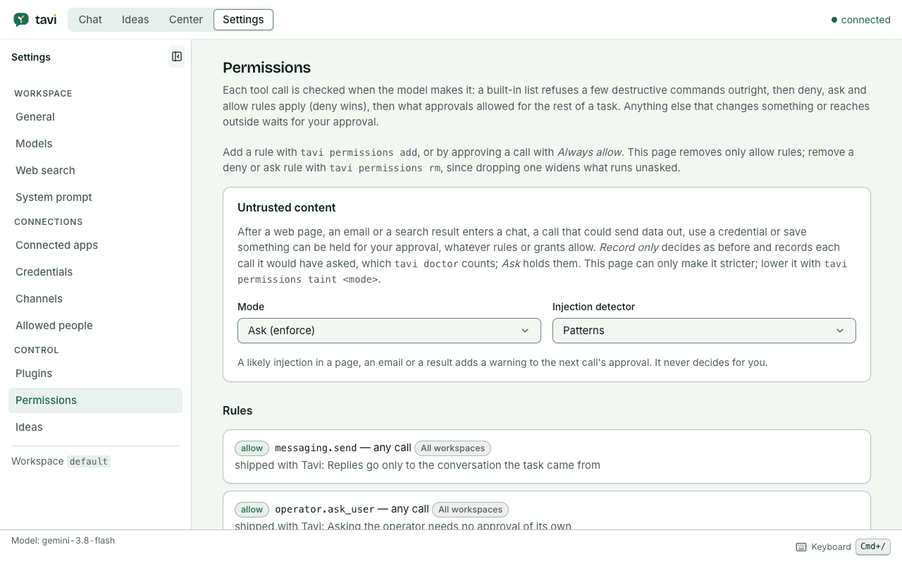
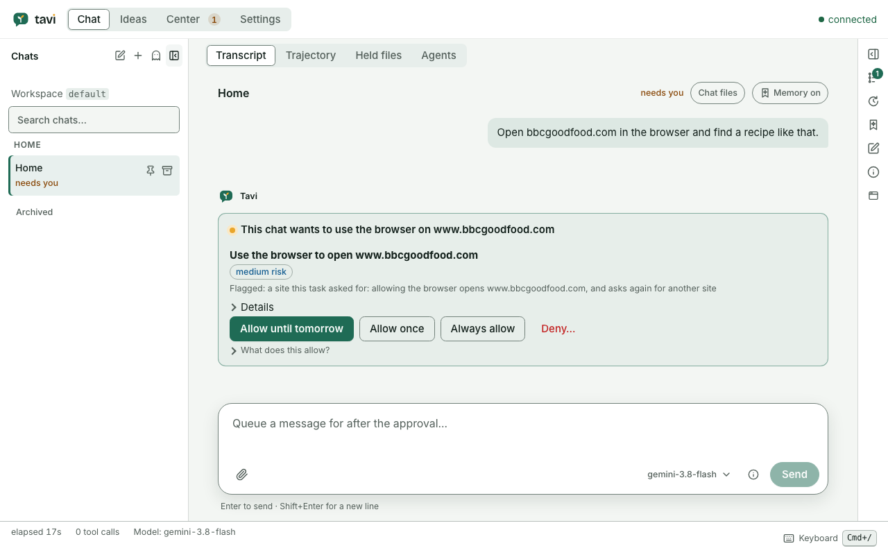
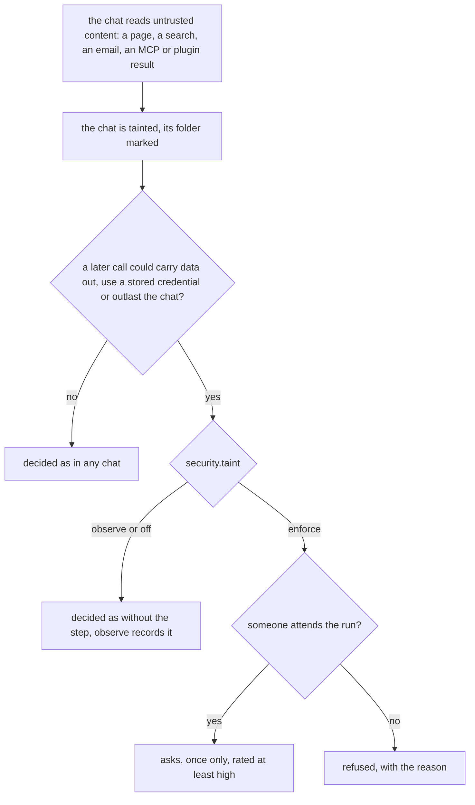

# Security model

This document describes how Tavi decides whether a tool call runs, waits for
you, or is refused: the hard-deny list, permission rules, chat grants, risk
ratings and approval rounds; how content Tavi does not trust is tracked
(content labels and the taint gate), fenced and scanned for prompt injection;
how tool output is reviewed and masked; and how credentials are kept. The
sandbox that confines `sandbox.run` and other children is in
[SANDBOX.md](SANDBOX.md). To report a vulnerability, see the root
[SECURITY.md](../SECURITY.md).

## Contents

- [Principles](#principles)
- [How a call is decided](#how-a-call-is-decided)
- [Permissions](#permissions)
- [Risk decides the scopes a round offers](#risk-decides-the-scopes-a-round-offers)
- [Approvals, reviews, questions](#approvals-reviews-questions)
- [Untrusted content and the taint gate](#untrusted-content-and-the-taint-gate)
- [The taint gate's rollout: `security.taint`](#the-taint-gates-rollout-securitytaint)
- [Untrusted content fenced, and an injection detector](#untrusted-content-fenced-and-an-injection-detector)
- [The browser's guards](#the-browsers-guards)
- [Desktop control](#desktop-control)
- [Output trust](#output-trust)
- [Credentials](#credentials)
- [Architecture](#architecture)

---

## Principles

- **Governed tools.** Tools with effects outside the model — writing files,
  sending messages, web requests, the browser, the sandbox — are gated. The
  model never chooses its own policy: a sandbox's filesystem and network
  policy, the hosts a credential may reach, and the domains a shell may dial
  are set by the operator. Under a workspace's `sandbox.network ask`, a run
  may name a host beyond them, which it reaches only once a person approves
  that call's card: no rule, grant or unattended run approves it.
- **Decided once.** Whether a call runs, waits for a person, or is refused is
  decided when the model emits it, and the verdict is checkpointed with the
  call. A rule or grant created while a round waits applies to later calls,
  never to that round.
- **Deny wins.** Nothing overrides a deny: no rule, flag, grant or approval
  lifts the hard-deny list or a deny rule.
- **Two axes for content.** Every piece of context carries a *content label*:
  its integrity (may this text steer actions? `trusted` or `untrusted`) and
  its confidentiality (what would leak? `public`, `personal` or `secret`),
  with the sources and references that say why. A chat that holds both
  untrusted content and private data is the dangerous case, and the gate is
  strictest there.
- **The fence is a hint, the gate is the control.** Untrusted text reaches the
  model fenced and scanned, but what stops a steered call is the approval
  step.

## How a call is decided

Each call is checked when the model makes it, before any round forms, in this
order (drawn as a diagram in
[The approval gate's order](TOOLS-AND-SKILLS.md#the-approval-gates-order)).
The first match wins:

1. **The hard-deny list**, which nothing lifts — no rule, flag or approval: a
   `sandbox.run` command that deletes the root or home directory (`rm -rf ~/*`,
   `${HOME}`, `rm --recursive /`, or `find ~ -delete` with no test before the
   delete), deletes the chat's working folder, managed folder, sandbox home or
   a read-write attachment whole (`rm -rf .` there, or the folder's path), is
   a fork bomb, runs a download as a shell script or writes a raw device; an
   `http.request` its own host or credential checks would refuse; a file tool
   touching a credential directory (`~/.ssh`, `~/.aws`, …) or the Tavi data
   directory; filling or typing into a protected browser field or a password,
   one-time-code or payment-card field (its value is never shown on a card, and
   only the person fills it via `browser.request_handoff`).
2. **Deny rules.** A call that does another tool's work is held by that
   tool's deny and ask rules too: an `http.request` with `saveTo` by
   `fs.write`'s.
3. **The taint step** — in a chat that has read untrusted content, a call that
   could carry data out, use a credential or outlast the chat asks once (see
   [the taint gate](#untrusted-content-and-the-taint-gate)). This is the
   default (`security.taint` at `enforce`); at `observe`, an opt-out, this
   step records instead of asking.
4. **The skill ceiling** — a call outside the `allowed-tools` of the skills
   loaded this turn asks once ([below](#a-skills-allowed-tools)).
5. **A call only a person decides** (`attendedOnly`: a `pdf.fill`, a
   mailbox's `send_draft`, a `web_search` whose query looks like a key or
   token) asks once, whatever a rule or grant says.
6. **Ask rules.**
7. **Allow rules** (shipped, seeded, `serve --allow` flag rules, and yours).
8. **Chat grants** made by approving with `session`.
9. **The effect default**: anything left that has an outside effect forms a
   round that asks you.

A `critical` call is asked even when a rule or grant allows it, and so is an
`askWhenTainted` call in a tainted chat. A run nobody attends refuses what
steps 3 to 5 would ask. A schedule's fire never creates or changes schedules
or routines, and neither does a worker it spawns: such a call is denied
whatever an allow rule or grant says. Its `--allow` list may name only their
read-only tools (`schedules.list`, `schedules.history`, `routines.get`,
`routines.list`, `routines.history`, `routines.inspect` and
`routines.targets`), and a list saved before that was refused is
denied those calls. A tool annotated destructive (`reminders.cancel`,
`todos.remove`, `schedules.cancel`, `agents.cancel`, an MCP write its server
calls destructive or gives no hint for) is offered `once` only when it asks, and its card says it cannot be
undone; an allow rule still lifts it, as nothing else is relaxed.
After every rule has decided, a mod's `tool.check` hook may make a call
stricter, never looser: it can ask about a call a rule allowed, or refuse it,
and no allow rule lifts that; in a run nobody attends its ask is a refusal.
The built-in guard mod (`tavi.guard`, off until enabled) does this for
`sandbox.run`: it asks before a command that deletes or overwrites files and
refuses one where nobody can approve ([MODS.md](MODS.md)).

## Permissions

### Rules

Rules are `deny`, `ask` and `allow`, per workspace; deny wins. They come from
three sources:

- **Shipped** — a reply into the task's own conversation (`messaging.send`)
  and a question to you (`operator.ask_user`) are allowed, and so is a
  `sandbox.run` line that only reads inside the working folder and prints
  (`ls`, `cat`, `rg`, `grep`, `find` with only tests and `-print`, `sort`,
  `uniq`, `tree`, and `git status`, `diff`, `log`, `show` and `branch` listing
  from the folder's root — each given only options known to leave it so, with
  no redirect to a file, no path out of the folder and no script on standard
  input): rule `shipped-sandbox-readonly`, which a deny
  or ask rule of yours overrides. To run every sandboxed line without asking,
  add `tavi permissions add --tool sandbox.run --decision allow`: the
  hard-deny list, deny and ask rules, and lines no rule can read still
  apply. The messaging
  profile holds some tools back from chat-started tasks (below). Override a
  shipped rule with a deny or ask rule of your own.
- **Flag** — `tavi serve --allow <tool>` (repeatable; `*` is refused). For
  `sandbox.run` it never covers a line no rule can read (`$(…)`, `eval`, a
  here-document), which is still asked about — and refused by a heartbeat
  check or a routine's run, which nobody attends; store a rule with
  `permissions add --match-unparsed` for that.
- **Operator** — rules you store.

A rule scoped to where a chat started (`web` for the canvas, `ipc` for
`tavi chat`) also follows where each message is typed: a `web` deny or ask
rule holds a canvas message in a Home that `tavi chat` began, and every worker
that message spawns, while an allow rule applies only when it covers both.

```bash
tavi permissions list                      # every rule in force: shipped, serve --allow, yours
tavi permissions add --tool sandbox.run --match "make *" --decision allow [--note "why"]
tavi permissions rm <rule-id>              # a rule you stored
tavi permissions grants [--task <task-id>] # what session approvals allowed
tavi permissions revoke <grant-id>
tavi permissions taint [off|observe|enforce]
```

`--tool` is a tool id or a dotted glob (`browser.*`); `--match` is a glob
(`*`, `?`, with `\` to escape them) over what the call does — a shell command,
`POST https://…`, a destination. An allow rule for every tool is refused. A
shipped or `serve --allow` rule cannot be removed: override it, or restart
without the flag. Under a live owner these commands run on it, over IPC. A
rule stored while a round waits applies to later calls, not to that round.
Full flags: [CLI.md](CLI.md).

What a `sandbox.run` rule does not see:

- **Data on standard input.** A rule or grant for a program that reads
  `stdin` as data (`jq`, `wc`, `python3 script.py`) covers it whatever the
  data. A script on standard input is part of the command instead: a shell's
  (`sh`, `bash -s`, `env sh`, a pipe into one) is read as its commands, each
  needing its own approval and held to the hard-deny list, and an
  interpreter's or tool's (`python3 -`, `node`, `xargs`, `patch`, `git
  apply`, …) pins a grant to that exact program. A shell or interpreter is
  read as running its standard input unless it is given inline code (`-c`,
  `-e`) or a script file. Every card shows the text given on standard input;
  one longer than a card shows can be approved only once. A program Tavi does
  not know to run its input (a tool of your own) is read as taking data, so
  grant such programs `once`.
- **Spellings.** A deny or ask rule also matches a command as it runs once
  wrappers and paths are read through (`env curl …`, `/usr/bin/curl …`,
  `timeout 5 curl …` as `curl …`); an allow rule matches only as written.
- **Lines asked every time.** A line with `$(…)`, `eval`, a here-document or
  another form no rule can read is offered only "once", and no allow rule or
  grant lets it through — not even one with no `--match` — unless the rule was
  stored with `tavi permissions add … --match-unparsed`. `permissions add`
  warns when an allow rule's glob starts with `*`.

### Chat grants

Approving with `session` ("Approve for this chat"; in Home, "Approve until
tomorrow") stores a chat grant matching exactly what the round showed — except
where the card says what it covers instead: for a `sandbox.run` build or test
command (`npm test`, `pnpm run <script>`, `cargo build|check|test|clippy`, `go
build|test|vet`, `pytest`, `tsc`, `vitest`, `jest`, `eslint`, …) the grant
covers that program and subcommand with any arguments (`cargo check *`). Each
of those already runs the project's own code, which the chat can edit, so a
variant grants nothing more. Any other command — a read tool, one a risk rule
names (`git push`, `rm -r`, `curl`), a shell, an interpreter, a wrapper, one
that runs a downloaded package (`npm exec`) or changes standing config (`go
env -w`), or a line with a redirect — is granted exactly. `always` always
stores the exact line. In a
Home, or a chat that came from Telegram or email, a grant lasts a day or until
the chat rolls over into its next epoch, whichever comes first — so a click
never becomes a standing rule there; the rollover ends its workers' grants
too, and `/new` ends them as well. Anywhere else it lasts the chat. Settings →
Permissions and `tavi permissions grants` show when one ends, and `tavi serve`
deletes lapsed grants at start and hourly.

### Settings → Permissions



The canvas's **Settings → Permissions** lists rules and grants, revokes grants
and removes your allow rules. It adds nothing and removes no deny or ask rule —
either would widen what runs unasked; use `tavi permissions rm`. A standing
rule from the canvas comes only from approving a call with *Always allow*,
which stores an operator rule matching exactly what the round showed;
`session` grants exactly that for the rest of this chat (in Home or a
messaging chat: a day, or until it rolls over). The chat's card says **Allow
for this chat**, and in Home **Allow until tomorrow**; the Command Center's
inbox says the same — **Allow until tomorrow** on a card from a Home or a
messaging chat (the owner marks those rounds `lastingChat` in
`tavi approvals list`), **Allow for this chat** elsewhere.
A rule made for every workspace is labelled *All workspaces*, here and in
`tavi permissions`.

### The messaging profile

A task started from a chat (Telegram, Mailgun, Discord) gets no `sandbox.run`,
`fs.write`, `fs.edit`, `plugins.validate` or `http.request` with a credential.
Neither does a message sent from a chat into a chat started elsewhere (Home,
say), any worker such a message's turn spawns, for the worker's whole life, or
a side chat opened from a chat that began in a messaging conversation.
`tavi serve --messaging-allow-tool <tool-id>` (repeatable) lets one of those
five through in your own one-to-one chats only — never in a group, a thread,
an email thread or another person's chat. See [CHANNELS.md](CHANNELS.md).

A spawn's `tools` list narrows its worker's tools and never widens them: the
worker's allowlist is the named tools its parent's allowlist already allows,
so a model cannot hand a worker a tool its chat may not use. Agent definitions
still carry no tool authority.

## Risk decides the scopes a round offers

Each call is rated `low`, `medium`, `high` or `critical`, with its reasons —
`rm -rf build` in the sandbox is high, a `sudo` critical. The round shows what
each call does and how risky it is, and the scopes it offers (`once`,
`session`, `always`) follow that risk:

- **Critical**: `once` only, and asked even when a rule or grant allows it.
- **High**, or **tainted** — made after the task read a web page, a search
  result, an HTTP response or other untrusted tool output, and marked as
  possibly steered by it: no `always`. A tainted call is rated at least high.
- A call an `ask` rule matched, and a write whose diff is too long to show
  whole (or that replaces a file too large to diff), are decided `once` only:
  what was not shown cannot be approved for later.
- A call to a **destructive** tool — one that deletes what cannot be had back
  (`reminders.cancel`, `agents.cancel`, an MCP tool its server does not say is
  safe) — is offered `once` only when it is asked about, and its card says
  *cannot be undone*. An allow rule you wrote, or a grant made before, still
  lets one through without a card, as it does any other call that is not
  critical.

A round offers only the scopes every one of its calls allows.

Each tool carries annotations, as MCP's hints say them: read-only,
destructive, idempotent, open-world. A tool that states none is read-only
exactly when its effect is, open-world when it is `external`, and never
destructive. They are metadata: no rule allows a call because of one. Only
read-only tools run side by side in one step.

## Approvals, reviews, questions

### Approvals

<picture>
  <source media="(prefers-color-scheme: dark)" srcset="assets/screens/chat-approval-dark.png">
  
</picture>

A round of gated calls waits for a decision. It can be decided:

- in `tavi chat`, with keys: `y` once, `s` for the rest of this chat (in Home
  or a messaging chat: a day, or until it rolls over), `a` always, `n` reject,
  `N` reject with a reason — `s` and `a` only where every call offers them;
- in the canvas, whose buttons also show each call's risk and exactly what it
  runs;
- at the prompt of a foreground `tavi run` (`[y/s/a/N]`);
- in the chat a task came from (below);
- from the command line:

```bash
tavi approvals list
tavi approvals approve <task-id> [--scope once|session|always]
tavi approvals reject <task-id> [--note "why not"]
tavi approvals show <task-id>
tavi approvals history [--kind approval|review|question] [--state granted,denied] [--since 2026-09-01] [--tool <tool-id>] [--principal <id>]
```

A round is decided once, wherever it is decided first; deciding a round
someone already decided elsewhere says who decided it, where and when.
`tavi approvals approve` defaults to `once`, except that a browser round is
allowed for the rest of the chat — on the site it opens: a browser decision
grants every browser tool for the host the card names (the card says "the
browser on example.com"), and opening another site asks again. A click,
typing or screenshot is held to the host its page is on now, so after a link
or a redirect leads to another site the next call there asks again. No
approval, grant or rule lets the browser open this machine or a private
network — loopback, RFC 1918 and ULA, link-local (the cloud metadata service),
CGNAT — whether the URL names the address or a name resolves to it; only the
operator's `--browser-allow-host` does. The rule is enforced at the network
layer: every connection the browser makes goes through an egress proxy of the
owner's, which checks the host and connects only to the address it checked —
redirects, workers, WebSockets, new tabs, prefetches and DNS rebinding
included. A confined browser on Linux goes out only through the sandbox's
own proxy, which holds it to the same rule and also connects to the address it
checked; see [BROWSER.md](BROWSER.md#allowing-the-browser). A
browser decision that named no site grants only what reaches nothing (a
screenshot, closing a session), and a browser grant or rule that names no site
never covers a call that names one. `tavi approvals show <task-id>` prints a
task's rounds that went to a chat — announced, decided (by whom, via what,
with what scope), refused, expired, shown in the chat, and each call's result
— then every call it asked about with its full input. `tavi approvals history`
lists what was decided before across the workspace, newest first: approvals
(who, through which channel, with what scope, and the rule an "always"
created), artifact reviews and answered questions, each under the task's
generated title when it has one; `--tool` and `--principal` narrow it to one
tool's approvals or one person's tasks, and it prints the same lines whether
or not `tavi serve` runs.

### Approvals in the chat a task came from

A round raised by a task that started in Telegram or email — or by an agent
that task delegated to — is sent to that conversation with a short token and
what each call does:

```text
approve k3f9abcd            # this round only
approve k3f9abcd session    # and exactly these commands/requests for the rest of this chat (a day at most, or until it rolls over)
approve k3f9abcd always     # and a workspace rule that allows exactly them from now on
reject k3f9abcd too risky   # the reason is what the model reads
```

Only the scopes every call of the round allows are offered; a `session` for a
tool with nothing narrower than its name to match covers any call of it in
this task, and the message says so. The reply says which scope was applied.
`approve` or `reject` with no token decides the conversation's pending round.
A round may quote the URL the call would open; in Telegram it is sent with
link previews off, so showing it fetches nothing.

A round nobody decides within 24 hours (`tavi serve --approval-expiry
<hours>`, 0.25–720) is rejected, and the chat is told. Only a round that
reached the chat expires: an announcement that failed is sent again on every
sweep (each 30 seconds), and its expiry starts when it is delivered. Rounds
decided in a terminal or the web app never expire. However a round is
settled, the chat is told who decided it, where and when, in the workspace's
time zone — `✅ Approved for this chat by Ana via Telegram at 16:02 EET.`

In Telegram the round also carries buttons — Once, Session, Always when
offered, Deny — and once decided, anywhere, the message loses its buttons and
shows the outcome. A web page already showing that chat draws the round too,
so it can be decided there. After Deny your next message in that chat is the
reason — optional: `-` for none, and with no reply within two minutes it is
rejected without one. A press only counts from the person the task belongs
to, and rounds and replies stay in the forum topic the task started in. An
email's round links to a page that decides it; a critical call's page also
asks for your PIN (`tavi credentials set approvals.pin`). A link decides as the
round's decider whoever opens it, so it is sent only to the address bound to
the decider: another person writing in the same thread gets the card without
links or token. See
[CHANNELS.md](CHANNELS.md).

### Form fills

A `pdf.fill` or `pdf.overlay` round shows every value with its source and
whether it was found there, by page, with the fields left for you to sign: in
full in the canvas and `tavi chat`. In your one-to-one chat (Telegram) the
sensitive values are masked — an ID, card, insurance or phone number to its
last four, a date to its year, an email address to its first letter and
domain, health details hidden — and the fill can be approved there only when
every masked value was found in its source and every row was shown (a long
form takes up to three messages). A group, a topic or an email shows the field
names only; an email's link page shows the masked table, and only its link can
approve. Anywhere else the round can be rejected, and is approved in the
canvas or with `tavi approvals approve`. The filled pages show beside the
fill's result in the canvas. See [PDF.md](PDF.md).

### Hidden characters on a card

Everything a card shows that a model, a page or a sender could have written —
a call's title, command, URL, path, destination, form values, the reasons, an
argument's origin, the call's input in the details, and a question's text and
options — is cleaned once, where the card's text is built, so the terminal,
the canvas, Telegram and email all show the same thing. A terminal control
(C0 and C1 control characters but newline and tab, and so every escape
sequence), a bidi override or isolate (U+202A–U+202E, U+2066–U+2069), and a
zero-width, variation-selector or other invisible character (U+200B–U+200F,
U+2060–U+2064, U+FEFF, tag characters, U+FE00–U+FE0F and U+E0100–U+E01EF,
the grapheme joiner, Hangul and Mongolian fillers — every default-ignorable
character) is shown as a visible mark — `⟨ESC⟩`, `⟨U+202E⟩` — instead of
hiding or reordering part of what you approve. What an emoji or a script
needs is left alone: one presentation selector right after a pictograph (or
after a keycap's digit, `#` or `*` before its keycap mark), a joiner between two
pictographs, a non-joiner between Arabic-script letters, and the tags of the
three recommended subdivision flags (England, Scotland, Wales) — any other tag
run, a common way to smuggle text, is marked. A card that held a marked character says "the call's
text holds hidden or control characters" and is rated high risk. The same
marks are used where `tavi permissions` and Settings → Permissions show a rule's
or grant's matcher, and in the foreground `tavi run` prompt and
`tavi approvals show`.

### Why am I asked, and from where

After a chat has read content Tavi does not trust, each call's card says why
it asks in plain words — for example "this call opens an address you did not
give and Tavi cannot vouch for: a model wrote it, or a page showed it after the
model typed on that page" — and what the chat read, as chips that
lead with what Tavi itself established: the host it parsed from a page's URL
(`news.example`) — the page it ended on, after redirects — a part of your own
email you forwarded or quoted, with the verified domain it came through (`mail
you forwarded or quoted (via x.example)`), or the kind of source (`search
results`, `a download`). What a desktop tool read is `a desktop app's screen
(TextEdit)`, naming the app only when its name is plain words (else its
bundle id, or none): the gate holds it as a web page's (the `web` source), only
the words differ. A page's or sender's own title only follows, as "the
page calls itself “…”", clipped to 60 characters and stripped of markup and
control characters, so content never speaks in Tavi's voice.

The card also marks where each of the call's values appears: `from your
message`, `appears in news.example`, or *not in this chat's recent text* (the
model wrote it, or it is older than the last 100 KB of the chat). That is
display only, and never changes a decision: a paraphrase defeats it.
`tavi chat` prints the same under the call, and a chat's round says it in one
line — `⚠ after reading example[.]com and mail you forwarded or quoted (via
x[.]example) — once only` (its hosts disarmed, as every reply of a tainted
chat is). The Center's approvals inbox, the email link's page and
`tavi approvals list` say the same line under each round whose chat read such
content.

### A skill's allowed-tools

A skill loaded this turn that declares `allowed-tools` narrows what the turn
may do without you: a call outside the union of the lists of the skills in
scope asks once (gate reason `outside-skill-ceiling`, after every deny and the
taint step, before any ask rule, allow rule or grant), with a card naming the
skill, and is refused in a run nobody attends. It is no taint: the chat is not
marked, and `tavi doctor`'s taint line does not count it. It only ever asks; a
listed tool is decided as before. It is no defence against injected content:
loading any approved skill that declares no list lifts the ceiling for the
turn, so untrusted content is held by the taint step, not by this. See
[SKILLS.md](SKILLS.md).

### The taint chip

The chat header in the canvas carries an amber shield among its tools once the
chat has read such content, named and titled with up to three sources (`Read
news.example and mail you forwarded or quoted (via x.example)`); `tavi chat`'s
status line carries the same words as a chip (`⚠ Read news.example … (/taint)`).
Its details — click it, or type `/taint` — say what the chat read, that a call
sending data out, using a credential or changing something lasting asks you
once, and the remedy: **Start a fresh chat**. *Fresh context* (`/compact`)
does not clear it: the summary is written from the same content.
`tavi tasks <task-id>` prints the chat's `contextLabel` too.

### Artifact review

Files a tool makes for the model to see — a browser screenshot or download, a
file sent by path — are created `pending` and wait for review before the model
sees them. The model never sees a pending artifact's content, and a rejected
one never reaches it at all. Size alone asks no one: a result over 64 KiB is
archived whole, `approved` and with its result's label, so its taint travels
with it, and the model is shown a short preview (its shape, long text cut to
head and tail), and reads the rest with `artifacts.read`, which carries the
archive's label and reads only the calling chat's own artifacts. A tool that made a pending artifact and returned a large result
besides still waits for that artifact's review. `tavi run --approval approve`
reviews its own run's artifacts as it decides its rounds: each is approved,
recorded as reviewed by `auto:<principal>` rather than a person, keeps its
label (a download stays web content to the turn that reads it), and the turn
resumes; `ask` and `deny` leave the review for a person.

```bash
tavi artifacts list
tavi artifacts approve <artifact-id> [--resume]
tavi artifacts reject <artifact-id> [--resume]
```

`tavi chat` shows one review card for all of a round's artifacts. Once
approved — by any of these, `tavi chat`, the canvas, a schedule's tool
policy or `tavi run --approval approve` — a browser download is copied into `downloads/` in its chat's own
folder (`chats/<workspace>/<task-id>/downloads/`; a worker's goes to its
chat's), under the name the page suggested made safe: no path, no leading
dot, no control, format (right-to-left override, zero-width) or
line-separator characters, at most 128 bytes. A report from
`reports.generate`, and a routine's PDF report (`routine-report-<date>.pdf`,
in its fire's folder), are stored approved, so they are copied into
`reports/` at once. Nothing pending or rejected is ever copied, a file of the
same name gets ` (2)`, ` (3)`, …, and it is a copy: changing it never changes
the reviewed artifact. Never a host folder the chat works in. A copy that
failed is retried by approving the artifact again.

These count as reading web content: `fs.read` of a file in `downloads/`, an
`fs.grep` match in one, `fs.list` of `downloads/`, an `fs.glob` that matches a
file in it, and any `sandbox.run` while the chat's `downloads/` (or, in a side
chat, its parent's) holds anything. A copy the shell moved out of
`downloads/` is not tracked once `downloads/` is empty. Only the browser
writes `downloads/`: `fs.write`, `fs.edit` and `sandbox.run` refuse it, so
what is read there is always a page's. A report that quotes news headlines
from your projects' feeds is treated as web content too, and so is its chat's
folder once the copy lands there.

### Questions

Questions a task asks (`operator.ask_user`) are answered in `tavi chat` by
typing, or in the chat (Telegram, Mailgun) the task came from, or with
`tavi approvals answer <task-id> --answer <text>` (also
`tavi answer <task-id> <answer>`). A question that is a choice lists 2–4
numbered options: reply with a number (several for a multi-select, e.g.
`1 3`) or tap a button in Telegram or the canvas; your own words are taken too
unless the question says otherwise. A question asked at a terminal or in the
canvas waits 30 minutes; any other (a chat, a schedule, a delegated agent)
waits a day. `tavi approvals needs` (also `tavi needs`) lists everything
waiting on you as one queue.

## Untrusted content and the taint gate

How a chat's taint follows through to its later calls:



### What makes a chat tainted

A chat is *tainted* once its context holds content labelled `untrusted`. The
sources are: a web page (`web_fetch`, `browser.*`), a search result
(`web_search`, `news.search`, `travel.*`), an inbound email's quoted or
forwarded part or an unverified email, a chat message from someone other than
the task's person, a forwarded chat message, channel media, a managed
download, an MCP result, an external plugin's result, a worker's or peer's
message carrying an untrusted label, a notice read in Home about a run or
side chat that read untrusted content (its label, private data included, stays
with Home as a worker's result's does; a notice about a chat that read nothing
untrusted taints nothing, and a block holding a notice Tavi cannot trace to a
chat — a reminder's text, "Earlier chats" — taints that turn alone), a side
chat's background when its parent read untrusted content (it starts with the
parent's label, no more), a past chat a `sessions.search` found, routine
output, heartbeat signals and page excerpts, and `sandbox.run` output while
`downloads/` holds files or after a run whose request reached a granted
domain (its `requests` show an `allowedCount` above 0, or it failed after
one did). A chat's folder is marked too: what a tainted chat
writes there taints whoever reads it — a side chat reading its parent's
folder, a worker reading the folder it shares with its chat — and a file a
tainted chat writes in a host folder is remembered by its contents until you
edit it outside Tavi. See [WORKING-FOLDERS.md](WORKING-FOLDERS.md).

Labels join: a turn's label is the join of everything it read, so integrity
only falls and confidentiality only rises within a chat. Your own messages,
Tavi's own prompt and the memory Tavi shows the model are trusted.

A call that failed taints as its tool's output would, with two exceptions
whose words are Tavi's own: a refusal before the tool runs (a missing
permission, arguments that do not fit), and a built-in's refusal whose
message is Tavi's own words, raised before it reached anything outside
(desktop control's helper not built, a mailbox not connected), which Tavi
marks as such where it raises it and which wraps no other error. So a
`desktop.observe` that refused leaves the chat clean. Tavi's own argument
validation of an MCP server's or external plugin's tool is trusted too: it
quotes the pinned schema the model already has. Any other failure of a tool
that reads untrusted content still taints, failing closed, whatever its
code: a handler's error can quote what it read (a page element's label, a
mailbox label's name, a guard's reason), a refusal raised after a
round-trip can carry a server's answer (a Google API that is off, a sign-in
the provider revoked), a wrapped error can carry a server's text, and an
MCP server's or external plugin's refusal is that server's or plugin's
words.

### What is asked about once

With `security.taint` at `enforce`, in a tainted chat, a call that could carry
its data out, use a stored credential or outlast the chat waits for you, and
its round offers `once` only — whatever an allow rule, an *Allow for this
chat* grant, `serve --allow`, an *Always allow* rule or `--approval approve`
would otherwise do. `--approval approve` and a schedule's `--allow` list
refuse such a call, with the reason, since nobody is there to see it. That
covers:

- **Opening a URL the chat has not seen** — `web_fetch`, `heartbeat.fetch`,
  `browser.navigate`, a new browser session's page, or a plain `http.request`
  GET. A URL is *seen* when it is exactly one in your messages, in Tavi's own
  prompt or the memory it shows the model, in a tool result (a page's listed
  links and a fetch's redirects included), or one you approved earlier in the
  chat; it stays seen after older messages are summarized. In the browser, a
  page of a site the chat has seen or you allowed for it, with no query or
  fragment, whose path is the site's root or one your messages name as
  written (`/login`), counts as seen too, private data or not: nothing is
  composed into its address. Only a result from
  outside counts — a page, a search, an email, an MCP or plugin tool, a
  download — never one a model could have written: a worker's answer, a past
  chat, a routine's output, a sandbox's output or a file in the chat's folder.
  A URL the model wrote or extended is not seen, even once a tool result
  repeats it (a finding, a file it wrote or edited, text it typed, a worker
  repeating it, `agents.status` showing a worker's answer); a browser page the
  model typed into makes no URL seen afterwards; and in the browser a
  `#fragment` counts. A worker's own prompt is its chat's model's words, and
  so is a heartbeat check's: the worker starts knowing the URLs its chat had
  seen, the check the pages it watches.
- **A request or typing the model composed** — a request with a body or
  headers of the model's (`http.request` POST, or any header), and typing in
  the browser — text, or a key that types a character — on a page whose site
  is not in a seen URL, or on a page Tavi has not looked at yet, and on any
  page once the chat also holds private data (below). Text copied from your
  own messages is asked about too: they may hold a number or code an injected
  page asks for. Clicks, scrolls and keys that type nothing are not asked
  about. A submit, an upload, a download, a
  press of a committing button (paying, sending/posting, account/authorization,
  legal acceptance, or destructive actions across the protected-field languages,
  or any form-submitting control outside a strict search form) and acting by
  sight (`browser.vision_act`) ask once, and are refused where nobody attends.
- **Sending elsewhere** — `messaging.send_to`, `routines.run` and
  `routines.retry_delivery` — except a schedule's own brief: a fire's
  `messaging.send_to` to the schedule's alert destination
  (`--alert-connection`/`--alert-destination`, no other thread or topic) is
  its reply, sent with every address the run has not seen defanged, as a
  reply in a chat is; since who reads that destination is not known, it counts
  as a group once the run also holds private data (below). The scheduler's own
  alert there quotes the run's final words with every address disarmed, and
  goes to Home instead when the destination refuses it or cannot be reached.
- **Any call with a stored credential.**
- **Opening the browser signed in** — a `browser.create_session` on the
  workspace's profile (the default), whatever the page: it carries your
  cookies and sign-ins, so an injected instruction could steer the model into
  your accounts. Once you have approved a signed-in session in a task, tainted
  or not, later ones in that task do not ask again for this (a new address
  still does). A signed-out session (`profile: "ephemeral"`) is not asked
  about for this; where nobody attends, the refusal tells the model to open
  one. A session opened before the chat read untrusted content stays open,
  and its navigations and typing are asked about as above.
- **Anything that outlasts the chat** — creating, changing or cancelling a
  reminder, adding, ticking off, changing or removing a to-do (`todos.*`: the
  seeded `seeded-todos` allow rule does not lift this, as the taint step comes
  first), creating or changing a schedule (`schedules.*`), routine changes,
  `heartbeat.propose`, `plugins.validate`, and file writes outside the chat's
  own folder — an `http.request` whose `saveTo` names a host-folder file
  included, as each `saveTo` is assessed as the `fs.write` that creates that
  file.

### Once the chat also holds private data

Private data is anything the chat read in the browser (the browser shares your
profile and its cookies), your memory or past chats (`memory.search`,
`memory.list`, `memory.get`, `sessions.search`), a host-folder file, a business collector's
report or a credentialed request. Your own messages and the memory Tavi shows
the model do not count as private data here, nor does a `memory.search`,
`memory.list` or `sessions.search` that found nothing: no record read, none held. Once a tainted
chat also holds private data, three more things ask once:

- a web or flight search (`news.search` does not: its query is the project's
  configured keywords);
- a reply into a conversation not known to be one-to-one — a group, a forum
  topic, or a chat whose channel does not say what it is (a reply in a direct
  chat, an email thread or the app does not, even when another member wrote
  the turn);
- every typing step in the browser, whatever the page.

### What is not asked about

Replies in the chat (outside that case), snoozing a reminder, web and travel
searches (outside that case and the one below), `memory.propose` and
`skills.propose` (each only files a proposal, and its card is where you keep or
discard it: every workspace is seeded once with the revocable allow rules
`seeded-memory-propose` and `seeded-skills-propose`; `tavi permissions rm` one
to be asked each time, and it is not seeded again) and work inside the chat's
folder are not asked about. In a tainted chat
`memory.search` searches only this device's own memory index, by words, and
says its results are partial. A tainted chat's `sandbox.run` gets no network
and no injected credentials, and writes only its own folder (see
[SANDBOX.md](SANDBOX.md)). A tainted turn is never captured to memory
automatically, whatever `security.taint` says.

A deny rule still refuses. A routine's run, a heartbeat check, a schedule's
fire and `tavi run --approval approve`, which nobody attends, refuse such a
call instead of asking, and tell the model why.

### A web search's query

`web_search` runs without asking by the allow rule every workspace is seeded
with (`seeded-web-search`; `tavi permissions rm seeded-web-search` to be asked
each time, and it is not seeded again; `tavi doctor`'s `webSearch` section
says whether it is still there). Two kinds of query still ask:

- **A query shaped like a secret** — an API key, a token, a private key, in
  the shapes Tavi masks in tool output — asks once in every chat, tainted or
  not, whatever a rule or grant says (`attendedOnly`), and a run nobody attends
  is refused it: a key sent to a search provider has left the machine whoever
  typed it. Prose that only mentions such words (`bearer bonds`,
  `max tokens: 512`) does not match.
- **In a tainted chat, a query shaped like data leaving** — a link carrying a
  query string, a domain whose name carries data, a long code, a card number,
  an email address, or over 300 characters with its `site` — asks once
  (`askWhenTainted`), and is refused where nobody attends. So does any search
  once the tainted chat also holds private data (above).

### A schedule's webhook

A schedule's webhook is off unless a person turns it on (`tavi schedules
webhook`, or its page in the app); no tool turns it on, rotates it or reads it,
so its secret never passes through a model. The secret (256 random bits) is
shown once and kept only as its SHA-256. The signing key is a separate 256
random bits, shown once and kept only encrypted with the credential key
(AES-256-GCM, bound to its schedule), so a read of the database alone yields
nothing that can call or sign; it is made only while the credential store is
encrypted, and without it signed calls are refused. A call is accepted with
`Authorization: Bearer <secret>`, compared by hash in constant time before
the body is read, or signed with HMAC-SHA256 over `<timestamp>.<body>` keyed
with the signing key, its timestamp within five minutes and each signature
taken once (in the ingress's replay cache; `503` when it is full); anything
else is `401` with no detail. Failed calls are counted per sending address,
across all schedules (a burst of 10 a minute); once that is spent, a call with
neither the secret nor fresh signature headers is refused before its schedule
is looked up, while a bearer or signed call is still checked and charged only if it
fails, so junk calls cannot lock the real caller out; accepted calls are
limited after they are checked (one fire a minute, 12 an hour), each run they
start is stopped past 250,000 tokens unless its schedule sets its own ceiling,
the body is capped at 8 KiB, and refusals are recorded
by count and cause, never with a header or the body, and logged at most once
per schedule every 5 seconds. A fire it starts is a
`run-now` under the schedule's own tool list and policy, and starts tainted
(source `webhook`): the body comes after the operator's prompt as a
quoted-data message of its own (`trigger-…`, labelled `webhook`), never in
the prompt, so none of its URLs is known to the taint step, and the denial of scheduling writes, the critical and
MCP-write denials and the other taint rules apply from its first turn, and
the body cannot widen what the schedule may do. The ledger keeps the body's
size and a hash prefix only. A call to a schedule whose webhook is off, or to
an id with none, is answered as a wrong secret is (`401`, `405`, `413`) and
never recorded; the owner keeps the ids of the schedules whose webhook is on in
memory and looks up only those, so a flood of made-up ids never reaches the
database.

### A schedule's email trigger

Email is the most common way injected instructions reach an agent, so a
schedule's email trigger is off unless a person turns it on (`tavi schedules
email-trigger`, or its page in the app); no tool turns it on or changes its
senders. It needs a sender list (exact addresses or `@domain`) and an email
connection whose channel authenticates each sender; a connection that cannot
(Telegram, a plugin channel without per-message authentication) is refused,
and so is an `@domain` entry for a public mailbox domain (`@gmail.com`,
`@outlook.com`, `@yahoo.com`, `@icloud.com`, `@proton.me` and a few more),
where anyone can get an address; an exact address there is allowed.
An email fires it only when its sender is listed **and** the channel's own
verdict passed (a message with no verdict counts as failed, and a binding's
trust-unverified override does not apply), so a forged From of a listed
address fires nothing. What the verdict proves is the sender's **domain**,
not the person: Gmail's pass is a DKIM signature aligned with the From
domain (neither SPF alone nor a DMARC pass that rests on SPF alone counts); Mailgun's is SPF and DKIM for the envelope sender's domain; and
alignment is relaxed, so a subdomain's mail counts. An exact address
therefore relies on that domain's own mail servers to stop its other users
sending as it. The run it starts
is a reader session (`TaskExecutionPolicy.readOnlyTools`): only tools that
read and reach nothing outside (sink `none`) are offered, and the gate
hard-denies any call whose effect — as declared, or as its assessment raises
it — is not read-only, or whose sink is anything but `none` (`web_fetch`,
`web_search`, an MCP server's read on the default `network` sink), whatever
an allow rule, a session grant or the schedule's own tool list says. The one
exception is `messaging.send_to` assessed as a send to the schedule's own
configured delivery destination (`sink: reply`), which is the schedule's
delivery, not the email's choice; the Home post a schedule makes after its
run is the scheduler's, not a tool call. The flag is part of the task's
durable policy, so continuations keep it and every worker the run spawns
inherits it. The run also starts tainted (source `email`), and the email's
subject and text (at most 8 KiB) come after the operator's prompt as a
quoted-data message of their own (`trigger-…`, labelled `email`), never in
the prompt: none of its URLs is known to the taint step, and a string copied
from it shows as the email's in an approval's argument origins. Its sender's
address appears only in that quoted block's heading, never in the run's own
note, since its local part can be any words. A webhook's
payload is delivered the same way, labelled `webhook`. Fires are limited to
one a minute and 12 an hour per schedule, each run under the same default
token ceiling as a webhook's; the ledger keeps the sender, size
and a hash prefix of a fire's email, and counts refused emails by cause
without their sender or words. An email the trigger takes is held while the
trigger decides and marked handled in the inbox before its run is started,
so a redelivery — while the run is admitted, or after a crash — is never
admitted as a conversation's message; one it does not take is handled
exactly as before.

### A schedule's pre-check

A schedule's `--precheck` (off unless set) adds no tool: a `page-changed` or
`feed-has-new` address is read over the guarded public fetch a heartbeat's
watched pages use (https only, no credentials, cookies or caller headers, a
public address resolved once and dialled as validated, every redirect
re-checked, 2 MiB and 10 s at most), dialling only the address's own host; an
address with a port, credentials or an IP literal is refused when the schedule
is saved. Like every unattended read, it is held to the site profiles: an
address whose profile is not browsed, is read only while the person attends,
or whose robots.txt disallows the path is refused when the schedule is saved
and again before each check, which then fails with the profile's reason. A
feed is scanned in one forward pass and read for at most 1,000 items, so a
hostile feed cannot stall the owner. A `file-changed` file is read only under
one of the owner's `--fs-root` folders and never in the data directory or a
credential home, checked when it is saved and again before each read. It is
opened without blocking and without following a link put there since its
check, must be the regular file checked (the same device and inode), and is
hashed up to 16 MiB, past which its size and modification time stand for it. Nothing
the check read reaches the run: the run is told only the address or path that
changed, and reads it itself under its own tool list and the taint rules above.

### A schedule's watcher

A watcher (`tavi schedules watch`, or **Watch it** in the app) is a schedule
with a pre-check and a cadence of an hour or more; no tool makes one or
changes what one watches (`schedules.update` refuses a watcher's pre-check),
so a model cannot set up work that starts on outside events. Its checks are the
pre-check above, with no tool and no model, and a run starts only when one
finds a change. A file watcher's file is watched only while `tavi serve` runs,
under an `--fs-root`, and held to the folders when the watch is set up and
again before each check (and the pre-check holds it at its read). A change
makes at most one check a minute and 12 an hour, after a 30-second quiet
spell, so a file written in a loop drives at most 12 runs an hour, and six
runs in a row within an hour, each on a change, leave it to its cadence for
the next hour, its person told once. Its runs count toward the schedule's
failures, so one that keeps failing pauses after three, and a failed run's
change counts as seen rather than running again on the next event. A check
is a run-now of the schedule under its own tool list and policy, with the
in-flight guard, and its run is told only the path. The schedule is read again before each
check, and the watches follow edits, pauses and removals and end at stop.
A schedule made from a chat names its pre-check on its approval card. A check
refused or failed runs nothing, and is recorded and told.

## The taint gate's rollout: `security.taint`

`security.taint` sets how the taint step applies, per workspace:

- **`enforce`** — the default. The step asks, as described above, and each ask
  is recorded (`tavi doctor`: `taint asked N calls …`). A routine's or
  heartbeat check's denial is recorded as `deny`; a schedule fire's or
  `--approval approve`'s refusal of the round is recorded as the gate's `ask`.
- **`observe`** — an opt-out. Every call is decided as it would be without
  the step (rules, grants and `serve --allow` apply), and each call the step
  *would* have asked about is recorded: its task, tool, effect, sink, decision
  and reason — never its arguments — kept 30 days. `tavi doctor` reports them
  in its `taint` section as `taint would have asked N calls in 7 days (top
  tools …)`. The unattended deny of tainted `askWhenTainted` and `critical`
  calls applies in every mode. Under `observe` an injected page or email can
  steer what a rule or grant already allows, so the owner logs a warning at
  start while a workspace has it, and `tavi doctor` warns too.
- **`off`** — the step neither asks nor records. It is deprecated, and is
  warned about the same way.

A workspace that never set `security.taint` gets `enforce`.

```bash
tavi permissions taint                 # the mode in force
tavi permissions taint enforce         # or observe, off; the same as tavi config set security.taint enforce
tavi serve --taint-policy enforce      # every workspace, for this owner's lifetime
```

**Settings → Permissions** shows it under *Untrusted content* and can make it
stricter (`observe` → `enforce`); lowering it is refused from a page, as
removing a deny rule is — use `tavi permissions taint`. `tavi serve
--taint-policy <mode>` overrides every workspace's setting until the owner
restarts without it (a workspace's own setting is kept, and
`tavi permissions taint` shows both); the order is `--taint-policy`, then the
workspace's `security.taint`, then `enforce`. The memory capture mark (a
tainted turn is never captured automatically) does not depend on it: it is
always on.

## Untrusted content fenced, and an injection detector

**What the model reads from an untrusted source is fenced.** A web page, a
search result, a worker's or past chat's words, a plugin's or MCP server's
result — any tool result or quoted block labelled untrusted — reaches the
model between two lines:

```text
[untrusted:3f9c0a1b7d2e4c55 source=web host=docs.example]
…the page, as Tavi read it…
[/untrusted:3f9c0a1b7d2e4c55]
```

The id comes from the chat and the tool call, so a page cannot know it in
advance, and the same result is sent the same way on every later request (the
prompt cache keeps working). The `host` is what Tavi parsed, never the
content's own words. Inside the fence, anything that could pass for a fence or
a role turn is rewritten as quoted text first — a forged `[untrusted:<id> …]`,
`[/untrusted:<id>]` or `</untrusted>`, a `[context]` or `[inbound]` marker,
and chat-template tokens by their exact names, such as `<|im_start|>`,
`[INST]` or `<start_of_turn>` — also when written in look-alike letters,
fullwidth forms or split by invisible characters; nothing else in the text
changes (code such as an F# `<| … |>` pipeline is left as it is).

Someone else's words in a message — an email's quoted or forwarded part,
another group member's message, an attachment, a heartbeat's item — keep their
own `[inbound]` … `[/inbound]` fence, with the same rewriting inside it. The
side calls that read untrusted text get it too: the summary of older history
(each untrusted message in its own fence), `browser.extract` and
`browser.find`, `browser.vision_act`'s results, the detector's `model`
classifier and the Activity summarizer. So does everything in a call's
`[context]` block (retrieved memory, the profile, preferences and epoch
summaries) and a routine's pinned skill references (approved words, rewritten
as defence in depth). Tavi's default instructions say the
fence holds data, not instructions. Results from trusted tools are never
fenced, and what Tavi stores (the chat's history, its exports) keeps the
result as it was read: the fence is applied when a request is built for a
provider. The fence is a hint to the model, not a guarantee — what stops a
steered call is the approval step above.

**`security.injectionDetector`** (`off`, `patterns` or `model`; default
`patterns`) reads a tainted chat's untrusted content for likely injections —
text addressed to the assistant rather than the reader, override and
concealment requests, forged markers, chat-template tokens, hidden or encoded
instructions. When it finds one, the next call that asks for your approval
says so (*possible prompt injection in web content (override)*) and is rated
high risk. It never allows, refuses or lowers anything: a call is decided
exactly as it would be without it. `model` also asks the workspace's `fast`
model, else the chat's own model (a chat on a local connection uses its own
model, never a remote one), about the texts the patterns pass; it costs a
model call per untrusted text. Measured on 500 benign pages, `patterns` warned
on 1 (0.2%).

```bash
tavi config set security.injectionDetector model    # or patterns, off
```

**Settings → Permissions** shows it under *Untrusted content*.

## The browser's guards

Besides its approvals (above) and the destination rule, the browser holds every
call to these checks, in code, wherever the call comes from. The full list of
what it refuses is in [BROWSER.md](BROWSER.md#what-the-browser-refuses).

- **Sessions.** A session is its chat's: every tool that names one is refused,
  `NOT_AUTHORIZED`, for a session another workspace or another chat opened,
  closing included. A chat's workers count as the chat (see
  [BROWSER.md](BROWSER.md#the-navigation-allowlist-and-private-addresses)).

- **Forms sent.** A press that sends its form — a submit control of it,
  wherever on the page it sits, or Enter in one of its fields — is refused in
  the page unless the call was approved as a submit, whatever the control's
  label ("Continue", "Weiter", an arrow). A strict search form and a filter
  form's own buttons are exempt. So acting by sight, recipe replay and batch
  steps never send a form nobody was asked about.
- **Frames.** A frame on another host than its page is held to the same
  destination rules as a page the session opens: it is read only on the
  page's own host, a host a person allowed for this session, or one the
  browser opens unasked (`--browser-allow-host`, an enabled site profile). Any
  other frame, and every frame inside it, is neither listed, read nor acted on.
  An action on an element in a frame is asked about on that frame's host, and
  runs only when that host was decided, whatever the page's: a batch whose
  steps (or a drag whose drop target) land in frames on other sites is asked
  about for each of those hosts, as its steps sent one by one would be.
  A check the browser makes in a frame before it acts (a protected or secret
  field, a commit label) finds that frame by its exact address, or by a name
  only one frame bears; when it cannot, the action is refused.
- **Downloads.** A file is kept only through `kind: "download"`, which is asked
  about like an upload. A plain click that starts a download has it cancelled
  and kept nowhere, and the model is told to ask for it as a download.
- **Dialogs.** An `alert` is accepted; a `confirm`, `prompt` or `beforeunload`
  is dismissed, and each on the session's page is reported. Accepting one takes
  `dialog: { accept: true }` on the action that raises it, asked about first
  as a submit. When a dialog was dismissed on the host before, the card names
  its message and commit category, and the accept applies only to a dialog
  asking exactly that, once; with none dismissed, it accepts the first
  `confirm` or `beforeunload` the action raises.
  Answering a `prompt` with text is refused (the person does it), and
  `browser.navigate` never leaves a page that asks to keep unsaved changes.
- **Recipe replay.** A site's recipe replays without asking, so only where you
  marked it (`tavi browser recipes --replay <host>`), in a run someone attends,
  in a chat that holds nothing untrusted. Each replayed step passes the same
  guards as the agent's own `browser.act`: the site profile's rules for the
  page, the host the session was decided on, the stage and assist-only
  limits, the commit re-check with no commit approved, and the checks after
  it. Replay stops at the first step that does not match or would commit.
- **Native computer use.** With `browser.visionEngine native`, a vendor's own
  computer-use tool only proposes actions: the browser runs each with the
  same checks as acting by sight. A vendor's safety check is never
  acknowledged on your behalf: it ends the step and comes back to you. An
  action with keys held down is refused, and a local connection never uses a
  vendor's tool.

## Desktop control

Desktop control is the experimental built-in `tavi.desktop`: macOS only, off
until enabled, and acting only in the apps a workspace grants
(`desktop.grantedApps`). Two layers apply, and both fail closed. See
[DESKTOP.md](DESKTOP.md).

The approval cards (`apps/cli/src/features/approvals/call-assessors.ts`):

- Every `desktop.act` and `desktop.computer_use` call, and a `desktop.observe`
  that takes a screenshot, is decided by a person each time: no rule, grant or
  approve-all lets it run unasked, and no unattended run may answer it.
- An action on a blocked application, a credential field or a system
  authentication dialog is refused before anyone is asked; so is any action in
  a view-only application (web browsers, by default: the browser tools are for
  the web) and anything but a plain left click or a scroll in a click-only one
  (terminals and IDEs, by default).
- A press of a commit control (the browser's commit categories, by the
  element's title) and any action in a warning-tier application are high
  risk, and approving the card approves only what it named: the gate lets a
  commit or a warning-tier action through only when that card asked about it.
  An app the workspace never granted is refused on its card. A
  `desktop.computer_use` loop's one card approves no commit, no warning-tier
  step and no typing or key press; those go through `desktop.act` and its own
  card. A ⌘ or Ctrl shortcut that sends or deletes is a commit named by its
  keys.

The gate (`packages/builtin/desktop/src/gates.ts`), on every action:

- An action is refused unless its run is marked attended; the abort hotkey
  stops every run that used desktop control, for the rest of that run, and
  tells each in its chat: "Desktop control stopped for this run".
- The application and element at the target point are resolved by hit-test
  (both ends of a drag, and the centre of a ref's bounds), never taken from
  the frontmost application; what cannot be resolved is refused.
- Refused there: password managers and system authentication agents
  (`BLOCKED_DESKTOP_APPS`, and any `ai.tavi.*` bundle id), credential fields
  (`AXSecureTextField` and the like, by role or subrole, at the point or at
  focus), authentication dialogs, an application the workspace has not
  granted, a view-only or click-only application beyond its tier, a
  warning-tier application or a commit control without its card's approval
  (read by the control the press lands in), Enter in a window holding an
  unapproved commit control, a typed tab, a held Enter, Delete or Space,
  an action on the processes that run Tavi, and typing a terminal's name into
  a launcher unless Terminal has the full tier.
- Typing by ref clicks the field first, checked as a click, then checks the
  focus it landed on before the text goes there; what is sent is the point
  just checked, never the ref.
- Screenshots show only the granted applications' windows (an allowlist),
  never Tavi's own, and are refused while a credential field or an
  authentication dialog has focus.
  A refused action takes and returns no screenshot.

## Output trust

- **Labels on tool output.** A tool declares where its output comes from
  (its `outputSource`: `web`, `search`, `mcp`, `plugin`, `sandbox`, …), and
  its result is labelled from that, joined into the chat's label. A host-folder
  read is labelled `personal`. `sandbox.run`'s output is untrusted only while
  the chat's `downloads/` holds a file, when the run reaches a folder a
  tainted chat wrote, or after a request of the run got through to a granted
  host (which taints the chat as well). An MCP server's result is always untrusted (`mcp`); a
  plugin tool's is untrusted unless its manifest declares
  `"untrustedOutput": false`, which approval shows as *trusted output* (see
  [MCP.md](MCP.md) and [PLUGINS.md](PLUGINS.md)).
- **Review before the model sees it.** Sandbox and browser artifacts wait for
  review ([Artifact review](#artifact-review)).
- **Secrets in tool results** are masked before the model sees them: an AWS
  key, a GitHub, GitLab or Slack token, a Stripe or `sk-` API key, a JWT, a
  bearer token, a Hugging Face, npm or PyPI token, a SendGrid key, a Telegram
  bot token, a connection string's password or a private key in what a tool
  returns becomes
  `[redacted:<kind>]` in the conversation, the archive and every client, and
  the tool card says how many were masked. A call that would write a
  placeholder back — into a file, a command, a message — is refused, so a
  masked secret is never erased from a file. `tavi config set
  tools.redactResults off` (or Settings → General) turns the masking off for a
  workspace. A routine's `web_search` snippets have a credential fragment too
  short for any of those shapes (`sk-abc123`, a short `ghp_`, `AIza…` or
  bearer value) masked as `[redacted]` whatever the setting, and the stored
  copy of each snippet is scrubbed whole.
- **Replies of a tainted chat** carry their hosts disarmed (`example[.]com`),
  and a schedule's brief defangs every address its run has not seen.

## Credentials

- **Referenced, never passed around.** A connection or provider names a
  reference (`openai.apiKey`), and the value is read from the credential store
  (or a file you bind with `--api-key-file`) when it is used. No command
  prints one, errors name the reference and the remedy, never the value, and
  no tool can mint, read or echo a credential: `tavi credentials` (and the
  owner's IPC handler for it) is the only write path. The commands are in
  [CONFIGURATION.md](CONFIGURATION.md#credentials).

- **Stored privately.** Values live one file per reference under
  `<data-dir>/credentials/`, written `0600` in a `0700` directory; a symlink,
  an unsafe mode or an empty file is refused. `tavi credentials encrypt`
  encrypts the store at rest (AES-256-GCM) under a key kept beside it
  (`<data-dir>/credentials.key`), so a copy of `credentials/` — `tavi backup
  --include-credentials` makes one — does not carry the key. Where the OS
  keychain is available (macOS Keychain, a libsecret Secret Service, Windows
  Credential Manager) the key is kept there instead, `credentials.key` holding
  only a reference. A new data directory is encrypted from its first open:
  where there is no keychain (Linux without a Secret Service on a session bus,
  or `TAVI_CREDENTIAL_KEYCHAIN=off`) under a key in `credentials.key` itself
  (0600; on a headless service it can be moved into a systemd credential). A
  directory from before stays as it was, and `tavi serve` and `tavi doctor`
  warn while a plain store holds values until `tavi credentials encrypt`;
  the key reaches the keychain tool on standard input, never in its arguments
  (on Windows no tool runs: Credential Manager is called in process). A sign-in's token
  and a client secret are kept only when the store is encrypted. Under a
  service manager, credentials may also come from a directory it injects
  (systemd `LoadCredential=`), read-only.
- **Bound to hosts.** `http.request` sends a credential only to the hosts
  `tavi serve --http-credential-host <ref>=<host>` binds it to; an unbound
  reference is refused, and credential headers cannot be allowed with
  `--http-request-header`. `sandbox.run` uses a credential without holding it
  (`--sandbox-credential`): the command sees a placeholder and its proxy puts
  the value in only toward the bound hosts (see [SANDBOX.md](SANDBOX.md)).
- **Gated.** Any call with a stored credential is asked about once in a
  tainted chat, and the messaging profile holds `http.request` with a
  credential back from chat-started tasks.
- **Kept out of children.** `sandbox.run`'s command, and the children
  confined through the same sandbox, start from an environment of their own,
  never the owner's. For `sandbox.run`, known provider variables
  (`OPENAI_API_KEY`, `ANTHROPIC_API_KEY`, `GH_TOKEN`, …) and any owner
  variable whose name says it holds a secret are also unset as a backstop. The
  data directory's credential files and keys are denied to every sandboxed
  read and write.

Model connections, provider keys and their roles are in
[CONFIGURATION.md](CONFIGURATION.md).

## Architecture

The security and governance pipeline spans `@tavi/contracts`, `@tavi/runtime`, `@tavi/agent-host`, and `@tavi/cli`:

| Layer | Module / Path | Responsibility |
| :--- | :--- | :--- |
| **Policy & Provenance Contracts** | `packages/contracts/src/execution-policy.ts`, `tool-policy.ts`, `argument-provenance.ts`, `provenance-display.ts`, `content-label.ts`, `untrusted-envelope.ts`, `protected-fields.ts`, `commit-guard.ts`, `approval-card.ts`, `approval-rounds.ts`, `approval-inbox.ts`, `redaction.ts`, `known-url.ts` | Content label lattice (`trusted`/`untrusted` × `public`/`personal`/`secret`), `[untrusted:<id>]` and `[inbound]` fencing, invisible/bidi character marking, argument origin display, secret redaction patterns, and approval card schemas. |
| **Access Policy & Secret Store** | `packages/runtime/src/access/policy.ts` (`AccessPolicy`), `packages/runtime/src/access/secrets.ts`, `packages/runtime/src/injection-detector.ts` | Rule evaluation (hard-deny → deny → taint gate → skill ceiling → `attendedOnly` → ask → allow → chat grants → effect default; see [How a call is decided](#how-a-call-is-decided)), AES-256-GCM encrypted credential store (`credentials/` + `credentials.key`), and pattern/model prompt-injection detection (`evals/injection/`). |
| **Workflow Taint Gate & Rounds** | `packages/agent-host/src/workflow/scope/{gate,labels,core,offer}.ts`, `packages/agent-host/src/workflow/{known-urls,approval}.ts`, `packages/agent-host/src/workflow/nodes/{approve,review}.ts` | Per-turn taint tracking, seen-URL tracking, `security.taint` (`enforce` / `observe` / `off`) enforcement, approval round construction, and artifact review interrupts. |
| **Persistence** | `packages/runtime/src/persistence/tool-policy-repository.ts`, `approval-round-repository.ts`, `approval-inbox.ts`, `store/approvals.ts` | Durable rules, session grants with expiry/epoch bounds, approval rounds, and decision history. |
| **CLI & Web Canvas** | `apps/cli/src/features/approvals/*`, `apps/cli/src/features/permissions/*`, `apps/cli/src/features/artifacts/*`, `apps/ui/src/features/needs/*`, `apps/ui/src/features/settings/*` | `tavi permissions`, `tavi approvals`, `tavi artifacts`, `tavi needs`, `tavi answer`, channel approval buttons/links, and **Settings → Permissions**. |

See [ARCHITECTURE.md](ARCHITECTURE.md) for the end-to-end turn lifecycle and [evals/injection/README.md](../evals/injection/README.md) for injection detector evaluation.

## Related

- [SANDBOX.md](SANDBOX.md) — what `sandbox.run` and the confined children can reach.
- [CLI.md](CLI.md) — every flag of `tavi approvals`, `tavi permissions`, `tavi artifacts`, `tavi serve`.
- [CHANNELS.md](CHANNELS.md) — approvals and questions in Telegram, email and Discord.
- [WORKING-FOLDERS.md](WORKING-FOLDERS.md) — chat folders, host folders and how they are marked.
- [PRIVACY.md](PRIVACY.md) — what leaves this machine.
- [../SECURITY.md](../SECURITY.md) — reporting a vulnerability.
