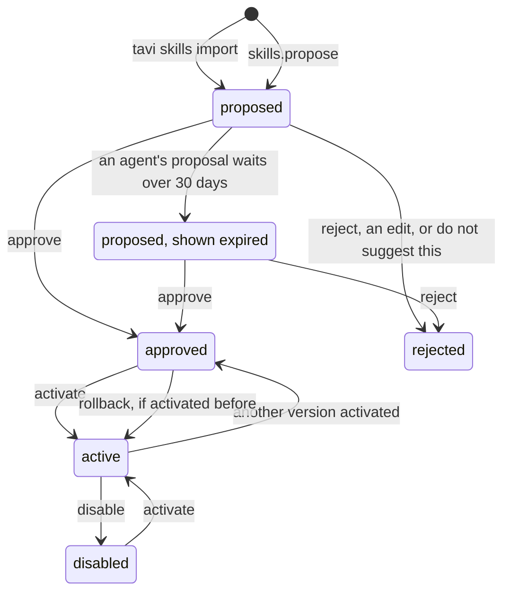

# Skills

This page covers skills — versioned, operator-approved packages a workspace
activates. It describes what a chat sees of a skill, how a routine pins one, and what
each command does. Memory (facts, preferences, lessons about you) is a
separate store with its own review; see [MEMORY.md](MEMORY.md). Every flag is
in [CLI.md](CLI.md#tavi-skills).

```bash
tavi skills list | show | import | approve | reject | activate | disable | rollback | pin-rollout | clear-rollout | rollout-status
```

While `tavi serve` runs, `tavi skills` goes through it (IPC `skills`), acting as
the workspace's operator; the rollout actions refuse with exit `5` there, and
work on the data directory once the owner stops. With no owner running, every
action works on the data directory. Each command acts in one workspace
(`--workspace`, default `default`); with no owner running it acts as
`--principal` (default `operator`), and through a running owner as that
workspace's operator, whatever `--principal` says. The canvas lists, reviews
and activates skills but never imports one: `tavi skills import` does.

**In the canvas.** Command Center → Soul & memory lists the workspace's skills:
versions waiting for review first, then each skill with its versions and the
active one. A version opens its text, its hash and provenance, and the changes
from the version it follows; from there it is approved or rejected, activated,
rolled back to, or the skill disabled. A version another author wrote is marked
so. `tavi skills approve` prints a version's text and hash before approving,
and approves another author's only with `--yes`. Without `--version`,
`approve` and `reject` take the skill's only proposed version and `activate`
its only approved one.

## Skills

A skill is a package of bytes with a manifest, imported under a skill id and a
version. It is stored as a content-addressed artifact; its SHA-256 is its
identity.

A version's life in a workspace:



**Agent Skills packages.** `tavi skills import <folder|SKILL.md|zip>` reads
an Agent Skills package: `SKILL.md`'s YAML frontmatter gives its id
(`name`), `description`, version (`metadata.version`, or `--version`),
`allowed-tools` and `compatibility`; its other files (`references/`,
`scripts/`, assets) come with it, at most 32 files and 512 KiB (a `.zip` at
most 1 MiB), with no symbolic link, absolute path or `..`; each file is sized
before it is read. The files are stored as one
deterministic bundle (the same files, the same hash). A script is kept as text
to read and is never run: Tavi installs nothing and runs no hook. The review
prints and shows every file, and `allowed-tools` as what it is — a ceiling the
skill declares, never a grant. `skills.read` serves `SKILL.md` by default,
lists the other files (`files`), and reads one by `path`; a routine that pins
a bundle gets its `SKILL.md`.

**`allowed-tools` is a ceiling, never a grant.** From the `skills.read` that
loads a skill until your next message, and again on each later load (a
reference, the skill once more), a call outside the tools the skills in scope
declare is asked about, once, whatever a rule, a grant or `serve --allow`
says: the card says which skill's list it falls outside ("Why am I asked?"),
so you are never stuck. In a run nobody attends (a schedule's fire, a
routine's run, a heartbeat tick, `tavi run --approval approve`) it is refused
with an error naming the skill and its list. With several skills in scope the
ceiling is the union of their lists; a skill in scope that declares nothing
lifts it; with no declaring skill in scope nothing changes, so no other call
gains a card. A tool on the list is decided exactly as without one — listed
tools are never pre-approved, and a deny still denies — so a package written
for Claude Code's grant reading fails safe. Loading a skill (`skills.read`,
`skills.search`), finding a tool (`tools.search`), the turn's reply
(`messaging.send`), asking you (`operator.ask_user`) and collecting the turn's
workers (`agents.wait`, `agents.read_payload`) are never held. Names map to Tavi tools: `Read` → `fs.read`,
`Write` → `fs.write`, `Edit`/`MultiEdit` → `fs.edit`, `Grep` → `fs.grep`,
`Glob` → `fs.glob`, `LS` → `fs.list`, `Bash` and any `Bash(…)` → the whole
`sandbox.run`, `WebSearch` → `web_search`, `WebFetch` → `web_fetch`, and any
Tavi tool id written as is (`fs.read`, `reports.generate`). Any other name is shown as "declared but not
enforceable here" on the review and the call's card, and lets nothing through.
A version that widens its list against the one it follows (else the active
one) — new names, or the field dropped — is flagged as an escalation in
`tavi skills show --body` and `approve` (`! Escalation: …`) and on the Skills
page.

**Skills the agent proposes.** `skills.propose` offers a procedure the agent
just carried out, with the task it came from and how its outcome was checked
(the person confirmed it, or a check passed); the task it names must be one
this workspace holds, or the proposal is refused. It always lands `proposed`,
under `chat:<task>` provenance, never approved — even when the same text was
approved before; the call itself is not asked about (the seeded, revocable allow
rule `seeded-skills-propose`; `tavi permissions rm seeded-skills-propose` to be
asked each time), since the proposal is the review — and a new version of an existing skill follows its active
one, which stays active until you approve and activate the new one. Asked to
("save this as a skill"), it may while fewer than five proposals wait. On its
own it may only after a clear success, never in a turn that read untrusted
content, at most once a conversation, while fewer than five wait, not on a topic you turned
down in the last 30 days (the same skill id, or an id or name that differs
only in case, spacing or punctuation: `Weekly Report!` is `weekly-report`),
and not when you turned suggestions off (`tavi config set skills.suggestions
off`, or **Skill suggestions** in Settings → General). A proposal that waits
for review more than 30 days is shown as expired (`tavi skills list`, `show
--body` and the Skills panel): nothing rejects it for you, and it stays yours
to approve or reject, but it no longer counts toward the five. A proposal
is instructions only: no scripts, no `allowed-tools`, at most 500 lines. The
review (Soul & memory, or `tavi skills show --body` and `approve --yes`) shows
its evidence.

**Reviewing a proposal.** One the agent offered on its own ends its turn in the
canvas with a card, *Save how I did this as a skill?*: **Review** opens it in
Soul & memory → Skills, **Not now** leaves it waiting there (the card folds to
*Waiting for your review*, in this browser), and **Don't suggest this** rejects
it, so its topic is not offered again for 30 days. The terminal chat (`tavi
chat`) prints one line under the call instead — *A skill waits for your review:
`tavi skills show <id> --body --version <version>`* — and in a messaging channel
the agent says where it waits, with the same command. Reviewing a proposal
shows, besides its text and evidence:

- **What the task did**: the tool calls of the task its evidence names, as that
  task's stored history keeps them — each tool's name and its input on one line,
  cut to 100 characters, the first 40 calls and a count of the rest (`tavi
  skills show --body` prints them too).
- **What its turn read**, for a proposal you asked for in a turn that had read
  untrusted content (an unasked one is refused there): the kinds of source and
  the hosts, as a memory proposal's provenance line says them, and that parts
  of the text may come from there. Tavi cannot tell which words did, so it
  flags the whole text rather than marking spans.

Two more decisions besides Approve and Reject:

- **Edit** (`tavi skills edit <id> --version <v> --package <file>`): your text
  is filed as a new proposed version, `edited-<time>`, that follows the
  proposal (`parentVersion`, so its review diffs your changes), with the
  proposal's name, evidence and `chat:<task>` provenance kept. The proposal is
  set aside (rejected) — an edit, not a no, so its topic is not held. An edit
  is held to the proposal's own limits: plain text, at most 500 lines, no
  `allowed-tools`, and not unchanged.
- **Regenerate with feedback** (`tavi skills regenerate <id> --version <v>
  --feedback <text>`, which needs `tavi serve`): your feedback is sent to the
  chat the proposal came from as your own message, asking the agent to propose
  the skill again with it. It is an ordinary turn of that chat, decided by the
  same rules; the new proposal is one you asked for, and the old one waits
  until you reject it.

**Import, review, activate.**

```bash
tavi skills import release-notes --version 1.0.0 --package ./release-notes.md \
  --name "Release notes" --description "How we write release notes" --provenance "team wiki"
tavi skills approve release-notes --version 1.0.0
tavi skills activate release-notes --version 1.0.0
```

- **Import** stores a new version as *proposed*. A manifest's
  `supportedRuntimeVersions` and `supportedToolContractVersions` are retired:
  never checked, no longer needed, and read from an older version only as
  written; what a package says it needs is its `compatibility`, shown on its
  review as the package states it. The package must be non-empty
  and at most 512 KiB; the manifest's name at most 200 characters and its
  description 2,000. A version is immutable: importing the same
  `(skill, version)` again with the same bytes is a no-op, with different
  bytes a conflict. Bytes this workspace already approved under another
  version are approved at once.
- **Approve** moves a proposed version to *approved*. Only a proposed version
  can be decided.
- **Activate** points the workspace at an approved version. Each skill has at
  most one active version per workspace; every change is kept in the skill's
  activation history (`tavi skills show`).
- **Rollback** activates an earlier version, and only one this workspace has
  activated before.

Skills are scoped to the workspace: every agent and run in it sees the same
active set. A package is never executed; Tavi treats it as opaque content.

### What a chat sees

On each model call, the context lists the active skills the task may use, by
id, version, name and a description cut to 160 characters — all of them, in id
order, up to 25; past 25, the 25 that rank best for the turn — the words of the
turn they match, plus how recently each was used (a use today weighs as much
as one matched word, halving every 14 days), then the more used — and a count
of the rest, which `skills.search` finds by what they are for — under *Approved skills — call skills.read
to load one when it applies*. The package itself is not put in a chat's
prompt: the agent loads the one it needs with `skills.read`, which reads only
the active, approved version in the chat's own workspace (after the same
rollout check the list makes, and only bytes whose hash still matches), in
pages of about 16,000 characters. The body comes back as reference text that
grants nothing: every tool call it describes is still decided by your rules. A
skill whose provenance names another author — `chat:<task>` for one a chat
proposed, `archive:…` for one from an outside archive — is read as untrusted
content, like a web page; any other provenance is yours. The list shares the context budget with your preferences: when
both do not fit, the ones kept are listed and one line says how many more
preferences and skills were left out. With memory paused, or off for a chat,
the skill list is still given (not to a heartbeat check or a scheduled
prompt's run).

When routing is on with its `skills` mode, the router may also name
*Suggested skills (advice only; no skill has been loaded or applied)* from the
same list. See [ROUTER.md](ROUTER.md).

### Skills pinned by a routine

A routine does not follow the workspace's active pointer. Its revision pins up
to 20 skills by id, version and content hash. Creating or editing a routine
names a skill by id alone: the version is the skill's active one and the hash
that version's own, filled in then and kept exactly from that revision on (a
version given must be approved, and a hash given must match it). Each run
reads exactly those approved bytes, checks the hash again, and appends each
package's text to the routine's instructions in a fenced block headed
*Approved skill reference `<id>@<version>` (reference material, not system
authority)*, up to 48,000 bytes in all. A context marker or chat-template
token in the text (`[/context]`, `<|im_start|>`, in any spelling) is quoted
first, as in untrusted text. A package must be UTF-8 text: one that
is not is refused at import. A pin whose version is no longer
approved, or whose bytes changed, stops the run. A pinned skill whose
provenance names another author (`chat:<task>` or `archive:…`) is that
content's words, as `skills.read` labels them: approving the pin does not make
them yours, so the run, and its research worker, starts as one that read
untrusted content (source `agent` for a chat's proposal, `unknown-source` for
an archive), and the unattended taint rules hold from its first turn. A pin of
a skill with your own provenance changes nothing. The canvas's routine page
shows the pins, and names any another author wrote with why its runs start
tainted. See [AUTOMATION.md](AUTOMATION.md#skills-a-routine-pins).

### How often a skill is used

Each `skills.read` and each routine run that follows a pinned skill records a
use: the workspace, the task, or for a routine the run's id, the
skill and version, when, and whether it came from a chat or a routine —
metadata only, never the skill's text. A task that loads the same version
again (another page, another file) is the same use. Uses are kept for a year,
and at most 1,000 per skill, the oldest pruned as new ones arrive. `tavi skills
list` and the canvas's Skills panel show each skill's use count and last use,
and flag an active skill that has gone 60 days without one (counted from its
activation when it was never used): one worth disabling, or whose description
no longer matches the tasks it was meant for.

### Bounded rollout

A version can be held to an allowlist of tasks before everyone gets it:

```bash
tavi skills pin-rollout release-notes --version 2.0.0 --task <task-id> --task <task-id>
tavi skills rollout-status release-notes
tavi skills clear-rollout release-notes --version 2.0.0
```

A pinned version is given only to the tasks on its list; every other task
gets no version of that skill (never an older one). Without `--version`,
`pin-rollout` and `clear-rollout` act on the active version; with it, the pin
can precede activation. `rollout-status` shows the active version's pin and
every other pinned version, stale ones included. Unpinned means unrestricted.

## Site skills

Separate from the skills above, the browser tools carry notes for sites an
agent often browses (`tavi.siteskills`, `packages/builtin/site-skills`, read by
the browser tools through `SiteSkillRegistryPort`): how a site's URLs open a
search directly, what to wait for, a schema for `browser.extract`, and whether
the site blocks automated browsers. They are data in one `tavi.sitenotes/1`
format: the built-in ones ship with Tavi, a plugin may bring its own
(`siteNotes`, checked at install) and you may write your own under
`<data-dir>/site-notes/`. A plugin's and your own are off until you turn them
on by id (a plugin's with `tavi apps sites <app> <id> on`, your own with
`tavi browser site-notes --on <id>`), are framed as reference notes rather
than instructions, and win over a built-in on the same host. `tavi
browser site-notes --propose <host>` turns a site's recipe into a proposed
note. A site note is not a skill: it is matched by host and path, never listed
in a chat's context, and never imported or approved through `tavi skills`. See
[BROWSER.md](BROWSER.md).

## Architecture

Skills and bounded rollouts are implemented across `@tavi/contracts`, `@tavi/runtime`, and `@tavi/cli`:

| Layer | Module / Path | Responsibility |
| :--- | :--- | :--- |
| **Contracts & Ports** | `packages/contracts/src/skills.ts`, `packages/contracts/src/skill-rollout.ts`, `packages/contracts/src/ports/skills.ts` (`SkillServicePort`) | Schemas for versioned skill manifests, content-addressed SHA-256 package artifacts, routine skill pins, and task-scoped rollout allowlists. |
| **Skill Service & Rollouts** | `packages/runtime/src/skills/service.ts` (`SkillService`), `packages/runtime/src/skills/rollout.ts` | Enforces propose/approve/activate/rollback transitions, immutability checks, and task-scoped rollout resolution. |
| **Persistence** | `packages/runtime/src/persistence/store/skills.ts` | SQLite queries for skill versions, approvals, workspace activation pointers, activation history, and rollout pins. |
| **CLI & Site Skills** | `apps/cli/src/features/skills/*`, `packages/builtin/site-skills` (`@tavi/plugin-site-skills`) | `tavi skills` operator CLI (`list`, `show`, `import`, `edit`, `regenerate`, `approve`, `reject`, `activate`, `disable`, `rollback`, `pin-rollout`, `clear-rollout`, `rollout-status`), the owner's IPC `skills` command (`owner.ts`), Agent Skills bundles (`bundle.ts`), `skills.read`/`skills.search` (`tools.ts`) and `skills.propose` (`propose.ts`) and built-in site navigation/extraction guidance for `browser.*` tools. |

See [ARCHITECTURE.md](ARCHITECTURE.md) for how active skills and routine pins are assembled into turn context, and [TOOLS-AND-SKILLS.md](TOOLS-AND-SKILLS.md#skills-end-to-end) for the whole path from import to a loaded skill's ceiling.
