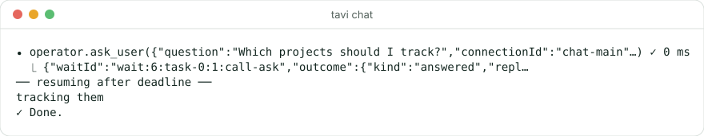
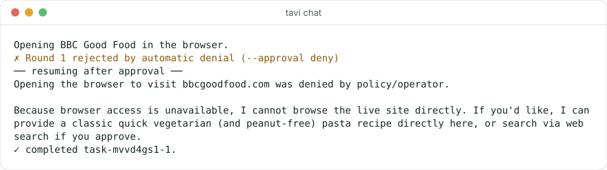

# The terminal UI: `tavi chat`

This covers `tavi chat`, the terminal front end to a running owner (`tavi
serve`): how chats continue, Home and side chats, notices, questions from
workers, memory modes, and every key and slash command. The web canvas is
described in [WEB-UI.md](WEB-UI.md); the full flag list is in
[CLI.md](CLI.md#tavi-chat).

```bash
tavi chat [--workspace <id>] [--principal <id>] [--data-dir <path>]
tavi chat --no-memory | --private
tavi chat --draft "<text>"
tavi chat --attach <task-id>
tavi chat --replay <ndjson-file>
```

`tavi chat` needs a terminal and a running owner (exit `4` without one; use
`tavi run` in scripts). Type a prompt and press Enter; the answer streams in.
Finished text and tool cards scroll into your terminal's history; only the line
being written, a status line and the prompt stay live. An answer's Markdown
emphasis (`*title*`, `**bold**`) is shown as its words, without the asterisks,
and a `* ` bullet as `- `, in a saved turn a chat opens with as in one streaming
now. Code stays exact, in a fence or a span, and so does a `**` that isn't
emphasis (`x ** 2`, `**kwargs`, `src/**/*.ts`). With `NO_COLOR` set, it sends no
colour.

## Continuing a chat

Once the chat's turn has ended (completed, failed, or aborted), your next
prompt **continues it**: the model sees the earlier turns. The status line says
so ("✓ Done. Type to continue it"). A finished turn is said without the chat's
id; a running or waiting one keeps it (it is what `tavi chat --attach` and
`/open` take), and `/chats` lists every id. Reopened, a chat says how its last
turn ended ("✓ completed (recorded)"), and Home, which never ends, says
"✓ ready". A failed turn is continued the same way: type it
again, in the same chat. A cancelled chat is not continued.

A prompt typed while a turn runs is queued and sent when it ends, by this
window: leave before then (Ctrl-C detaches) and it is not sent, which the way
out says, naming each one. `/steer
<text>` instead sends it **into the turn that is running**: the model reads it
before its next step, and the chat shows it there (with no turn running, it is
an ordinary message).

While an approval or a review is offered, its keys (`y`, `s`, `a`, `n`, `N`) decide it, so a
prompt is typed once you have decided (only a `/command` before).

To make the next prompt start a new chat instead, type `/side` (with Home on;
it starts a side chat of the chat shown) or `/new` (Home off).

## Home

Home is on by default; `tavi config set chat.home off` turns it off for the
workspace. With Home on, `tavi chat` opens on your Home: it prints Home's newest
saved turns, and your next prompt continues it. With no Home yet, your first
message begins it. A prompt with nothing else to continue goes to Home.

- `/side <topic>` starts a side chat of the chat shown (the topic is its first
  prompt, under an "a side chat begins" line — "a new chat begins" when Home is off; `/side` alone makes the next prompt
  start one). `tavi chat --attach <side chat>` shows that first prompt above
  its answer.
- `/home` goes back to Home.
- `/chats` lists the workspace's recent chats (your Home first) and
  `/open <task-id>` continues one.
- With Home on, `/new` does what `/side` does.

A long chat is compacted by itself as it grows. `/compact` asks for **fresh
context** now: the chat's next message starts a new epoch, its earlier turns
summarized and archived (kept across an owner restart). It does not clear the
chat's taint (see `/taint` below).

With Home off, `/new` starts a new chat, `/side` still opens a side chat of the
chat shown, and `/home` says how to turn Home on.

## Side chats

A side chat is opened from another chat (Home or any other) and begins from it.
Before your first message the model is given background from that chat: its
latest epoch summary, when it has rolled over, and its newest few saved turns
(up to six, about 4,000 characters), marked as context from the parent chat, to
be read as data rather than as instructions. It is not shown as a message of
yours.

- A side chat opened from a chat that began in a messaging conversation is held
  to the same tools as that chat, and its first turn is treated as having read
  untrusted content.
- A side chat reads the parent's chat notes besides its own (just the
  parent's, not its parent's).
- With nothing on screen, `/side` starts an ordinary chat instead.
- When a side chat's turn ends, a short notice is posted back into the parent
  chat ("Side chat … finished: …").

## Notices

Background work posts into the chat you are in as a **notice**, never as a
message to answer:

- a schedule or reminder delivered to Home (see [AUTOMATION.md](AUTOMATION.md));
- a standalone `tavi run` that settled (Home on);
- a side chat that finished (into its parent);
- when your Home is first made, one **Earlier chats** notice listing your ten
  most recent chats (side and ordinary chats, never a run).

A notice holds a label, the run's status and, once written, its generated
one-line summary, never the run's raw output. Since that summary (and a
reminder's text) can still echo what a run read, the model sees notices only as
quoted, untrusted data. `tavi chat` prints each as one line:

```text
◆ Scheduled run “brief” — Completed — … (task …)
```

The model reads the notices posted since your last message only when you next
write, as one short block marked as untrusted data. A notice never starts a turn
by itself. The web canvas shows notices as cards (see
[WEB-UI.md](WEB-UI.md#home-and-side-chats)).

## Questions

<picture>
  <source media="(prefers-color-scheme: dark)" srcset="assets/terminal/chat-question-dark.svg">
  
</picture>

A question a task asks you (`operator.ask_user`) is answered by typing. The
status row names the question while it waits, even after it scrolls away. From
any terminal, `tavi needs` lists what waits and `tavi answer <task-id>
<answer>` answers it. A question says why it is asked, marks the option the
task recommends, and says when it stops waiting and, when the task named one,
the option it goes with if nobody answers by then. Once settled, the question
stays in the chat as one line: who answered what, through which channel, or
what the task went with when nobody did.

A question a worker of the chat shown asks you is printed in that chat with the
worker's name (`? Researcher asks: …`, its options numbered). A browser
handoff a worker asks for says so: the takeover is in the web canvas (see
[BROWSER.md](BROWSER.md#handing-the-browser-to-you)).

A typed line answers a question only when exactly one is open in the chat, its
own or a worker's; the answer goes to the worker, never as a turn of the chat.
With two or more open, a typed line is a message (queued behind the chat's own
question, if it has one); `/answer` lists the open questions and
`/answer <n> <text>` answers one of them.

## Following an existing chat: `--attach`

`--attach <task-id>` opens that chat instead of Home, from its beginning (a
Home from its newest saved turns, as Home opens). Its approval rounds are
decided here, its question (when a run started over IPC asks one) is answered
by typing, and once it ends your next prompt continues it. A start the owner no
longer holds is announced, and a chat whose stream it no longer holds is
printed from its saved turns and record.

## Memory off and private chats

- `--no-memory` makes your first prompt start a new chat (never Home) with its
  memory off: nothing recalled, nothing remembered from it. `/memory on` turns
  it back on.
- `--private` starts a private chat: its memory stays off, past-chat search and
  *Earlier chats* never show it, and its saved turns are forgotten about a day
  after its last message. Its status line says `private`, and `/chats` marks
  it `private`.

The two cannot be combined, and neither combines with `--attach` or `--replay`
(use `/memory off` in a chat instead).

A side chat follows its parent: turning a chat's memory off also turns it off in
the side chats already opened from it (and theirs), until the parent is turned
back on, and what a side chat said meanwhile is never captured or found by
past-chat search afterwards. Only a chat's own person turns its memory on or
off; another person's chat is not found. See [MEMORY.md](MEMORY.md).

## Other options

- `--draft <text>` opens a new chat with `<text>` in the prompt, unsent: edit
  it, then Enter sends it (at most 4,000 characters). `tavi onboard` uses it
  for a first idea.
- `--replay <file>` plays back a stream recorded with `tavi run --format json`
  (one task's), without an owner, then exits.
- `--stats <file>` writes render statistics as JSON on exit (events, tree
  updates, frames drawn, peak memory), a diagnostic.

## Keys and commands

Commands are typed at the prompt at any time, even while a run is going. A pane
prints a snapshot into the transcript; a form asks what its words leave out, a
field at a time.

| Key / command | What it does |
| :--- | :--- |
| Enter | Send the prompt (or the answer to a question) |
| `y` / `s` / `a` / `n` / `N` | Approve the round on screen once / for the rest of the chat (in Home: until tomorrow, as the canvas's **Allow until tomorrow**) / always (a workspace rule) / reject it / reject it with a reason the model reads; `s` and `a` only where every call offers them. A review takes `y` and `n` |
| Esc | Abort the running turn; in a form, cancel it; drop a command half typed |
| Ctrl-C | Quit: exit `0`, or `130` if a run is still going (it continues; `tavi chat --attach <task-id>` follows it again) |
| `/side [topic]` | Start a side chat of the chat shown (an ordinary chat when none is), which begins from it; the topic, when given, is its first prompt |
| `/home` | Back to your Home (Home on) |
| `/chats` | The workspace's recent chats, your Home first, with their task ids |
| `/open <task-id>` | Follow that chat from its beginning and continue it |
| `/compact` | Fresh context: the chat's next message starts a new epoch, its earlier turns summarized and archived |
| `/taint` | What the chat shown read that Tavi does not trust (the status line's ⚠ chip), what that changes, and the remedy: a fresh chat |
| `/steer <text>` | Send this into the turn running now: the model reads it before its next step (none running: an ordinary message) |
| `/model [<connection> <model>]` | Name the chat shown's model; with one given, the chat runs it from its next turn and it becomes the default for new chats (no chat shown: the default only) |
| `/folder` | Show the chat shown's working folder, its attached folders and their modes, and its own folder's size against its budget, warned past 80% |
| `/folder set <path>`, `/folder add <path> [--rw]`, `/folder drop <label>`, `/folder reset` | From the chat's next message: work in a folder under an `--fs-root`; attach one (read-only unless `--rw`); detach one; or go back to the chat's own folder with its default attachments (also the fix when its folder is gone). `~` and relative paths are this terminal's |
| `/answer [<n> <text>]` | List the questions open in this chat, its workers' included; with a number, answer that one |
| `/new` | With Home off, the next prompt starts a new chat; with Home on, it does what `/side` does |
| `/needs`, `/agents`, `/schedules`, `/approvals` | Print a status snapshot (`/needs`: every question, approval and review waiting on you, and where to answer each; `/agents`: the workspace's agents and the followed chat's mailbox) |
| `/credentials`, `/models`, `/plugins` | List stored references; connections, default and roles; plugins, their state and what awaits review |
| `/credentials set [ref]` | Store a credential; the value is typed masked, never shown |
| `/models add`, `/models set-default`, `/models set-role`, `/models test` | Configure models a field at a time |
| `/help` (or `/?`) | List the commands, wrapped to the terminal's width |

Plugins add their own slash commands (for example `/memory`, `/remember`, `/forget`, `/why`,
`/heartbeat` and `/ideas`); a plugin command whose name collides with one above is
listed as `/<plugin>:<name>`. An MCP server's prompt (`/mcp-<server>-<prompt>`)
is sent as a message and run by the owner in the turn.

A chat a prompt starts here (a side chat, or a new chat with Home off) works in
this terminal's directory when it lies under one of the owner's `--fs-root`
folders; Home never moves to it. See [WORKING-FOLDERS.md](WORKING-FOLDERS.md).

## Rounds, credentials and reconnects

<picture>
  <source media="(prefers-color-scheme: dark)" srcset="assets/terminal/chat-denied-dark.svg">
  
</picture>

- **Approval rounds** are one card listing every gated call, each by its tool
  and what it touches (`fs.write — notes.txt`), also when the chat is reopened
  while the round waits; a file change shows its diff's first 20 lines, and
  the canvas's **Details** the rest; `y`/`s`/`a`/`n`/`N` decides the whole round, and
  `/needs` names the command that decides it from another terminal. A review of archived output is one card too, `y` releasing
  all of it and `n` rejecting it. A round decided elsewhere (another terminal,
  the canvas, `tavi approvals`) is shown as decided, with who decided it — a
  run's `--approval approve` or `--approval deny` as "automatic approval" or
  "automatic denial". A round a schedule's fire answers is shown read-only until
  the fire ends.
  Control, bidi and invisible characters in what a model, page or sender wrote
  (a call's title, command, URL, values, reasons) are shown as visible marks
  (`⟨ESC⟩`, `⟨U+202E⟩`)
  ([SECURITY-MODEL.md](SECURITY-MODEL.md#hidden-characters-on-a-card)).
- **A credential typed as a prompt** is masked and refused on Enter: never
  sent, and never in the transcript.
- **Reconnects.** If the owner restarts, the chat reconnects on its own (about
  12 s) and says so.

## Architecture

`tavi chat` is an Ink/React terminal application in `@tavi/cli` that connects to the running owner through `@tavi/client/node`:

| Layer | Module / Path | Responsibility |
| :--- | :--- | :--- |
| **Entry & CLI Parser** | `apps/cli/src/tui/index.ts`, `apps/cli/src/tui/parse.ts` | Parses `tavi chat` flags (`--attach`, `--no-memory`, `--private`, `--draft`, `--replay`, `--stats`), resolves working-folder defaults, and boots the Ink terminal loop or NDJSON replay stream. |
| **App & State Store** | `apps/cli/src/tui/app.tsx`, `apps/cli/src/tui/store.ts`, `apps/cli/src/tui/theme.ts` | Manages live turn streaming, Home and side-chat navigation, approval/review round cards, worker question queues, credential-paste masking, control/bidi character escaping, and automatic owner reconnects. |
| **Slash Commands, Panes & Forms** | `apps/cli/src/tui/commands.ts`, `apps/cli/src/tui/panes.ts`, `apps/cli/src/tui/forms.ts` | Dispatches built-in and plugin slash commands (`/side`, `/home`, `/compact`, `/steer`, `/folder`, `/taint`, `/answer`, `/needs`), renders status snapshots, and runs interactive multi-step configuration forms. |
| **Owner Client (`@tavi/client/node`)** | `packages/client/src/node.ts`, `packages/client/src/node/{discovery,socket}.ts`, `packages/client/src/client.ts`, `packages/client/src/reduce-run.ts` | Authenticated local Unix-socket client with owner discovery (`runtime/ipc.json`, `runtime/ipc.token`, `runtime/ipc.sock`), live turn event streaming, approval/answer submission, and operator IPC commands. |

See [ARCHITECTURE.md](ARCHITECTURE.md) and [WEB-UI.md#architecture](WEB-UI.md#architecture) for how the terminal UI and web canvas share `@tavi/client`.
