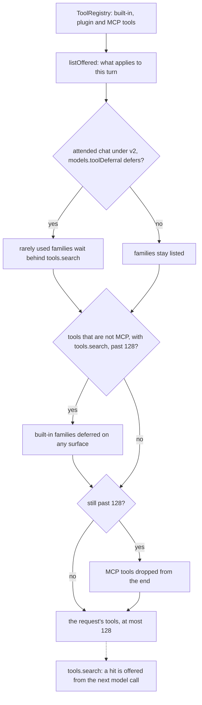
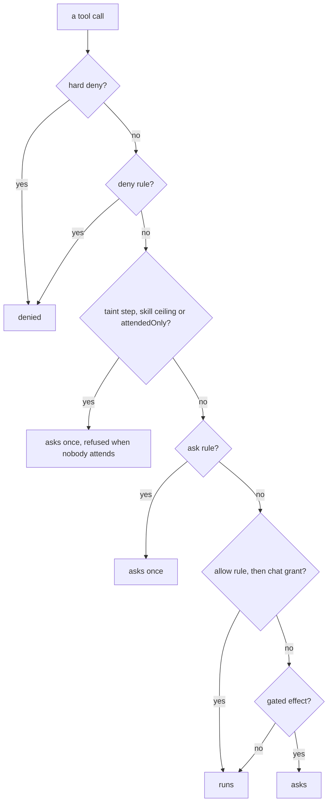

# Tools and skills: architecture and advanced usage

This page is for a power user tuning what the agent is offered, and for a
plugin author whose tools have to be found, chosen and approved. It follows a
tool from the registry to the model's tool list, through the approval gate, to
the result the model reads, and a skill from import to the turn that loads it.
It links to the detailed pages rather than repeating them: approvals are in
[SECURITY-MODEL.md](SECURITY-MODEL.md), skills in [SKILLS.md](SKILLS.md), MCP
servers in [MCP.md](MCP.md), plugin manifests in [PLUGINS.md](PLUGINS.md).

## Contents

- [How a turn's tool list is built](#how-a-turns-tool-list-is-built)
- [How a call is decided](#how-a-call-is-decided)
- [How calls run](#how-calls-run)
- [How results reach the model](#how-results-reach-the-model)
- [The tool catalogue](#the-tool-catalogue)
- [Skills end to end](#skills-end-to-end)
- [Evals that guard this](#evals-that-guard-this)
- [Where it lives](#where-it-lives)

## How a turn's tool list is built

How the registry becomes one model request's tools:

### The registry and what a turn is offered

Every tool — built-in, an external plugin's, an MCP server's — is registered
in one `ToolRegistry` (`packages/runtime/src/tools/registry.ts`) with an id
(`fs.read`, `mcp.docs.search`), an `effect` (`read-only`, `mutating` or
`external`), a `sink`, a description and an input schema. The model is sent
each tool under a model-safe name (`tools.search` is `tools_search`).

A turn is offered the registry's tools less what does not apply to it:

- a built-in's own `offered` check, read against the turn (`ToolOfferContext`:
  the workspace, the person and whether they are its operator, the
  conversation it answers and whether that is one-to-one). `messaging.send` and
  the group tools are not offered outside a channel conversation, and the group
  tools (polls, events, `messaging.recent`) not in a one-to-one DM
  ([CHANNELS.md](CHANNELS.md)); `agents.request` and `agents.reply` only with a
  peer-messaging grant; `web_search` only once a provider is enabled;
- a deny rule naming the tool, the task's execution policy (a schedule's
  `--allow` list, a worker's `tools`), the messaging profile, the memory
  settings, and the permissions the caller lacks;
- an MCP server's tools outside the workspace's `mcp.servers` (and, for
  another person's chat, `mcp.people`).

A tool left out is also refused if called: the list and the dispatcher read
the same checks.

### Prompt layouts

`models.promptLayout` ([CONFIGURATION.md](CONFIGURATION.md#workspace-settings))
picks how a model call is laid out for the provider's prompt cache. `v2`, the
default, keeps every earlier request's bytes: the tools array only grows within
an epoch (a routed turn appends its new tools after the ones earlier turns
were offered, and a tool `tools.search` finds goes after the rest), the system
text depends only on the instructions and the epoch's whole tool catalog, and
the turn's context block is written once (a block that showed a memory since
forgotten is dropped, [MEMORY.md](MEMORY.md#a3-how-memory-is-read-one-turns-context)). `v1` is the layout earlier releases
sent; setting it is the rollback, and it lists every offered tool on every
call. The cache side is in
[ARCHITECTURE.md](ARCHITECTURE.md#token-and-prompt-cache-behaviour).

### Families that wait behind `tools.search`

Under `v2` an attended chat (the canvas, `tavi chat`, `tavi run` attended) is
first shown its common tools. The rarely used built-in families
(`ATTENDED_DEFERRED_FAMILIES` in `packages/agent-host/src/tools/tool-routing.ts`)
are marked `deferred` and wait behind `tools.search`:

| Family | Waits |
| :--- | :--- |
| `routines.*`, `pdf.*`, `video.*`, `projects.*`, `reports.*`, `findings.*`, `plugins.*`, `schedules.*` | the whole family |
| `heartbeat.status`, `heartbeat.propose` | both |
| `reminders.update`, `reminders.cancel`, `reminders.snooze` | creating and listing stay listed |
| `todos.update`, `todos.remove` | adding, listing and ticking off stay listed |
| `agents.send`, `agents.request`, `agents.reply`, `agents.cancel` | spawning and waiting stay listed |

`tools.search`'s description carries one line per deferred family the turn
could use, and one per MCP server waiting behind it, so the model knows what
it may search for; the runtime facts tell it to search before saying a
capability is missing. Some turns bring a family in without a search: a PDF or
a video the conversation holds brings in its tools, and a turn that asks to be
reminded or names a time brings in the reminder changes and `schedules.create`,
`.list`, `.update` and `.pause`. A task's allowlist that names a deferred tool,
by id or pattern (a heartbeat check's choices), gets it listed, since that task
has no search.

A channel's turn, a worker's and an unattended run's keep the families listed
(most have no allowlist that could name one), except when their list is past
the 128-tool limit below.

### Finding a tool: `tools.search`

`tools.search({ query, limit? })` is read-only and never asks. It answers up
to eight tools, which are offered from the next model call:

- `select:<id>[,<id>]` names tools exactly, offered or not: `select:pdf.fill`.
  Use it when the id is known (a skill names it, a refusal points at it).
- A family's name — one word, with or without `.*` — answers the whole
  family in registry order: `pdf`, `reminders.*`, `mcp` (every MCP tool the
  turn may use).
- Any other query is ranked by the words it shares with each tool's id and
  description: split on spaces, dots, underscores and hyphens, stop words
  dropped, plurals read as singulars, each word weighted by how rare it is
  among the tools and three times when it is in the tool's id. A tool the turn
  already has is left out.

The same ranking makes the router's lexical shortlist when routing is off
([ROUTER.md](ROUTER.md)). A found tool stays offered for the epoch (at most 32
under `v2`, the oldest giving way).

### Calling a tool the turn was not shown

A call to an offered but undisclosed tool by its exact id is treated as a
discovery: it runs when its input fits the tool's whole schema, and still goes
through the gate like any call. When the input does not fit, the refusal says
what was wrong and carries the schema, or, when the schema is too long to send
whole, says to call `tools.search` with `select:<id>` first. A tool that is not
offered at all, or does not exist, is refused; an unknown tool's error points
at `tools.search` and names no near ids, which the task may not be shown.

### `models.toolDeferral` and local models

`models.toolDeferral` (`auto`, `on`, `off`; Settings → General → **Rarely used
tools**) decides whether an attended chat defers the families under `v2`.
`auto`, the default, defers them unless the chat runs on a local model, which
may search badly and keeps the whole list; `on` always defers; `off` never. A
remote model's chat under `auto` defers.

### The 128-tool limit and the MCP budget

One model request carries at most 128 tools (`MAX_MODEL_TOOLS`). A list is
fitted in this order:

1. On any surface — attended, a channel's turn, a worker's, an unattended
   run's — when the tools that are not an MCP server's, with `tools.search`,
   are past 128, the built-in families are deferred whatever
   `models.toolDeferral` says, since only MCP tools can give way when a list
   is fitted.
2. Past 128 still, MCP tools are dropped from the end of the list (a tool a
   search just found goes last). An MCP server never makes a turn fail.

A workspace lists at most `128 − (other tools + 1) − 8` MCP tools; a server
that would not fit waits behind `tools.search` under its `auto` exposure, and
enabling an `always` server that does not fit is refused with the count. The
other tools there leave out the deferred built-in families, since a list past
128 defers them on every surface (step 1 above). See [MCP.md](MCP.md#using-a-server). `tavi doctor` reports what each
workspace's listed MCP tools cost in schema tokens.

### Writing descriptions that get chosen

Every offered tool's name, description and schema is sent on every call, so
each word costs every turn. The conventions the built-ins follow, and the
plugin authoring guide (`plugins.authoring_guide`) asks of a plugin:

- say what the tool does, then what it is not for, naming the tool that is
  (`reminders.create` tells the person something at a time, `schedules.create`
  runs a prompt at set times, `routines.create` researches and publishes,
  `todos.add` keeps a thing to do; `fs.write` writes a whole file, `fs.edit`
  part of one; `web_search` finds pages, `web_fetch` reads one). Name only
  tools that exist: a repository test fails when a description names one that
  is not registered;
- end a tool whose input is hard to get right with one to three `Example:`
  calls its schema accepts (a test parses each against the schema);
- give a tool with an `op` one strict object per op, so a field an op does not
  take is refused by the schema;
- leave out a field description that only repeats the tool's.

An MCP tool's description reaches the model prefixed with `[<server>]`, and
with `[Original MCP tool: <name>]` when its id took a collision suffix.

## How a call is decided

### Effect, sink and annotations

Each registered tool has a **sink** (`ToolSinkSchema` in
`packages/contracts/src/tools.ts`): where its data can go — `none`, `reply`
(the conversation the task came from), `network` (with `urlOnly` when the URL
is the only model-chosen payload), `search`, `message` (another destination),
`credential` or `persist` (anything that outlives the chat). The taint step
reads it. A built-in must state one; an external tool that states none is
`network`.

Each tool also has **annotations**, as MCP's hints name them: `readOnly`,
`destructive`, `idempotent` and `openWorld` (`toolAnnotationsOf`). Absent ones
are derived from the effect: read-only when the effect is, destructive only
when stated and never for a read-only tool, idempotent when read-only,
open-world when `external`. An MCP tool keeps its server's hints, held to the
effect you approved: an unhinted write, or one falsely hinted read-only, is
destructive. Annotations never allow anything; `readOnly` decides whether a
call may run early ([below](#parallel-read-only-calls)) and `destructive`
shapes its card.

A tool may also have an assessor (`assess`, many in
`apps/cli/src/features/approvals/call-assessors.ts`) that reads one call's
input: its card, the subjects a rule matches (a shell command, `POST
https://…`, a folder-qualified path), its risk, a hard deny, and flags such as
`askWhenTainted` (asked in a tainted chat whatever a rule says),
`attendedOnly` (only a person decides it), `onceOnly` and `ruleAliases`
(another tool's deny and ask rules hold it too: `http.request` with `saveTo`
borrows `fs.write`'s).

### The approval gate's order

`evaluateGate` (`packages/contracts/src/tool-policy.ts`) decides each call
before any card forms, first match wins:

1. **Hard deny** — what nothing lifts (an assessor's `hardDeny`).
2. **Deny rules**, the tool's own and its `ruleAliases`'.
3. **The taint step** — in a chat holding untrusted content, a call whose sink
   could carry its data out, use a credential or outlast the chat asks once
   (`security.taint` `enforce`; `observe` only records).
4. **The skill ceiling** — a call outside the `allowed-tools` of the skills
   loaded this turn asks once (`outside-skill-ceiling`).
5. **A call only a person decides** (`attendedOnly`) asks once.
6. **Ask rules** — once only.
7. **Allow rules** — shipped, seeded, `serve --allow` and yours; not for a
   `critical` call, nor an `askWhenTainted` call in a tainted chat.
8. **Chat grants** from approving with *Approve for this chat*, with the same
   exceptions.
9. **The effect default** — a gated effect asks; anything else runs.

A run nobody attends (a schedule's fire, a routine's run, a heartbeat tick,
`tavi run --approval approve`) refuses what steps 3 to 5 would ask, with the
reason. The rules, grants and the taint gate are in
[SECURITY-MODEL.md](SECURITY-MODEL.md#how-a-call-is-decided).

### Once-only and destructive cards

A card offers *once* only when the taint step, the skill ceiling,
`attendedOnly` or an ask rule asked it, and when the tool is destructive
(`reminders.cancel`, `todos.remove`, `schedules.cancel`, `agents.cancel`, a
destructive MCP tool): its card says it cannot be undone, on the canvas, the
terminal, the CLI prompts, a worker's prompt and a channel's round. An allow
rule still lifts a destructive call; nothing else is relaxed. `memory.forget`
shows the same card and is `attendedOnly` besides, so no rule lifts it.

### Seeded rules

Five allow rules are seeded into every workspace once, shown in Settings →
Permissions and `tavi permissions list`, and never put back once removed
(`tavi permissions rm <rule-id>`):

| Rule | Lets run without asking | Still asks |
| :--- | :--- | :--- |
| `seeded-reminders` | `reminders.*` | a reminder that starts a task, or a change or cancel, in a tainted chat |
| `seeded-todos` | `todos.*` | every to-do change, an add included, in a tainted chat, once (the taint step comes before allow rules) |
| `seeded-web-search` | `web_search` | a query shaped like a secret, in any chat; under taint, a query shaped like data leaving, or any search once the chat also holds private data |
| `seeded-memory-propose` | `memory.propose` | nothing: the proposal waits for review on its card |
| `seeded-skills-propose` | `skills.propose` | nothing: the proposal waits for review in Soul & memory, and an unasked offer is still refused after untrusted content |

See [AUTOMATION.md](AUTOMATION.md#reminders) and
[SECURITY-MODEL.md](SECURITY-MODEL.md#a-web-searchs-query).

## How calls run

### Parallel read-only calls

When a model step asks for several calls, each run of read-only calls in a row
starts together, at most `tools.parallelReads` of them (eight by default; `1`
runs every call in turn, see
[CONFIGURATION.md](CONFIGURATION.md#workspace-settings)): each must be
read-only by its annotations and by the gate's decided effect, need no
approval and be refused by nothing. A call that does not qualify (a write, a
call that needs approval) runs in its turn, and the run of reads after it
starts once it has settled, so a read after a write in the same step sees the
write. Of two calls on one browser session only the first starts early; the
second waits its turn. Results, events and records still come in call order,
and a read that asks the person a question asks it in its turn. The shipped
system prompt (`tavi-default-5`) asks the model to make independent reads
together.

### Deadlines and failures

Every call has a deadline: its definition's `timeoutMs`, or two minutes
(`DEFAULT_TOOL_TIMEOUT_MS`). Tools that run loops or hold their own deadlines
(MCP calls, `browser.vision_act`, `browser.extract`, `browser.find`, the PDF
and video jobs, `routines.run`) declare `0`. A failure reaches the model with
its code (`TIMEOUT`, `UNAVAILABLE`, `INVALID_INPUT` with its `issues`,
`TOOL_FAILED`, …) and `retryable`. A change whose call may have reached its
provider before failing is never called retryable: the model is told to check
first, so an email or a payment is not sent twice.

### Loop detection

The workflow compares a conversation's last twelve calls since the person last
spoke (`packages/agent-host/src/workflow/repeats.ts`). A call is the same when
its tool and arguments are, whatever their keys' order, with nonces,
idempotency keys, request ids and timestamps aside; two calls that keep taking
turns (A, B, A, B) with the same answers count too. After two repeats the
model is told it is looping, the next one is refused, and the one after asks
the person how to go on (an unattended run keeps refusing); the person's
answer restarts the count. Polling whose answer changes, a read made again
after a change, and several reads made together in one step never count. The
browser's own no-progress nudge is in [BROWSER.md](BROWSER.md#acting).

## How results reach the model

- **Paging, not cutting.** Long text comes back a page at a time with a
  `nextOffset` to pass back as `offset`: `web_fetch` (16,000 characters by
  default, `maxChars` up to 24,000; `format: "raw"` for the body as fetched),
  `fs.read` (a file up to 16 MiB, or lines from an `fs.grep` match with
  `startLine`/`lineCount`), `artifacts.read`, `skills.read`. See
  [CLI.md](CLI.md) and [WORKING-FOLDERS.md](WORKING-FOLDERS.md#fs-per-call).
- **Large results.** A result over 64 KiB is kept whole as an approved
  artifact with its call's label, so taint travels with it, and the model is
  shown an 8,000-character preview that keeps its shape (long text as head and
  tail, long lists as their first items) and names `artifacts.read`, which
  reads it back a page at a time. Size alone never pauses a turn for review.
  `http.request` keeps up to 1 MiB of a response, or saves a successful body
  to a new file in the chat's folder with `saveTo` (its path, size and sha256
  come back instead). `sandbox.run` keeps the head and the tail of each long
  stream.
- **Older results.** Under `v2`, in a long chat, an older `fs.read` of a file
  read again or changed becomes a pointer to the newer result, and an older
  `sandbox.run`, `fs.grep` or `web_fetch` result over 4,000 characters keeps
  its head, tail and counts; the checkpoint keeps every result whole
  ([ARCHITECTURE.md](ARCHITECTURE.md#token-and-prompt-cache-behaviour)).
- **The browser.** An observation's elements reach the model as one compact
  line each (`el-4 link "Next" ["Results"] → /p/2`), with same-site links made
  relative and context quoted so a page cannot forge a line;
  `browser.extract` answers from a page's JSON-LD or microdata when that covers
  every field of every record (`source: "structured"`, no model call). See
  [BROWSER.md](BROWSER.md#observations).
- **Credentials and labels.** Credential shapes in tool output are masked
  (`tools.redactResults`), and an untrusted result is fenced as
  `[untrusted:<id>]` data, never instructions
  ([SECURITY-MODEL.md](SECURITY-MODEL.md)).

## The tool catalogue

Every built-in tool an owner composes, generated from its registry
(`apps/cli/test/tools/tool-catalogue.test.ts` fails when the table falls
behind; `TAVI_UPDATE_GOLDEN=1` rewrites it). MCP servers' tools and an
installed plugin's are not listed: `tavi plugins show` and `tavi mcp show`
review them. Nor are the tools an owner composes only once something is set
up: `web_search` (a search provider), `browser.request_handoff` (when the
live view is served) and `desktop.*` (with `tavi.desktop` enabled,
[DESKTOP.md](DESKTOP.md)); `video.*` is offered only where FFmpeg is
found ([VIDEO.md](VIDEO.md)); `tools.search` is the workflow's own,
added to a turn that has something waiting behind it. The columns are the registration's own fields:

- **Effect**: `read-only`, `mutating` or `external`
  ([Effect, sink and annotations](#effect-sink-and-annotations)); a
  `mutating` or `external` call forms an approval round unless a rule allows
  it.
- **Input goes to** (the sink): `network`, `search`, `persist`, `credential`,
  `message`, `reply` or `none`, as the taint gate reads it once a chat holds
  untrusted content ([Effect, sink and annotations](#effect-sink-and-annotations)).
- **Output**: `untrusted` when the tool declares it returns third-party
  content, which taints the chat; `per result` when each result is labelled
  by where it came from, so one that read nothing marks nothing; `trusted`
  otherwise. A built-in is trusted
  unless it declares otherwise, where a plugin's tool is untrusted unless it
  declares `"untrustedOutput": false` ([PLUGINS.md](PLUGINS.md)); a single
  result can still arrive marked untrusted, such as a download.
- **Attended chat**: `listed` when an attended chat is shown it at once,
  `search` when it waits behind `tools.search`
  ([Families that wait behind `tools.search`](#families-that-wait-behind-toolssearch)).

Each tool also names the workspace permissions a caller needs
(`requiredPermissions`): every built-in asks for `tools.invoke`, which the
workspace's operator grant carries with `models.invoke` and `runs.create`. A
caller without it is not offered the tool, and a call is refused
`NOT_AUTHORIZED`. `agents.request` and `agents.reply` also check, when called,
an `agents:message:<agent-id>` grant for the agent they reach.

<!-- tool-catalogue:start -->
| Tool | Effect | Input goes to | Output | Attended chat | What it does |
| :--- | :--- | :--- | :--- | :--- | :--- |
| `agents.cancel` | mutating | none | trusted | search | Request cancellation of a delegated task. |
| `agents.read_payload` | read-only | none | per result | listed | Read a bounded byte range of an agent mailbox message's offloaded payload (a worker's long result or message); paginate with offset/length. |
| `agents.reply` | mutating | none | trusted | search | Answer a pending agents.request; requires the same peer-messaging grant the request needed. |
| `agents.request` | mutating | none | trusted | search | Ask a question of another agent's task; requires an explicit peer-messaging grant. |
| `agents.send` | mutating | none | trusted | search | Send a bounded message to a worker or the orchestrator's own task; to message a person, reply with messaging.send or reach another conversation with messagin… |
| `agents.spawn` | mutating | none | per result | listed | Delegate a bounded task to a new worker agent, with a delegated budget carved from the caller's own. |
| `agents.status` | read-only | none | per result | listed | Inspect a delegated task's current status. |
| `agents.wait` | read-only | none | per result | listed | Suspend until a matching reply arrives, a worker completes, or the deadline passes. |
| `artifacts.read` | read-only | none | per result | listed | Page through a large tool result this chat kept whole as an artifact (its note names the artifactId), or another approved JSON or plain-text artifact of this… |
| `artifacts.view_image` | read-only | none | per result | listed | Look at a picture: an approved image artifact (a browser capture, a rendered chart) by `artifactId`, or one in the chat's folders by `path`. |
| `audio.transcribe` | read-only | none | per result | search | What is said in an audio attachment — a voice message, a recording — by its `artifactId`, transcribed on this machine: the words (`text`) and when each part… |
| `browser.act` | external | network | untrusted | listed | Act in a browser session. |
| `browser.batch` | external | network | untrusted | listed | Run up to 5 browser.act steps in one call, in order — fill a form's fields, pick a date, scroll and wait — each as browser.act would; up to 12 when every ste… |
| `browser.capture` | external | none | untrusted | listed | Capture a screenshot of a browser session. |
| `browser.close` | read-only | none | trusted | listed | Close a browser session. |
| `browser.create_session` | mutating | network | untrusted | listed | Open a new browser session. |
| `browser.extract` | read-only | none | untrusted | listed | Extract structured records from a browser session's current page — flights, products, listings, a table — filling the schema you give for one record: from th… |
| `browser.find` | read-only | none | untrusted | listed | Find an element of a browser session's page by what it is for — "the return date field", "the select button of the cheapest fare" — among all of the page's e… |
| `browser.navigate` | external | network | untrusted | listed | Navigate a browser session to a URL and observe its interactive elements (at most 60, the page's content first; `elementsOmitted` counts the rest). |
| `browser.observe` | read-only | none | untrusted | listed | Re-observe a browser session's current page without navigating, or part of it (`scope`: main, dialog, form, or one element's part by ref) and only what a per… |
| `browser.read` | read-only | none | untrusted | listed | Read the text of a browser session's current page — an article's body, a document — which navigate/observe leave out; for its records (listings, products, a… |
| `browser.structured` | read-only | none | untrusted | listed | Read the structured data a page publishes for machines — schema.org JSON-LD and microdata — as records: LocalBusiness, Restaurant, MedicalBusiness, Physician… |
| `browser.vision_act` | external | network | untrusted | listed | Do a sub-task in a browser session by sight, with a vision model that sees the page and clicks, types and scrolls on it — for what element actions cannot do:… |
| `collect.daily` | read-only | none | untrusted | listed | Collect every configured project's analytics, billing, subscription and news data into one bounded summary. |
| `findings.add` | read-only | none | trusted | search | Keep records you gathered for this task — flights, prices, listings — with the page they came from. |
| `findings.check` | read-only | none | untrusted | search | Check this task's records of a kind against the request's constraints, before answering: each constraint a field, an operator and a value (outbound.durationH… |
| `findings.list` | read-only | none | untrusted | search | The records this task and its workers have kept (findings.add, browser.extract), the task's own first, in the order they were found, of one kind or all. |
| `fs.edit` | mutating | persist | trusted | listed | Replace exact text in a file in your working folder, or in an attached folder you may write; to create a file or rewrite it whole, use fs.write. |
| `fs.glob` | read-only | none | per result | listed | Find files in your working folder or an attached folder whose path, relative to the searched directory, matches a glob (* and ? match any characters, includi… |
| `fs.grep` | read-only | none | per result | listed | Search text files in your working folder or an attached folder for a regular expression; returns path, line number and line for each match. |
| `fs.list` | read-only | none | per result | listed | List a directory in your working folder or an attached folder: names, with a trailing / on directories. |
| `fs.read` | read-only | none | per result | listed | Read a text file in your working folder or an attached folder, of any size up to 16 MiB. |
| `fs.write` | mutating | persist | trusted | listed | Create a text file, or replace one whole, in your working folder or an attached folder you may write; to change part of a file, use fs.edit. |
| `ga4.report` | read-only | none | trusted | listed | Google Analytics 4 summary for one configured project: sessions, users and conversions. |
| `gcp.billing` | read-only | none | trusted | listed | Cloud Billing month-to-date cost for one configured project's export table. |
| `gsc.query` | read-only | none | trusted | listed | Search Console summary for one configured project: clicks, impressions and average position. |
| `heartbeat.fetch` | read-only | network | untrusted | listed | Read a page this heartbeat watches (its instructions' watch: lines), or a link found on a watched page this check already read, as text. |
| `heartbeat.propose` | mutating | persist | trusted | search | Change the person's heartbeat — turn it on or off, how often, active hours and days, how it tells them, or its instruction list (send the whole new list). |
| `heartbeat.report` | read-only | reply | trusted | listed | Tell the person what is worth their attention from this check: each item a stable key, an urgency (now or later), a short plain-text title and its sources. |
| `heartbeat.status` | read-only | none | trusted | search | The person's heartbeat: whether it is on or paused, how often and when it checks, how it tells them, its instructions (what it keeps an eye on), its next and… |
| `http.request` | external | network | untrusted | listed | Make one bounded HTTPS request (GET, POST, PUT, PATCH or DELETE) to an operator-allowlisted host: prefer it to the browser for an API on that list; a public… |
| `math.eval` | read-only | none | trusted | listed | Compute exactly instead of estimating: arithmetic with percentages and common functions (`expression`: 17% of 2340, (3+9+4)/3, round(1234.5678, 2)), or date… |
| `memory.forget` | mutating | persist | trusted | listed | Ask the person to forget one memory record for good, when they say it is wrong or ask you to forget it. |
| `memory.get` | read-only | none | trusted | listed | Fetch one memory record by id. |
| `memory.list` | read-only | none | trusted | listed | Everything kept on this person, newest first, with no words to match: preferences, facts and lessons, as snippets with citations. |
| `memory.propose` | mutating | persist | trusted | listed | Suggest a fact, preference or lesson to remember. |
| `memory.search` | read-only | none | trusted | listed | Search what you remember about this person: their own authorized memory. |
| `messaging.channels` | read-only | none | trusted | listed | List the channels you can send through with `messaging.send_to`: each connection's id, its channel, what a message there can carry, and the targets the opera… |
| `messaging.create_event` | external | message | trusted | listed | Create a group-chat event, not a calendar entry — a time and a place or link — where the conversation this task came from lives, so its members are invited a… |
| `messaging.create_poll` | external | message | trusted | listed | Post a poll in the conversation this task came from, for its members to vote in. |
| `messaging.end_poll` | external | message | trusted | listed | End a poll this task posted with messaging.create_poll before its time runs out; everyone in the conversation sees it closed. |
| `messaging.poll_results` | read-only | none | untrusted | listed | Read the votes of a poll this task posted with messaging.create_poll: each answer's count and who voted, as far as Tavi knows them, and whether they are fina… |
| `messaging.recent` | read-only | none | untrusted | listed | Read this room's latest messages, oldest first: who said what, as far as Tavi knows them — anyone it does not know is never quoted. |
| `messaging.send` | external | reply | trusted | listed | Reply here: send a message to the conversation this task came from, on the channel it came through, with an approved artifact (a screenshot, a report) when y… |
| `messaging.send_to` | external | message | trusted | listed | Send a text message, an approved artifact (a PDF report) or a file from your working folder (by path) through one of the channels you can reach, by its conne… |
| `news.search` | read-only | search | untrusted | listed | Recent news items carrying links for one configured project's keywords, from the deployment's news feeds and its news search provider. |
| `operator.ask_user` | external | none | trusted | listed | Ask the operator a question in their chat and suspend until they answer, or until the deadline passes. |
| `pdf.fields` | read-only | none | per result | search | List a PDF form's fields: id (the fill key), type, page, label, value, options (each with the export `value` to write and what the form `shown`s), required,… |
| `pdf.fill` | mutating | persist | per result | search | Fill a PDF form into a new copy, after pdf.fields. |
| `pdf.overlay` | mutating | persist | per result | search | Write values onto a flat PDF form — one with no fields — at the entry boxes pdf.fields lists under `boxes` (an underline or an empty box, named by the text b… |
| `pdf.read` | read-only | none | per result | search | Read a PDF's text, page by page (`pages`, e.g. 1-5,9), or only the pages that contain a phrase (`find`); `format: markdown` gives it in reading order (column… |
| `pdf.render` | read-only | none | per result | search | Render up to three pages of a PDF as images you can look at (a scan, a handwritten page, a layout), optionally outlining form fields in yellow (`highlight`,… |
| `pdf.view` | read-only | none | per result | search | Hand the model a whole PDF to read as a document — layout, tables and figures included — where its connection takes PDFs; anywhere else its text and up to th… |
| `plan.update` | read-only | none | trusted | listed | Keep a short plan for a task of several steps: send the whole list each time, marking one step in_progress while you work on it and each done when it is. |
| `plugins.authoring_guide` | read-only | none | trusted | search | Read this before writing a Tavi plugin or mod (a hook into the turn, a slash command, a status line, a tool): the manifest and module format, the hook events… |
| `plugins.validate` | read-only | persist | trusted | search | Check a plugin folder in your working folder or an attached folder as install would, without installing it; on macOS also run its register in a sandbox (no n… |
| `projects.get` | read-only | none | trusted | search | List the configured projects and which data sources each one has. |
| `reminders.cancel` | mutating | persist | trusted | search | Cancel one of this person's reminders. |
| `reminders.create` | mutating | persist | trusted | listed | Create a reminder that tells this person something at a time. |
| `reminders.list` | read-only | none | trusted | listed | List this person's reminders, with each one's readBack. |
| `reminders.snooze` | mutating | none | trusted | search | Snooze the latest delivered fire of one of this person's reminders, by any span up to a week. |
| `reminders.update` | mutating | persist | trusted | search | Change one of this person's reminders: its text, its time, or the task it starts. |
| `reports.generate` | mutating | none | trusted | search | Collect every configured project's data and render the daily brief as a PDF, stored as a report artifact. |
| `reports.history` | read-only | none | untrusted | search | The reporting history: each generated brief's period, artifact and per-project metric values, newest first. |
| `routines.add_target` | mutating | persist | trusted | search | Add a delivery target, only one the operator authorized. |
| `routines.archive` | mutating | none | trusted | search | Archive a routine for good: it never runs again and cannot be resumed. |
| `routines.cancel_run` | mutating | none | untrusted | search | Cancel a run: stop it if it is still running, and drop its deliveries not yet sent. |
| `routines.create` | mutating | persist | trusted | search | Save a research routine and a persistent specialist: daily at `at`, or on `triggers` (daily on chosen weekdays, or once at a time). |
| `routines.get` | read-only | none | trusted | search | Read a routine, its revision and state. view: explain (where a revision's words came from), verify (its run ledger is intact) or readiness (can it run: resea… |
| `routines.history` | read-only | none | trusted | search | List a routine's past runs. |
| `routines.inspect` | read-only | none | untrusted | search | Inspect a run: its report as text (`report`), its publication (`gaps` says why a degraded run was degraded), deliveries and attempts. |
| `routines.list` | read-only | none | trusted | search | List your routines. |
| `routines.pause` | mutating | none | trusted | search | Pause a routine. |
| `routines.preview` | mutating | none | untrusted | search | Run a routine as a preview, delivered nowhere. routines.inspect reads the run. |
| `routines.reevaluate` | mutating | persist | trusted | search | Run a routine's failed setup evaluation again, without saving a new revision. |
| `routines.resume` | mutating | persist | trusted | search | Resume a paused routine. |
| `routines.resume_delivery` | mutating | message | trusted | search | Resume a delivery target paused after repeated failures or missing credentials; its held reports go out now. |
| `routines.retry_delivery` | mutating | message | trusted | search | Retry a failed delivery. |
| `routines.revoke_grant` | mutating | none | trusted | search | Revoke a run's pinned authority. |
| `routines.run` | mutating | message | untrusted | search | Run a routine now; its report goes to its configured targets. routines.inspect reads the run. |
| `routines.targets` | read-only | none | trusted | search | List the delivery targets the operator configured. |
| `routines.undo` | mutating | persist | trusted | search | Restore an earlier revision of a routine. |
| `routines.update` | mutating | persist | trusted | search | Edit the linked routine (or explicit routineId). |
| `sandbox.run` | external | none | per result | listed | Run a program inside the sandboxed execution environment: `command` is the program (python3, ls), `args` its arguments (["-c", "print(1)"]). |
| `schedules.cancel` | mutating | persist | trusted | search | Delete a schedule for good. |
| `schedules.create` | mutating | persist | trusted | search | Run a prompt at set times without being asked (a daily inbox summary, a weekly check, every 2 hours in work hours, monthly, once on a date): a schedule. |
| `schedules.history` | read-only | none | trusted | search | A schedule's recent runs, newest first: when each was due and why it ended so (ok, undelivered, quiet, unchanged, failed, timeout, waiting, asked, missed, ov… |
| `schedules.list` | read-only | none | trusted | search | List this workspace's schedules: each one's name, when it runs (readBack), whether it is paused, the tools it may use, when it tells the person, its last run… |
| `schedules.pause` | mutating | persist | trusted | search | Stop a schedule from running until resumed ("stop my morning summary"). |
| `schedules.resume` | mutating | persist | trusted | search | Start a paused schedule again, from its next time. |
| `schedules.run_now` | mutating | message | trusted | search | Run a schedule once now, as it would run at its time, without changing when it next runs. |
| `schedules.update` | mutating | persist | trusted | search | Change a schedule's prompt, when it runs (times, days, monthly, yearly, once, until), tools, delivery, when it tells the person, its pre-check, or run limit. |
| `sessions.search` | read-only | none | per result | listed | Search your earlier conversations with this person (their prompts and your final answers) for words. |
| `skills.propose` | mutating | persist | trusted | listed | Offer a multi-step procedure you just carried out, and that worked, as a skill the person reviews before it is ever used. |
| `skills.read` | read-only | none | trusted | listed | Load an approved skill's instructions when it applies to the task: the context lists the active skills by id and name. |
| `skills.search` | read-only | none | trusted | listed | Find approved skills by what they are for, past the ones the context lists: up to eight active skills whose id, name or description matches, best first. |
| `stripe.subscriptions` | read-only | none | trusted | listed | Stripe MRR, paid revenue and churn for one configured project. |
| `todos.add` | mutating | persist | trusted | listed | Add a to-do to this person's list in Tavi: "add milk to my list", "I need to renew my passport", "put 'call the plumber' on my work list". |
| `todos.complete` | mutating | persist | trusted | listed | Tick off one of this person's to-dos (it stops reminding), or with reopen put a done one back on its list. |
| `todos.list` | read-only | none | trusted | listed | List this person's open to-dos in Tavi (every list, or one), oldest first, each with its readBack. |
| `todos.remove` | mutating | persist | trusted | search | Remove one of this person's to-dos for good. |
| `todos.update` | mutating | persist | trusted | search | Change one of this person's to-dos: its text, list, notes or due. |
| `travel.flights_search` | external | search | untrusted | listed | Search flights — one way or return, over date ranges each way, within a maximum flight time per direction — and answer with itineraries: airlines, flight num… |
| `video.frames` | read-only | none | per result | search | Look at a video through its frames: `mode` uniform (evenly spaced), scene (at its cuts), motion (where it changes most) or at (the times in `at`, seconds), o… |
| `video.info` | read-only | none | per result | search | A video's facts: container, duration, codec, size, frame rate, rotation, whether it has sound and subtitles, and whether it records a location (never where). |
| `video.pose` | read-only | none | per result | search | Measure a person's movement in a video (at most 60 s, `from`-`to`): joint angles over time, reps, and, for `movement` squat, push-up, lunge or hip-hinge, eac… |
| `video.transcribe` | read-only | none | per result | search | What is said in a video, with the times it is said (`from`-`to`, seconds; `language` as an ISO 639 code, or detected), and its own subtitles where it has them. |
| `video.view` | read-only | none | per result | search | Watch a video: its facts, a contact sheet and two stills, and, where the model takes video, the whole clip with its sound (MP4, MOV or WebM, up to 2 minutes… |
| `web_fetch` | read-only | network | untrusted | listed | Retrieve one public HTTPS page by its URL and return its text (to find pages, use web_search) — markdown when the site serves it, else the page's text with e… |
<!-- tool-catalogue:end -->

`web_fetch` is offered only when the owner allows a host for it (`tavi serve
--http-allow-host <host>`); without one, the model reads a page with the
browser instead, which asks per site.

A chat with none of `http.request`, `web_fetch` or a browser that opens pages
(`browser.navigate`, `browser.create_session`), deferred ones counted, has a
line in its runtime facts saying it cannot check whether a link is live or
fetch an archive snapshot: it says so instead of giving a link's status or a
snapshot's date from memory.

## Skills end to end

A skill is a procedure written down — how this workspace writes release notes,
files an expense — that the agent loads when a task calls for it. Memory holds
facts, preferences and lessons about you; a reusable multi-step procedure is a
skill ([MEMORY.md](MEMORY.md)).

### Approved versions

A skill is an immutable version under a skill id, stored as a
content-addressed artifact whose SHA-256 is its identity. Every version enters
*proposed* (unless the exact bytes were approved here before); a person
approves or rejects it, and activates one approved version per workspace,
rolling back only to one activated before. A version can be held to an
allowlist of tasks first (`tavi skills pin-rollout`). Nothing a skill says is
run: a package is opaque text. See [SKILLS.md](SKILLS.md).

### Getting skills in

- **`tavi skills import <folder|SKILL.md|zip>`** reads an Agent Skills
  package: `SKILL.md`'s frontmatter gives its id, description, version,
  `allowed-tools` and `compatibility`; its other files (at most 32, 512 KiB in
  all, no links, absolute paths or `..`) are stored as one deterministic
  `tavi-skill-bundle/1` bundle, the same files always the same hash. Scripts
  are kept as text and never run. Without `--provenance` it is
  `archive:<name>`: another author's, approved only with `--yes`, and read as
  untrusted.
- **`skills.propose`** files a procedure the agent just carried out, with the
  task it came from (one this workspace holds) and how its outcome was
  checked. It always lands proposed, never approved. Asked for, it is taken
  while fewer than five proposals wait; unasked, only after a clear success,
  never in a tainted turn, at most once a conversation, not on a topic turned
  down in 30 days (matched by id or name ignoring case, spacing and
  punctuation), and never with `skills.suggestions` off. A proposal waiting
  past 30 days shows as expired and stops counting toward the five. A
  proposal cannot set `allowed-tools`.
- **Review** happens in `tavi skills show --body` and `approve` (which print
  the text and hash), `reject`, `disable`, or Command Center → Soul & memory,
  which shows a version's diff from the one it follows.

### The context listing

Each model call's context lists the active skills the task may use, by id,
version, name and a description cut to 160 characters: all of them in id
order up to 25, the same bytes turn after turn; past 25, the 25 that rank best
for the turn by the words they share with it and how recently each was used (a
use today weighs as one matched word, halving every 14 days), and a count of
the rest. The listing names `skills.read` and `skills.search`. It shares the
context budget with your preferences.

### Loading: `skills.read` and `skills.search`

`skills.read({ skillId, path?, offset?, maxChars? })` reads the active,
approved version in the caller's workspace, after the rollout check and only
bytes whose hash still matches, in pages of about 16,000 characters; a bundle
serves `SKILL.md` by default, lists its other files and reads one by `path`.
The body is reference text that grants nothing; one another author wrote
(`chat:…`, `archive:…`) is read as untrusted. `skills.search({ query })` finds
up to eight active, approved skills by id, name or description, for those the
listing left out. Both are read-only and never ask.

### The `allowed-tools` ceiling

From the `skills.read` that loads a skill until the person next speaks, a
skill that declares `allowed-tools` holds the turn to the union of the lists
of the skills in scope, mapped to Tavi ids (`Read` → `fs.read`, `Bash(…)` →
`sandbox.run`, a Tavi id as written). A call outside it asks once in an
attended chat, on a card naming the skill, and is refused unattended; it sits
after every deny and the taint step, so it never relaxes anything, and a tool
inside it is decided as without one. A skill in scope that declares nothing
lifts it. `skills.read`, `skills.search`, `tools.search`, `messaging.send`,
`operator.ask_user`, `agents.wait` and `agents.read_payload` are never held. A
version that widens its list is flagged as an escalation in review. It is not
a defence against injected content; the taint step is. See
[SKILLS.md](SKILLS.md#skills) and
[SECURITY-MODEL.md](SECURITY-MODEL.md#a-skills-allowed-tools).

### Use counts

Each `skills.read` and each routine run that follows a pinned skill records a
use — workspace, task or run, skill, version, when, source; never the text —
kept a year, at most 1,000 per skill. `tavi skills list` and the Skills panel
show each skill's count and last use, and flag an active skill unused for 60
days. The listing's ranking past 25 reads them.

### Routine pins

A routine does not follow the active pointer: its revision pins up to 20
skills by id, version and hash (`routines.create`/`update` take a skill id
alone and fill in the active version and its hash). Each run reads exactly
those bytes, checks the hash, and appends each body to the routine's
instructions as an approved skill reference, up to 48,000 bytes in all. See
[AUTOMATION.md](AUTOMATION.md#skills-a-routine-pins).

### Site notes are not skills

The browser's site notes (`tavi.sitenotes/1`: how a site's search URL works,
what to wait for, an extraction schema) are matched by host and path when the
browser is on that site, never listed in a chat's context, and managed with
`tavi browser site-notes`, not `tavi skills`. A plugin's and your own are off
until turned on. See [BROWSER.md](BROWSER.md) and
[SKILLS.md](SKILLS.md#site-skills).

## Evals that guard this

| Eval | What it holds | Run |
| :--- | :--- | :--- |
| [tool-selection](../evals/tool-selection/README.md) | Offline: `tools.search`'s recall@1 and @5 and the router shortlist's recall for 30 everyday requests over the real registry, against `baseline.json`; a case the baseline found in the top five must stay found. | `pnpm --filter @tavi/cli exec vitest run test/tools/tool-selection-eval.test.ts` (`TAVI_UPDATE_TOOL_SELECTION_BASELINE=1` rewrites the baseline) |
| Schema budget | Offline: the tool schemas a default attended turn sends, with every family and with the families deferred, held to the token ceilings in `evals/tool-selection/schema-budget.json`. | `pnpm --filter @tavi/cli exec vitest run test/tools/tool-schema-budget.test.ts` (`TAVI_UPDATE_TOOL_SCHEMA_BUDGET=1`) |
| [tool-choice](../evals/tool-choice/README.md) | Live: the first tool a model calls, after any `tools.search`, for about 40 everyday requests, as pass rate and pass^k. | `node evals/tool-choice/eval.ts --template "$EVAL_TEMPLATE" --label baseline` |
| [skills](../evals/skills/README.md) | Live: each task without and with a curated skill, judged by the skill's own checks, as each arm's pass rate, the lift, the cases made worse and how often `skills.read` was called. | `node evals/skills/eval.ts --template "$EVAL_TEMPLATE" --label baseline` |
| [browser](../evals/browser/README.md) | Live browsing tasks, and the `actions` category's tool tasks on a local mini-web (upload, download, tabs, frames, stale refs, sliders by sight, infinite scroll). | `node evals/browser/eval.ts --template "$EVAL_TEMPLATE" --label baseline` |
| [fs](../evals/fs/README.md) | Live file and sandbox tasks: a three-part `fs.edit`, an `fs.grep` then a line-window `fs.read`, a `sandbox.run` script on `stdin`. | `node evals/fs/eval.ts --template "$EVAL_TEMPLATE" --label baseline` |
| [injection](../evals/injection/README.md) | Fixture attacks, one for every tool whose sink is not `none` (`schedules.*`, `todos.*`, `skills.propose` and `memory.forget` among them), each met by the gate. | `node evals/injection/eval.ts --tier0` |

The live evals spend model tokens and run on a copy of a template data
directory that holds only model connections; how to make one is in
[DEVELOPMENT.md](DEVELOPMENT.md#evals). Beside them, repository tests fail when
a tool or field description, or the system prompt, names a tool that is not
registered, and when a live tool-choice case names a tool or an argument the
registry does not hold.

## Where it lives

| Concern | Code |
| :--- | :--- |
| Tool definitions, sinks, annotations, deadlines | `packages/contracts/src/tools.ts` |
| The registry and the offered list | `packages/runtime/src/tools/registry.ts` (`listOffered`) |
| Deferred families, `tools.search`, ranking, list fitting | `packages/agent-host/src/tools/tool-routing.ts` |
| What a turn is offered, deferral, undisclosed calls | `packages/agent-host/src/workflow/scope/offer.ts` |
| The gate's order, seeded rules | `packages/contracts/src/tool-policy.ts` (`evaluateGate`), `packages/agent-host/src/workflow/scope/gate.ts` |
| Per-call assessments | `apps/cli/src/features/approvals/call-assessors.ts` |
| Parallel reads, deadlines | `packages/agent-host/src/workflow/nodes/tools.ts` |
| Loop detection | `packages/agent-host/src/workflow/repeats.ts` |
| Archived results and previews | `packages/agent-host/src/workflow/tool-output.ts` |
| The MCP budget | `apps/cli/src/features/mcp/bridge.ts` |
| Skill versions, bundles, proposal expiry | `packages/contracts/src/skills.ts`, `packages/runtime/src/skills/` |
| The skill listing and its ranking | `packages/agent-host/src/context/skill-listing.ts` |
| The `allowed-tools` ceiling | `packages/contracts/src/skill-ceiling.ts`, `packages/agent-host/src/workflow/skill-scope.ts` |
| Skill tools, import, proposals, the CLI | `apps/cli/src/features/skills/` (`tools.ts`, `bundle.ts`, `propose.ts`, `client.ts`, `owner.ts`) |
