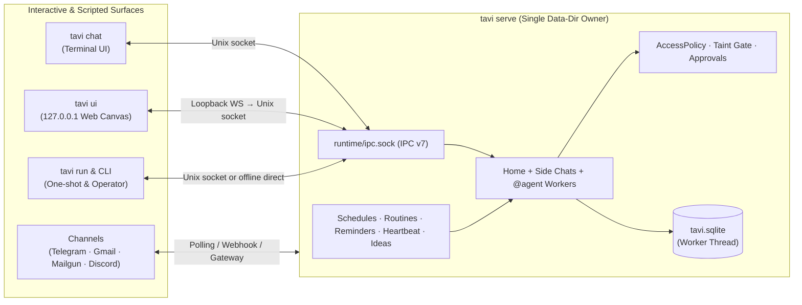

# Using Tavi: Surfaces and Use Cases

Tavi is one personal agent with one memory, one conversation history (`Home`), and one data directory (`$XDG_DATA_HOME/tavi`, `~/Library/Application Support/tavi` on macOS, `~/.local/share/tavi` on Linux, or `%LOCALAPPDATA%\tavi` on Windows by default), reached through four surfaces and your messaging channels:

- **[`tavi serve`](#1-tavi-serve--the-owner)** — the long-lived owner process that holds `tavi.sqlite`, runs channels, schedules, routines, reminders, the heartbeat, and daily ideas, and listens on `runtime/ipc.sock`.
- **[`tavi chat`](#2-tavi-chat--the-terminal-ui)** — the full-screen terminal interface (`cli` interactive) for talking to `Home`, branching side chats, attaching folders, and approving tool calls in place.
- **[`tavi run` and operator CLI](#3-tavi-run-and-the-operator-cli)** — one-shot task execution (`tavi run "<prompt>"`), JSON pipelines, and command-line management for every subsystem.
- **[`tavi ui`](#4-tavi-ui--the-web-canvas)** — the loopback browser canvas (`127.0.0.1`) with `Home`, side chats, unified file diffs, live browser view and human handoff, the Command Center, Ideas, and Settings.
- **[Messaging channels](#5-messaging-channels-and-shared-rooms)** — Telegram, Gmail, Mailgun, and Discord rooms connected to the same `Home` conversation (or isolated per sender/room).

For how the packages, ports, worker processes, and sandboxes are built underneath, see [ARCHITECTURE.md](ARCHITECTURE.md). For core terms (*owner*, *Home*, *principal*, *taint*, *epoch*, *operator*), see [CONCEPTS.md](CONCEPTS.md).

## Contents

- [How the pieces fit together](#how-the-pieces-fit-together)
  - [Surface comparison](#surface-comparison)
  - [1. `tavi serve` — The owner](#1-tavi-serve--the-owner)
  - [2. `tavi chat` — The terminal UI](#2-tavi-chat--the-terminal-ui)
  - [3. `tavi run` and the operator CLI](#3-tavi-run-and-the-operator-cli)
  - [4. `tavi ui` — The web canvas](#4-tavi-ui--the-web-canvas)
  - [5. Messaging channels and shared rooms](#5-messaging-channels-and-shared-rooms)
- [Use-case walkthroughs by capability](#use-case-walkthroughs-by-capability)
  - [1. Everyday persistent assistant: `Home`, side chats, private chats, and `@agent` workers](#1-everyday-persistent-assistant-home-side-chats-private-chats-and-agent-workers)
  - [2. One-shot CLI tasks, shell pipelines, and JSON transcripts (`tavi run`)](#2-one-shot-cli-tasks-shell-pipelines-and-json-transcripts-tavi-run)
  - [3. Local coding, working folders, and sandboxed shell execution (`fs.*`, `sandbox.run`)](#3-local-coding-working-folders-and-sandboxed-shell-execution-fs-sandboxrun)
  - [4. Governed web research, live browser automation, flight search, and human handoff (`web_search`, `browser.*`, `travel.flights_search`)](#4-governed-web-research-live-browser-automation-flight-search-and-human-handoff-web_search-browser-travelflights_search)
  - [5. Reading PDFs, OCR on scanned pages, and source-verified form filling (`pdf.*`)](#5-reading-pdfs-ocr-on-scanned-pages-and-source-verified-form-filling-pdf)
  - [6. Watching videos, local speech transcription, and exercise pose coaching (`video.*`)](#6-watching-videos-local-speech-transcription-and-exercise-pose-coaching-video)
  - [7. Messaging from your phone or inbox: Telegram, Gmail, Mailgun, Discord rooms, and one-time code / QR pairing](#7-messaging-from-your-phone-or-inbox-telegram-gmail-mailgun-discord-rooms-and-one-time-code--qr-pairing)
  - [8. Unattended automation: reminders, cron schedules, research routines (`news-v1`, `trends-v1`), project reports, and the heartbeat](#8-unattended-automation-reminders-cron-schedules-research-routines-news-v1-trends-v1-project-reports-and-the-heartbeat)
  - [9. Governed long-term memory (`/remember`, `/why`, idle review) and versioned skills (`SKILL.md`)](#9-governed-long-term-memory-remember-why-idle-review-and-versioned-skills-skillmd)
  - [10. Connected apps and sandboxed MCP servers (Google Calendar, Gmail, Home Assistant, Google Maps)](#10-connected-apps-and-sandboxed-mcp-servers-google-calendar-gmail-home-assistant-google-maps)
  - [11. Domain plugins: Job search & CV matching (`jobs.finder`), Places & healthcare (`places.open`, `places.care`), and Trend radar (`trends.radar`)](#11-domain-plugins-job-search--cv-matching-jobsfinder-places--healthcare-placesopen-placescare-and-trend-radar-trendsradar)
  - [12. Extending Tavi: authoring custom plugins, turn-hook mods, provider plugins, and UI plugins](#12-extending-tavi-authoring-custom-plugins-turn-hook-mods-provider-plugins-and-ui-plugins)
- [Built-in everyday use-case catalogue](#built-in-everyday-use-case-catalogue)

---

## How the pieces fit together



### Surface comparison

| Surface | Command | Needs `tavi serve`? | Best for | How approvals and questions work | Guide |
| :--- | :--- | :--- | :--- | :--- | :--- |
| **Owner** | `tavi serve` | *Is* the owner | Keeping channels, schedules, routines, reminders, heartbeat, and ideas running; serving `chat`, `ui`, and `run` concurrently | Enforces policies and dispatches approval/question requests to attached surfaces or channels | [OPERATIONS.md](OPERATIONS.md), [CONFIGURATION.md](CONFIGURATION.md) |
| **Terminal UI** | `tavi chat` | Yes (connects to the live `tavi serve` owner) | Coding in a terminal, working with local folders (`/folder`), steering live turns (`/steer`), keyboard-driven review | Inline prompt in the transcript (`y` approve round, `n` reject round; scoped approvals via `tavi approvals approve --scope`) | [TERMINAL-UI.md](TERMINAL-UI.md) |
| **Web Canvas** | `tavi ui` | Yes (connects to the live `tavi serve` owner) | Rich visual review (unified file diffs, live browser view & human takeover, Command Center, Ideas tab, Settings) | Inline approval cards (`once` / `session` / `always`), diff cards, question cards, and the Command Center **Approvals** queue | [WEB-UI.md](WEB-UI.md), [ONBOARDING.md](ONBOARDING.md) |
| **One-shot CLI** | `tavi run "<prompt>"` | Connects to `serve` if running; otherwise runs in-process | Shell scripts, CI/local automation, JSON output (`--format json`), non-interactive jobs (`--approval approve\|deny`) | Interactive terminal prompt (`--approval ask`), pre-authorized (`approve`), or auto-denied (`deny`) | [AUTOMATION.md](AUTOMATION.md), [CLI.md](CLI.md#tavi-run) |
| **Channels** | Telegram / Email / Discord | Yes (`tavi serve` runs connectors) | Reaching Tavi from your phone or inbox, receiving routine reports, reminders, and heartbeat check-ins | Telegram inline buttons (`Approve once`, `Approve task`, `Approve chat`, `Reject`) or `approve [<token>] [once\|task\|chat]` / `reject [<token>] <reason>`; single-use `/i/<token>` links or `approve` / `reject <reason>` email replies | [CHANNELS.md](CHANNELS.md) |

---

### 1. `tavi serve` — The owner

One process at a time owns a `<data-dir>` (`$XDG_DATA_HOME/tavi`, `~/Library/Application Support/tavi` on macOS, `~/.local/share/tavi` on Linux, or `%LOCALAPPDATA%\tavi` on Windows by default; locked via `owner.lock` and `owner.process.json`) and publishes `runtime/ipc.json`, `runtime/ipc.token`, and `runtime/ipc.sock`. While `tavi serve` is running, you can open `tavi chat`, `tavi ui`, and `tavi run` at the same time against the same database without lock contention.

```bash
# Run the owner in the foreground
tavi serve

# Start with a working folder root and pre-approved mutating tools (read-only tools need no --allow)
tavi serve --fs-root ~/projects/app --allow fs.write --allow fs.edit

# Generate a background user service unit (launchd on macOS, systemd on Linux) and load it
tavi service unit --kind launchd --out ~/Library/LaunchAgents/dev.tavi.serve.plist
launchctl load -w ~/Library/LaunchAgents/dev.tavi.serve.plist
```

Useful startup flags on `tavi serve` (`--http-allow-host`, `--browser-allow-host`, and `--messaging-allow-destination` are also accepted by `tavi run`):

- `--fs-root <dir>` — (`tavi serve` only, repeatable) grant file tools (`fs.read`, `fs.list`, `fs.glob`, `fs.grep`, `fs.write`, `fs.edit`) confined to `<dir>`.
- `--allow <tool>` — (`tavi serve` only, repeatable) pre-approve a mutating tool for the owner session without prompting each time (read-only tools such as `fs.read`, `fs.list`, and `web_search` do not require `--allow`).
- `--http-allow-host <host>` / `--browser-allow-host <host>` — allowlist outbound hosts for `http.request`, `web_fetch`, and `browser.*`.
- `--messaging-allow-destination <dest>` / `--messaging-allow-tool <name>` — allowlist outbound channel destinations (`serve` and `run`) and messaging tools (`serve`).

See [OPERATIONS.md](OPERATIONS.md) for service management, health checks (`tavi doctor`), backups, and logs, and [CONFIGURATION.md](CONFIGURATION.md) for models, credentials, and environment variables.

---

### 2. `tavi chat` — The terminal UI

`tavi chat` launches the full-screen Ink terminal UI connected to your running `tavi serve` owner. By default it opens **`Home`**, your continuous conversation with Tavi.

```bash
# Open Home
tavi chat

# Open Home with a pre-filled draft message (and manage attached folders in-chat via /folder)
tavi chat --draft "Summarize the recent changes in this repo"
# Inside chat:
#   /folder set ~/projects/app
#   /folder add ~/projects/shared-specs

# Start a private chat that leaves no trace in memory, or run without memory reads/writes
tavi chat --private
tavi chat --no-memory

# Attach to an existing task on the owner
tavi chat --attach <task-id>
```

Inside `tavi chat`:

- **Slash commands**: `/chats` (switch conversations), `/home` (return to `Home`), `/side [topic]` (branch a side chat), `/open <id>`, `/new` (start a fresh chat), `/steer <note>` (redirect an in-flight turn), `/compact` (summarize older turns into a new epoch), `/taint` (inspect turn taint status), `/why` (inspect which memories and skills the last turn used), `/memory`, `/remember <text>`, `/forget <query>`, `/folder` (`show`, `set <path>`, `add <path> [--rw]`, `drop <label>`, `reset`), `/needs`, `/answer`, `/approvals`, `/agents`, `/schedules`, `/models`, `/model`, `/credentials`, `/plugins`, `/heartbeat`, `/ideas`, `/help`.
- **Approvals**: When Tavi proposes a side-effecting tool call (`fs.write`, `sandbox.run`, `browser.click`, sending an email), an inline approval prompt appears with the tool arguments and provenance (`y` to approve the round, `n` to reject).

See [TERMINAL-UI.md](TERMINAL-UI.md) for keybindings, panes, and slash commands.

---

### 3. `tavi run` and the operator CLI

`tavi run` executes a single task from your shell and exits when the turn finishes (or pauses if it needs an approval or answer you haven't pre-authorized).

```bash
# Run a one-shot task in a fresh conversation with a working folder (under the owner's --fs-root)
tavi run "Summarize the open TODOs in this repository" --folder .

# Post the message into Home instead of a separate task conversation
tavi run --home "Remind me at 17:00 to call the accountant"

# Emit machine-readable JSON for shell pipelines
tavi run "List the three largest files in src/" --folder . --format json

# Replay a saved JSONL event stream in the terminal UI
tavi chat --replay ./run-events.jsonl
```

When a background task, schedule, or routine pauses waiting for your input, you can inspect and resolve it from the terminal:

```bash
# See every waiting question and approval across all tasks
tavi needs

# Answer a waiting question or approve a pending tool call on a task from the CLI
tavi answer <task-id> "Use the staging configuration"
tavi approvals approve <task-id> --scope once
```

See [AUTOMATION.md](AUTOMATION.md) for scripting patterns and [CLI.md](CLI.md) for every command and flag.

---

### 4. `tavi ui` — The web canvas

`tavi ui` opens Tavi's browser interface on loopback (`http://127.0.0.1:<port>`). It never binds to a public interface, and has no remote-access mode: a browser gets in through a one-time link (its token in the `#fragment`, good once for a minute), exchanged for a session cookie.

```bash
# Start the loopback web server and open it in your default browser
tavi ui

# Run on a fixed port and print the session URL without opening a browser window automatically
tavi ui --port 4317 --print-url
```

What you can do in the web canvas:

- **First-run Welcome**: Walk through **Choose the model Tavi thinks with**, **About you** (your name and time zone), **Connect an app**, **Where do you keep tasks?**, **Message Tavi from your phone** (Telegram pairing via a scannable QR code, an **Open in Telegram** deep link, or a copyable `/link XXXX-XXXX` code), **Web search**, and **Try something**.
- **Chat (`Home` and side chats)**: Read streaming replies, review syntax-highlighted unified file diffs before `fs.write` or `fs.edit` touches disk, and approve or deny tool calls inline.
- **Right-hand Chat Panel**: Inspect live tool **Activity**, conversation **Schedule** items, **Memory** items cited in the turn, **Instructions**, and **Details**.
- **Live Browser & Takeover**: Watch Tavi's Chromium tab in real time, and click **Take over** when a login, MFA challenge, CAPTCHA, or final checkout/application review needs your own hands.
- **Command Center**: Review global **Activity**, **Schedule** (routines, cron jobs, reminders), **Heartbeat**, pending **Approvals**, **Soul & memory**, and **Browser** sessions.
- **Ideas Tab**: Browse personalized workflow suggestions backed by your enabled capabilities (`Try it`, `Pin`, `Make it recurring…`, `Remind me…`).
- **Settings**: **General**, **Models**, **Web search**, **System prompt**, **Credentials**, **Channels** (including Telegram one-time pairing codes and QR codes), **Allowed people**, **Connected apps**, **Plugins**, **Permissions**, and **Ideas**.

See [WEB-UI.md](WEB-UI.md) and [ONBOARDING.md](ONBOARDING.md).

---

### 5. Messaging channels and shared rooms

When `tavi serve` is running, connected channels route into your agent:

- **Your own direct messages (Telegram, Gmail, Mailgun)** each have their own persistent conversation Home by default (listed under **Conversations**), and you can opt a chat-channel DM directly into your main **`Home`** via `tavi config set chat.home-dm <connection>:<sender-id>` so you can start a task in `tavi chat` at your desk and continue it from Telegram on your phone (`Home` reminders, heartbeat items, notices, and approvals can also notify your channels).
- **Other people and shared rooms (Telegram groups, Discord channels/threads)** get their own isolated conversation per sender or room, running under a tighter guest tool policy that never reads your private memory or `Home` transcript.

See [CHANNELS.md](CHANNELS.md) for setup, pairing, and room governance.

---

## Use-case walkthroughs by capability

Each walkthrough below shows how to run a real workflow across Tavi's surfaces, how the security and governance model behaves during the turn, and which guide covers the full details.

### 1. Everyday persistent assistant: `Home`, side chats, private chats, and `@agent` workers

- **Goal**: Keep one continuous `Home` thread across terminal, web, and phone, while branching exploratory work into side chats or parallel `@agent` workers.
- **How to run it**:
  ```bash
  # In tavi chat or tavi ui, talk in Home:
  "We're planning a 4-day trip to Lisbon in October. Keep track of our options."

  # Branch a side chat so noisy research doesn't clutter Home:
  /side Compare Lisbon neighbourhoods near the metro

  # Return to Home when done:
  /home

  # Delegate background work to a named specialist agent:
  "@researcher Compare three flight options and post a summary back here"
  ```
- **How governance works**: `Home` automatically rolls over into a new **epoch** when context grows large, summarizing earlier turns and flushing durable facts into memory review. Private chats (`tavi chat --private` or **New private chat** beside the chat list's + in `tavi ui`) never write to memory and are excluded from Ideas and Heartbeat reads.
- **Deep-dive guides**: [CONCEPTS.md](CONCEPTS.md), [TERMINAL-UI.md](TERMINAL-UI.md), [WEB-UI.md](WEB-UI.md), [PRIVACY.md](PRIVACY.md), [ASYNC-PERSISTENCE.md](ASYNC-PERSISTENCE.md), [AUTOMATION.md — Agents and workers](AUTOMATION.md#agents-and-workers).

---

### 2. One-shot CLI tasks, shell pipelines, and JSON transcripts (`tavi run`)

- **Goal**: Run Tavi from scripts, git hooks, or terminal pipelines with deterministic tool permissions and structured output.
- **How to run it**:
  ```bash
  # Read-only code audit with JSON output (read-only tools run when --folder is under the owner's --fs-root)
  tavi run "Find any exported functions in src/ missing TypeScript return types" \
    --folder ~/projects/app \
    --approval deny \
    --format json > audit.json

  # Run a task that is pre-authorized to approve mutating tools in the attached folder
  tavi run "Update CHANGELOG.md with the commits since v1.2.0" \
    --folder ~/projects/app \
    --approval approve
  ```
- **How governance works**: `--approval deny` ensures a non-interactive script never hangs waiting for a prompt; any mutating tool not pre-approved on the owner (`tavi serve --allow <tool>`) or via saved permissions is cleanly refused. `--approval approve` pre-authorizes mutating tool rounds for that one-shot run.
- **Deep-dive guides**: [AUTOMATION.md — `tavi run`: one task per command](AUTOMATION.md#tavi-run-one-task-per-command), [CLI.md — `tavi run`](CLI.md#tavi-run).

---

### 3. Local coding, working folders, and sandboxed shell execution (`fs.*`, `sandbox.run`)

- **Goal**: Let Tavi read, edit, and test code or organize local files inside an explicit folder boundary and an OS-confined child sandbox.
- **How to run it**:
  ```bash
  # Launch interactive chat and attach a working folder (must be within an --fs-root on the owner)
  tavi chat
  # Inside chat:
  /folder set ~/projects/my-service
  /folder add ~/Photos/2026-import --rw
  ```
  Prompt example:
  > *"Run the test suite in the sandbox, fix the failing date-parsing test in `src/dates.ts`, and re-run the tests to confirm."*
- **How governance works**:
  - File tools (`fs.read`, `fs.list`, `fs.glob`, `fs.grep`, `fs.write`, `fs.edit`) resolve real paths (`realpath`) and reject symlink escapes or paths outside attached folders (`/folder set`, `/folder add`, `tavi tasks folder <task-id>`, and `--fs-root`).
  - `fs.write` and `fs.edit` show a unified diff in `tavi ui` and `tavi chat` before modifying existing files.
  - `sandbox.run` executes commands inside macOS **Seatbelt** (`sandbox-exec`) or Linux **bubblewrap** (`bwrap`) with an isolated `/tmp`, filtered environment variables (no API keys), a domain-filtered HTTP egress proxy, and an RSS memory watchdog.
- **Deep-dive guides**: [WORKING-FOLDERS.md](WORKING-FOLDERS.md), [SANDBOX.md](SANDBOX.md).

---

### 4. Governed web research, live browser automation, flight search, and human handoff (`web_search`, `browser.*`, `travel.flights_search`)

- **Goal**: Search the web, navigate multi-step pages in a real Chromium instance, compare flights (`travel.flights_search`), and hand control to the user for logins or final checkout/submission steps.
- **How to run it**:
  ```bash
  # Configure a search provider interactively (Tavily, Brave, Serper, or SearXNG)
  tavi setup search
  tavi search list

  # Inspect live browser sessions, capture live frames for a task, and list saved site recipes
  tavi browser history --live
  tavi browser live <task-id> --out ./frames
  tavi browser recipes
  ```
  Prompt examples:
  > *"Find the cheapest non-stop flights from SFO to LHR in the second week of November and compare total fares with carry-on bags."*
  >
  > *"Open my utility portal in the browser, wait for me to sign in, and download the last three PDF bills."*
- **How governance works**:
  - Reading any web page or search result marks the turn **tainted** (`untrusted_content`) and wraps the content in a provenance-labeled `<untrusted_content>` envelope.
  - Once tainted, Tavi's **taint gate** blocks high-risk side effects (such as arbitrary shell execution or unapproved external sends) unless you explicitly approve the action with full provenance visibility.
  - Protected fields (passwords, credit cards, SSNs, tax IDs, legal signature/attestation checkboxes) are blocked from automated filling; Tavi pauses and requests a **human takeover** in `tavi ui` (inspectable via `tavi browser history --live` or `tavi browser live <task-id> --out <dir>`).
- **Deep-dive guides**: [BROWSER.md](BROWSER.md), [SECURITY-MODEL.md](SECURITY-MODEL.md), [SKILLS.md — Site skills](SKILLS.md#site-skills).

---

### 5. Reading PDFs, OCR on scanned pages, and source-verified form filling (`pdf.*`)

- **Goal**: Extract text, tables, and form fields from PDFs (including scanned documents via local OCR) and pre-fill AcroForm PDFs with strict source verification.
- **How to run it**:
  ```bash
  # Attach your forms folder in chat (or pass --folder ~/Documents/Forms to tavi run)
  tavi chat
  # Inside chat:
  /folder set ~/Documents/Forms
  ```
  Prompt examples:
  > *"Read `lease-agreement.pdf`, summarize the renewal and notice clauses, and flag any unusual fees."*
  >
  > *"Inspect the fields in `school-enrollment.pdf`, fill them from the details in `family-info.md`, and write the draft to `school-enrollment-filled.pdf` for me to check."*
- **How governance works**:
  - PDF parsing (`pdfium` + `@cantoo/pdf-lib`) and OCR (`@tavi/pdf-ocr`, Tesseract WASM) run in isolated, memory-capped child processes with no network access.
  - Hidden text (zero-point fonts, white-on-white text, off-page annotations) is detected and stripped or flagged before reaching the model.
  - `pdf.fill` verifies that every value written into a form field traces back to a trusted user source, refuses to fill signature or legal attestation fields, and never overwrites the original PDF in place.
- **Deep-dive guides**: [PDF.md](PDF.md).

---

### 6. Watching videos, local speech transcription, and exercise pose coaching (`video.*`)

- **Goal**: Understand local video clips, transcribe speech locally with `whisper.cpp`, and analyze movement/exercise form with local pose estimation (RTMPose with optional RTMDet-nano person detection via `onnxruntime-node`).
- **How to run it**:
  ```bash
  # Attach your videos folder in chat (or pass --folder ~/Videos/Workouts to tavi run)
  tavi chat
  # Inside chat:
  /folder set ~/Videos/Workouts
  ```
  Prompt examples:
  > *"Transcribe `lecture-recording.mp4` with timestamps and summarize the three main arguments."*
  >
  > *"Analyze my squat form in `back-squat-set3.mp4` and coach me on depth, knee tracking, and bar path."*
- **How governance works**:
  - FFmpeg frame extraction, `whisper.cpp` transcription, and ONNX pose inference run in confined child processes (`@tavi/child-kit`) with strict duration, frame-count, and RSS limits.
  - Pose coaching reports joint angles, rep phases, and verbal coaching cues while explicitly framing output as movement coaching rather than medical advice.
- **Deep-dive guides**: [VIDEO.md](VIDEO.md).

---

### 7. Messaging from your phone or inbox: Telegram, Gmail, Mailgun, Discord rooms, and one-time code / QR pairing

- **Goal**: Talk to Tavi from Telegram, email, or a Discord server, pair your phone with a one-time code or QR code, and approve waiting actions remotely.
- **How to run it**:
  ```bash
  # Connect a Telegram bot token
  tavi channels add telegram

  # Mint a 10-minute one-time pairing code (or scan the QR code in tavi ui → Settings → Channels)
  tavi channels link telegram
  # In Telegram, tap "Open in Telegram" or send: /link XXXX-XXXX

  # List paired people and manage access
  tavi channels people telegram
  tavi channels unlink telegram <sender-id>
  tavi channels revoke telegram <sender-id>

  # Bind an external sender to a principal or allow a group room on a connection
  tavi bindings bind --connection telegram --sender <sender-id> --principal <principal-id>
  tavi channels rooms telegram add <room-id>
  ```
- **How governance works**:
  - Telegram runs with link previews disabled (`link_preview_options.is_disabled: true`) so untrusted URLs cannot exfiltrate data via preview fetches.
  - Inbound messages from unverified senders or shared rooms are labeled with sender provenance and cannot access owner-only tools or private memory.
  - Waiting approvals and questions can be answered directly from Telegram or by replying to Tavi's email notification.
- **Deep-dive guides**: [CHANNELS.md](CHANNELS.md), [APPS.md](APPS.md), [templates/CHANNEL-PRIVACY-NOTICE.md](templates/CHANNEL-PRIVACY-NOTICE.md).

---

### 8. Unattended automation: reminders, cron schedules, research routines (`news-v1`, `trends-v1`), project reports, and the heartbeat

- **Goal**: Schedule recurring work, run multi-source research routines that deliver cited digests, get one-shot reminders, and let the periodic **heartbeat** surface timely nudges.
- **How to run it**:
  ```bash
  # Set a one-shot reminder
  tavi reminders add "Submit quarterly VAT return" --at "2026-10-25 09:00"

  # Create a recurring weekday schedule
  tavi schedules add --name "Morning summary" --at 08:00 --days 1,2,3,4,5 \
    --timezone Europe/Berlin \
    --prompt "Summarize my calendar and urgent emails for today"

  # Configure and trigger the periodic heartbeat
  tavi heartbeat status
  tavi heartbeat hours 08:00-21:00
  tavi heartbeat run-now
  ```
  In `tavi ui` (**Command Center → Schedule** or **Ideas → Make it recurring…**), you can also create **Agent Routines** that track a topic's news across sources, evaluate quality, and deliver reports to `Home` or a channel. These use Tavi's own `news-v1` report; a plugin's report template, such as the Trends app's `trends-v1`, is set only through the owner's `routines` IPC command, so for a daily trends digest use a schedule instead ([Track a trend over weeks](use-cases/automation/trend-routine.md)).
- **How governance works**:
  - Unattended schedules and routines run under a pre-evaluated tool policy; if a routine reads untrusted web content, any proposed changes to its own state or memory are quarantined until you approve them.
  - The heartbeat checks quiet hours, daily budgets, and deduplication windows before sending any notification.
- **Deep-dive guides**: [AUTOMATION.md](AUTOMATION.md), [HEARTBEAT.md](HEARTBEAT.md).

---

### 9. Governed long-term memory (`/remember`, `/why`, idle review) and versioned skills (`SKILL.md`)

- **Goal**: Build a personal memory and reusable skill library that stays transparent, auditable, and immune to silent prompt-injection writes.
- **How to run it**:
  ```bash
  # Record or search memories from the CLI
  tavi memory remember --body "I prefer aisle seats on flights over 3 hours"
  tavi memory search "flights"
  tavi memory review

  # List or import versioned skills (SKILL.md)
  tavi skills list
  tavi skills import release-checklist --version 1.0.0 \
    --package ~/my-skills/release-checklist \
    --name "Release Checklist" --provenance local
  ```
  Inside `tavi chat`:
  - `/remember I use pnpm in all TypeScript repos` — saves a memory directly.
  - `/why` — shows the exact memory items, skills, and provenance that shaped the last reply.
  - `/forget <query>` — removes matching memories and cascades deletion to any Ideas that cited them.
- **How governance works**:
  - Model-proposed memories never become active silently when a turn is tainted; they enter a pending **review queue** (`tavi memory review` or **Command Center → Soul & memory**).
  - Skills (`SKILL.md`) are versioned, scanned for prompt injection, and rolled out with bounded evaluation so a faulty skill revision can be rolled back automatically.
- **Deep-dive guides**: [MEMORY.md](MEMORY.md), [SKILLS.md](SKILLS.md).

---

### 10. Connected apps and sandboxed MCP servers (Google Calendar, Gmail, Home Assistant, Google Maps)

- **Goal**: Connect first-party OAuth apps and external Model Context Protocol (MCP) servers with per-tool permission controls (`allow`, `ask`, `block` for apps; mailbox levels `off`, `read`, `send` for Gmail; `--effect` and `--floor` for MCP tools) and OS-sandboxed stdio transport.
- **How to run it**:
  ```bash
  # Browse and connect curated apps, inspect status, and set per-tool permissions
  tavi apps catalog
  tavi apps client gmail --file ./client_secret.json
  tavi apps calendar gmail <account> on
  tavi apps show gmail
  tavi apps permission gmail gmail.<account>.list_events allow

  # Add a preset or custom MCP server (confined in the OS sandbox) and inspect its tools
  tavi mcp add homeassistant --preset homeassistant
  tavi mcp probe mcp.homeassistant
  tavi mcp show mcp.homeassistant
  ```
- **How governance works**:
  - OAuth tokens and API credentials are stored as `0600` encrypted files in `<data-dir>/credentials/<ref>` (AES-256-GCM keyed by `<data-dir>/credentials.key`, while `tavi.sqlite` stores only opaque credential reference names) — never in environment variables passed to child processes.
  - Every MCP server added via `tavi mcp add` is probed and pinned by SHA-256 tool-definition hash (`apps/cli/src/features/mcp/{owner,probe,review}.ts`), assigned per-tool effect/floor policies on approval (`tavi mcp approve`), and spawned inside the OS sandbox (`@tavi/plugin-sandbox`).
- **Deep-dive guides**: [APPS.md](APPS.md), [MCP.md](MCP.md).

---

### 11. Domain plugins: Job search & CV matching (`jobs.finder`), Places & healthcare (`places.open`, `places.care`), and Trend radar (`trends.radar`)

- **Goal**: Use Tavi's built-in domain workers to search across 20 job boards, 15 open/licensed place & healthcare directories, and 17 trend/community sources with local SQLite deduplication and zero paid aggregator lock-in.
- **How to run it**:
  - **Jobs (`jobs.finder`)**:
    > *"Search remote TypeScript staff engineer roles paying at least $180k across Greenhouse, Lever, and HN Who's Hiring, and score them against `~/Documents/resume.pdf`."*
    >
    > *"Pre-fill this Greenhouse application from my résumé and stop before clicking submit so I can review every field."*
  - **Places & Healthcare (`places.open`, `places.care`)**:
    > *"Find a licensed electrician within 10 km, verify their state license status, and summarize their reviews."*
    >
    > *"Find dermatologists near my postcode who are in network for Blue Cross and accepting new patients."*
  - **Trends (`trends.radar`)**:
    > *"How fast is `local-first software` trending across Hacker News, Reddit, GitHub, and Lobsters this week compared with the past month? Cluster the main arguments in the top threads."*
- **How governance works**:
  - Each domain plugin runs in an isolated worker process (`@tavi/domain-kit`) with its own SQLite cache, per-source rate budgets, and Terms-of-Service compliance guards.
  - `jobs.finder` never clicks final submit on an application; it stages answers for your review.
  - `places.care` verifies provider NPIs/licenses from official registries and never sends health queries to ad-tech trackers.
- **Deep-dive guides**: [JOBS.md](JOBS.md), [PLACES.md](PLACES.md), [TRENDS.md](TRENDS.md).

---

### 12. Extending Tavi: authoring custom plugins, turn-hook mods, provider plugins, and UI plugins

- **Goal**: Extend Tavi with new tools, turn-lifecycle interceptors (*mods*), custom `heartbeat` / `ideas` / `memory` / `onboarding` / `channel` / `router` providers, or sandboxed browser UI panels — either by asking Tavi in chat or by building a standalone package.
- **How to run it**:
  ```bash
  # Install, approve, and enable one of the runnable examples shipped in this repository
  tavi plugins install ./examples/plugins/acme-units
  tavi plugins approve acme.units 0.1.0
  tavi plugins enable acme.units
  tavi plugins install ./examples/plugins/acme-fx
  tavi plugins install ./examples/mods/acme-guard
  tavi plugins install ./examples/mods/cache-meter
  tavi plugins list

  # Run the conformance suite against a custom provider plugin
  pnpm --filter @tavi/plugin-kit test
  ```
- **Runnable examples in the repository**:
  - [`examples/plugins/acme-units`](../examples/plugins/acme-units) — zero-permission unit conversion tool plugin.
  - [`examples/plugins/acme-fx`](../examples/plugins/acme-fx) — currency conversion plugin demonstrating network host allowlists (`api.frankfurter.app`).
  - [`examples/mods/acme-guard`](../examples/mods/acme-guard) — `tool.check` turn-hook mod that guards `sandbox.run` against destructive commands and production hostnames.
  - [`examples/mods/cache-meter`](../examples/mods/cache-meter) — `turn.complete` turn-hook mod tracking prompt-cache hit rates.
  - [`examples/ui-plugins/minimal-browser-view`](../examples/ui-plugins/minimal-browser-view/README.md) — sandboxed iframe UI plugin rendered inside `tavi ui`.
- **Deep-dive guides**: [PLUGINS.md](PLUGINS.md), [MODS.md](MODS.md), [CHANNEL-PLUGINS.md](CHANNEL-PLUGINS.md), [HEARTBEAT-PLUGINS.md](HEARTBEAT-PLUGINS.md), [IDEAS-PLUGINS.md](IDEAS-PLUGINS.md), [MEMORY-PLUGINS.md](MEMORY-PLUGINS.md), [ONBOARDING-PLUGINS.md](ONBOARDING-PLUGINS.md), [ROUTER.md](ROUTER.md), [DEVELOPMENT.md](DEVELOPMENT.md).

---

## Built-in everyday use-case catalogue

Tavi ships with **65 researched everyday use-case templates across 19 domains** in `packages/plugin-kit/src/ideas/catalogue.ts`. The built-in Ideas provider filters this catalogue against the capabilities actually enabled in your workspace (`requires`), ranks templates that match topics you've mentioned in your approved memory, chats, or brief (`triggers`), and marks which capabilities always ask for confirmation before acting (`asks`).

See [IDEAS.md](IDEAS.md) for how Ideas are ranked, budgeted, and managed in `tavi ui`, `tavi chat`, and `tavi ideas`.

| # | Domain | Key (`useCase`) | Everyday Workflow | Capabilities (`requires`) | Asks First (`asks`) | Cadence | Primary Guide |
| :--- | :--- | :--- | :--- | :--- | :--- | :--- | :--- |
| 1 | **Shopping & Deals** | `shopping.landed-cost` (`1.1`) | Compare a product's landed cost (price, shipping, duties, fees) across stores in your browser session | `browser`, `web` | — | — | [BROWSER.md](BROWSER.md) |
| 2 | **Shopping & Deals** | `shopping.review-check` (`1.2`) | Check a product listing for signs of fake reviews or counterfeits | `browser`, `web` | — | — | [BROWSER.md](BROWSER.md) |
| 3 | **Local Vetting** | `travel.specialist` (`2.1`) | Find a licensed specialist nearby, verify state license, and summarize ratings | `places`, `web` | — | — | [PLACES.md](PLACES.md) |
| 4 | **Local Vetting** | `health-home.in-network` (`2.2`) | Find doctors/dentists near you who are in network for your insurance plan and taking new patients | `care`, `web` | — | — | [PLACES.md](PLACES.md) |
| 5 | **Jobs & Career** | `work.job-watch` (`3.1`) | Watch job boards for roles matching your salary floor and rank them against your résumé | `jobs` | `jobs` | `daily` | [JOBS.md](JOBS.md) |
| 6 | **Jobs & Career** | `work.application-prefill` (`3.2`) | Pre-fill a job application (Greenhouse, Lever, Workday) from your résumé and stop before final submit | `browser`, `pdf` | `browser` | — | [JOBS.md](JOBS.md), [BROWSER.md](BROWSER.md) |
| 7 | **Trends & Monitoring** | `work.trend-radar` (`4.1`) | Track how fast a topic is rising across free sources this week vs. the past month | `trends` | `trends` | `daily` | [TRENDS.md](TRENDS.md) |
| 8 | **Trends & Monitoring** | `work.comment-clusters` (`4.2`) | Cluster comments in a busy thread into themes and summarize the main arguments on each side | `browser` | — | — | [BROWSER.md](BROWSER.md) |
| 9 | **B2B Leads** | `productivity.prospects` (`5.1`) | Research a company's organization and public roles worth contacting from its own published sources | `web` | — | — | [BROWSER.md](BROWSER.md) |
| 10 | **Travel & Commute** | `travel.fare-watch` (`6.1`) | Compare flight prices across carriers for your route and dates and keep checking the fares | `flights` | — | `daily` | [BROWSER.md](BROWSER.md) |
| 11 | **Travel & Commute** | `travel.hotels` (`6.2`) | Shortlist hotels for your dates and priorities from recent guest reviews with trade-offs spelled out | `web` | — | — | [BROWSER.md](BROWSER.md) |
| 12 | **Travel & Commute** | `travel.car-or-rail` (`6.3`) | Compare renting a car (with all surcharges) against taking the train door to door | `web`, `browser` | — | — | [BROWSER.md](BROWSER.md) |
| 13 | **Travel & Commute** | `travel.fuel-route` (`6.4`) | Plan fuel or EV charging stops along a road trip route with prices where available | `places` | — | — | [PLACES.md](PLACES.md) |
| 14 | **Travel & Commute** | `travel.itinerary` (`6.5`) | Plan a day in a city grouping nearby sights and places to eat suited to your diet | `places`, `web` | — | — | [PLACES.md](PLACES.md) |
| 15 | **Travel & Commute** | `travel.visa-packing` (`6.6`) | Check passport entry/visa rules, build a packing list, and set reminders for deadlines | `web`, `reminders` | — | — | [AUTOMATION.md](AUTOMATION.md) |
| 16 | **Hobbies & Craft** | `learning.sketch-critique` (`7.1`) | Critique a photo of your drawing or painting on anatomy, perspective, and values | `image` | — | — | [CONCEPTS.md](CONCEPTS.md) |
| 17 | **Hobbies & Craft** | `learning.garden-plan` (`7.2`) | Check your hardiness zone, suggest companion plantings, and draw up a sowing calendar | `web` | — | — | [BROWSER.md](BROWSER.md) |
| 18 | **Hobbies & Craft** | `health-home.fridge-recipes` (`7.3`) | Suggest dinner recipes from a photo or list of your fridge that use expiring ingredients first | `image` | — | — | [CONCEPTS.md](CONCEPTS.md) |
| 19 | **Hobbies & Craft** | `learning.mix-practice` (`7.4`) | Build a weekly practice plan for your instrument and level, or diagnose a muddy audio mix | `web` | — | — | [BROWSER.md](BROWSER.md) |
| 20 | **Hobbies & Craft** | `productivity.photo-organise` (`7.5`) | Rename and sort a folder of photos by date and place from EXIF data after showing the plan | `files`, `sandbox` | `files` | — | [WORKING-FOLDERS.md](WORKING-FOLDERS.md) |
| 21 | **Hobbies & Craft** | `learning.cut-list` (`7.6`) | Compute a woodworking cut list from board sizes to minimize waste | `sandbox` | — | — | [SANDBOX.md](SANDBOX.md) |
| 22 | **Hobbies & Craft** | `learning.canon-audit` (`7.7`) | Read a manuscript in an attached folder and list continuity contradictions by chapter | `files` | — | — | [WORKING-FOLDERS.md](WORKING-FOLDERS.md) |
| 23 | **Life Ops & Admin** | `productivity.morning-brief` (`8.1`) | Deliver a morning brief of today's meetings, emails needing a reply, and anything due | `calendar`, `gmail` | — | `daily` | [APPS.md](APPS.md), [CHANNELS.md](CHANNELS.md) |
| 24 | **Life Ops & Admin** | `productivity.meeting-slots` (`8.2`) | Find meeting slots across multiple time zones checking your calendar | `calendar` | — | — | [APPS.md](APPS.md) |
| 25 | **Life Ops & Admin** | `productivity.inbox-triage` (`8.3`) | Triage your Gmail inbox and draft replies for your approval before anything is sent | `gmail` | `gmail` | — | [APPS.md](APPS.md), [CHANNELS.md](CHANNELS.md) |
| 26 | **Life Ops & Admin** | `productivity.downloads-cleanup` (`8.4`) | Propose a clean structure for a cluttered folder and wait for your approval before moving files | `files` | `files` | — | [WORKING-FOLDERS.md](WORKING-FOLDERS.md) |
| 27 | **Life Ops & Admin** | `productivity.subscriptions` (`8.5`) | Audit recurring subscriptions and stage cancellations in the browser, stopping before the final click | `browser`, `web` | `browser` | — | [BROWSER.md](BROWSER.md) |
| 28 | **Life Ops & Admin** | `health-home.appliance-records` (`8.6`) | Find appliance manuals by model/serial number, note warranties, and set maintenance reminders | `web`, `reminders` | — | — | [AUTOMATION.md](AUTOMATION.md) |
| 29 | **Learning & Study** | `learning.tutor` (`9.1`) | Tutor you Socratically through a subject step by step by asking guiding questions | `memory` | — | — | [MEMORY.md](MEMORY.md) |
| 30 | **Learning & Study** | `learning.language` (`9.2`) | Role-play real-world situations in a target language and gently correct mistakes | `memory` | — | — | [MEMORY.md](MEMORY.md) |
| 31 | **Learning & Study** | `learning.flashcards` (`9.3`) | Distil a PDF chapter or article into spaced-repetition flashcards for Anki | `pdf` | — | — | [PDF.md](PDF.md) |
| 32 | **Learning & Study** | `learning.tech-roadmap` (`9.4`) | Map out a technical learning roadmap with free resources or untangle a stack trace | `web` | — | — | [BROWSER.md](BROWSER.md) |
| 33 | **Learning & Study** | `learning.exam-prep` (`9.5`) | Quiz you before an exam to map weak spots and schedule study reminders | `memory`, `reminders` | — | `weekly` | [MEMORY.md](MEMORY.md), [AUTOMATION.md](AUTOMATION.md) |
| 34 | **Health & Fitness** | `health-home.form-check` (`10.1`) | Coach your lifting/exercise technique and setup from a workout video clip | `video` | — | — | [VIDEO.md](VIDEO.md) |
| 35 | **Health & Fitness** | `health-home.meal-plan` (`10.2`) | Plan a week of meals around your nutrition goals with one low-waste shopping list | `memory` | — | — | [MEMORY.md](MEMORY.md) |
| 36 | **Health & Fitness** | `health-home.sleep` (`10.3`) | Review recent sleep/wake times and suggest a sleep routine to try | `memory` | — | — | [MEMORY.md](MEMORY.md) |
| 37 | **Health & Fitness** | `health-home.thought-record` (`10.4`) | Guide a structured written thought record when something feels stressful or heavy | `memory` | — | — | [MEMORY.md](MEMORY.md) |
| 38 | **Health & Fitness** | `health-home.supplements` (`10.5`) | Set supplement reminders and flag known timing clashes to discuss with a pharmacist | `reminders`, `web` | — | — | [AUTOMATION.md](AUTOMATION.md) |
| 39 | **Home & Smart Home** | `health-home.rental-watch` (`11.1`) | Watch rental listings in your target area and budget and tell you what matches | `web`, `routines` | — | `daily` | [AUTOMATION.md](AUTOMATION.md) |
| 40 | **Home & Smart Home** | `health-home.load-shift` (`11.2`) | Inspect Home Assistant devices and electricity tariffs to suggest off-peak load shifting | `home-assistant` | `home-assistant` | — | [APPS.md](APPS.md), [MCP.md](MCP.md) |
| 41 | **Home & Smart Home** | `health-home.recycling` (`11.3`) | Check your local council's recycling rules from a photo of an item and say which bin it goes in | `image`, `web` | — | — | [BROWSER.md](BROWSER.md) |
| 42 | **Home & Smart Home** | `health-home.neighbourhood` (`11.4`) | Profile a neighbourhood around an address (amenities, transit, schools, noise sources) from open data | `places` | — | — | [PLACES.md](PLACES.md) |
| 43 | **Family & Household** | `health-home.school-forms` (`12.1`) | Pre-fill school permission or medical forms from known details and mark missing fields for review | `pdf` | `pdf` | — | [PDF.md](PDF.md) |
| 44 | **Family & Household** | `people.carpool` (`12.3`) | Run a pickup rota poll and coordinate a carpool in your group chat | `discord` | `discord` | — | [CHANNELS.md](CHANNELS.md) |
| 45 | **Pets** | `health-home.pet-vaccines` (`13.1`) | Check your pet's PDF vaccine record against kennel boarding rules and set expiry reminders | `reminders`, `pdf` | — | — | [PDF.md](PDF.md), [AUTOMATION.md](AUTOMATION.md) |
| 46 | **Pets** | `health-home.pet-diet` (`13.2`) | Stage a gradual day-by-day pet food transition with daily reminders and a symptom log | `reminders` | — | — | [AUTOMATION.md](AUTOMATION.md) |
| 47 | **Pets** | `health-home.lost-pet` (`13.3`) | Draft a lost-pet post and run a daily routine checking nearby shelter listings for matches | `web`, `routines` | — | `daily` | [AUTOMATION.md](AUTOMATION.md) |
| 48 | **Auto & Bikes** | `travel.car-code` (`14.1`) | Decode an OBD-II warning code for your car make/model/year, explain risks, and list part numbers | `web` | — | — | [BROWSER.md](BROWSER.md) |
| 49 | **Auto & Bikes** | `travel.bike-wear` (`14.2`) | Track weekly riding distance and remind you when chain, cassette, and brake pads need checking | `memory`, `reminders` | — | — | [MEMORY.md](MEMORY.md), [AUTOMATION.md](AUTOMATION.md) |
| 50 | **Auto & Bikes** | `travel.recalls` (`14.3`) | Watch for open safety recalls on your car's make, model, and year | `web`, `routines` | — | `weekly` | [AUTOMATION.md](AUTOMATION.md) |
| 51 | **Wardrobe & Style** | `shopping.capsule` (`15.1`) | Build a mix-and-match capsule wardrobe from photos or a list of your clothes | `image` | — | — | [CONCEPTS.md](CONCEPTS.md) |
| 52 | **Wardrobe & Style** | `shopping.outfit` (`15.2`) | Suggest today's outfit each morning from your wardrobe based on the forecast and your calendar | `calendar`, `web` | — | `daily` | [APPS.md](APPS.md) |
| 53 | **Wardrobe & Style** | `shopping.mending` (`15.3`) | Walk through mending a garment from a photo or price it for resale | `image`, `web` | — | — | [BROWSER.md](BROWSER.md) |
| 54 | **Gaming** | `learning.dnd-lore` (`16.1`) | Track tabletop RPG campaign world state, NPCs, and open threads across sessions | `memory` | — | — | [MEMORY.md](MEMORY.md) |
| 55 | **Gaming** | `learning.rules` (`16.2`) | Settle a board-game rules dispute by quoting the exact clause from the PDF rulebook | `pdf` | — | — | [PDF.md](PDF.md) |
| 56 | **Gaming** | `people.game-night` (`16.3`) | Poll your Discord group chat for a game night date and suggest co-op games everyone owns | `discord` | `discord` | — | [CHANNELS.md](CHANNELS.md) |
| 57 | **Genealogy & Archives** | `learning.cursive` (`17.1`) | Transcribe a scanned handwritten letter or historical record, marking uncertain words | `image` | — | — | [CONCEPTS.md](CONCEPTS.md) |
| 58 | **Genealogy & Archives** | `learning.census` (`17.2`) | Trace an ancestor across census records in your own browser session | `browser`, `web` | — | — | [BROWSER.md](BROWSER.md) |
| 59 | **Genealogy & Archives** | `learning.gedcom` (`17.3`) | Audit a GEDCOM family-tree file in an attached folder for impossible dates and relationships | `files`, `sandbox` | — | — | [WORKING-FOLDERS.md](WORKING-FOLDERS.md), [SANDBOX.md](SANDBOX.md) |
| 60 | **Personal Knowledge** | `productivity.note-links` (`18.1`) | Scan a notes vault (Obsidian/Markdown) in an attached folder and suggest links between related notes | `files`, `sandbox` | — | — | [WORKING-FOLDERS.md](WORKING-FOLDERS.md) |
| 61 | **Personal Knowledge** | `productivity.distil` (`18.2`) | Distil a long PDF or article in layers: key points, a paragraph, and a single sentence | `pdf`, `web` | — | — | [PDF.md](PDF.md), [BROWSER.md](BROWSER.md) |
| 62 | **Personal Knowledge** | `productivity.bookmarks` (`18.3`) | Audit a bookmarks export, recover dead links from web archives, and group the best reads | `web`, `files` | — | — | [WORKING-FOLDERS.md](WORKING-FOLDERS.md), [BROWSER.md](BROWSER.md) |
| 63 | **Culture & Social** | `people.recommendations` (`19.1`) | Recommend books, films, or series across genres from a few titles you loved | `memory`, `web` | — | — | [MEMORY.md](MEMORY.md) |
| 64 | **Culture & Social** | `people.tour-radar` (`19.2`) | Watch for concert or theatre tour dates near your city and alert you before tickets go on sale | `web`, `routines` | — | `weekly` | [AUTOMATION.md](AUTOMATION.md) |
| 65 | **Culture & Social** | `people.keep-in-touch` (`19.3`) | Remind you at your chosen interval to catch up with friends or family, citing your last chat topic | `memory`, `reminders` | — | `weekly` | [MEMORY.md](MEMORY.md), [AUTOMATION.md](AUTOMATION.md) |
