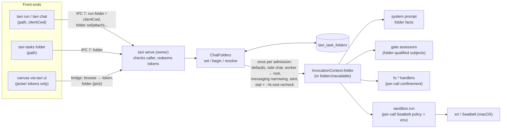

# Working folders

Every chat in tavi has a **working folder**: the one place its file tools and
its shell work. This page explains what a working folder is and how it fits
into the owner, how to choose and change one from each front end, how to get
files in and out, how folders are cleaned up, and what the confinement does
and does not protect.

## Contents

1. [Overview](#1-overview)
2. [Architecture](#2-architecture)
3. [Guide](#3-guide)
4. [Working examples](#4-working-examples)
5. [Security model and limits](#5-security-model-and-limits)
6. [Reference](#6-reference)

---

## 1. Overview

Before working folders, the file tools (`fs.*`) were confined to the owner's
`tavi serve --fs-root` folders, the same for every chat in every workspace.
`sandbox.run` wrote into the shared `<data-dir>/artifacts/`, started in
whatever directory the owner ran from, could read most of `$HOME`, and
inherited the owner's environment, provider keys included. A file written with
`fs.write` could not then be run with `sandbox.run`, and one chat's shell could
overwrite another chat's files. Now each chat has one folder, which the owner
records and the model never chooses. `fs.*` and `sandbox.run` both resolve
against that folder on every call. `fs.*` reads only the chat's folders — its
primary, its attachments, its managed folder and, in a side chat, the parent's
managed folder — and never a credential home, a file that holds keys or
tokens, or the rest of the data directory. `sandbox.run` writes only the
chat's writable folders. It reads the chat's folders, the toolchains
re-opened from the owner's `PATH`, the `--sandbox-read` folders and any path
outside `$HOME`; the rest of `$HOME`, every other `--fs-root`, the rest of the
data directory and the owner's temporary directory are closed to it. The
table in [Who can read and write what](#who-can-read-and-write-what) lists
each case.

**Vocabulary**

- **Managed folder**: the chat's own folder,
  `<data-dir>/chats/<workspace>/<task-id>/`, created with mode `0700` when the
  chat is first admitted. Every chat has one, even when it works somewhere
  else. The canvas calls it **Chat files**. tavi manages it: `tavi reset`
  erases it.
- **Primary folder**: where the chat works. Relative paths resolve there and
  `sandbox.run` starts there. It is the managed folder by default, or a
  **host primary**: a folder on your computer under one of the owner's
  `--fs-root` folders (never your home folder itself).
- **Attachments**: other host folders under an `--fs-root` that the chat may
  also use, **read-only (`ro`, the default) or read-write (`rw`)**. A chat
  attaches at most 16. Attachments may not overlap each other or the primary;
  but a chat's default attachments, which nobody chose, give way to a folder
  inside or around one until the chat's folder is first changed: with `code`
  attached by default, `/folder set ~/code/site` (or the canvas's **Work in
  this folder**) works in `site`, and `/folder add ~/code/reference` attaches
  `reference` — each leaving `code` out, so the rest of `code` is no longer
  read.
  Your home folder, or a folder holding it, can be attached read-only but
  never read-write. A chat that already holds such an attachment is refused
  until `/folder reset`, which drops it.
- **Labels**: each attachment's short name, from its folder's basename
  (`reference`, then `reference-2`, and so on). You detach a folder by its
  label. Results and diffs show a path in an attachment as `<label>/<path>`.
- **`.tmp/`**: the chat's scratch folder, inside the managed folder. It is
  `sandbox.run`'s `TMPDIR` and is emptied when the chat's turn ends and at an
  epoch rollover. It is never inside a host folder.
- **`.home/`**: the shell's `HOME`, inside the managed folder. It is kept across
  turns, so build caches (`.home/.cache`, a Go module cache) survive.
- **`downloads/`** and **`reports/`**: folders in the managed folder (never a
  host folder) that receive a copy of each approved browser download and PDF
  report.
- **`forms/`**: where `pdf.fill` writes a filled copy by default,
  `forms/<form>-filled.pdf` (an encrypted form's answer sheet:
  `forms/<form>-answers.pdf`), or the next free name, `forms/<form>-filled (2).pdf`
  and so on. A fill never writes over a file. A chat started from a messaging
  channel always writes here, whatever output path the call names; any other
  chat may name a new `.pdf` in a folder it can write. Every fill is asked
  about, once, by a person.

<a id="architecture"></a>

## 2. Architecture

### The folder record and the resolver

A chat's folder is a row in `tavi_task_folders`: `primary_kind` (`managed` or `host`), `primary_path` (the
real path, for a host primary), `attachments_json` (`[{ path, mode, label }]`),
and `revision`. A chat with no row uses its origin's defaults.
Workers never get a row.

`ChatFolders` (`packages/runtime/src/chat-folders.ts`) resolves the row to a
`ChatFolder` (`packages/contracts/src/chat-folders.ts`): `primary`,
`primaryKind`, `managed`, `scratch` (`<managed>/.tmp`), `home`
(`<managed>/.home`), `attachments`, `revision`, and optionally
`tainted`, `taintedFolders` and `managedUnavailable`. It resolves once per
admission, and it applies these rules:

| Case | What the chat gets |
| :--- | :--- |
| No row, interactive origin (`cli`, `ipc`, `web`) | Its managed folder, with the first `--fs-root` attached read-only. |
| No row, messaging, schedule or reminder origin | Its managed folder only. |
| Home | Like any chat: it keeps its folder. Opening Home from a terminal never moves it to that terminal's directory. |
| Side chat (no row) | Its own managed folder, its parent's attachments with the same modes, and its parent's host primary attached read-only. A change (`/folder reset` above all) stores them leaving out any that is gone or no longer allowed. It keeps every one it inherits, even one more than the 16 a chat attaches (a parent's host primary and 16 attachments); a reset or a detach always goes through, and only an attach past 16 is refused. Its parent's managed folder is attached read-only as `parent-chat` at every resolve; no other attachment is ever labelled `parent-chat`. |
| Worker | Its root chat's folder (followed through the delegation chain). A worker's first turn can run before its delegation is recorded (an unattended spawn records it afterwards): it then follows the chat its spawn names, so it never gets a folder of its own. |
| Turn held to a messaging channel | The managed folder only, with no attachments, whatever the chat's record. This includes DM turns into Home. |
| Tainted conversation | The folder as recorded, marked `tainted`, which narrows what the shell may write (see below). The chat's managed folder is recorded tainted (`tavi_task_folders.tainted_at`) and listed in `taintedFolders`. |
| Reaching a tainted chat's folder | A side chat whose parent, or a worker whose root chat, is tainted — recorded, or as that chat's checkpoint says now — lists that managed folder in `taintedFolders` (see [Taint](#taint)). |

On every resolve, each host entry is realpathed, checked with `stat`, and
checked again against the current `--fs-root` set. If a host primary or
attachment no longer exists, is no longer under a root, or is now protected,
the turn still runs, with no folder: its file tools and shell refuse with an
error that names `/folder reset`, for example:

```text
This chat's primary folder /Users/you/code/site no longer exists. Run /folder reset to go back to the chat's own folder, or choose another.
```

A missing managed folder is recreated empty, because tavi owns it. If it cannot
be created (a full disk, permissions, a planted link), the folder still
resolves with `managedUnavailable` set. Attachments then stay readable, and
the tools that need the managed folder fail with that reason.

Changes go through `ChatFolders.set`, or `begin` for a new chat's first
folder. The caller must be the chat's own principal in a workspace the owner
serves. A worker is refused (`set the folder of the chat it works for`). A chat
started by a messaging conversation may not take a host path. A web caller may
name a host folder only through a picker token (see below). Each change
validates the path:

- it must be absolute, with its deepest existing ancestor resolved;
- it must be inside an `--fs-root`, checked with a separator-aware
  `path.relative`, never a string prefix;
- it must not be inside the data directory, a credential home (`~/.ssh`,
  `~/.aws`, `~/.gnupg`, `~/.config/gcloud`, `~/.kube`, `~/.docker`, `~/.netrc`,
  `~/.npmrc`, `~/.pypirc`, `~/Library/Keychains`, secret managers' and cloud
  CLIs' token folders, registries' publish credentials; see
  [SANDBOX.md](SANDBOX.md#filesystem)) or a `--dev-plugin` folder;
- its path must not contain `*`, `?`, `[` or `]` (the sandbox would read them
  as a pattern), a line break or another control character;
- it must be an existing directory.

A change bumps `revision` and applies from the chat's next message.

### The folder on the turn

The workflow stamps the resolved folder on the turn's `InvocationContext`
(`folder`) once per admission. If the resolve was refused, it stamps the
reason (`folderUnavailable`) instead. Both are stripped from any caller-supplied
context (I-model). Gate assessors receive the same context
(`assess(input, context)`), so the gate and the handler read a path the same
way.

The turn's runtime facts state the folder in the system prompt
(`folderFacts`, `packages/agent-host/src/prompts/system-prompt.ts`), for example:

```text
- Your working folder is "/Users/you/code/site"; relative paths resolve there; use `$TMPDIR` for scratch.
- The chat's own folder, where approved downloads and reports are copied, is "/Users/you/.tavi/chats/default/task-mv2ekb9l-1".
- Attached folders, reached by absolute path: "reference" at "/Users/you/code/reference" (read-only); "out" at "/Users/you/code/out" (read-write).
```

Paths and labels, and the reason a folder is unavailable (which names it), are
quoted as JSON strings are — a `"` or `\` in a name is escaped, so no name can
close its quotes and pass for the line's own words —
and kept on one line (`lineSafe`). The lines are
derived from the folder alone, so they are byte-identical across a turn's model
calls, and the prompt cache is invalidated only when the folder changes. When
the folder is unavailable, the facts say so and tell the model to tell you,
not to look for another folder.

### `fs.*` per call

`fs.read`, `fs.list`, `fs.glob`, `fs.grep`, `fs.write` and `fs.edit` are always
registered, with or without `--fs-root`. `fs.read` pages a text file of up to 16 MiB,
a page of at most 48 KiB of text and 40,000 bytes at a time (`offset`/`nextOffset`),
or reads lines (`startLine`, `lineCount`, with `firstLine`/`nextLine`) to follow up
an `fs.grep` match. `fs.grep` searches files of up to 4 MiB and takes `ignoreCase`,
`context` (0–3 lines around each match) and `filesOnly` (each matching file and
its count). `fs.edit` takes one `oldText`/`newText`, or `edits`, several
replacements applied in order as one change on one approval card (all or none);
its diff shows each changed region as its own hunk. `http.request`'s `saveTo`
writes a response body to a new file in these folders, confined, assessed and
marked as an `fs.write` creating that file (see [CLI.md](CLI.md#tavi-serve)).
In a long chat, an older `fs.read`
whose file the task read again (same path and offset) or changed with
`fs.write` or `fs.edit` is sent to the model as a pointer to the newer result,
and an older `fs.grep` over 4,000 characters as its first and last matches with
a count; the chat's transcript keeps both whole
([ARCHITECTURE.md](ARCHITECTURE.md#token-and-prompt-cache-behaviour)). Each call builds its
confinement from `context.folder` (`confinementFor`,
`apps/cli/src/features/folders/fs-tools.ts`):

- Read roots are the primary, the managed folder and every attachment. Write
  roots are the primary, the managed folder and read-write attachments.
- A relative path resolves against the primary. A file in an attachment is
  reached by its absolute path; `<label>/<rel>` is for display only.
- Containment is checked on the resolved path. The data directory stays closed
  except for the chat's own managed folder (and a side chat's parent's,
  read-only). Credential homes and the files that hold keys or tokens
  (`.zshrc` and the other shell profiles and histories, `.git-credentials`,
  `.gitconfig`, `.config/gh`) are never read or written, in any case — the
  same list the sandbox denies (`credentialFiles`).
- `--dev-plugin` folders are never written, wherever they appear. Neither is
  any `.git` path component in a host folder.
- Writes never follow a link at the target or at any ancestor. Directories are
  created one level at a time with `lstat` checks. New files are opened
  `O_CREAT | O_EXCL | O_NOFOLLOW`, and the opened inode is checked against the
  resolved path before anything is written.
- A write lands only where the gate decided it would: the handler resolves
  the path again and refuses (`CONFLICT`) one whose rule subject is not the
  verdict's — a link swapped in since — and a file whose path resolves
  elsewhere once open, even into another folder the chat may write.
- In a managed folder, a regular file with more than one hard link is refused
  for reads and writes.
- Reading anything under a managed folder's `downloads/` marks that result
  untrusted (see [Taint](#taint)).

**Rule subjects** (I-rules). An approval rule matches a
folder-qualified subject: `chat:<task-id>/<rel>` in a managed folder, or the
absolute real path in a host folder. A rule saved for `notes.md` in one chat
therefore never matches another chat's `notes.md`. Generated matchers escape
glob characters, and a call with several subjects is auto-allowed only when
every subject matches. Deny and ask rules match a file subject case-folded and
NFC-normalized as well, on macOS and Windows, whose filesystems open `.ENV` as
the `.env` a deny names; allow rules match exactly. A relative matcher
matches no subject in any chat's folder (a matcher that starts with a
wildcard, `*.env`, is not relative and keeps matching).

Under taint, a write outside the chat's own managed folder (into a host primary
or a read-write attachment) asks every time and offers `once` only; no saved
rule or session grant lifts this. A side chat's write into a host folder is
rated `high`, so `always` is not offered: an absolute-path rule would also
match the parent's writes. A `sandbox.run` call in a side chat, or in a worker of
one, is rated `high` for the same reason: a command rule applies in every chat, its parent's too.

### `sandbox.run` per call

`policyFor` (`apps/cli/src/features/sandbox/tools.ts`) builds the sandbox policy
for each call from the turn's folder, never from the call's input; the sandbox
plugin compiles it to Seatbelt patterns on macOS and bubblewrap literals on
Linux (`packages/builtin/sandbox/src/policy-compile.ts`):

| Policy field | Contents |
| :--- | :--- |
| `allowWrite` | The primary, the managed folder and read-write attachments. In a **tainted** chat, only the managed folder. |
| `denyWrite` | srt's shared write paths (`/private/tmp/claude`, `/tmp/claude`, `~/.npm/_logs`, `~/.claude/debug`); every `--dev-plugin` folder; the data directory except the chat's own folder, entry by entry; the credential homes and key-holding dotfiles (`.zshrc`, `.bashrc`, `.profile`, `.git-credentials`, `.gitconfig`, `.config/gh`, …); the user persistence locations under `$HOME` (`~/Library/LaunchAgents`, `~/.config/git`, `~/.local/bin`, `~/.cargo/bin`, `~/.zlogin`, `~/.zprofile`, `~/.bash_login`, `~/.zlogout`, `~/.bash_logout`, `~/.config/fish`, `~/.config/nvim`, `~/.config/autostart`, `~/.config/systemd/user`, `~/.config/environment.d`, tmux's, direnv's, mise's, terminals', Starship's and window managers' config, iTerm2's `AutoLaunch`, VS Code's and its forks' user settings, tasks, key bindings and profiles, IPython's startup folder, each `~/.local/lib/python*/site-packages`; see [SANDBOX.md](SANDBOX.md#filesystem)), write-denied only, so a toolchain there stays readable; inside every folder the shell writes, `.git/hooks`, `.git/config`, `.git/config.worktree`, `.git/commondir`, `.git/info/attributes`, `.gitconfig`, `.gitmodules`, shell profiles (`.bashrc`, `.bash_profile`, `.bash_login`, `.zshrc`, `.zprofile`, `.zlogin`, `.profile`), `.envrc`, `mise.toml`, `.mise.toml`, hook managers' config (`.husky`, `.pre-commit-config.yaml`, `lefthook.yml`, `.lefthook.yml`), `.ripgreprc`, `.mcp.json`, `.vscode`, `.idea`, `.zed`, `.helix`, `.cursor`, `.codex`, `.gemini`, `.claude/commands`, `.claude/agents`, `.claude/hooks`, `.claude/skills`, `.claude/settings.json` and `.claude/settings.local.json` at any depth and in any case, and the folder each repository's `core.hooksPath` names (in its own config, a file it includes, or your global or system git config), and every file those configs include; and, in each writable host folder, any path component named `.git` and what a package manager, mise or a dev container runs (`.yarnrc.yml`, `.yarnrc`, `.yarn/releases`, `.yarn/plugins`, `.pnpmfile.cjs`, `bunfig.toml`, `.npmrc`, `.cargo/config.toml`, `.cargo/config`, mise's other config, `.tool-versions`, `.devcontainer`). |
| `denyRead` | `$HOME`, every `--fs-root` and the data directory, plus the credential homes and key files by name; mounted drives (`/Volumes`, `/media`, `/mnt`), `/Users/Shared`, `$XDG_RUNTIME_DIR` (a networked run re-opens its own proxy folder there) and other users' entries in macOS's `/private/tmp`; and the owner's temporary directory (`os.tmpdir()`), where the owner spools other chats' checkpoints and artifacts. When a folder the chat reads lies in that directory, only what the owner stages there is denied, by name (`tavi-render-*`). It is write-denied the same way. The chat's own `TMPDIR` is its `.tmp/`. |
| `allowRead` | The chat's own folders (primary, managed, attachments), toolchain roots under `$HOME` that exist and are on the owner's `PATH` (`~/.nvm/versions`, `~/.fnm`, `~/.local/state/fnm_multishells`, `~/.volta`, mise's `installs` and `shims`, asdf's `installs`, `shims`, `plugins`, `lib` and `bin`, `~/.cargo/bin` with `~/.rustup/toolchains`, `settings.toml` and `update-hashes`, pyenv's `versions`, `shims`, `libexec`, `bin`, `plugins` and `version`, `~/.bun/bin`, `~/go/bin`, `~/.sdkman/candidates`, `~/.ghcup/bin` and `~/.ghcup/ghc`, fnm's multishell links with its installs in `~/.local/share/fnm` or `~/Library/Application Support/fnm`, `~/.local/bin`); the environment then names their managers' homes (`RUSTUP_HOME`, `PYENV_ROOT`, `ASDF_DATA_DIR`, `MISE_DATA_DIR` with `MISE_CACHE_DIR` in the chat's `.home/`, `VOLTA_HOME`, `FNM_DIR`), the owner's own setting kept and re-opened when it lies in `$HOME` (never `$HOME` itself, the data directory, a credential home or an `--fs-root`), and every `serve --sandbox-read` folder. |

The network stays off. `cwd` defaults to the primary. A relative `cwd`
resolves there, and any `cwd` must resolve to an existing folder among the
chat's own folders. Nothing is ever spawned in a `cwd` that is gone. A folder
whose path contains a glob character is refused (`UNAVAILABLE`).

**Environment** (I-env). The child starts from an environment tavi builds
(`inheritEnv: false`):

| Variable | Value |
| :--- | :--- |
| `PATH` | The owner's, minus entries the shell cannot read |
| `HOME` | `<managed>/.home` |
| `XDG_CACHE_HOME` | `<managed>/.home/.cache` |
| `TMPDIR` | `<managed>/.tmp` |
| `LANG` | The owner's, else `en_US.UTF-8` |
| `LC_ALL`, `LC_CTYPE`, `TZ`, `TERM` | The owner's, when set |
| `USER`, `LOGNAME` | The owner's |
| `SHELL` | `/bin/sh` |
| `npm_config_package_import_method` | `copy` |
| `GIT_AUTHOR_NAME/EMAIL`, `GIT_COMMITTER_NAME/EMAIL` | From the owner's global git `user.name`/`user.email`, read once at the first call |

As a backstop, srt also unsets `SSH_AUTH_SOCK`, the known provider variables,
every `TAVI_*` variable and every owner variable whose name contains key,
token, secret, password, credential or auth (`denyEnv`). srt adds variables of
its own, `SANDBOX_RUNTIME` and its proxy variables among them.

### Artifacts and the folder

- **Outward (materialize).** When a browser download or a PDF report is
  approved, `createArtifactMaterializer` (`packages/runtime/src/artifact-folders.ts`)
  copies it into `downloads/` or `reports/` in the chat's **managed** folder.
  Pending content is never copied (I-pending). The copy is a copy, never a
  hard link. Its name is made safe (`folderFileName`: basename only, no
  leading dot, no control, bidi or path characters, at most 128 bytes), and a
  name that is taken gets ` (2)`, ` (3)` and so on. A report is named
  `brief-<start>-to-<end>.pdf`, and a routine's PDF report — published
  approved — is copied into its fire's folder as
  `routine-report-<YYYY-MM-DD>.pdf` once the publication commits. A copy that
  fails never undoes the approval; approving again retries it.
- **Inward (promote).** `browser.act` with `kind: "upload"` and
  `messaging.send_to` with `kind: "file"` take either an `artifactId` or a
  `path` in the chat's folders, never both. The file is read once (at most
  20 MiB), and the approval card shows its name, size and sha256. If a person
  approved that very call, the bytes are stored as an approved artifact of the
  chat, with that person as reviewer, and sent. If the bytes changed since the
  card was shown, the call is refused (`CONFLICT`). If a rule, grant or flag
  allowed the call, the file is stored `pending`, nothing is sent, and the
  call answers `awaiting_review`. Once the file is approved, the model sends
  it by `artifactId`.

### Front ends

- **IPC protocol 7.** `run` gains `folder` (`{ managed: true }`, `{ path }` or
  `{ pick: <token> }`) and `clientCwd`, honoured only on the admission that
  creates the chat. There are two new commands. `folder` takes the actions
  `show | set | attach | detach | reset | files | read`. `browse` lists
  folders for the canvas's picker. Both are advertised in `ready.features`
  and allowed through the web bridge. A protocol-6 client is refused when it
  connects. Later, `run` gained `folderAttachments`: the folders a chat
  starts with attached, picked by the canvas's chip on an empty chat or
  Home before its first message (by token from the bridge), checked before
  admission and attached by the admission that creates the chat.
- **The web never names a host path** (I-web). `browse` lists only
  directories under the `--fs-root` set: never the data directory, a
  credential home, a dev plugin's folder, a hidden folder or a path with a
  glob character. It goes at most 12 levels below a root and lists at most
  200 entries. Each entry carries a token (144 random bits) issued on that
  connection. The owner maps tokens to paths itself and keeps at most 4,096
  per connection. A path or a `clientCwd` sent from the bridge is refused
  (`NOT_AUTHORIZED`). This covers chats' and routines' folders only (a
  schedule's folder is set from a terminal): the
  canvas's plugin install (`plugins install { path }`), which is older than
  working folders, still takes a typed path to a plugin's folder, and the
  installed plugin waits for approval before it runs.
- **Client cwd**. `tavi run`, and `/side` or a new chat in
  `tavi chat`, send `process.cwd()`. The owner uses it as the new chat's
  primary only when it lies under an `--fs-root` and is not your home folder
  itself. Otherwise the chat works in its own folder, and one line says why.
- **Downloads in the canvas** go through `folder read`, which reads 256 KiB
  chunks up to 32 MiB. It hashes the file at the first chunk and again at the
  last, opens the file `O_NOFOLLOW` and checks its inode on every chunk, and
  refuses hard-linked files in managed folders. The page saves the file as
  `application/octet-stream`, so an HTML file in a folder never renders on the
  canvas's origin. `files` and `read` reach what `fs.read` reaches
  (`folderReadScope`). The listing leaves out the entries `fs.read` refuses,
  which `fs.list` still names though it cannot read them, and hides a managed
  folder's `.tmp/` and `.home/`.

### Retention

`FolderSpace` (`packages/runtime/src/folder-retention.ts`) applies three limits:

- **The budget** (`serve --folder-cap`, default 2 GB) applies to each chat's
  managed folder, `.home/` and `.tmp/` included. **The total budget**
  (`--chats-cap`, default 20 GB) covers every managed folder plus
  `chats/.trash/`. Past 80% the chat is told once per crossing (a `folder`
  notice) and `/folder` shows a warning. At the budget, tavi first empties
  `.tmp/`. If the folder is still over, writes into the managed folder, copies
  of approved artifacts and new `sandbox.run` calls are refused
  (`QUOTA_EXCEEDED`), naming the size and the prune command. It is a budget,
  not a ceiling: a command already running may overshoot (see
  [Documented races and residuals](#documented-races-and-residuals)). Host folders have no budget.
- **The free-space floor** (`--free-space-floor`, default 1 GB, `0` turns it
  off): below it, host-side writes on the data directory's disk, new
  `sandbox.run` calls, copies into a chat's folder, and every file the
  owner's artifact store keeps for a person or the model are refused: a
  browser download or screenshot, a `reports.generate` PDF, inbound channel
  media, a file a send by path promoted, an oversized tool result held for
  review. Not refused: tavi's own bookkeeping in that store (a conversation
  fold's archive, a worker's or an envelope's offloaded text, a proposed
  skill package, a browser thumbnail), since refusing it frees nothing and
  would stop a chat compacting; and what the database worker writes itself —
  a routine's published report (its JSON and PDF) and an imported skill
  package. Free space that cannot be read refuses nothing; it is read at
  most once a second. `tavi artifacts
  approve` with no owner running keeps to the default budget and floor (a
  served owner's flags are not recorded).
- **`.tmp/` emptying.** `.tmp/` is emptied when the chat's own turn ends
  (completed, failed or cancelled, not one left waiting) and when an epoch
  rollover folds the conversation. Emptying never follows a link.
- **Prune and trash.** `tavi tasks folders prune` moves folders into
  `chats/.trash/<task-id>-<YYYYMMDDTHHMMSSZ>/`. The trash is emptied after 7
  days, by a later prune or at owner start.

Folder sizes are measured by a walk that never follows a link. For the
budget it stops at 100,000 entries (the size is then a lower bound, shown as
"at least"), and a result is reused for 30 seconds; the sizes prune and
forget print stop at 20,000 entries.

### Backup, restore and reset

- `tavi backup` copies `chats/`. It leaves out `chats/.trash/`,
  `chats/*/*/.tmp/` and `chats/*/*/.home/`, which the manifest names in
  `excluded`. Links are copied as links with their targets as written, and
  sockets, FIFOs and devices are skipped. A file a running chat removes while
  the copy walks the tree is skipped, and so is one it swaps for a link, a FIFO
  (never waited on) or a file where a folder was after the walk looked at it: a file is copied from a descriptor opened without
  following a link, and only when it is still the file looked at, at a path
  that resolves to itself. Any other error fails the backup. `--force`
  replaces an earlier snapshot's `chats/` even where a toolchain left it
  read-only. The text output's `includes:` line
  names `chats/ (<size>)`, and the JSON output carries `chatsBytes`. A `chats`
  that is itself a link is refused.
- `tavi restore` moves the live `chats/` aside to
  `chats.pre-restore-<timestamp>` before copying and prints where it went
  (`moved the previous chats/ to <path>`; a copy that fails partway names it
  in the error). A snapshot that carries no `chats/` leaves the live one in
  place and says so.
- `tavi reset` erases `chats/` (and its `*.pre-restore-*` copies). It never
  touches host folders, nor what a link in a chat's folder points at. A
  folder a toolchain left read-only (Go's module cache under `.home/`) or a
  shell made unreadable is made its owner's (`0700`) and deleted. The chats'
  folders go first: one that still cannot be deleted stops the reset with the
  database and everything else in place, naming the entry; run the reset
  again once it can be deleted.

### Request flow



### Who can read and write what

"Read" and "Write" mean the tool can do it at all. Writes still go through the
approval gate.

| Folder | `fs.*` read | `fs.*` write | `sandbox.run` read | `sandbox.run` write |
| :--- | :--- | :--- | :--- | :--- |
| The chat's managed folder | yes | yes | yes | yes |
| Host primary | yes | yes (asks every time when tainted) | yes | yes; **no** when tainted |
| Read-only attachment | yes | no | yes | no |
| Read-write attachment | yes | yes (asks every time when tainted) | yes | yes; **no** when tainted |
| Side chat: parent's managed folder (`parent-chat`) | yes | no | yes | no |
| Side chat: inherited attachments | as inherited | as inherited | as inherited | as inherited |
| `.git` anywhere in a host folder | yes | no | yes | no |
| A repository's `.git` hooks and config in the managed folder (submodules' and worktrees' too) | yes | no | yes | no |
| Files tools run on their own (`.npmrc`, `.yarnrc.yml`, `.vscode`, …; see [SANDBOX.md](SANDBOX.md)) in a host or attached folder | yes | yes, asked every time | yes | no |
| `--dev-plugin` folder (inside a chat folder) | yes | no | yes | no |
| Toolchains on `PATH` under `$HOME`, `--sandbox-read` folders | no (unless inside a chat folder) | no | yes | no |
| Another chat's managed folder, the rest of the data directory | no | no | no | no |
| Unattached `--fs-root` folders, the rest of `$HOME` | no | no | no | no |
| Credential homes and key files | no | no | no | no |
| The owner's temporary directory (`os.tmpdir()`) | no | no | no | no |
| Mounted drives (`/Volumes`, `/media`, `/mnt`), `/Users/Shared`, `$XDG_RUNTIME_DIR`, other users' `/private/tmp` entries | no | no | no (`--sandbox-read` opens one) | no |
| Any other path outside `$HOME` (`/usr`, `/opt`, your own `/private/tmp` entries) | no | no | yes | no |
| **Turn held to a messaging channel** | managed folder only | managed folder only, if allowed | managed folder only | managed folder only, if allowed |

A messaging-origin task keeps `fs.write`, `fs.edit` and `sandbox.run` denied
by the messaging profile unless `serve --messaging-allow-tool` names them (in
the operator's own one-to-one chat), or a contact grant allows one in that
person's one-to-one chat on a chat channel (see [CHANNELS.md](CHANNELS.md#rooms)).
Even then, the tool sees only the managed folder.

---

## 3. Guide

### Starting the owner

```bash
tavi serve --fs-root ~/code --fs-root ~/Documents/shared
```

`--fs-root` names **the folders a chat may use or attach**; it grants no chat
access by itself. With no `--fs-root`, every chat works only in its own
folder under the data directory, and `fs.*` still work there. The value must
be absolute, and the flag is repeatable; a root spelled with `*`, `?`, `[` or
`]` stops the owner at start, since the sandbox would read it as a pattern. A new chat from `tavi`, `tavi chat`,
`tavi run` or the canvas gets the first root attached read-only.

Other folder flags on `tavi serve`:

| Flag | Default | Meaning |
| :--- | :--- | :--- |
| `--sandbox-read <path>` | none | A folder every chat's `sandbox.run` may read (only read), for a toolchain or data under `$HOME` or on a mounted drive the sandbox does not re-open. Absolute and repeatable. Refused when it is in or holds the data directory, a credential home or a key file, so `~` itself is refused, and when it is or holds an `--fs-root`, which it would re-open to every chat. |
| `--folder-cap <size>` | `2GB` | Each chat's own folder's budget. `K`, `M`, `G` and `T` are powers of 1024. |
| `--chats-cap <size>` | `20GB` | Every chat's folder together, the trash included. |
| `--free-space-floor <size>` | `1GB` | Below this much free space on the data directory's disk, file writes, copies into a chat's folder, stored files for a person or the model (downloads, screenshots, `reports.generate` PDFs, a file sent or uploaded by path, inbound media; not a routine's report or tavi's own archives) and new `sandbox.run` calls are refused. `0` turns it off. |

Shims from shim-based version managers (`~/.asdf/shims`,
`~/.local/share/mise/shims`) are not re-opened and drop out of the shell's
`PATH`. Re-open them with `--sandbox-read`.

### Working from `tavi chat`

`/folder` acts on the chat shown:

| Command | Effect (from the chat's next message) |
| :--- | :--- |
| `/folder` or `/folder show` | Prints where the chat works, its attachments and modes, its own folder when the primary is a host folder, and its size against the budget. |
| `/folder set <path>` | Makes a folder under an `--fs-root` the chat's primary. |
| `/folder add <path> [--rw]` | Attaches a folder, read-only unless `--rw`. |
| `/folder drop <label>` | Detaches a folder by its label. |
| `/folder reset` | Goes back to the chat's own folder with its default attachments. It also recovers a folder that is gone. |

`~` and relative paths are resolved in your terminal before the owner checks
them. A refused change prints `✗ this chat's folder was not changed: <reason>`.

A prompt that starts a chat of its own (`/side`, or a new chat with Home off)
works in your terminal's directory when that directory is under an `--fs-root`.
**Home never moves**: messages to Home never carry your directory, so change
Home's folder only with `/folder` or the canvas.

### `tavi run`

Under a live owner, `tavi run` sends your terminal's directory. The new chat
works there when it is under an `--fs-root` and is not your home folder.
Otherwise the chat works in its own folder, and stderr says why:

```text
This chat works in its own folder, not /Users/you: /Users/you is not under an --fs-root
```

- `--folder <path>` names the folder instead. It needs a live owner, is
  refused with `--in-memory`, and is refused outright, with nothing admitted,
  when the folder fails the check.
- `--managed` keeps the chat in its own folder whatever your directory is.
- `--folder` and `--managed` cannot be combined, and neither can be combined
  with `--home` or `--attach`: Home keeps its own folder, and `--attach`
  starts nothing.

A run in this process (no owner) works in its own folder.

### The operator command: `tavi tasks folder`

```text
tavi tasks folder <task-id> [show|set <path>|attach <path> [--rw]|detach <label>|reset] [--workspace <id>]
```

This is the same as `/folder`, for any chat by id. It needs a running owner,
because paths are checked against the owner's `--fs-root` set. With no owner,
it exits `4`. A refusal exits `2` for an overlap, a malformed path, a path
that is a file, a 17th attachment, a worker's id, or a change that raced
another one (`CONFLICT`: run it again), and `4` for a folder that is not
allowed or not found. Showing a folder that is gone, or whose record no
longer reads, prints why and exits `4`; `reset` recovers it.

### The canvas

The chat header has a **folder chip**. It reads **Chat files** for the chat's
own folder or `<folder>/…` for a host folder. When the folder is gone, the chip reads **Folder unavailable** and offers
**Reset**. The chip opens the **Chat folder** panel, which:

- lists the chat's folders (the primary, Chat files when the primary is a host
  folder, and each attachment with its mode) and their files, each with
  **Download**;
- offers **Attach a folder…**, a picker over the `--fs-root` tree with
  **Attach read-only**, **Attach read-write** and **Work in this folder** on
  each entry, and **Detach** per attachment;
- offers **Work in Chat files** when the primary is a host folder, and
  **Reset…**, which asks first: "Back to this chat's defaults: its own Chat
  files and the default attachments. No file is deleted."

There is no path field: the canvas sends only the tokens the owner issued. On
the phone layout the panel only lists and downloads. It keeps Reset for a
folder that is gone.

### Routines

A routine may pin a host folder when it is created
(`routines` `create.folder: { path }`) or updated (`update.snapshot.folder`).
The owner checks the path against its `--fs-root` set like a run's folder and
stores the real path. The folder is checked again at each fire, before the
run's task exists. A folder that no longer passes fails that run with the
reason. Without a pin, each fire works in a managed folder of its own.

There is no `tavi routines` command and no canvas picker for the pin yet, so
you pin a folder from a local IPC client. The canvas cannot name one ("The
canvas cannot name a host folder for a routine; pin it from a terminal"),
although an update that keeps the routine's current folder passes. The routine
tools the model uses carry no folder.

### Schedules

A schedule may pin a host folder the same way, from a terminal:
`tavi schedules add|watch … --folder <path>`, or `tavi schedules update <name>
--folder <path>` (`--folder off` removes it). The running owner checks the path
against its `--fs-root` set like a chat's primary folder and stores the real
path; an offline write refuses `--folder` ("needs a running owner"). The folder
is checked again at each fire, before the run's task exists, and becomes that
task's primary folder: the run reads and writes there, and its workers work
there too. A folder that no longer passes fails that fire, saying why and how to
change it. `tavi schedules show` prints it as `folder` (`each run's own` when
none is pinned). A chat's `schedules.create`/`update` carry no folder, so the
model never chooses one.

A file watcher (`--file <path>`) is told which file changed but reads it with
its own tools, so give it the file's folder, or a folder above it, with
`--folder`; without one its run works in its own folder and cannot read the
file.

Without a pin, schedules and reminders get a managed folder per fire. A
schedule's `--allow fs.write` or `--allow sandbox.run` then writes only into
that fire's folder.

### Getting files out

- **Approved downloads and reports** land in the managed folder's
  `downloads/` and `reports/`. Approve them with
  `tavi artifacts approve <id>`, the canvas, or the turn's review. If the copy
  fails, the approval stands. With an owner running, the owner logs why
  (`an approved artifact could not be copied into its chat's folder`) and
  the CLI prints nothing about it; with no owner, `tavi artifacts approve`
  prints
  `Artifact <id> was approved, but not copied into its chat's folder: <reason>`.
  Approving again retries the copy; offline, a retry that fails prints
  `Artifact <id> is approved, but not copied into its chat's folder: <reason>`.
- **Download from the canvas**: use the folder panel's **Download** (up to
  32 MiB).
- **Send a file onward**: the model calls `messaging.send_to` (`kind: "file"`)
  or `browser.act` (`kind: "upload"`) with `path`. The approval card shows the
  file:

  ```text
  Send report.pdf (48213 bytes) to telegram-main:123456789
  File: downloads/report.pdf
  Size: 48213 bytes
  sha256: 9f2c…e41a
  ```

  Approve the call itself to send it. A call a rule allowed stores the file
  `pending` and sends nothing until the file is reviewed — by a person: a
  schedule's `--allow` policy never approves such a file, so the fire ends
  with the review waiting in the inbox.

### Cleaning up

Folders are reclaimed by age and by explicit prune, never by deleting a chat. Stop the owner first: prune takes the data directory's ownership,
as `tavi prune` does.

```text
tavi tasks folders prune [--older-than <days>] [--chat <task-id>] [--workspace <id>] [--dry-run] [--yes]
```

- With no `--chat`, prune considers the folders of **runs** only (a
  schedule's, a routine's or a reminder's fire, or a `tavi run`) whose chat
  was last active more than `--older-than` days ago (default `30`; `30d`
  works too).
- `--chat <task-id>` clears that one chat's folder whatever its kind. This is
  the only way to clear a Home's, a side chat's or an ordinary chat's folder.
  A worker id names its root chat's folder. With `--chat`, age applies only
  when `--older-than` is given.
- Prune skips a chat with a turn in progress (running, or waiting on an
  approval, a review or an answer, including running workers). It also skips
  a chat whose folder configuration or task record cannot be read, and any
  folder no recorded chat maps to.
- A side chat reads its parent's folder as `parent-chat`, so prune never
  takes such a folder by age; its plan names the side chat and `--chat`. With
  `--chat` it is skipped while a side chat of it has a turn in progress.
- Prune prints its plan and asks. Off a terminal, `--yes` is required.
  `--dry-run` only prints.
- Each folder moves to `chats/.trash/`, where it is deleted after 7 days. A
  chat whose folder was moved gets an empty one at its next turn. Host
  folders are never touched.

Forgetting (`tavi tasks history … forget`) and rewinding never touch files.
Forget names the folder, its size and the prune command. Rewind says
`Files in the chat's folder were not changed.`

### Backup, restore, reset

- `tavi backup --out <dir>` includes `chats/` (without `.tmp/`, `.home/` and
  the trash). Expect it to be large if chats build things.
- `tavi restore --from <dir>` replaces `chats/`, moving the live one aside
  and printing where.
- `tavi reset --yes` erases `chats/`. **Keep files a chat must not lose in a
  host folder it attaches**: reset never touches those.

### Recovering a folder that is gone

If a chat's host folder was removed, renamed, or is no longer under an
`--fs-root` (because you restarted `tavi serve` with other roots), its next
turn's file tools and shell refuse with a message naming `/folder reset`.
Recover with any of these:

- `/folder reset` in `tavi chat`;
- `tavi tasks folder <task-id> reset`;
- **Reset** on the canvas's folder chip.

Or point the chat at another folder with `set` or `attach`. A missing managed
folder needs nothing: it is recreated empty.

Reset works for a side chat whose parent's folder is the one gone too: it
takes its parent's folders again, leaving out each that is gone or no longer
allowed (the parent's own record is left as it is). A folder record that no
longer reads (one edited by hand) is shown as unavailable with Reset, as a
folder that is gone is. A change is checked as the chat's next turn checks
its folder before it is stored, so a change that would leave a folder that is
gone (detaching another folder, say) is refused and stores nothing: reset, or
detach the one that is gone. A host folder swapped since for a link to a
folder spelled with `*`, `?`, `[`, `]`, a line break or a control character is
refused the same way.

---

## 4. Working examples

The output below was captured from a scratch data directory against the build
at `57f167da`, with a scripted local model, and the paths shortened: the data
directory is shown as `/Users/you/.tavi` and the only `--fs-root` as
`/Users/you/code`. Example (d) is built from the code's formats and is marked
as such.

### (a) A project chat in a repository, started from that directory

```bash
tavi serve --fs-root ~/code
```

In another terminal:

```console
$ cd ~/code/site
$ tavi run "list the files here"
ok
```

The run started in `~/code/site`, which is under the root, so that folder is
the chat's primary. The default read-only attachment of `~/code` gave way,
because it overlaps the primary. The model is told:

```text
- Your working folder is "/Users/you/code/site"; relative paths resolve there; use `$TMPDIR` for scratch.
- The chat's own folder, where approved downloads and reports are copied, is "/Users/you/.tavi/chats/default/task-mv2ekb9l-1".
```

Show it from the operator side:

```console
$ tavi tasks folder task-mv2ekb9l-1
… this chat works in /Users/you/code/site
  its own folder: /Users/you/.tavi/chats/default/task-mv2ekb9l-1
  size: 0 B of its 2.0 GB budget
```

From a directory outside every root, the run falls back and says why:

```console
$ cd ~ && tavi run "hello"
This chat works in its own folder, not /Users/you: /Users/you is not under an --fs-root
ok
$ tavi run --folder /etc "x"
run failed: NOT_AUTHORIZED: /private/etc is not under an --fs-root
```

### (b) Attaching a read-only reference folder and a read-write output folder

In `tavi chat`, with the chat shown, type (paths resolve in your terminal):

```text
/folder add ~/code/reference
/folder add ~/code/out --rw
```

Each change prints the folder as the chat's next message will see it. The
lines below are the same ones `tavi tasks folder … attach` printed:

```text
… from its next message, this chat works in /Users/you/code/site
  reference (read-only): /Users/you/code/reference
  its own folder: /Users/you/.tavi/chats/default/task-mv2ekb9l-1

… from its next message, this chat works in /Users/you/code/site
  reference (read-only): /Users/you/code/reference
  out (read-write): /Users/you/code/out
  its own folder: /Users/you/.tavi/chats/default/task-mv2ekb9l-1
```

What is refused, and why:

```text
/folder add /etc                 → /private/etc is not under an --fs-root
/folder add ~/code               → /Users/you/code overlaps the attached folder "reference"; detach it first
/folder add ~/.ssh               → /Users/you/.ssh is a credential directory; a chat never uses it as its folder
/folder set ~                    → /Users/you is not under an --fs-root
```

(With `--fs-root ~`, `set ~` is refused instead with "Your home folder itself
cannot be a chat's folder; choose a folder inside it".)

A write into the read-only attachment is refused at the gate:

```json
{"denied":true,"reason":"fs refused: /Users/you/code/reference/notes.md is in a folder attached read-only"}
```

`/folder drop reference` detaches it again.

### (c) The model writes a script with `fs.write` and runs it with `sandbox.run`

The owner for this example was started with
`--allow fs.write --allow sandbox.run`, so no approval round appears. Without
those flags, each call asks, and `fs.write`'s card shows the diff.

```console
$ tavi run --managed "write a script and run it"
[tool] fs.write ← {"path":"hello.py","content":"import os\nprint('hello from', os.getcwd())\nprint('TMPDIR =', os.environ.get('TMPDIR'))\n"}
[tool] fs.write → {"path":"hello.py","bytes":87} (2.5ms)
[tool] sandbox.run ← {"command":"python3","args":["hello.py"]}
[tool] sandbox.run → {"session":{"sessionId":"sandbox-run-1","state":"completed"},"exitCode":0,"stdout":"hello from /Users/you/.tavi/chats/default/task-mv2emmcv-m\nTMPDIR = /Users/you/.tavi/chats/default/task-mv2emmcv-m/.tmp\n","stderr":"","truncated":false} (270.9ms)
```

The relative `hello.py` landed in the managed folder, and the shell started
there and found it. The shell's environment, from a second run
(`sh -c 'pwd; echo HOME=$HOME; echo TMPDIR=$TMPDIR; env | cut -d= -f1 | sort'`):

```text
/Users/you/.tavi/chats/default/task-mv2emqv5-s
HOME=/Users/you/.tavi/chats/default/task-mv2emqv5-s/.home
TMPDIR=/Users/you/.tavi/chats/default/task-mv2emqv5-s/.tmp
GIT_AUTHOR_EMAIL GIT_AUTHOR_NAME GIT_COMMITTER_EMAIL GIT_COMMITTER_NAME HOME LANG LOGNAME
npm_config_package_import_method PATH PWD SANDBOX_RUNTIME SHELL SHLVL TMPDIR USER XDG_CACHE_HOME
… plus srt's proxy variables (HTTP_PROXY, ALL_PROXY, GIT_SSH_COMMAND, …)
```

No provider key and no `SSH_AUTH_SOCK`. The rest of the host stays closed:

```text
ls /Users/you/Documents                              → Operation not permitted
ls /Users/you/.tavi/chats/default/task-mv2ekb9l-1    → Operation not permitted   (another chat's folder)
ls /Users/you/code                                   → out reference site        (the first root, attached read-only by default)
```

`fs.read` of the database is refused too:
`/Users/you/.tavi/tavi.sqlite is outside your working folder and attached folders`.

### (d) A browser download lands in `downloads/` and is sent on by path

*Built from the code's formats, not captured.* The model downloads a file with
`browser.act` (`kind: "download"`). The download is stored as an artifact,
pending review, and the turn waits. You approve it:

```console
$ tavi artifacts approve art_01J9…
```

On approval, the owner copies it into the chat's managed folder under a safe
name, for example `downloads/report.pdf` (`downloads/report (2).pdf` if that
name is taken). The model can now read it, and the read is marked untrusted:

```json
{"path": "downloads/report.pdf"}
```

To pass it on, the model calls `messaging.send_to` with `kind: "file"` and
`path: "downloads/report.pdf"`. The approval card reads:

```text
Send report.pdf (48213 bytes) to telegram-main:123456789
File: downloads/report.pdf
Size: 48213 bytes
sha256: 9f2c…e41a
```

If you approve this call, the bytes are stored as an approved artifact with
you as reviewer and sent. If a saved rule had allowed the call instead,
nothing is sent and the model gets
`{ status: "awaiting_review", artifactId, detail: "Nothing was sent: no person approved this messaging.send_to call, … Once it is approved, call messaging.send_to again with artifactId …" }`.

### (e) A routine pinned to a host folder

A local IPC client sends the routine's `create` with a folder (other fields
elided):

```json
{ "action": "create", "workspaceId": "default", "principalId": "operator",
  "create": { "name": "Weekly digest", "objective": "…", "…": "…",
              "folder": { "path": "/Users/you/code/digests" } } }
```

The owner checks the folder against its `--fs-root` set and stores
`/Users/you/code/digests` as its real path. Each fire then works in that
folder, with its own managed folder for downloads and reports. If you later
start the owner without `~/code`, the next fire fails before its task exists,
with the folder check's reason (for example
`/Users/you/code/digests is not under an --fs-root`). The same `create` from
the canvas is refused with
`The canvas cannot name a host folder for a routine; pin it from a terminal`.

### (f) Pruning old run folders: `--dry-run`, then `--yes`

With the owner running, prune refuses (exit `5`):

```console
$ tavi tasks folders prune --dry-run
tasks folders prune failed: `tavi serve` (pid 4242) already owns /Users/you/.tavi; pruning folders needs it to itself, even with --dry-run, so no turn starts while folders move. Stop it first (Ctrl-C where it runs, or stop the launchd/systemd unit you installed with `tavi service unit`), then run this again.
```

Stop the owner, then:

```console
$ tavi tasks folders prune --dry-run
No runs' folders unused for more than 30 days to move.

$ tavi tasks folders prune --older-than 0 --dry-run
Would move to chats/.trash/ (deleted after 7 days):
  task-mv2ekb9l-1	run	0 B	last active 2026-10-10T13:00:57.324Z	/Users/you/.tavi/chats/default/task-mv2ekb9l-1
  task-mv2emazf-h	run	87 B	last active 2026-10-10T13:02:30.240Z	/Users/you/.tavi/chats/default/task-mv2emazf-h
  task-mv2emmcv-m	run	87 B	last active 2026-10-10T13:02:45.283Z	/Users/you/.tavi/chats/default/task-mv2emmcv-m
  …
```

Clearing one chat's folder, first from a script (no terminal), then with
`--yes`:

```console
$ tavi tasks folders prune --chat task-mv2emmcv-m </dev/null
To move to chats/.trash/ (deleted after 7 days):
  task-mv2emmcv-m	run	87 B	last active 2026-10-10T13:02:45.283Z	/Users/you/.tavi/chats/default/task-mv2emmcv-m
tasks folders prune asks before it moves anything, and this is not a terminal: pass --yes to go ahead, or --dry-run to see the plan only
$ echo $?
2

$ tavi tasks folders prune --chat task-mv2emmcv-m --yes
To move to chats/.trash/ (deleted after 7 days):
  task-mv2emmcv-m	run	87 B	last active 2026-10-10T13:02:45.283Z	/Users/you/.tavi/chats/default/task-mv2emmcv-m
Moved task-mv2emmcv-m's folder to /Users/you/.tavi/chats/.trash/task-mv2emmcv-m-20261010T130343Z

$ tavi tasks folders prune --dry-run
No runs' folders unused for more than 30 days to move.
In the trash: 1 folder(s), 87 B; 0 past 7 days would be deleted.
```

At a terminal, without `--yes`, prune asks
`Move <n> folder(s) (<size>) to the trash? [y/N]`. If a trash entry cannot be
deleted, prune prints `Could not delete … from the trash: …`, and if a folder
cannot be moved, `Could not move …'s folder: …`; either way it exits `4`
after reporting what it moved.

### (g) Recovering after a folder or a root is removed

The folder was removed:

```console
$ mv ~/code/site ~/site-moved
$ tavi tasks folder task-mv2ekb9l-1
✗ This chat's primary folder /Users/you/code/site no longer exists. Run /folder reset to go back to the chat's own folder, or choose another.
$ echo $?
4
$ tavi tasks folder task-mv2ekb9l-1 reset
… from its next message, this chat works in its own folder, /Users/you/.tavi/chats/default/task-mv2ekb9l-1
  code (read-only): /Users/you/code
```

The owner was restarted with a different root (`--fs-root ~/other`):

```console
$ tavi tasks folder task-mv2ekb9l-1
✗ This chat's attached folder "code" /Users/you/code is no longer under an --fs-root. Run /folder reset to go back to the chat's own folder, or choose another.
$ tavi tasks folder task-mv2ekb9l-1 reset
… from its next message, this chat works in its own folder, /Users/you/.tavi/chats/default/task-mv2ekb9l-1
  other (read-only): /Users/you/other
```

Until you reset, a turn in that chat sees in its facts that the folder is
unavailable, and its file tools and shell refuse with the same message.
Nothing is ever run in the missing folder. A turn that was waiting on an
approval, a review or an answer when the folder went (a root removed at a
restart, a `/folder reset`) resolves the folder again when it resumes: its
tools act only in the folder as it is then — refused when it is gone, the new
one when it changed — while its facts keep the turn's words, so the prompt
cache holds. On the canvas, the chip reads
**Folder unavailable**, with **Reset** beside it.

---

## 5. Security model and limits

### Invariants

Each invariant has at least one test, or suite, whose title carries its tag.

| Invariant | Statement | Where it is held |
| :--- | :--- | :--- |
| **I-model** | No model-supplied value ever chooses a folder, a root, a sandbox path or an environment variable of the sandboxed child. | The folder comes only from `InvocationContext.folder`, stamped by the workflow and stripped from callers. `policyFor` and `environmentFor` read only the folder. The routine tools carry no folder. |
| **I-web** | The web bridge can never name a host path as a chat's or a routine's folder (a plugin install's path is not a folder's; see [Architecture](#2-architecture)). It can only redeem a picker token the owner issued for a directory under an `--fs-root`. | `ChatFolders.set` refuses a `web` caller without `picked`. `startRun` refuses a web `folder.path`, a `folderAttachments` path and `clientCwd`. Tokens are per connection. `refuseBridgeRoutineFolder` refuses routine pins from the bridge. |
| **I-isolate** | Chat A's `fs.*` and `sandbox.run` cannot read or write chat B's managed folder, any unattached root, the data directory outside A's own folder, the owner's temporary directory, or the credential homes and key files. | Per-call confinement and per-call Seatbelt denies. The hard-link refusal in managed folders. `--sandbox-read` refused when it is or holds a root. |
| **I-messaging** | A turn held to a messaging channel sees only the managed folder. | `ChatFolders.resolve` with `heldChannel === "messaging"`. |
| **I-nofollow** | No host-side writer (`fs.write`, `fs.edit`, folder creation, materialization, backup) follows a link the sandbox could have planted, at the target or at any ancestor. | One-level `mkdir` with `lstat`, `O_NOFOLLOW` and `O_EXCL` opens, inode re-checks, `.tmp` emptying that never follows a link, and backup's own walk (`copyChats`), which copies a link as a link (`readlinkSync`/`symlinkSync`) and a file only from an `O_NOFOLLOW` descriptor that is the inode `lstat` found, at a path that still resolves to itself; an entry swapped meanwhile is skipped. |
| **I-pending** | Content pending review is never copied into a folder. | The materializer reads the review state itself. |
| **I-rules** | An approval rule saved for a file in one folder never matches a file in another folder. | Folder-qualified subjects (`chat:<task-id>/…` or absolute real paths), and a write refused at dispatch when its target is no longer the one the gate decided. |
| **I-env** | The sandboxed child sees only the environment tavi builds for it. | `inheritEnv: false`, the built environment, and `denyEnv` as a backstop. |

### Taint

Once a conversation has read untrusted content (a web page, a download), it
stays tainted:

- its shell writes only the managed folder;
- writes by `fs.*` outside the managed folder ask every time;
- a worker it spawns starts tainted, and works in the chat's folder from its
  first turn;
- reads from `downloads/` and `sandbox.run` results taint it in turn: every
  `sandbox.run` result counts while a `downloads/` it reaches holds anything,
  and so does a run whose request got through to a granted domain, which marks
  the managed folder tainted as well (what it fetched there is read as
  untrusted later);
- its managed folder is marked tainted ([SECURITY-MODEL.md](SECURITY-MODEL.md#what-makes-a-chat-tainted)), so what it wrote there taints whoever reads it.

**Folder taint.** `tavi_task_folders.tainted_at` records, once and for good,
that a chat's conversation was tainted. A chat with no stored folder gets a
taint-only row (revision 0) that the stored-folder read ignores, so it keeps
its origin's defaults and a first `/folder` change still expects revision 0.
`ChatFolders.resolve` records it when the turn is tainted — a worker's tainted
turn records its root chat, whose folder it writes — and, for a side chat's
parent or a worker's root chat, when that chat's checkpoint is tainted now
(a turn of it not yet ended; a checkpoint that cannot be read counts as
tainted for that resolve, and is not recorded). It is recorded where files are
written too: `fs.write` and `fs.edit` into the managed folder under an
untrusted context label, and a tainted `sandbox.run`, first mark the calling
task's chat (a worker's root chat), so a worker admitted clean that read a page
mid-turn and wrote into the shared folder taints the root chat's later reads;
a failure to record refuses the write. The turn's `ChatFolder.taintedFolders` lists every tainted managed
folder it reaches, with its chat, and each read asks the store again
(`ChatFolders.taintedFoldersNow`), so a taint recorded after the turn's folder
was resolved — a worker's tainted write mid-turn — is seen by the next read:

- `fs.read`, `fs.list`, `fs.glob` and `fs.grep` label what they return from
  one untrusted, source `sandbox`, naming the chat (`chat:<task-id>`): a side
  chat reading a tainted parent's folder, or a clean worker reading its tainted
  root chat's folder, is tainted by the read;
- `sandbox.run` is untrusted whenever such a folder is in reach — stamped on
  the turn, or recorded since (`taintedFoldersNow`, asked at each call) —
  since the shell can read it, and is held as a tainted run: it writes only
  the managed folder, and marks its chat's folder;
- a file promoted from one (sent with `messaging.send_to` or uploaded with
  `browser.act`) is stored with that chat's taint, also as recorded at the
  promotion, as well as the calling conversation's label.

Host folders carry no label of their own: their files are the person's, read
as trusted and personal — except bytes a tainted chat wrote there.

- **Marking.** `fs.write` and `fs.edit` under taint outside the managed folder
  (each asked about, as above) record the file's real path and the SHA-256 of
  what they write (`tavi_tainted_host_writes`, migration 0141): before the
  write (a failure refuses it), and again once written with the file's device
  and inode. A row is kept per path and bytes, the newest 8 per path, so a
  write that fails or loses a race never drops an earlier mark.
- **Derived bytes.** An `fs.write` or `fs.edit` by any chat, tainted or not, of
  a file that holds marked bytes marks what it writes too, credited to the chat
  that wrote the marked bytes. A mark ends only when the file holds bytes no
  write recorded: the person edited it outside Tavi.
- **Reads.** In any chat and any workspace — a host file is one file — these
  are untrusted `sandbox` while the file holds marked bytes, naming the writing
  chat (`chat:<task-id>`) only to a chat of its workspace:
  - `fs.read` and `fs.grep` of the file, by its path or under another name (a
    hard link, matched by device and inode);
  - a file promoted from it (`messaging.send_to`, `browser.act` upload);
  - `sandbox.run`, whenever a host folder it reaches holds such a file (the
    newest 200 marks under its host folders are checked). The run is also held
    as a tainted one: it writes only the managed folder, and marks its chat's
    folder.
- **Forgetting** the writing chat whole drops its name from the row, not the
  mark.

Residual: `sandbox.run` finds a marked file by the path it was written at. A
hard link to it under another path in a folder the shell reaches, made outside
Tavi, is not found by the shell, though `fs.read` and `fs.grep` find it.

The remedy is a new chat, not an un-taint.

### What working folders do not cover

- **Approved external plugins.** They run inside the owner with its
  privileges. A chat's folder confines tavi's own file tools and
  `sandbox.run`, not a plugin's code. Only a process boundary would confine
  them.
- **Files the host runs later.** In a writable host folder, project files you
  or your tools run on purpose (`package.json` scripts, a `Makefile`, other
  agents' instructions) stay writable. A run that changes one at a host
  folder's top names it in `hostRunsChanged`; review it before you run it.
  The shell is write-denied only what git, shells, direnv, mise, package
  managers and editors run implicitly (`.git` hooks and config, the
  `core.hooksPath` folder, husky, pre-commit and lefthook config, shell
  profiles, `.envrc`, mise's config, and in a host folder `.yarnrc.yml` and
  `.yarn/releases`, `.pnpmfile.cjs`, `bunfig.toml`, `.npmrc`, cargo's config,
  `.devcontainer`; `.vscode`, `.idea`,
  `.mcp.json`, `.claude/commands|agents|hooks|skills`); `fs.write` and
  `fs.edit` may still change them in a host or attached folder with your
  approval, given each time and never for later. No tool writes the user persistence
  locations under `$HOME` (`~/Library/LaunchAgents`, `~/.config/git`,
  `~/.local/bin`, `~/.cargo/bin`, login and logout profiles, fish and Neovim
  config, autostart, systemd user units, `environment.d`, tmux, direnv, mise,
  terminal, prompt and window-manager config, iTerm2's `AutoLaunch`, VS Code's
  and its forks' user settings, tasks, key bindings and profiles, IPython's
  startup, Python's user `site-packages`), even in a read-write `~/.config`.
- **The network.** `sandbox.run` has no network unless the operator grants
  domains: `serve --sandbox-domain <pattern>` for every workspace, and a
  workspace's `sandbox.domains` (`tavi config set sandbox.domains
  pypi.org,*.pythonhosted.org`). The model never chooses them, and a tainted
  chat gets no network whatever is granted. A run with grants runs in a
  Tavi srt host process of its own (`packages/builtin/sandbox/src/host-process.ts`;
  see [SANDBOX.md](SANDBOX.md#network)), so it has its own proxy and allowlist and
  runs alongside others with different grants. Its proxy decides each
  connection by the run's grants and reports it: the result's `requests`
  lists every host and port asked for and whether it was let through. Paste
  and file-drop sites are never reached, and a granted name that resolves to
  this host, a private network (RFC 1918), CGNAT or a ULA is never dialed, also
  through a proxy named with `serve --sandbox-parent-proxy` (the owner's own
  `HTTPS_PROXY` is never used).
  - A sandboxed child reaches a granted host only through the proxy
    (`HTTP_PROXY`/`HTTPS_PROXY`), because the sandbox blocks direct
    connections. curl, git, pip and most other tools honour those variables.
    Node's `fetch` and `https` honour them from Node 22.21 with
    `NODE_USE_ENV_PROXY=1`, which Tavi sets for every network run.
  - On Linux the proxy's sockets live in the service's runtime directory
    (`RuntimeDirectory=tavi` in the generated unit, else
    `$XDG_RUNTIME_DIR/tavi`); without one a run granted domains is refused.
- **Platforms.** `sandbox.run` runs on macOS (Seatbelt) and on Linux
  (bubblewrap with seccomp and an empty network namespace), at the tier the
  host's check settles: `full`; `nested` only with `serve --sandbox-nested`,
  for a container that masks `/proc`; or `unavailable`, refused with its cause
  and fix (`tavi sandbox check`). Ubuntu needs `tavi sandbox setup` once.
  On Linux the write protections are literal paths found when the run starts,
  so a repository created during the run in a new subfolder is not covered,
  and a folder on a filesystem that ignores letter case is refused. Windows is
  out of scope.
- **Git in the sandbox.** `git init` and `git clone` work only into a
  subfolder of the chat's own folder, and no hook or fsmonitor runs in any
  sandbox git: every run's git is told to take none (husky and lint-staged
  checks do not run on a sandbox commit). Elsewhere `.git/config` and
  `.git/hooks` are write-denied, and `git commit` fails in a host folder,
  because every `.git` component there is write-denied.
  `fs.write`/`fs.edit` refuse `.git` paths in a host folder too. Run git on
  the host yourself.
- **Rewind and forget** never revert or delete files.
- **Exports.** `tavi export` (NDJSON), backups and checkpoints keep absolute
  host paths (the folder records, a routine's pinned folder, each turn's
  context). The chat export `tavi tasks history <id>` carries no folder
  record.

### Documented races and residuals

- Node has no `openat`. If an ancestor is swapped for a link between the
  check and the open, nothing is written and no existing file is truncated,
  but an empty file (or folder) can remain at the link's target. The same
  applies to a `downloads/` swapped for a link during a copy, and to emptying
  `.tmp/` (no `unlinkat`).
- In the nested layout (a folder the chat reads holds the data directory, for
  example `--fs-root ~` with `~/.tavi`), the data directory is denied to the
  shell entry by entry. An entry created after a call's policy was built is
  open to that call.
- A file the shell moved out of `downloads/` is no longer tracked as untrusted
  once `downloads/` is empty.
- A worker shares its chat's `.tmp/`: it is not emptied — at the chat's turn
  end, an epoch rollover or the budget — while a worker of the chat runs, so a
  chat at its budget with a worker running is refused instead.
- The budget is a budget, not a ceiling. A folder's size is measured at
  admission and reused for 30 seconds, except that a chat's own folder is
  measured again after each `sandbox.run` in it ends (every chat's total keeps
  its 30 seconds). So a command running may overshoot it, as may commands
  that run at once (a chat's workers), and file writes admitted within those
  30 seconds, each of which is bounded in size. Above 100,000
  entries, the size is a lower bound (20,000 for the sizes prune and forget
  print).
- The 80% warning is kept in memory: a restarted owner warns about a full
  folder once more.

---

## 6. Reference

- [SANDBOX.md](SANDBOX.md): the shell sandbox `sandbox.run` runs in.
- [SECURITY-MODEL.md](SECURITY-MODEL.md): approvals, taint and the rules that
  match folder-qualified subjects.
- [docs/CLI.md](CLI.md):
  [Data Directory & IPC Architecture](CLI.md#data-directory--ipc-architecture)
  (`chats/`, default tools, `sandbox.run`),
  [Upgrades](CLI.md#upgrades) (working folders across an upgrade and a
  downgrade), [`tavi run`](CLI.md#tavi-run),
  [`tavi chat`](CLI.md#tavi-chat) (`/folder`),
  [`tavi serve`](CLI.md#tavi-serve) (`--fs-root`, `--sandbox-read`,
  retention flags),
  [A chat's working folder from an attached client](IPC.md#a-chats-working-folder-from-an-attached-client)
  (`folder`, `browse`), [`tavi tasks`](CLI.md#tavi-tasks)
  (`tasks folder`, `tasks folders prune`),
  [`tavi artifacts`](CLI.md#tavi-artifacts) (copies into the chat's folder),
  [`tavi backup`](CLI.md#tavi-backup), [`tavi restore`](CLI.md#tavi-restore),
  [`tavi reset`](CLI.md#tavi-reset).
- Code: `packages/contracts/src/chat-folders.ts`,
  `packages/contracts/src/folder-ipc.ts`,
  `packages/runtime/src/chat-folders.ts`,
  `packages/runtime/src/artifact-folders.ts`,
  `packages/runtime/src/folder-retention.ts`, `apps/cli/src/features/folders/fs-tools.ts`,
  `apps/cli/src/features/sandbox/tools.ts`, `apps/cli/src/features/folders/owner.ts`,
  `apps/cli/src/features/folders/prune.ts`, `apps/cli/src/features/folders/promotion.ts`,
  `apps/cli/src/tui/commands.ts`, `apps/ui/src/features/chat-panel/Folder.tsx`,
  `packages/agent-host/src/prompts/system-prompt.ts` (`folderFacts`).
