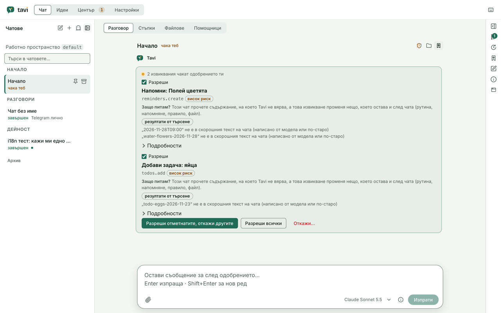
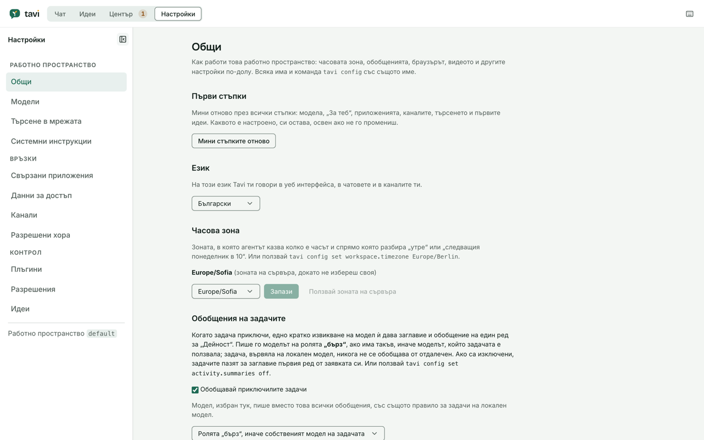
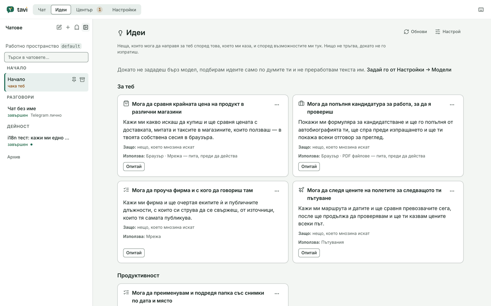
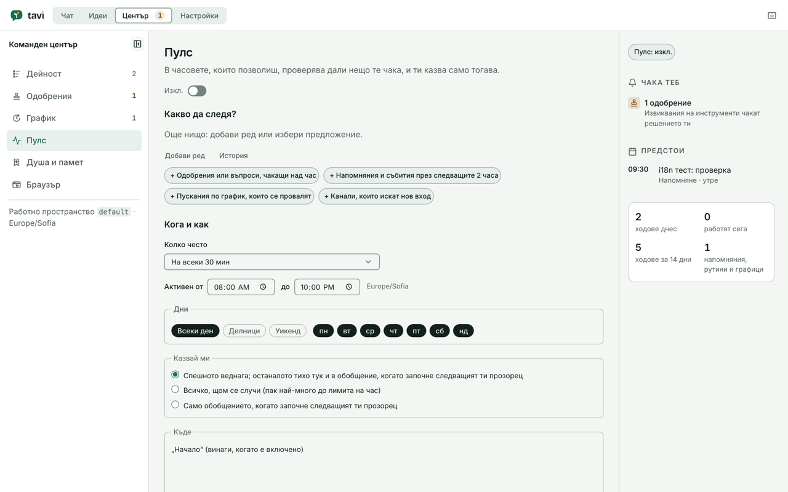
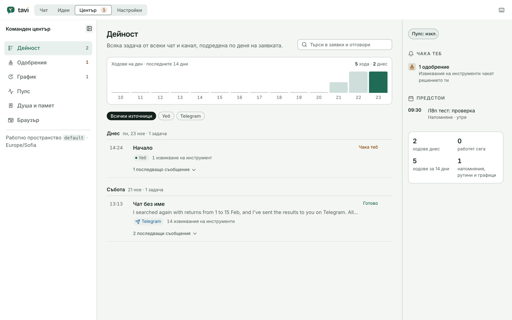
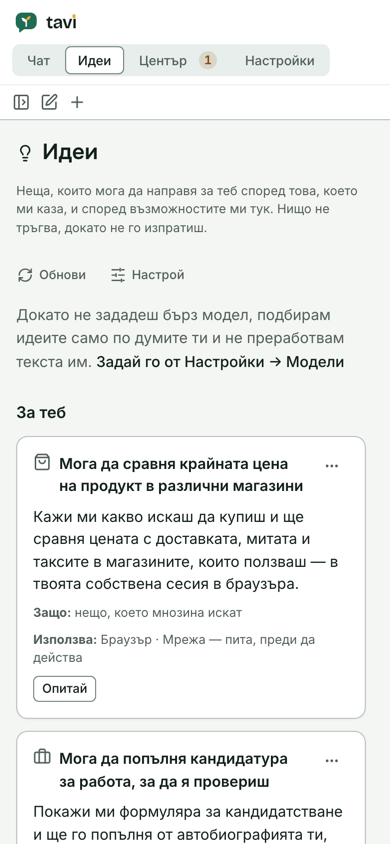

# Tavi на български

Tavi е личен AI асистент, който работи на твоя компютър. Пишеш му в браузъра,
в терминала или от телефона през Telegram, а той търси, напомня, води
задачите ти и предлага какво още може да свърши за теб. Преди да промени нещо
или да изпрати нещо навън, те пита.

Tavi говори български: уеб интерфейсът, терминалът, съобщенията в Telegram и
отговорите на асистента. Тази страница е кратко въведение на български.
Подробната документация е на английски и е описана в [README на
документацията](../README.md).



## Инсталиране

Трябват ти macOS, Linux или Windows с WSL2 и Node.js `22.22.2` или по-нов.
Инсталирай последната версия с един ред:

```bash
curl -fsSL https://github.com/atanasster/tavi/releases/latest/download/install.sh | sh
```

Инсталаторът проверява всеки пакет, слага Tavi в `~/.tavi/app` и добавя
командата `tavi` в `~/.local/bin`. Пусни го отново, когато искаш да обновиш;
данните ти остават непокътнати. Подробности има в [README](../../README.md#quick-install).

## Първи стъпки

```bash
tavi onboard     # избираш език и модел; другите стъпки не са задължителни
tavi serve       # сървърът на Tavi; остави го да работи
tavi ui          # отваря уеб интерфейса в браузъра (или tavi chat в терминала)
```

Първият въпрос на `tavi onboard` е на какъв език да ти говори Tavi. Избери
„Български“ (Enter оставя английски) и всичко след това е на български. После
избираш модел: Tavi намира ключ в средата ти или локална Ollama, а може и да те
впише в OpenRouter. Останалите стъпки (Telegram, гласови съобщения, търсене в
мрежата, работа като услуга) можеш да направиш и по-късно.

## Смяна на езика

Езикът е един за цялото работно пространство. Сменяш го по три начина:

- в уеб интерфейса: **Настройки → Общи → Език**;
- при първото пускане: първата стъпка на `tavi onboard`;
- от терминала, по всяко време:

```bash
tavi config set workspace.locale bg    # български
tavi config set workspace.locale en    # английски
```

Отворената страница в браузъра и `tavi chat` минават на новия език за
секунди, без презареждане.



## Какво е на български

- **Уеб интерфейсът:** чатовете, „Идеи“, „Команден център“ и „Настройки“, с
  български дати („вт, 24 ное“), числа („20 000“) и шрифт за кирилица.
- **Терминалът:** `tavi chat`, `tavi onboard`, потвърждения `[Д/н]` и изходът
  на `tavi reminders`, `tavi schedules`, `tavi ideas`, `tavi heartbeat`,
  `tavi doctor`, `tavi tasks` и други.
- **Telegram и другите канали:** въпросите за одобрение и бутоните им,
  напомнянията, обобщенията и известията. Можеш да отговаряш и на български:
  „одобри“, `/memory запази всички`, `/heartbeat пауза 2ч`.
- **Асистентът:** отговаря ти на български, освен ако не му пишеш на друг
  език, и пише идеите и докладите на рутините на български.
- **Плъгините:** вградените са на български, а външните дотолкова, доколкото
  авторът им е добавил български езиков пакет.

На английски остават `--help`, съобщенията за грешка в употребата, логовете и
`--format json`, защото ги четат скриптове. Инструкциите, които чете моделът,
също са на английски. Пълният списък е в [LANGUAGES](../LANGUAGES.md#what-follows-the-language).

## Tavi пита, преди да действа

Когато асистентът иска да направи нещо, което остава след чата (да създаде
напомняне, да запише файл, да изпрати съобщение, да отвори нов сайт), Tavi
ти показва карта: какво точно ще се случи, колко е рисковано и защо пита.
Избираш „Разреши“ или „Откажи“; можеш да разрешиш само за този чат или да
направиш правило за винаги. Същите въпроси идват и в Telegram, с бутони.

Чакащите одобрения са и в **Команден център → Одобрения**. Как работи
защитата е описано в [SECURITY-MODEL](../SECURITY-MODEL.md).

## Какво може

**Напомняния и задачи.** „Напомни ми в петък в 18:00 да купя хляб“ или
„Добави „мляко“ в списъка ми със задачи“. Напомнянията се виждат в
**Команден център → График**, а от терминала с `tavi reminders list`.

**Идеи.** В раздел **Идеи** Tavi предлага неща, които може да свърши за теб,
според това, което му казваш, и според възможностите си тук. Нищо не тръгва,
докато не натиснеш „Опитай“.



**Пулс.** Когато го включиш, Tavi проверява в часовете, които си избрал, дали
нещо те чака (одобрение, напомняне, провалено пускане), и ти казва само
тогава. Настройва се в **Команден център → Пулс**.



**Търсене, браузър, полети, PDF.** Tavi търси в мрежата, чете страници в своя
браузър, търси полети и попълва PDF формуляри. Всичко, което изпраща или
променя нещо, минава през одобрение.

**Дейност.** В **Команден център → Дейност** виждаш всичко, което Tavi е
правил, по дни, от всеки чат и канал.



## Пиши на Tavi от телефона

Създай бот в Telegram през @BotFather и добави токена му в **Настройки →
Канали** или от терминала:

```bash
tavi channels add telegram --secret-file token=<файл-с-токена>
```

После `tavi onboard` (стъпката „Пиши на Tavi от телефона“) те свързва с бота.
Повече за каналите и кой може да пише на асистента има в
[CHANNELS](../CHANNELS.md).



## Tavi да работи постоянно

`tavi serve` трябва да работи, за да идват напомнянията и съобщенията от
Telegram. За да тръгва сам при влизане в компютъра, направи го услуга:

```bash
tavi service unit --kind launchd --out ~/Library/LaunchAgents/dev.tavi.serve.plist        # macOS
tavi service unit --kind systemd --scope user --out ~/.config/systemd/user/tavi.service   # Linux
```

Как се включва услугата е описано в [OPERATIONS](../OPERATIONS.md).

## Данните ти

Tavi пази всичко на твоя компютър: чатовете, паметта, напомнянията и
файловете. Към модела отива само това, което е нужно за отговора. Какво
помни Tavi за теб виждаш и одобряваш в **Команден център → Душа и памет**.
Подробности има в [PRIVACY](../PRIVACY.md) и [MEMORY](../MEMORY.md).

## Още

- [LANGUAGES](../LANGUAGES.md): езиците в Tavi в подробности и как се добавя
  нов език (на английски).
- [Ръководства с примери](../use-cases/README.md): кратки ръководства, по една
  задача (на английски).
- Кодът е отворен: [github.com/atanasster/tavi](https://github.com/atanasster/tavi).
  Грешките в превода и предложенията са добре дошли като issue.
