<!-- Generated by scripts/docs/guide-indexes.mjs from the guides: edit the guides, not this file. -->

# Automation

Reminders, to-dos, schedules, routines and the heartbeat.

| | Guide |
| :--- | :--- |
| 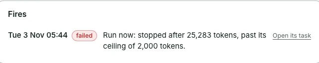 | [Cap what a schedule or routine may spend](cap-what-it-spends.md) Put a token ceiling on each run of a schedule, so one that goes wrong stops instead of spending on, and set a monthly budget for all your scheduled work, so you hear before it runs high. |
| 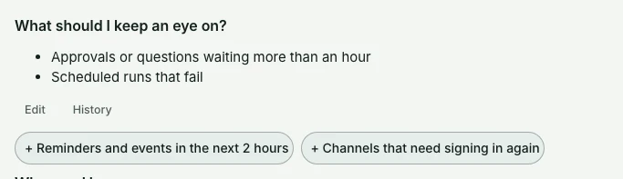 | [Tune the heartbeat: quiet hours and nudges](heartbeat.md) Let Tavi check in on its own: tell it what to keep an eye on, the hours it may look and message you, and how it tells you. |
| 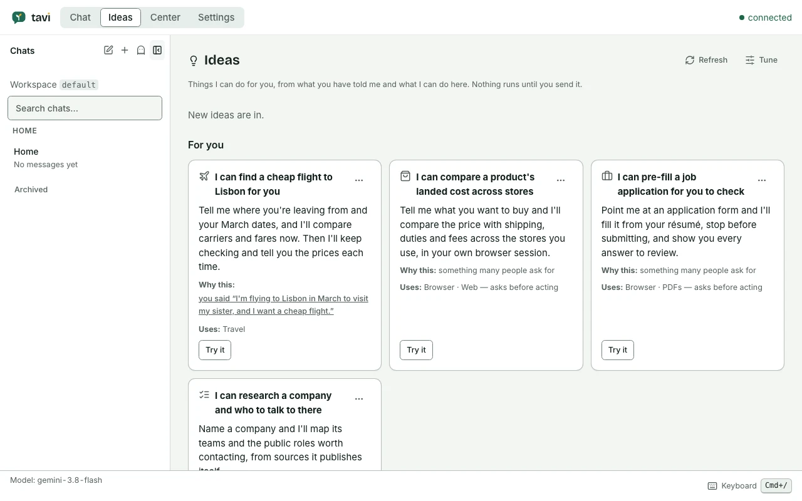 | [Pin an idea, make it recurring, or try it](ideas-tab.md) See what Tavi offers to do for you, from what you told it and what it can do here, then keep one, have one run every day, or try one now. |
| 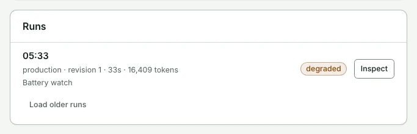 | [Read a routine run's report and where it was delivered](inspect-a-routine-run.md) Open one run of a research routine and see everything about it: how long it took and what it cost in tokens, the report it wrote, where that report went, the pages it read, and each step it took with the prompts it was given. |
| 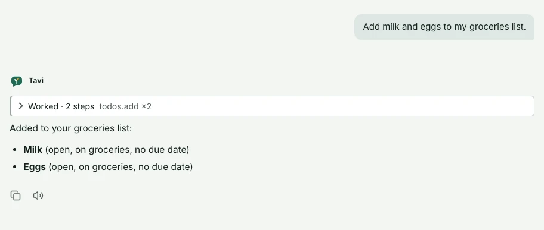 | [Keep a to-do list, in Tavi or in your own task app](keep-a-todo-list.md) Tell Tavi what you need to do, in a chat or from the terminal, tick things off in the Command Center, and take the list with you. |
| 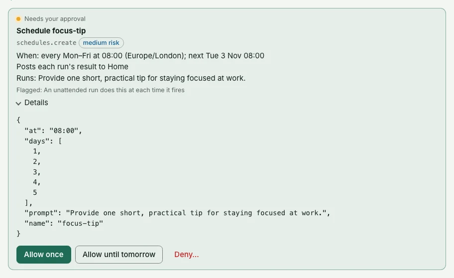 | [Create, change, pause and cancel schedules from a chat](manage-schedules-by-chatting.md) Set up something Tavi does on its own, on a cadence, by saying so in a chat, then move it, pause it or cancel it the same way. |
| 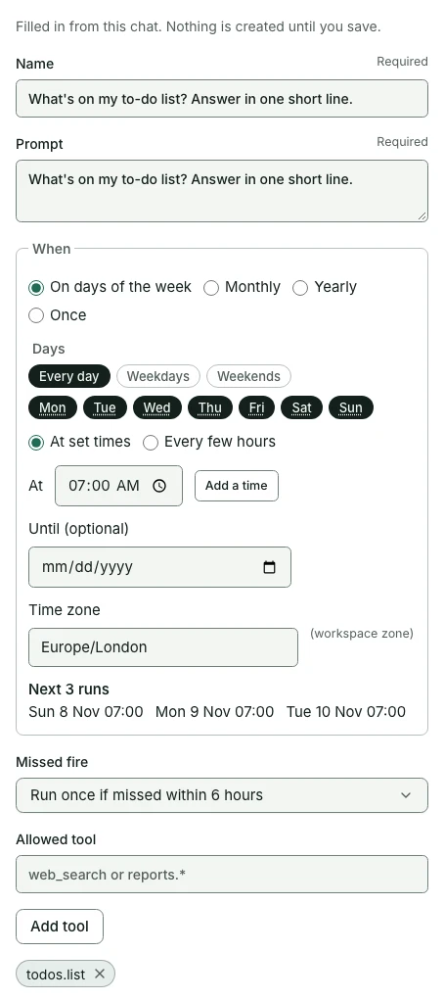 | [Turn a chat that worked into a schedule](repeat-this.md) When a question got the answer you wanted, have Tavi ask it again on its own every morning, with the same tools: **Repeat this…** fills in the schedule form from the chat. |
| 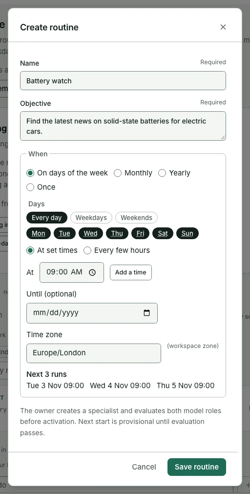 | [Follow a topic with a research routine](research-routine.md) Have Tavi research a topic every morning and write you a report with its sources: a routine searches the web, keeps only claims it can quote from the pages it read, and skips stories it has already told you. |
| 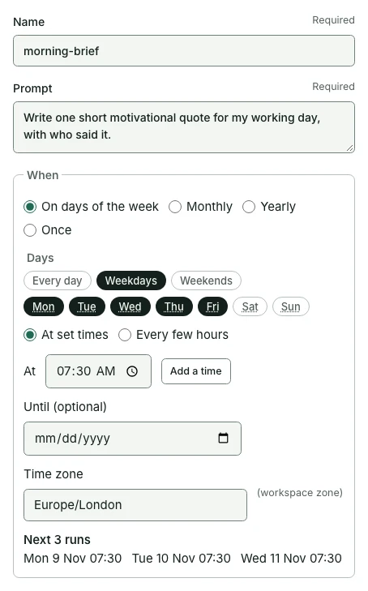 | [Run a task every weekday morning](schedule-a-task.md) Have Tavi do a piece of work on its own at set times, such as a short brief every weekday at 07:30, and post the result into Home. |
| 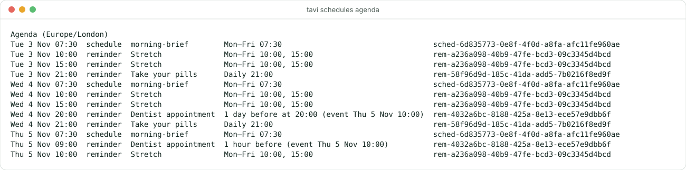 | [See every upcoming reminder, routine and schedule](see-whats-coming-up.md) Find out what Tavi will do and say over the next days, in one list: every reminder, routine and schedule fire, in your time zone. |
| 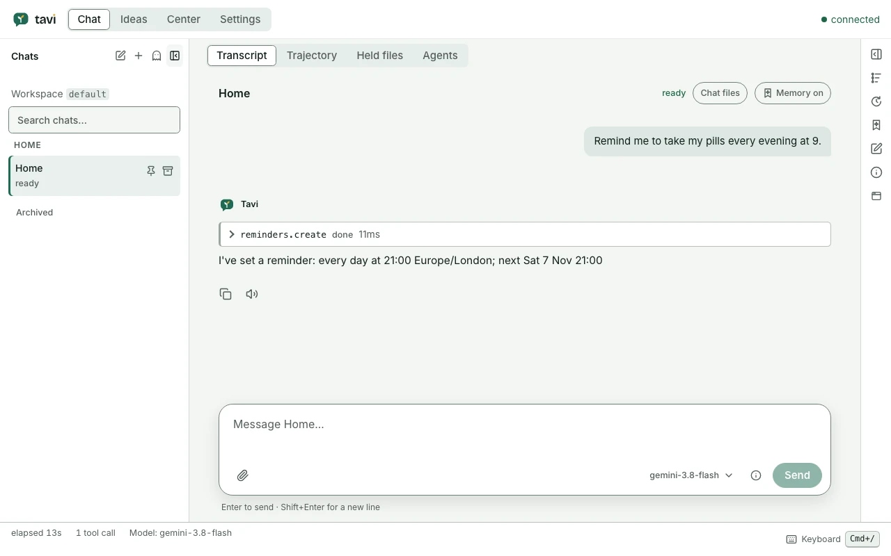 | [Set a reminder (once, on an event, or repeating)](set-a-reminder.md) Have Tavi remind you of something at a time: once, ahead of an appointment, or every day or weekday. |
| 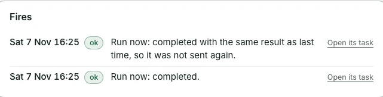 | [Hear from a schedule only when there's something new](tell-me-only-when-it-changes.md) A schedule normally tells you after every run. |
| 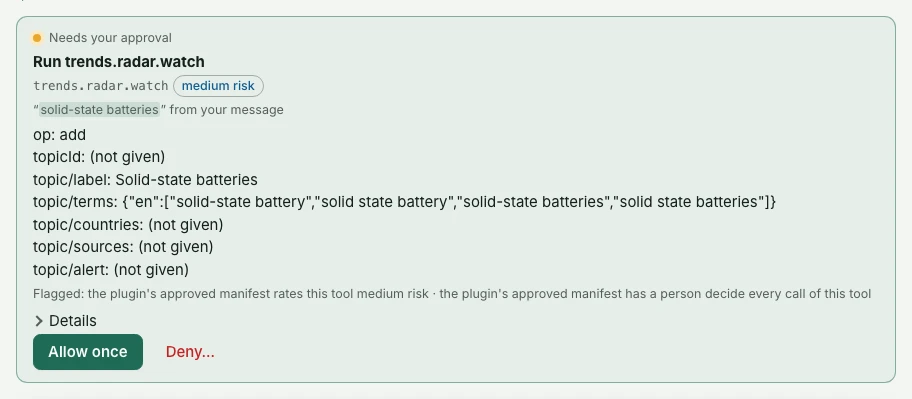 | [Track a trend over weeks](trend-routine.md) Name a topic and let Tavi follow how much it is talked about across free public sources (Hacker News, GDELT news, Bluesky, Mastodon, arXiv and others), then get a digest of it every morning. |
| 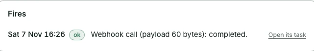 | [Start a schedule from a webhook](trigger-from-a-webhook.md) Let another program start a schedule the moment something happens, such as a shop sending a new order, by calling the schedule's own webhook with its secret. |
| 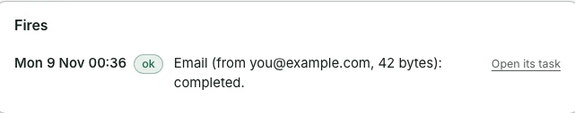 | [Start a schedule from an email](trigger-from-email.md) Run a schedule the moment a particular email arrives, such as an order confirmation from your shop, without opening Tavi. |
| 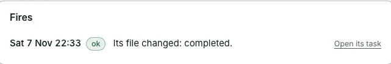 | [Run only when a page, feed or file changes](watch-a-page-or-feed.md) Make a watcher: a schedule that looks at a file, a web page or a feed every hour and runs its prompt only when something there is new. |
| 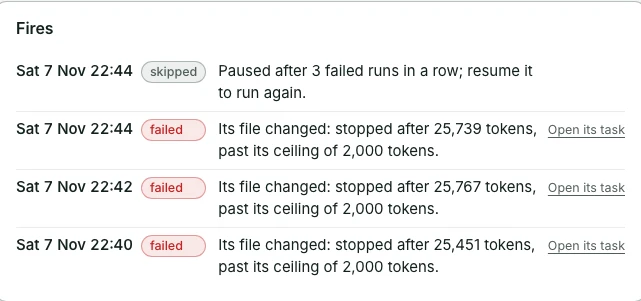 | [Find out why a schedule didn't run, and fix it](why-didnt-it-run.md) When a schedule goes quiet, its fire history says why: each time it was due, what happened, and the task of any run. |

[All how-to guides](../README.md)
