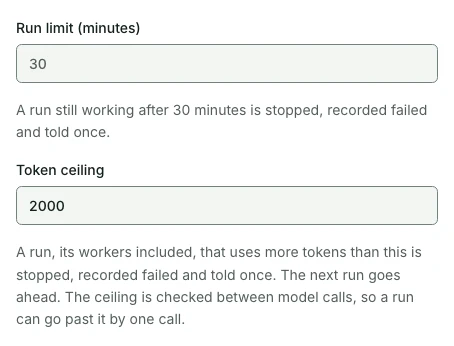
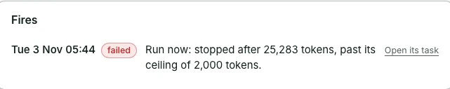
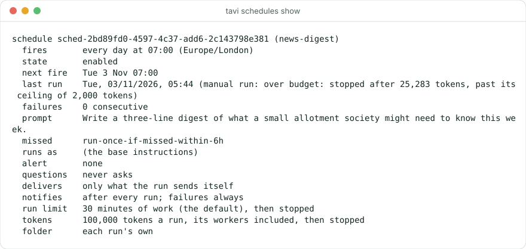
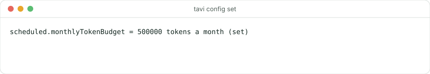
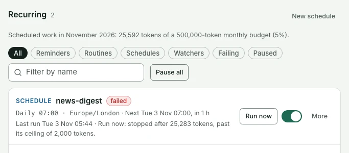

# Cap what a schedule or routine may spend

Put a token ceiling on each run of a schedule, so one that goes wrong stops instead of spending on, and set a monthly budget for all your scheduled work, so you hear before it runs high. About five minutes.

> **Uses:** schedules (**Token ceiling** in the schedule form, `tavi schedules update <name> --max-tokens 50000`) · the monthly budget (`tavi config set scheduled.monthlyTokenBudget 500000`) · **Center → Schedule**
> **Before you start:** a model connected ([Connect your first model](../get-started/first-model.md)) · Tavi running in the background with `tavi serve` ([Keep Tavi running in the background](../get-started/keep-tavi-running.md)) · a schedule to cap ([Run a task every weekday morning](schedule-a-task.md)) · the canvas open ([Open the web canvas and walk through Welcome](../get-started/web-canvas-tour.md))

## 1. Set a token ceiling

In **Center → Schedule** open the schedule's **More** menu, choose **Edit**, and type a number in **Token ceiling**, then choose **Save schedule**. The count covers the run and any workers it starts. To see what a stop looks like, try a small ceiling first, such as 2,000.

## 2. See a run stop at it

Choose **Run now**. Tavi counts the tokens as each model call ends, and once they pass the ceiling it stops the run, cancels any workers it started, and tells you once; a run can go over by one call. Its page lists the run under **Fires** with how far it got; the next run goes ahead as usual.

<!-- cover -->

## 3. Set the ceiling you mean

Raise it to what a good run needs with a margin, for example `tavi schedules update news-digest --max-tokens 100000`, or remove it with `--max-tokens off`. `tavi schedules show news-digest` says it as `tokens`, beside the run limit in minutes.

<picture>
  <source media="(prefers-color-scheme: dark)" srcset="../../assets/use-cases/automation/cap-what-it-spends/03-set-the-ceiling-you-mean-dark.svg">
  
</picture>

## 4. Set a monthly budget

Run `tavi config set scheduled.monthlyTokenBudget 500000`. It counts every schedule's and routine's runs this calendar month, with their workers, in your workspace's time zone. Home is told once a month when they reach 80% of it.

<picture>
  <source media="(prefers-color-scheme: dark)" srcset="../../assets/use-cases/automation/cap-what-it-spends/04-set-a-monthly-budget-dark.svg">
  
</picture>

## 5. See what scheduled work spent

Open **Center → Schedule**. Under **Recurring**, one line says what this month's scheduled work has used, with an estimated cost when the model has a price sheet, and its share of your budget; a **Near budget** badge appears from 80%. `tavi doctor` shows the same as `scheduledWork`.

## What Tavi will and won't do

A token ceiling stops one run; the monthly budget only tells you, and stops nothing. A run started by a webhook or an email always has a ceiling: 250,000 tokens unless you set your own. A routine's runs keep their own budget, in minutes, set in the routine. Stopped runs count toward the three failures in a row that pause a schedule, so a ceiling set too low pauses it. See [AUTOMATION.md](../../AUTOMATION.md#schedules).

## Related

- [Run a task every weekday morning](schedule-a-task.md)
- [Find out why a schedule didn't run, and fix it](why-didnt-it-run.md)
- [Start a schedule from a webhook](trigger-from-a-webhook.md)
- Reference: [AUTOMATION.md](../../AUTOMATION.md#schedules), [CLI.md](../../CLI.md#tavi-schedules), [WEB-UI.md](../../WEB-UI.md#schedule)
