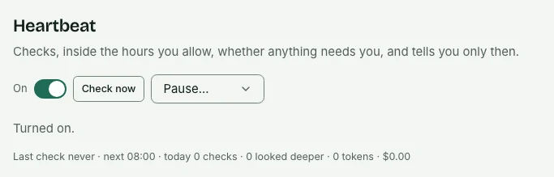
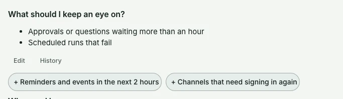
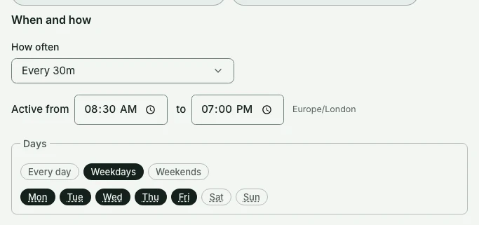
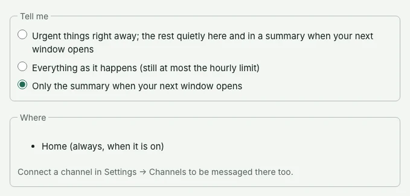
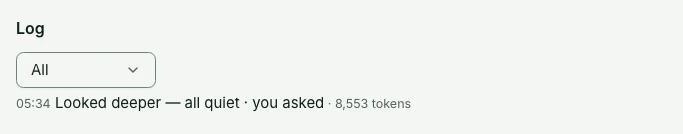
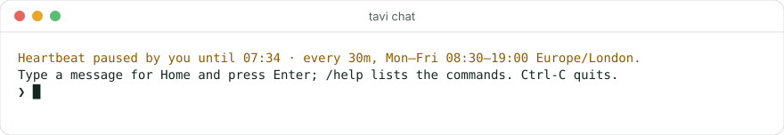

# Tune the heartbeat: quiet hours and nudges

Let Tavi check in on its own: tell it what to keep an eye on, the hours it may look and message you, and how it tells you. It stays quiet unless something needs you. About five minutes.

> **Uses:** the heartbeat (**Center → Heartbeat**, `tavi heartbeat status`) · the `/heartbeat` command in a chat
> **Before you start:** a model connected, with a *Fast* model for its checks ([Connect your first model](../get-started/first-model.md)) · Tavi running in the background with `tavi serve` ([Keep Tavi running in the background](../get-started/keep-tavi-running.md)) · the canvas open ([Open the web canvas and walk through Welcome](../get-started/web-canvas-tour.md))

## 1. Turn it on

Open **Center → Heartbeat** and switch it **On**. From now on it checks every 30 minutes, between 08:00 and 22:00 by default; the line under the switch says when it last looked, when it looks next, and what today's checks have cost.

## 2. Tell it what to keep an eye on

Under **What should I keep an eye on?** pick a suggestion, such as **+ Approvals or questions waiting more than an hour** or **+ Scheduled runs that fail**, or choose **Edit** and write your own lines, one concern each: `Tell me if a payment fails, urgent if it's over €500`. A line that starts `watch:` and an https address watches that page.

<!-- cover -->

## 3. Set its quiet hours

Under **When and how**, choose the hours it may check and message you and the days: here 08:30 to 19:00 on **Weekdays**. Outside them it neither checks nor sends anything; what it found waits for the summary when your next window opens. Each change is saved as you make it, and the estimate below says how many checks a day that is.

## 4. Choose how it nudges you

Under **Tell me**, choose **Urgent things right away** (the default: the rest waits for the summary), **Everything as it happens**, or **Only the summary when your next window opens** if you never want to be interrupted. Urgent messages are capped at three an hour either way.

## 5. Check now and read the log

Choose **Check now** to have it look at once, even outside its hours. The **Log** lists every check: why it ran, whether it stayed quiet or told you something, and the tokens it spent. Quiet is the usual outcome.

## 6. Pause it from a chat

In any chat, `/heartbeat pause 2h` pauses it for two hours (`30m`, `1d`, or none to pause until you resume), `/heartbeat resume` ends the pause, and `/heartbeat` alone shows how it stands. It works in `tavi chat`, the canvas and your own channel chats; from a terminal, `tavi heartbeat pause --for 2h` does the same.

<picture>
  <source media="(prefers-color-scheme: dark)" srcset="../../assets/use-cases/automation/heartbeat/06-pause-it-from-a-chat-dark.svg">
  
</picture>

## What Tavi will and won't do

A check reads your reminders, approvals, schedules and memory, and the pages you asked it to watch, but it can't send, buy, write or change anything: a suggestion it makes runs only when you choose **Do it**, and then asks for approval as usual. It never messages you outside your hours, and a check that finds nothing new makes no model call. The details are in [HEARTBEAT.md](../../HEARTBEAT.md).

## Related

- [Find your way around the Command Center](../chat/command-center.md)
- [See every upcoming reminder, routine and schedule](see-whats-coming-up.md)
- [Set a reminder (once, on an event, or repeating)](set-a-reminder.md)
- Reference: [HEARTBEAT.md](../../HEARTBEAT.md), [CLI.md](../../CLI.md#tavi-heartbeat)
