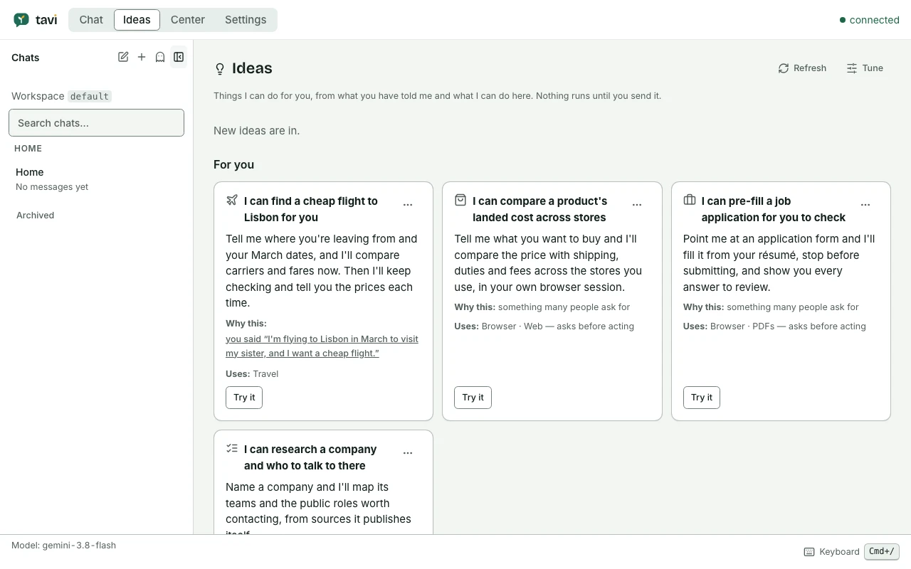
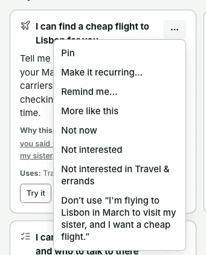
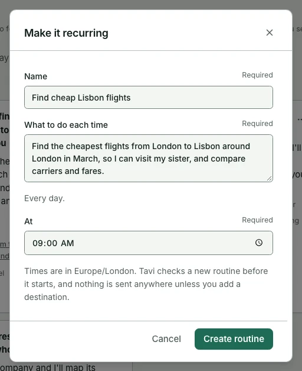
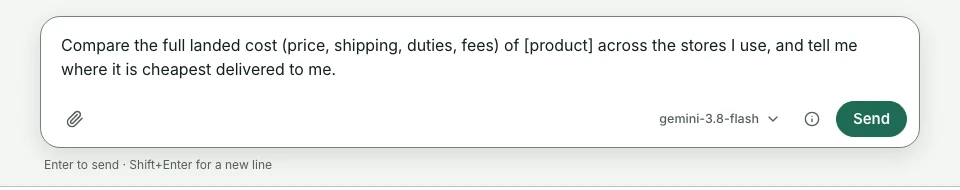
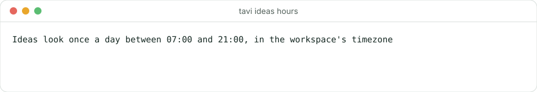

# Pin an idea, make it recurring, or try it

See what Tavi offers to do for you, from what you told it and what it can do here, then keep one, have one run every day, or try one now. About five minutes.

> **Uses:** the **Ideas** tab in the web canvas (`tavi ideas list`) · routines, for an idea that repeats
> **Before you start:** a model connected, with a *Fast* model to word the ideas ([Connect your first model](../get-started/first-model.md)) · Tavi running in the background with `tavi serve` ([Keep Tavi running in the background](../get-started/keep-tavi-running.md)) · the canvas open ([Open the web canvas and walk through Welcome](../get-started/web-canvas-tour.md))

## 1. Open the Ideas tab

Choose **Ideas** at the top of the canvas, then **Refresh** to have Tavi look now (it also looks once a day by itself). **For you** holds the best four; each card says **Why this** (here, something you told Tavi about a trip to Lisbon) and what it **Uses**.

<!-- cover -->

## 2. Pin the one you want to keep

Open a card's **⋯** menu and choose **Pin**: it stays until you unpin it, or until you try it or make it recurring, which retires it. The same menu has **More like this**, **Not now** (hidden for a week), **Not interested**, and **Don't use** for the memory it rests on.

## 3. Make it recurring

On an idea that repeats, choose **⋯ → Make it recurring…**. Fill in what the prompt leaves open, check the time, and choose **Create routine**. Tavi checks a new routine before it starts, and it sends nothing anywhere until you add a destination. The idea then leaves the tab: it lives on as the routine, in **Center → Schedule**.

## 4. Try one

Choose **Try it** on another card. A new chat opens with the idea's prompt in the message box and the part in square brackets, such as `[product]`, selected for you to type over. Edit it and send it yourself; nothing runs until you do.

## 5. Choose when Tavi looks

Tavi looks for new ideas once a day, between 08:00 and 22:00 by default. Run `tavi ideas hours 07:00-21:00` to change the hours. To have your best three sent to your own chat on a channel each week, run `tavi ideas digest <connection> fri` once a channel is connected ([CHANNELS.md](../../CHANNELS.md#the-weekly-ideas-digest)).

<picture>
  <source media="(prefers-color-scheme: dark)" srcset="../../assets/use-cases/automation/ideas-tab/05-choose-when-tavi-looks-dark.svg">
  
</picture>

## What Tavi will and won't do

An idea never runs on its own: **Try it** only fills the message box, and a routine made from one is checked before it starts. Ideas read only your approved, non-sensitive memory, your own chats and your brief, never private chats or sensitive memory, and **Settings → Ideas** brings back anything you hid. The details are in [IDEAS.md](../../IDEAS.md).

## Related

- [Follow a topic with a research routine](research-routine.md)
- [Turn a chat that worked into a schedule](repeat-this.md)
- [Set a reminder (once, on an event, or repeating)](set-a-reminder.md)
- Reference: [IDEAS.md](../../IDEAS.md), [CLI.md](../../CLI.md#tavi-ideas)
