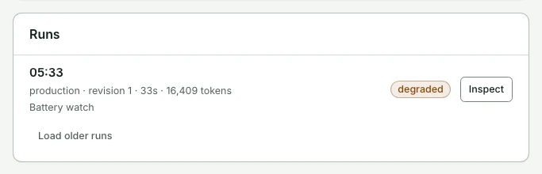
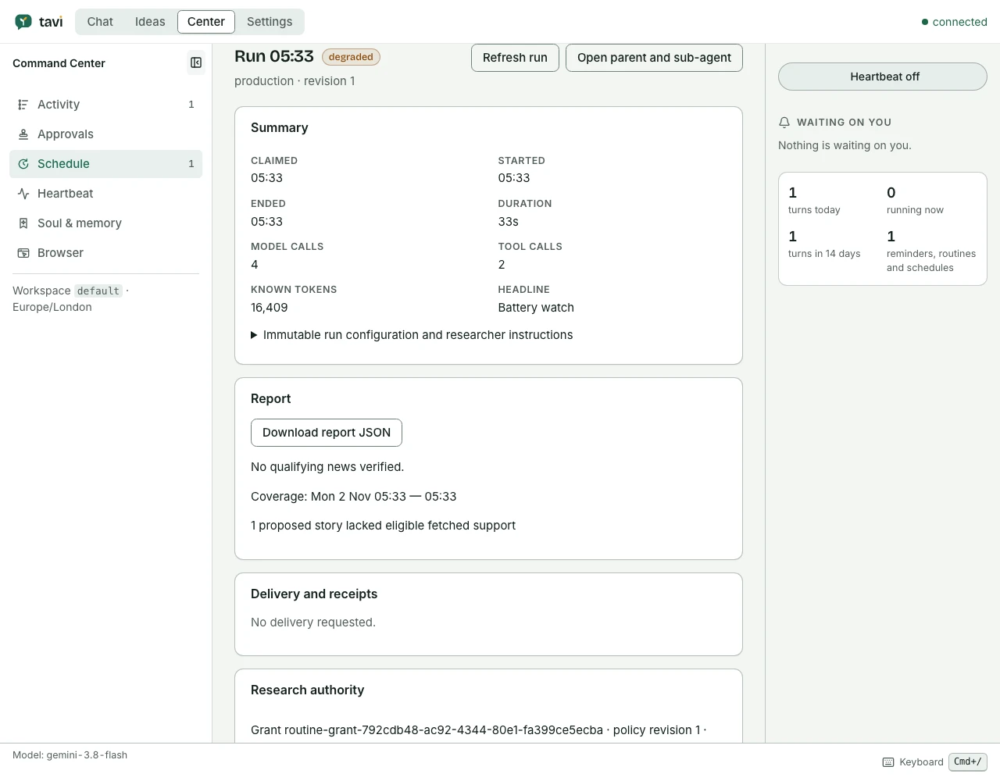
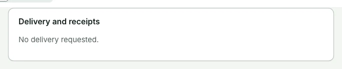
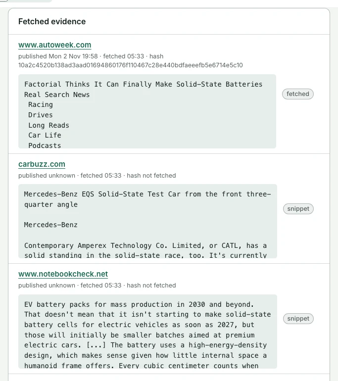
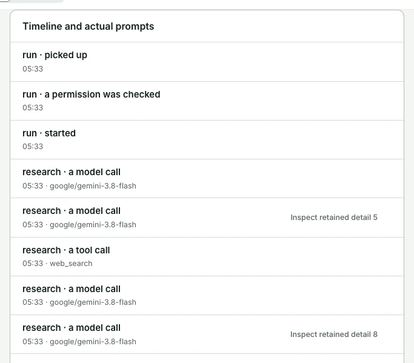

# Read a routine run's report and where it was delivered

Open one run of a research routine and see everything about it: how long it took and what it cost in tokens, the report it wrote, where that report went, the pages it read, and each step it took with the prompts it was given. About five minutes.

> **Uses:** research routines (a run's page under **Center → Schedule**)
> **Before you start:** a research routine that has run at least once ([Follow a topic with a research routine](research-routine.md)) · the canvas open ([Open the web canvas and walk through Welcome](../get-started/web-canvas-tour.md))

## 1. Open a run from its routine

Open **Center → Schedule**, choose the routine's name, and scroll to **Runs**. Each run says when it started, whether it was a production run or a preview, how long it took, the tokens it used and its report's headline. Choose **Inspect** to open one.

<!-- cover -->

## 2. Read its summary and report

The run's page starts with how it ended and a **Summary**: when it was **Claimed**, **Started** and **Ended**, its model and tool calls, the tokens providers reported and its headline. A failed run says why here, in the words of the error it ended on. **Report** below shows the stories it published, each claim linked to its page.

## 3. See where it was delivered

**Delivery and receipts** lists each place the report was sent, such as a Telegram chat, with its status, the provider's message ids and any error, and **Resend original PDF** for one that failed. A routine with no delivery target keeps its report here in the app, as this one does.

## 4. Check the pages it read

**Fetched evidence** lists every page the run used: its publisher, when it was published and fetched, a hash of what was read, and the excerpt the report may quote. A page marked **snippet** was seen only in search results, not fetched. **Research authority**, above, says which sites the run was allowed to read.

## 5. Follow each step it took

**Timeline and actual prompts** lists each step in order: picked up, the permission checks, each model and tool call of its research and its synthesis, the report published. **Inspect retained detail** on a step opens what was kept of it, such as the exact prompt the model was given.

## What Tavi will and won't do

A run's page only reads: resending a delivery asks you to tick that it may arrive twice first, and nothing else here changes the run. Each run keeps the configuration it ran under, so a later edit to the routine never changes what an old run shows. Retained details and fetched evidence expire after a while; the page then says when. See [AUTOMATION.md](../../AUTOMATION.md#reports-and-delivery).

## Related

- [Follow a topic with a research routine](research-routine.md)
- [See every upcoming reminder, routine and schedule](see-whats-coming-up.md)
- Reference: [AUTOMATION.md](../../AUTOMATION.md#what-the-canvas-shows), [WEB-UI.md](../../WEB-UI.md#schedule)
