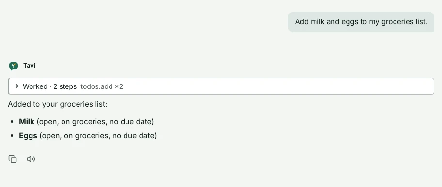
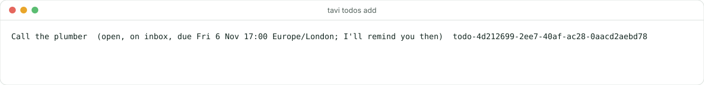
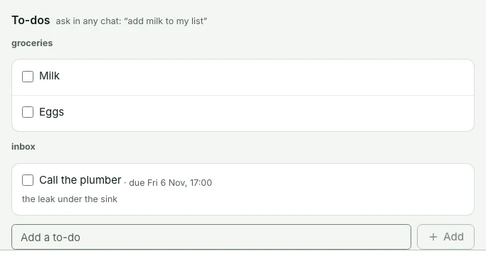
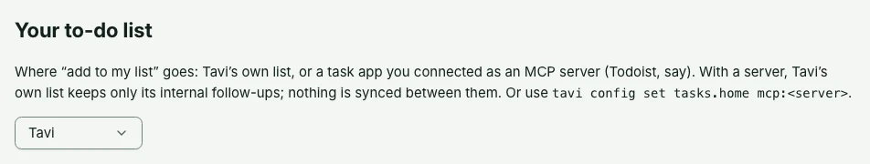
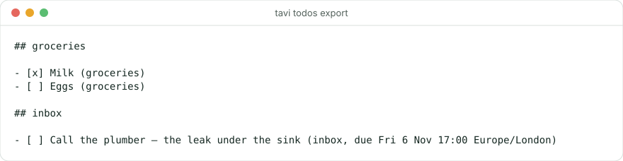

# Keep a to-do list, in Tavi or in your own task app

Tell Tavi what you need to do, in a chat or from the terminal, tick things off in the Command Center, and take the list with you. About five minutes.

> **Uses:** to-dos (`todos.add`, `todos.list`, `todos.complete`, `tavi todos list`) · **Center → Schedule** · **Settings → General → Your to-do list**
> **Before you start:** a model connected ([Connect your first model](../get-started/first-model.md)) · Tavi running in the background with `tavi serve` ([Keep Tavi running in the background](../get-started/keep-tavi-running.md)) · the canvas open ([Open the web canvas and walk through Welcome](../get-started/web-canvas-tour.md))

## 1. Ask Tavi to add to your list

In Home, or any chat or channel, say it in your own words: `Add milk and eggs to my groceries list.` Tavi adds each one without asking for approval, on the list you named (`inbox` when you name none), and says what it added.

<!-- cover -->

## 2. Add one with a due time

From a terminal, `tavi todos add "Call the plumber" --due 2026-11-20T17:00+00:00 --notes "the leak under the sink"` adds a to-do that reminds you at that time, in the app or the chat you asked in. A due date alone (`--due 2026-11-20`) is only shown, never reminded.

<picture>
  <source media="(prefers-color-scheme: dark)" srcset="../../assets/use-cases/automation/keep-a-todo-list/02-add-one-with-a-due-time-dark.svg">
  
</picture>

## 3. Tick one off in the Command Center

Open **Center → Schedule** and scroll to **To-dos**: your open to-dos, by list, with their notes and dues. Tick a box to mark one done, or type in **Add a to-do** to add one. A to-do with a due time also shows under **Coming up**.

## 4. Choose where your to-dos live

If you already keep tasks in an app such as Todoist, connect it as an MCP server (`tavi mcp add todoist --preset todoist`, then sign in), and choose it under **Settings → General → Your to-do list**. "Add to my list" then goes to your app, and Tavi's own list keeps only its own follow-ups. Nothing is synced between the two.

## 5. Take your list with you

Run `tavi todos export` for every to-do, open and done, as a Markdown checklist grouped by list (`--format json` for the records). To move them into your task app instead, ask in a chat: `Move my Tavi to-dos to Todoist.`

<picture>
  <source media="(prefers-color-scheme: dark)" srcset="../../assets/use-cases/automation/keep-a-todo-list/05-take-your-list-with-you-dark.svg">
  
</picture>

## What Tavi will and won't do

Your own list never asks for approval, and each person sees only their own to-dos. In a chat that has read a web page or a document, adding, ticking off or removing a to-do asks you first, since the page might have suggested it. The details are in [AUTOMATION.md](../../AUTOMATION.md#to-dos).

## Related

- [Set a reminder (once, on an event, or repeating)](set-a-reminder.md)
- [See every upcoming reminder, routine and schedule](see-whats-coming-up.md)
- [Find your way around the Command Center](../chat/command-center.md)
- Reference: [AUTOMATION.md](../../AUTOMATION.md#to-dos), [CLI.md](../../CLI.md#tavi-todos)
