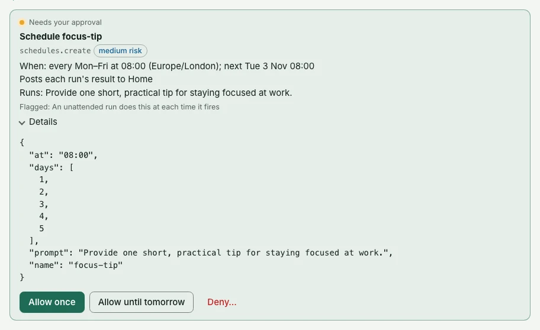
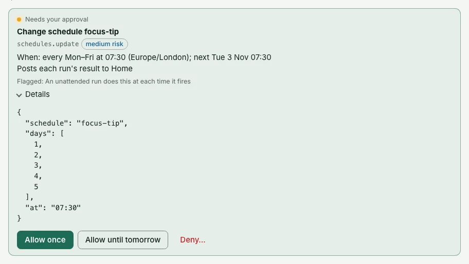
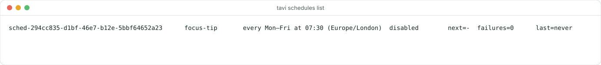
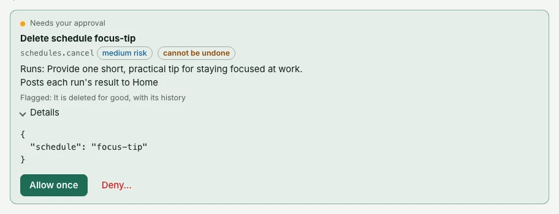

# Create, change, pause and cancel schedules from a chat

Set up something Tavi does on its own, on a cadence, by saying so in a chat, then move it, pause it or cancel it the same way. Each change shows you a card first. About five minutes.

> **Uses:** schedules (`schedules.create`, `schedules.update`, `schedules.pause`, `schedules.cancel`) · approvals · `tavi schedules list`
> **Before you start:** a model connected ([Connect your first model](../get-started/first-model.md)) · Tavi running in the background with `tavi serve` ([Keep Tavi running in the background](../get-started/keep-tavi-running.md)) · the canvas open ([Open the web canvas and walk through Welcome](../get-started/web-canvas-tour.md))

## 1. Ask for a schedule

In Home, say what and when: `Every weekday at 8:00, give me one short tip for staying focused at work. Call it focus-tip.` Before anything is saved, Tavi stops on a card that says when it will run, in your workspace's time zone, where each result goes, and what it runs (**Details** adds the call's full input). Choose **Allow once**.

<!-- cover -->

## 2. Change when it runs

Ask for the change in the same words you would use with a person: `Move focus-tip to 7:30.` The card reads the schedule as it will be, days and all, so you can check nothing else moved. Allow it, and Tavi says when it runs next.

## 3. Pause it

`Pause focus-tip.` stops it from running without losing it; `Resume focus-tip.` starts it again from its next time. Allow the card, and the schedule stays listed as paused in **Center → Schedule** and `tavi schedules list`.

<picture>
  <source media="(prefers-color-scheme: dark)" srcset="../../assets/use-cases/automation/manage-schedules-by-chatting/03-pause-it-dark.svg">
  
</picture>

## 4. Cancel it

`Cancel focus-tip.` removes it for good, with its history. The card is marked **cannot be undone**, and its **Details** name the schedule it will remove; nothing goes until you allow it.

## What Tavi will and won't do

Creating, changing, pausing, resuming, running now and cancelling a schedule each wait for your approval; asking what is scheduled, or why one didn't run, doesn't. A schedule runs only with the tools it was given, and one that can write, send or run something asks on a high-risk card every time. A routine's schedule is changed through the routine, not these tools. The details are in [AUTOMATION.md](../../AUTOMATION.md#schedules).

## Related

- [Run a task every weekday morning](schedule-a-task.md)
- [Turn a chat that worked into a schedule](repeat-this.md)
- [Follow a topic with a research routine](research-routine.md)
- Reference: [AUTOMATION.md](../../AUTOMATION.md#schedules), [CLI.md](../../CLI.md#tavi-schedules)
