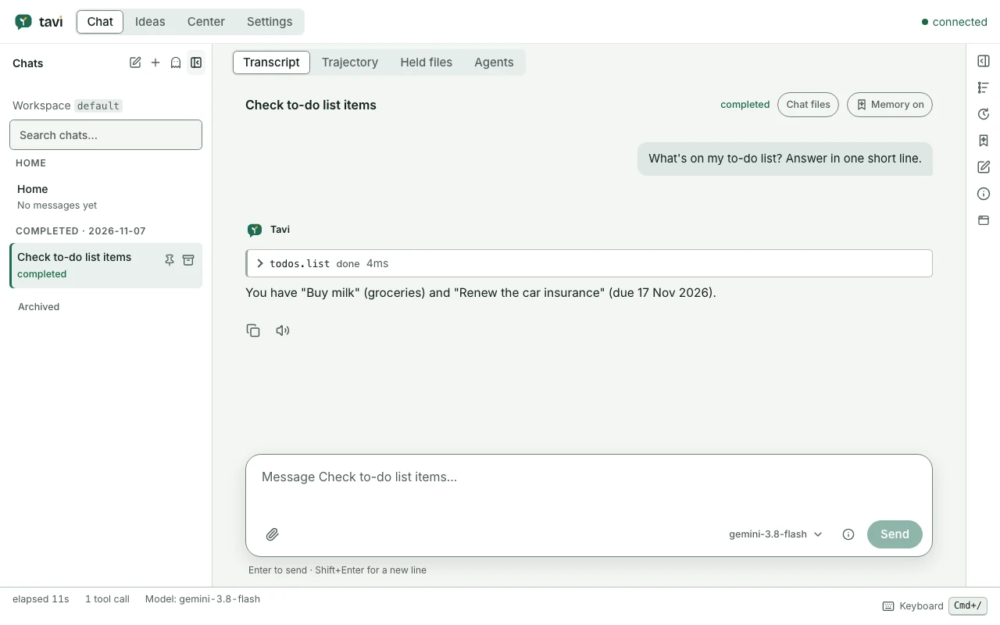
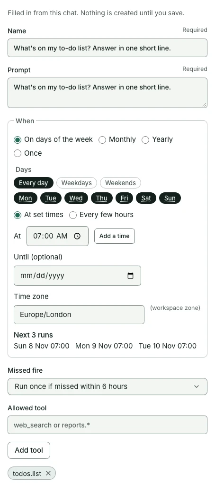
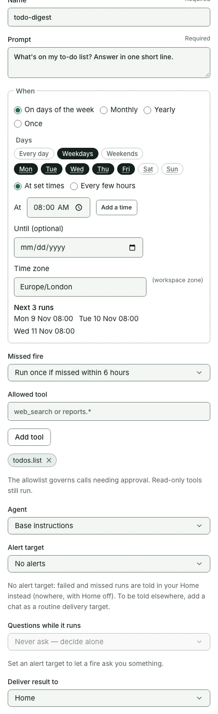
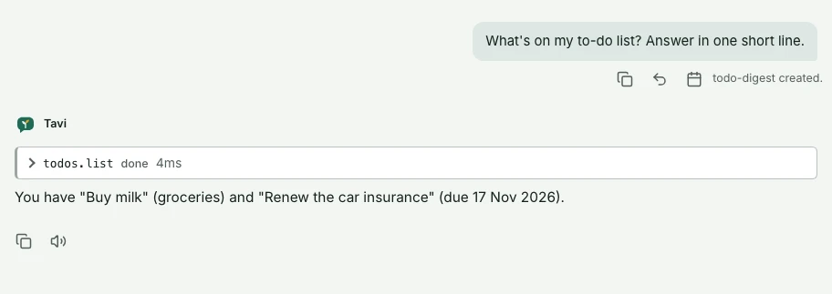
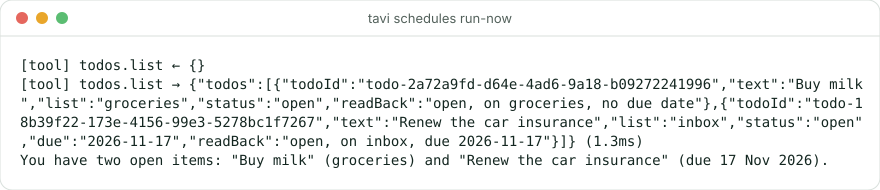

# Turn a chat that worked into a schedule

When a question got the answer you wanted, have Tavi ask it again on its own every morning, with the same tools: **Repeat this…** fills in the schedule form from the chat. About five minutes.

> **Uses:** **Repeat this…** on a message in the web canvas · schedules (`tavi schedules list`) · the read-only tools the chat used (here `todos.list`)
> **Before you start:** a model connected ([Connect your first model](../get-started/first-model.md)) · Tavi running in the background with `tavi serve` ([Keep Tavi running in the background](../get-started/keep-tavi-running.md)) · the canvas open ([Open the web canvas and walk through Welcome](../get-started/web-canvas-tour.md)) · a few to-dos ([Keep a to-do list](keep-a-todo-list.md))

## 1. Ask something that works

Start a new chat with **+** above the chat list and ask, for example, `What's on my to-do list? Answer in one short line.` Tavi reads your list with `todos.list` and answers. If the answer is what you'd want every morning, it's worth repeating.

## 2. Choose Repeat this…

Point at your message and choose **Repeat this…** (the calendar icon) under it. **Create schedule** opens, filled in from the chat: your message as the prompt, a name from it, and as allowed tools the read-only ones the chat used (`todos.list`). Nothing is created until you save.

<!-- cover -->

## 3. Say when and where it goes

Give it a short name such as `todo-digest`, choose **Weekdays** and `08:00`, and check that **Deliver result to** says **Home**: a schedule made this way posts each result there, as one made in a chat does (choose **Nowhere** to keep results in their tasks). The next three runs under **When** show the times you picked.

## 4. Save it

Choose **Save schedule**. The message's actions now say what was created, and the schedule is in **Center → Schedule** and `tavi schedules list`.

## 5. Try a run now

Rather than wait for tomorrow morning, run `tavi schedules run-now todo-digest`. It runs once as it would at 08:00, with only the tools it was given, and prints the result; its next run stays where it was.

<picture>
  <source media="(prefers-color-scheme: dark)" srcset="../../assets/use-cases/automation/repeat-this/05-try-a-run-now-dark.svg">
  
</picture>

## What Tavi will and won't do

The chat's words only fill in a form: you check the prompt and tools, and nothing runs until you save. Tools that write, send or schedule are never filled in for you; a chat that read a web page or a document fills in no tool at all and says so, and a chat that researched the web offers a research routine instead. The details are in [WEB-UI.md](../../WEB-UI.md) and [AUTOMATION.md](../../AUTOMATION.md#schedules).

## Related

- [Create, change, pause and cancel schedules from a chat](manage-schedules-by-chatting.md)
- [Run a task every weekday morning](schedule-a-task.md)
- [Follow a topic with a research routine](research-routine.md)
- Reference: [AUTOMATION.md](../../AUTOMATION.md#schedules), [WEB-UI.md](../../WEB-UI.md)
