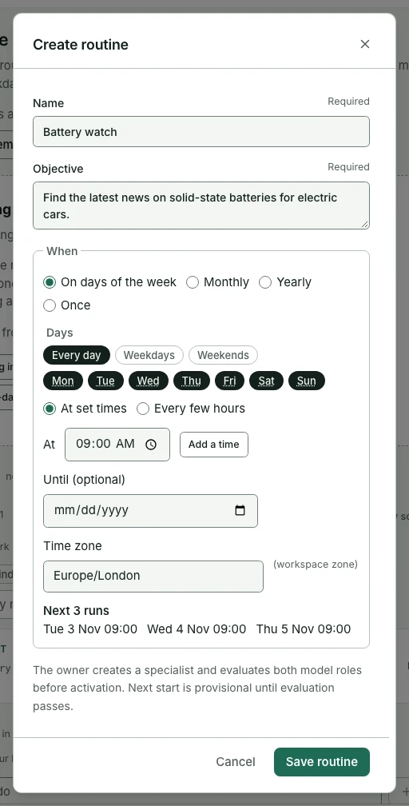
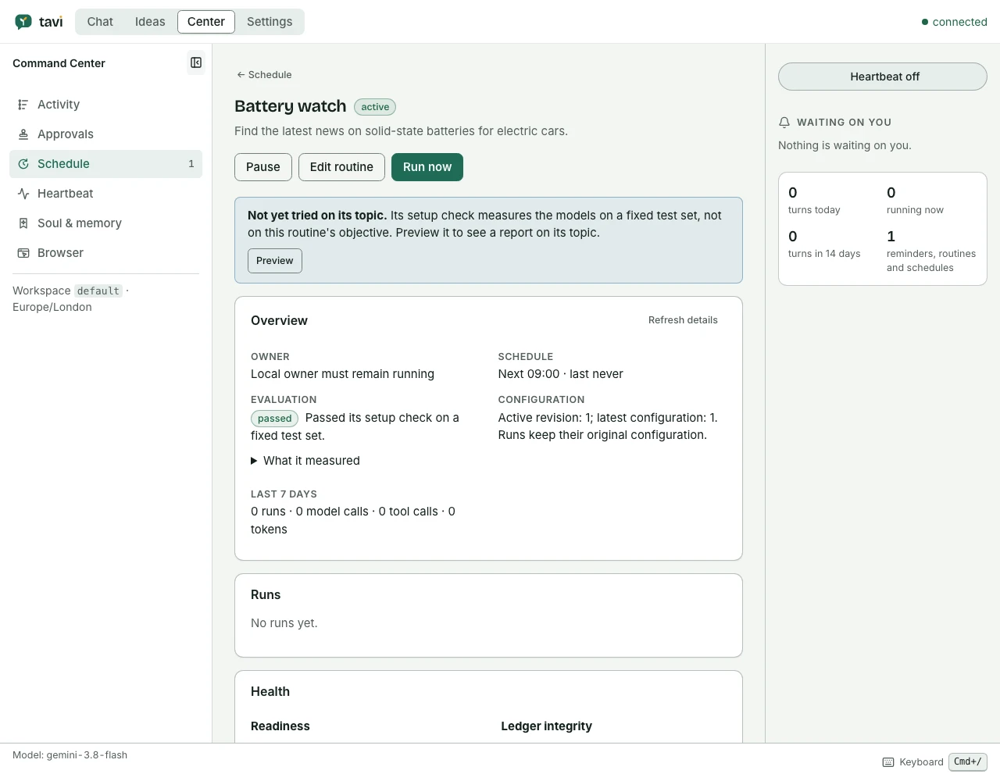
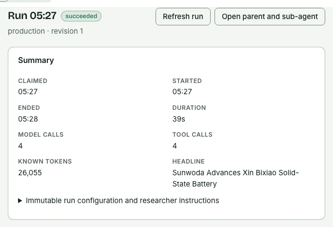
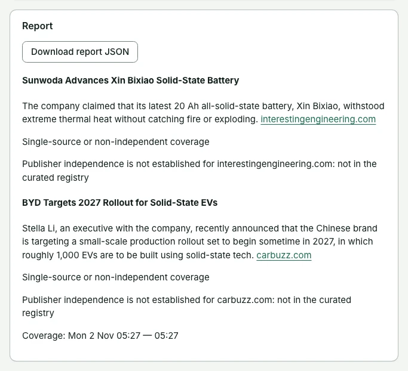

# Follow a topic with a research routine

Have Tavi research a topic every morning and write you a report with its sources: a routine searches the web, keeps only claims it can quote from the pages it read, and skips stories it has already told you. About twenty minutes, most of it Tavi checking its models.

> **Uses:** research routines (`news-v1`, **New routine** in **Center → Schedule**) · web search (`web_search`)
> **Before you start:** a model connected ([Connect your first model](../get-started/first-model.md)) · a web search provider in **Settings → Web search** · Tavi running in the background with `tavi serve` ([Keep Tavi running in the background](../get-started/keep-tavi-running.md)) · the canvas open ([Open the web canvas and walk through Welcome](../get-started/web-canvas-tour.md))

## 1. Say what to follow

Open **Center → Schedule** and choose **New routine**. Give it a name and an objective, the topic in a sentence, and set when it runs: every day at 09:00 unless you change it. Choose **Save routine**.

<!-- cover -->

## 2. Wait for its setup check

Saving opens the routine's page. Before a routine may run on its own, Tavi checks that your models can research and write a report on a fixed test set: its status reads **evaluating**, then **active**. The check makes about 36 model calls and can take up to fifteen minutes, once per workspace and models.

## 3. Run it now

Choose **Run now** to try it on your topic without waiting for the morning. The run opens as a page of its own: its research comes first, then the report, and the page updates itself until the run has ended. **succeeded** means it published a report; **degraded** that it did, with caveats.

## 4. Read the report

Under **Report**, each story has a title and the sentences it quotes, each linked to the page it came from, then its caveats, such as a story only one source reported, and the time the report covers. **Download report JSON** saves it. Next time, stories already reported are skipped unless something material changed.

## What Tavi will and won't do

A routine only reads: it searches the web and fetches pages its own search returned, never a link a page told it to follow, and every claim in the report is a sentence copied from a page it fetched. It never asks you anything while it runs unless you allow questions in **Edit routine**, and three failed runs in a row pause it. See [AUTOMATION.md](../../AUTOMATION.md#agent-routines).

## Related

- [Read a routine run's report and where it was delivered](inspect-a-routine-run.md)
- [Run a task every weekday morning](schedule-a-task.md)
- [See every upcoming reminder, routine and schedule](see-whats-coming-up.md)
- Reference: [AUTOMATION.md](../../AUTOMATION.md#agent-routines), [WEB-UI.md](../../WEB-UI.md#schedule)
