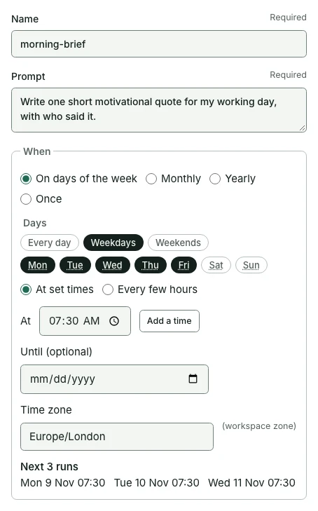
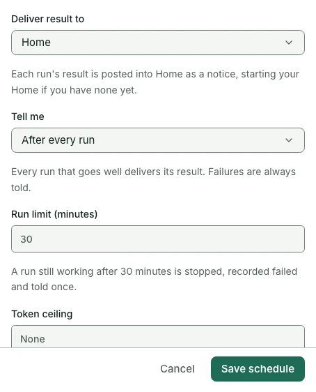
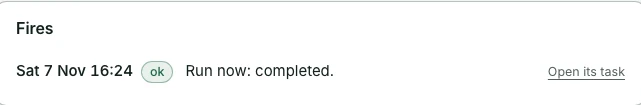
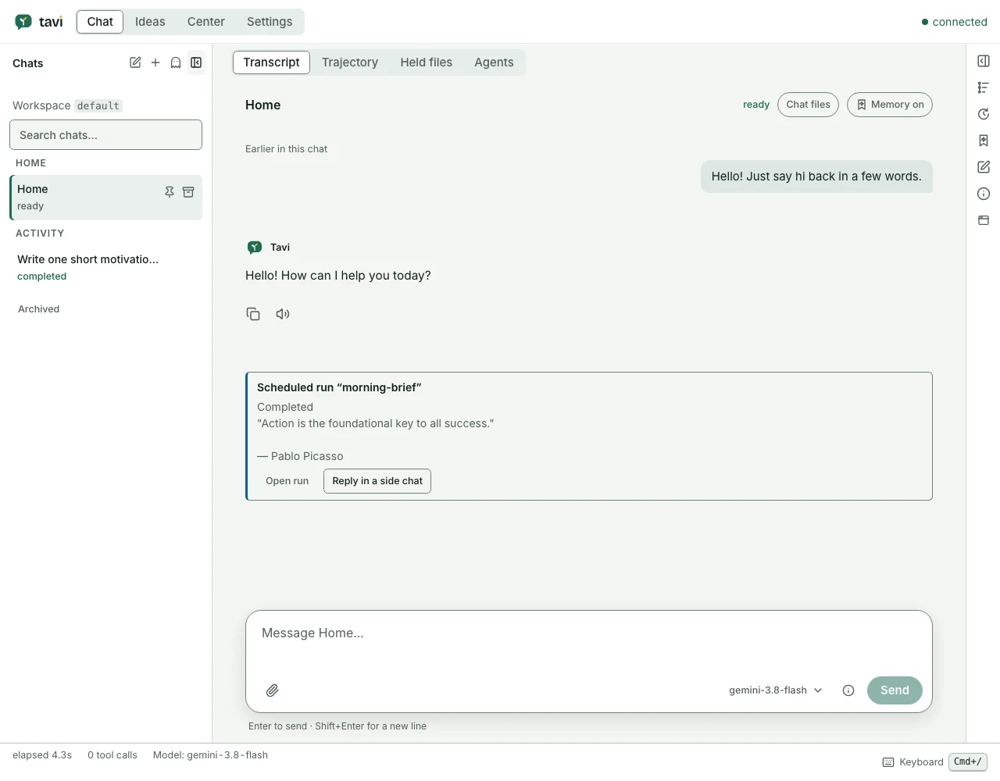
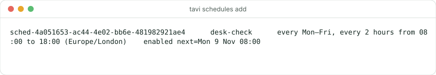

# Run a task every weekday morning

Have Tavi do a piece of work on its own at set times, such as a short brief every weekday at 07:30, and post the result into Home. One cadence field covers every pattern: one or several times a day, every few hours, monthly, yearly or once, with an optional last day. About five minutes.

> **Uses:** schedules (**New schedule** in **Center → Schedule**, `tavi schedules list` in the terminal) · your Home conversation
> **Before you start:** a model connected ([Connect your first model](../get-started/first-model.md)) · Tavi running in the background with `tavi serve` ([Keep Tavi running in the background](../get-started/keep-tavi-running.md)) · the canvas open ([Open the web canvas and walk through Welcome](../get-started/web-canvas-tour.md))

## 1. Say what to do and when

Open **Center → Schedule**, choose **New schedule** under **Recurring**, and give it a name and a prompt. Under **When**, keep **On days of the week**, choose **Weekdays** and set the time. **Every few hours** runs it through a window instead, **Monthly** on a day or its last Friday, and **Until** ends it on a date; **Next 3 runs** shows the result as you go.

<!-- cover -->

## 2. Choose where the result goes

Set **Deliver result to** to **Home** so each run's result is posted there, and leave **Tell me** at **After every run**. **Allowed tool** lists what the run may use without asking you; a run nobody watches is refused anything else. Choose **Save schedule**.

## 3. Try it now

You don't have to wait for the morning. Choose **Run now** on its row, then its name to open its page: its prompt, the policy it runs under, and under **Fires** each run with how it went and **Open its task**. Running it now doesn't move its next run.

## 4. Read the result in Home

Open **Chat → Home**. The run's result is there as a notice, linked to the run's task, and Home can talk about it in your next message.

## 5. Add another from the terminal

The same cadences work from the terminal: `tavi schedules add --name desk-check --every-hours 2 --between 08:00-18:00 --days 1,2,3,4,5 --timezone Europe/London --deliver-to home --prompt "Remind me to stand up and stretch."` runs every two hours through the working day, and `--at 09:00 --monthly last:fri --until 2027-06-30` in place of the hours runs on the last Friday of each month until a date. It prints the new schedule's id and next run; `tavi schedules list` says each one's cadence in words.

<picture>
  <source media="(prefers-color-scheme: dark)" srcset="../../assets/use-cases/automation/schedule-a-task/05-add-another-from-the-terminal-dark.svg">
  
</picture>

## What Tavi will and won't do

A schedule runs only the tools its allow list names; anything else that would need your approval is refused, since nobody is there to answer. A failed run is told to you in Home, and three failures in a row pause it until you resume it. A schedule can't create more schedules, and a missed run is caught up only within six hours. See [AUTOMATION.md](../../AUTOMATION.md#schedules).

## Related

- [See every upcoming reminder, routine and schedule](see-whats-coming-up.md)
- [Set a reminder (once, on an event, or repeating)](set-a-reminder.md)
- [Follow a topic with a research routine](research-routine.md)
- Reference: [AUTOMATION.md](../../AUTOMATION.md#schedules), [CLI.md](../../CLI.md#tavi-schedules), [WEB-UI.md](../../WEB-UI.md#the-cadence-field)
