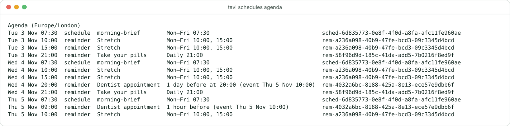
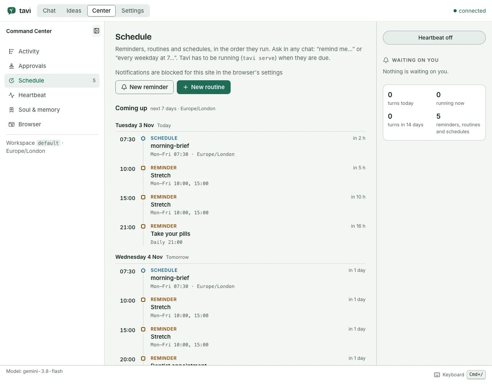
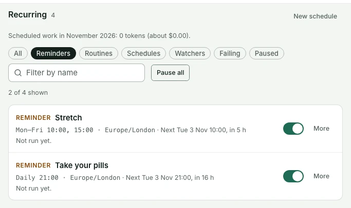
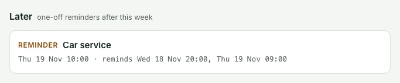
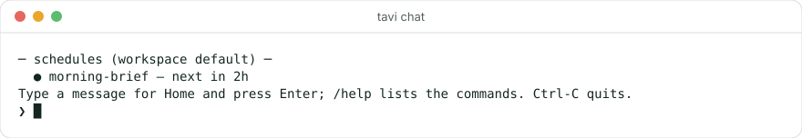

# See every upcoming reminder, routine and schedule

Find out what Tavi will do and say over the next days, in one list: every reminder, routine and schedule fire, in your time zone. About two minutes.

> **Uses:** the agenda (`tavi schedules agenda`) · **Center → Schedule** in the web canvas · `/schedules` in the terminal chat
> **Before you start:** Tavi running in the background with `tavi serve` ([Keep Tavi running in the background](../get-started/keep-tavi-running.md)) · a reminder or schedule or two ([Set a reminder](set-a-reminder.md), [Run a task every weekday morning](schedule-a-task.md))

## 1. List the week in the terminal

Run `tavi schedules agenda`. It lists every reminder, routine and schedule fire in the next seven days, soonest first, with your workspace's time zone named once at the top. Add `--days 31` to look up to a month ahead.

<!-- cover -->
<picture>
  <source media="(prefers-color-scheme: dark)" srcset="../../assets/use-cases/automation/see-whats-coming-up/01-list-the-week-in-the-terminal-dark.svg">
  
</picture>

## 2. Open Coming up in the canvas

Open **Center → Schedule**. **Coming up** shows the same seven days under the day each falls on: the time, whether it is a reminder, routine or schedule, its name and cadence, and how soon it is. Choose a name to open its page.

## 3. Narrow the repeating ones

Under **Recurring**, everything that repeats is one row each, soonest first, with its next run and how the last one went. Choose **Reminders**, **Routines** or **Schedules** above the rows to show only that kind, or type in the filter to find one by name.

## 4. See what's further off

One-off reminders beyond this week are under **Later**, an event's with the notices still to come. Reminders that finished or were missed are under **Done / missed** at the end.

## 5. Check from the terminal chat

In `tavi chat`, type `/schedules` and press Enter: it lists the workspace's schedules and how soon each runs next, without leaving the conversation. Reminders are not in it; use the agenda for those.

<picture>
  <source media="(prefers-color-scheme: dark)" srcset="../../assets/use-cases/automation/see-whats-coming-up/05-check-from-the-terminal-chat-dark.svg">
  
</picture>

## What Tavi will and won't do

The list only reads: nothing runs because you looked at it. Paused and finished items are left out of the agenda, and a fire that was missed but will still be caught up is listed first as overdue. To change or stop something, open its page from the list.

## Related

- [Set a reminder (once, on an event, or repeating)](set-a-reminder.md)
- [Run a task every weekday morning](schedule-a-task.md)
- [Find your way around the Command Center](../chat/command-center.md)
- Reference: [AUTOMATION.md](../../AUTOMATION.md#schedules), [WEB-UI.md](../../WEB-UI.md#schedule)
