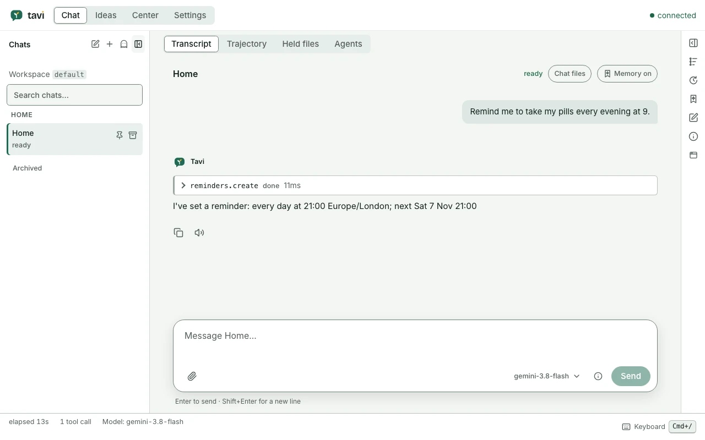
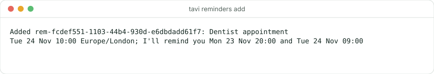
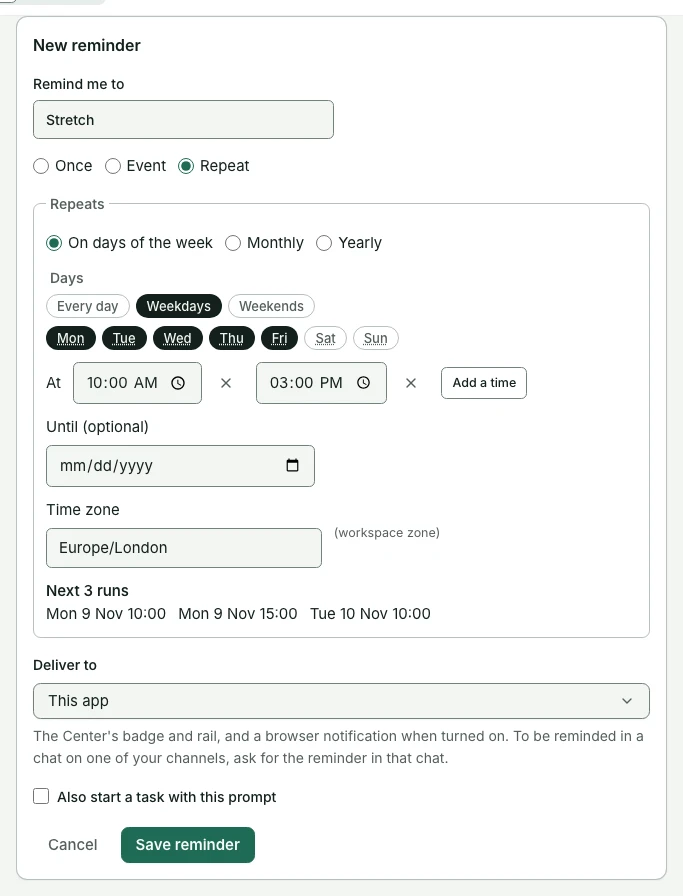
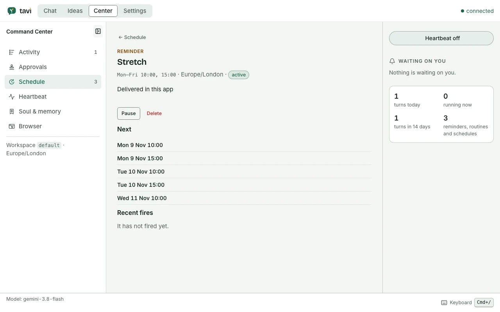

# Set a reminder (once, on an event, or repeating)

Have Tavi remind you of something at a time: once, ahead of an appointment, or every day or weekday. Ask in a chat, type one command, or fill in a form. About five minutes.

> **Uses:** reminders (`reminders.create` in a chat, `tavi reminders list` in the terminal) · **Center → Schedule** in the web canvas
> **Before you start:** a model connected ([Connect your first model](../get-started/first-model.md)) · Tavi running in the background with `tavi serve` ([Keep Tavi running in the background](../get-started/keep-tavi-running.md)) · the canvas open ([Open the web canvas and walk through Welcome](../get-started/web-canvas-tour.md))

## 1. Ask for one in a chat

In Home, say what and when in your own words, such as `Remind me to take my pills every evening at 9.` Tavi sets it up and repeats back when it will fire, so a wrong reading is caught at once.

<!-- cover -->

## 2. Add an appointment from the terminal

Run `tavi reminders add "Dentist appointment" --event "2026-11-20 10:00"`. For an event, Tavi reminds you the evening before at 20:00 and an hour before, and prints both; `--notify -2h` chooses others.

<picture>
  <source media="(prefers-color-scheme: dark)" srcset="../../assets/use-cases/automation/set-a-reminder/02-add-an-appointment-from-the-terminal-dark.svg">
  
</picture>

## 3. Make a repeating one in Schedule

Open **Center → Schedule** and choose **New reminder**. Type what to remind you of, choose **Repeat**, then the days (**Weekdays**) and the times; **Add a time** adds a second one. **Next 3 runs** shows when it will fire before you choose **Save reminder**.

## 4. Snooze, pause or delete it

Choose a reminder's name in Schedule to open its page: what it says, its next fires, and how its recent ones went. **Pause** stops it until you **Resume** it, and **Delete** removes it. Once it has fired and you haven't seen it yet, **Snooze 10 min** and **Snooze 1 h** appear here to say it again later.

## What Tavi will and won't do

Reminders normally need no approval, because every workspace has an allow rule for them (`seeded-reminders` in **Settings → Permissions**; remove it to be asked each time). In a chat that has read the web or a past chat, one asks first, because it lasts beyond the chat. A reminder asked for in a chat is said in that chat; one made here or in the terminal shows in the app, or in Home with **Deliver to**. Each fire happens once, even across a restart, and one missed while Tavi was stopped is delivered late only within six hours. See [AUTOMATION.md](../../AUTOMATION.md#reminders).

## Related

- [See every upcoming reminder, routine and schedule](see-whats-coming-up.md)
- [Run a task every weekday morning](schedule-a-task.md)
- [Approve, reject or always-allow a tool call](../chat/approve-tool-calls.md)
- Reference: [AUTOMATION.md](../../AUTOMATION.md#reminders), [CLI.md](../../CLI.md#tavi-reminders)
