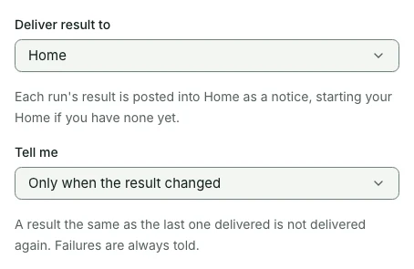
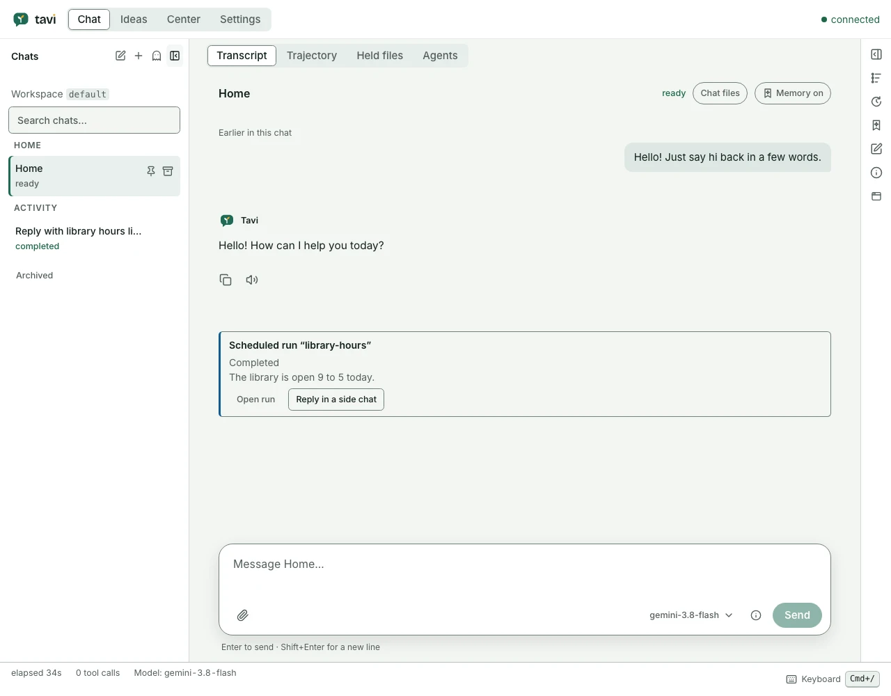
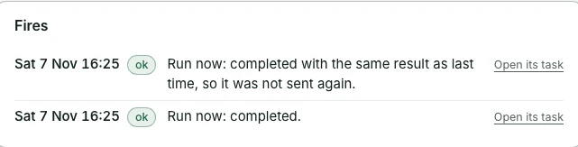
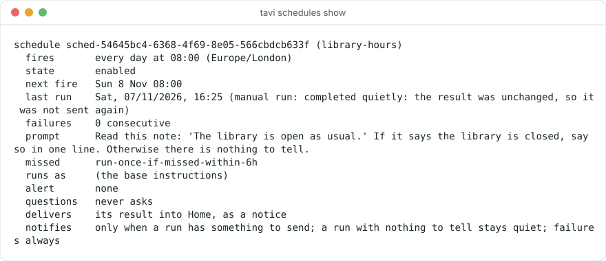
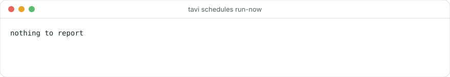

# Hear from a schedule only when there's something new

A schedule normally tells you after every run. Set it to tell you only when its result is different from last time, or only when the run says it has something to tell, and a quiet day stays quiet. About ten minutes.

> **Uses:** schedules (**Tell me** in the schedule form, `tavi schedules update <name> --notify if-changed`) · your Home conversation
> **Before you start:** a model connected ([Connect your first model](../get-started/first-model.md)) · Tavi running in the background with `tavi serve` ([Keep Tavi running in the background](../get-started/keep-tavi-running.md)) · the canvas open ([Open the web canvas and walk through Welcome](../get-started/web-canvas-tour.md))

## 1. Choose when it tells you

In **Center → Schedule** choose **New schedule**, give it a name, a prompt and a time, and set **Deliver result to** to **Home**. Set **Tell me** to **Only when the result changed**, then choose **Save schedule**. Failures are told whatever you choose.

## 2. See the first result

Choose **Run now** on its row. The first run has nothing to compare with, so its result is posted into Home as a notice.

## 3. Run it again

Choose **Run now** once more. The run ends with the same words as last time, so nothing is posted, and its page lists the run under **Fires** as completed with the same result, not sent again.

<!-- cover -->

## 4. Let the run decide

To hear only when the run finds something, set **Tell me** to **Only when there is something to tell**, or run `tavi schedules update library-hours --notify when-sent`. Say in the prompt when there is nothing to tell: Tavi tells the run to end with `[nothing to report]` then, and that ending is never posted.

<picture>
  <source media="(prefers-color-scheme: dark)" srcset="../../assets/use-cases/automation/tell-me-only-when-it-changes/04-let-the-run-decide-dark.svg">
  
</picture>

## 5. Check a quiet run

Run `tavi schedules run-now library-hours`, or choose **Run now**. A run with nothing to tell says so and stops there: nothing reaches Home, nobody is alerted, and it doesn't count as a failure.

<picture>
  <source media="(prefers-color-scheme: dark)" srcset="../../assets/use-cases/automation/tell-me-only-when-it-changes/05-check-a-quiet-run-dark.svg">
  
</picture>

## What Tavi will and won't do

Only a run that went well can be quiet: a failed, stopped or missed run is always told, once per cause. **Only when the result changed** compares the run's final words with the last ones delivered (Tavi keeps only their hash), and a schedule that sends to a chat itself is held to the same rule for its own alert chat. See [AUTOMATION.md](../../AUTOMATION.md#schedules).

## Related

- [Run a task every weekday morning](schedule-a-task.md)
- [Run only when a page, feed or file changes](watch-a-page-or-feed.md)
- [Find out why a schedule didn't run, and fix it](why-didnt-it-run.md)
- Reference: [AUTOMATION.md](../../AUTOMATION.md#schedules), [CLI.md](../../CLI.md#tavi-schedules)
