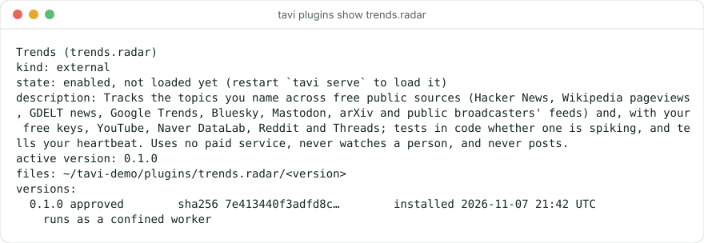
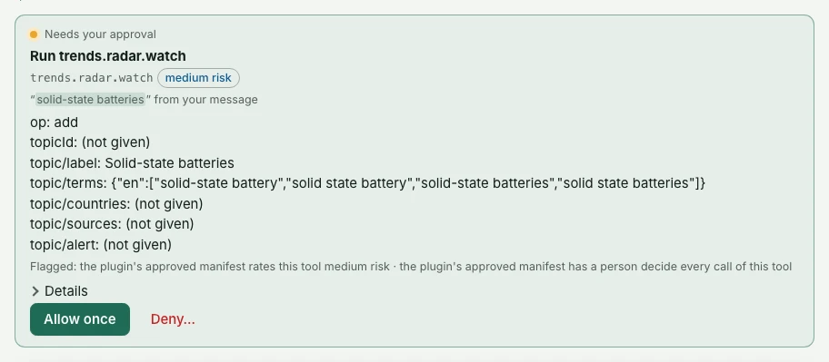
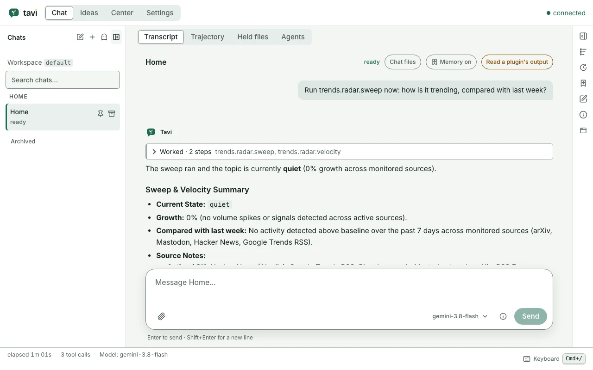
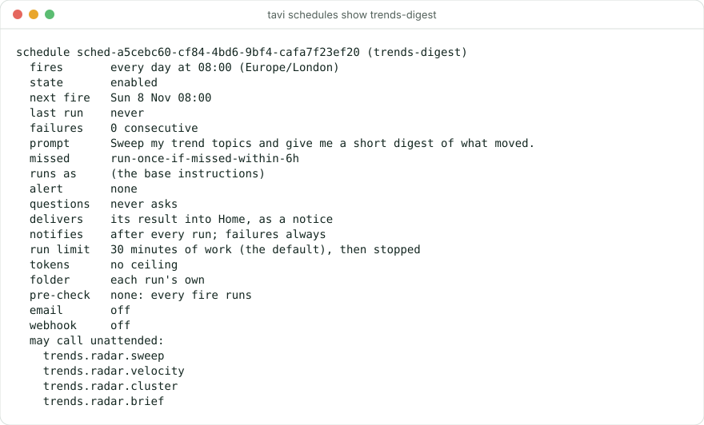

# Track a trend over weeks

Name a topic and let Tavi follow how much it is talked about across free public sources (Hacker News, GDELT news, Bluesky, Mastodon, arXiv and others), then get a digest of it every morning. About ten minutes, then a minute a day to read the digest.

> **Uses:** the Trends app (`trends.radar.watch`, `trends.radar.sweep`, `trends.radar.compare`) · a morning schedule · your Home conversation
> **Before you start:** a model connected ([Connect your first model](../get-started/first-model.md)) · Tavi running in the background with `tavi serve` ([Keep Tavi running in the background](../get-started/keep-tavi-running.md)) · the canvas open ([Open the web canvas and walk through Welcome](../get-started/web-canvas-tour.md)) · the Trends plugin built from the repository with `pnpm --filter @tavi/plugin-trends build`

## 1. Add the Trends app

Run `tavi plugins install packages/external/trends/dist-plugin`, then `tavi plugins approve trends.radar 0.1.1` and `tavi plugins enable trends.radar`, and restart `tavi serve`. `tavi plugins show trends.radar` lists the sites it may read and its tools; it uses no paid service and never posts.

<picture>
  <source media="(prefers-color-scheme: dark)" srcset="../../assets/use-cases/automation/trend-routine/01-add-the-trends-app-dark.svg">
  
</picture>

## 2. Name a topic to watch

In a chat, ask for it, such as `Use trends.radar.watch to start watching the topic solid-state batteries.` Tavi asks before it saves a topic: the card shows its label, the words it searches for, and when it counts as spiking. Choose **Allow once**.

<!-- cover -->

## 3. See how it is moving

Ask `Run trends.radar.sweep now: how is it trending, compared with last week?` Tavi reads the sources for your topic, tests whether it is spiking against its usual level, and answers with the numbers its tests computed. The more days it has watched, the more it can compare: counts are kept 35 days by the hour and 400 days by the day.

## 4. Get a digest every morning

Make a schedule that sweeps your topics each morning and posts what changed into Home, allowed to use the Trends app's reads without asking: `tavi schedules add --name trends-digest --at 08:00 --timezone Europe/London --allow trends.radar.sweep,trends.radar.velocity,trends.radar.cluster,trends.radar.brief --deliver-to home --prompt "Sweep my trend topics and give me a short digest of what moved."`. `tavi schedules show trends-digest` reads it back.

<picture>
  <source media="(prefers-color-scheme: dark)" srcset="../../assets/use-cases/automation/trend-routine/04-get-a-digest-every-morning-dark.svg">
  
</picture>

## What Tavi will and won't do

The Trends app only reads public sources, through a confined worker that can reach only the sites it lists, and it never watches a person: a handle or an author's name is refused as a topic. Saving or removing a topic always asks you. What the sources say is treated as untrusted text, so a digest built from it can't make Tavi send or change anything without asking. See [TRENDS.md](../../TRENDS.md).

## Related

- [Follow a topic with a research routine](research-routine.md)
- [Run a task every weekday morning](schedule-a-task.md)
- [See every upcoming reminder, routine and schedule](see-whats-coming-up.md)
- Reference: [TRENDS.md](../../TRENDS.md), [AUTOMATION.md](../../AUTOMATION.md#schedules)
