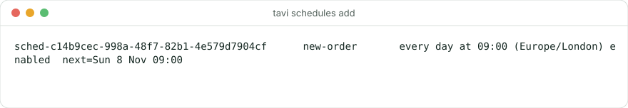
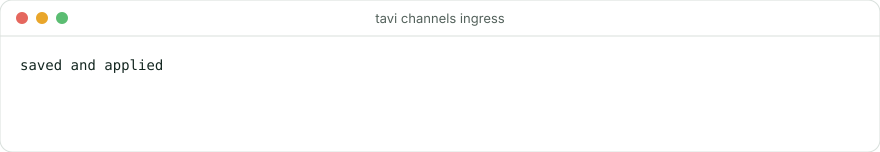
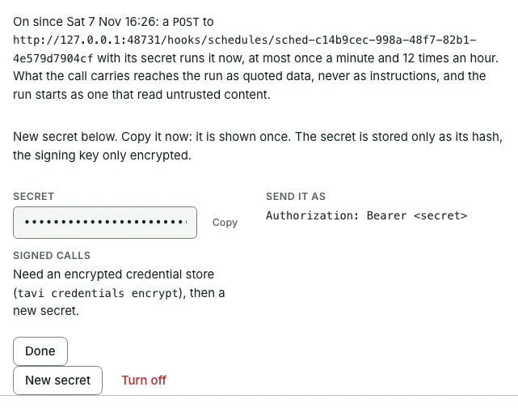
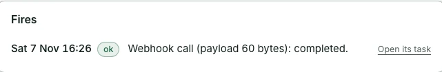
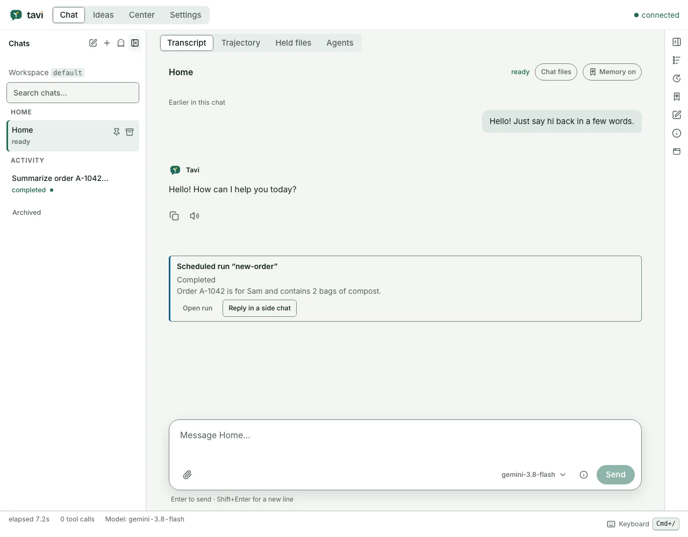
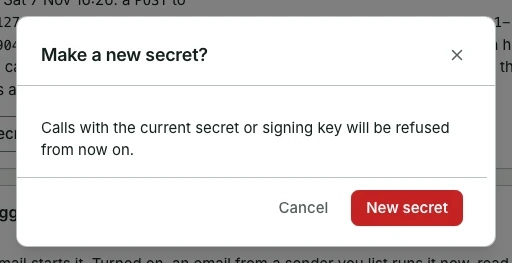

# Start a schedule from a webhook

Let another program start a schedule the moment something happens, such as a shop sending a new order, by calling the schedule's own webhook with its secret. What the call carries reaches the run as data to read, never as instructions. About ten minutes.

> **Uses:** schedules (`tavi schedules webhook <schedule> on`, **Webhook** on a schedule's page) · the webhook listener (`tavi channels ingress --port 48731`) · your Home conversation
> **Before you start:** a model connected ([Connect your first model](../get-started/first-model.md)) · Tavi running in the background with `tavi serve` ([Keep Tavi running in the background](../get-started/keep-tavi-running.md)) · the canvas open ([Open the web canvas and walk through Welcome](../get-started/web-canvas-tour.md))

## 1. Make the schedule

Make the schedule the call will start, saying in its prompt what to do with the data, for example `tavi schedules add --name new-order --at 09:00 --timezone Europe/London --deliver-to home --notify when-sent --prompt "…"`. Every schedule has a time as well; with `--notify when-sent`, a run at that time with no order to read tells you nothing.

<picture>
  <source media="(prefers-color-scheme: dark)" srcset="../../assets/use-cases/automation/trigger-from-a-webhook/01-make-the-schedule-dark.svg">
  
</picture>

## 2. Choose a port for the listener

Webhooks are answered by Tavi's webhook listener, on this computer only (`127.0.0.1`). Pick a free port with `tavi channels ingress --port 48731`; nothing outside your computer can reach it until you put a reverse proxy or tunnel in front of it.

<picture>
  <source media="(prefers-color-scheme: dark)" srcset="../../assets/use-cases/automation/trigger-from-a-webhook/02-choose-a-port-for-the-listener-dark.svg">
  
</picture>

## 3. Turn on its webhook

Open the schedule's page from **Center → Schedule** and choose **Turn on** under **Webhook**. Copy the secret now: it is shown once, and Tavi keeps only its hash. The section gives the address to call, `http://127.0.0.1:48731/hooks/schedules/<schedule-id>` while the listener is reached only from this computer. `tavi schedules webhook new-order on` does the same in the terminal.

## 4. Call it

From the other program, send a `POST` to the listener with the secret, for example `curl -X POST http://127.0.0.1:48731/hooks/schedules/<schedule-id> -H "Authorization: Bearer <secret>" -H "Content-Type: application/json" -d '{"order":"A-1042","for":"Sam","items":["2 bags of compost"]}'`. Tavi answers `202` and starts the run; **Fires** lists it as a webhook call with the size of what it carried.

<!-- cover -->

## 5. Read the result in Home

Open **Chat → Home**: the run's result is there as a notice, linked to its task. The run started as one that read untrusted content, so anything it does after that which would send data out or change something lasting is refused.

## 6. Make a new secret when you need one

If the secret may have leaked, choose **New secret** (or run `tavi schedules webhook new-order rotate`) and give the other program the new one: calls with the old secret are refused from then on. **Turn off** removes the webhook altogether.

## What Tavi will and won't do

A webhook is off until you turn it on, and only a person can: a chat has no tool for it. A call without the right secret gets `401` and no detail, and too many bad calls from one address are turned away. A good call starts at most one run a minute and 12 an hour, carries at most 8 KiB, and a run it starts stops past 250,000 tokens unless you set the schedule's own ceiling. To sign calls instead of sending the secret, see [AUTOMATION.md](../../AUTOMATION.md#schedules); to expose the listener safely, [OPERATIONS.md](../../OPERATIONS.md#a-schedules-webhook).

## Related

- [Run a task every weekday morning](schedule-a-task.md)
- [Cap what a schedule or routine may spend](cap-what-it-spends.md)
- [Find out why a schedule didn't run, and fix it](why-didnt-it-run.md)
- Reference: [AUTOMATION.md](../../AUTOMATION.md#schedules), [OPERATIONS.md](../../OPERATIONS.md#a-schedules-webhook), [CLI.md](../../CLI.md#tavi-schedules)
