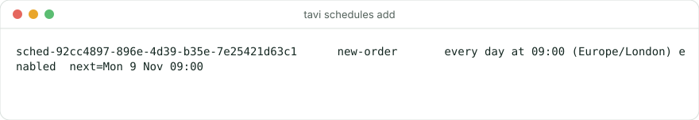
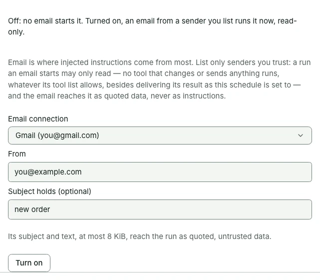
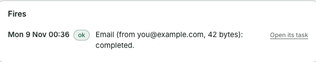
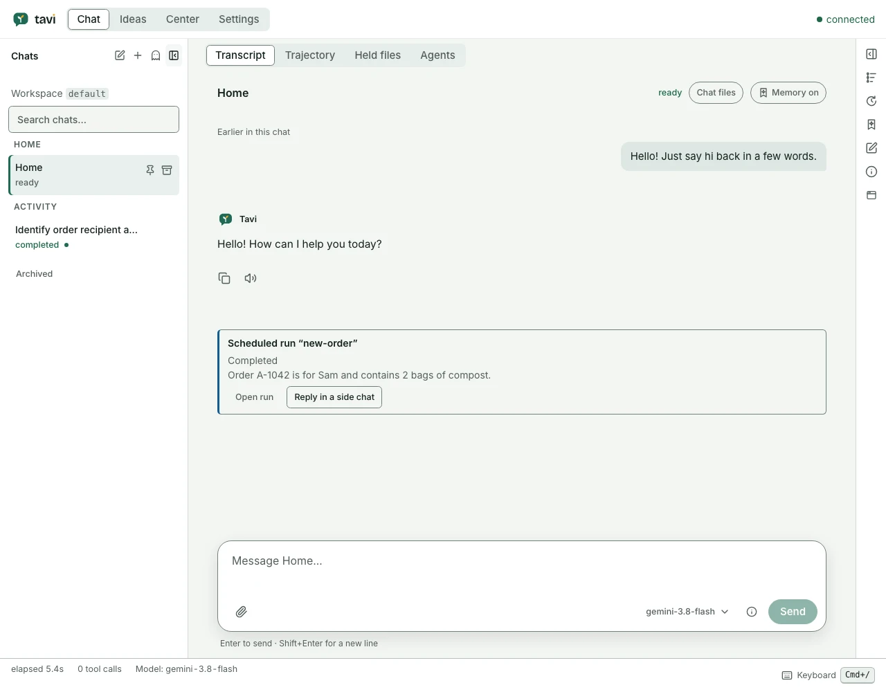
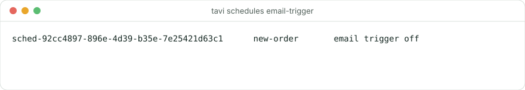

# Start a schedule from an email

Run a schedule the moment a particular email arrives, such as an order confirmation from your shop, without opening Tavi. Only senders you list can start it, and the run may only read: an email can never make it change or send anything else. About ten minutes.

> **Uses:** schedules (`tavi schedules email-trigger <schedule> on --connection <id> --from you@example.com`, **Email trigger** on a schedule's page) · the Gmail channel · your Home conversation
> **Before you start:** a model connected ([Connect your first model](../get-started/first-model.md)) · Tavi running in the background with `tavi serve` ([Keep Tavi running in the background](../get-started/keep-tavi-running.md)) · the canvas open ([Open the web canvas and walk through Welcome](../get-started/web-canvas-tour.md)) · a Gmail connection reading its label ([Talk to Tavi by Gmail](../channels/email-gmail.md)); email through Mailgun works the same

## 1. Make the schedule

Make the schedule the email will start, saying in its prompt what to do with the email, for example `tavi schedules add --name new-order --at 09:00 --timezone Europe/London --deliver-to home --notify when-sent --prompt "…"`. Every schedule has a time as well; with `--notify when-sent`, a run at that time with no email to read tells you nothing.

<picture>
  <source media="(prefers-color-scheme: dark)" srcset="../../assets/use-cases/automation/trigger-from-email/01-make-the-schedule-dark.svg">
  
</picture>

## 2. Turn on its email trigger

Open the schedule's page from **Center → Schedule** and choose **Set up** under **Email trigger**. Pick the email connection, list who may start it in **From** (exact addresses, or `@yourshop.example` for a whole domain of your own), and, if you like, words its subject must hold, such as `new order`. Choose **Turn on**. `tavi schedules email-trigger new-order on --connection <id> --from you@example.com --subject "new order"` does the same.

## 3. Send it an email

From a listed address, send an email the connection reads (for Gmail, one carrying its label), with the subject words, such as `New order A-1042` and the text `2 bags of compost for Sam`. Within a minute **Fires** lists an email fire, naming the sender and the size of what it carried. That email is the trigger's alone: it never also becomes a chat.

<!-- cover -->

## 4. Read the result in Home

Open **Chat → Home**: the run's result is there as a notice, linked to its task. The email reached the run as quoted data, never as instructions, so the run could read and summarise but not send, write or fetch anything.

## 5. Turn it off

Run `tavi schedules email-trigger new-order off`, or choose **Turn off** under **Email trigger**. Mail from its senders is then handled as any other message again.

<picture>
  <source media="(prefers-color-scheme: dark)" srcset="../../assets/use-cases/automation/trigger-from-email/05-turn-it-off-dark.svg">
  
</picture>

## What Tavi will and won't do

An email trigger is off until you turn it on, and only a person can: a chat has no tool for it. It listens only on a channel that checks each sender (Gmail, Mailgun), and fires only when the channel verified the sender's domain, which proves the domain, not the person; a whole public domain such as `@gmail.com` is refused. A run it starts is read-only, at most one a minute and 12 an hour, and its email is at most 8 KiB. See [AUTOMATION.md](../../AUTOMATION.md#schedules).

## Related

- [Start a schedule from a webhook](trigger-from-a-webhook.md)
- [Run a task every weekday morning](schedule-a-task.md)
- [Talk to Tavi by Gmail](../channels/email-gmail.md)
- Reference: [AUTOMATION.md](../../AUTOMATION.md#schedules), [CLI.md](../../CLI.md#tavi-schedules)
