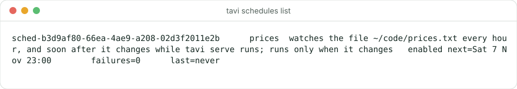
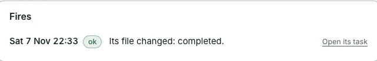
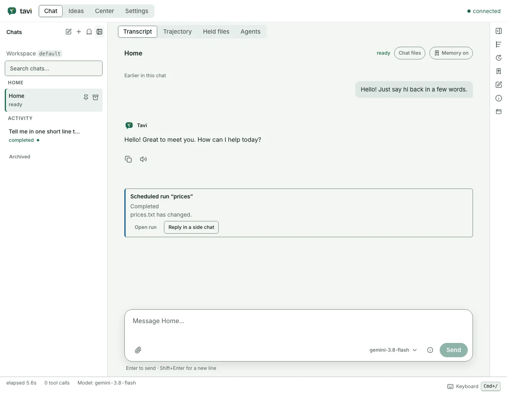
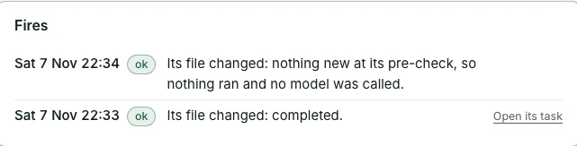
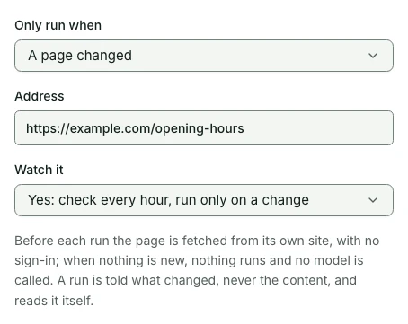
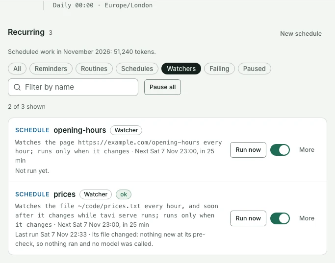

# Run only when a page, feed or file changes

Make a watcher: a schedule that looks at a file, a web page or a feed every hour and runs its prompt only when something there is new. A look that finds nothing new calls no model, so watching costs nothing until there is something to read. About ten minutes.

> **Uses:** watchers (`tavi schedules list`, **Only run when** and **Watch it** in the schedule form) · pre-checks · your Home conversation
> **Before you start:** a model connected ([Connect your first model](../get-started/first-model.md)) · Tavi running in the background with `tavi serve`, started with `--fs-root` naming the folder that holds the file ([Keep Tavi running in the background](../get-started/keep-tavi-running.md)) · the canvas open ([Open the web canvas and walk through Welcome](../get-started/web-canvas-tour.md))

## 1. Watch a file

Run `tavi schedules watch prices --file ~/shop/prices.txt --folder ~/shop --prompt "…" --deliver-to home`, naming a file inside one of the owner's `--fs-root` folders, its folder with `--folder` so each run can read it, and saying in the prompt what to tell you when it changes. `tavi schedules list` then says what it watches in place of a time.

<picture>
  <source media="(prefers-color-scheme: dark)" srcset="../../assets/use-cases/automation/watch-a-page-or-feed/01-watch-a-file-dark.svg">
  
</picture>

## 2. Change the file

Edit the file and save it. While `tavi serve` runs, the watcher looks about 30 seconds after the last change and runs its prompt when the file differs from its last look (the first look, with nothing to compare, always runs); its page in **Center → Schedule** lists the run under **Fires**.

<!-- cover -->

## 3. Hear about it in Home

Open **Chat → Home**. The run's result is there as a notice, linked to its task. The run is told which file changed and reads it in the folder you gave it with `--folder`, so it can say what changed.

## 4. Save it without a change

Save the file again with the same content. The watcher looks, finds nothing new, and records that nothing ran and no model was called. The hourly look does the same, so a file that never changes never costs a model call.

## 5. Watch a page or a feed

In **Center → Schedule** choose **New schedule**, give it a name and a prompt, set **Only run when** to **A page changed** (or **A feed has new items**) with its `https://` address, and set **Watch it** to **Yes: check every hour**. Choose **Save schedule**. The page's readable text is fetched from its own site with no sign-in; a feed runs only for an item it hasn't seen.

## 6. Find your watchers

Under **Recurring**, choose **Watchers**: each row carries a **Watcher** badge and says what it watches. **Pause**, **Run now** and **More** work as for any schedule.

## What Tavi will and won't do

A watcher only reads: the look is a fetch or a file read, and the run it starts has only the tools its allow list names. A model runs at most once an hour on its cadence, and a file change starts at most one run a minute and 12 an hour. A page or feed is read only where the site profiles allow an unattended read, and a file only inside the `--fs-root` folders. Three failed runs in a row pause it. Only a person makes a watcher: a chat can read one back but not create one. See [AUTOMATION.md](../../AUTOMATION.md#schedules).

## Related

- [Hear from a schedule only when there's something new](tell-me-only-when-it-changes.md)
- [Run a task every weekday morning](schedule-a-task.md)
- [Find out why a schedule didn't run, and fix it](why-didnt-it-run.md)
- Reference: [AUTOMATION.md](../../AUTOMATION.md#schedules), [CLI.md](../../CLI.md#tavi-schedules), [WEB-UI.md](../../WEB-UI.md#schedule)
