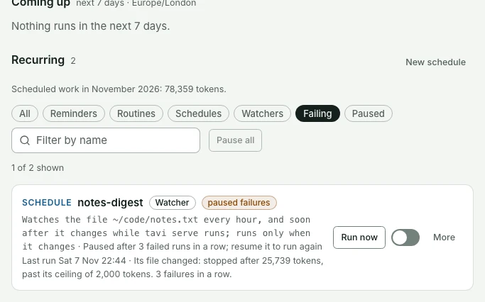
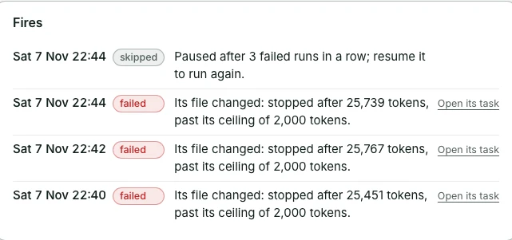
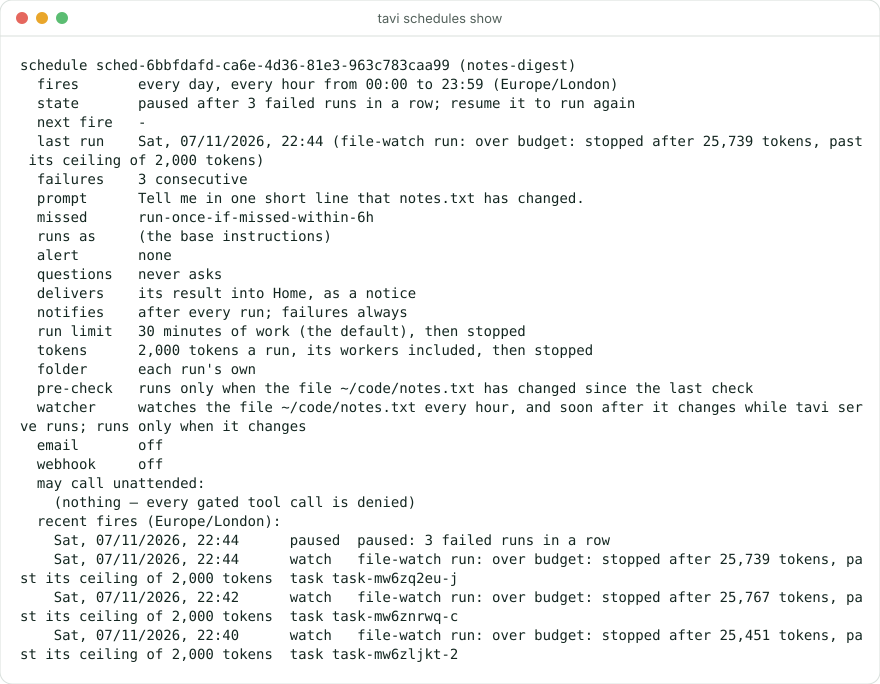
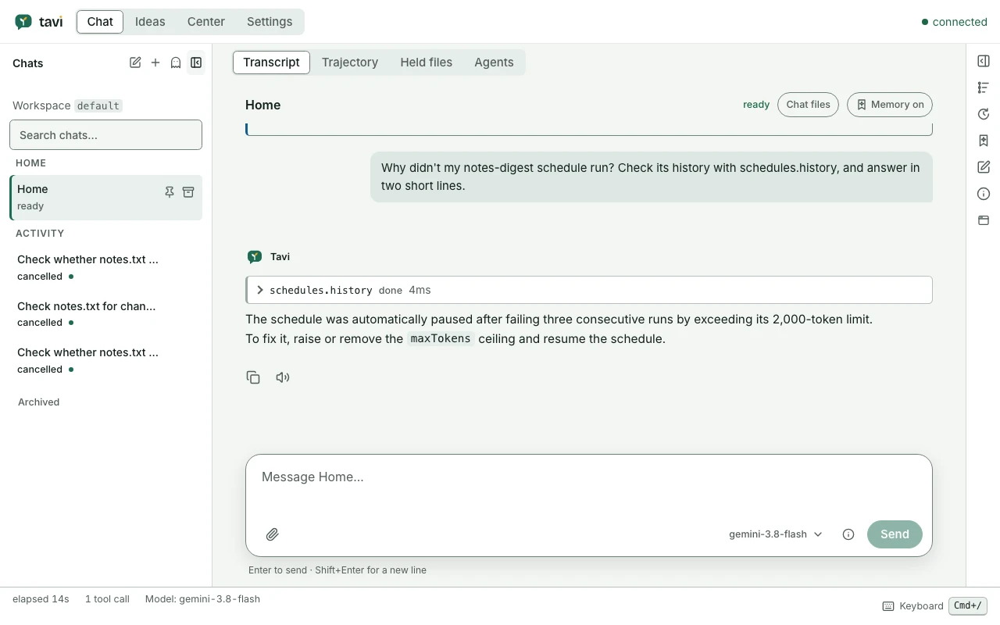
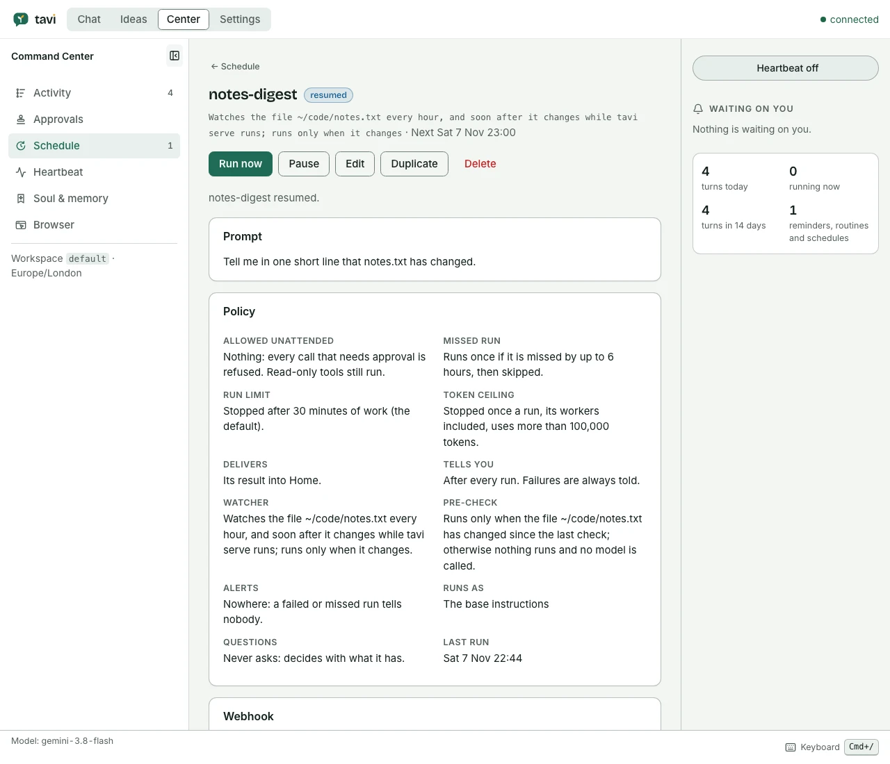

# Find out why a schedule didn't run, and fix it

When a schedule goes quiet, its fire history says why: each time it was due, what happened, and the task of any run. Read it in the canvas, the terminal or by asking in a chat, fix the cause, and resume it. About five minutes.

> **Uses:** schedules' fire history (**Fires** on a schedule's page, `tavi schedules show <name>`, the `schedules.history` tool) · **Center → Schedule**
> **Before you start:** a model connected ([Connect your first model](../get-started/first-model.md)) · Tavi running in the background with `tavi serve` ([Keep Tavi running in the background](../get-started/keep-tavi-running.md)) · a schedule that has stopped telling you things ([Run a task every weekday morning](schedule-a-task.md)) · the canvas open ([Open the web canvas and walk through Welcome](../get-started/web-canvas-tour.md))

## 1. Find the failing schedule

Open **Center → Schedule** and choose **Failing** above the **Recurring** rows. A schedule whose runs failed three times in a row has stopped itself: its badge says **paused failures**, and the line under its name says how its last run went.

## 2. Read its fires

Choose its name. Under **Fires**, each row is one time it was due, newest first, with what happened in a sentence and **Open its task** for any run. Here every run was stopped past its token ceiling, and the third failure paused it. Other causes read the same way: **Missed: Tavi was not running at the time.**, **Skipped: the previous run was still going.**, a pre-check that could not be made, or a provider error with the time of its retry.

<!-- cover -->

## 3. Read it in the terminal

`tavi schedules show notes-digest` prints its state, its policy and its ten most recent fires, each with what started it or why it ended so (`watch`, `missed`, `overlap`, `paused` and the rest) and what happened; `tavi schedules list` says `paused:failures` and `failures=3`.

<picture>
  <source media="(prefers-color-scheme: dark)" srcset="../../assets/use-cases/automation/why-didnt-it-run/03-read-it-in-the-terminal-dark.svg">
  
</picture>

## 4. Or ask in a chat

In Home, ask, for example, *Why didn't my notes-digest schedule run? Check its history.* Tavi reads the same history with `schedules.history` and answers from it; a failed run is named by its task rather than quoted.

## 5. Fix the cause and resume

Fix what the fires named: here, raise the ceiling with `tavi schedules update notes-digest --max-tokens 100000` (or **Edit** on its page). Then choose **Resume** on its page, or run `tavi schedules enable notes-digest`. Resuming clears the failure count, so it gets three more tries; its badge says **resumed** until the next run.

## What Tavi will and won't do

A run that fails is told to you once, in its alert chat or in Home, and three in a row pause the schedule so it stops spending. A run that failed on a provider's rate limit or outage, having done nothing, is tried again after 2, 10 and 30 minutes, and doesn't count as a failure. A run missed while Tavi wasn't running is caught up once if it is less than six hours late, and its prompt says it is late. See [AUTOMATION.md](../../AUTOMATION.md#schedules).

## Related

- [Cap what a schedule or routine may spend](cap-what-it-spends.md)
- [See every upcoming reminder, routine and schedule](see-whats-coming-up.md)
- [Run only when a page, feed or file changes](watch-a-page-or-feed.md)
- Reference: [AUTOMATION.md](../../AUTOMATION.md#schedules), [CLI.md](../../CLI.md#tavi-schedules), [WEB-UI.md](../../WEB-UI.md#schedule)
