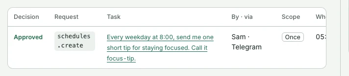
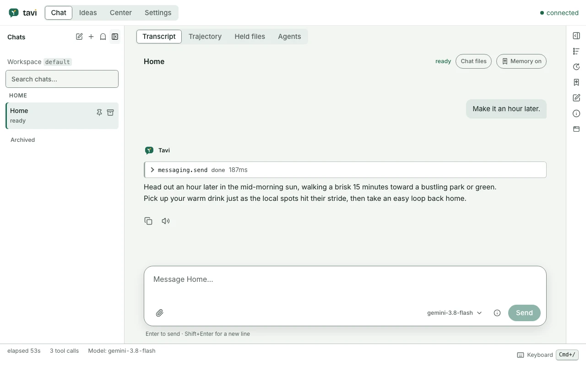
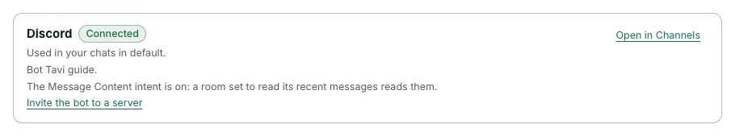
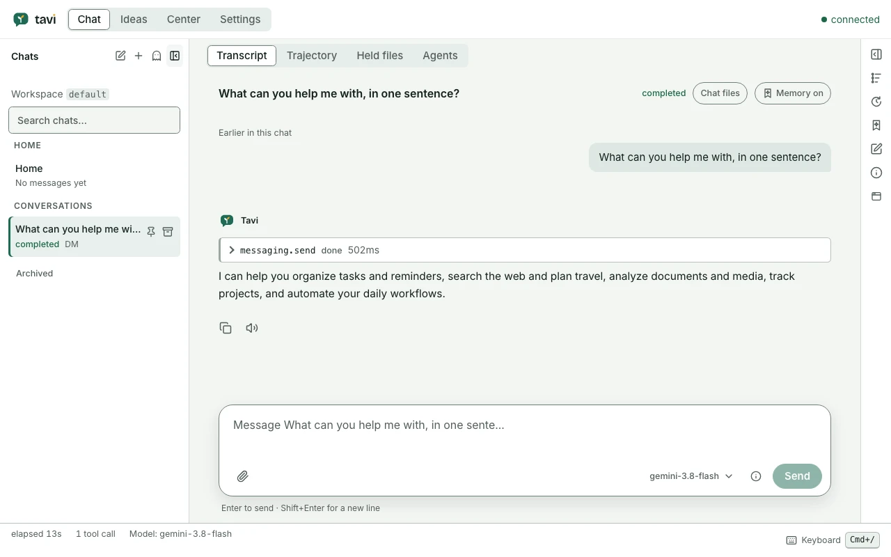
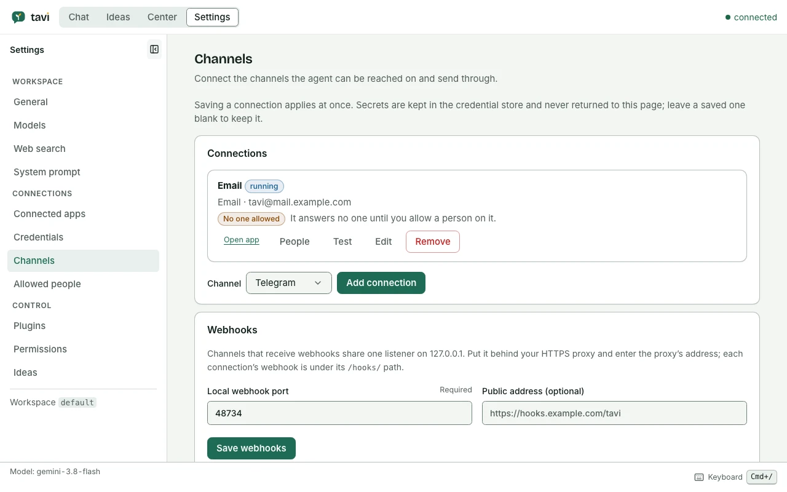
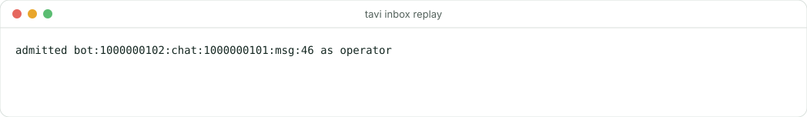
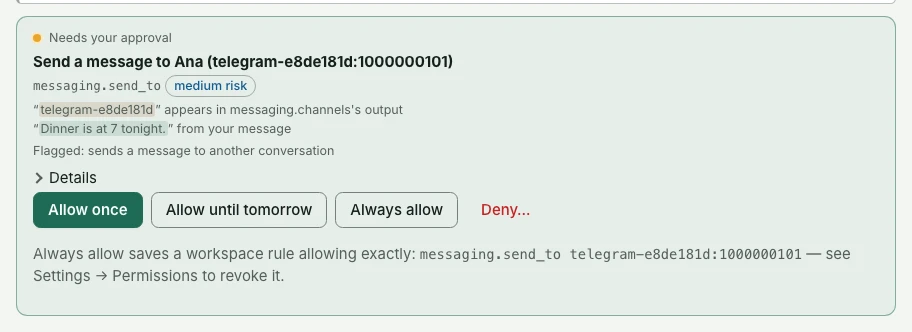
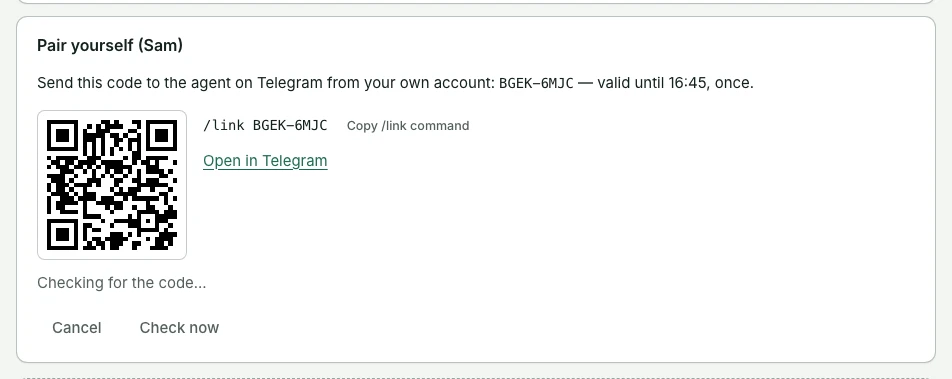
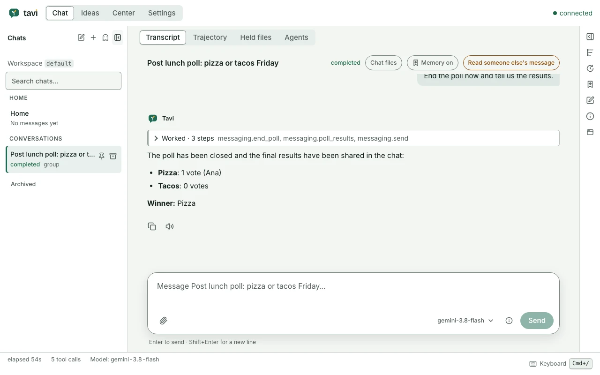

<!-- Generated by scripts/docs/guide-indexes.mjs from the guides: edit the guides, not this file. -->

# Channels

Telegram, email and Discord, and who may talk to Tavi.

| | Guide |
| :--- | :--- |
|  | [Approve actions from your phone](approve-from-your-phone.md) When a chat you started in Telegram wants to change something, the approval comes to that chat with buttons: allow it once, for the day, always, or deny it with a reason, without going back to your computer. |
|  | [Continue a Home conversation on your phone](continue-on-your-phone.md) Start something in Home at your computer and carry on from your phone: link your own Telegram chat with the bot to Home, so both are one conversation. |
|  | [Add Tavi to a Discord server](discord-rooms.md) Talk to Tavi in Discord, in a DM with a bot of your own and in the server channels you choose. |
|  | [Talk to Tavi by Gmail](email-gmail.md) Email Tavi from anywhere and get its answer in the same thread, through your own Gmail account. |
|  | [Talk to Tavi by email through Mailgun](email-mailgun.md) Give Tavi an email address of its own on your domain, such as `tavi@mail.example.com`, through your Mailgun account: email it from anywhere and it answers from that address. |
|  | [Let in a message Tavi held back](held-messages.md) When someone you haven't allowed yet writes to your bot, Tavi keeps the message and doesn't answer. |
|  | [Ask Tavi to message someone by name](message-someone-by-name.md) Say who to message the way you'd say it to a person, `Send Ana a message…`, and Tavi finds Ana's chat from the people you allowed, shows you exactly where it will go, and sends it once you agree. |
|  | [Connect a Telegram bot](pair-telegram.md) Talk to Tavi from Telegram through a bot of your own: add the bot from a terminal, pair your account with a one-time code, and say hello. |
|  | [Run a poll in a group and wait for the answers](run-a-poll.md) Ask Tavi in a Discord room to put a question to everyone, then have it read the votes back: who chose what, as far as Tavi knows them. |

[All how-to guides](../README.md)
