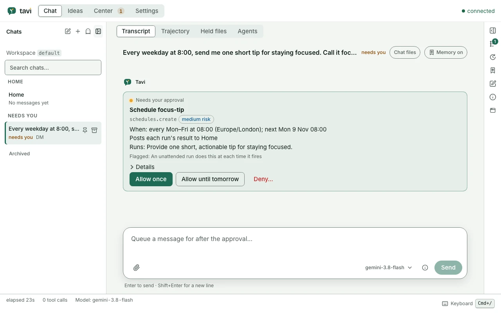
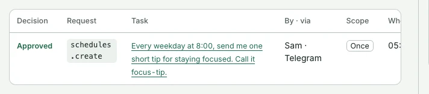
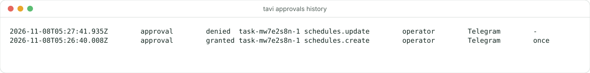
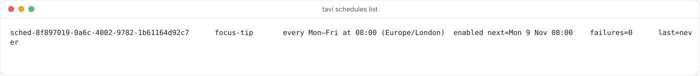

# Approve actions from your phone

When a chat you started in Telegram wants to change something, the approval comes to that chat with buttons: allow it once, for the day, always, or deny it with a reason, without going back to your computer. By email it works the same way, by reply or a link ([CHANNELS.md](../../CHANNELS.md#questions-and-approvals-by-email)). About five minutes.

> **Uses:** approvals in the chat a task came from · channels (Telegram) · schedules (`schedules.create`, `schedules.update`) · `tavi approvals history`
> **Before you start:** a model connected ([Connect your first model](../get-started/first-model.md)) · your Telegram bot, paired to you ([Connect a Telegram bot](pair-telegram.md)) · the canvas open ([Open the web canvas and walk through Welcome](../get-started/web-canvas-tour.md))

## 1. Ask for something from your phone

In Telegram, ask your bot for something that changes what Tavi does, such as `Every weekday at 8:00, send me one short tip for staying focused. Call it focus-tip.` Before anything is saved, Tavi sends the approval to your chat: what it would do, a short token, and the buttons **Once**, **Session**, **Always** (when offered) and **Deny**. The same card shows in the canvas, in that conversation, so either place can decide it.

## 2. Approve it with a button

Tap **Once**. The schedule is saved, the card loses its buttons and says who decided it, where and when, and Tavi carries on in the chat. Typing `approve` does the same; `approve <token> session` or `approve <token> always` widens it.

<!-- cover -->

## 3. Deny one with a reason

Ask for a change, such as `Move focus-tip to 7:30.`, and tap **Deny** on its card. Tavi asks why: your next message is the reason the model reads (`-` for none), and with no reply in two minutes it's denied without one. Typing `reject <token> keep it at 8` does it in one go. The reason is kept with the decision: `tavi approvals show <task-id>` shows it beside the denied call.

<picture>
  <source media="(prefers-color-scheme: dark)" srcset="../../assets/use-cases/channels/approve-from-your-phone/03-deny-one-with-a-reason-dark.svg">
  
</picture>

## 4. Check what was decided

**Center → Approvals** and `tavi approvals history` list every decision, with the channel it came through. `tavi schedules list` shows `focus-tip` saved at 8:00, unchanged by the denied move.

<picture>
  <source media="(prefers-color-scheme: dark)" srcset="../../assets/use-cases/channels/approve-from-your-phone/04-check-what-was-decided-dark.svg">
  
</picture>

## What Tavi will and won't do

Only you, the person the chat's task belongs to, can decide its approvals: a button press or an `approve` from anyone else counts for nothing. An approval nobody decides is denied after 24 hours, and the chat is told. A card that shows a link is sent with link previews off, so showing it fetches nothing. The details are in [SECURITY-MODEL.md](../../SECURITY-MODEL.md#approvals-in-the-chat-a-task-came-from).

## Related

- [Approve, reject or always-allow a tool call](../chat/approve-tool-calls.md)
- [Create, change, pause and cancel schedules from a chat](../automation/manage-schedules-by-chatting.md)
- [Continue a Home conversation on your phone](continue-on-your-phone.md)
- Reference: [SECURITY-MODEL.md](../../SECURITY-MODEL.md), [CHANNELS.md](../../CHANNELS.md)
