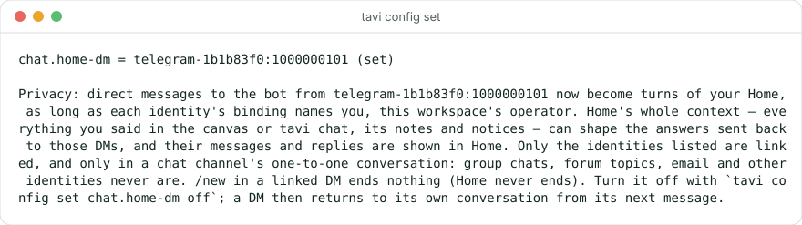
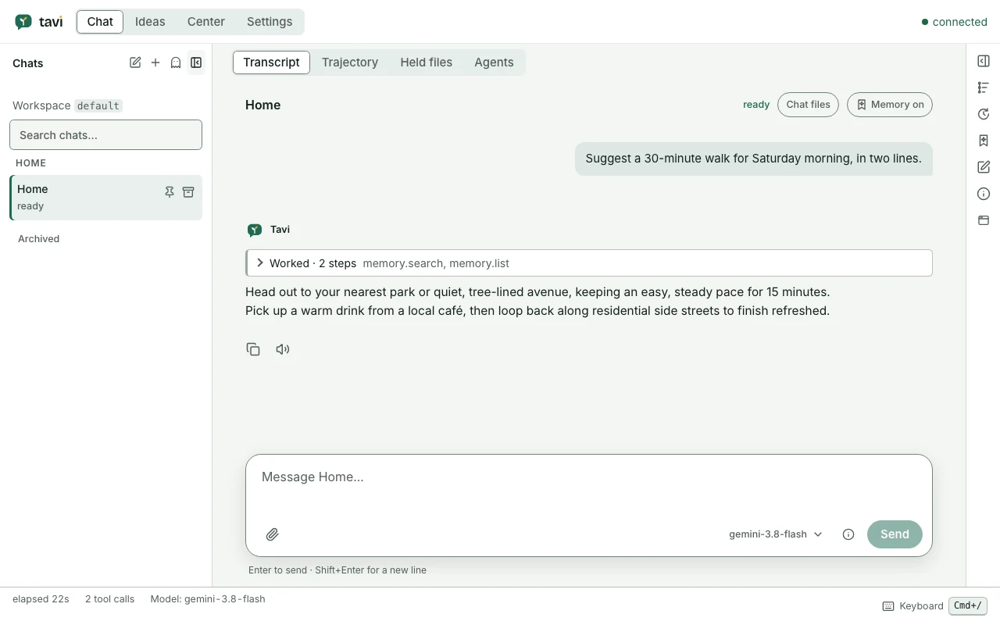
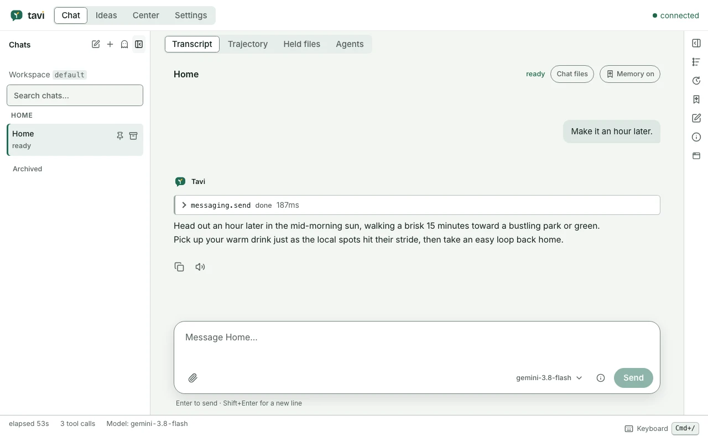
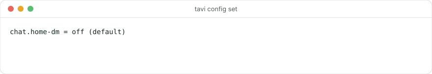

# Continue a Home conversation on your phone

Start something in Home at your computer and carry on from your phone: link your own Telegram chat with the bot to Home, so both are one conversation. About five minutes.

> **Uses:** your Home conversation · channels (Telegram) · the `chat.home-dm` setting (`tavi config get chat.home-dm`)
> **Before you start:** a model connected ([Connect your first model](../get-started/first-model.md)) · your Telegram bot, paired to you ([Connect a Telegram bot](pair-telegram.md)) · the canvas open ([Open the web canvas and walk through Welcome](../get-started/web-canvas-tour.md))

## 1. Link your chat with the bot to Home

Find your Telegram user ID with `tavi channels people telegram` (the second column, on your row), then run `tavi config set chat.home-dm <connection>:<user-id>`, with your bot's connection id from the first column. Tavi prints what linking means: Home's whole context can shape the answers sent to that chat, and its messages show in Home.

<picture>
  <source media="(prefers-color-scheme: dark)" srcset="../../assets/use-cases/channels/continue-on-your-phone/01-link-your-chat-with-the-bot-to-home-dark.svg">
  
</picture>

## 2. Start something in Home

In the canvas, ask Home for something you'll want to pick up later, such as `Suggest a 30-minute walk for Saturday morning, in two lines.`

## 3. Carry on from your phone

In Telegram, send your bot the follow-up, such as `Make it an hour later.` Tavi answers in Telegram, knowing what you asked in Home, and the turn shows in Home too, so your next message at the computer carries on from there.

<!-- cover -->

## 4. Unlink it

Run `tavi config set chat.home-dm off`. From your next message, the Telegram chat is a conversation of its own again, and Home stays as it was.

<picture>
  <source media="(prefers-color-scheme: dark)" srcset="../../assets/use-cases/channels/continue-on-your-phone/04-unlink-it-dark.svg">
  
</picture>

## What Tavi will and won't do

Only the Telegram accounts you list, paired to you, are linked, and only in their one-to-one chat with the bot: groups, forum topics and email never are. A turn from your phone can't write files or run code, and its questions and approvals are asked there; while Home waits for a decision, a new message from the phone is refused until you make it. `/new` in a linked chat ends nothing, since Home never ends. The details are in [CHANNELS.md](../../CHANNELS.md#conversations-and-tasks).

## Related

- [Pair your phone in two minutes (QR code)](../get-started/pair-your-phone.md)
- [Approve actions from your phone](approve-from-your-phone.md)
- Reference: [CHANNELS.md](../../CHANNELS.md), [CLI.md](../../CLI.md#tavi-config)
