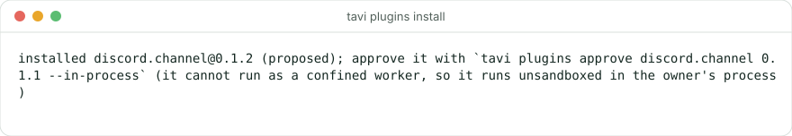
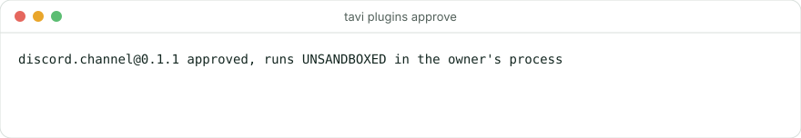
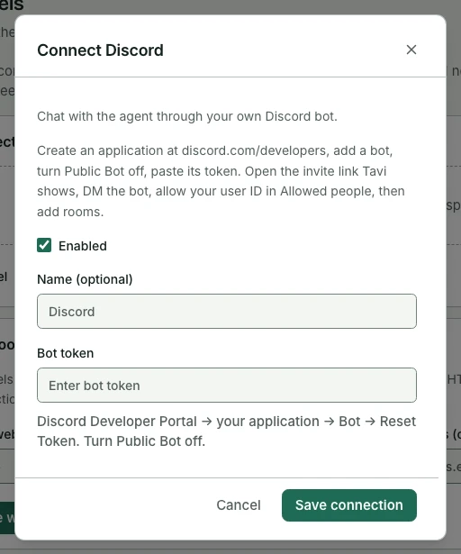
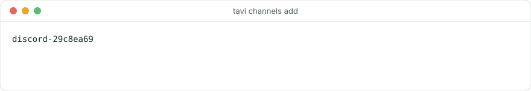
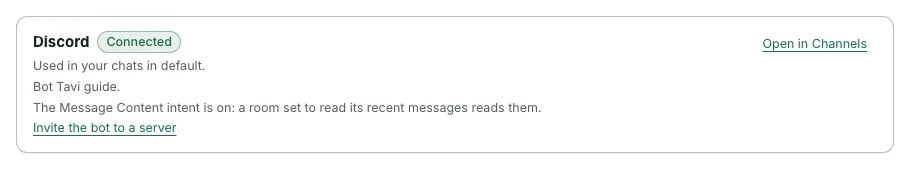
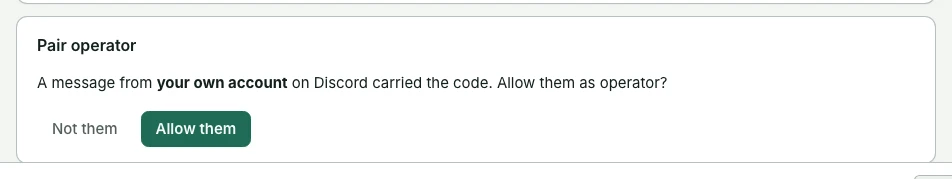
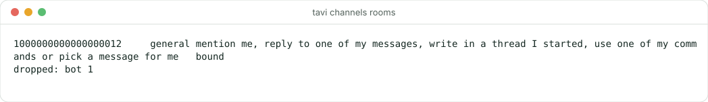
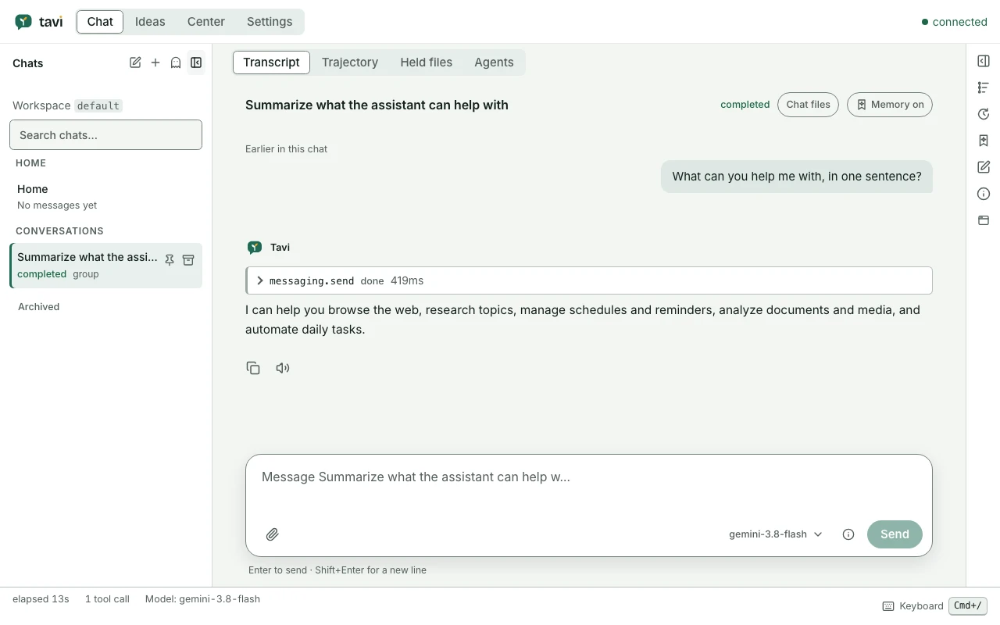

# Add Tavi to a Discord server

Talk to Tavi in Discord, in a DM with a bot of your own and in the server channels you choose. Tavi answers only the people you allow, and only when someone addresses it. About fifteen minutes.

> **Uses:** the Discord channel plugin (`discord.channel`, `tavi plugins show discord.channel`) · channels (`tavi channels add discord`, **Settings → Channels**) · rooms (`tavi channels rooms <connection>`) · **Settings → Allowed people**
> **Before you start:** a model connected ([Connect your first model](../get-started/first-model.md)) · Tavi running in the background with `tavi serve` ([Keep Tavi running in the background](../get-started/keep-tavi-running.md)) · the canvas open ([Open the web canvas and walk through Welcome](../get-started/web-canvas-tour.md)) · a clone of Tavi's repository with the plugin built (`pnpm --filter @tavi/plugin-discord build`) · a Discord account and a server where you may add bots, such as a test server of your own

## 1. Install the Discord plugin

Discord is a plugin built in Tavi's repository, installed like any other. From the clone, run `tavi plugins install packages/external/discord/dist-plugin`. It is installed as a proposed version: nothing of it runs until you approve it.

<picture>
  <source media="(prefers-color-scheme: dark)" srcset="../../assets/use-cases/channels/discord-rooms/01-install-the-discord-plugin-dark.svg">
  
</picture>

## 2. Approve it and turn it on

A channel cannot run as a sandboxed worker, so its approval must say so: run `tavi plugins approve discord.channel 0.1.3 --in-process`, then `tavi plugins enable discord.channel`, and restart `tavi serve` so it loads the plugin. `tavi plugins show discord.channel` lists the hosts it reaches, all Discord's own.

<picture>
  <source media="(prefers-color-scheme: dark)" srcset="../../assets/use-cases/channels/discord-rooms/02-approve-it-and-turn-it-on-dark.svg">
  
</picture>

## 3. Create your bot

Open the Discord Developer Portal (discord.com/developers), make a **New Application**, and under **Bot** turn **Public Bot** off and choose **Reset Token**. Save the token in a file only you can read, such as `discord-bot.token`. Tavi's own Discord form, under **Settings → Channels → Add connection**, says the same.

## 4. Add the bot to Tavi

Run `tavi channels add discord --secret-file token=discord-bot.token`. Tavi stores the token in its credential store, connects the bot and prints the connection's id, such as `discord-29c8ea69`.

<picture>
  <source media="(prefers-color-scheme: dark)" srcset="../../assets/use-cases/channels/discord-rooms/04-add-the-bot-to-tavi-dark.svg">
  
</picture>

## 5. Invite the bot to your server

Choose **Open app** on the Discord row of **Settings → Channels**: your bot's account has an **Invite the bot to a server** link (`tavi channels test <connection> --to <channel-id>` prints it too). Open it, pick your server and choose **Authorize**. It asks only for what Tavi uses: reading and sending messages, threads, files, polls and events.

<!-- cover -->

## 6. Allow yourself

Open **Settings → Allowed people**, pick the Discord connection, tick **This is me**, give a display name and choose **Pair with a code**. In Discord, send the code to your bot in a DM, then choose **Yes, it's me** when Tavi asks **Is this you?**

## 7. Add a room

Tavi listens only in the channels you list. In Discord, turn on **Developer Mode** (User Settings → Advanced), right-click the channel and choose **Copy Channel ID**, then run `tavi channels rooms <connection> add <channel-id> --label general`, with your connection's id from step 4. The bot posts one short introduction there: whose agent it is and how to address it.

<picture>
  <source media="(prefers-color-scheme: dark)" srcset="../../assets/use-cases/channels/discord-rooms/07-add-a-room-dark.svg">
  
</picture>

## 8. Mention the bot in the room

In that channel, write `@` and your bot's name, then your question, such as `@yourbot What can you help me with, in one sentence?`. Tavi answers in the room. Its chat is in the canvas under **Conversations**, marked `group`, and a DM with the bot is a chat of its own.

## What Tavi will and won't do

A room hears only a message that addresses the bot (a mention, a reply to it, one of its commands, a thread it started), and only from people you allowed: anyone else's message is dropped before anything of it is stored. What the room says is read as the people's words, never as yours, so a send or a change a room's chat asks for waits for your approval, which comes to your DM. Removing the connection erases what it brought in 24 hours later, as Discord's terms require. The details are in [CHANNELS.md](../../CHANNELS.md#discord) and [SECURITY-MODEL.md](../../SECURITY-MODEL.md#approvals-in-the-chat-a-task-came-from).

## Related

- [Run a poll in a group and wait for the answers](run-a-poll.md)
- [Install and enable a plugin](../extend/install-a-plugin.md)
- Reference: [CHANNELS.md](../../CHANNELS.md#discord), [CLI.md](../../CLI.md#tavi-channels)
