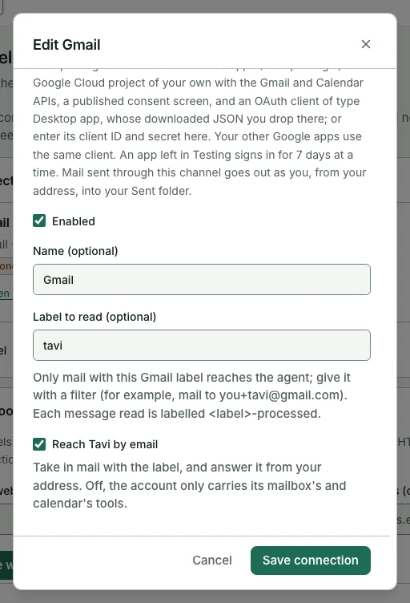
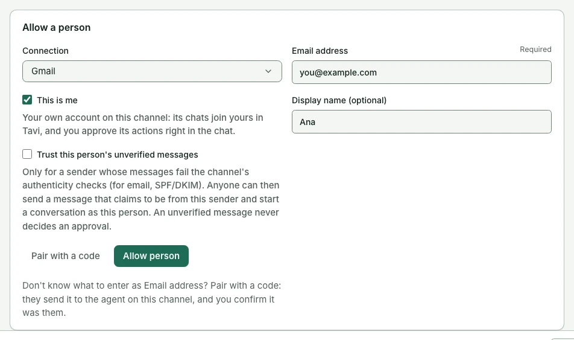
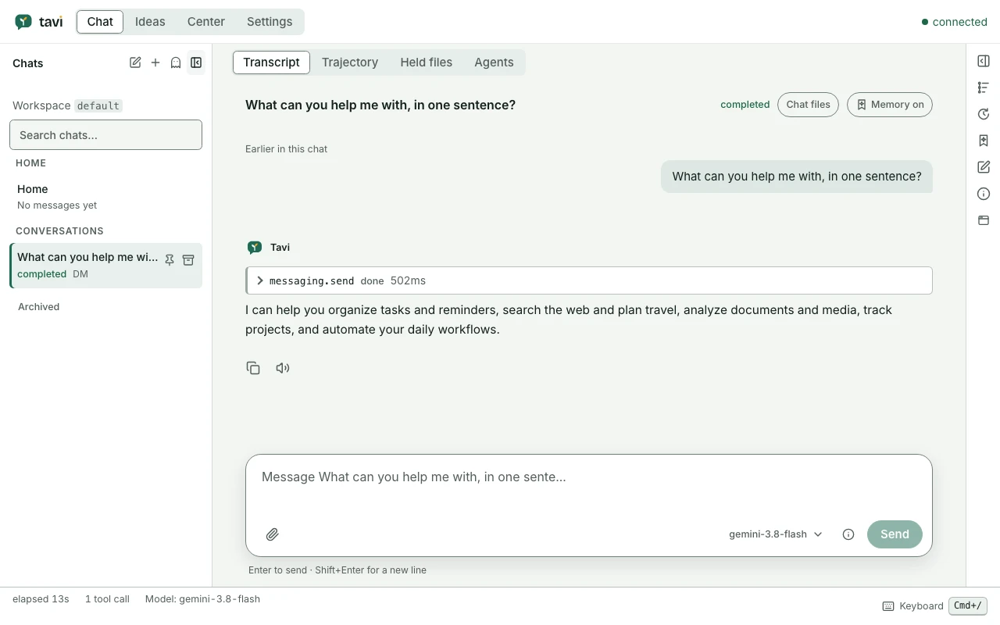
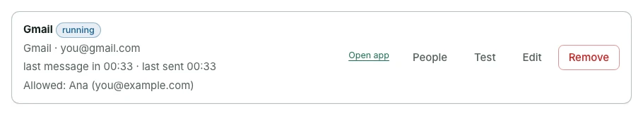

# Talk to Tavi by Gmail

Email Tavi from anywhere and get its answer in the same thread, through your own Gmail account. It reads only the mail you label for it, never the rest of your inbox. About ten minutes once Gmail is signed in.

> **Uses:** the Gmail channel (`tavi.gmail`, **Settings → Channels**) · **Settings → Allowed people**
> **Before you start:** a model connected ([Connect your first model](../get-started/first-model.md)) · Tavi running in the background with `tavi serve` ([Keep Tavi running in the background](../get-started/keep-tavi-running.md)) · a Google account added and signed in with **Reach Tavi through this account** ticked ([Connect Google Calendar](../connected-apps/connect-google-calendar.md), steps 1 to 5, leaving that box ticked)

## 1. Label the mail Tavi reads

As a channel, Gmail reads only mail carrying its label, `tavi` by default (**Label to read** under **Edit** on the Gmail row). In Gmail, make a filter for mail to your address with `+tavi` added, such as `you+tavi@gmail.com`, that applies the label `tavi`. Mail to that address still reaches you; Tavi labels each message it took `tavi-processed`.

## 2. Allow your own address

Open **Settings → Allowed people**, pick the Gmail connection, enter the address you write from, tick **This is me** and choose **Allow person**. Mail from anyone else is held, not read, and a message is admitted only when Google's own check shows your address's domain signed it.

## 3. Email Tavi

From your address, send an email to `you+tavi@gmail.com`, such as `What can you help me with, in one sentence?`. Within about 30 seconds Tavi reads it and answers in the same thread, `Re:` its subject. The thread is a chat of its own on the canvas.

<!-- cover -->

## 4. Check the connection

Open **Settings → Channels**. The Gmail row says which address it is connected as, when it last took a message in and when it last sent one, and why a send failed, if one did. **Disconnect**, under **Edit**, signs it out. Tavi's answers go out as you, from your address, and are in your Sent folder.

## What Tavi will and won't do

The channel reads only labelled mail, and only from people you allowed whose mail Google verified; everything else is held. Your own new words are the request: a quoted reply or a forwarded message is read as data, never as instructions. Anything it sends goes out as you, so a send to anyone other than the thread needs a destination you allowed. A question it asks arrives as an email you answer by replying ([CHANNELS.md](../../CHANNELS.md#questions-and-approvals-by-email)). Reading and drafting in the rest of your mailbox is a separate opt-in, off by default.

## Related

- [Talk to Tavi by email through Mailgun](email-mailgun.md)
- [Start a schedule from an email](../automation/trigger-from-email.md)
- [Let Tavi read (or send) your Gmail](../connected-apps/connect-gmail-app.md)
- Reference: [CHANNELS.md](../../CHANNELS.md), [CLI.md](../../CLI.md#tavi-channels)
